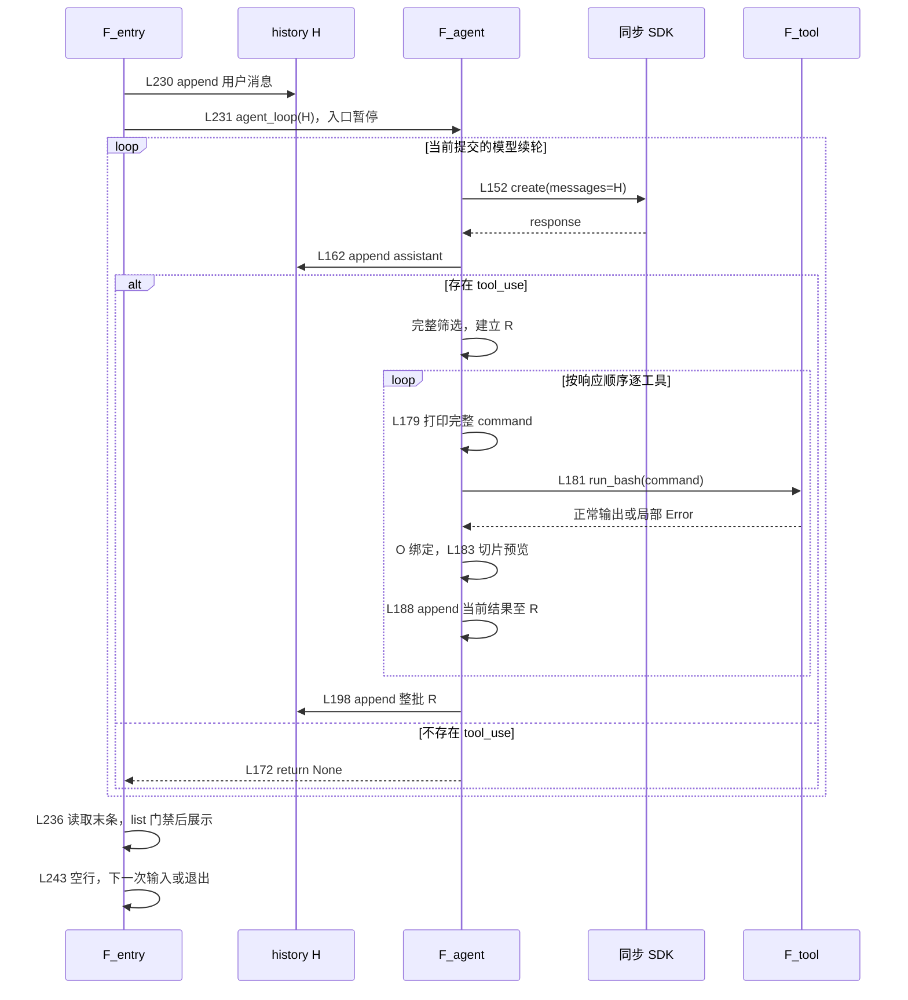
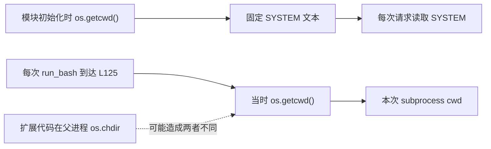
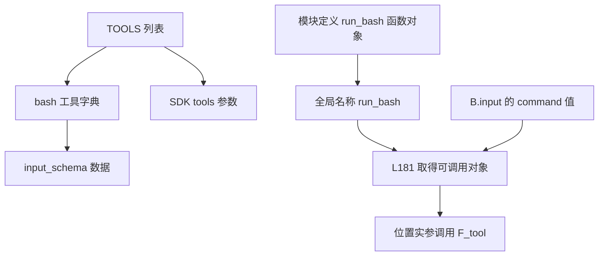
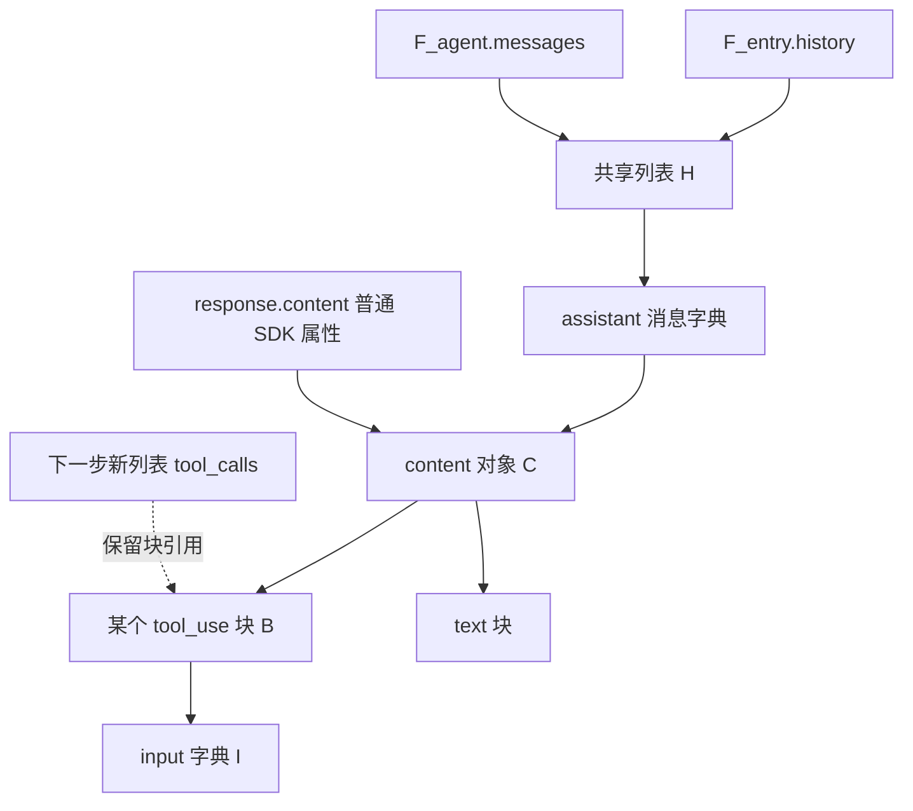
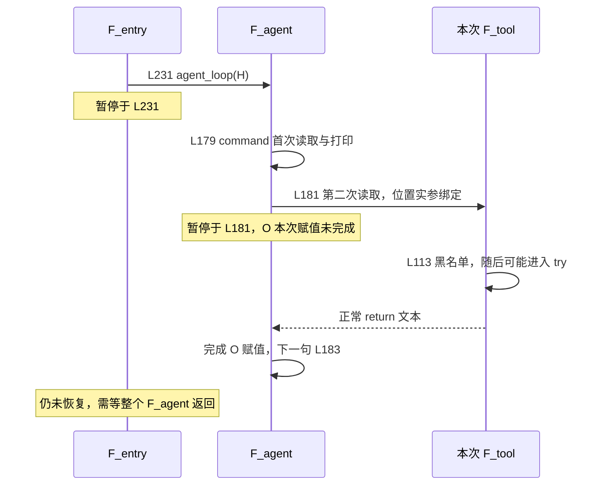
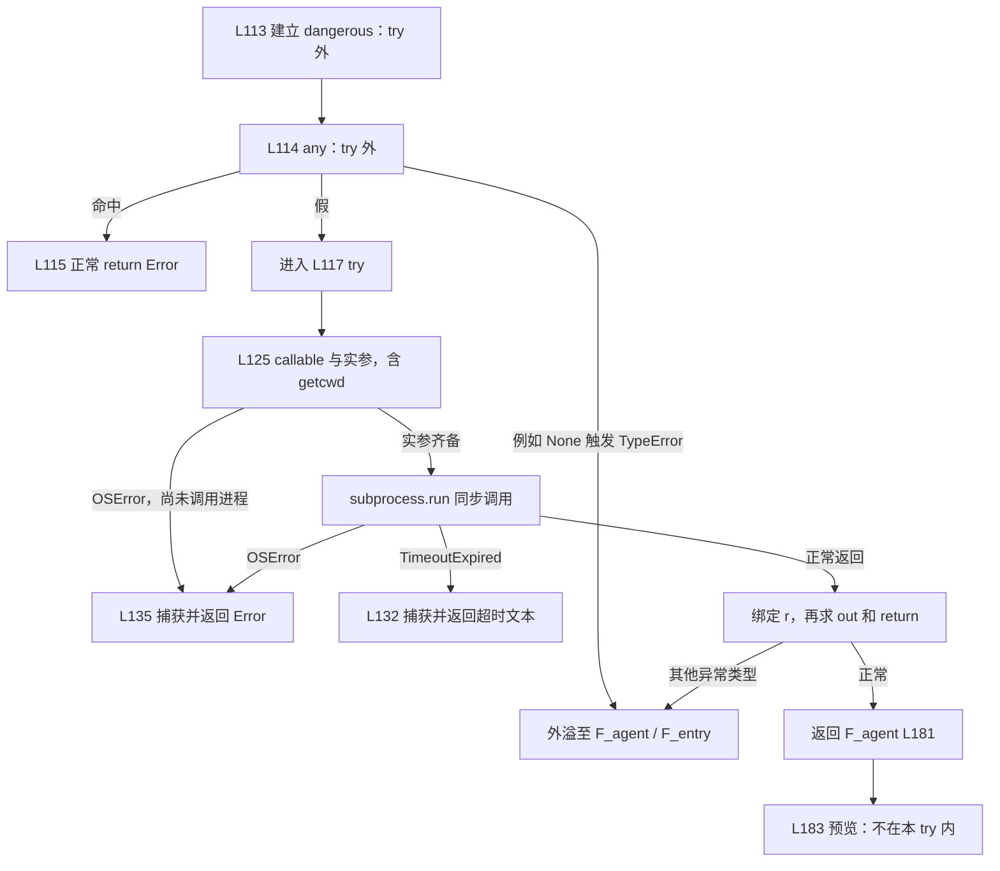
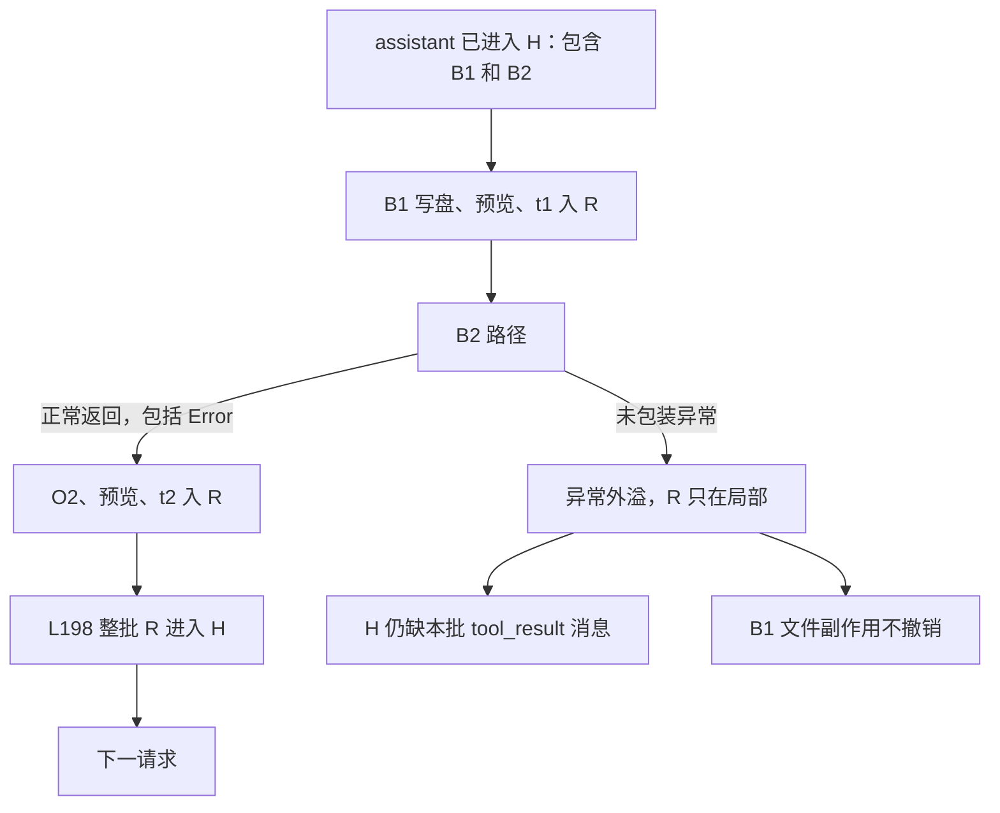
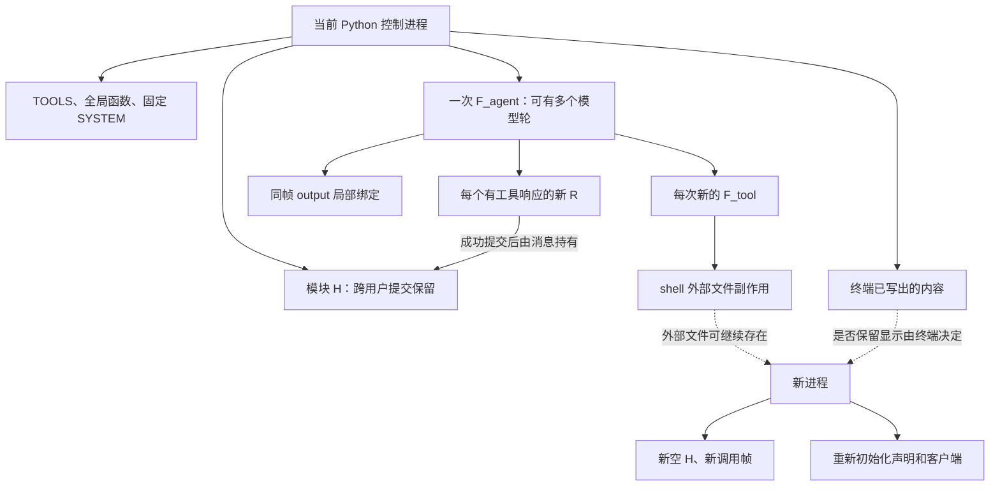

**s01：按实际调用链逐表达式、逐调用帧、逐提交点分析**

本文以 [s01 当前源码](../s01_agent_loop/code.py)的 243 行版本为基准，结合[中文 README](../s01_agent_loop/README.zh.md)、[英文 README](../s01_agent_loop/README.md)、[根依赖声明](../requirements.txt)和直接相关断言。所有案例均为源码静态推演，不是运行记录；本文编写与校验没有导入目标模块、调用模型、执行命令工具或运行用例，也没有读取真实 `.env` 或密钥。

阅读路线：[入口](#chapter-01) → [初始化](#chapter-02) → [用户提交](#chapter-05) → [请求](#chapter-06) → [assistant 与筛选](#chapter-07) → [命令调用](#chapter-10) → [bash 内部](#chapter-12) → [返回与预览](#chapter-19) → [批次提交](#chapter-22) → [最终展示](#chapter-23) → [生命周期](#chapter-24)。

讲解别名只用于解释，不是源码新增变量：

| 别名 | 对应对象或执行现场 |
|---|---|
| H | 入口 `history` 与 `agent_loop.messages` 指向的同一列表 |
| C | 某次读取 `response.content` 得到的对象；源码没有 C 变量 |
| B／I | 当前工具块及当前读取到的 `input` |
| R | 本响应对应的 `results` 列表 |
| O | 当前 F_agent 中 `output` 的绑定，不是另一个结果容器 |
| F_entry | 执行 `__main__` 分支的模块执行帧，不是 CLI 函数帧 |
| F_agent | 当前一次 `agent_loop` 调用帧 |
| F_tool | 当前一次 `run_bash` 调用帧 |

每处按“源码 → 调用现场 → 求值与绑定 → 状态 → 返回下一句 → 失败边界”展开。普通 `while`、`for` 不建立新的函数局部作用域；推导式／生成器的迭代变量不泄漏为后续普通循环变量。不同函数调用中的同名局部变量不是同一个槽位。

全文限定一个 bash 工具、五项子串黑名单、同步请求与顺序工具执行。没有工具分发表、路径 helper、人工授权或统一工具异常包装；不把其他章节机制当作本章已有能力。默认行为、源码静态推断、扩展假设分别标注。

<a id="chapter-01"></a>
# 1. 入口、两层循环与完整执行地图

源码：[L203–243](../s01_agent_loop/code.py#L203-L243)。

<!-- source: s01_agent_loop/code.py:L203-L243 -->
```python
if __name__ == "__main__":
    print("s01: Agent Loop")
    print("Enter a question, press Enter to send. Type q to quit.\n")

    # history 保存整段对话历史，所有消息都会累积在这里，
    # 传给 agent_loop 后由它就地推进。
    history = []

    # 外层交互循环：反复读取用户输入，直到用户退出。
    while True:
        try:
            # \001/\002 tell Readline the ANSI escapes have zero display width.
            # \001/\002 是 readline 的「不可见定界符」，
            # 用来告诉 readline 夹在中间的 ANSI 转义码不占显示宽度，
            # 这样彩色提示符才不会导致光标位置错乱。
            # \033[36m ... \033[0m 则是「青色文字 + 恢复默认颜色」。
            query = input("\001\033[36m\002s01 >> \001\033[0m\002")
        except (EOFError, KeyboardInterrupt):
            # 用户按 Ctrl+D（EOF）或 Ctrl+C（中断）时退出。
            break

        # 输入 q / exit / 空行，就退出程序。
        if query.strip().lower() in ("q", "exit", ""):
            break

        # 把用户输入作为 user 消息加入对话历史，
        # 然后调用 agent_loop 让模型去干活（可能触发多次工具调用）。
        history.append({"role": "user", "content": query})
        agent_loop(history)

        # Print the model's final text response
        # agent_loop 结束后，打印模型的最终文字回复。
        # history[-1]["content"] 是最后一次 assistant 回复的内容块列表。
        response_content = history[-1]["content"]
        if isinstance(response_content, list):
            for block in response_content:
                # 只打印 text 类型的块（跳过 tool_use 块）。
                if getattr(block, "type", None) == "text":
                    print(block.text)
        # 换行，让下一条提示符清爽地开始。
        print()
```

`__name__` 判断成立才执行入口分支。真实 Python 顺序是先执行本文件前面的导入、环境初始化、工具声明和函数定义，再到这里；本文先展示入口是为了确定调用地图，不是说 Python 先运行入口再初始化。

`print` 两次调用按顺序完成；第二个字符串自身含换行，`print` 还会使用默认结束符。随后 `[]` 建立新列表，成功后才绑定模块级 `history`。H 在外层循环之前创建，因此不是每轮输入都建立空历史。启动打印失败时 H 甚至可能尚未建立。

外层循环负责“一次输入完成后再收下一次输入”；L231 调用的 F_agent 内层循环负责“当前输入可能触发多轮请求和多个工具”。在 F_agent 返回以前，F_entry 暂停于 L231，不会并行执行 L236 或继续读取下一条输入。



这里的回边是同步的：单个工具返回并完成反馈处理后才轮到下一个工具，整批提交后才发下一请求。SDK 或 shell 内部如何实现不由此推出；模型可能一次返回多个块，但本文件没有把它们并行执行。

外层 `break` 结束 CLI 循环；内层 `return` 结束一次 F_agent，不退出外层 CLI。当前工具循环也没有用于逐工具恢复的异常分支。沿图向下读时始终分开：工具进入、副作用、返回、O 绑定、预览、R 追加、H 提交、请求调用、模型消费和最终展示。

<a id="chapter-02"></a>
# 2. 导入、环境修改与顶层失败的先后关系

源码分为两个连续区间：[L37–56](../s01_agent_loop/code.py#L37-L56)、[L58–72](../s01_agent_loop/code.py#L58-L72)。

<!-- source: s01_agent_loop/code.py:L37-L56 -->
```python
import os          # 操作系统相关功能：读环境变量、获取当前目录等
import subprocess  # 子进程管理：用来真正执行模型生成的 shell 命令

# readline 提供命令行编辑能力（历史记录、方向键、退格等）。
# 它在 Unix 上通常可用，但在 Windows 上可能不存在，所以用 try/except 包裹。
try:
    import readline
    # #143 UTF-8 backspace fix for macOS libedit
    # 下面这几行是 macOS 上 libedit 库的 UTF-8 退格修复，
    # 让终端能正确处理中文字符的输入/输出与退格删除。
    readline.parse_and_bind('set bind-tty-special-chars off')
    readline.parse_and_bind('set input-meta on')
    readline.parse_and_bind('set output-meta on')
    readline.parse_and_bind('set convert-meta off')
except ImportError:
    # 如果系统没有 readline（例如 Windows），直接忽略即可，不影响主逻辑。
    pass

from anthropic import Anthropic          # Anthropic 官方 Python SDK 的客户端类
from dotenv import load_dotenv           # 从 .env 文件加载环境变量（如 API Key）
```

`import os` 成功后才有模块名称绑定，随后才处理 subprocess。进入 try 后，readline 导入和四次配置按 L47、L48、L49、L50 的顺序执行，不会先收集配置再统一应用。

捕获条件是异常类型 `ImportError`，而不是“只要 readline 出任何问题都忽略”。导入缺失通常匹配这个分支；配置时若产生其他异常，后续配置、SDK 导入和入口都不再执行。若前两次配置已完成而第三次失败，源码没有撤销前两次配置的语句。异常若恰为 ImportError，即使来自 try 内其他位置也会匹配，不能把语法上的捕获范围缩成只有 import 一行。

readline 的功能说明是预期用途，不证明每个终端、平台或输入法的真实表现。关于输入提示符的静态断言见[第 5 章](#chapter-05)。

<!-- source: s01_agent_loop/code.py:L58-L72 -->
```python
# override=True：如果系统里已经存在同名环境变量，仍用 .env 里的值覆盖它。
load_dotenv(override=True)

# 如果设置了 ANTHROPIC_BASE_URL（用于走自定义/代理的 API 端点），
# 就移除可能冲突的 ANTHROPIC_AUTH_TOKEN，避免鉴权方式打架。
if os.getenv("ANTHROPIC_BASE_URL"):
    os.environ.pop("ANTHROPIC_AUTH_TOKEN", None)

# 创建 Anthropic 客户端。base_url 默认指向官方 API；
# 如果设置了 ANTHROPIC_BASE_URL，则使用自定义端点。
client = Anthropic(base_url=os.getenv("ANTHROPIC_BASE_URL"))

# 从环境变量读取模型 ID（例如 claude-sonnet-5 等）。
# 注意：这里用 [] 取值，若 .env 里没配 MODEL_ID 会直接报 KeyError。
MODEL = os.environ["MODEL_ID"]
```

L59 取得函数后以 `override=True` 调用；调用完成才进入 L63。该选项表示在 dotenv 实际加载到值时可以覆盖进程环境的同名值，不等于当前必然存在文件或加载到配置。本文只分析调用语义，没有读取真实环境文件内容。

L63 的 `os.getenv` 返回值要经过真假判断：缺失的 None 或空串不会进入分支，非空文本即使看起来像“false”也是真值。分支成立时，先取得 `os.environ.pop`，再以键和默认值 None 调用。键不存在不因本次 pop 抛 KeyError；键存在则从进程环境移除。此处不是临时屏蔽，也没有随后自动恢复。

L68 再次读取端点，而不是使用 L63 已缓存的值；源码没有缓存变量。取得 Anthropic 可调用对象、求出 base_url 实参、构造成功后，才完成 `client` 赋值。客户端构造不等于请求已经发送，更不证明认证或网络可用。

L72 随后才通过下标读取必需的 MODEL_ID，成功后绑定的是 `MODEL`。因此可能出现“client 已构造，但 MODEL_ID 缺失导致顶层退出”。这不是先校验完全部配置再创建客户端。

| 首次失败阶段 | 已完成的可能状态 | 尚未完成的状态 |
|---|---|---|
| readline 的非匹配异常 | 标准库导入、部分 readline 配置 | SDK/dotenv 导入及后续初始化 |
| SDK 或 dotenv 导入 | 前面成功的导入和配置 | load_dotenv 调用、client、MODEL |
| load_dotenv 调用 | 导入已完成；调用内部可能已有环境修改 | 端点分支与 client 构造 |
| client 构造 | dotenv 处理、可能的 token 删除 | client 本次绑定、MODEL |
| MODEL_ID 下标读取 | client 已绑定；前面环境副作用保留 | MODEL、SYSTEM、TOOLS、函数定义、CLI H |
| 后续 SYSTEM 构造 | client、MODEL、平台说明可能已绑定 | SYSTEM 本次绑定以及更后面的声明和入口 |

这是新模块执行中按源码顺序的静态边界，不假定有人预先注入同名全局值。前面副作用发生后失败，并没有统一顶层补偿。

[requirements.txt](../requirements.txt)只声明 anthropic≥0.25.0、python-dotenv≥1.0.0、pyyaml≥6.0，不证明当前实际安装版本。s01 没有导入 YAML，也没有 Path 或 WORKDIR 全局量；不能从根依赖推导这些本章功能。SDK 内部认证、复制和重试策略不由这三行依赖确定。

<a id="chapter-03"></a>
# 3. 平台选支、两次不同用途的 cwd 与固定 SYSTEM

源码：[L77–89](../s01_agent_loop/code.py#L77-L89)。

<!-- source: s01_agent_loop/code.py:L77-L89 -->
```python
ENVIRONMENT_PROMPT = (
    "Windows: the bash tool runs through cmd.exe; use cmd.exe syntax, not Unix "
    "Bash or PowerShell syntax"
    if os.name == "nt"
    else "Unix-like: the bash tool runs the system shell"
)

# 系统提示词（system prompt）：给模型设定「人设」和「约束」。
# 它告诉模型：你是运行在某个目录下的编程 Agent，用 bash 来解决问题，直接行动、少废话。
SYSTEM = (
    f"You are a coding agent at {os.getcwd()}. Environment: {ENVIRONMENT_PROMPT}. "
    "Use bash to solve tasks. Act, don't explain."
)
```

先求条件 `os.name == "nt"`，再选择条件表达式的一侧。Windows 分支里的两个相邻字面量组成一段文字；另一分支不会成为本次表达式结果。右侧整体完成后才绑定 ENVIRONMENT_PROMPT。

构造 SYSTEM 时，f-string 先调用当时的 `os.getcwd()`，将结果用于格式化，再读取平台说明；随后与后面的相邻文本共同形成字符串值，成功后绑定 SYSTEM。括号用于跨行，不建立列表或动态模板对象。

此时的目录已经成为文本。后续请求只读取 SYSTEM，不会因为外部目录变化重新执行其 f-string。相反，L125 的工具调用每次重新执行 `os.getcwd()`，详见[第 14 章](#chapter-14)。两者没有共同指向一个“会自动刷新的目录配置”。



默认源码没有主动调用 `os.chdir`，所以不能把图中的扩展分支描述为本章必然发生。若扩展代码改变父进程 cwd，SYSTEM 可以仍写旧目录，而下一工具使用新 cwd；shell 子进程内部执行 cd 本身不会改掉父 Python 进程 cwd。

如果 SYSTEM 中的 getcwd 抛异常，这里没有 run_bash 的 try 可用：SYSTEM 尚未完成绑定，TOOLS 和后续函数定义、CLI 都尚未执行。相同 API 在不同调用位置的捕获边界不能混用。

平台说明仅告诉模型如何生成语法，没有在 Python 层将工具名 bash 变成固定的 Bash 可执行程序，也没有实现路径隔离。“Act, don't explain”是模型指令，不是本地校验、权限批准或成功保证。实际 shell 选择还依赖平台和标准库实现。

<a id="chapter-04"></a>
# 4. 单工具 schema 与直接全局函数调用

源码：[L91–105](../s01_agent_loop/code.py#L91-L105)。

<!-- source: s01_agent_loop/code.py:L91-L105 -->
```python
# -- Tool definition: just bash --
# 工具定义（tool definition）：本阶段只提供一个「bash」工具。
# 这个结构遵循 Anthropic API 的 tools 参数格式：
#   name          -> 工具名
#   description   -> 给模型看的工具说明
#   input_schema  -> 工具入参的 JSON Schema（这里只要求一个 command 字符串）
TOOLS = [{
    "name": "bash",
    "description": "Run a shell command.",
    "input_schema": {
        "type": "object",
        "properties": {"command": {"type": "string"}},
        "required": ["command"],
    },
}]
```

本段建立外层列表、单个工具字典、input_schema 字典、properties 内的字典以及 required 列表。嵌套字面量求值完成后，外层列表才交给 TOOLS。没有在这一步执行 shell，也没有注册函数回调给 SDK。

传给模型的是名称、说明和 schema 数据；Python 函数对象没有出现在 TOOLS 中。其 required/string 约束不等于本地每次输入都经过统一 JSON Schema 校验。本地真实检查是后续属性读取、下标读取、形参绑定和函数体运算；不同检查失败的位置不同。



函数定义执行到 [L110](../s01_agent_loop/code.py#L110)时才建立并绑定 run_bash 函数对象，不运行函数体。agent_loop 的定义也不预先执行请求。到 L181 时，F_agent 运行时直接解析全局名称 run_bash。

**源码静态推断：** 若扩展代码在下一次调用前重新绑定模块的 run_bash，全局名称查找可取得新对象；不存在“已有分发表仍保存旧函数”这层行为。若当前调用已先取得可调用对象，则后续名称变化不会倒换这次已经取得的对象。

实际循环甚至不读 B.name：一旦块被识别为 tool_use，就按 command 直交 bash。没有按名称查表、不可哈希名称查询错误或 Unknown 分支。额外 input 字段也不会通过 `**input` 展开，详见[第 11 章](#chapter-11)。

[README 的模型决策说明](../s01_agent_loop/README.zh.md#工作原理)用于概括模型负责提出行动；不能据此补出本地工具名校验。schema 提供模型接口，不构成完整执行授权或沙箱。

<a id="chapter-05"></a>
# 5. 输入完成、退出判断与用户消息提交

源码：[L213–231](../s01_agent_loop/code.py#L213-L231)。

<!-- source: s01_agent_loop/code.py:L213-L231 -->
```python
        try:
            # \001/\002 tell Readline the ANSI escapes have zero display width.
            # \001/\002 是 readline 的「不可见定界符」，
            # 用来告诉 readline 夹在中间的 ANSI 转义码不占显示宽度，
            # 这样彩色提示符才不会导致光标位置错乱。
            # \033[36m ... \033[0m 则是「青色文字 + 恢复默认颜色」。
            query = input("\001\033[36m\002s01 >> \001\033[0m\002")
        except (EOFError, KeyboardInterrupt):
            # 用户按 Ctrl+D（EOF）或 Ctrl+C（中断）时退出。
            break

        # 输入 q / exit / 空行，就退出程序。
        if query.strip().lower() in ("q", "exit", ""):
            break

        # 把用户输入作为 user 消息加入对话历史，
        # 然后调用 agent_loop 让模型去干活（可能触发多次工具调用）。
        history.append({"role": "user", "content": query})
        agent_loop(history)
```

F_entry 先取得 input 可调用对象和提示字符串，再调用，等待用户提交。input 成功返回才完成 query 本次赋值；输入期间 H 尚未追加本次消息。提示符含 readline 不可见标记和 ANSI 色码，与真正进入 H 的 query 是不同文本。

input 抛 EOFError 或 KeyboardInterrupt 时，except 执行 break。若之前输入过问题，模块中的旧 query 可能仍在，但本次赋值失败后直接退出循环，不会把旧 query 再提交一次。首次失败则 query 可能从未建立；这两种名称状态都不改变 break 去向。

正常输入先调用 query.strip，再对返回文本 lower，再与三项元组作 membership 判断。`" Q "`、`"EXIT"`、纯空白都可规范化为退出项。这里没有 `query = query.strip().lower()`，因此其他普通输入的原始空白和大小写仍进入 H。文本操作形成值，不要求每次得到不同字符串身份。

不退出时，先取得 H.append，按源码顺序构造 role/content 字典，将 query 原文本作为 content，再调用 append。成功后 H 原位增长。接着读取 agent_loop 和 H 并调用，F_agent 的 messages 绑定到同一列表，不是返回一份新历史来替换它。

状态账本：

| 时点 | H | 请求／工具 | 下一句 |
|---|---|---|---|
| input 返回前 | 只有先前历史 | 本次尚未开始 | 返回后绑定 query |
| 退出判断命中 | 不追加退出输入 | 不发额外请求 | break |
| L230 append 成功 | 已有本次 user | 仍未发请求 | L231 |
| F_agent 刚建立 | 与 messages 共享 H | 将进入 L152 | F_entry 等待调用返回 |

input 的 try 已在 L222 结束，不能捕获 L230/L231 中的历史、网络或工具异常。尤其工具运行时的 KeyboardInterrupt 不会返回这里的 except；它不在这个 try 的动态执行范围内。

[提示符 AST 用例](../tests/test_readline_prompts.py#L52-L72)扫描包括 s01 在内的源文件，检查 ANSI 片段是否带不可见标记，只说明静态形状，不证明真实终端输入、退格或中文显示结果。本章没有用户提交 hook 或人工批准入口。

[README 的第一条 messages 示例](../s01_agent_loop/README.zh.md#工作原理)说明从用户开始的最小场景；真实 CLI 在循环外建立 H，每次使用 append，不能照示例误写成每次提交都清空历史。

<a id="chapter-06"></a>
# 6. 同步 SDK 请求、实参求值与 response 绑定

源码：[L145–155](../s01_agent_loop/code.py#L145-L155)。

<!-- source: s01_agent_loop/code.py:L145-L155 -->
```python
def agent_loop(messages: list):
    while True:
        # 【第 1 步】把当前对话历史 + 工具定义一起发给模型，让模型生成回复。
        #   system=SYSTEM   -> 系统提示词
        #   messages        -> 对话历史
        #   tools=TOOLS     -> 可用的工具列表
        #   max_tokens=8000 -> 限制本次回复最多生成的 token 数
        response = client.messages.create(
            model=MODEL, system=SYSTEM, messages=messages,
            tools=TOOLS, max_tokens=8000,
        )
```

F_entry 停在 L231。F_agent 中 messages 已绑定 H，进入 while 不产生新函数帧。先从 client 取得 messages 属性，再取得 create 可调用对象，之后按书写顺序读取 MODEL、SYSTEM、messages、TOOLS 和整数 8000，最后进行调用。

这里的 `client.messages` 是 SDK 接口对象；函数局部 `messages` 是 H，虽然拼写相同但不是同一命名位置。模型得到工具 schema 和消息数据，不是 run_bash 函数体或 Python 执行帧。

实参中的 messages 指向原 H，TOOLS 指向模块列表。源码没有在传入前调用 copy、序列化或深拷贝；这不等于 SDK 内部绝不复制，它的请求转换过程不能由本文件猜测。

调用成功返回后，才把返回对象赋给 response。若取得 callable、求实参或实际请求失败，本次 response 赋值未完成。首次请求失败时局部 response 尚未绑定；模型续轮失败时旧 response 可能仍绑定，但没有 except 转去处理旧值，不会自动再次追加旧 assistant。

| 失败位置 | H 尾部 | response 本次绑定 | 工具和后续 |
|---|---|---|---|
| 第一次请求前／中失败 | 本次 user | 未完成，通常无旧绑定 | 无 assistant、无 R、无工具 |
| 已提交一批后的请求失败 | 含上一批 tool_result 的 user | 未完成，旧 response 可能存在 | 不读取旧响应，不生成新批次 |
| 请求返回成功 | 暂仍是请求前 H | 完成 | 下一句 L162 append assistant |

请求抛错不证明远端一定没收到请求或没生成内容；这里只能确认本地没有正常拿到返回值。源码没有本地显式重试、备用模型、总轮数上限或会话总预算。8000 是这一次请求的输出 token 参数，不限制工具输出、捕获内存、总时间或累计费用。

证据边界：[测试加载器](../tests/test_agent_loop_boundaries.py#L49-L90)用 fake Anthropic、fake dotenv、临时 cwd 和 test-model 建立模块；[FakeMessagesApi](../tests/test_agent_loop_boundaries.py#L37-L46)只计数并取预设响应，不证明真实网络、认证或 SDK 内部重试。本文只读这些断言，没有执行加载器。

<a id="chapter-07"></a>
# 7. assistant 追加是独立于工具执行的历史提交点

源码：[L157–162](../s01_agent_loop/code.py#L157-L162)。

<!-- source: s01_agent_loop/code.py:L157-L162 -->
```python
        # Append assistant turn
        # 【第 2 步】把模型的回复作为 assistant 角色追加进对话历史。
        # response.content 是一个 content block 列表，里面可能包含：
        #   - text 块（普通文字回答）
        #   - tool_use 块（模型请求调用某个工具）
        messages.append({"role": "assistant", "content": response.content})
```

请求已经返回，response 本次绑定完成。接着先取得 messages.append，再按字典项顺序形成 role 项、content 项；content 值需要读取 response.content。字典整体完成后才调用 append，成功后 H 增长一条 assistant。

此处用 C 指称这次属性读取的结果。字典保存 C 引用，没有主动深拷贝 C 或块。接下来的工具筛选会再次读取 response.content，而不是读取一个源码中的 C 缓存变量。



默认 SDK 普通列表属性下，两次 content 读取通常得到同一列表；若人为提供返回不同对象的动态属性，L162 保存的对象与 L168 遍历的对象可能不同。这是扩展假设，不是默认 SDK 的常见行为，也不能宣称源码缓存保证它们必然一致。

assistant 已入 H 只证明本地历史追加完成。工具列表还没有完整形成，R 尚未为本响应建立，命令尚未打印，shell 没有由本响应启动。后续任何一步失败，都不会自动删除这条含 tool_use 的 assistant。

属性读取失败时，append 尚未被调用，本条消息不入 H。默认列表 append 的非常规资源失败要与“append 成功之后后续失败”分开；后者明确已保留 assistant。没有恢复旧 H 的语句。

这就是第一处容易被误读的提交窗口：模型请求成功、assistant 记录成功，不等于工具结果已经配对成功。配对必须继续走到[第 21 章](#chapter-21)和[第 22 章](#chapter-22)。

<a id="chapter-08"></a>
# 8. 完整工具列表形成后，才可能执行任何工具

源码：[L164–172](../s01_agent_loop/code.py#L164-L172)。

<!-- source: s01_agent_loop/code.py:L164-L172 -->
```python
        # If the model didn't call a tool, we're done
        # 【第 3 步】从回复中筛选出所有 tool_use 块。
        # 如果模型没有调用任何工具（tool_calls 为空），
        # 说明对话已经「收敛」了，直接结束循环。
        tool_calls = [
            block for block in response.content if block.type == "tool_use"
        ]
        if not tool_calls:
            return
```

先再次读取 content 并取得迭代器。对每块绑定推导式内部的 block，读取其 type，再与字符串 tool_use 比较；只有条件成立才把该块引用放入新列表。所有迭代成功结束以后，才完成 tool_calls 本次绑定。

这不是边筛选边执行工具。假设第一块有效、第二块没有 type：第一块虽已暂存在推导式构造中的列表，后块属性读取会让整体 RHS 失败；本次 tool_calls 未完成绑定，L176 以后完全未开始。H 却可能已经有 L162 的完整 assistant。

推导式内部 block 不会泄漏成后续普通 for 的局部绑定；L177 会自己逐次绑定 F_agent 中的 block。旧 tool_calls 若来自同一 F_agent 的前一模型轮，可能仍存在，但异常不会自动拿旧列表执行。

| content 静态样本 | 筛选结果／失败 | 此响应是否调用工具 | 返回与展示含义 |
|---|---|---|---|
| `[]` | 空 tool_calls | 否 | return，CLI 可正常走到空行 |
| 仅一个空 SDK text | 空 tool_calls | 否 | 仍可正常返回，不认证业务完成 |
| 普通 SDK text | 空 tool_calls | 否 | 后续 CLI 尝试展示末条文本 |
| text 与 tool_use 混合 | 只保留工具块，顺序不变 | 有工具分支才调用 | 此处不把早期文字当最终答案打印 |
| 真正的 None | 取得迭代器时 TypeError | 否 | 不到 return 和最终展示 |
| 块没有 type | 属性读取异常 | 否，整列表尚未成功 | H 仍可能保留 assistant |
| 字典块仅有 `"type"` 键 | 属性方式不按键读取 | 否，通常 AttributeError | 不提供 dict 块通用适配 |

`if not tool_calls` 检查的是新列表是否为空，源码没有读取 stop_reason。为空时 `return` 返回 None，结束 F_agent，下一处恢复点是 F_entry 的 L236；不是返回新 H，也不是执行清理、摘要或完成认证。

**断言证据：** [参数化列表](../tests/test_agent_loop_boundaries.py#L13-L30)包含 s01；[L219–240](../tests/test_agent_loop_boundaries.py#L219-L240)断言无实际工具时只请求一次、历史尾部为 assistant、不追加空 user 结果。但其中参数 None 被[辅助函数 L93–100](../tests/test_agent_loop_boundaries.py#L93-L100)换成空文本 SDK 块列表，不能用来证明真实 content=None 兼容。

[L243–275](../tests/test_agent_loop_boundaries.py#L243-L275)预设 end_turn 却包含工具块，断言仍进入工具路径、两次请求并保留配对 ID。这支持“看块而非 stop_reason”；真实 bash 已被替换，不证明默认 shell 路径。源码注释和 README 所说“收敛／模型停止”在此仅指没有工具块，不代表任务真的正确完成。

<a id="chapter-09"></a>
# 9. 新 R 建立与普通工具循环的局部绑定

源码：[L174–177](../s01_agent_loop/code.py#L174-L177)。

<!-- source: s01_agent_loop/code.py:L174-L177 -->
```python
        # Execute each tool call, collect results
        # 【第 4 步】逐个执行模型请求的工具调用，收集执行结果。
        results = []
        for block in tool_calls:
```

只有 tool_calls 非空才到 L176。`[]` 创建新列表后将局部 results 重绑定为本轮 R；它不会调用旧列表的 clear，也不会顺着 H 中旧消息的 content 引用清空旧结果。

随后取得 tool_calls 迭代器，按顺序将每个原块引用绑定给 F_agent 的 block。本轮 B 不是复制的字典，I 也尚未被读取。一个列表推导式负责形成完整工具列表，一个普通循环负责依次执行，两者不要合并为“边解析边执行”。

状态可以在每个工具前重新定位：

```text
当前语句：L177，F_agent 绑定当前 B
→ H 尾部：当前响应的 assistant，包含整批原始块
→ R：新批次列表，第一工具前为空；后工具前可有已完成项
→ O：第一轮第一工具前可能未绑定；后工具／后轮次可保留旧值
→ 文件／进程：尚无当前工具的新副作用；先前工具副作用不会消失
→ 终端：尚未打印当前 command
→ 请求：当前 response 已返回，下一请求尚未调用
→ 下一句：L179 首次读取并打印 command
```

普通 for 不创建新的函数局部作用域。因此第一工具设置的 output 可在第二工具执行前仍绑定；这只是名字存在，不是备用结果机制。R 也不会因为进入下一次 for 迭代自动提交 H。

**源码静态推断：** 下一模型轮重新执行 results=[] 后，旧 R 若已被 H 引用，仍作为旧消息的 content 存在。若上一轮在提交前异常，则控制流已经外溢，不会正常来到下一轮替它补交。对象能否被回收取决于其实际引用，不能从“局部重绑定”推导安全擦除。

<a id="chapter-10"></a>
# 10. 首次读取 command，先完整打印再执行

源码：[L178–179](../s01_agent_loop/code.py#L178-L179)。

<!-- source: s01_agent_loop/code.py:L178-L179 -->
```python
            # 用黄色（ANSI 转义码 \033[33m）打印即将执行的命令，便于观察循环过程。
            print(f"\033[33m$ {block.input['command']}\033[0m")
```

F_agent 正在当前工具迭代，F_tool 尚未建立。求值先取得 print 可调用对象，随后构造 f-string：黄色前缀、美元符号和空格，读取 B.input 得到 I，再对 I 执行 `['command']`，格式化该值，最后加入恢复颜色的后缀。整段字符串成功形成后才调用 print。

默认 I 为普通字典、command 为普通字符串，打印的是完整命令文本，不是工具名；没有 `[:200]`，也没有单独的敏感信息脱敏或控制字符转义。ANSI 包装意图改变显示颜色，但真实终端是否解释以及命令自身如何影响显示不是 Python 逻辑保证。

缺 command 的普通字典会在这里抛 KeyError。此时不是 run_bash 的形参绑定失败：run_bash 还未被调用，dangerous 尚未建立，try 尚未进入，当前命令也尚未交给 print。I=None 则在下标访问处 TypeError。

command=None 的格式化可以正常形成含 None 的文本并完成打印；随后仍会继续 L181，错误位置见[第 13 章](#chapter-13)。所以“终端看见命令”最多证明日志链走到了 print，不证明参数类型正确、黑名单通过或子进程启动。

**非常规静态边界：** 扩展 command 对象的格式化、终端流编码或 I/O 可以失败。若 f-string 形成失败，print 尚未调用；若 print 自身失败，可能已有部分终端写出，源码没有撤销。两者都不继续 L181，不会把日志异常包装成 tool_result。

与 README 的分步／完整示例相比，真实循环多了这次命令打印。忽略它会把缺键的首次失败误放到执行行，还会漏掉“仅命令日志存在、工具尚未进入”的状态窗口。

<a id="chapter-11"></a>
# 11. 第二次读取 command 与一个位置实参的函数调用

源码：[L180–181](../s01_agent_loop/code.py#L180-L181)。

<!-- source: s01_agent_loop/code.py:L180-L181 -->
```python
            # 真正执行命令，得到输出字符串。
            output = run_bash(block.input["command"])
```

L179 已正常完成。先从全局环境取得 run_bash 可调用对象，再读取 B.input，并再次下标取得 command，最后发起调用。这不是将刚才打印的值保存在临时局部后复用；源码确实读取了两次。

默认普通 SDK 块、普通字典、普通文本且中间无人修改时，两次读取对应相同内容。动态属性、特殊 mapping、格式化时修改共享输入等属于扩展假设，可能让打印值与执行值不同；源码没有缓存来排除这些情况，但不能描述为默认路径经常改变参数。

本次调用只传一个位置实参：F_tool 的 command 绑定到取出的对象。I 本身没有整体传入，没有 `**I` 展开，也没有深拷贝。额外的 cwd、timeout 或任意 input 键不会成为额外形参；本地实际 cwd/timeout 由 run_bash 内部指定。

Python 形参绑定、进入函数体和函数返回是三个阶段。默认函数收到一个位置实参，可以完成绑定，之后才执行 L113。若直接调用 run_bash() 缺参，则绑定阶段会失败、函数体完全未进入；但 Agent 路径的“缺 command 键”更早在 L179 就失败，不可混为一谈。

F_agent 一直停在 L181 等待函数正常返回，output 本次赋值还没有完成。它不会先把 output 设为 None。函数体或调用前表达式外溢时，也不会跳到 L183 或自动拿旧 O 继续。



完全没有读取 B.name。即使名称是未知字符串，甚至对象没有 name 属性，只要 type、input、command、后续 id 等满足当前真实读取要求，仍按 bash 路径执行。schema 只声明 bash，不等于执行器会拒绝其他名字。这里没有 Unknown 文本，没有哈希名称查表，也没有统一 schema 验证。

## 首次失败位置的固定账本

以下全部为**源码静态推演**。共同前提：SDK 响应已返回，H 尾部已有本响应 assistant。除“后块缺 type”这一更早失败的行外，均已完成筛选并到达当前工具，R 尚未进入 H。Rₚ 表示前工具已完成项，首工具时就是空列表。旧 O 只可能来自同一 F_agent 的先前成功赋值；每行都不假定存在自动备用值。

| 当前样本 | 首个关键位置与 O 状态 | 当前文件／进程及已打印内容 | R 与缺失的后续步骤 |
|---|---|---|---|
| I 缺 command | L179 KeyError；O 本次未赋值 | 当前命令未打印；F_tool、进程均未进入 | 仍 Rₚ；无当前结果、无整批提交、无下一请求 |
| I=None | L179 下标 TypeError；O 本次未赋值 | 同上 | 同上 |
| command=None | L179 可打印；L114 成员判断 TypeError；O 本次未赋值 | 已打印含 None 的命令；未调用 subprocess | 仍 Rₚ；无预览、无当前结果或整批提交 |
| 额外 input 键 | L181 仅取 command；可正常绑定 | 只执行 command 对应动作，额外键不改变参数 | 正常返回后才有 O、预览和当前结果 |
| name 未知或缺失 | 不读 name，非失败点 | 已打印 command；可照常进入 bash | id 等正常时可形成当前结果并闭合批次 |
| 后块缺 type | 更早在 L169 属性失败；当前轮 tool_calls 赋值未完成 | 本响应所有工具均未执行、未打印 | 本响应 R 尚未创建；旧局部 R 不会被自动提交 |
| try 内 getcwd 抛 OSError | L125 实参求值失败，由 L135 捕获；Error 返回后 O 完成 | 已打印命令；本次 subprocess 尚未调用 | 可继续 Error 预览、R 追加与整批提交 |
| B 缺 id | L190 失败；O 已完成 | 本工具可已产生副作用且预览成功 | 仍 Rₚ，无当前结果；阻断整批提交与下一请求 |
| 扩展 O=None/int | L183 切片失败；O 已完成 | 命令已打印；先前工具动作可能完成，输出预览未正常完成 | 仍 Rₚ，无当前结果或整批提交 |
| 扩展 O 为列表 | L183 可以切片并打印列表 | 预览显示切片对象的文本表示，不是原 O 先 str | 原列表 O 可进入当前结果；后续 SDK 接受与否未知 |

这些异常没有被 Agent 层统一 try 包裹。除可匹配 run_bash 内部 except 的路径外，默认会向 F_entry 的 L231 外溢；入口 input 的局部捕获对此无效。

<a id="chapter-12"></a>
# 12. 新 F_tool、类型注解与每次创建的黑名单列表

源码：[L110–113](../s01_agent_loop/code.py#L110-L113)。

<!-- source: s01_agent_loop/code.py:L110-L113 -->
```python
def run_bash(command: str) -> str:
    # 危险命令黑名单（非常简单的安全防护，s03 会引入更完善的权限控制）。
    # 只要命令里包含这些片段，就直接拒绝执行。
    dangerous = ["rm -rf /", "sudo", "shutdown", "reboot", "> /dev/"]
```

模块初始化时执行 def 只建立函数对象；本次 L181 调用完成位置形参绑定后才进入函数体。command 的 `str` 注解和返回注解都不自动执行 isinstance 检查或转换。传入 None 不会在默认 Python 形参绑定时变成字符串。

L113 每次建立一个新列表，成功后在本次 F_tool 绑定 dangerous；它不是模块级权限规则注册表。五个文本元素形成待检查顺序，列表可变不意味着本章提供动态管理命令。

当前阶段只有 command 绑定和列表建立。没有读取 cwd，没有调用 subprocess，没有 r 或 out 本次绑定；F_agent 仍等在 L181。新 F_tool 不继承上一调用的 dangerous、r 或 out，即使上一工具已经成功返回。

列表分配等资源失败属于非常规静态边界，并且位于 try 外，不能由后面的 OSError except 兜底。源码注释提到后续章节只是教学背景，不表示当前实现含人工权限控制。

<a id="chapter-13"></a>
# 13. any 消费生成器、首次命中与 try 外失败

源码：[L114–115](../s01_agent_loop/code.py#L114-L115)。

<!-- source: s01_agent_loop/code.py:L114-L115 -->
```python
    if any(d in command for d in dangerous):
        return "Error: Dangerous command blocked"
```

先取得 any，建立生成器并准备遍历 dangerous。建立生成器不等于已经算完五个判断；any 推进它时，才逐项把 pattern 绑定给生成器内部的 d，计算 `d in command` 并读取判断结果。

普通字符串下，每项是区分大小写的子串匹配。第一个真值使 any 立即返回 True，后续 pattern 不再检查；所有项为假才返回 False，进入 L117。生成器内部 d 不泄漏成 F_tool 的普通局部迭代变量。

命中后直接 return 固定错误文本。这是正常函数返回，不是抛异常、不经过 except、不询问用户。返回先交给 F_agent 的 L181 完成 O 赋值，再到 L183 预览；此时当前拒绝结果仍未进入 R/H。

**源码静态推演：**

| command 样本 | 实际匹配含义 | 不能推导什么 |
|---|---|---|
| `rm -rf /` | 第一项子串命中 | 不证明其他危险命令都能识别 |
| `rm -rf /tmp/cache` | 同样含第一项，不分析实际目标边界 | 不证明它判断了路径是否为根目录 |
| `echo sudo` | sudo 子串命中，即使看起来只是输出文本 | 不证明理解 shell 引号或命令语义 |
| `SUDO` | 不因小写 sudo 这一项命中 | 不证明命令一定可执行或安全 |
| `echo hello` | 五项均未命中时继续 | 不证明其他 shell 行为无风险 |
| None | 第一项成员判断即可 TypeError | 不转成正常“默认拒绝” |

黑名单没有统一小写、正则、shell 解析或实际命令身份校验。通过只代表这五次判断没有返回真，不能当作安全认证。固定 cwd、单线程和 SYSTEM 都不会补齐这种语义分析。

command=None 时，函数已经进入，dangerous 已绑定，但异常发生在 try 外。r 尚未绑定、getcwd 尚未调用、进程未启动；F_agent 的 O 本次赋值未完成。旧 O 若存在也不会被采用，L183、当前 R 追加、整批 H 提交都不执行。

没有发现针对 s01 本默认黑名单的直接专项断言；上表为源码静态推演，不是执行结果。通用成功工具用例把 run_bash 整体替换了，不能据它宣称验证了 any 或黑名单。

<a id="chapter-14"></a>
# 14. try 内的实参求值：cwd 失败可发生在进程启动前

源码：[L117–126](../s01_agent_loop/code.py#L117-L126)。

<!-- source: s01_agent_loop/code.py:L117-L126 -->
```python
    try:
        # subprocess.run 在子进程中执行命令：
        #   shell=True          -> 通过系统 shell 解释命令（支持管道、重定向等）
        #   cwd=os.getcwd()     -> 在当前工作目录下执行
        #   capture_output=True -> 捕获标准输出和标准错误
        #   text=True           -> 以文本（而非字节）形式返回输出
        #   errors="replace"    -> 遇到无法解码的字符时用替代符，避免崩溃
        #   timeout=120         -> 最多运行 120 秒，防止命令卡死
        r = subprocess.run(command, shell=True, cwd=os.getcwd(),
                           capture_output=True, text=True, errors="replace", timeout=120)
```

只有黑名单判断为假才进入 try。F_agent 仍停在 L181；F_tool 当前停在 r 赋值的 RHS。先取得 subprocess.run 可调用对象，再依次求 command、True、`os.getcwd()`、True、True、字符串 replace、整数 120；全部成功后才调用 subprocess.run。

command 仍是传入对象的本次局部绑定，没有自动转成新文本；cwd 是本次 getcwd 得到的目录字符串，不是初始化时 SYSTEM 中的文字。capture_output/text/errors/timeout 是固定实参，不来自 I 额外字段。

如果 getcwd 在此抛 OSError，后面的实参求值和 subprocess.run 调用都没有发生，r 本次赋值也没有完成。但异常位于 try 的动态范围内，能够转到 L135，形成 Error 文本返回。它与初始化 SYSTEM 中 getcwd 失败的传播不同。



捕获范围是 try 的执行范围与类型匹配共同决定，不是“调用到 run_bash 后一切异常都变 Error”。图中 out 计算若恰好抛匹配类型也受 try 覆盖；普通类型不匹配则外溢。命令日志与预览都在调用者中，不由这个 try 覆盖。

**cwd 失败的源码静态账本：** H 尾部已有本响应 assistant；R 保留前工具结果但未提交；命令日志已完成；当前进程没有启动，当前命令没有因此发生新文件动作；本次 F_tool 没有 r；Error 正常返回后 O 会绑定，再尝试预览和回填。以前的工具或外部进程副作用不会因这一事实消失。

<a id="chapter-15"></a>
# 15. 同步子进程、等待、捕获与 r 本次绑定

源码：[L125–126](../s01_agent_loop/code.py#L125-L126)。本章沿上一章已完成的实参求值继续，不把这次调用误算成第二次启动进程。

<!-- source: s01_agent_loop/code.py:L125-L126 -->
```python
        r = subprocess.run(command, shell=True, cwd=os.getcwd(),
                           capture_output=True, text=True, errors="replace", timeout=120)
```

所有实参齐备以后，subprocess.run 才接管本次同步调用。在它正常返回以前，r 赋值没有完成，F_tool 不会提前计算 out，F_agent 不会执行输出预览，更不会启动下一工具或下一请求。

`shell=True` 让命令交由平台 shell 解释，管道、重定向等由 shell 决定。cwd 决定子进程的起始目录，不限制其只能访问该目录；绝对路径、父目录和外部程序行为没有被本章路径规则统一拦截。这里没有文件沙箱 helper。

“单进程、同步控制流”指本章 Python 控制程序没有额外 Agent 执行线程；bash 本身明确创建子进程，shell 还可能创建更多进程。不能由 Python 串行 for 推导操作系统里绝无并行活动，或文件不可能被外部进程修改。

`capture_output=True` 捕获两个输出流，text=True 采用文本模式。捕获与等待由标准库处理，只有成功返回后本地才绑定 r。外部命令可能在等待期间已经写盘或产生网络副作用；这些动作不需要等待 r 绑定才成立。

若调用抛超时或 OSError，r 本次未绑定，进入匹配 except；若是其他异常则外溢。每次新 F_tool 都有自己的局部绑定，不存在上次 r 自动可用。函数内没有 loop 重试本次命令。

超时值 120 是传给 subprocess 的一次调用参数，不是从 CLI 输入到最终回答的总时限，也不是整个进程树所有活动都严格在 120 秒内终结的保证。本章没有自建进程组管理；这不否认标准库自己的超时处理。

正常返回以后下一句是 L128 计算 out，而不是先检查 r.returncode。shell 内执行 cd 只影响相应子进程环境，不会把父 Python 的 cwd 改成那个位置；跨工具要区分单个命令内部的目录变化和下一次重新读取父 cwd。

<a id="chapter-16"></a>
# 16. stdout 与 stderr 合并、strip 和 out 本次绑定

源码：[L127–128](../s01_agent_loop/code.py#L127-L128)。

<!-- source: s01_agent_loop/code.py:L127-L128 -->
```python
        # 把 stdout 和 stderr 拼在一起，去掉首尾空白。
        out = (r.stdout + r.stderr).strip()
```

此时 subprocess.run 已经正常返回，r 已绑定，本次外部副作用可能已经发生。表达式先读 r.stdout，再读 r.stderr，将两个文本相加；取得合并文本的 strip 方法并调用，最后才绑定 out。没有分次保存两个局部流变量，也没有把 r 的字段原位改写。

默认路径下两个字段是捕获后的字符串。相加按“全部 stdout 在前、全部 stderr 在后”组合，不按两条流在运行时真实交错的时间顺序合并；代码也没有主动在它们之间加入分隔符。若 stdout 为 abc、stderr 为 def，组合可以是 abcdef，而不是自动两行。

strip 去除的是合并后文本的首尾空白，不只是最后一个换行，也不按每行分别清理。内部空白仍可能保留。例如两流均只有空白时会变为空串，后续走无输出占位；这不等于命令从未输出字节。

这一句发生在完整捕获之后，不能把下面的 50000 切片反向解释为捕获缓冲上限。r 持有流文本，合并和 strip 还涉及文本结果；源码没有基于流式长度提前停止读取。

L125 只有 text=True、errors="replace"，未指定 encoding。实际默认编码受平台、Python 配置及运行环境影响，不能仅凭工作区是中文或文档是 UTF-8 推导子进程输出按 UTF-8 解码。replace 约束解码遇到不能处理的字节时如何替代，不识别原编码，也不保证文字语义正确。文本模式还可能处理换行，返回结果不是原始字节保真视图。

**断言边界：** [subprocess AST 策略检查](../tests/test_subprocess_output_encoding.py#L73-L113)覆盖 s01 源码，检查文本模式调用带 errors="replace"。同文件的[动态编码、stderr、空输出与超时用例](../tests/test_subprocess_output_encoding.py#L29-L71)针对 s07，不移用为 s01 的运行证据。[文本 I/O AST 检查](../tests/test_utf8_text_io.py#L8-L49)虽扫描 s01，但 s01 没有专用文件文本 API，不能据此声称它实现 UTF-8 文件工具或 shell 输出一律 UTF-8。

如果属性读取、拼接或 strip 抛异常，out 本次赋值未完成，r 仍已绑定，进程可能已经完成副作用。实际是否捕获取决于类型：匹配本 try 的 except 才文本化；例如扩展替换 r 导致 TypeError，不会被 OSError 捕获。默认 subprocess 返回普通文本，不把这些扩展对象故障描述为常见路径。

<a id="chapter-17"></a>
# 17. 输出真假、50000 字符切片与无输出占位

源码：[L129–131](../s01_agent_loop/code.py#L129-L131)。

<!-- source: s01_agent_loop/code.py:L129-L131 -->
```python
        # 有输出就返回（最多截断到 50000 字符，避免超长内容撑爆上下文），
        # 没有输出就返回一个占位说明。
        return out[:50000] if out else "(no output)"
```

先判断已经绑定的 out 的真假。默认字符串非空时只求值 `out[:50000]`，为空时只取占位字符串；未选分支不会额外计算。随后将选中值正常返回 F_agent 的 L181。

非空分支最多保留 Python 字符串的 50000 个字符，不是 50000 字节或 token，也不是“全部会话最多这些内容”。短字符串切片也只是得到文本值，不承诺一定分配不同身份的字符串。

注释中“避免超长内容撑爆上下文”是动机，不是上下文容量的完整保证：多工具、多轮的结果、历史用户输入和 assistant 内容仍会累计，50000 也远大于终端预览。原始流完整捕获和合并都已经完成，资源成本没有因此回退。

**源码静态推演：**

| r 与 out 的设定 | 当前返回值 | 已经发生与不能推导的事 |
|---|---|---|
| returncode=0，out 为 hello | hello | 正常返回文本，不另外认证文件结果 |
| returncode 非零，有 stderr | 合并并 strip 后的文本 | 不自动加 Error，不检查退出码 |
| returncode 非零，两流都空 | `(no output)` | 不表示命令成功；也不表示没发生副作用 |
| 两流只有空白 | `(no output)` | strip 后为空，不等于底层零输出 |
| out 长 50001 字符 | 前 50000 字符 | 末尾被丢弃，没有截断提示 |

此处没有 `check=True`，也没有读取 r.returncode 来分支，因此不能把正常 Python 返回与 shell 业务成功等同。空输出不必抛异常；“错误文本”和“正常文本”都沿同一返回链进入 O。

本句 return 结束 F_tool，不结束 F_agent。接下来仍要完成 O 赋值、200 切片预览、ID 读取、R 追加和整批 H 提交，之后才有下一请求。结果已生成与模型已读取之间还有多个独立失败窗口。

<a id="chapter-18"></a>
# 18. 超时、OSError 与没有覆盖的异常边界

源码：[L132–137](../s01_agent_loop/code.py#L132-L137)。

<!-- source: s01_agent_loop/code.py:L132-L137 -->
```python
    except subprocess.TimeoutExpired:
        # 命令超时（超过 120 秒）——单独捕获，给出明确提示。
        return "Error: Timeout (120s)"
    except (FileNotFoundError, OSError) as e:
        # 命令不存在或其它系统级错误——把错误信息返回给模型，让它自行调整。
        return f"Error: {e}"
```

try 内若抛 TimeoutExpired，第一分支匹配，直接返回固定文本。r 赋值可能未完成，但超时前外部程序已经可能写盘、输出或产生其他行为。返回文本不包含已捕获的部分输出，也没有回滚这些行为。

第二个分支匹配 FileNotFoundError 或 OSError；前者是后者子类，列出两者不等于两个不同阶段的独立兜底。进入 except 时 e 绑定到异常对象，f-string 正常形成文本后 return；O 将得到文本而不是原异常对象。Python 会在处理结束时清理 except 目标绑定，不能依赖 e 作为长期错误状态。

shell=True 时，“shell 中某个命令不存在”可以由 shell 打印错误并以非零状态正常退出，不一定使 Python 抛 FileNotFoundError。反之，调用前 getcwd 抛 OSError 也可以到这里，却完全没启动本次进程。因此同样 Error 前缀不能反推同样的文件或进程状态。

| 位置／类型 | 当前捕获与返回 | H／R／O | 当前工具与终端状态 |
|---|---|---|---|
| L114 黑名单命中 | 正常 return 固定 Error，非 except | assistant 已入 H；R 待追加；返回后 O 完成 | 命令已打印，无当前 subprocess |
| L114 command=None | try 外 TypeError 外溢 | R 保留前项；O 本次未完成；不提交本批 | 命令可已打印，无当前进程 |
| L125 getcwd 的 OSError | L135 文本化返回 | 返回后 O 完成，可继续正常反馈链 | 命令已打印，当前 subprocess 未调用 |
| subprocess 超时 | L132 固定文本返回 | 返回后 O 完成，R/H 仍需后续语句 | 命令已打印；副作用可能已发生 |
| try 内 OSError | L135 文本化返回 | 同上 | 具体磁盘状态取决于失败阶段 |
| try 内非匹配普通异常 | 外溢 | O 本次未完成；无当前结果，无整批提交 | 副作用取决于是否已启动进程 |
| 参数绑定失败的直接调用 | 函数体未进入，无本地捕获 | 若在 L181 调用阶段发生，O 未完成 | dangerous、getcwd、进程均未进入 |
| 工具内 KeyboardInterrupt/SystemExit | 不由这两个 except 捕获 | 当前反馈链中断 | 可能已有副作用 |
| L183 预览／L190 ID 读取失败 | 在调用者，无此 try 覆盖 | O 已完成，当前项未入 R | 工具可能完成；预览是否完成按位置区分 |

表格中的 H 默认已含当前 assistant，R 都没有因“Error 文本形成”就自动入 H。正常 Error 返回可以让循环继续，但若之后预览、ID 或追加失败，仍可能没有完整反馈。

KeyboardInterrupt、SystemExit 是 BaseException 的非 Exception 子类；本章既没有统一 except Exception，也没有统一 BaseException 清理。CLI 的中断捕获只在 input 的局部范围内。

**非常规静态边界：** except 中格式化异常对象自身也可能失败，该分支没有再次包裹自己的 return 表达式，不能把 Error 形成当作无条件保证。通常标准异常可正常格式化，此边界不作为常见故障。

本章没有自建进程组管理、文件回滚或副作用补偿；不能据此否认 subprocess 库自身会做其规定的超时处理，也不能反过来推导所有后代进程与所有外部动作都已撤销。相关默认异常路径没有 s01 专项动态断言，以上为源码静态推断。

<a id="chapter-19"></a>
# 19. 返回调用者之后，O 才完成本次赋值

源码：[L181](../s01_agent_loop/code.py#L181)。

<!-- source: s01_agent_loop/code.py:L181-L181 -->
```python
            output = run_bash(block.input["command"])
```

现在从 F_tool 回到先前暂停的 F_agent。工具 return 值先成为调用表达式的结果，整个 RHS 成功后才将它绑定给局部 output。正常输出、无输出占位、主动黑名单 Error、except 形成的 Error 都遵守这一顺序。

默认函数所有正常 return 分支都给出字符串，但没有在 F_agent 统一调用 str。它直接绑定返回值；注解本身也不阻止扩展代码把 run_bash 替换为返回其他对象的函数。

赋值不是原位修改上次 O 对象。若第一工具已返回 O₁，第二工具正常返回 O₂，则 output 改绑到 O₂；R 内已保存的第一项不会因此把 content 自动换成 O₂。若第二工具 RHS 外溢，output 可以仍绑定 O₁，但当前函数沿异常传播退出，而不是跳到预览使用 O₁。

## 三种“绑定没完成”的静态推演

| 现场 | 失败前的绑定 | 本次失败结果 | 控制流是否使用旧值 |
|---|---|---|---|
| 新 F_tool 的 r RHS 抛 OSError | 本 F_tool 的 r 从未绑定；上一调用 r 在另一个帧 | 本次 r 赋值未完成，转 L135 | 不读旧 r；返回 Error 后 F_agent 可正常绑定 O |
| 第二工具 L181 的 RHS 抛 TypeError | 同一 F_agent 中 O₁ 可能仍绑定 | O₂ 赋值未完成 | 无捕获恢复，不用 O₁ 造当前结果 |
| 下一模型轮 L152 请求抛异常 | 同一 F_agent 中旧 response 可能存在 | response 本次赋值未完成 | 不重新消费旧 response，直接外溢 |

前一行体现“新帧没有继承旧局部”，后两行体现“同一帧旧绑定仍可能存在”。它们都不同于“本次赋值已成功”。

反过来，若第二工具正常返回、L183 切片或打印失败，则 O₂ 已绑定，不能仍写成“O₂ 赋值未完成”。这时失败属于反馈阶段，而不是 handler 返回阶段。

**O 刚完成时的账本：**

```text
当前语句：L181 赋值完成，F_agent 将到 L183
→ H：尾部仍是本响应 assistant
→ R：只有前工具已完成项，当前 O 尚未追加
→ O：本次完成，默认是字符串
→ 文件／进程：本工具可能已完成外部动作，或黑名单路径根本未启动
→ 终端：完整命令已打印，当前输出预览尚未完成
→ 请求：下一次 create 尚未调用
→ 下一句：print(output[:200])
```

全局函数替换的实际证据见[测试辅助函数 L122–130](../tests/test_agent_loop_boundaries.py#L122-L130)。s01 只需替换 lesson.run_bash 就能影响 L181；它没有供替换的权限函数、execute_tool 或 TOOL_HANDLERS。成功工具测试验证的是该替换返回后的控制流，不验证真实 subprocess。

<a id="chapter-20"></a>
# 20. 原 O 直接切片，然后才由 print 展示

源码：[L182–183](../s01_agent_loop/code.py#L182-L183)。

<!-- source: s01_agent_loop/code.py:L182-L183 -->
```python
            # 只打印前 200 个字符，避免刷屏。
            print(output[:200])
```

先取得 print，再读取已经绑定的 output，对原对象执行切片 `[:200]`，将切片结果作为 print 的实参，最后调用 print。源码不是 `str(output)[:200]`，也没有把切片结果赋回 output。

默认 O 为普通字符串，切片至多含 200 个 Python 字符；print 还会使用默认结束符。它不限制命令打印长度，不裁剪 R 内将要保存的原 O，也不是 200 字节、token 或终端列宽。


这些箭头是正常路径，不是事务提交：任何后段失败都不自动逆向撤销前段。外部副作用可以早于工具返回，工具返回可以早于 O 绑定，O 绑定又早于预览。

## 扩展返回值与失败阶段

以下为**扩展假设下的源码静态推演**，默认 run_bash 不返回这些非文本对象：

| O | L183 实际动作 | 是否改绑 O | 当前结果能否继续形成 |
|---|---|---|---|
| 普通长字符串 | 先截取前 200 字符，再打印 | 否 | print 正常后可继续 |
| None 或普通 int | 原对象不支持切片，先 TypeError | 否，O 已完成本次绑定 | 无当前 R 项 |
| list | 切前 200 元素，print 展示切片列表 | 否 | 原列表可进结果，SDK 接受与否未知 |
| bytes | 切前 200 字节，print 展示 bytes 表示 | 否 | 同样不保证 SDK 接受 |
| 特殊对象 | 由其切片协议决定；可能在此失败 | 否，除非扩展另有副作用 | 不提供统一格式化兜底 |

即使 print 内部最终对切片对象产生文本表示，也不能改写成“先对整个 O 调用 str 再截断”。例如列表打印出来可能超过 200 个字符；其限制单位从一开始就不是文本字符。

切片失败时 print 尚未执行；print 调用失败时终端可能已写部分内容。两者都发生在当前 result 字典形成之前。此时工具已经可能写盘，O 已绑定，R 仍只有前项，H 仍停在当前 assistant。

正常返回的错误文本也照样预览，不因前缀 Error 自动跳过。预览成功后下一句是 L188 results.append，不是下一次请求。终端看见预览也不等于模型看见完整结果。

<a id="chapter-21"></a>
# 21. ID 读取、原 O 保存与当前结果进入 R

源码：[L184–192](../s01_agent_loop/code.py#L184-L192)。

<!-- source: s01_agent_loop/code.py:L184-L192 -->
```python
            # 每条结果都遵循 Anthropic 的 tool_result 格式：
            #   type        -> "tool_result"
            #   tool_use_id -> 对应哪个 tool_use 块（用 block.id 关联）
            #   content     -> 工具的实际输出
            results.append({
                "type": "tool_result",
                "tool_use_id": block.id,
                "content": output,
            })
```

当前命令日志、handler 正常返回、O 本次绑定及预览都已完成。现在先取得 results.append，再按顺序构造字典：type 固定文本，tool_use_id 需要读取 B.id，content 读取局部 output。整个字典形成后才调用 append。

tool_use_id 把当前结果关联到请求块 ID，不是重新分配 ID，也没有本地唯一性检查、去重或完整配对验证。内容保存的是原 O，而非 L183 的切片或 print 的返回值。默认是工具返回字符串；扩展 O 为可变对象时，字典持有其引用，没有深拷贝。

若 B 没有 id，L190 属性读取就会失败，content 项可能尚未求值，results.append 尚未调用。工具已经可能完成写盘，完整命令和预览也已经打印；本次结果却仍不在 R，整批更不在 H。不是“执行失败所以没副作用”，而是“反馈关联阶段失败”。

append 成功以后，只能说当前项进入了局部 R。H 尚未新增包含 R 的 user 消息，模型还没收到它。若当前不是最后一个工具，下一步是 L177 推进迭代、处理下一 B；最后一个完成后才离开 for 到 L198。

**Error 的归属：**

| content 的来源 | 产生层 | 在结果块中的实际形式 |
|---|---|---|
| 正常 shell 文本／无输出占位 | F_tool 正常计算返回 | 原 O |
| Dangerous command blocked | F_tool try 外主动正常 return | 原 Error 字符串 |
| Timeout 文本 | F_tool 的专项 except | 原 Error 字符串 |
| OSError 格式化文本 | F_tool 的专项 except | 原 Error 字符串 |
| 未捕获的参数／工具／预览异常 | 正常返回链没有走完 | 不会自动形成当前结果 |

字典没有统一 `is_error` 项，Error 前缀只是文本；不能把异常对象、Error 文本和模型侧协议错误标记混成一件事。Unknown 也不是本章结果类别，因为不存在未知工具分支。

[配对 ID 断言](../tests/test_agent_loop_boundaries.py#L268-L275)检查结果消息数量和 tool_1 配对；它只覆盖给定预设块与替换 handler，不证明缺 ID 处理、全局 ID 唯一性、原位修改隔离或异常补交。

<a id="chapter-22"></a>
# 22. 多工具部分成功、整批提交与四轮完整主例

源码：[L194–198](../s01_agent_loop/code.py#L194-L198)。for 内的连续原码已在[第 9 至 21 章](#chapter-09)逐段展示，此处不拼接成伪连续片段。

<!-- source: s01_agent_loop/code.py:L194-L198 -->
```python
        # Feed tool results back, loop continues
        # 【第 5 步】把工具结果作为 user 角色消息追加回对话历史，
        # 然后回到 while 顶部（第 1 步），让模型看到结果后继续推理。
        # 这正是上图中「tool_result 回流 -> 循环继续」的那条回边。
        messages.append({"role": "user", "content": results})
```

所有工具都完成 L188–192 后，才到这句。先取得 H.append，形成 role=user、content=R 的新字典，再调用 append。默认 list 成功追加后，H 同时保留原 assistant 的全部请求块和本批全部结果。

消息 content 保存 R 本身的引用，没有深拷贝或逐项重新生成。下一模型轮的 results=[] 只是局部重绑定，不会清空此消息。下一请求将读取增大的同一 H；源码不需要将新 H return 给入口。

for 中后续工具的参数来自原响应 B.input，不会自动把 O₁ 注入第二个 command，也不会在两个工具之间先请求模型重新规划。操作文件后，后一个已经生成的 shell 命令可能读取到新文件，但这是外部状态被读取，不是 Python 自动代入工具输出。

## 两工具批次的部分成功

以下为**源码静态推演**。前提：B₁ 已写盘、正常返回、预览成功、t₁ 已进入 R；H 尾部仍是含 B₁、B₂ 的 assistant，R 尚未提交。假定表中未指出的后续打印、ID 与追加都正常。



| B₂ 路径 | O 本次绑定与第二结果 | R 能否进入 H | 第一工具与终端 |
|---|---|---|---|
| 黑名单主动返回 Error | O₂ 完成，Error 可预览并生成 t₂ | 可以正常闭合 | 第一写盘保留；第二命令及 Error 预览可见，无第二进程 |
| try 内捕获后返回 Error | O₂ 完成，可生成 t₂ | 可以正常闭合 | 第一保留；第二有无副作用取决于异常阶段 |
| L179 command 缺失 | O₂ 未完成，O₁ 可能仍绑定，无 t₂ | 不进入 H，R 仍仅 t₁ | 第一保留；第二命令未打印 |
| command=None 的 try 外异常 | O₂ 未完成，无 t₂ | 不进入 H | 第一保留；第二命令可已打印，无第二 subprocess |
| 第二工具写后预览失败 | O₂ 已完成，无 t₂ | 不进入 H | 两次写盘均可能保留；第二预览未正常完成 |
| 正常成功 | O₂ 完成，t₂ 追加 | 可以正常闭合 | 两次动作及反馈逐步完成 |

正常 Error 返回不打断 for；外溢异常则打断批次。表中的“可以闭合”不是无条件保证，仍依赖剩余反馈语句成功。缺参的直接函数调用也会在函数体前失败，但 Agent 缺 command 键的首次位置是 L179，不把本章改写成 kwargs 绑定失败。

## 同一次写盘成功后的五个反馈终点

以下均为**源码静态推演**。先假定 shell 已完整写入目标文件并正常返回；“写入完成”是案例前提，不是本代码对文件做过独立校验。

```text
写入完成
→ 工具返回文本形成
→ L181 O 绑定
→ L183 原 O 切片
→ print
→ L190 ID 读取
→ 当前结果 append R
→ 后续工具
→ L198 整批 append H
→ L152 下一请求
```

| 失败检查点 | 已完成的本次绑定与终端 | R／H 状态 | 文件与请求 |
|---|---|---|---|
| L183 切片或预览失败 | O 已绑定；命令已打印，预览未正常完成 | 无当前项；H 只有当前 assistant | 写盘保留；无下一请求 |
| L190 ID 读取失败 | O 与预览均完成 | 当前项未入 R；H 未收本批 | 写盘保留；无下一请求 |
| 后一工具失败 | 当前项已入 R，当前日志完整 | R 有当前项但未入 H | 写盘保留；无下一请求 |
| L198 append 失败 | 本批 O、预览、结果构造已完成 | R 完整；按本次 append 未成功的设定，H 未收本批 | 写盘保留；无下一请求 |
| 下一次 create 抛异常 | 整批反馈已经进入 H | R 被 H 引用，历史闭合不等于远端消费 | 写盘保留；请求已尝试，远端接收未知 |

默认 handler 返回字符串，因此“切片失败”需要扩展非字符串返回等前提；终端 I/O 故障、默认 list 追加的资源失败也只作为非常规边界，不描述成普通小字符串和小列表的常见情况。若实际故障发生在其他阶段，不套用本表前提推断磁盘。

没有统一事务边界：文件、终端和 H 不属于可一起提交／回滚的同一对象。源码没有自动补交局部 R、回放工具、去重或恰好一次执行保证。历史已缺一批反馈也不会自动令前一写盘恢复。

## 统一完整主例：定位、读取、写入、最终回答

**源码静态推演，不是运行日志。** 设定用户要求“查明项目测试方式并写入说明文件”。初始 H 为空；模型和 shell 的响应都由本例静态设定，不预测真实模型会如何行动，不证明当前仓库已有特定测试说明。

设定三条平台适用的命令文本 c₁、c₂、c₃：依次定位说明文件、读取说明、写入 TESTING_NOTES.md。它们都是 bash 工具的 command 字符串，不代表新增定位／读取／写入工具。设定均未命中五项黑名单，执行及反馈均正常，ID 分别为 b₁、b₂、b₃。

设定 O₁ 为发现的文件名文本，O₂ 为读取到的测试说明文本；c₃ 写入完成但两流为空，因此 O₃ 为 `(no output)`。写盘成功是静态前提，不能由这个占位文本反证真实成功。第 4 次响应只含 SDK text，文字为“已整理并写入测试说明”（静态设定）。

| 请求／阶段 | 调用前 H 长度 | 本阶段 H 增量与长度 | R 和 O | 文件／终端 |
|---|---:|---|---|---|
| CLI 用户提交 | 0 | append user 后为 1 | 新 F_agent 尚无本次 R/O | 无本例工具动作 |
| 第 1 次请求：B₁/c₁ | 1 | assistant 后 2；R₁ user 后 3 | 新 R₁=[t₁]，O=O₁，R₁ 被 H 引用 | 打印 c₁ 和 O₁ 预览；本例设定只定位 |
| 第 2 次请求：B₂/c₂ | 3 | assistant 后 4；R₂ user 后 5 | results 改绑新 R₂=[t₂]，O=O₂；R₁ 未被清空 | 打印 c₂ 和 O₂ 预览；本例设定读取 |
| 第 3 次请求：B₃/c₃ | 5 | assistant 后 6；R₃ user 后 7 | 新 R₃=[t₃]，O=O₃；旧两批保留 | 写 TESTING_NOTES.md；打印命令与无输出占位 |
| 第 4 次请求：纯 text | 7 | assistant 后 8，不追加空反馈 | tool_calls=[]；不建立 R₄，旧 R₃/O₃ 可仍绑定 | 无新工具；尚未由 CLI 展示最终文字 |
| L172 返回与 CLI 展示 | 8 | H 仍为 8 | F_agent 结束；入口持有同一 H | list 门禁后打印最终 text，再打印空行 |

这里 O 在每次工具正常返回后才改变；进入下一请求本身不清空它。第 4 轮无工具，因此不存在新的 results=[] 或 output 赋值，不能凭“新响应”假设这两个局部被初始化。

主例最后 H 的关系是：

```text
H[0] user：原始请求
H[1] assistant：含 B₁
H[2] user：content 指向 R₁，含 b₁ 的结果
H[3] assistant：含 B₂
H[4] user：content 指向 R₂，含 b₂ 的结果
H[5] assistant：含 B₃
H[6] user：content 指向 R₃，含 b₃ 的结果
H[7] assistant：最终 SDK text
```

四次请求调用前 H 长度为 1、3、5、7，最终长度 8；这来自每个有工具响应追加 assistant 和整批 user、最后只追加 assistant 的设定。若某一步异常，这些后续长度就不再成立，不能把这张表当作实际运行证据。

证据边界再限定一次：[GLOB_LESSONS 的构造](../tests/test_agent_loop_boundaries.py#L13-L34)从 LESSONS[1:] 开始，因此 [UTF-8 文本 handler](../tests/test_agent_loop_boundaries.py#L164-L188)与 [glob 用例](../tests/test_agent_loop_boundaries.py#L191-L216)不包含 s01。它们既不能证明本主例的 shell 文件编码，也不能补出本章不存在的文件工具。s01 的部分成功窗口、补偿缺失和上述长度账本属于源码静态推演。

<a id="chapter-23"></a>
# 23. 无工具 return、末条读取与 list 门禁后的最终展示

返回点源码：[L171–172](../s01_agent_loop/code.py#L171-L172)。

<!-- source: s01_agent_loop/code.py:L171-L172 -->
```python
        if not tool_calls:
            return
```

空列表使 F_agent 正常返回 None。它没有 return messages；F_entry 也没有接收新历史的赋值。H 是原共享对象，最终 assistant 早在 L162 就进入它。工具历史是否完整取决于此前各批正常提交，不是 return 新增了什么。

展示源码：[L233–243](../s01_agent_loop/code.py#L233-L243)。

<!-- source: s01_agent_loop/code.py:L233-L243 -->
```python
        # Print the model's final text response
        # agent_loop 结束后，打印模型的最终文字回复。
        # history[-1]["content"] 是最后一次 assistant 回复的内容块列表。
        response_content = history[-1]["content"]
        if isinstance(response_content, list):
            for block in response_content:
                # 只打印 text 类型的块（跳过 tool_use 块）。
                if getattr(block, "type", None) == "text":
                    print(block.text)
        # 换行，让下一条提示符清爽地开始。
        print()
```

F_entry 从 L231 恢复后，先读 history[-1]，再用 content 键下标取值，整体成功后才绑定 response_content。真实正常路径末条是最后一次 assistant，但此语句没有检查 role，也没有逆向搜索最近文本回答。

随后 isinstance 只允许 list（含其子类）进入遍历。逐块使用 getattr(block, "type", None)，缺少属性时默认 None；等于 text 才读取 block.text 并 print。工具块和其他类型跳过。getattr 默认值只应对属性不存在，不吞掉任意属性访问异常，也不保证 text 属性存在。

| 展示对象静态样本 | L237 及后续 | 本地历史与用户展示 |
|---|---|---|
| 普通 SDK text 列表 | 打印每个 type=text 的 text | H 已有回答，逐项打印后才算展示完成 |
| 空列表 | for 无迭代，最后 print 空行 | 正常返回不要求存在可见回答 |
| 列表中只有非 text 块 | 全跳过，仍有空行 | 不把工具结果自动当最终回答 |
| 列表中为 dict text 记录 | getattr 不按字典键识别，一般跳过 | 不提供 dict 内容块全面兼容 |
| 非 list 的字符串／tuple／None | 展示门禁跳过，最后空行 | 仅描述此展示分支；不证明 Agent 可产生这一路径 |
| type=text 但缺 text 属性 | L241 前属性读取失败 | H 回答仍保留，最终展示未完成 |

尤其真实 content=None 会更早在 F_agent 的筛选处失败，根本不正常返回到这里；不能拿展示门禁证明生产 None 兼容。tuple 在筛选阶段可能可迭代，但这里仍因非 list 跳过，说明请求后处理和展示接受范围不同。

早期“text 与 tool_use 混合”响应中的文字没有在 L179 被打印，那一行只打印命令。最终展示又只读 H[-1]，所以早期文字不会自动被再次展示为最终答案。只有模型以后重新写入末条 text 才可能被这段读取。

最终 assistant 已入 H、某个 text 打印成功、全部 text 打印完、L243 空行成功是四个时点。后一块失败时前一块可能已经显示；打印失败不删除 H 中的内容，也不把展示异常转成模型工具结果。正常完成 L243 后，外层 while 才继续下一 input。

[无工具断言](../tests/test_agent_loop_boundaries.py#L219-L240)调用的是 agent_loop，不执行 `__main__` 分支，因此证明不了 list 门禁和真实 CLI 展示；它只支持无工具返回时不额外追加空反馈。README 的“模型停止”仍只是本地控制条件，不是模型已证明任务正确或用户已看见答案。

<a id="chapter-24"></a>
# 24. 跨提交、退出与重启的状态生命周期

本章回扣[初始化 L59–89](../s01_agent_loop/code.py#L59-L89)及[入口 L203–231](../s01_agent_loop/code.py#L203-L231)。相关连续源码已在前文展示，不用重复完整函数来增加篇幅。

同一提交中的模型续轮复用 F_agent，所以 response、tool_calls、results、block、output 等名称都可能保留上一轮绑定。下一用户提交则是新的 agent_loop 调用，建立新 F_agent；旧 O 不会成为新帧里的默认值。与此同时 H 在模块级，只要同一 CLI 仍运行就持续累积。

| 生命周期边界 | H | R／O 与调用帧 | 工具声明与工作目录 | 文件与终端 |
|---|---|---|---|---|
| 同一 F_agent 的下一模型轮 | 保留并继续增长 | 同帧可有旧绑定；有工具才建新 R | TOOLS 与全局 run_bash 继续使用；执行时重读 cwd | 先前副作用和已打印内容不回滚 |
| 同进程下一用户提交 | 同一 H 追加新 user | 新 F_agent，不继承旧局部槽位；旧 R 可被 H 引用 | 默认声明不重新初始化；源码未主动 chdir | 文件仍在；新输入不会抹除已有展示 |
| 正常 q/exit/空白退出 | 不追加退出输入，不发额外请求 | break 后模块结束，无批次补交 | 无重新初始化或恢复步骤 | 文件不撤销；终端记录由终端管理 |
| input 的 EOF/中断退出 | H 不追加本次失败输入 | 局部 except 直接 break | 不执行额外退出 hook | 已有文件／展示保留 |
| 请求、工具或反馈异常外溢 | 可停在 user、assistant 或已提交结果 | 可能只存在未提交局部 R；默认 CLI 无上层恢复 | 无统一 finally／清理调用 | 文件可能改变；终端可能只显示一部分 |
| 同 cwd 新进程启动 | 新建空 H，不加载旧对话 | 新帧、无旧工具 ID、R、O 或暂停位置 | 重新读环境、构造 client、声明 TOOLS；新 SYSTEM 记录本次 cwd | 同路径文件可继续存在，不等于恢复会话 |
| 不同 cwd 新进程启动 | 同样是空 H | 同样无局部状态恢复 | SYSTEM 与后续 cwd 从新进程环境确定 | 相对路径指向可能不同；旧文件不因此消失 |

表中“重新读环境”指新进程启动时执行本文件的初始化调用，不表示旧进程被 pop 的环境会被本章主动还原。不同启动方式继承或提供哪些环境值，属于外部启动条件。



正常退出条件只判断当前 query，不会向模型再发送“结束会话”消息。return 不退出 CLI，break 不代表执行了统一清理；本章没有 Stop、finally 历史保存、会话持久化或未完成批次补交。

默认脚本没有捕获网络／工具异常来恢复输入循环，外溢会中断当前流程；若外部嵌入调用者另行捕获，那是本章之外的边界，不把它写成默认自动恢复。Python 或标准库正常资源管理与本章是否设计了业务补偿也是两回事。

不保存 H 不等于安全擦除：异常 traceback、SDK 或其他外部引用是否仍持有对象，以及何时回收，不能从局部作用域结束推导。文件继续存在也不等于旧工具调用已被记录、模型知道写入结果或新进程可以从暂停处接着执行。

最终可由源码证明的责任划分是：模型给出响应块；本地按块筛选、直接取 command、做五项子串检查并同步调用 shell；正常返回值经过直接切片预览和两级结果追加后才进入下一请求。文件副作用、终端展示和历史反馈是独立阶段，当前实现没有跨它们的事务或统一异常闭合。以上边界均来自本章代码，不把提示词、schema、黑名单或教学概括提升为更强保证。
