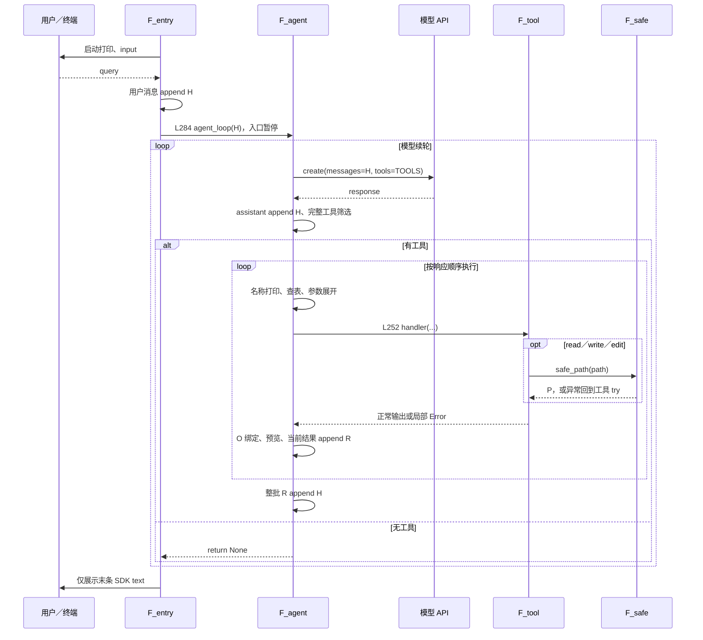
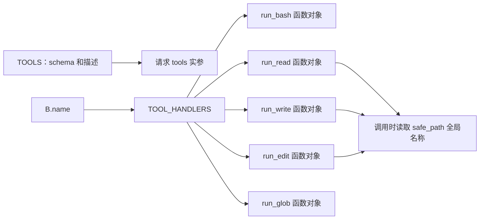
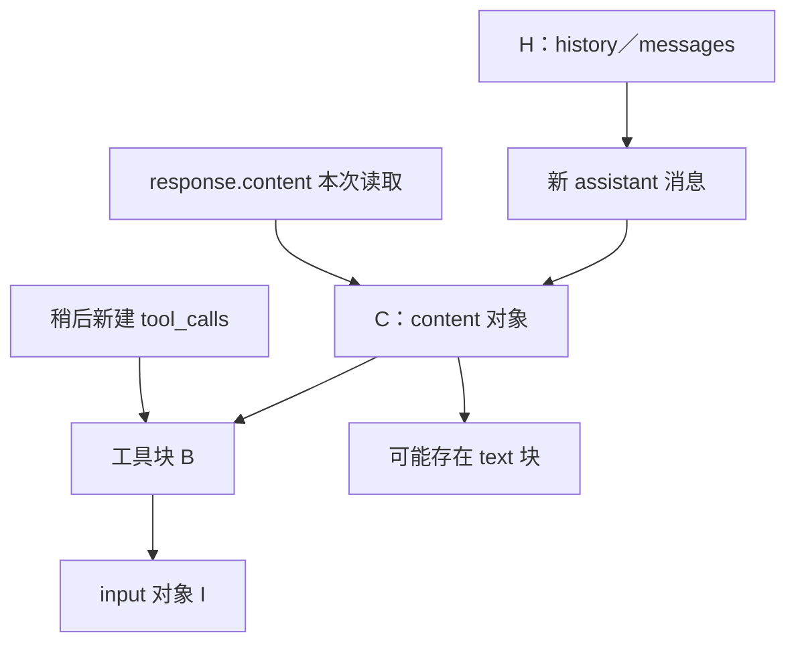
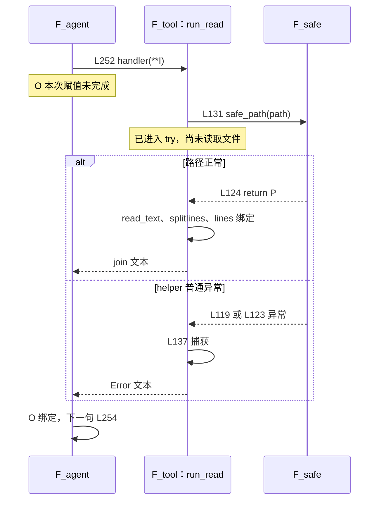
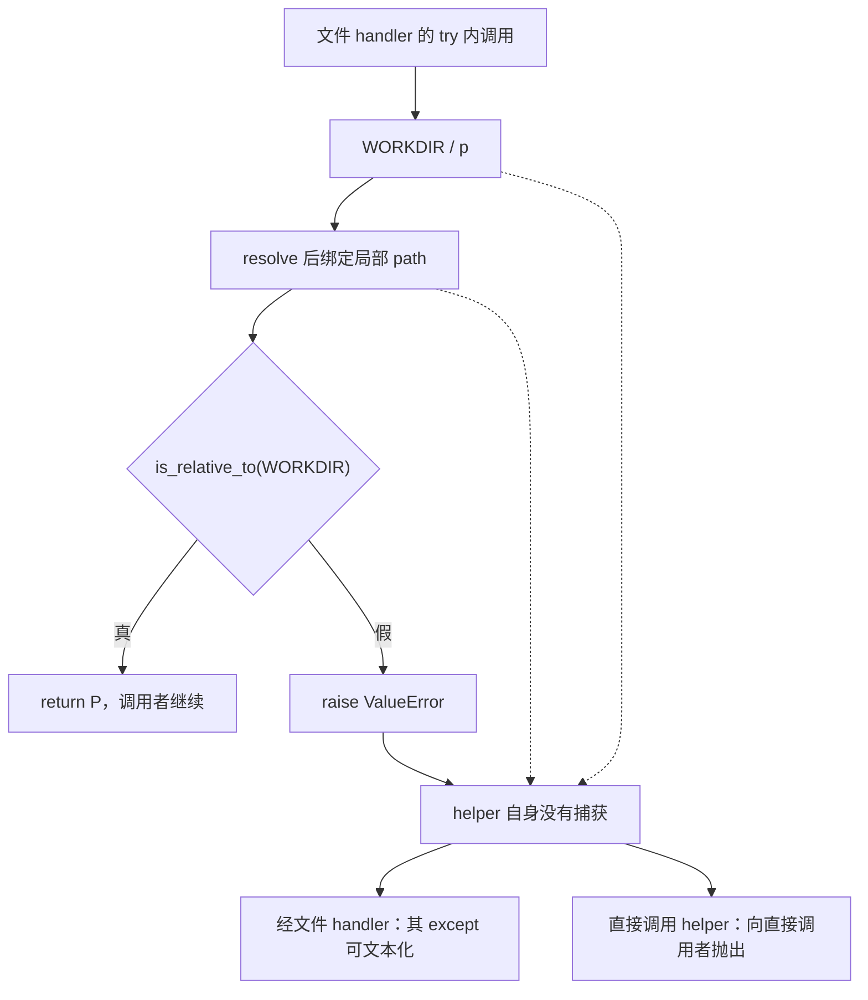
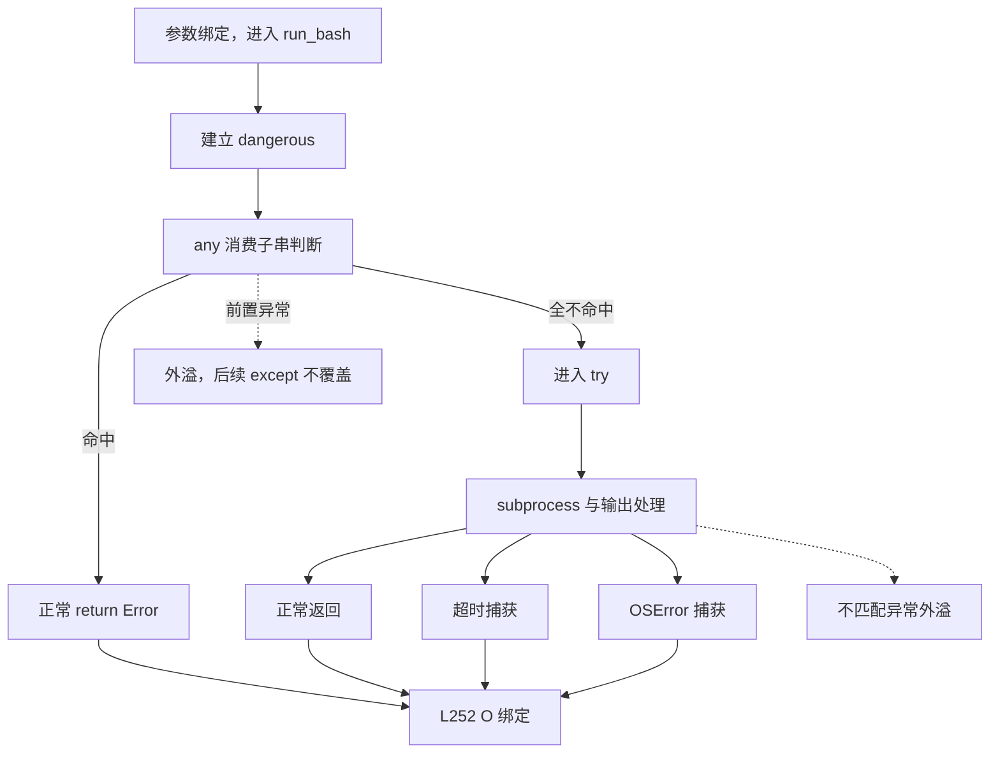
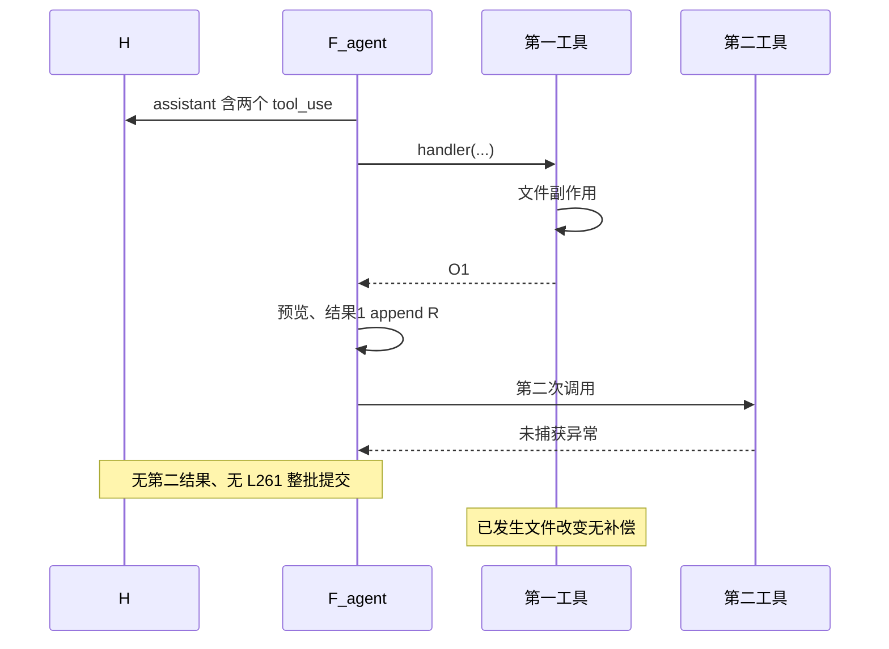
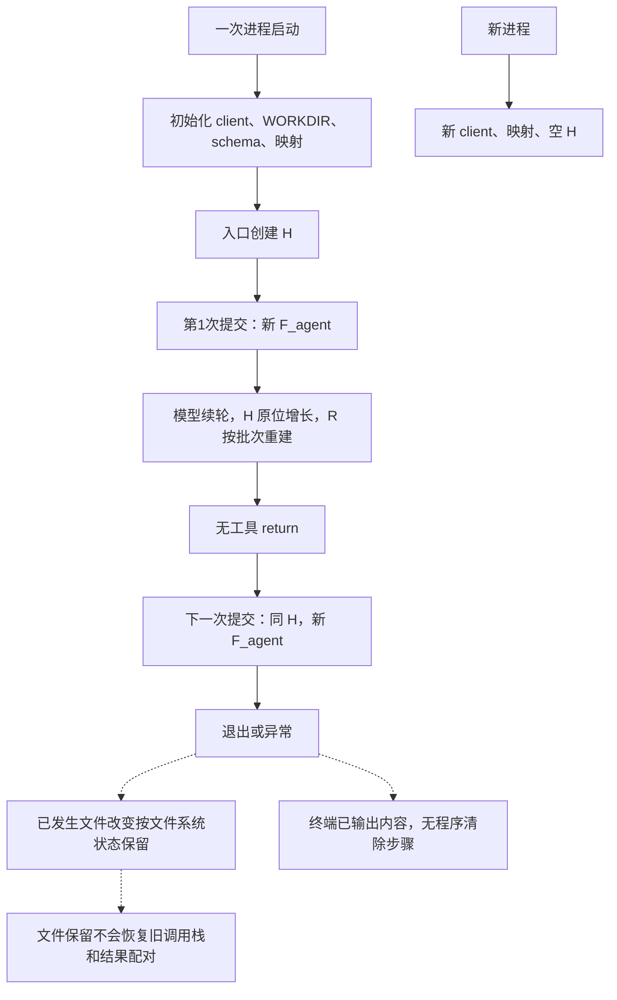

**s02 Tool Use：按实际调用链逐表达式、逐调用帧、逐提交点分析**

本文以当前 290 行 [s02_tool_use/code.py](../s02_tool_use/code.py) 为执行事实，结合[中文 README](../s02_tool_use/README.zh.md)、[英文 README](../s02_tool_use/README.md)、[根依赖](../requirements.txt)及直接相关断言。分析的是五工具、分发表、三个文件工具的路径 helper、bash 子串黑名单和同步 CLI。

正文的“默认路径”指现有函数与普通 SDK 块、字典、字符串；“源码静态推演”指未实际执行的设定输入与失败检查点；“扩展假设”指替换 handler、特殊对象等非默认情况。没有导入或运行目标模块，没有读取真实环境文件或密钥，没有请求模型、执行工具或运行用例。

## 阅读方式

每个关键单元按“连续原码 → 调用现场 → 求值和绑定 → 引用与副作用 → 返回后的下一句 → 失败边界”展开。工具章节是分发后的不同分支，章节排列不代表模型必须依次调用它们。

| 别名 | 实际对象或现场 |
|---|---|
| H | 入口 history 与 agent_loop.messages 指向的同一列表 |
| C | 某次读取 response.content 得到的对象；不是新增源码缓存 |
| B／I | 当前工具块及其 input |
| R | 当前有工具响应建立的 results 列表 |
| O | F_agent 中 output 的绑定 |
| P | safe_path 正常返回的 Path 对象 |
| F_entry | `__main__` 所在模块执行帧，不是额外的 CLI 函数 |
| F_agent | 当前 agent_loop 调用帧 |
| F_tool／F_safe | 当前 handler／safe_path 调用帧 |

普通 while、for 不创建新的函数局部作用域；推导式的迭代绑定不泄漏给后面的普通 for。不同函数帧的同名变量也不共用槽位。右侧失败只能先说明“本次赋值未完成”：旧绑定可能存在，异常却不会自动使用旧值回填。str、strip、lower、replace 形成文本结果值，但不承诺每次得到不同字符串身份；名称重绑定也不会改写过去保存的文本。

```text
进入 handler
≠ 检查通过
≠ 文件／进程副作用发生
≠ handler 正常返回
≠ O 本次赋值完成
≠ 预览成功
≠ 当前结果进入 R
≠ 整批 R 进入 H
≠ 下一请求已调用
≠ 模型已消费结果
≠ CLI 已展示回答
```

导航：

| 章节 | 章节 | 章节 | 章节 |
|---|---|---|---|
| [1 入口](#ch01) | [2 初始化](#ch02) | [3 SYSTEM](#ch03) | [4 工具声明](#ch04) |
| [5 用户提交](#ch05) | [6 SDK 请求](#ch06) | [7 assistant](#ch07) | [8 工具筛选](#ch08) |
| [9 R 与名称](#ch09) | [10 分发绑定](#ch10) | [11 read 下沉](#ch11) | [12 safe_path](#ch12) |
| [13 完整读取](#ch13) | [14 limit](#ch14) | [15 read 返回](#ch15) | [16 write](#ch16) |
| [17 edit](#ch17) | [18 glob 扫描](#ch18) | [19 glob 展示](#ch19) | [20 bash 黑名单](#ch20) |
| [21 子进程](#ch21) | [22 bash 捕获](#ch22) | [23 当前结果](#ch23) | [24 整批回填](#ch24) |
| [25 最终展示](#ch25) | [26 生命周期](#ch26) | | |

<a id="ch01"></a>
# 1. 入口、两层循环与执行地图

源码：[code.py L265–290](../s02_tool_use/code.py#L265)（连续原码）。

```python
if __name__ == "__main__":
    print("s02: Tool Use - four tools added to s01")
    print("Enter a question, press Enter to send. Type q to quit.\n")

    history = []  # 保存整段对话历史，传给 agent_loop 后由它就地推进
    while True:   # 外层交互循环：反复读用户输入，直到用户退出
        try:
            # \001/\002 tell Readline the ANSI escapes have zero display width.
            # \001/\002 是 readline 的「不可见定界符」：夹在中间的 ANSI 转义码
            # 不占显示宽度，这样青色提示符才不会让光标位置错乱。
            query = input("\001\033[36m\002s02 >> \001\033[0m\002")
        except (EOFError, KeyboardInterrupt):
            # Ctrl+D（EOF）或 Ctrl+C（中断）时退出。
            break
        # 输入 q / exit / 空行都退出。
        if query.strip().lower() in ("q", "exit", ""):
            break
        # 把用户输入加入历史，再交给 agent_loop 干活（可能触发多轮工具调用）。
        history.append({"role": "user", "content": query})
        agent_loop(history)
        # 打印模型最后的文字回复（跳过 tool_use 块）。
        for block in history[-1]["content"]:
            if getattr(block, "type", None) == "text":
                print(block.text)
        # 空行，让下一条提示符清爽地开始。
        print()
```

Python 实际先执行前面的顶层初始化、函数定义和映射建立，再判断 L265。这里先看入口，是为后面的下沉找到调用者，不是 Python 先运行 CLI 再回头导入。以非主模块加载时条件为假，入口不执行，但前面的顶层副作用仍可能发生；本文没有实际加载模块。

L266、L267 两次 print 顺序执行；第二段文本自身带换行，print 还默认追加换行。两次调用正常结束后，L269 才创建空列表并绑定 history。因此启动打印失败时，不能假设 H 已经建立。H 只在这里创建一次，不在每次用户提交时清空。

L270 是接收下一次用户输入的循环；L284 下沉的 agent_loop 内部循环，处理当前提交需要的模型请求与工具续轮。调用期间 F_entry 暂停在 L284，F_agent 可以请求多次、执行多个批次。只有正常返回后，入口才到 L286 读取末条消息，展示后再执行 L290 空行和下一次 input。



图示正常闭合路径，不表示所有异常都会转成文本。s02 没有统一 handler 包装：缺参、bash 前置检查异常或预览异常都可能穿过 F_agent，使入口不再执行展示。

CLI 的 break 退出外层循环；F_agent 的 return 只结束当前函数；工具 for 完成后才整批回填。当前没有权限分支的 continue，不应加入其他章节的“拒绝后直接跳下一工具”。bash 黑名单是 handler 内提前 return，调用者仍继续预览和普通结果追加。

<a id="ch02"></a>
# 2. 导入、环境修改与顶层失败

源码：[code.py L30–49](../s02_tool_use/code.py#L30)（连续原码）。

```python
import os              # 操作系统相关功能：读环境变量、判断平台（os.name）
import subprocess      # 子进程管理：用来真正执行模型生成的 shell 命令
from pathlib import Path  # 面向对象的路径操作：安全的读写、glob、相对路径判断

# readline 提供命令行编辑能力（历史记录、方向键、退格等）。
# 它在 Unix 上通常可用，但在 Windows 上可能不存在，所以用 try/except 包裹。
try:
    import readline
    # 以下四行是 macOS 上 libedit 库的 UTF-8 修复，
    # 让终端能正确处理中文等多字节字符的输入/输出。
    readline.parse_and_bind('set bind-tty-special-chars off')
    readline.parse_and_bind('set input-meta on')
    readline.parse_and_bind('set output-meta on')
    readline.parse_and_bind('set convert-meta off')
except ImportError:
    # 没有 readline（例如 Windows 自带的 Python）就直接跳过，不影响主逻辑。
    pass

from anthropic import Anthropic    # Anthropic 官方 Python SDK 的客户端类
from dotenv import load_dotenv     # 从 .env 文件加载环境变量（如 API Key）
```

先顺序导入 os、subprocess、Path，再进入 readline try。导入成功后四次 parse_and_bind 逐条调用；前一次配置已生效，不因后一次失败自动撤销。

except 只匹配 ImportError。缺少 readline 可以 pass；配置若抛出其他异常，初始化仍终止。try 实际也覆盖四次配置，若它们真的抛 ImportError，同样会匹配这个 except。它不是“所有终端问题均忽略”的保证。

readline 段结束后才导入 SDK 与 dotenv；这两行不在该 try 内，依赖缺失可直接外溢。注释中的平台说明不替代运行环境验证。

源码：[code.py L51–63](../s02_tool_use/code.py#L51)（连续原码）。

```python
# override=True：即使系统里已经存在同名环境变量，也用 .env 里的值覆盖它。
load_dotenv(override=True)

# 如果配了 ANTHROPIC_BASE_URL（走代理/自定义端点），
# 就移除可能打架的 ANTHROPIC_AUTH_TOKEN，避免两种鉴权方式冲突。
if os.getenv("ANTHROPIC_BASE_URL"):
    os.environ.pop("ANTHROPIC_AUTH_TOKEN", None)

WORKDIR = Path.cwd()  # 工作目录（workspace 根）：文件工具的「沙箱边界」就靠它来划定
# 创建 Anthropic 客户端；base_url 默认为官方 API，配了环境变量则走自定义端点。
client = Anthropic(base_url=os.getenv("ANTHROPIC_BASE_URL"))
# 从环境变量读取模型 ID；用 [] 取值，若 .env 里没配会直接抛 KeyError。
MODEL = os.environ["MODEL_ID"]
```

L52 调用 load_dotenv，传 override=True，返回值被忽略。按其用途，找到并加载的配置可以覆盖已有同名进程环境变量；本代码未将返回值作为后续启动门禁。这里不读取真实文件内容，也不由静态调用断言已经找到配置。

L56 读取端点并判断真假：缺失、空串为假，其他非空文本（包括空白）为真。真时 L57 从进程环境原位删除鉴权变量，默认 None 允许键不存在。源码没有恢复语句；这也不能证明任意代理配置都已正确认证。

L59 的 cwd 调用成功后才绑定 WORKDIR。它来自启动时进程目录，不是 code.py 目录。L61 再次读取端点并构造 client，成功后才绑定 client。L63 下标读取 MODEL_ID 晚于构造：缺失时可以是“环境已修改、WORKDIR 已有、client 已构造，但 MODEL 未绑定”。构造客户端不等于完成模型请求。

| 静态失败阶段 | 已可能完成 | 尚未完成 |
|---|---|---|
| readline 非 ImportError | 更早导入、部分配置 | 后续配置及初始化 |
| SDK／dotenv 导入失败 | readline 段 | load_dotenv、cwd、client、H |
| 环境加载／处理失败 | 更早导入、可能部分环境改变 | 后续绑定与 CLI |
| cwd 失败 | 环境处理 | WORKDIR 本次绑定、client |
| client 构造失败 | WORKDIR、环境副作用 | client 本次绑定、MODEL、H |
| MODEL_ID 缺失 | client 构造 | MODEL、SYSTEM、工具映射、H |

[依赖声明](../requirements.txt) 为 anthropic>=0.25.0、python-dotenv>=1.0.0、pyyaml>=6.0，只说明版本下限，不证明实际版本、安装完成、认证或 SDK 重试行为。源码还依赖支持其语法和 Path API 的解释器，三条依赖不是完整环境声明。

[用例加载器 L49–90](../tests/test_agent_loop_boundaries.py#L49) 使用 fake SDK、fake dotenv、临时 cwd 和测试 MODEL_ID；它隔离了外部调用，但不证明真实生产启动、认证和网络可用。本文没有运行加载器。

<a id="ch03"></a>
# 3. 平台分支与 SYSTEM

源码：[code.py L65–79](../s02_tool_use/code.py#L65)（连续原码）。

```python
# 根据操作系统告诉模型它面对的 shell 是什么语法，
# 这样它才知道该生成 cmd.exe 还是 Unix shell 的命令。
ENVIRONMENT_PROMPT = (
    "Windows: the bash tool runs through cmd.exe; use cmd.exe syntax, not Unix "
    "Bash or PowerShell syntax, and prefer dedicated file tools for file operations"
    if os.name == "nt"
    else "Unix-like: the bash tool runs the system shell"
)

# 系统提示词：给模型设定身份与行为约束——
# 「你是运行在 WORKDIR 下的编程 Agent，用工具解决问题，直接动手、少解释」。
SYSTEM = (
    f"You are a coding agent at {WORKDIR}. Environment: {ENVIRONMENT_PROMPT}. "
    "Use tools to solve tasks. Act, don't explain."
)
```

L67 括号内是条件表达式，不是元组。先判断 os.name 是否等于 nt，再选择对应文本；Windows 分支的两个相邻字面量组成一段说明。选中值形成后才绑定 ENVIRONMENT_PROMPT，未选分支不会产生另一套平台动作。

随后 f-string 读取当时 WORKDIR 与 ENVIRONMENT_PROMPT，和后续相邻字面量形成 SYSTEM。它是初始化时的文本值，不是运行时目录视图。以后即使扩展代码重绑 WORKDIR，SYSTEM 也不自动刷新；handler 内部则在调用时读取全局 WORKDIR，读取时点不同。

“使用 cmd.exe 语法”“优先专用文件工具”和 Act, don't explain 都是给模型的指令，不设置 OS 沙箱、人工批准或系统调用限制。是否遵循提示不能充当执行器的权限认证。

s02 没有导入 YAML。根目录存在 pyyaml 依赖不说明本章读取 YAML、加载技能或恢复其他状态。SYSTEM 正常建立后继续定义函数和容器，CLI 仍未开始。

<a id="ch04"></a>
# 4. schema 与函数映射

源码：[code.py L194–208](../s02_tool_use/code.py#L194)（连续原码）。

```python
TOOLS = [
    # 每个工具都是「name + description + input_schema」三件套：
    #   description  让模型知道这个工具是干什么的
    #   input_schema 约束参数的 JSON Schema，required 表示必填字段
    {"name": "bash", "description": "Run a shell command.",
     "input_schema": {"type": "object", "properties": {"command": {"type": "string"}}, "required": ["command"]}},
    {"name": "read_file", "description": "Read file contents.",
     "input_schema": {"type": "object", "properties": {"path": {"type": "string"}, "limit": {"type": "integer"}}, "required": ["path"]}},
    {"name": "write_file", "description": "Write content to a file.",
     "input_schema": {"type": "object", "properties": {"path": {"type": "string"}, "content": {"type": "string"}}, "required": ["path", "content"]}},
    {"name": "edit_file", "description": "Replace exact text in a file once.",
     "input_schema": {"type": "object", "properties": {"path": {"type": "string"}, "old_text": {"type": "string"}, "new_text": {"type": "string"}}, "required": ["path", "old_text", "new_text"]}},
    {"name": "glob", "description": "Find files matching a glob pattern; ** matches recursively.",
     "input_schema": {"type": "object", "properties": {"pattern": {"type": "string"}}, "required": ["pattern"]}},
]
```

执行到这里，前面的 def 已建立函数对象，但函数体尚未因定义而运行：没有读取文件、检查路径、扫描或启动子进程。TOOLS 右侧建立外层列表、五个工具记录和嵌套 schema，全部完成才绑定名称。

模型工具声明与本地参数检查分开。例如 limit 声明 integer，但本地没有统一 JSON Schema 校验；省略时由 Python 默认参数处理，错误类型可能一直进入函数体。SDK 或服务端内部另有何种验证，保持未知。

源码：[code.py L214–217](../s02_tool_use/code.py#L214)（连续原码）。

```python
TOOL_HANDLERS = {
    "bash": run_bash, "read_file": run_read, "write_file": run_write,
    "edit_file": run_edit, "glob": run_glob,
}
```

字典右侧读取当前函数对象后建立映射，不是保存函数名称字符串。以后仅重绑全局 run_bash，不会让已有字典项自动改指向新函数；需要修改映射项才改变查表结果。默认 CLI 没有动态管理命令。

| 工具名 | 保存的 handler | 是否调用 safe_path |
|---|---|---|
| bash | run_bash | 否 |
| read_file | run_read | 是 |
| write_file | run_write | 是 |
| edit_file | run_edit | 是 |
| glob | run_glob | 否，自行过滤结果 |



映射保存 handler 引用，而文件 handler 函数体中的 safe_path 是调用时全局名称查找。这两种引用时点不同。实际执行顺序是查表、关键字绑定、函数体检查；没有 execute_tool，也没有统一异常包装。

[成功 bash 辅助函数 L122–130](../tests/test_agent_loop_boundaries.py#L122) 同时换全局函数与映射项，因此不能把用例概括为“重绑名称就替换已有映射”。其中 check_permission、execute_tool 分支仅对存在这些函数的其他章节有效，s02 不存在它们。

<a id="ch05"></a>
# 5. 输入、退出与用户提交

源码：[code.py L271–284](../s02_tool_use/code.py#L271)（连续原码）。

```python
        try:
            # \001/\002 tell Readline the ANSI escapes have zero display width.
            # \001/\002 是 readline 的「不可见定界符」：夹在中间的 ANSI 转义码
            # 不占显示宽度，这样青色提示符才不会让光标位置错乱。
            query = input("\001\033[36m\002s02 >> \001\033[0m\002")
        except (EOFError, KeyboardInterrupt):
            # Ctrl+D（EOF）或 Ctrl+C（中断）时退出。
            break
        # 输入 q / exit / 空行都退出。
        if query.strip().lower() in ("q", "exit", ""):
            break
        # 把用户输入加入历史，再交给 agent_loop 干活（可能触发多轮工具调用）。
        history.append({"role": "user", "content": query})
        agent_loop(history)
```

input 提示中的 \001／\002 包围 ANSI 颜色，供 readline 计算不可见宽度，不属于用户输入文本。input 正常返回后，query 本次赋值才完成；提示打印或终端回显和 H 追加是不同动作。

EOFError、KeyboardInterrupt 发生在这里的 try 内，进入 except 后直接 break。第二次输入失败时，上次 query 可能仍绑定在模块帧，但不会提交旧值。strip/lower、SDK、工具调用均不在此 try 范围。

L280 顺序计算 strip、lower、membership，临时规范化值不写回 query。`" Q "`、`"EXIT"`、纯空白会退出；`"quit"` 不在元组内，会当普通提交；带两侧空白的正常问题仍以原文本进入 H。

非退出路径取得 H.append、形成用户字典并调用；成功后 H 增长，随后 L284 传同一个 H 建立 F_agent.messages。没有 history 复制、提交 hook、人工授权或客户端重建。此刻用户消息已提交，模型请求尚未调用；之后异常没有撤销该用户消息的语句。

[提示符 AST 检查](../tests/test_readline_prompts.py) 覆盖 s02 并检查彩色 input 的零宽标记，但不验证真实终端、readline 库或输入中断的运行表现。

<a id="ch06"></a>
# 6. SDK 请求与 response

源码：[code.py L225–233](../s02_tool_use/code.py#L225)（连续原码）。

```python
def agent_loop(messages: list):
    # messages 是完整对话历史，函数就地修改它、无返回值（与 s01 相同）。
    while True:
        # 【第 1 步】把对话历史 + 5 个工具定义发给模型。
        #   max_tokens=8000 限制本次回复最多生成多少 token。
        response = client.messages.create(
            model=MODEL, system=SYSTEM, messages=messages,
            tools=TOOLS, max_tokens=8000,
        )
```

F_entry 停在 L284。进入 F_agent 后 messages 指向 H；list 注解不执行运行时断言，也不自动把其他直接调用者的输入转成列表。

每轮先求 client.messages.create 这个可调用对象，再按书写顺序求关键字实参，最后调用。client.messages 是 API 属性，形参 messages 是历史，名称相同却不是同一绑定。

| 实参 | 来源与求值时点 | 本地没有做的事 |
|---|---|---|
| model | 本次读取全局 MODEL | 不重新读取 MODEL_ID |
| system | 本次读取全局 SYSTEM | 不重新拼目录和平台说明 |
| messages | 当前形参，即 H | 无 slice、list、copy 或 deepcopy |
| tools | 全局 TOOLS | 不直接传 Python handler 函数体 |
| max_tokens | 整数 8000 | 不累计为总会话预算 |

所有实参求值完成，还要等待调用正常返回，response 本次赋值才完成。第一次请求失败时本帧可能没有 response；续轮失败时可能仍有旧 response，但控制流沿异常退出，不继续处理旧响应。

这是同步调用，当前主流程等待期间不会执行下一工具。网络错误却不能证明远端未接收请求；本地失败与远端处理结果不是同一状态。源码没有显式 try、重试、备用模型或总轮次上限，SDK 内部认证、复制、序列化和重试行为不由此补写。

8000 是单次输出参数，不限制历史输入、工具输出、总请求次数、时间和费用。正常返回后的下一句是 L235 assistant 追加，不是先读 stop_reason 或先展示答案。

<a id="ch07"></a>
# 7. assistant 的历史提交点

源码：[code.py L234–235](../s02_tool_use/code.py#L234)（连续原码）。

```python
        # 【第 2 步】把模型回复（可能含 text / tool_use 块）作为 assistant 消息追加进历史。
        messages.append({"role": "assistant", "content": response.content})
```

先取得 H.append，再构造消息字典；字典构造中求 role 的常量值、content 的属性值，全部完成后才调用 append。属性读取失败时，本次 append 未发生；append 正常结束后，H 已增长，后面解析或工具失败都没有删除该消息的动作。

默认 SDK content 是块列表，H 保存该次读取所得 C，没有深拷贝块或 input：



新建 tool_calls 不复制 B。默认路径下，历史、响应和工具列表可以经不同容器引用同一块和输入。源码 L239 再次读取 response.content，没有先缓存到局部 C；若扩展对象让两次属性返回不同值，不能把默认引用图当成无条件身份保证。

当前账本：H 尾部为 assistant；本响应 R 尚未创建；当前响应任何 handler 都未进入；文件未因本响应工具改变；请求已经返回，CLI 最终展示尚未开始。assistant 入历史本身是一个提交点，不等于工具执行点。

字典或 append 的资源失败只用于界定静态范围，不作为普通小消息的常见故障。下一步 L238 才完整筛选工具。

<a id="ch08"></a>
# 8. 工具列表与无工具分支

源码：[code.py L237–242](../s02_tool_use/code.py#L237)（连续原码）。

```python
        # 【第 3 步】筛出所有 tool_use 块；一个都没有，说明模型已给出最终回答，结束循环。
        tool_calls = [
            block for block in response.content if block.type == "tool_use"
        ]
        if not tool_calls:
            return
```

重新读取 response.content、取得迭代器后，推导式逐块读取 type，与 tool_use 比较，再决定是否保留原块引用。完整推导式正常结束，才完成 tool_calls 本次绑定。

它不会筛出一个就立刻执行一个。源码静态推演：前块是有效 tool_use，后块缺 type，则临时列表可能已经收下前块，但当前推导式异常，for 尚未开始，前工具也没有执行。H 中 assistant 已存在；本轮 tool_calls 赋值未完成，不代表旧绑定一定不存在。

推导式 block 不泄漏覆盖普通循环槽位；以后 L246 的 block 是普通 for 绑定，不能混同。

| content 情形（源码静态推断） | 筛选行为 | 后续 |
|---|---|---|
| [] | 新空列表 | return None，不追加空 R |
| 一个空 SDK text | type 不匹配 | 正常 return，未必有可见答案 |
| 普通 SDK text | 无工具 | 入口稍后显示 |
| text 与工具混合 | 保留工具块，保序 | 工具执行，本轮文字不立即由入口显示 |
| None | 取得迭代器失败 | assistant 可能已保存 None，不到 return |
| 列表内普通 dict 块 | 默认没有 .type | 不自动改用下标 |
| 普通非空字符串 | 逐字符访问 .type 失败 | 不是通用字符串兼容；空串则无迭代 |
| 后块缺 type | 推导式中断 | 本响应工具一个未执行 |

分支只读工具列表真假，不读 stop_reason。end_turn 配 tool_use 仍执行，tool_use 配无工具仍 return。注释“模型已给出最终回答”是教学概括；真实实现只确认本轮没有待分发工具，不认证任务完成或非空文本存在。

[无工具断言 L219–240](../tests/test_agent_loop_boundaries.py#L219) 包含 s02，检查 API 一次、末条 assistant、无 content=[] 的 user 反馈。其 [辅助函数 L93–100](../tests/test_agent_loop_boundaries.py#L93) 把参数 None 替换为一个空 SDK text 列表，因此不能证明生产 content=None 兼容。

[有工具断言 L243–275](../tests/test_agent_loop_boundaries.py#L243) 设置 end_turn 和 tool_use，随后纯文本，检查两次请求、一个结果消息与 tool_1 ID。它证明按块分支；bash 已被替换，不能证明真实 shell 或黑名单。

无工具 return 回到 F_entry 的 L286；有工具进入 L245。没有 Stop、摘要 callback 或完成度认证。

<a id="ch09"></a>
# 9. R 建立与名称打印

源码：[code.py L244–250](../s02_tool_use/code.py#L244)（连续原码）。

```python
        # 【第 4 步】逐个执行工具调用并收集结果。
        results = []
        for block in tool_calls:
            # 用黄色打印「工具名」，便于观察循环过程（s01 打印的是具体命令）。
            print(f"\033[33m> {block.name}\033[0m")
            # 查分发表拿到对应处理函数；查不到就返回 Unknown，而不是直接崩溃。
            handler = TOOL_HANDLERS.get(block.name)
```

确认有工具后才创建新 R，再把 results 改绑到它。上轮 R 若已被 H 引用，依然保留，重绑定不是 clear。上轮若没提交 H，也不能把曾经存在的局部列表称为历史反馈。

普通 for 按顺序绑定 B，不新建 F_agent。每次 handler 调用才有独立 F_tool，因此 F_agent 的 handler、output 可以跨工具复用，handler 内的局部变量却不继承上次调用。

L248 先读取名称、形成彩色文本、print，之后才查映射。名称已经打印不证明路径或黑名单检查通过，也不证明 handler 已进入。名称属性读取／格式化失败时，print 尚未调用；print 也可能部分输出后失败。特殊格式化对象是扩展假设，普通名称走正常路径。

L250 取得字典 get，求 name，查询返回后才绑定 handler。不可哈希名称可以在这里失败；旧 handler 可能仍存在，但 L252 不会继续使用它。

正常完成这段时：H 尾部已有 assistant，R 可能含前工具结果，当前名称已打印，handler 已查询，当前工具函数体还没执行。下一句 L252 才建立工具调用。

<a id="ch10"></a>
# 10. 查表、展开与形参绑定

源码：[code.py L250–252](../s02_tool_use/code.py#L250)（连续原码）。

```python
            handler = TOOL_HANDLERS.get(block.name)
            # **block.input 把模型给的参数字典按关键字展开，例如 run_read(path="a.txt")。
            output = handler(**block.input) if handler else f"Unknown: {block.name}"
```

条件表达式先检查 handler，只计算选中分支。五个默认 handler 都是普通真值函数。get 找不到时返回 None，直接形成 Unknown 文本，不读取 input；扩展 falsey callable 的行为不同，但不属于默认映射。

已知分支取得 I 后用 ** 展开关键字，将各字段值绑定到对应形参。它不是 handler(I)，也不深拷贝字段值。调用机制可能使用内部容器，不意味着参数对象已经深复制。当前 handler 不会把 I 自动规范化为另一套输入。

完整顺序为：查询完成 → handler 绑定 → 条件选择 → I 读取和展开 → 关键字检查和形参绑定 → 进入新 F_tool → 函数正常返回 → O 本次赋值完成。类型注解没有插入转换或检查。

| 情形（源码静态推断） | 首个失败层或选支 | handler 状态 |
|---|---|---|
| 缺必需参数 | Python 参数绑定 | 函数体和局部 try 未进入 |
| 多出关键字 | 参数检查 | 不自动忽略 |
| I=None 等非 mapping | ** 展开 | 未绑定形参 |
| 普通非字符串键 | 关键字展开检查 | 未进入函数体 |
| 字段值类型错误 | 可能正常绑定 | 到函数实际操作才决定 |
| 未知工具，I=None 或不存在 | Unknown 分支 | 完全不读取 I |
| name 为普通 list | L250 get | 不到条件选支 |

例如 read_file 的 limit="2" 可以绑定，之后才在比较失败；缺 path 则根本不进入 read 的 try。本段没有统一包装，外溢穿过 F_agent 到 F_entry，入口 input 的 except 不接它。

固定参数样本账本如下。设 H 已有当前 assistant，R₀ 是此前局部结果前缀；第一工具时 R₀=[]。表中“可追加”都以预览、ID 和批末正常为前提：

| 样本 | 首个关键位置 | O／R | 文件／进程及终端 |
|---|---|---|---|
| read_file 缺 path | L252 绑定 | O 本次未完成，R=R₀ | 未读；名称后外溢，无预览 |
| read_file path=None | F_safe L119 | 本地捕获后 O=Error，可追加 R | 未读；名称后可预览 Error |
| read_file 解析后越界 | F_safe L123 | 同上 | 未打开目标 |
| read_file limit="2"，文件可读 | F_tool L134 | 本地 Error，可追加 | 已完整读取，未写 |
| write_file 缺 content | L252 绑定 | 本次未完成，R=R₀ | 未 mkdir、未写 |
| bash 缺 command | L252 绑定 | 同上 | 黑名单未建，进程未起 |
| bash command=None | F_tool L88 | 本次未完成，外溢 | handler 已进，try 未进，未起进程 |
| glob 缺 pattern | L252 绑定 | 本次未完成 | import／扫描未执行 |
| 未知工具 input=None | L252 Unknown | O=Unknown，可追加 | 无 handler；正常预览 |
| 普通不可哈希名称 | L250 查询 | 本次未完成，R=R₀ | 名称可能已打印，当前工具未进 |

以上都是源码静态推演。R 增长不是 H 已提交；后工具仍可能中断批次。

README 的分发示例用下标和无条件调用，实际是 get 与条件表达式。示意不覆盖 Unknown、绑定失败和输出链。下面先沿 read 分支下沉；其他正常或局部 Error 返回也都继续 L254。

<a id="ch11"></a>
# 11. read 的内层调用现场

源码：[code.py L127–131](../s02_tool_use/code.py#L127)（连续原码）。

```python
def run_read(path: str, limit: int | None = None) -> str:
    # 读文件工具：没有这个工具，模型只能靠 bash 的 cat/type，既不好限制也不好跨平台。
    try:
        # 先过 safe_path 校验，再按 UTF-8 读取并拆成行列表。
        lines = safe_path(path).read_text(encoding="utf-8").splitlines()
```

以 I=`{"path": "README.md", "limit": 2}` 为源码静态推演。F_agent 暂停于 L252，参数绑定成功，新 F_tool 中 path、limit 保存字段值；I 没有被替换。省略 limit 才采用默认 None，显式 None 直接绑定原值，类型注解不参与转换。

进入 try 后，L131 先取得 safe_path 和 path 实参，调用建立 F_safe，把 p 绑定到同一个路径值。F_tool 暂停在读取链内部，read_text 尚未取得并调用，lines 本次赋值没完成；F_agent 的 O 更没有完成本次赋值。



```text
I["path"] ─────────→ 原路径文本
F_tool.path ───────→ 同一实参值
F_safe.p ──────────→ 同一实参值
F_safe.path        要等 L119 完整 RHS 成功
F_tool.lines       要等 helper、读取、拆行全部成功
F_agent.output     要等整个 run_read 正常返回
```

F_safe 后面把自己的 path 绑定为 Path，不会把 F_tool.path 或 I["path"] 改成 Path。同名局部变量属于不同调用帧；没有“自动把规范化路径写回输入”的语句。

当前 H 尾部 assistant、R 前缀、终端已打印名称均保持；文件未打开，也无输出预览。接下来才执行 helper L119。

<a id="ch12"></a>
# 12. safe_path 的完整返回链

源码：[code.py L117–124](../s02_tool_use/code.py#L117)（连续原码）。

```python
def safe_path(p: str) -> Path:
    # 把用户/模型给的相对路径拼到工作目录上，并解析成绝对路径（含 ../ 的折叠）。
    path = (WORKDIR / p).resolve()
    # 关键安全检查：解析后的路径必须仍在工作目录内，
    # 否则说明有人用 ../../etc/passwd 之类的写法试图「逃逸」出沙箱。
    if not path.is_relative_to(WORKDIR):
        raise ValueError(f"Path escapes workspace: {p}")
    return path
```

F_safe 先读取 WORKDIR、p，执行 Path 组合，取得 resolve 方法并调用。整个右侧返回后才绑定本帧 path。None 等输入若在组合处失败，path 本次绑定未完成；这是新的 helper 调用，不继承上次 helper 的局部 path。

相对输入以 WORKDIR 为基准；绝对路径及 Windows 盘符／根路径遵循平台 Path 组合语义，不是简单字符串拼前缀。resolve 解析父目录、链接等，但未传 strict=True，成功不表示目标必须存在、是文件或可访问。

L122 对解析结果调用 is_relative_to，求布尔结果后再 not。它按路径组件关系判断，不是 startswith，也不读取文件内容认证可读写。resolve 与范围比较是两个阶段，不能说 is_relative_to 自己冻结了文件系统。

若越界，先形成含 p 的文案、构造 ValueError，再 raise；普通文本参数得到预期异常。若特殊对象在格式化时出错，异常可能更早发生，这是扩展假设。若未越界，L124 返回 P 引用，不创建文件句柄。

设 W 为 WORKDIR，下面按实际 resolve 结果给出静态条件，不创建样本：

| 输入条件 | helper 行为 | 仍不保证 |
|---|---|---|
| 普通内部相对路径 | 结果在 W 内则返回 | 存在、是文件、可读写 |
| sub/../note.txt，链接未改变结论 | 可解析回 W 内 | 不能见 .. 就拒绝 |
| W 内绝对路径 | 按平台解析后可通过 | 绝对输入不是一律拒绝 |
| 解析后位于 W 外的绝对／父目录路径 | ValueError | 不存在目标也不自动放行 |
| W 内不存在目标 | 可以返回 P | read 可能不存在，write 可能创建 |
| 空路径，结果为 W | W 相对自身成立 | 不校验文件类型 |
| None | 组合阶段可 TypeError | 未到范围判断，未读写 |
| 链接解析到外部 | 范围判断拒绝 | 不是系统隔离 |
| resolve 系统错误 | RHS 失败，异常外抛 | 不一定形成固定越界文案 |

P 只是路径描述，不是安全能力或不可变文件快照。检查结束到 read_text/write_text 之间可能有外部文件系统改变；单线程不排除其他进程活动。范围检查也不覆盖 bash 任意访问。glob 自行过滤，根本不调用 helper。



三种调用边界完整对照：

| 调用 | 传播／返回链 | 下一步 |
|---|---|---|
| 直接 safe_path(越界) | F_safe L123 → 直接调用者异常 | helper 不返回 Error |
| run_write(越界, 文本) | F_safe 抛 → F_tool L151 捕获 → Error return | 直接调用者取得字符串，或 agent 绑定 O |
| agent 中 write_file 缺 path | L252 绑定失败 | F_tool、F_safe 都未进入，无统一 Error |

当前没有 s02 专项断言覆盖 helper 的这些失败点，以上由源码推断。注释“沙箱”只能作为目的描述。正常返回到 read 后，下一步仍在 L131，继续获取 read_text；write/edit 则先完成 file_path 赋值。

<a id="ch13"></a>
# 13. 返回 Path 后的读取

源码：[code.py L131–131](../s02_tool_use/code.py#L131)（连续原码）。

```python
        lines = safe_path(path).read_text(encoding="utf-8").splitlines()
```

这里返回的仅是内层调用，不是整个 L131：

```text
F_safe return P
→ safe_path(path) 结束
→ 取得 P.read_text
→ 求 encoding="utf-8"
→ 完整读取，得到临时文本
→ 取得并调用 splitlines
→ 行列表形成
→ lines 本次绑定完成
```

源码没有保存中间 text 局部变量。read_text 成功但 splitlines 尚未成功时，lines 仍未绑定；不能把某个子表达式完成写成整条赋值完成。

UTF-8 指定解码方式，不保证输入字节合法。未配置替代策略时，非法字节可产生解码错误进入 L137。打开、读取、解码和拆行的失败阶段不同：没有 lines 不证明文件未打开或从未被部分读取。

完整读取和拆行之后才检查 limit。limit=1 不会变成底层只读一行，也不约束完整字符串和列表的内存开销。正常情况下原文件内容未被修改，但读取本身及相关系统观察已经发生。

文本层可能处理换行，splitlines 去除行分隔符，最后 join 用 \n 重新连接；不保留原始 CRLF 等形式或末尾单个换行。具体空白行为取决于行列表，不能概括成源码调用了 rstrip。

此时 H、R 尚未改变；lines 已有完整列表，下一句 L134 限行。若前面失败，则转 L137，不执行 limit。

<a id="ch14"></a>
# 14. limit 与二次绑定

源码：[code.py L132–136](../s02_tool_use/code.py#L132)（连续原码）。

```python
        # limit：只读前 N 行，用来避免一次把超大文件全部灌进上下文。
        # 截断时额外附一行提示，告诉模型「后面还有多少行」。
        if limit and limit < len(lines):
            lines = lines[:limit] + [f"... ({len(lines) - limit} more lines)"]
        return "\n".join(lines)
```

and 先测试 limit 真假；为假时连 len(lines) 与比较都不执行。真时才求 len、比较，再由 if 判断结果。schema 的 integer 和注解都没有在此插入 int 校验。

固定设五行普通文本，逐类静态推演：

| limit | 条件与执行 | 结果 |
|---|---|---|
| None、0、False | 左侧假 | 五行全文 |
| 空串、空 list／dict 等 | 左侧假 | 即使类型不符也可全文返回 |
| True | 按整数 1 比较和索引 | 一行加提示四行 |
| 2 | 2<5 | 两行加提示三行 |
| 5、6 | 比较假 | 全文，无提示 |
| -2 | 比较真，[:-2] | 三行加提示七行 |
| -10 | 比较真，切片为空 | 仅提示十五行 |
| "2"、普通非空 list／dict | 真值后与整数比较失败 | 完整读后局部 Error |
| 2.0、-2.0 | 比较真，随后浮点切片失败 | 局部 Error |
| 5.0、6.0 | 比较假，不做切片 | 可全文返回 |

bool 的索引语义来自 Python，不是本代码转换。自定义比较、真假或索引对象属于扩展假设，不把此表当成全类型验证。

L135 先切片，再形成提示单项列表，再拼接；完整 RHS 成功后才重绑 lines。提示中的 len(lines) 仍读旧完整列表。原列表没有被原位截短。

```text
旧 lines = 五行
lines[:-2] → 新列表，前三行
提示算式 len(旧 lines)-(-2) → 7
拼接 → 三行加一条“还有七行”
最后才把 lines 改绑到拼接结果
```

因此负数并未得到业务校验；“前 N 行”注释不能替代实际算式。切片失败时提示没开始；提示或拼接失败时二次赋值没完成，旧 lines 还可能绑定，但 except 返回 Error，不自动改成返回原全文。

L136 再 join 当前列表；空文件正常返回空字符串，不采用 bash 的 no output 占位。README 示例只有 if limit 后切片，省略比较、提示和捕获，不能据它解释真实浮点和负数路径。

<a id="ch15"></a>
# 15. read 的捕获与返回

源码：[code.py L136–139](../s02_tool_use/code.py#L136)（连续原码）。

```python
        return "\n".join(lines)
    except Exception as e:
        # 统一兜底：文件不存在、编码错误、越界等都以 "Error: ..." 文本返回给模型。
        return f"Error: {e}"
```

正常返回链是 join 成功 → F_tool return 表达式完成 → run_read 返回 → F_agent L252 调用完成 → O 本次绑定 → L254 预览 → L258 当前结果 → L261 整批历史。中间任一阶段尚未发生时，不能提前宣告后续完成。

helper、读取、limit 以及 return 内 join 的普通异常，都在 try 范围。except 绑定 e、形成 Error 文本后正常 return。调用者得到字符串，不是异常对象；没有自动附带栈或统一 is_error。

| 失败现场（源码静态推断） | lines | 文件访问 | 后续 |
|---|---|---|---|
| helper 拒绝／None | 首次赋值未完成 | 未进入 read_text | 本地 Error，可预览 |
| 打开失败 | 首次未完成 | 未成功读取内容 | 同上 |
| 读取／解码失败 | 首次未完成 | 可能打开、部分读取 | 同上 |
| limit 比较失败 | 完整列表已绑定 | 已完整读取 | 同上 |
| 浮点切片失败 | 二次赋值未完成 | 已完整读取 | 同上，旧列表不作为 fallback |
| join 普通异常 | 按前阶段 | 已读取 | 同上 |
| 缺 path 参数 | F_tool 未建立 | 未读 | 无本地捕获，外溢 |
| KeyboardInterrupt／SystemExit | 按实际阶段 | 不凭异常类型推断 | 不属 Exception，外溢 |

except 的文案形成若自身失败，也没有递归兜底，这是特殊／资源边界，不是普通错误的常见路径。局部 Error 不证明未读；没有结果块也可能是返回后预览失败。

[UTF-8 用例 L164–188](../tests/test_agent_loop_boundaries.py#L164) 经辅助函数直调 handler。其中 assert read == original.rstrip() 只针对“你好，UTF-8\n”这一输入，不证明实现调用 rstrip 或全面删除空白。它不经过 agent 的预览和批次回填。

[文本编码 AST 检查](../tests/test_utf8_text_io.py) 覆盖 s02，只检查相关调用有 encoding 关键字，不认证文件合法、路径边界或任意平台换行一致。

<a id="ch16"></a>
# 16. write 的目录与覆盖

源码：[code.py L142–152](../s02_tool_use/code.py#L142)（连续原码）。

```python
def run_write(path: str, content: str) -> str:
    # 写文件工具：整文件覆盖写入。
    try:
        file_path = safe_path(path)
        # parents=True 会按需创建中间目录，exist_ok=True 让目录已存在时不报错。
        file_path.parent.mkdir(parents=True, exist_ok=True)
        file_path.write_text(content, encoding="utf-8")
        # 返回写入字节数，方便模型确认「确实写进去了」。
        return f"Wrote {len(content)} bytes to {path}"
    except Exception as e:
        return f"Error: {e}"
```

F_agent L252 完成 path、content 绑定才进入函数；缺任一必需参数，以下 try 都未开始。L145 调 helper 时 F_tool 暂停，返回 P 后才绑定 file_path，原 path 仍保存输入值。

L147 取得 parent 路径，再取 mkdir 方法，传 parents=True、exist_ok=True 后才执行目录创建。取得 parent 本身不创建目录；多层 mkdir 若中途失败，先前建好的目录可能保留。exist_ok 也不意味着任何同名非目录对象都可接受。

L148 取得 P.write_text，传原 content 和 UTF-8 后执行整文件覆盖。代码没有读取旧内容比较、临时文件、原子替换或备份。库调用正常返回后，其返回值被忽略。

L150 另外计算 len(content)，格式化原 path，形成反馈。路径文案来自输入值，不是 P 的规范化字符串；bytes 实际是 Python 字符数。两个汉字 len=2，UTF-8 编码通常为六字节；涉及换行时磁盘字节还受文本层换行策略影响。显式 UTF-8 没有同时指定 newline。

| 静态阶段 | 目录状态 | 文件状态 | 反馈 |
|---|---|---|---|
| helper 失败 | 本调用未 mkdir | 本调用未写 | 本地 Error |
| mkdir 失败 | 可已创建部分中间目录 | 未到 write_text | Error 不撤销目录 |
| 写入在打开前失败 | mkdir 可已完成 | 文件可能未动 | 按实际失败阶段判断 |
| 覆盖打开后失败 | 保留 | 可截断或部分写入 | Error 不恢复 |
| 写入完整返回，反馈形成失败 | 保留 | 新内容可能完整存在 | 仍可能 Error |
| handler 正常返回 | 保留 | 完成该库调用 | O 尚待 F_agent 绑定 |

不能把类型、编码、I/O 错误一律推成相同磁盘状态；具体在打开前还是后发生，与库实现和系统过程有关。普通字符串写完后 len 和格式化一般正常，反馈形成异常仅标注静态边界。

相同内容仍会调用覆盖，因为没有相等跳过分支。P 是路径而非冻结文件句柄，检查后可能有外部变化。成功返回也没有额外 fsync 或持久化认证语句。

正常或 Error 都回到 L252，随后 L254、L258、L261。文件写好不表示当前结果已进 R，更不表示模型已消费；后续失败不会由 run_write 撤销。

[直调断言 L185–188](../tests/test_agent_loop_boundaries.py#L185) 检查写入非 Error、固定读取结果、编辑非 Error，以及最终字节等于“你好，跨平台\n”的 UTF-8 编码。它没有检验 bytes 文案数值或失败回滚，固定预期也不提升为任意平台换行保证。

README 的 write 示例省略 mkdir 与 except，不能用它替代实际步骤。

<a id="ch17"></a>
# 17. edit 的检查与覆盖

源码：[code.py L155–167](../s02_tool_use/code.py#L155)（连续原码）。

```python
def run_edit(path: str, old_text: str, new_text: str) -> str:
    # 编辑工具：只替换「第一处」精确匹配的文本，比整体重写更省 token、更安全。
    try:
        file_path = safe_path(path)
        text = file_path.read_text(encoding="utf-8")
        # 找不到 old_text 就明确报错——提醒模型必须提供原文中真实存在的片段。
        if old_text not in text:
            return f"Error: text not found in {path}"
        # 第三个参数 1 表示「只替换一次」，避免误伤文件里其它相同片段。
        file_path.write_text(text.replace(old_text, new_text, 1), encoding="utf-8")
        return f"Edited {path}"
    except Exception as e:
        return f"Error: {e}"
```

F_agent 停在 L252。L158 在 try 内调用 safe_path，返回后绑定 file_path；L159 完整 UTF-8 读取成功后绑定 text。新的 F_tool 不继承此前 read/edit 的局部变量。

L161 先执行 old_text not in text，是普通子串检查，不是正则、模糊匹配或结构化补丁。old_text 类型错误可在此失败，转 L166。本代码没有提前字符串校验。

若找不到，L162 正常 return Error，不抛异常、不经过 except、不执行 replace 或 write。此时文件已经读过，new_text 尚未用于替换；两个字段都不合适时，未找到可能先决定返回，new_text 类型不一定被检查。

存在时，L164 先取得外层 write_text 方法，再求 text.replace(old_text,new_text,1) 的完整结果，然后求 encoding，最后才调用覆盖。replace 失败意味着本次覆盖未开始，与覆盖中 I/O 失败不同。

| 样本（源码静态推演） | 文本计算 | 写盘 |
|---|---|---|
| 多处相同 old_text | 只替换首处 | 覆盖完整结果，不要求唯一 |
| old_text 不存在 | 正常提前 Error | 已读未写 |
| old_text 类型不兼容 | 可在成员判断失败 | 未替换未写 |
| old_text 存在，new_text 不兼容 | replace 失败 | write_text 尚未调用 |
| 空 old_text | 首处可在开头插入 | 可改变空／非空文件 |
| 空 new_text | 删除首处 | 仍覆盖整文件 |
| old_text 等于 new_text | 逻辑文本可不变 | 仍调用写入 |
| a 替换为 aa 后重复执行 | 仍含旧片段，可继续增长 | 不保证幂等 |

“只改首处”描述逻辑文本，不代表只修改该位置字节。整文件解码、换行处理和再编码可能影响其余字节。text 是读取时快照，外部后续改动不会自动合并；本代码没有锁、版本比较或冲突检测。

safe_path 仅 L158 调一次，L164 复用 P。README 的示意读写前各调用一次，与当前源码不同；不能把实际写入解释成再度范围检查。

未找到的 Error 与 except Error 来源不同。写入开始后的错误不能推断文件未变；写入成功后的反馈也还未进 R。两种正常字符串返回均到 L252，再 L254、L258、L261。直调 UTF-8 用例只验证特定替换，不证明反馈失败或重放行为。

<a id="ch18"></a>
# 18. glob 的完整扫描

源码：[code.py L170–180](../s02_tool_use/code.py#L170)（连续原码）。

```python
def run_glob(pattern: str) -> str:
    # 查找文件工具：按 glob 模式列文件，** 表示递归匹配，让模型先「定位」再「读取」。
    import glob as g
    try:
        # 用集合去重后再排序，保证输出稳定；root_dir 限定搜索范围在工作目录内，
        # 后面的 is_relative_to 再兜底过滤掉任何越界结果（例如符号链接指到外面）。
        matches = sorted({
            match for match in g.glob(
                pattern, root_dir=WORKDIR, recursive=True)
            if (WORKDIR / match).resolve().is_relative_to(WORKDIR)
        })
```

参数绑定成功后才运行 L172 局部 import，成功绑定 g，再进入 try。import 在捕获范围外，失败可穿过没有兜底的 F_agent。新调用不继承上次的局部 g；模块缓存是否命中属于 import 机制，不改变捕获位置。

L176 先取得 sorted，再计算集合推导实参。g.glob 收到 pattern、root_dir=WORKDIR、recursive=True，正常返回完整候选列表后才开始逐项过滤；这里不是扫描一项就交给模型。

每个 match 先计算 WORKDIR/match、resolve、is_relative_to。条件真才把原 match 加入集合。保留的是原匹配字符串，不是解析后路径或真实文件身份；不同字符串指向同一文件仍可能保留，相同字符串才去重。

集合完整构造后 sorted 完整排序，返回后才绑定 matches。某项过滤失败可中断整个右侧：先前临时候选不是可自动返回的前缀。没有 is_file 检查，因此合适模式可以返回目录；绝对模式也不能保证输出都被转成相对形式。


glob 不调用 safe_path。root_dir 是匹配基准，返回过滤也发生在扫描之后；不能写成底层绝不访问外部。父目录、绝对模式、链接等可能影响扫描，最终过滤不是 OS 扫描沙箱。

排序保证本次结果的字符串顺序，不保证文件系统跨时刻不变。库对部分扫描错误自身如何处理，不扩大成“所有 I/O 问题都会抛到这里”。try 内实际抛出的普通异常才由 L186 文本化；扫描可能已发生部分或全部访问。

正常成功下一句 L182，当前工具还没有结果进入 R。

<a id="ch19"></a>
# 19. glob 展示与返回

源码：[code.py L181–187](../s02_tool_use/code.py#L181)（连续原码）。

```python
        # 最多展示 200 条，防止结果过多刷屏、吃掉上下文。
        shown = matches[:200]
        if len(matches) > 200:
            shown.append("... (more matches omitted; narrow the pattern)")
        return "\n".join(shown) if shown else "(no matches)"
    except Exception as e:
        return f"Error: {e}"
```

matches[:200] 建立新 shown；不是原位缩短 matches。超过 200 才给 shown append 提示，不修改 matches。恰好 200 没提示，205 项得到前 200 加提示，普通文件名下通常为 201 行。

L185 先判断 shown；真时才 join，假时直接正常返回 no matches。它与扫描异常转 Error 不同。若文件名自身含换行，展示行数未必等于项数，不能把普通文件名用例计数扩展成任意文件名保证。

| 匹配数量／状态 | 返回 |
|---|---|
| 0 | 正常 no matches 占位 |
| 1–200 | 全部排序后文本 |
| 大于 200 | 前 200 项与固定提示 |
| try 内实际普通异常 | Error，不是无匹配 |

[递归用例 L191–203](../tests/test_agent_loop_boundaries.py#L191) 直调后比较集合 `{"root.py","one/one.py","one/two/deep.py"}`。它支持指定深度样本，不检验输出排序、越界或链接安全。

[大结果用例 L206–216](../tests/test_agent_loop_boundaries.py#L206) 建立 205 文件，断言 len(lines)==201 和最后一行固定提示。它只检查展示，不证明扫描只访问 200 个。

[辅助入口 L142–147](../tests/test_agent_loop_boundaries.py#L142) 在 s02 直接调用 run_glob，不经过模型分发、预览和 H 回填。README 示例省略过滤、捕获和无匹配占位，真实行为按原码。

正常文本、无匹配占位或本地 Error 返回都继续 L252 完成 O，再 L254 预览、L258 结果和 L261 批次；不直接跳下一请求。

<a id="ch20"></a>
# 20. bash 前置黑名单

源码：[code.py L85–90](../s02_tool_use/code.py#L85)（连续原码）。

```python
def run_bash(command: str) -> str:
    # 危险命令黑名单：只要命令里包含这些片段就直接拒绝执行。
    dangerous = ["rm -rf /", "sudo", "shutdown", "reboot", "> /dev/"]
    if any(d in command for d in dangerous):
        return "Error: Dangerous command blocked"
    try:
```

L252 参数绑定成功后，F_tool 才建立。L87 每次新建 dangerous 列表，再绑定局部名称，不是模块级规则表，也没有人工批准流程。

L88 取得 any、建立生成器，然后让 any 逐项消费。每个 d 进行 d in command，首项命中就停止，不再检查后面的子串。普通字符串匹配区分大小写，不分析 shell 引号、语法和真实命令身份。五项全不命中才进入 L90 try。

| 样本（源码静态推演，不执行） | 行为 | 边界 |
|---|---|---|
| rm -rf / | 第一项命中，正常 Error return | 未起子进程 |
| rm -rf /tmp/example | 也包含第一项 | 不是精确根目录命令识别 |
| echo sudo | sudo 命中 | 可以拦截只是输出文字的命令 |
| echo SUDO，且无其他命中 | 大小写不同不命中 | 不等于安全认证 |
| 空串 | 不命中 | 可进入 subprocess，不是缺参 |
| None | any 消费时成员判断 TypeError | try 尚未进入 |

None 路径：dangerous 已绑定、生成器已建立，但 any 在第一项求值时失败，if 没有得到正常判断结果。L89 未返回，L90 未进入，后面的捕获接不到。F_agent O 本次未完成；名称已打印，当前结果未进 R。

命中则没有异常，L89 字符串正常返回到 L252，O 完成本次赋值，接着 L254、L258。它既不是 helper 的 raise→except，也不是独立 permission 返回 False；没有特殊拒绝结果格式。



中英文 README L159 分别称“bash 不受限制，rm -rf / 还是能跑”和“bash is unrestricted — rm -rf / still runs”。该精确样本与当前 L87–89 冲突，正文以源码为准：会正常返回 Dangerous command blocked，subprocess 不执行。

但简单子串不构成完整 shell 安全机制，未命中也不是任意命令许可证明；cwd 不限制外部访问。未找到 s02 专项断言验证这些样本，上述为静态推演，不是运行结果。

<a id="ch21"></a>
# 21. 子进程与输出形成

源码：[code.py L90–104](../s02_tool_use/code.py#L90)（连续原码）。

```python
    try:
        # 在子进程中执行命令：
        #   shell=True          -> 交给系统 shell 解释（支持管道、重定向）
        #   cwd=WORKDIR         -> 固定在工作目录下执行
        #   capture_output=True -> 捕获 stdout / stderr
        #   text=True           -> 以文本返回而非字节
        #   errors="replace"    -> 无法解码的字符用替代符，避免崩溃
        #   timeout=120         -> 最多跑 120 秒，防止命令卡死
        r = subprocess.run(command, shell=True, cwd=WORKDIR,
                           capture_output=True, text=True, errors="replace",
                           timeout=120)
        # stdout + stderr 合并后去掉首尾空白。
        out = (r.stdout + r.stderr).strip()
        # 有输出就返回（截断到 50000 字符，防止超长内容撑爆上下文）；没输出给个占位提示。
        return out[:50000] if out else "(no output)"
```

黑名单正常未命中后，先取得 subprocess.run，顺序求 command、shell、cwd、capture_output、text、errors、timeout，再调用并同步等待。正常返回后才绑定 r；进程等待期间可能早已改变文件或外部系统，副作用不以 r 赋值为开始点。

| 参数 | 含义 | 不提供的保证 |
|---|---|---|
| command | 原绑定输入 | 未经过完整 shell 业务校验 |
| shell=True | 平台 shell 解释 | 不是系统沙箱 |
| cwd=WORKDIR | 子进程启动目录 | 不限制文件访问范围 |
| capture_output=True | 完整捕获两流 | 不限总输出量 |
| text=True | 文本接口 | 没指定 UTF-8 |
| errors="replace" | 解码错误替代 | 不识别正确编码 |
| timeout=120 | subprocess 超时参数 | 非整个会话总时限 |

编码默认由库和环境决定；replace 降低解码错误直接失败的风险，不保证中文正确，不影响文件工具明确用 UTF-8 的事实。

L102 顺序读取 stdout、stderr，拼接，再 strip，成功才绑定 out。完整 stdout 后接完整 stderr 不保留两流时间交错。strip 去除两端空白，纯空白也会变空串。

L104 先判 out 真值，真时才切前 50000 Python 字符，假时返回 no output。先完整捕获、解码、拼接和 strip 再截断；不是字节、token、终端列限制，更不是内存上限，没有额外截断提示。

源码不检查 returncode。因此非零退出可直接返回错误输出，甚至在无输出时返回 no output；不能据占位文字认证成功。超时前也可能已有副作用。

正常返回后到 L252，O 才完成本次绑定，接着 L254 预览。默认库给出正常文本；若扩展 mock 返回不正常对象，引发的类型错误只按实际 except 匹配，不能因为处于 try 就说全部异常都被捕获。

<a id="ch22"></a>
# 22. bash 专项捕获

源码：[code.py L104–110](../s02_tool_use/code.py#L104)（连续原码）。

```python
        return out[:50000] if out else "(no output)"
    except subprocess.TimeoutExpired:
        # 超时单独捕获，返回明确提示让模型知道该换策略。
        return "Error: Timeout (120s)"
    except (FileNotFoundError, OSError) as e:
        # 命令不存在等系统级错误：把错误信息交回模型，让它自行调整。
        return f"Error: {e}"
```

try 包住 subprocess、输出形成与正常返回表达式，但 except 只匹配两类指定异常。前置黑名单和调用前形参绑定不在其中。

TimeoutExpired 匹配后返回固定 Error: Timeout (120s)。120s 是写定文案，不是实测耗时；不返回部分捕获输出，也不撤销进程已做的动作。源码没有自建进程组管理，不能因此否认 subprocess 库自身超时处理，也不能声称全部后代进程必已终止。

第二分支捕获 FileNotFoundError／OSError；前者是后者子类，不是两个独立异常族。绑定 e、格式化后正常返回。shell=True 时，shell 内命令不存在通常可能表现为非零退出与 stderr，并不一定抛 Python FileNotFoundError；启动环境、cwd 等系统问题也可产生 OSError。

| 失败点（源码静态推断） | 当前处理 | 状态 |
|---|---|---|
| 缺 command | 绑定失败，无本地捕获 | handler 未进，未起进程 |
| command=None | 前置 try 外 | handler 已进，进程未起 |
| TimeoutExpired | 第一分支 | 进程可能运行并有副作用 |
| try 内 OSError | 第二分支 | 按实际阶段判断副作用 |
| try 内其他普通异常 | 不匹配则外溢 | O 本次未完成，不证明未执行 |
| KeyboardInterrupt／SystemExit | 不匹配 | 按发生阶段外溢 |
| L254 预览失败 | 已离开 handler | 进程可已完成，当前结果仍可能缺失 |

except 文案自身若格式化失败，没有递归包装。特殊对象和资源错误仅用于界定范围，不当默认普通系统异常的常见路径。

[子进程编码策略检查](../tests/test_subprocess_output_encoding.py) 的跨章 AST 范围覆盖 s02，检查 text=True 是否带 errors="replace"；该文件动态 UTF-8／GBK、stderr、空输出和超时用例针对 s07，不是 s02 动态证据。通用循环用例换掉 bash，也不验证此处真实进程。

无论黑名单、超时、OSError 文本还是正常输出，只要 handler 正常返回，都先到 L252 完成 O，再到预览；没有直达模型的通道。

<a id="ch23"></a>
# 23. O、预览与当前结果

源码：[code.py L254–258](../s02_tool_use/code.py#L254)（连续原码）。

```python
            print(str(output)[:200])
            # 每条结果都按 Anthropic 的 tool_result 格式回填：
            #   tool_use_id 关联到请求它的那个 tool_use 块（block.id）
            #   content     是工具的实际输出
            results.append({"type": "tool_result", "tool_use_id": block.id, "content": output})
```

到这里，已知 handler 已正常返回（可以返回局部 Error），或 Unknown 分支已形成文本，L252 的 O 本次赋值已经完成。handler 抛出的未捕获异常不会到这里。

L254 先取得 print，再求实参：取得 str、读取 O、完整转换、对转换结果做 [:200]，最后才调用 print。200 限制的是转换后的终端字符展示，不限制完整转换成本，不限制原 O 或历史 content。

这里没有 output=str(output)。默认五 handler 与 Unknown 都返回字符串；预览转换并未把 F_agent 的 O 改绑。扩展 handler 若返回非文本对象，str 可能失败或触发自定义行为；即使转换正常，后面仍保存原对象，不能推导 SDK 一定接受它。若原对象可变且还有外部别名，后续原位变化也可能被历史看到，默认字符串路径不产生这种实时变化。

print 自身可以部分输出后失败，例如终端写入异常。此时 O 已绑定，文件或进程副作用可已发生，但当前结果尚未进入 R。handler 的 try 已结束，不能回头捕获这个异常；也没有 Post 或 finally 负责补交。

预览正常后，L258 才取得 R.append，再构造字典并读取 B.id、原 O，字典完成才 append。没有统一 str、is_error 或 ID 校验；复制 block.id 用于协议配对，不等于额外认证 ID 唯一或正确。ID 访问失败可以发生在工具和预览都已成功之后。


每个箭头都可有独立失败窗口。图中的先后关系不是事务保证：后一步失败没有反向撤销前一步的语句。

| 静态现场 | O 本次绑定 | 当前结果 | 文件／终端 |
|---|---|---|---|
| handler RHS 外溢 | 未完成，旧 O 可能还在 | 未追加 | 按工具阶段，名称可能已打印 |
| str／切片失败 | 已完成 | 未追加 | 工具可完成，无成功预览保证 |
| print 失败 | 已完成 | 未追加 | 可部分输出；工具副作用保留 |
| ID 读取失败 | 已完成 | 未追加 | 预览已完成 |
| R append 正常返回 | 已完成 | 已在局部 R | 尚未整批提交 H |

对字符串 O，后续把 output 改绑成别的字符串不会改变旧结果文本。R 保存旧值，不是对 output 名称的实时引用。

三种输出限制要放回各自阶段：

| 位置 | 实际限制 | 没有限制 |
|---|---|---|
| bash [:50000] | strip 后返回字符串 | 完整捕获、解码与合并 |
| glob [:200] | 展示项 | 完整扫描、过滤、排序 |
| 预览 [:200] | 完整 str 后的终端字符 | 原 O、历史、输入参数 |

所以 glob 的完整结果文本可能超过预览可见部分，文件读取结果也可以完整进入 R。终端只看到前 200 字符不意味着模型只会收到这部分。

<a id="ch24"></a>
# 24. 多工具与整批提交

源码：[code.py L258–261](../s02_tool_use/code.py#L258)（连续原码）。

```python
            results.append({"type": "tool_result", "tool_use_id": block.id, "content": output})

        # 【第 5 步】把工具结果作为 user 消息送回，循环回到顶部继续下一轮推理。
        messages.append({"role": "user", "content": results})
```

当前结果成功 append R 后，for 才移向下一 B。下一工具的 I 来自原响应，不会把前工具 O 自动代入、重新生成或发送给模型再决定。工具可以通过文件系统看到先前写入，但那是共享副作用，不是参数自动重算。

全部工具正常结束后，L261 先取得 H.append，形成 user 字典，content 引用当前 R，调用成功才使 H 增长。没有深拷贝；之后新批次 results=[] 不清空旧 R。工具结果使用 user role 是本实现协议组织方式，不表示终端又输入了一条用户消息。

此后回到 while 顶部 L230 请求。R 已在 H，不等于请求已经发出；调用 SDK 也不等于远端已接受并消费，更不等于下一响应已经取得。下一请求失败不会删除 H 中结果或撤销磁盘变化。

## 24.1 第二工具失败，旧 O 不是备用值

源码静态推演：第一工具正常得到 O₁，预览并 append R；第二工具在 L252 RHS（例如缺参）失败：

```text
第一工具 O₁ 已绑定、R=[结果1]
→ 第二工具名称已打印
→ handler 查询正常
→ 第二次调用 RHS 失败
→ O 本次赋值没有完成，旧 O₁ 可能仍绑定
→ 异常穿过 F_agent
→ 不做第二次预览
→ 不追加第二结果
→ 不执行 L261
```

H 尾部仍可能是含两个 tool_use 的 assistant，第一结果只在局部 R，文件却已由第一工具改变。普通循环不新建作用域解释了旧绑定为何可能存在；异常控制流解释了它为何不被回填。若第二工具已经返回、只是预览失败，则 O 已是 O₂，不能再套用“本次 RHS 未完成”的说明。



## 24.2 两工具批次的六种后果

固定第一工具 write_file 成功写入 F₁，预览并追加结果1。第二工具分别取以下情况；均为源码静态推演，后续未另有失败：

| 第二工具 | 已发生动作 | R 与 H | 第一工具副作用 |
|---|---|---|---|
| edit 未找到旧文本 | 已读，正常 return Error | Error 可预览并入 R，批次可闭合 | F₁ 保留 |
| read limit="2" | 已完整读，本地捕获 Error | 同上 | F₁ 保留 |
| handler 缺参 | 未进函数体，绑定外溢 | R 仅结果1，未执行 L261 | F₁ 保留 |
| bash command=None | 前置检查外溢，未起进程 | 同上 | F₁ 保留 |
| 第二次 write 写完，预览失败 | F₂ 已改变，O₂ 已绑定 | 第二结果未追加，批次中断 | F₁、F₂ 都可保留 |
| 未知工具 input=None | 不进 handler，正常 Unknown | 可预览、入 R，批次可闭合 | F₁ 保留 |

“可闭合”仍要求 ID、R/H append 正常，并且后续没有其他工具外溢。主动 Error 与局部 Error 是函数正常返回；未包装异常才会阻断这条正常回填链。没有“批次失败就恢复批次开始状态”的实现。

## 24.3 同一写盘副作用，不同反馈终点

固定当前 write_file 已完整写盘并形成反馈，O 已绑定。下面只改变失败点：

| 后续失败点（源码静态推断） | 已完成 | 尚未完成 |
|---|---|---|
| L254 str／预览 | 写盘、handler 返回、O 绑定 | 当前结果 append R、整批 H、下一请求 |
| L258 ID 读取 | 上述及完整预览 | 当前结果 append R、整批 H |
| 后一工具外溢 | 当前结果已进 R | 整批 H、下一请求 |
| L261 消息形成失败 | 本批局部结果完备 | 尚未调用 append H |
| L261 append 调用未正常结束 | R 已完备、工具副作用已发生 | 不能把 R 完备当成历史成功提交确认 |
| 下一次 L230 请求失败 | R 已成功进入 H | 下一响应未正常取得，CLI 最终展示未开始 |

对普通内置 H，资源失败只是静态检查点；扩展自定义 append 还可能有其他行为。这里不伪称默认小列表频繁失败，也不根据 append 前的局部状态认证它已经成功。源码没有补交、回滚或异常后继续 CLI 的统一处理。

## 24.4 四轮完整主例

以下为源码静态推演，不是实际模型记录。设新 CLI 的 H 初始为空，W 内已有可读的 docs/testing.md，内容包含测试说明。模型按如下设定返回，所有工具、预览和追加均正常；没有实际创建这些样本：

```text
用户：查明项目测试方式，并写入说明文件
响应1：glob，pattern="**/*testing*.md"，id=g1
响应2：read_file，path="docs/testing.md"，id=r1
响应3：write_file，path="test-guide.md"，content=根据读取结果整理的说明，id=w1
响应4：仅 SDK text 最终回答
```

响应内容是讲解设定，不证明仓库真实存在这些文件或真实测试命令。工具参数由各次模型响应提供，上一轮结果不会由执行器自动改写下一轮字段。

| 执行边界 | H 长度／增量 | R、O | 文件与终端 |
|---|---|---|---|
| 用户 append 后，请求1前 | 1：用户 | 本响应 R 未建 | 输入已完成，无工具 |
| 响应1 assistant append | 2：加 A₁ | 筛选 glob，建立 R₁ | 尚未扫描 |
| glob 返回和预览后 | 仍 2 | O=匹配文本，R₁=[g1结果] | 扫描完成，名称和预览已打印 |
| R₁ append 后，请求2前 | 3：加 user(R₁) | R₁ 被 H 引用 | 未写文件 |
| 响应2 assistant append | 4：加 A₂ | 建立新 R₂，不清空 R₁ | 当前 read 尚未完成 |
| read 返回、预览、批末 | 5：加 user(R₂) | O=说明文本，R₂=[r1结果] | helper、完整读取已完成 |
| 响应3 assistant append | 6：加 A₃ | 建立新 R₃ | write 尚未完成 |
| write 返回与预览 | 仍 6 | O=写入文案，R₃=[w1结果] | test-guide.md 已由设定调用写入 |
| R₃ append 后，请求4前 | 7：加 user(R₃) | 三个旧结果列表都在 H | 写盘和预览已发生 |
| 响应4 assistant append | 8：加 A₄ | tool_calls=[]，本响应不建 R | 最终文字在 H，尚未 CLI 展示 |
| L242 return 后 | 仍 8 | F_agent 结束 | F_entry 才开始 L286 |
| text 打印后 | 仍 8 | 历史不因展示增长 | 最终回答完成终端展示 |

请求序号、工具批次序号和文件副作用次数是不同计量：本例四次请求、三个工具批次、一次写入；同响应若含五工具仍只建立一个 R 和一条批末 user 消息。源码没有维护这些序号，它们只是静态账本。

请求2在调用边界得到包含 R₁ 的 H；模型是否实际消费需请求和响应进一步完成，不能在 R₁ append 时就宣布。本例每轮均设定正常，失败情况按前表回到对应阶段，不补造不存在的结果。

## 24.5 错误来源与异常边界对照

| 现场 | 当前处理 | 历史、文件和终端含义 |
|---|---|---|
| bash 黑名单正常命中 | 正常 Error return | 名称已打印，未起进程；结果仍需预览和回填 |
| edit 未找到旧文本 | 正常 Error return | 文件已读未写；可闭合批次 |
| 文件 handler try 内普通异常 | 本地 Error | 文件状态随阶段；不能由前缀推断未读未写 |
| glob import | try 外异常 | 名称可已打印，未进入扫描 try |
| bash 非匹配异常 | 外溢 | 可已有进程副作用，当前结果不保证存在 |
| 参数绑定失败 | 无统一捕获 | 函数体未进；以前工具仍可有副作用 |
| SDK／筛选失败 | 无统一捕获 | 用户或 assistant 可已入 H；当前工具可尚未执行 |
| CLI input EOF／中断 | 入口局部捕获后 break | 没有本次新用户消息或请求 |
| 工具中的 KeyboardInterrupt／SystemExit | 不由 Exception 捕获 | 按实际阶段外溢，不等于业务拒绝 |

没有统一失败事务、重放、去重或恰好一次保证。工具结果带 Error 前缀、没有结果块、结果已经进 H，是三个不同事实。

<a id="ch25"></a>
# 25. return 与最终展示

源码：[code.py L241–242](../s02_tool_use/code.py#L241)（连续原码）。

```python
        if not tool_calls:
            return
```

tool_calls 为空时 return 的值是 None，作用是结束当前 F_agent，不退出 CLI，也不是工具结果或完成证书。本响应不会创建并回填空 R；旧 results 即使还绑定也不再使用。

源码：[code.py L284–290](../s02_tool_use/code.py#L284)（连续原码）。

```python
        agent_loop(history)
        # 打印模型最后的文字回复（跳过 tool_use 块）。
        for block in history[-1]["content"]:
            if getattr(block, "type", None) == "text":
                print(block.text)
        # 空行，让下一条提示符清爽地开始。
        print()
```

入口没有接收函数返回值，而是继续读取原 H。只有 L284 正常返回，才计算 history[-1]、取 content、取得迭代器。末条消息缺失或形状错误的异常不由 input except 捕获。

普通 for 每次把入口自己的 block 绑定到末条元素；它不与已经结束的 F_agent.block 共用局部槽位。getattr 获取 type，缺失时默认 None；仅 type=="text" 才读取 block.text 并 print。

| 末条 content／元素 | 展示行为（源码静态推断） |
|---|---|
| SDK text 列表 | 按列表顺序打印文字 |
| 空列表 | 不打印回答，仍可打印空行 |
| 空 SDK text | 可只出现空行，没有有效内容认证 |
| 普通 dict 块 | getattr 默认不按键取 type，可被跳过 |
| 普通字符串 | 逐字符通常没有 type，可能全跳过 |
| None | 无法迭代；但正常 agent 对 None 更早已筛选失败 |
| text 属性读取／print 失败 | 展示中断；已入 H 的回答不删除 |

本实现不是通用消息渲染器，不反向查找以前的答案。早先含 text 与 tool_use 的混合响应不会在这里被重放，CLI 仅展示最后一次无工具响应中的 SDK text。

最终 assistant 已入 H、agent 已 return、print 已调用、终端完整展示是不同状态。print 可部分成功，源码没有终端展示确认协议。正常展示后 L290 打印空行，再返回 CLI input；不是再请求模型。

边界用例中的 done 只是 fake 返回文字，不认证用户目标完成；它检查模型循环行为，也未执行真实 CLI 展示。这些限制来自测试替换范围和源码，不添加独立完成审核机制。

<a id="ch26"></a>
# 26. 生命周期与退出

源码：[code.py L265–284](../s02_tool_use/code.py#L265)（连续原码）。

```python
if __name__ == "__main__":
    print("s02: Tool Use - four tools added to s01")
    print("Enter a question, press Enter to send. Type q to quit.\n")

    history = []  # 保存整段对话历史，传给 agent_loop 后由它就地推进
    while True:   # 外层交互循环：反复读用户输入，直到用户退出
        try:
            # \001/\002 tell Readline the ANSI escapes have zero display width.
            # \001/\002 是 readline 的「不可见定界符」：夹在中间的 ANSI 转义码
            # 不占显示宽度，这样青色提示符才不会让光标位置错乱。
            query = input("\001\033[36m\002s02 >> \001\033[0m\002")
        except (EOFError, KeyboardInterrupt):
            # Ctrl+D（EOF）或 Ctrl+C（中断）时退出。
            break
        # 输入 q / exit / 空行都退出。
        if query.strip().lower() in ("q", "exit", ""):
            break
        # 把用户输入加入历史，再交给 agent_loop 干活（可能触发多轮工具调用）。
        history.append({"role": "user", "content": query})
        agent_loop(history)
```

H 在 CLI 循环外建立，下一用户提交沿用同一列表；但每次 agent_loop(history) 都建立新的 F_agent。前次 frame 中 response、results、output 不作为新调用的局部值恢复。旧 R 若已进入 H，由历史引用保留；局部名称消失不等于历史内容消失。

WORKDIR、client、TOOLS 和 TOOL_HANDLERS 是模块级状态，不随每次输入重建。启动 cwd 决定文件基准；子 shell 内的 cd 不会自动改写 Python 的 WORKDIR 绑定。源码没有会话 ID 分区或历史序列化。



| 场景 | H | R／O | 模块对象与 WORKDIR | 文件／终端 |
|---|---|---|---|---|
| 同一 F_agent 续轮 | 原位增长 | 同帧重绑定；R 每有工具响应新建 | 保留 | 副作用不回滚 |
| 下一用户提交 | 沿用 | 新 F_agent；旧已提交 R 仍在 H | 保留 | 先前文件和输出可能仍在 |
| q／exit／空白正常退出 | 不追加退出输入 | 不补交局部批次 | 无额外清理 hook | 不额外请求或保存历史 |
| input EOF／中断 | 不提交本次输入 | 直接 break | 无 Stop/finally | 已有输出无撤销 |
| SDK／工具等未捕获异常 | 按最后成功 append | 局部结果可未提交 | 无统一恢复 | 已发生副作用不自动恢复 |
| 同 cwd 新进程 | 新空 H | 新调用，不恢复旧 R／O | 重新构造，同目录基准 | 既有文件不恢复对话 |
| 不同 cwd 新进程 | 新空 H | 同上 | 新目录基准，SYSTEM 重新形成 | 旧文件物理存在不表示新基准相同 |

退出没有 Stop、finally、额外保存或批次补交。H 在进程中有引用，不等于在退出后自动恢复；未捕获异常时对象是否仍被 traceback 等引用也不由“函数结束”决定。没有上下文恢复不等于安全擦除或所有引用立即释放。

同目录重启可以再读到上次写过的业务文件，但文件不包含自动恢复旧历史、tool_use_id、局部候选、R／O 或暂停栈的协议。错误恢复、历史配对和外部副作用责任不能由“文件还在”替代。

从本章已经证明的边界看，当前实现承担同步请求、顺序工具分发、三个文件工具的路径检查、部分异常文本化以及正常路径整批反馈。模型输出、参数绑定、文件操作、终端打印和历史提交各有独立成功条件；源码没有统一事务、完成认证或恢复机制。正文到此仅说明当前执行事实，不增加后续章节功能或改造建议。
