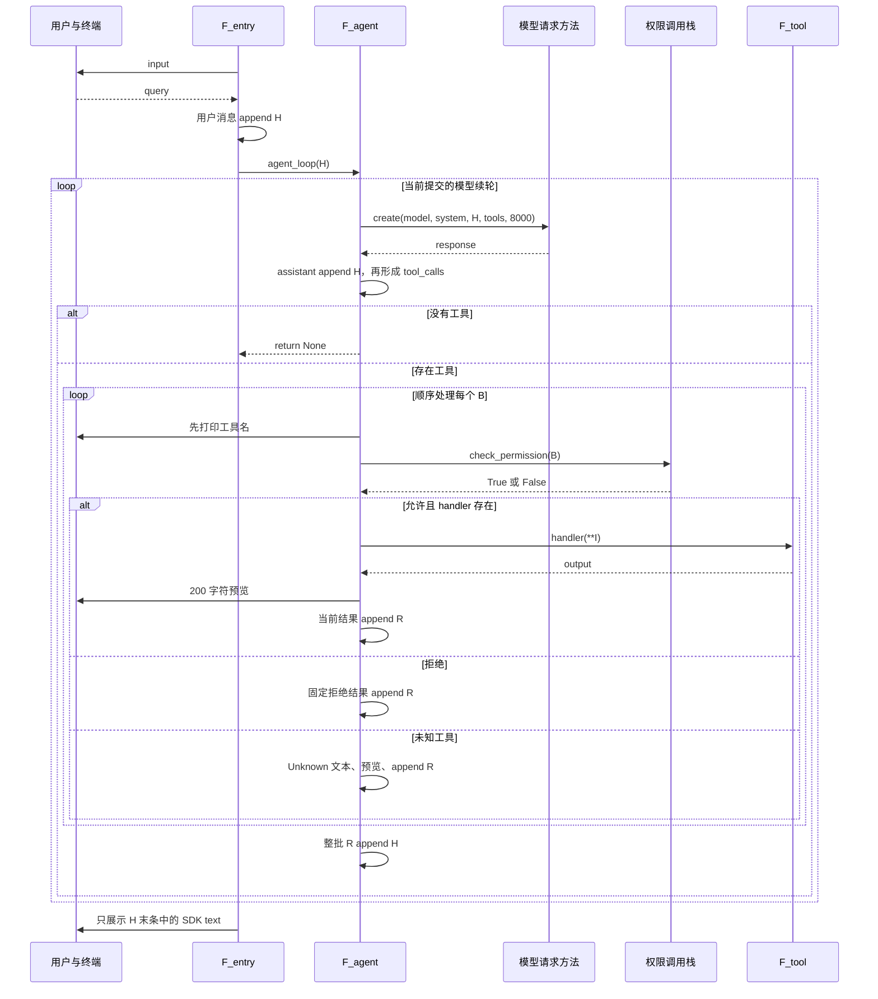
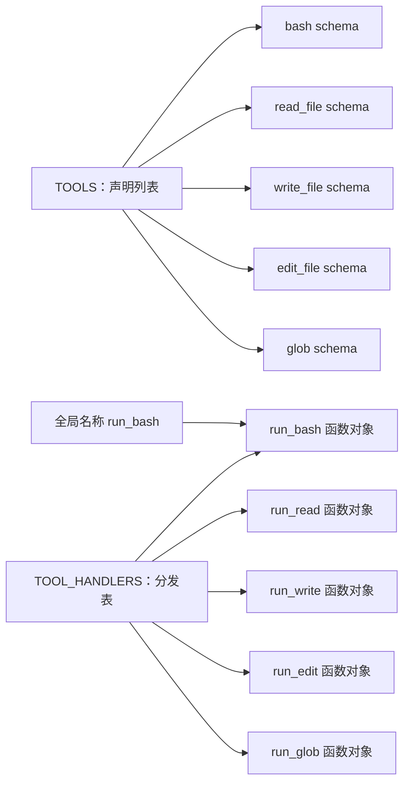
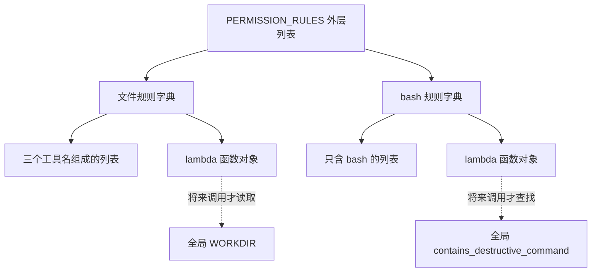
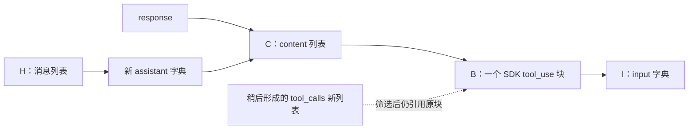
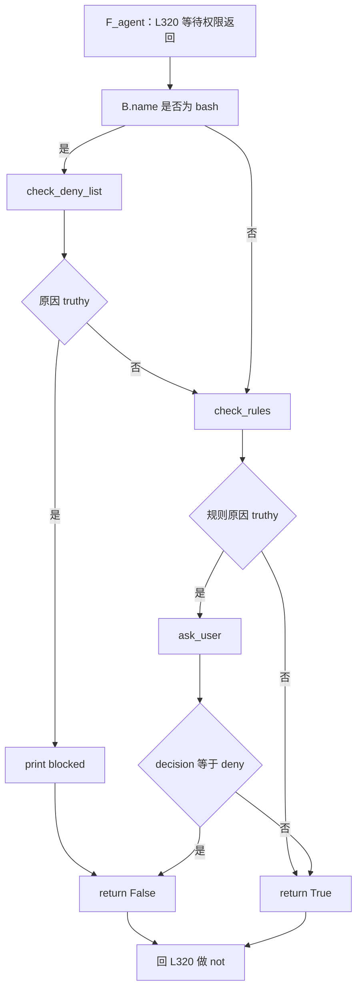
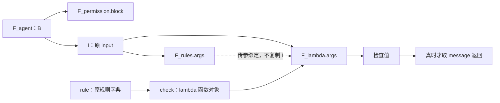
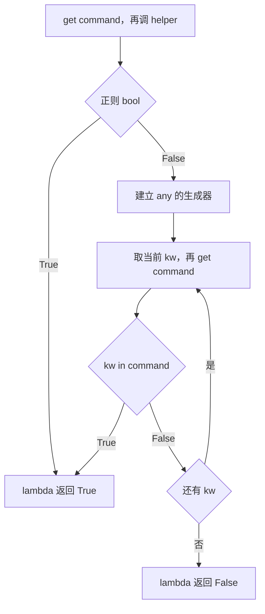
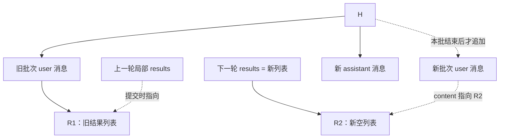
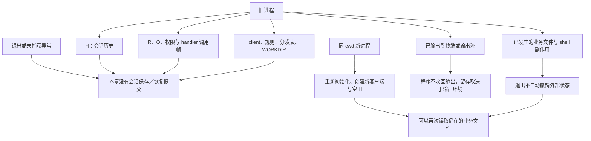

**s03 Permission：按实际调用链逐表达式、逐调用帧、逐提交点分析**

本文以当前 362 行 [s03_permission/code.py](../s03_permission/code.py) 为执行事实来源，结合[中文 README](../s03_permission/README.zh.md)、[英文 README](../s03_permission/README.md)、[根依赖](../requirements.txt)与直接相关断言。这里只分析五个模型工具、三段权限流程、两条规则及同步 CLI；不借用后续章节的实现。

本章没有 hooks、`execute_tool`、Post、Stop 或统一 handler 异常包装。正常结果直接保存 `output`；终端预览的 `str(output)` 不会把这个绑定改成字符串。权限检查是条件与启发式，不是进程、文件系统或事务隔离。

正文中的“默认路径”指当前函数和普通 SDK 块、字典、字符串的行为；“源码静态推演”指没有实际执行的设定输入与失败检查点；“扩展假设”指替换函数、特殊返回对象等非默认情形。所有示例均非运行日志。分析没有导入或运行目标模块，没有读取真实 `.env` 或密钥，没有请求模型、执行工具或运行用例。

阅读导航：

| 章节 | 章节 | 章节 | 章节 |
|---|---|---|---|
| [1 入口](#ch01) | [2 初始化](#ch02) | [3 SYSTEM](#ch03) | [4 工具表](#ch04) |
| [5 权限对象](#ch05) | [6 用户提交](#ch06) | [7 SDK 请求](#ch07) | [8 assistant 提交](#ch08) |
| [9 工具筛选](#ch09) | [10 批次与打印](#ch10) | [11 权限入口](#ch11) | [12 硬黑名单](#ch12) |
| [13 规则遍历](#ch13) | [14 文件规则](#ch14) | [15 正则](#ch15) | [16 or 与 any](#ch16) |
| [17 人工确认](#ch17) | [18 拒绝反馈](#ch18) | [19 参数绑定](#ch19) | [20 bash](#ch20) |
| [21 read](#ch21) | [22 write](#ch22) | [23 edit](#ch23) | [24 glob](#ch24) |
| [25 预览与结果](#ch25) | [26 整批提交](#ch26) | [27 CLI 展示](#ch27) | [28 生命周期](#ch28) |

讲解别名不是新增代码：

| 别名 | 实际对象或调用现场 |
|---|---|
| H | 入口 `history`，也是当前 `agent_loop.messages` |
| C | 当前响应的 `content`；普通 SDK 路径下两次属性读取取到同一内容对象 |
| B／I | 当前工具块／其 `input` |
| R | 当前有工具响应的局部 `results` 列表 |
| O | 当前 `agent_loop` 帧的 `output` 绑定 |
| F_entry | 执行 `__main__` 分支的模块帧，不存在额外 CLI 函数 |
| F_agent | 当前 `agent_loop` 调用帧 |
| F_permission | 当前 `check_permission` 调用帧 |
| F_rules／F_lambda | 当前规则遍历／具体 lambda 调用帧 |
| F_ask／F_tool | 当前人工确认／handler 调用帧 |

以下每个单元先给连续原码，再说明调用现场、求值、状态、返回与失败。箭头只表示执行顺序，不表示事务；“已打印”指相应打印正常完成，打印自身失败仍可能留下部分输出。

<a id="ch01"></a>
# 1. 从入口建立完整执行地图

源码位置：[code.py L337–L362](../s03_permission/code.py#L337)。

```python
if __name__ == "__main__":
    print("s03: Permission")
    print("Enter a question, press Enter to send. Type q to quit.\n")

    history = []  # 整段对话历史，传给 agent_loop 后由它就地推进
    while True:   # 外层交互循环：反复读用户输入，直到用户退出
        try:
            # \001/\002 tell Readline the ANSI escapes have zero display width.
            # \001/\002 是 readline 的「不可见定界符」：夹在中间的 ANSI 转义码
            # 不占显示宽度，这样青色提示符才不会让光标错位。
            query = input("\001\033[36m\002s03 >> \001\033[0m\002")
        except (EOFError, KeyboardInterrupt):
            # Ctrl+D（EOF）或 Ctrl+C（中断）时退出。
            break
        # 输入 q / exit / 空行都退出。
        if query.strip().lower() in ("q", "exit", ""):
            break
        # 用户输入入历史，交给 agent_loop 干活（期间可能弹出多次审批提示）。
        history.append({"role": "user", "content": query})
        agent_loop(history)
        # 打印模型最后的文字回复（跳过 tool_use 块）。
        for block in history[-1]["content"]:
            if getattr(block, "type", None) == "text":
                print(block.text)
        # 空行，让下一条提示符清爽地开始。
        print()
```

`__name__ == "__main__"` 只决定入口分支是否运行；在解释器到达这里之前，前面的导入、环境修改、客户端构造、工具表与规则表建立已经执行。下面先从读者能看到的 CLI 开始，再回溯这些前置条件，不是说 Python 先启动 CLI 再初始化。

`F_entry` 先调用第一条 `print`，正常返回后才执行第二条。两次都完成，才求值 `[]`、建立新的空列表并绑定 `history`。它就是 H，创建位置在 CLI `while` 外；每接收一个用户输入不会重新建立 H。第一条打印失败会跳过第二条与 H 创建；第二条失败时，第一条可能已经显示，但 H 仍未建立。这里没有包围启动过程的统一 except。

`while True` 是接收用户提交的外层循环。一次正常迭代中，`input` 返回字符串后才完成 `query = ...`。退出条件计算临时规范化值；不退出才创建用户消息并原位追加 H，再在 L356 调用 `agent_loop(history)`。参数不是新列表，F_agent 的 `messages` 绑定同一个 H。

紧随这段原码，先看整体暂停与返回关系：



F_entry 在 L356 同步等待。模型请求、权限确认和 shell 工具执行期间，不会并行接收下一次 CLI 提交。所谓同步不是“没有子进程”：bash 可以启动系统 shell，但 Python 的 CLI 控制流仍在等它返回。

F_agent 的 `return` 只结束该次函数调用，正常返回 None；不创建新历史，不退出 CLI。F_entry 随后从 L358 继续，查看的还是 H。L323 的 `continue` 则只进入当前工具 `for` 的下一项，不是直接下一次模型请求。L350／L353 的 `break` 才退出入口的 CLI 循环。

统一主例是源码静态推演：用户要求“查明项目测试方式并写入说明文件”。假设模型四次分别返回 glob、read_file、write_file、纯文本。每个工具响应都先进入 H，再产生 R；只有下一次请求调用时，反馈才作为历史实参交给 SDK。具体请求与历史账本在第 26 章闭合，这里没有实际执行命令或创建说明文件。

<a id="ch02"></a>
# 2. 模块初始化、导入顺序与环境副作用

## 2.1 标准库与可选 readline

源码位置：[code.py L40–L57](../s03_permission/code.py#L40)。

```python
import os          # 操作系统相关功能：读环境变量、判断平台
import re          # 正则表达式：用于第 2 关「危险命令」的模式匹配
import subprocess  # 子进程管理：真正执行模型生成的 shell 命令
from pathlib import Path  # 面向对象的路径操作：拼路径、解析、判断是否越界

# readline 提供命令行编辑能力（历史记录、方向键、退格等）。
# 它在 Unix 上通常可用，Windows 上可能不存在，所以用 try/except 包裹。
try:
    import readline
    # 以下四行是 macOS 上 libedit 库的 UTF-8 修复，让终端能正确
    # 处理中文等多字节字符的输入与退格删除。
    readline.parse_and_bind('set bind-tty-special-chars off')
    readline.parse_and_bind('set input-meta on')
    readline.parse_and_bind('set output-meta on')
    readline.parse_and_bind('set convert-meta off')
except ImportError:
    # 没有 readline（例如 Windows 自带 Python）就直接跳过，不影响主逻辑。
    pass
```

此时入口尚未执行，没有 H，也没有 F_agent。四条标准库导入按源码顺序完成各自绑定：`os`、`re`、`subprocess`、`Path`。注释不执行检查；导入库不等于调用 shell、扫描项目或发模型请求。

接着进入 try。若 `import readline` 成功，先绑定模块名，再依次执行四条 `parse_and_bind`。每一条都要正常返回，下一条才开始；这些配置不构成一个全成功才生效的事务，前面已完成的配置不会因后面失败被撤销。

except 只匹配 `ImportError`。缺少 readline 时可以走 `pass`，然后继续 SDK 导入；配置过程若抛出其他类型异常，则直接外溢，不能概括成“readline 相关任何失败都被忽略”。代码注释描述了配置意图，不证明当前机器一定安装了特定 readline/libedit 或终端配置实际生效。

[Readline 静态检查](../tests/test_readline_prompts.py#L52)的 `test_colored_input_prompts_mark_ansi_as_zero_width` 扫描 `s*/code.py`，s03 在范围内。它抽取可识别的输入提示符常量，检查 ANSI 序列两侧的零宽标记；不验证 readline 导入成功、按键行为、字体宽度或真实终端显示。

## 2.2 SDK、dotenv、环境与客户端

源码位置：[code.py L59–L74](../s03_permission/code.py#L59)。

```python
from anthropic import Anthropic    # Anthropic 官方 Python SDK 的客户端类
from dotenv import load_dotenv     # 从 .env 文件加载环境变量（如 API Key）

# override=True：即使系统里已有同名环境变量，也用 .env 里的值覆盖。
load_dotenv(override=True)

# 配了 ANTHROPIC_BASE_URL（走代理/自定义端点）时，
# 移除可能打架的 ANTHROPIC_AUTH_TOKEN，避免两种鉴权方式冲突。
if os.getenv("ANTHROPIC_BASE_URL"):
    os.environ.pop("ANTHROPIC_AUTH_TOKEN", None)

WORKDIR = Path.cwd()  # 工作目录：权限规则里判断「是否越界」的基准线
# 创建 Anthropic 客户端；base_url 默认官方 API，配了环境变量则走自定义端点。
client = Anthropic(base_url=os.getenv("ANTHROPIC_BASE_URL"))
# 从环境变量读模型 ID；用 [] 取值，.env 里没配会直接抛 KeyError。
MODEL = os.environ["MODEL_ID"]
```

先导入 `Anthropic`，再导入 `load_dotenv`。任一导入失败，L63 及之后都不会执行。函数调用表达式 `load_dotenv(override=True)` 正常完成才进入端点判断；返回值没有保存。它的作用是加载环境配置并允许覆盖既有同名值，不是在 SYSTEM 中附上一份配置文本。

`if os.getenv("ANTHROPIC_BASE_URL"):` 先读取环境变量，再做真假判断。缺失或空字符串不进分支；非空字符串，包括纯空白字符串，在 Python 层都是 truthy，后续是否是有效 URL 不是这句判断保证的。满足时调用 `os.environ.pop("ANTHROPIC_AUTH_TOKEN", None)`；缺键得到默认值而不因缺键报错，返回的旧值也没有保存。没有任何稍后恢复环境变量的语句。

`WORKDIR = Path.cwd()` 先完成 cwd 查询并产生 Path 值，再绑定名称。这个位置取的是进程当时工作目录，不是 `code.py` 所在目录；源码没有在这里执行 chdir。路径查询失败则 WORKDIR 本次绑定未完成，client 构造尚未开始。

L72 先取得 Anthropic 可调用对象，再读取 base_url 参数并调用构造。构造正常返回后才绑定 `client`；这不是模型请求。紧接着 L74 才通过下标读取 MODEL_ID，缺键抛 KeyError。因而存在“客户端对象已构造，但 MODEL 尚未绑定、CLI 尚未运行”的失败窗口，不能把顺序倒写成先检查全部配置再构造客户端。

| 失败位置（源码静态推断） | 此前可能已完成 | 必然跳过的本地后续 |
|---|---|---|
| SDK／dotenv 导入 | 标准库及部分 readline 配置 | dotenv 调用、WORKDIR、client、CLI |
| dotenv 调用 | 导入绑定 | 后续环境判断与客户端创建；不能承诺调用内部没有部分环境副作用 |
| Path.cwd | dotenv 与可能的鉴权变量移除 | client、MODEL、SYSTEM、H |
| Anthropic 构造 | WORKDIR 已绑定 | client 本次绑定、MODEL 读取、CLI |
| MODEL_ID 下标读取 | client 已绑定 | 平台说明、SYSTEM、工具与规则后续建立、CLI |

错误没有被将来的工具局部 try 捕获：那些函数尚未调用，不能跨调用时间保护模块初始化。

[requirements.txt](../requirements.txt)声明 `anthropic>=0.25.0`、`python-dotenv>=1.0.0`、`pyyaml>=6.0`。这只是最低依赖约束，不是当前安装版本清单。s03 没有导入 YAML；不能从根依赖推出本章会解析 YAML，也不能据最低 SDK 版本推断实际认证、序列化或重试行为。

相关用例的加载器使用 fake Anthropic、fake dotenv 和临时 cwd，见[边界用例加载器](../tests/test_agent_loop_boundaries.py#L49)及[权限用例加载器](../tests/test_permission_command_words.py#L31)。这些测试设置不是生产初始化证据；本文只是阅读这些断言，没有运行加载器，更没有读取真实密钥。

<a id="ch03"></a>
# 3. 平台说明与固定 SYSTEM 的形成

源码位置：[code.py L77–L89](../s03_permission/code.py#L77)。

```python
ENVIRONMENT_PROMPT = (
    "Windows: the bash tool runs through cmd.exe; use cmd.exe syntax, not Unix "
    "Bash or PowerShell syntax, and prefer dedicated file tools for file operations"
    if os.name == "nt"
    else "Unix-like: the bash tool runs the system shell"
)

# 系统提示词：相比 s02 多了一句「所有破坏性操作都需要用户批准」，
# 让模型提前知道有些操作会被拦下来，从而自觉地少做危险动作。
SYSTEM = (
    f"You are a coding agent at {WORKDIR}. Environment: {ENVIRONMENT_PROMPT}. "
    "All destructive operations require user approval."
)
```

前提是 WORKDIR、client、MODEL 已成功建立。赋值右侧先求值 `os.name == "nt"`，只计算条件表达式被选中的文本分支。Windows 文本中的相邻字符串字面量组成该分支的文本；未选分支不会作为另一次动作执行。右侧完成后才绑定 ENVIRONMENT_PROMPT。

L86–89 随后形成 SYSTEM：f-string 对当时 WORKDIR 和 ENVIRONMENT_PROMPT 取值并格式化，再与后面的固定字面量组成最终文本，右侧完整完成才绑定 SYSTEM。这里没有模型调用、文件写入或历史追加；H 还不存在。

SYSTEM 是文本值，不是跟随进程环境实时变化的视图。以后即使 cwd 或环境变量变化，本句也不会自动再执行，原文本不会自行重算。平台说明表达模型应选用何种命令风格，不是对 shell 的语法解析器或文件访问限制。

`"All destructive operations require user approval."` 是提示词。真正执行权限分支的是第 11–18 章的条件与规则，不能用这句英文证明所有破坏性动作都能被识别、所有工具都要问人或所有副作用都可撤回。尤其硬黑名单命中会直接拒绝，不是再交用户批准。

正常建立后，模块继续执行工具函数定义，之后建立工具表与规则表；定义函数体不等于执行里面的 read/write/subprocess。若 SYSTEM 构造失败，当前绑定不完成，后续定义、表及入口不运行。普通 Path 与字符串的默认构造不应被描述为常见异常；这里只给出源码赋值的静态边界。

<a id="ch04"></a>
# 4. 工具 schema 与函数分发表如何建立

源码位置：[code.py L179–L196](../s03_permission/code.py#L179)。

```python
TOOLS = [
    # 每个工具 = name + description + input_schema 三件套。
    {"name": "bash", "description": "Run a shell command.",
     "input_schema": {"type": "object", "properties": {"command": {"type": "string"}}, "required": ["command"]}},
    {"name": "read_file", "description": "Read file contents.",
     "input_schema": {"type": "object", "properties": {"path": {"type": "string"}, "limit": {"type": "integer"}}, "required": ["path"]}},
    {"name": "write_file", "description": "Write content to a file.",
     "input_schema": {"type": "object", "properties": {"path": {"type": "string"}, "content": {"type": "string"}}, "required": ["path", "content"]}},
    {"name": "edit_file", "description": "Replace exact text in a file once.",
     "input_schema": {"type": "object", "properties": {"path": {"type": "string"}, "old_text": {"type": "string"}, "new_text": {"type": "string"}}, "required": ["path", "old_text", "new_text"]}},
    {"name": "glob", "description": "Find files matching a glob pattern; ** matches recursively.",
     "input_schema": {"type": "object", "properties": {"pattern": {"type": "string"}}, "required": ["pattern"]}},
]

TOOL_HANDLERS = {
    "bash": run_bash, "read_file": run_read, "write_file": run_write,
    "edit_file": run_edit, "glob": run_glob,
}
```

在模块到达这里之前，五个 `def` 已将函数对象绑定到各自全局名称，但尚未运行函数体。L179 右侧建立工具记录及嵌套 schema，外层列表全部形成后才绑定 TOOLS。模型收到的是这些声明，不是 Python 文件句柄、函数对象或权限规则。

L193 另建一个字典，读取当时的函数对象引用作为值，右侧形成后绑定 TOOL_HANDLERS。这是两个不同目的的容器：一个说明可提交的工具与参数，一个决定本地调用哪个函数。



| 模型工具名 | 函数 | schema 的 required | 本地实际进入位置 |
|---|---|---|---|
| bash | run_bash | command | L98，绑定成功后才进函数体 |
| read_file | run_read | path | L114；limit 有 Python 默认值 |
| write_file | run_write | path、content | L127 |
| edit_file | run_edit | path、old_text、new_text | L140 |
| glob | run_glob | pattern | L155 |

schema 中的 `string`、`integer`、`required` 是发给模型/API 的输入描述，不是本地自动执行的验证器。代码在 L327 直接展开输入并调用函数；形参注解也不自动拒绝错误类型。缺参、额外参数可能由 Python 绑定抛 TypeError；某些错误值可能到函数内部甚至完整读取文件后才失败。

扩展假设：只重新绑定全局 `run_bash` 不会替换字典里已保存的函数引用；直接替换 `TOOL_HANDLERS["bash"]` 才改变该映射项。这不是现有 CLI 命令。[主循环用例辅助函数](../tests/test_agent_loop_boundaries.py#L122)既替换全局 run_bash，也替换映射，恰好说明两者需要分别辨认。

本章没有 `execute_tool`，不能把后续章节的统一异常包装套到这里。正常模块执行接着建立权限对象；本节只建立内存对象，不发请求、不改业务文件、不打印工具结果。若右侧构造中途失败，本次 TOOLS／TOOL_HANDLERS 绑定不完成，先前定义的函数仍可能已经存在，但入口不会自动继续。

<a id="ch05"></a>
# 5. 权限规则对象建立时没有执行检查

## 5.1 黑名单与正则先形成

源码位置：[code.py L205–L205](../s03_permission/code.py#L205)。

```python
DENY_LIST = ["rm -rf /", "sudo", "shutdown", "reboot", "mkfs", "dd if=", "> /dev/sda"]
```

这个赋值先形成七项列表，再绑定 DENY_LIST。它不是七次权限检查，也没有把 shell 命令送进任何执行器。L207 的函数定义随后建立 helper；调用发生在将来的 L274。

源码位置：[code.py L218–L226](../s03_permission/code.py#L218)。

```python
DESTRUCTIVE_COMMAND_WORD = re.compile(
    # 这个正则匹配「作为一个独立命令出现」的 rm 或 del：
    #   (?i)                 忽略大小写
    #   (?:^|[;&|()\n])      前面必须是行首或命令分隔符，避免误伤 "firm" 这类子串
    #   \s*                  分隔符后允许有空格
    #   (?:rm|del)           命令本身
    #   (?=\s|$|[;&|()])     后面必须跟空格/行尾/分隔符（前瞻，不消耗字符）
    r"(?i)(?:^|[;&|()\n])\s*(?:rm|del)(?=\s|$|[;&|()])"
)
```

这里先读取 `re.compile`，传入模式文本，编译正常返回后才绑定 DESTRUCTIVE_COMMAND_WORD。注释中的规则含义在第 15 章按实际匹配解释。模式如果无效会在此阻断模块初始化，而不是等用户提交工具后才出错；当前代码中的有效模式不因此被说成常见故障。

## 5.2 规则记录、lambda 对象与延迟执行

源码位置：[code.py L235–L247](../s03_permission/code.py#L235)。

```python
PERMISSION_RULES = [
    # 规则一：文件工具的路径解析后落在 WORKDIR 之外 → 判定为「向工作区外写」。
    # （对应 s02 里 safe_path 的越界检查，只是这里不再直接抛异常，而是触发审批。）
    {"tools": ["read_file", "write_file", "edit_file"],
     "check": lambda args: not (WORKDIR / args.get("path", "")).resolve().is_relative_to(WORKDIR),
     "message": "Writing outside workspace"},
    # 规则二：bash 命令里有删除类指令，或出现 rm / 重定向到 /etc / chmod 777
    # 这类高风险写法 → 判定为「潜在破坏性命令」。
    {"tools": ["bash"],
     "check": lambda args: contains_destructive_command(args.get("command", "")) or
     any(kw in args.get("command", "") for kw in ["rm ", "> /etc/", "chmod 777"]),
     "message": "Potentially destructive command"},
]
```

第一条记录形成一个 tools 列表、一个 lambda 函数对象和 message；第二条也分别形成自己的记录与 lambda。外层列表完整形成后才绑定 PERMISSION_RULES。建立第一条记录不会执行 `resolve`；建立第二条记录不会 search 命令或消费 any。



lambda 的 `args` 是将来调用的形参，不是构造规则表时已经存在的一份输入副本。函数体中的 WORKDIR、helper 按运行时全局名称解析；这与上一章映射在字典建立时取得函数对象的行为不同。当前默认流程不改这些名称，所以无需虚构运行中改规则。

默认路径在这里结束时只有内存规则对象，没有审批、请求、文件扫描或历史变化。后面还会定义 check_rules、ask_user、check_permission、agent_loop，最终才到入口。只有检查实际调用后，才会出现 F_lambda 与它的 args 绑定。

扩展假设：这些列表和字典是可变对象，程序外部可以改它们；源码没有提供动态授权管理、规则持久化或 CLI 编辑命令。不能从“对象可变”推出“本章实现了规则管理功能”。

<a id="ch06"></a>
# 6. 输入完成、退出判断与用户消息提交

源码位置：[code.py L343–L356](../s03_permission/code.py#L343)。

```python
        try:
            # \001/\002 tell Readline the ANSI escapes have zero display width.
            # \001/\002 是 readline 的「不可见定界符」：夹在中间的 ANSI 转义码
            # 不占显示宽度，这样青色提示符才不会让光标错位。
            query = input("\001\033[36m\002s03 >> \001\033[0m\002")
        except (EOFError, KeyboardInterrupt):
            # Ctrl+D（EOF）或 Ctrl+C（中断）时退出。
            break
        # 输入 q / exit / 空行都退出。
        if query.strip().lower() in ("q", "exit", ""):
            break
        # 用户输入入历史，交给 agent_loop 干活（期间可能弹出多次审批提示）。
        history.append({"role": "user", "content": query})
        agent_loop(history)
```

现在回到入口。F_entry 已建立 H，进入一次 CLI 迭代。`input` 先输出提示并等输入，返回后才完成 `query = ...`。标记 `\001`／`\002` 用来告诉 Readline ANSI 控制序列不占展示宽度，不属于用户输入内容。没有 readline 也不能由此推断所有终端行为一致。

若 input 抛 EOFError 或 KeyboardInterrupt，except 执行 break，退出 CLI。后一次输入失败时，模块名 query 可能还绑定上一次字符串，但这里没有继续使用它：退出判断、H.append、L356 都被跳过。这与“旧名称一定不存在”不同。

input 正常返回后，`query.strip().lower()` 形成用于比较的文本值。`" Q "`、`"exit"`、纯空白的规范化值可命中退出元组。原 query 未改绑；普通问题前后的空白不会因为退出检查自动被清洗后入历史。字符串运算是否复用身份不是本章契约。

不退出时，先取得 H.append，再构造新的用户字典，content 值是原 query 文本；append 原位修改 H。之后才查找并调用 agent_loop，F_agent 的 messages 与 H 指向同一列表：

```text
F_entry.history ─┐
                 ├──> H：[旧消息..., 新用户字典]
F_agent.messages┘                    └─ content：原 query 文本
```

没有 UserPromptSubmit，也没有任何 hook 在这两句之间注入 cwd 或改写输入。正常进入 F_agent 时，用户消息已经存在；如果随后请求失败，这条消息不会自动从 H 删除。

返回链是 L356 等待 F_agent，正常返回后去 L358；若调用或内部异常外溢，这里没有覆盖它的 except。L343 的 try 仅保护 input 所在代码，不保护后来的 SDK、权限输入、handler 或最终展示。下一次用户提交仍使用 H，但会建立新的 F_agent；第 28 章区分它与当前函数续轮。

<a id="ch07"></a>
# 7. SDK 请求的逐项求值与 response 绑定

源码位置：[code.py L292–L299](../s03_permission/code.py#L292)。

```python
def agent_loop(messages: list):
    # messages 是完整对话历史，函数就地修改它、无返回值。
    while True:
        # 【第 1 步】把对话历史 + 工具定义发给模型。
        response = client.messages.create(
            model=MODEL, system=SYSTEM, messages=messages,
            tools=TOOLS, max_tokens=8000,
        )
```

F_entry 停在 L356。进入 F_agent 时只建立一个新的参数绑定 messages，目标对象仍是 H；随后 `while True` 开始当前提交的模型循环。

L296 先求出 `client.messages.create` 可调用对象。再按源码关键字顺序求值：MODEL 给 model，SYSTEM 给 system，messages 给 messages，TOOLS 给 tools，整数 8000 给 max_tokens。没有把 Python handler、lambda、黑名单或终端审批程序作为函数体上传；权限机制仍在本地调用链中。

参数表达式取得的是已有对象引用。本地没有 `list(messages)`、深拷贝或另外建立一份消息历史。SDK 内部如何检查、复制、序列化、认证、重试和传输，不由这一行源码证明。不能把“本地共享引用”扩展成“网络端持有可实时变动的 Python 列表”。

`create(...)` 完整返回后，结果对象才绑定 response。第一轮失败时可能还没有本帧 response；后续轮失败时，旧 response 可能仍绑定上轮对象。但异常直接传播，不会跳到 L301 使用旧响应，也不会自动退回 CLI 等下一输入。

| 当前状态 | H | R／O | 请求与下一句 |
|---|---|---|---|
| 第一次请求开始前 | 已有用户消息 | 本次工具批次未建立 | 将调用 create |
| create 正常返回 | 暂未因该响应改变 | 不因请求返回自动生成 | response 本次赋值完成，接着 L301 |
| create 抛异常（静态推断） | 保留先前 H，包括可能已有的旧批次 | 旧局部绑定可能仍在，但不会继续使用 | 当前 response 赋值未完成，无本轮 assistant 追加 |

8000 只是该次请求的输出 token 参数，不是会话总预算，不约束工具输入、工具输出、网络时间、费用或响应次数。F_agent 没有本地显式重试、备用模型、总轮数上限或上下文整理步骤。请求异常也不证明远端一定没收到请求；本地能确认的是没有取得正常返回并推进后续语句。

[边界用例 FakeMessagesApi](../tests/test_agent_loop_boundaries.py#L37)只是从预置响应列表取出对象并计数。它不证明生产 SDK 的认证、网络成功、历史复制或内部重试。后文只引用它能证明的本地分支与历史结构断言。

<a id="ch08"></a>
# 8. assistant 进入 H 的独立提交点

源码位置：[code.py L300–L301](../s03_permission/code.py#L300)。

```python
        # 【第 2 步】模型回复（含 text / tool_use 块）追加为 assistant 消息。
        messages.append({"role": "assistant", "content": response.content})
```

调用现场：F_agent 已取得本次 response，F_entry 仍在等 L356。L301 不是“收到响应就天然已经存进历史”，而是另一次明确的列表修改。

先求值 `messages.append`，再求实参字典。字典键值按书写顺序形成：role 的值是 assistant，content 的值来自本次 `response.content` 属性读取。字典形成后调用 append，成功才算 H 增长。若属性读取失败，字典尚未完整形成，append 没有执行；若 append 本身失败，不能写成已经成功提交。

正常 SDK 路径下，把该属性对象称 C。H 新消息的 content 指向 C，而不是逐个复制块或 input。这里没有发第二次请求，没有调用权限，更没有执行工具。



这张图中的 tool_calls 此刻还没建立；虚线表示 L304–306 正常完成后的关系。源码在筛选时再次读取 response.content，并没有先把 C 缓存到一个名为 content 的局部变量。普通 SDK 属性可按同一对象理解；若扩展替身实现了每次返回不同对象的动态属性，源码没有主动冻结它，不能把普通对象假定写成任意对象的强保证。

本句成功后的账本：

```text
F_agent 当前：L301 完成，下一句 L304
H：旧消息 + 当前 assistant（content=C）
本轮 R：尚未建立；旧轮绑定即使存在，也不是当前反馈
O：本轮尚未由工具赋值；不因此清空旧 O
文件：本次响应尚无工具副作用
终端：没有本次工具名或预览
请求：本次响应已取得；下一请求未调用
```

正常继续 L304。无捕获保护这一句：SDK 块属性读取、消息构造、append 等异常会沿 F_agent 外溢到入口调用点，入口 input 的 except 不处理。资源失败是静态边界，不是默认 SDK 小对象的常见行为。

<a id="ch09"></a>
# 9. 完整工具列表形成后才能进入执行分支

源码位置：[code.py L303–L308](../s03_permission/code.py#L303)。

```python
        # 【第 3 步】筛出 tool_use 块；一个都没有说明模型已给出最终答案，结束循环。
        tool_calls = [
            block for block in response.content if block.type == "tool_use"
        ]
        if not tool_calls:
            return
```

调用现场是 L301 已成功修改 H。F_agent 先取本次 response.content 的可迭代对象，在推导式中逐个读取块的 type；等于 tool_use 的块才进入临时新列表。完整遍历结束后才把结果绑定到 tool_calls，不是每发现一块就立刻执行。

推导式保存块引用，不深拷贝 B 或 I。推导式的 block 迭代绑定不泄漏为后面普通 `for block in tool_calls` 的局部绑定；后面的普通 for 又不会为每次迭代新建函数作用域。两个层次不能因为拼写都叫 block 而混为一谈。

假设原内容为“有效工具块、缺 type 的对象”。第一块已经加入推导过程的临时列表，但第二块读取属性抛异常，整个 RHS 失败，tool_calls 本次赋值未完成。H 中 assistant 已经存在；L311 尚未到达，本轮 R 未建立；第一个工具的权限与函数体都未执行。旧轮 tool_calls 即使仍有绑定，也不会被自动拿来运行。

| 源码静态样本 | 推导与分支 | H／工具／展示结果 |
|---|---|---|
| C=[] | 得到 []，not 为真，return | assistant 已入 H；没有 R；入口遍历空内容，仅后续空行 |
| C 含一个空 SDK text | type 不是 tool_use，得到 [] | 正常返回，但不保证有实质答案 |
| C 纯 SDK text | 工具列表为空 | L308 返回，入口才展示文字 |
| C 同时含 text 与 tool_use | 工具列表非空 | 文字留在 assistant 中，不立即在 CLI 当最终答案打印 |
| C=None | 迭代失败 | assistant 可能已存 None；不是正常空工具返回 |
| C 含普通 dict 块 | 读取 `block.type` 可能失败 | 不会自动使用 `block["type"]` 兼容 |
| 有效工具后接坏块 | 整个推导失败 | 本响应所有工具均尚未执行 |

`not tool_calls` 判断的是新列表是否为空。源码没有读取 `response.stop_reason`，因此 stop_reason 写 tool_use 但没有实际工具，仍直接 return；反之 stop_reason 写 end_turn 但存在实际工具，仍进入工具分支。这是控制流事实，不代表任意坏响应都被兼容。

[通用边界用例](../tests/test_agent_loop_boundaries.py#L219)的 LESSONS 包含 s03。`test_parent_loop_does_not_append_an_empty_tool_result_turn` 断言 API 调用数为 1、末条 role 为 assistant，且没有 content=[] 的 user 消息。必须同时看[辅助函数 L93–100](../tests/test_agent_loop_boundaries.py#L93)：参数 None 被换成含空 SDK text 的列表，并不是生产 response.content=None；这个用例不能证明上一表的 None 路径可正常返回。

另一个[真实工具块与停止原因相反的用例](../tests/test_agent_loop_boundaries.py#L243)预置 end_turn + tool_use，之后再给纯文本，断言两次请求、一条工具结果消息、结果 ID 为 tool_1。但它把 check_permission 改成总允许，把 bash 分发表改成成功文本；只证明本地工具分支和反馈结构，不证明默认审批、真实 shell、SDK 或网络成功。s03 不存在 hooks／execute_tool，辅助函数对其他章节的替换不能写成 s03 的生产调用。

正常无工具直接 return None，F_entry 从 L358 继续；这里没有 Stop、summary、TODO 检查或业务完成验证。有工具则进入 L311，不能把“存在文本”当作提前终止依据。

<a id="ch10"></a>
# 10. R 建立与权限之前的工具名打印

源码位置：[code.py L310–L320](../s03_permission/code.py#L310)。

```python
        # 【第 4 步】逐个执行工具调用（执行前先过权限流水线），收集结果。
        results = []
        for block in tool_calls:
            # 青色打印工具名，便于观察循环过程。
            print(f"\033[36m> {block.name}\033[0m")

            # s03 change: run through permission pipeline before executing
            # s03 的关键改动：执行之前先过权限流水线。
            # 被拒绝时不执行工具，但仍然要回填一条 tool_result，
            # 因为 API 要求每个 tool_use 都必须有对应的 tool_result。
            if not check_permission(block):
```

此时 tool_calls 已完整建立且非空。L311 先创建一个新空列表，再把 results 绑定到它，这就是当前 R。前一轮的 R 若已作为消息 content 进入 H，局部 results 重绑不会对旧列表执行 clear，也不会让旧历史消失。

L312 的普通 for 从 tool_calls 顺序取得块并绑定 F_agent.block。它与 F_entry 后来用于展示的 block 属于不同帧；但同一个 F_agent 中多次工具迭代共享函数局部槽位。handler、output 等不会因每次 for 自动重新初始化。

L314 先读取 B.name，形成带颜色的工具名文本，再调用 print。正常完成后才到 L320。被拒绝的工具也可能已经显示名字；这个日志不证明权限已通过、handler 已进入或副作用已发生。

若工具名属性读取失败，连名称文本都未形成；若打印失败，可能已部分输出，但权限调用尚未开始。这两种异常都没有统一捕获，当前工具没有结果，R 可能仍含前工具反馈，整批 H 提交不会自动补上。

L320 的精确结构是 `if not check_permission(block):`。先读取可调用对象和 B 引用，进入 F_permission，等待其正常返回，再计算 not。源码没有 `allowed` 或 `blocked` 局部变量，也不是先给一个变量赋值再检查。被调用函数若抛异常，not 无法完成，两条分支都不会自动执行。

当前账本：

```text
H：已含本次 assistant
R：当前新列表；当前块尚无结果
O：当前块赋值未发生，旧绑定可能仍在
文件：当前块尚未执行 handler；先前块副作用可能保留
终端：当前工具名 print 若成功，名字已显示
请求：本轮模型已响应；没有下一请求
下一步：进入 F_permission；正常返回后继续 L320 的 not
```

没有通用 Pre、callback 列表或 Post。README 将权限描述为插入执行前的一道门，是结构概括，不应借来补出生产源码没有的调度层。

<a id="ch11"></a>
# 11. 进入 F_permission 与 Gate 1 的适用条件

源码位置：[code.py L271–L280](../s03_permission/code.py#L271)。

```python
def check_permission(block) -> bool:
    # 只有 bash 才过第 1 关（黑名单是针对命令字符串的，文件工具没有 command 参数）。
    if block.name == "bash":
        reason = check_deny_list(block.input.get("command", ""))
        if reason:
            # 红色打印拦截信息；直接返回 False，连问都不问用户。
            print(f"\n\033[31m[blocked] {reason}\033[0m")
            return False
    # 第 2 关：所有工具都过规则匹配。
    reason = check_rules(block.name, block.input)
```

F_agent 暂停在 L320，参数 B 是原块引用。新的 F_permission.block 绑定它，没有复制 SDK 块、冻结名称或缓存 input。函数首先读取 block.name 并与 bash 比较。

默认普通字符串名称下，只有 bash 才执行 L274；read_file、write_file、edit_file、glob 和未知名称跳过 Gate 1。不能把 README 的“每工具经过三道闸门”解释成每次都执行黑名单 helper 与人工 input。

bash 路径中，先取得 check_deny_list 可调用对象，再读取 B.input，查找它的 get 并传入 command 与缺键默认值。get 返回后才调用 helper，helper 完整返回后才赋 reason。这个函数的新调用帧不会沿用上一个工具的 reason。

reason truthy 则先打印 blocked 原因，正常打印后才执行 return False。return 退出的是 F_permission，尚不是 F_agent；调用者还要完成 not 与拒绝字典。硬拒绝提前返回会跳过 L280、check_rules、所有 lambda、ask_user 和 handler。打印本身失败时没有 False 返回，不能想象成“虽然没显示，但仍会产生拒绝反馈”。

reason 假则去 L280，重新调用 check_rules。对 bash，Gate 1 正常返回 None 后，reason 已绑定 None；若 L280 的 RHS 失败，本次重绑定未完成，旧 None 可能仍在。但异常外溢，不会按旧 None 自动放行。对非 bash，若 L280 是第一次赋 reason 且 RHS 失败，本帧没有完成这个绑定；两种状态都不能通过读取上一工具的帧来补齐。



图中每个调用和打印都必须正常完成，才走下一箭头；异常不自动改成 False。此阶段不执行工具，不修改 H 或 R，不向模型发请求。唯一默认外部动作是硬拒绝打印，或后面的人工确认；审批没有写入独立审计历史或授权缓存。

<a id="ch12"></a>
# 12. 硬黑名单的顺序、大小写与首次命中

源码位置：[code.py L205–L212](../s03_permission/code.py#L205)。

```python
DENY_LIST = ["rm -rf /", "sudo", "shutdown", "reboot", "mkfs", "dd if=", "> /dev/sda"]

def check_deny_list(command: str) -> str | None:
    # 命中任一关键词就返回拒绝原因；全部没命中返回 None（表示「放行到下一关」）。
    for pattern in DENY_LIST:
        if pattern in command:
            return f"Blocked: '{pattern}' is on the deny list"
    return None
```

调用现场是 bash 的 L274。command 来自 I.get 的返回值；普通输入是不可变字符串，没有副本协议或命令规范化步骤。形参注解 str 不自动执行类型校验。

for 按 DENY_LIST 的顺序取得 pattern，`pattern in command` 是子串判断，不验证 executable 名称、shell 引号或语义。第一次命中便格式化返回原因；剩余项不再判断。全部不命中才执行 L212 的 None。

原因的文本先交回 L274，再绑定 F_permission.reason，随后 L275 判断、L277 打印。helper 自己不打印、不询问、不操作文件、不启动 shell。None 只表示这七个子串没有命中，不是“安全命令”证书。

| 源码静态样本 | helper 的本地结论 | 不能混同的后续 |
|---|---|---|
| 字符串含小写 sudo | 返回对应首个原因 | 还要让权限打印正常完成才返回 False |
| 同时含多个黑名单项 | 按列表顺序取第一个原因 | 不汇总所有危险点 |
| 仅大写 SUDO | 该小写项不命中 | 不据此宣称完整权限规则已通过 |
| 含 rm -rf /tmp/example | 也含 rm -rf / 子串，可命中 | 没有精确识别“目标恰好是根目录” |
| 缺 command | get 得到空串，helper 返回 None | 后续仍会到规则，最终调用可能因缺参失败 |
| command=None | 首次成员判断抛 TypeError | 不是正常 None 返回，也不是正常拒绝 |

这些字符串只用于静态分析，未执行任何命令。源码注释“无论上下文都禁止”应限定为检测到这些子串后的控制流；不能扩展成对所有语法变体的完整识别。

失败链是 helper → F_permission → F_agent → F_entry，三层都没有这里对应的普通异常包装。当前工具名已经打印，但 handler 尚未进入；H 有 assistant，当前 R 无此块结果，文件没有当前 handler 副作用。正常返回 None 则 F_permission 去 L280，正常返回原因则进入硬拒绝打印；不能从 helper 的返回直接跳到历史已提交。

README 中英文都提醒硬名单不是完整安全边界，见[中文说明](../s03_permission/README.zh.md#L42)与[英文说明](../s03_permission/README.md#L42)。[命令词用例](../tests/test_permission_command_words.py#L75)对 s03 直接调用 check_rules，并不调用本 helper；不应将它列作 Gate 1 的动态验证。

<a id="ch13"></a>
# 13. 规则遍历中的 and 短路与首次命中

源码位置：[code.py L249–L255](../s03_permission/code.py#L249)。

```python
def check_rules(tool_name: str, args: dict) -> str | None:
    # 逐条匹配规则：工具名在规则的 tools 列表里、且条件成立，就返回原因。
    # 没有任何规则命中，返回 None 表示「无需人工确认」。
    for rule in PERMISSION_RULES:
        if tool_name in rule["tools"] and rule["check"](args):
            return rule["message"]
    return None
```

F_permission 停在 L280。先求值两个实参 B.name、B.input，进入新 F_rules；tool_name 和 args 分别绑定名称值与 I。注解 dict 不把任何输入转成字典，也不自动拒绝 None。

for 从全局 PERMISSION_RULES 取得原列表的迭代器；rule 逐项绑定已有记录，不是复制字典。默认代码不会在此修改列表。源码没有做快照；运行中替换规则等仅属扩展假设，不是 CLI 功能。

L253 先读取 `rule["tools"]` 并做 membership。结果假时，and 右侧不求值，既不取 check，也不调用 lambda。结果真时才取函数对象并用 args 调用；lambda 正常返回真值时，才进入 L254 读取 message。message 取到后直接 return，后续规则不检查。

文件工具在第一条规则里：路径在内则检查返回 False，随后第二条的工具 membership 不匹配，最终 None；路径在外则第一条返回原因，不运行第二条。bash 跳过第一条 lambda，只调用第二条。glob 和普通未知名称两条 membership 都假，因此 args 即使为 None，也可能没有字段读取而返回 None。



lambda 的 args 与 F_rules.args 是不同局部槽位，但它们指向同一 I。默认检查只读其值，不修改输入。改绑其中一个形参不等于改写调用者引用；源码没有自动规范化输入或把解析路径写回 I。

检查、查键或返回消息失败时，F_rules 没有捕获；L280 的 reason 赋值未完成。对非 bash 可能是本帧第一次 reason，不能说沿用了上一工具原因；对 bash 可能仍有 Gate 1 的 None，但异常同样不继续。当前工具不进入 handler，也不生成固定拒绝反馈。

正常返回原因后先在 F_permission 绑定 reason，再由 L281 判断并决定是否询问；正常 None 则 L281 不进，L286 返回 True。规则的“需要询问”不是“已经拒绝”，更不是“已经执行”。

[权限命令词断言](../tests/test_permission_command_words.py#L110)将 s03 参数化在内。适配器 `permission_result` 优先发现 check_rules 后直接调用它；最终只断言 `bool(result) is expected`。虽然用例统一将 input 替换为 n，s03 这个适配分支根本不调用 ask_user，因此不能把真假断言说成审批拒绝测试、完整权限测试或真实 shell 测试。

<a id="ch14"></a>
# 14. 文件 lambda 的路径表达式与失败位置

源码位置：[code.py L238–L240](../s03_permission/code.py#L238)。

```python
    {"tools": ["read_file", "write_file", "edit_file"],
     "check": lambda args: not (WORKDIR / args.get("path", "")).resolve().is_relative_to(WORKDIR),
     "message": "Writing outside workspace"},
```

这是一段规则记录原码，不是独立函数定义。调用现场是 F_rules 的 L253：文件工具名匹配后，取到 check 函数，再用 I 调用，F_lambda.args 绑定同一个 I。

按表达式层次，先求路径组合的左操作数 WORKDIR，再调用 args.get，缺 path 才得到默认空串。组合路径之后取得 resolve 方法并调用；随后取得 is_relative_to 方法，以再次读取的 WORKDIR 作参数调用；最后 not 将范围判断取反。这里用 Path 解释路径，不是用字符串 startswith，也没有打开目标文件或确认它一定存在可读。

如果范围判断为真，表示解析路径在该基准下，not 得到 False，不返回确认原因；若判断假，lambda 返回 True，F_rules 才读取 message。当前规则 message 是 Writing outside workspace，而 tools 列表明确包含 read_file，所以这条规则确实也会要求审批工作区外读取。文字中出现 Writing 不会把读取排除掉。

[中英文 README 的示意规则](../s03_permission/README.zh.md#L69)使用 Access outside workspace；生产源码使用 Writing outside workspace。文档以源码记录执行文本，不能把示意片段当作生产记录，也不因文本不同而改写实际适用工具集合。

| 源码静态样本 | lambda 执行到哪里 | 后续位置 |
|---|---|---|
| 普通工作区内相对路径 | resolve 与范围判断正常，not 为 False | F_rules 继续，最终通常 None |
| 正常解析到工作区外 | not 为 True | 返回 message，F_permission 才进入询问 |
| path 缺失 | 用空串组合，普通 cwd 情形解析回工作区 | 可以放行；handler 仍可能因缺 path 绑定失败 |
| path=None | get 返回 None，路径组合失败 | lambda／规则／权限外溢，无询问，无 handler |
| I 不是有 get 的对象 | 访问 get 失败 | 不会自动转字典或生成拒绝结果 |
| 内部链接解析到外部 | resolve 后再判范围 | 可触发外部路径审批，具体解析还取决于文件系统 |

“工作区内”是这句路径判断的结论，不保证文件存在、内容可信、权限足够、编码正确或业务允许。路径是绝对路径时也不能凭“前面写了 WORKDIR /”就认定强制留在工作区；Path 的路径组合语义与后续范围检查必须分别理解。

审批通过后，没有把这个解析结果保存给 handler。F_lambda 的临时 Path 不成为打开的文件句柄，F_permission 也不返回它；L327 仍用原 I 调用 handler，文件工具会再次 resolve。检查与使用之间可受外部文件系统变化影响，单线程不排除其他进程更改链接或文件。不是被冻结的目标快照，更不是操作系统沙箱。

默认状态只读 I，不把解析 Path 写回 `I["path"]`，H 中原块的输入不会因检查自动规范化。规则真返回原因，假返回后由 F_rules 继续；任何异常均越过 lambda 与规则到权限，再外溢 F_agent。文件尚未被当前 handler 读取或修改；终端已可能打印工具名，当前 R 尚无反馈。

bash 执行命令中的文件路径不会自动套用这条文件 lambda。glob 也不在该 tools 列表中；它有自己的结果过滤，不能把这里的规则泛化成所有文件访问统一门禁。

<a id="ch15"></a>
# 15. 正则 helper 的 Match、None 与布尔返回

源码位置：[code.py L218–L231](../s03_permission/code.py#L218)。

```python
DESTRUCTIVE_COMMAND_WORD = re.compile(
    # 这个正则匹配「作为一个独立命令出现」的 rm 或 del：
    #   (?i)                 忽略大小写
    #   (?:^|[;&|()\n])      前面必须是行首或命令分隔符，避免误伤 "firm" 这类子串
    #   \s*                  分隔符后允许有空格
    #   (?:rm|del)           命令本身
    #   (?=\s|$|[;&|()])     后面必须跟空格/行尾/分隔符（前瞻，不消耗字符）
    r"(?i)(?:^|[;&|()\n])\s*(?:rm|del)(?=\s|$|[;&|()])"
)


def contains_destructive_command(command: str) -> bool:
    # 简单包装：正则匹配到就说明含有删除类命令。
    return bool(DESTRUCTIVE_COMMAND_WORD.search(command))
```

前半段在模块初始化时编译并绑定正则对象；后半段的函数体只在 bash lambda 调用 helper 时执行。F_lambda 先读取 command，再把返回值传给新的 helper 帧。

L231 先取得正则对象的 search 方法，传 command 调用。正常得到 Match 或 None 后，才交给 bool，再把 True／False 返回 F_lambda。错误类型不因注解而转字符串；search 抛异常时没有 helper 本地捕获，bool 与正常 return 都未完成。

逐段看模式：

| 片段 | 实际约束 | 没有保证什么 |
|---|---|---|
| (?i) | 这条正则忽略大小写 | 不改变黑名单及其他 in 判断 |
| (?:^&#124;[;&amp;&#124;()\n]) | 匹配从全文开头或指定分隔符开始 | 不是所有 shell 命令调用语法的枚举 |
| \s* | 允许匹配起点之后出现空白 | 不解析 shell 转义、变量或引号 |
| (?:rm&#124;del) | 匹配这两个文本名字 | 不解析实际程序路径或命令别名 |
| (?=\s&#124;$&#124;[;&amp;&#124;()]) | 后面需空白、结束或指定分隔符；前瞻不消费 | 不代表已分析整条命令及其副作用 |

search 会扫描可能的起点，不是只从字符零处匹配；但普通空格本身不属于前置分隔符，不能据此说任意位置的 rm/del 都由正则命中。没有 MULTILINE 标志，换行场景是通过模式显式列出的分隔符和空白规则处理，不能随意补出另外的模式标志。

源码静态推演：

| 命令文本 | 正则部分 | 后面还要看什么 |
|---|---|---|
| DEL file.txt | 开头、大小写忽略，可匹配 | or 左侧真，any 不执行 |
| echo ready; rm file.txt | 分号后的起点可匹配 | 同上 |
| rm; echo ready | rm 后前瞻接受分号 | 同上 |
| /usr/bin/rm file.txt | rm 前不是所列起点，通常不由此模式命中 | 独立 rm 空格子串仍可命中 |
| command rm file.txt | 普通空格不是前置分隔符 | 仍需 any |
| echo del file.txt | 不在开头或所列分隔符后 | any 也没有 del 子串项 |
| delimiter file.txt | del 后不满足前瞻 | 不等于单独 del 命令 |

这些只描述字符串与规则，没有执行 shell。即便正则匹配到了 rm/del，也不等于代码执行了该命令；还要返回原因、询问并经分发才能执行。没匹配到也不等于安全，因为 fallback 与未识别语法仍需分开。

[权限命令词用例的样本表](../tests/test_permission_command_words.py#L91)包含 DEL、多个分隔符、带路径 rm、command rm 及 model、delimiter、echo del 等。最终断言针对完整 check_rules 的 bool，不能把其中每个 True 都当作正则单独命中的动态证据。

<a id="ch16"></a>
# 16. bash lambda 的 or、any 与重复读取

源码位置：[code.py L243–L246](../s03_permission/code.py#L243)。

```python
    {"tools": ["bash"],
     "check": lambda args: contains_destructive_command(args.get("command", "")) or
     any(kw in args.get("command", "") for kw in ["rm ", "> /etc/", "chmod 777"]),
     "message": "Potentially destructive command"},
```

F_rules 已排除第一条文件规则并匹配 bash 记录，现在 F_lambda.args 指向 I。首先查找 helper 可调用对象，再调用 args.get 读取 command，helper 返回 bool 后才进行 or 的选择。

左侧 True 时，or 直接得到 True。不会取得或调用右侧 any，不会创建其生成器并检查三个 kw。F_lambda 返回 True 后，F_rules 才读取 Potentially destructive command 文本。

左侧 False 时才求值右侧：取得 any 可调用对象，建立给生成器使用的三个 kw 文本列表及迭代状态，再将生成器交给 any。生成器不是先建立三项真假结果列表：每推进一项，取当前 kw，再调用 `args.get("command", "")`，然后做成员判断。any 首次取得真便停止，未到的 kw 不再检查。

仅计本 lambda 内部的 get 次数：正则命中时一次；正则不命中且第一项 fallback 命中时两次；fallback 三项全查才到四次。完整权限路径在 Gate 1 还会另有一次 get，不要把这些次数混合。当前 I 是普通稳定字典时值不变，但源码确实没有先缓存 command 再用缓存做全部判断。



三项 fallback 是 `"rm "`、`"> /etc/"`、`"chmod 777"`，都是区分大小写、保留精确空格的普通子串。它们不继承 (?i)，不做路径规范化或 shell 语法解析。

关键静态对照：

- /usr/bin/rm file.txt、command rm file.txt 可以由第一项子串匹配弥补正则未匹配。
- firm file.txt 的后部同样含 rm 加空格；即便正则刻意避免词内匹配，独立 fallback 仍会触发原因。
- echo del file.txt 既不满足正则起点，也没有匹配这三项的正常文本，规则可返回 None。
- command=None 若直接进入 lambda，会在 search 处失败；完整默认 bash 权限路径更早可能在硬黑名单就失败。不能跳过实际先行步骤定位错误。

这些规则只有“是否产生询问原因”的作用。any 为 True 后尚未询问；用户允许后尚未调用 handler；无命中也不是所有行为安全的证明。

对应[用例最终断言 L125–127](../tests/test_permission_command_words.py#L125)只比较整个规则返回值真假，没有断言 get 次数、正则与 fallback 的独立分支或 firm 样本。次数、短路与该误判样本在本文属于源码静态推断。

<a id="ch17"></a>
# 17. 人工确认的输入链与字符串 decision

源码位置：[code.py L260–L266](../s03_permission/code.py#L260)。

```python
def ask_user(tool_name: str, args: dict, reason: str) -> str:
    # 黄色打印触发原因，并完整展示工具名和参数，让用户看清到底要执行什么。
    print(f"\n\033[33m[permission] {reason}\033[0m")
    print(f"   Tool: {tool_name}({args})")
    # 阻塞等待用户输入；注意默认是「拒绝」——直接回车 = N = 不放行（fail-safe）。
    choice = input("   Allow? [y/N] ").strip().lower()
    return "allow" if choice in ("y", "yes") else "deny"
```

F_permission 停在 L283 的赋值 RHS。调用时依次读取 B.name、B.input、当前 reason，把它们交给新的 F_ask。args 仍指向 I；F_ask.reason 和 F_permission.reason 是不同局部绑定，普通字符串值可以相同。

先格式化并打印原因，再格式化并打印工具名与完整参数。第二次打印不是前两项值摘要，也没有 200 字符限制，文件内容等输入可能完整出现在确认文本中。输出预览限制不保护这里的显示长度。

第二次打印正常后才执行 L265。其 RHS 顺序为 input 正常返回字符串、strip、lower，全部完成才绑定 choice。随后检查是否在 y／yes 中，选择 allow 或 deny 返回；不调用工具，不存文件，不追加 H，也不创建授权缓存。

| 正常输入（源码静态推演） | choice 文本 | 返回 F_permission 的值 |
|---|---|---|
| 空输入或纯空白 | 空字符串 | deny |
| Y、空格包围的 Y | y | allow |
| yes 的大小写组合 | yes | allow |
| n、no、其他文本 | 相应规范化文本 | deny |

allow 与 deny 都是非空字符串，因此都 truthy。F_permission 使用 `decision == "deny"`，不是 `if decision`。先返回字符串、再绑定 decision、再比较、最后才返回 bool，这是两级控制流。不能把 ask_user 直接描述成返回 True／False。

“默认拒绝”限定于 input 正常完成后，未给肯定文本的分支。EOFError 不会被转换成空字符串；KeyboardInterrupt 也不会自动选择 deny。这两者以及打印异常都没有 F_ask 本地捕获，也没有 F_permission／F_agent 包装。F_entry 保护 CLI input 的 except 已经不在当前受保护语句范围内。

| 输入现场 | EOFError | KeyboardInterrupt |
|---|---|---|
| 入口 L347 | L348 捕获并 break | L348 捕获并 break |
| bash 规则触发后的 L265 | 沿 ask → permission → agent 外溢 | 同样外溢，且不属于 Exception |
| 文件规则触发后的 L265 | 与 bash 确认相同的外溢链 | 同上 |

这不是三套 input 实现：后两项共用 F_ask，只是触发原因不同。不能套用后续章节父层 handler 包装改变这里的异常归属。

正常返回后 F_permission 才继续 L284；此时 H 仍只有当前 assistant，没有审批消息；R 没有当前工具结果；handler 未进入；下一模型请求未开始。异常可能留已打印原因和参数，但不会产生正常 decision 或默认拒绝反馈。[权限用例](../tests/test_permission_command_words.py#L122)虽然替换 input 为 n，s03 适配器直接调用 check_rules，没有动态覆盖本链。

<a id="ch18"></a>
# 18. 权限返回到拒绝结果的完整链路

源码位置：[code.py L275–L286](../s03_permission/code.py#L275)。

```python
        if reason:
            # 红色打印拦截信息；直接返回 False，连问都不问用户。
            print(f"\n\033[31m[blocked] {reason}\033[0m")
            return False
    # 第 2 关：所有工具都过规则匹配。
    reason = check_rules(block.name, block.input)
    if reason:
        # 命中规则 → 第 3 关：暂停下来问用户，用户不同意就拒绝。
        decision = ask_user(block.name, block.input, reason)
        if decision == "deny":
            return False
    return True
```

这是 F_permission 的后半段：bash 硬拒绝先打印再 return False；否则 Gate 2 返回后绑定 reason，reason truthy 才调用 ask_user。ask 正常返回后绑定 decision，仅等于 deny 才 False。没有原因或默认 allow 路径最终 True。

源码位置：[code.py L320–L323](../s03_permission/code.py#L320)。

```python
            if not check_permission(block):
                results.append({"type": "tool_result", "tool_use_id": block.id,
                                "content": "Permission denied."})
                continue
```

这是返回位置，而不是上段源码的相邻行。F_agent 等权限调用完整返回，才计算 not。True 的 not 为 False，跳过拒绝体并去 L326；False 的 not 为 True，进入拒绝体。

拒绝结果的构造仍需步骤：取得 results.append 方法，依序形成 type、读取 block.id、形成 content，字典完整后才 append R。拒绝文字固定 Permission denied.，并不把黑名单原因、规则 message、decision、用户输入或已解析路径放进去。结果没有 is_error 字段。

append 正常后才执行 continue，目标是 L312 的下一个工具。它跳过 handler 查询、参数展开、函数体、O 的本次赋值、预览和正常结果追加。若是最后一个块，for 结束才到 L333；不是拒绝一项就立刻请求模型，也不是结束 agent_loop。

```text
硬拒绝：
helper 返回原因 → reason 绑定 → print → False
人工拒绝：
check_rules 返回原因 → reason 绑定 → ask 返回 deny → decision 绑定 → False
共同返回：
L320 not → 读取 ID并形成固定字典 → append R → continue
整批结束：
L333 append H → 回 L296 → 下一模型请求
```

| 检查点（源码静态推演） | 当前结果与状态 |
|---|---|
| helper 已给原因，权限 print 失败 | False 尚未返回；不构造拒绝字典 |
| F_permission 正常 False，block.id 读取失败 | not 已完成；拒绝字典未完整形成，当前结果未进入 R |
| 拒绝结果 append R 成功 | 当前反馈仅在 R；H 仍未追加整批 |
| 后一工具异常 | 已有拒绝也可能停留在局部 R，不保证整批闭合 |
| 全批正常完成并 append H | 才有一条 user 工具反馈消息；之后模型才可能读取 |

理由的详细文字只可能已在终端显示。模型结果中的固定 Permission denied. 无法区分硬拒绝、哪条规则或人工选择；执行器没有另加结构化审批记录。

扩展假设：若替换 ask_user 使其返回别的值，源码只对精确 deny 返回 False；但默认 ask_user 只产生 allow／deny，不把扩展输入混称默认授权策略。默认 check_permission 正常返回 bool，类型注解不是任意替换实现的校验器。

模块开头“只多一行 if/continue”的示意省略真实拒绝结果构造；[README 循环示意](../s03_permission/README.zh.md#L121)则保留概略结果但省略预览等。均不能取代 L320–333 的完整反馈链。所有工具都被拒绝也可正常凑齐 R 并续轮；没有撤回前工具副作用，也没有业务成功认证。

<a id="ch19"></a>
# 19. 查表、条件分支、参数展开与函数体

源码位置：[code.py L325–L327](../s03_permission/code.py#L325)。

```python
            # 查分发表拿处理函数；**block.input 按关键字展开参数字典。
            handler = TOOL_HANDLERS.get(block.name)
            output = handler(**block.input) if handler else f"Unknown: {block.name}"
```

允许路径返回 L320 后，F_agent 走到 L326。先取得 TOOL_HANDLERS.get，读取 B.name 并调用；查表正常返回后才赋 handler。不可哈希名字可能在字典查询处失败，当前 handler 赋值未完成；上一次 handler 即使还绑定，也不会继续用于当前块。

L327 先求条件 handler。默认映射值是 truthy 函数对象；存在时选中调用分支，读取 I 并展开关键字。Python 对关键字及函数签名完成绑定后，才进入新的 F_tool。value 引用交给各形参，不深拷贝 I 中的值；整个 I 不是作为单一参数传入。

调用函数体之前的展开／形参绑定失败，不会被函数体内部 try 捕获。没有统一外层 handler try，故缺参不是自动 Error。只有函数体正常返回，O 本次赋值才完成。

没有 handler 时选中 Unknown 分支，格式化工具名返回文本。未选中的 handler 分支根本不读取用于展开的 input；虽权限调用传过 B.input，但普通未知名称的规则 membership 全假，I=None 也可能一路正常得到 Unknown，再预览、回填。不能借用本章不存在的 log callback 来声称它会先调用 input.values。

以下都属于源码静态构造的块，假定 name、input、id 属性存在，文件存在与路径条件按表中设定；不证明真实 API 会交付这些异常形状。共同初始状态为 H 已有当前 assistant、工具名已打印、R 可能含前工具反馈、O 可能仍为旧值。

| 固定样本 | 首个关键失败或返回位置 | 当前 handler／文件 | 当前反馈和下一步 |
|---|---|---|---|
| read_file，I={}，普通 cwd | 文件规则按空路径可放行，随后缺 path 绑定失败 | 函数体未进，文件未读 | O 本次赋值失败；无当前结果，整批不提交 |
| read_file，path=None | 权限路径组合失败 | 未到查表与函数体 | 无正常 True／False，不生成拒绝结果 |
| read_file，内路径且 limit="2"，文件可读 | handler 读完整文件后比较失败，本地捕获 | 已读，未写 | 返回 Error 后 O 可绑定，继续预览与回填 |
| bash，I={} | Gate 1 与规则按空串可通过，缺 command 绑定失败 | subprocess 未调 | 无统一 Error，异常外溢 |
| bash，command=None | Gate 1 首次子串判断失败 | handler 未进 | O 未完成当前赋值，R 无当前反馈 |
| glob，I={} | 规则跳过后缺 pattern 绑定失败 | import 尚未执行 | 无局部 glob Error |
| 普通未知名，I=None | 无规则命中，查表 None，选 Unknown | 不展开 I，无文件动作 | O 为 Unknown 文本，去 L329 |
| name=[]，I={} | 普通 membership 不匹配后，字典 get 因不可哈希失败 | 未进 handler | handler／O 当前赋值未完成 |
| read_file，合法 path 加额外关键字 | 权限可通过，Python 签名绑定拒绝 | 函数体未进 | 无统一 Error |
| read_file，合法 path 加非字符串键 | ** 关键字展开／调用检查失败 | 函数体未进 | 同上 |
| 已知 glob，I=None | 规则未用字段，随后 ** 展开失败 | 函数体未进 | 与未知工具 I=None 不同 |

表中“无当前反馈”不等于第一工具没执行。若前工具已写盘且入 R，异常不会撤销它；也不会自动使用旧 O 构造当前结果。当前 batch 无法到达 L333，是控制流中断，不是事务回滚。

[README 示意 L126](../s03_permission/README.zh.md#L126)用分发表下标调用，生产代码用 get 加 Unknown 分支。两者的未知工具行为不同，本文按生产分支说明。schema、类型注解、README 介绍都不能替代这里的真实绑定和捕获边界。下面下沉五个 F_tool，随后都精确返回 L327，再经 L329、L330 和 L333。

<a id="ch20"></a>
# 20. bash 的进程调用、捕获、解码与返回

源码位置：[code.py L98–L111](../s03_permission/code.py#L98)。

```python
def run_bash(command: str) -> str:
    try:
        # 在子进程里执行命令：shell=True 交给系统 shell 解释，
        # cwd=WORKDIR 固定工作目录，capture_output 捕获 stdout/stderr，
        # text=True 按文本返回，errors="replace" 避免解码崩溃，
        # timeout=120 防止命令卡死。
        r = subprocess.run(command, shell=True, cwd=WORKDIR,
                           capture_output=True, text=True, errors="replace", timeout=120)
        # stdout + stderr 合并去空白；截断到 50000 字符防撑爆上下文。
        out = (r.stdout + r.stderr).strip()
        return out[:50000] if out else "(no output)"
    except subprocess.TimeoutExpired:
        # 超时：返回明确提示，让模型知道该换策略（缩小范围、加过滤条件等）。
        return "Error: Timeout (120s)"
```

## 20.1 从 L327 进入，先完成参数绑定

F_agent 在 L327 的 RHS 等待。默认 handler 为 run_bash，command 从 I 的值绑定过来；Python 绑定成功才建立并进入 F_tool 的 try。权限先行并不保证实际程序一定可启动。

先取得 subprocess.run 并依次求 command、shell=True、cwd=WORKDIR、capture_output=True、text=True、errors=replace、timeout=120。调用同步等待；run 返回 CompletedProcess 后才赋 r。shell=True 表示交系统 shell 解释，不是用本章 Python 解析命令。cwd 只固定子进程初始工作目录，不能阻止命令改目录、用绝对路径或启动其他程序。

capture_output 捕获两条流，text 模式进行文本解码；没有显式 encoding，不能宣称总按 UTF-8。replace 为不可解码片段提供替换，不负责识别真实编码；即使不抛解码异常，也可能得到不正确字符。文本模式对换行的处理与保留原始字节不同，不能拿返回字符串充当无损原始输出。

## 20.2 r、out 与条件返回的三个阶段

r 赋值完成后，先读取 stdout，再读取 stderr，求字符串加法，随后 strip，全部成功才绑定 out。两条流分别完整捕获再拼接，不保留原来跨流交错的时间顺序，也没有自动加分隔符。stdout 的尾部与 stderr 的开头可以直接粘连。

L108 的条件表达式先判断 out 的真假。非空才求 `out[:50000]`；空则只选占位字符串。纯空白输出经过 strip 也可变为空。50000 是文本字符切片，不是字节数或捕获内存硬限。较长 stdout 可能把后拼的 stderr 挤出返回切片；这不是错误流被单独优先保留。

代码没有读取 returncode，也没有传 check=True。因此：

| 源码静态场景 | 当前返回路径 | 不能据此判断 |
|---|---|---|
| 非零退出但有文字 | 合并并截断返回文字 | 不自动 Error，也不带统一退出码 |
| 非零退出且无输出 | (no output) | 不等于命令成功 |
| 零退出且只有空白 | strip 后占位 | 不等于完全没有外部行为 |
| 超过 50000 字符 | 完整捕获后截前段 | 不限制实际输出生产量或捕获规模 |

## 20.3 超时与其他异常的分界

TimeoutExpired 落入匹配 except，返回固定 Error: Timeout (120s)。这时 r 赋值可能没有完成，out 与普通返回分支不执行。已发生的文件、网络或其他外部副作用不被撤销。120 秒是传给库的超时参数，不是整个用户回合、模型调用和全部子进程树的总时限保证。

本章没有自建进程组管理或外部副作用补偿，但不能因此声称 subprocess 自身完全不处理超时子进程；库内部如何处理与本章有没有附加管理是两个问题。也不能把超时 Error 当作“所有后代进程已被本章认证清理”的证明。

其他普通异常如果不属于 TimeoutExpired，会穿过该函数到 F_agent，再到入口；没有上层普通 Error 包装。KeyboardInterrupt／SystemExit 也不会由此 except 处理。try 的保护范围包括 run 后的字符串操作，但匹配的类型仍只有 TimeoutExpired。

正常文本或超时文本返回后，都先交给 L327，O 赋值完成后才 L329 预览、L330 append R、全批结束后 L333 append H。即使 shell 已退出，预览或后工具失败也可能让模型没有拿到这一批反馈。

[子进程策略检查](../tests/test_subprocess_output_encoding.py#L96)把 s03 纳入 `s[0-9][0-9]_*/code.py` 的 AST 扫描，检查可识别的 subprocess 文本调用是否声明 errors=replace，不验证运行环境、真实编码或命令效果。同文件[动态解码专项](../tests/test_subprocess_output_encoding.py#L30)只加载 s07，不是 s03 动态证据；其中被替换 run 直接抛 TimeoutExpired 的用例也不证明真实超时清理。

<a id="ch21"></a>
# 21. read_file 的完整读取、limit 与二次绑定

源码位置：[code.py L114–L124](../s03_permission/code.py#L114)。

```python
def run_read(path: str, limit: int | None = None) -> str:
    # 读文件：把相对路径拼到 WORKDIR 上并 resolve（折叠掉 ../ 等）。
    try:
        lines = (WORKDIR / path).resolve().read_text(encoding="utf-8").splitlines()
        # limit 只读前 N 行；截断时附一行提示告诉模型还剩多少行。
        if limit and limit < len(lines):
            lines = lines[:limit] + [f"... ({len(lines) - limit} more lines)"]
        return "\n".join(lines)
    except Exception as e:
        # 文件不存在 / 编码错误等统一以 "Error: ..." 文本返回给模型。
        return f"Error: {e}"
```

## 21.1 第一条赋值必须等整条调用链成功

F_agent 停在 L327，path 来自 I；没给 limit 时由 Python 绑定默认 None。F_tool 新建立，不继承前一次 read 的 lines。

L117 先组合 WORKDIR/path，resolve，再调用 read_text，传 encoding=utf-8。读取全部文本正常返回后才调用 splitlines，形成行列表，最后才绑定 lines。路径、读取或 splitlines 中任何一步失败，本次 lines 赋值未完成。文件可能已经有部分或全部读取行为，不等于一点 I/O 都没有；没有覆盖写。

read_text 默认不是 bash 的 replace 策略；不符合 UTF-8 的内容可能形成 UnicodeDecodeError 并被本地捕获。splitlines 去掉行结束符，最后 join 使用统一的 \n；返回不承诺保留 CRLF、结尾换行或原始字节形式。

## 21.2 limit 的真假先于比较，比较先于切片

先求 limit 的真假。假则跳过比较与切片，直接 join 全部 lines；不会因为 schema 写 integer 就在此额外校验。

以已成功读得五行的列表为例，以下均为源码静态推演：

| limit | 条件与后续 | 返回／失败 |
|---|---|---|
| None、0、False | 假，不比较 | 返回五行 |
| 空字符串、[]、{} | 同样假 | 也可返回五行，不是严格类型验证 |
| True | 真；1 < 5 | 切片一行，附四行提示 |
| 2 | 真；2 < 5 | 保留两行，附三行提示 |
| 5 或更大整数 | 比较假 | 全部五行，无截断提示 |
| -2 | 真；-2 < 5 | 保留前三行，提示算式却是 5-(-2)=7 |
| 非空字符串 "2" | 比较时类型不兼容 | 局部 Error；文件已完整读取 |
| 非空列表／字典 | 真后进入不兼容比较 | 通常在比较失败，不到切片 |
| 2.0 | 比较真 | 切片索引不是整数，局部 Error |
| 5.0／8.0 | 比较假 | 不到切片，可正常返回全文 |
| 0.0 | 假 | 不比较，正常全文 |

True 虽能按整数索引语义处理，也不等于本地实现了 schema 类型验证。负数按 Python 切片工作，提示数却只是算术差，不一定描述真正省略行数。若文件空而 limit 为负，也可能生成与真实行数不一致的提示；检查没有语义认证。

L120 的 RHS 先算左边 `lines[:limit]`，成功后才算右边新列表和 f-string，再拼接成新列表，最后改绑 lines。提示中的 `len(lines)` 使用的是改绑前的读后列表。若 2.0 的切片失败，右边提示 f-string 都尚未计算；旧 lines 仍绑定读得列表，但 except 返回 Error，不会偷偷回退 join 旧全文。

## 21.3 返回与局部捕获

不截断时，L121 join 原行列表；截断时 join 新列表。得到字符串后 return 到 L327，O 之后才绑定。限制行数不是底层读取上限，join 的结果也不是文件实时视图。

try 内普通 Exception 进入 except，形成 Error 文本并返回。失败在字段比较、切片或 join 时，不能说文件未读。异常处理文字自身也需正常形成；异常对象的特殊格式化再次抛错属于扩展边界，不是普通本地错误的默认路径。

当前完整链是：

```text
L327 等待
→ read 路径/读取/splitlines
→ limit 真假、比较、可选 RHS
→ join 或局部 Error
→ handler return
→ O 本次赋值
→ 预览
→ 当前结果进入 R
→ 整批进入 H
→ 下一请求
```

[UTF-8 共享用例](../tests/test_agent_loop_boundaries.py#L164)的 GLOB_LESSONS 包含 s03，直接调用 run_read，断言 read 等于 original.rstrip()，样本是“你好，UTF-8”加换行。它说明指定文本往返的期望，不证明所有 limit 类型、权限确认、预览或批次提交；rstrip 在此样本断言也不能概括成 read 总会对文件做任意首尾空白清理。

<a id="ch22"></a>
# 22. write_file 的目录、覆盖与反馈形成

源码位置：[code.py L127–L137](../s03_permission/code.py#L127)。

```python
def run_write(path: str, content: str) -> str:
    # 写文件：整文件覆盖。
    try:
        file_path = (WORKDIR / path).resolve()
        # parents=True 按需创建中间目录，exist_ok=True 目录已存在也不报错。
        file_path.parent.mkdir(parents=True, exist_ok=True)
        file_path.write_text(content, encoding="utf-8")
        # 返回字节数，方便模型确认写入成功。
        return f"Wrote {len(content)} bytes to {path}"
    except Exception as e:
        return f"Error: {e}"
```

## 22.1 参数绑定后，目录修改早于内容写入

允许路径到 L327，Python 把 path、content 绑定到新 F_tool。默认是字符串引用，不是复制后才写。函数体内先组合并 resolve，完成才绑定 file_path；这条赋值没有创建目标文件。

L132 取得 parent Path，调用 mkdir，parents=True 允许创建中间层级，exist_ok=True 处理目录已存在情形。成功后才去 L133。目录创建本身可能已经改变磁盘；后面内容类型或写入失败，没有语句删除已建目录。多级 mkdir 中途失败也不能直接说前面层级一定没创建。

L133 调用 file_path.write_text，显式 UTF-8。源码没有临时文件写完再原子替换、旧内容备份或恢复步骤。覆盖调用开始后，不同失败可能发生在打开前、截断后、编码或写入中、关闭阶段，不能仅凭 Error 前缀定位磁盘状态。

| 失败或完成阶段（源码静态推断） | 可以确认什么 | 不可以确认什么 |
|---|---|---|
| resolve 失败 | 没到本函数 mkdir／write_text | 不保证先前工具没有改文件 |
| mkdir 失败 | 尚未调用内容写入 | 不保证没有创建部分父目录 |
| mkdir 成功、写入前失败 | 父目录可能已经存在或新建 | 不等于业务文件已写入 |
| write_text 抛异常 | 写调用进入，捕获后会尝试 Error | 不统一断言“完全未动”或“必定已截断” |
| 覆盖打开后遭 I/O／编码问题 | 条件成立时可能截断或部分写入 | 不保证旧内容完整、也不保证新内容完整 |
| write_text 正常返回 | 写调用完成 | 尚未完成反馈、预览或 H 提交 |
| 之后预览／后工具失败 | 成功写盘副作用保留 | 不会因没有反馈自动恢复 |

这张表有意不把错误类型等同于固定内部阶段。比如不符合内容类型可能由标准库在真正打开前拒绝；不能机械宣称一切 write_text Error 都已经清空目标。

## 22.2 成功写入不等于成功反馈

write_text 的返回值没有保存。L135 随后计算 len(content)、格式化原 path，再形成反馈文字。这是另一阶段；不是把 write_text 的返回字节数交给模型。

默认普通字符串 content 的 len 是字符数。中文等多字节文本的 UTF-8 字节数通常不同，故 Wrote ... bytes 文案并不准确地报告编码后字节数。encoding=utf-8 规定编码，不单独冻结文本模式换行策略；没有传 newline，不能将“显式 UTF-8”写成“所有平台字节完全一致”。

相同内容也没有跳过判断，仍执行覆盖调用。扩展假设下，特殊字符串子类的 len／格式化可在写入后失败；普通字符串不把这种情况描述为常见故障。更直接的默认接口边界是写入返回后，调用者的预览打印、ID 读取或后工具失败：文件已经写好，反馈仍可能缺失。

try 内普通异常文本化，不撤销已创建目录、已覆盖内容或外部行为。正常反馈或 Error 都返回 L327，O 绑定后才去 L329；没有 Post 和额外保存步骤。

[文本工具断言](../tests/test_agent_loop_boundaries.py#L172)直接调用 write/read/edit，断言 written、edited 不以 Error: 开头，并在末尾断言 `path.read_bytes() == "你好，跨平台\n".encode("utf-8")`。只说明该用例写下的具体预期；不声称本文运行通过，也不能把固定字节断言提升为所有平台的换行保证。它没有通过完整权限、终端预览或批次链。

[跨章编码 AST 用例](../tests/test_utf8_text_io.py#L47)检查可识别文本 I/O 声明显式 encoding，s03 在扫描范围内。那是静态声明证据，不是所有编码、写入失败或原子性的动态验证。

<a id="ch23"></a>
# 23. edit_file 的错误优先级与覆盖时点

源码位置：[code.py L140–L152](../s03_permission/code.py#L140)。

```python
def run_edit(path: str, old_text: str, new_text: str) -> str:
    # 编辑文件：只替换第一处精确匹配，比整文件重写更省 token 也更安全。
    try:
        file_path = (WORKDIR / path).resolve()
        text = file_path.read_text(encoding="utf-8")
        # 找不到原文片段就明确报错，提醒模型必须给出真实存在的文本。
        if old_text not in text:
            return f"Error: text not found in {path}"
        # replace 的第三个参数 1 = 只替换一次，避免误伤其它相同片段。
        file_path.write_text(text.replace(old_text, new_text, 1), encoding="utf-8")
        return f"Edited {path}"
    except Exception as e:
        return f"Error: {e}"
```

F_agent 停在 L327，path、old_text、new_text 的绑定已经成功。权限规则只利用 path，不提前检验 old_text 或 new_text 的具体类型与意义。

先 resolve 并绑定 file_path，再完整读取 UTF-8 文本并绑定本帧 text。读取失败跳本地 except，成员判断与写入都跳过；读取成功不等于已修改文件。

`old_text not in text` 先执行。如果不存在，格式化 Error: text not found in ... 并正常 return，没有抛异常，没有调用 replace，也没有 write_text。这个分支不使用 new_text 做替换；new_text 即使类型不适合 replace，也可能因提前返回而根本没被检查。

存在时才到 L149。先取得 file_path.write_text 可调用对象，再求第一个实参 `text.replace(old_text, new_text, 1)`，接着 encoding 参数，实参全部成功才调用写入。replace 计算失败时，已经读取文件，但覆盖函数尚未调用；覆盖调用失败时，则可能已有截断或部分写入。两种错误即使都以 Error: 开头，磁盘状态不同。

| 源码静态样本 | 首个相关分支 | 文件阶段 |
|---|---|---|
| old_text 不存在 | 主动正常 Error 返回 | 已读，未覆盖 |
| old_text 为不适合成员判断的值 | 成员判断异常，本地捕获 | 已读，未到 replace |
| old 存在、new 类型不适合替换 | replace 异常，本地捕获 | 已读，write_text 未调用 |
| old 出现多次 | replace(..., 1) | 只替首处，不要求唯一 |
| old 为空串 | 空串是子串，不走未找到 | 可以在文本开头插入 |
| new 与 old 相同 | 替换结果可能相同 | 仍可调用覆盖写，没有无修改跳过 |
| new 继续包含 old | 后续重复调用仍可能再匹配 | 不具有统一幂等保证 |

replace 产生的是文本计算结果，不是即时修改磁盘，也不是就地修改原字符串。结果是否复用字符串身份无需承诺；关键是写调用只有在计算成功后才开始。默认路径没有锁、版本检查或检查至写入期间的不可变快照；外部进程变化不被单线程消除。

写调用正常返回后才形成 Edited path 文本。局部 Exception 形成 Error 不做内容恢复；异常处理文本正常返回后交 L327，再经过预览、R 与 H。错误前缀无法认证“完全没有改动”，成功前缀也不能认证模型已经拿到结果。

[UTF-8 直接工具用例](../tests/test_agent_loop_boundaries.py#L178)将 UTF-8 替换为跨平台，断言 edited 非 Error 且文件字节为指定内容。它没有测试多次匹配、空旧串、错误类型、写入失败、权限或预览中断。上述分支与状态均按源码静态推断，不移用其他章节用例。

<a id="ch24"></a>
# 24. glob 的完整扫描与最终展示

## 24.1 import 与扫描 RHS

源码位置：[code.py L155–L165](../s03_permission/code.py#L155)。

```python
def run_glob(pattern: str) -> str:
    # 查找文件：按 glob 模式列文件，** 表示递归匹配。
    import glob as g
    try:
        # 集合去重 + 排序保证输出稳定；root_dir 限定在工作目录内搜索，
        # 后面的 is_relative_to 再兜底过滤越界结果（如指向外部的符号链接）。
        matches = sorted({
            match for match in g.glob(
                pattern, root_dir=WORKDIR, recursive=True)
            if (WORKDIR / match).resolve().is_relative_to(WORKDIR)
        })
```

F_agent 在 L327 等待 run_glob，pattern 由 I 绑定。缺参时还进不了这个函数。进入后先执行局部 import；Python 通常可复用已加载模块，但绑定 g 的这句仍在本地 try 之外。若导入失败，glob 的 except 不覆盖，上层也没有统一包装，会直接外溢。

进入 try 后，L161 先取得 sorted 可调用对象，再求集合推导的完整结果。g.glob 被完整调用，pattern、root_dir=WORKDIR、recursive=True 求值后传入；这是 glob，不是逐项返回的 iglob。结果列表形成后，集合推导才逐项解析路径并过滤。

每项 match 是匹配字符串。WORKDIR/match 解析后判断是否仍在基准内，真才把原 match 字符串放进集合。不是把 resolve 后 Path 当作去重键；两个不同匹配名指向同一真实文件，也可能都保留。返回项还可能是目录，因为没有 is_file 过滤。

全部过滤、集合形成之后才排序，sorted 正常返回后才绑定 matches。过滤或排序失败时，本次赋值未完成；F_tool 是新调用帧，不能沿用上一次 glob 的 matches。局部临时集合曾收集若干项不等于已有可回填完整结果。

root_dir 提供相对模式基准，不能把绝对模式、父路径或链接引起的枚举都解释成严格沙箱。g.glob 的完整扫描发生在过滤前；过滤返回项不等于从未接触工作区外枚举。源码注释“限定搜索、兜底过滤”只能按实际调用和条件理解，不能提升为扫描预算或统一文件系统隔离。

## 24.2 排序完成后才限制展示

源码位置：[code.py L166–L172](../s03_permission/code.py#L166)。

```python
        # 最多 200 条，防止刷屏和吃掉上下文。
        shown = matches[:200]
        if len(matches) > 200:
            shown.append("... (more matches omitted; narrow the pattern)")
        return "\n".join(shown) if shown else "(no matches)"
    except Exception as e:
        return f"Error: {e}"
```

matches 已完整排序。`shown = matches[:200]` 建立新外层列表，不改变 matches。只有 len(matches)>200 才向 shown append 固定提示；恰好 200 不加，205 可形成 200 个结果加 1 个提示行。

最后条件表达式先判断 shown：非空才 join，为空返回 (no matches)。排序对象是完整集合的匹配字符串，展示限制不约束目录枚举、解析次数、集合或排序规模。路径中的特殊字符也没有额外转义协议，行展示不是文件身份认证。

默认本函数没有业务文件覆盖，但确实可能发生目录枚举与路径解析；不要把“没有写文件”说成“没有文件系统操作”。无匹配是正常返回，与异常后 Error 不同。局部 try 覆盖扫描、过滤、排序与输出构造，但不覆盖 import、调用前绑定或调用后的预览。

返回到 L327 后 O 才赋值，之后继续 L329、L330、L333。glob 返回过滤与权限文件 lambda 是两套位置不同的逻辑，不意味着 read/write/edit 或 bash 都受它限制。

[递归匹配用例](../tests/test_agent_loop_boundaries.py#L191)通过适配器直调 run_glob，s03 在 GLOB_LESSONS 中，断言结果集合恰为 root.py、one/one.py、one/two/deep.py。[展示上限用例](../tests/test_agent_loop_boundaries.py#L206)建立 205 个匹配，断言 splitlines 后 201 行、末行是固定提示。它们不证明外部链接过滤、绝对模式扫描边界、权限链或本函数各异常路径，也没有在本文运行。

<a id="ch25"></a>
# 25. O 赋值、200 字符预览与当前结果追加

源码位置：[code.py L329–L330](../s03_permission/code.py#L329)。

```python
            print(str(output)[:200])
            results.append({"type": "tool_result", "tool_use_id": block.id, "content": output})
```

## 25.1 handler 返回后，预览仍是可失败的独立动作

调用现场：L327 的 RHS 已正常完成，O 本次赋值成功。O 可能是正常结果、超时文本、局部 Error 或 Unknown；仅凭“有 O”不能认证业务成功。拒绝分支不会来到这里。

L329 先取得 print，再执行 str(output)，得到完整字符串后才切前 200 字符，最后调用 print。截断不是先取原对象的一部分再转换。默认 O 已是字符串，str 不必产生不同身份；关键是没有 `output = str(output)`。显示内容不会自动替换 O。

200 是字符串字符切片，不是 UTF-8 字节、终端列数或行数；内容含换行时仍可能显示多行。长结果的剩余部分只是不在这个预览中显示，正常结果字典仍保存全部 O。审批时的参数打印也不受本行限制。

如果 str 失败，切片和打印不执行；切片成功但 print 失败，可能有部分终端输出。二者都没有当前统一捕获，L330 不执行。write/edit/bash 即使已经改变文件，也不会被撤销。

## 25.2 预览成功后才读取 ID 与构造结果

L330 先取得 results.append，再求字典：type 为 tool_result，tool_use_id 读取当前 B.id，content 直接读取 O。字典完整形成后才 append R。不存在这个正常分支的再次 str，也没有深拷贝 O。

默认函数都用文本返回。扩展假设：handler 返回可变对象时，content 可保存该对象引用；预览只调用 str，并没有输出类型验证器或替换返回值。一个没有副作用的普通 str 转换不改原对象；特殊对象的 str 自身能否修改状态另属扩展实现，不能混作默认字符串路径。本地没有拒绝非文本 O，不等于下一 SDK 请求必然接受它。

B.id 此刻才读取，没有在权限前建立不可变快照；默认代码不改 B，但源码也没有冻结属性。缺 ID 可在工具写盘、O 形成、预览完成之后失败。不能因为 API 通常提供 ID，就省略这个回填前窗口。


箭头间任何异常都可能阻止更右步骤；成功经过左边的步骤不被自动撤销。工具结果没有统一 is_error、退出码或业务认证字段。Error／Unknown 也经过相同预览与追加，不能看“正常进入 R”就判定执行成功。

当前结果正常 append 后，F_agent 继续工具 for 的下一项；全批结束才 L333。返回链不是“handler return 就回模型”，而是先回 Python 表达式、赋 O、打印、建字典、局部追加、整批追加、再调用 SDK。

<a id="ch26"></a>
# 26. 多工具部分成功与整批历史提交

## 26.1 局部列表与历史的不同提交点

源码位置：[code.py L328–L333](../s03_permission/code.py#L328)。

```python
            # 只打印前 200 字符，避免刷屏。
            print(str(output)[:200])
            results.append({"type": "tool_result", "tool_use_id": block.id, "content": output})

        # 【第 5 步】把工具结果作为 user 消息送回，循环回到顶部继续推理。
        messages.append({"role": "user", "content": results})
```

前两行在上一章已逐句拆解。这里的关键是 for 全部正常结束之后，L333 才执行：先取得 messages.append，形成 role=user、content=R 的字典，再 append H。没有把每项 R 同步追加成独立历史消息，也没有深拷贝结果列表。

append 成功后，H 新消息的 content 与局部 results 指向同一 R。随后 while 回到 L296；等下次出现工具响应，再用新的 `results = []` 重绑局部名称。旧 R 依然由旧消息引用，不被 clear：



当前默认代码不再修改旧 R；它不是被深拷贝冻结，只是后续不再通过局部 results 指向它。H 是消息对象图，不是每一步都自动形成不可变审计快照。

## 26.2 第二工具失败，旧 O 不是备用结果

固定源码静态批次：B1 成功写入文件并返回 O1，预览与结果追加完成；B2 调用 RHS 失败。

```text
B1：
文件已改变 → O=O1 → 预览完成 → R=[结果1]

B2：
工具名已打印 → 权限可能已通过
→ L327 RHS 失败
→ O 本次赋值未完成，旧 O1 可能仍在
→ 异常外溢
→ 不执行 B2 预览
→ 不追加 B2 结果
→ 不执行 L333
```

for 没有新函数作用域，旧 O1 可以保留；但没有 except／finally 将控制流接回结果构造，因而旧值不会误作 B2 的备用反馈。R 中已经有结果1，也不等于 H 中已有这条反馈消息。当前 H 尾部仍可停在包含 B1、B2 tool_use 的 assistant。

同一批的 B.input 在模型响应时已经形成。执行 B1 不会自动重算 B2 参数。不过文件状态是共享的：B1 write_file 后，B2 read_file 对同一路径可以读到新内容；这是读取时磁盘状态改变，不是 B2 参数因 O1 自动改写。若模型要依据 O1 生成新参数，正常需要整批反馈进入 H 并取得下一次响应。

## 26.3 相同第一工具成功，第二工具有六种终点

以下以第一工具写盘、预览并进入 R 为共同前提，第二工具各路径都是源码静态推演：

| 第二工具路径 | O／R | H 与下一步 | 文件与终端 |
|---|---|---|---|
| edit 未找到旧文本 | O 绑定主动 Error；预览后可 append | 全批可提交并续轮 | 第一文件保留，第二未覆盖；Error 可被预览 |
| read 等在 try 内普通异常 | 局部 Error 正常返回后同上 | 全批可闭合 | 第二是否读过按失败阶段，第一副作用不撤销 |
| 权限检查抛异常 | O 当前赋值未发生；R 仅先前结果 | 不到整批追加 | 已有工具名及可能确认文字，第二 handler 未进 |
| Python 参数绑定失败 | O 当前赋值未完成；函数体未进 | 无统一 Error，不提交整批 | 第一文件保留；第二可能已打印名字 |
| 第二写盘后预览失败 | O 已绑定；第二结果未 append | R 仍可能只有第一项，H 无整批 | 两个工具副作用都可能存在；预览可能部分输出 |
| 正常权限拒绝 | 固定拒绝字典 append R；O 可仍是旧值但未被使用 | continue，全批可提交 | 第二 handler 未进；拒绝不回滚第一项 |

这六种差异证明：Error、拒绝、没有结果与异常外溢不是同一状态。“无结果”不证明工具未执行，“有结果”也不认证业务成功。

## 26.4 同一写盘的多个反馈失败窗口

固定前提是 write_text 已正常返回，普通成功文本已形成。当前单工具对应状态逐点为：

| 失败现场 | O／R／H | 文件／终端／请求与下一句 |
|---|---|---|
| L329 str 或预览失败 | O 已赋；当前结果未进 R；H 仅有 assistant | 写盘保留；预览可能未完成；异常外溢 |
| L330 block.id 读取失败 | O 已赋；当前字典未完整形成 | 写盘、预览已完成；无当前追加 |
| 当前结果 append 成功，后一工具权限或调用失败 | R 已有当前结果，未整批进入 H | 写盘与已有日志保留；无下一请求 |
| L333 历史追加失败 | R 已完整形成；未正常确认本次 H 提交 | 已有副作用、预览保留；不回 while 请求 |
| L333 成功，下一 L296 请求失败 | H 已有整批 R；当前 response 赋值未完成 | 文件不回滚；没有本次正常响应或展示保证 |

append 资源失败属于非常规静态边界。对默认普通列表，按追加没有正常完成来记账；不能把这个边界夸大成默认常见故障。若扩展 messages 为自定义先改后抛的对象，还须按其实现另行判断，不能将它混作 CLI 的普通 list。

当前源码没有补偿、批次事务、自动补交、重放、去重或恰好一次执行保证。一次请求或反馈异常不会让成功工具“仿佛从未运行”。返回 Error 也只是文本结果，不执行回滚操作。

## 26.5 按实际捕获范围整理异常去向

这是源码静态矩阵，不是运行测试。除入口 input 外，F_entry 不接住 F_agent 的异常；F_agent、F_permission、F_rules、F_ask 也无统一捕获。

| 失败位置 | 当前捕获或返回 | H／R／O | 文件、终端、轮次去向 |
|---|---|---|---|
| SDK 请求 | 无本地捕获 | 保留旧 H；本轮 assistant 未追加；旧绑定不回退使用 | 请求是否远端已收未知；不进入解析或展示 |
| assistant 属性／构造／追加 | 无统一捕获 | H 是否增加按具体点；本轮 R 尚未建立 | 不执行本响应工具 |
| 工具推导中坏块 | 无捕获 | assistant 已入 H；tool_calls 本次赋值失败 | 名字和 handler 都未执行 |
| 当前工具名打印 | 无捕获 | R 可部分已有，当前 O 未赋 | 权限未调用，可能部分终端输出 |
| 黑名单／规则／路径判断 | 无捕获 | 无正常 bool；当前反馈未生成 | handler 未进，工具名可能已打印 |
| 硬拒绝原因打印 | 无捕获 | False 未返回，拒绝结果未追加 | 原因可能部分输出；不自动正常拒绝 |
| ask 的打印／input | 无捕获 | decision 当前赋值未完成 | 可能已显示审批文字；不是自动 deny |
| handler 查询／参数展开／绑定 | 无统一捕获 | handler 或 O 当前赋值未完成；R 可部分存在 | 函数体可能尚未进入 |
| read/write/edit/glob 的 try 内 Exception | 本函数构造 Error 并正常返回才继续 | O 随后可赋；预览、R/H 仍未保证 | 是否读／写按本函数阶段；不回滚 |
| glob import | 位于局部 try 外 | O 当前赋值未完成 | 外溢，不形成局部 glob Error |
| bash TimeoutExpired | 匹配 except，返回固定文本 | O 随后可赋；后续仍可失败 | 超时不撤销已发生副作用 |
| bash 其他异常 | 不匹配其 except | O 当前赋值未完成 | 命令是否已造成副作用按发生时点 |
| 预览／ID／结果追加／整批追加 | 无统一捕获 | 分别对应上一表提交窗口 | 已发生副作用与打印不撤销 |
| KeyboardInterrupt／SystemExit | 不属于 Exception；这些函数没有对应捕获 | 按中断前进度保留 | 不是 Error 文本路径；仅 CLI input 的 KeyboardInterrupt 另有局部 break |

直接调用 handler 的异常范围还会少掉权限与 CLI；第 28 章说明为什么直调用例不能当作端到端证据。本矩阵不借用后续章节的嵌套捕获，也没有不存在的 Pre/Post。

## 26.6 统一主例的完整请求与历史账本

假定 H 初始为空，用户要求查明测试方式并写说明；模型各次响应按主例设定，路径在内、工具与打印均正常。以下只是源码静态推演；R1/R2/R3 是说明新列表身份的别名，不是新增源码变量。

| 时点 | H 长度与新增内容 | 局部与文件 | 下一步 |
|---|---|---|---|
| 用户提交 | 1：user(query) | 尚无本次 R，未写文件 | 请求1以 H 为实参 |
| 响应1 glob | 2：assistant(tool_use g1) | 筛选完成，新 R1，执行扫描 | O1 预览，结果进 R1 |
| 批次1提交 | 3：user(R1) | 无业务覆盖 | 请求2使用含 glob 反馈的 H |
| 响应2 read_file | 4：assistant(tool_use r1) | 新 R2，读取指定说明 | O2 预览，结果进 R2 |
| 批次2提交 | 5：user(R2) | 本工具只读 | 请求3可基于此前文本生成新参数 |
| 响应3 write_file | 6：assistant(tool_use w1) | 新 R3，建目录／覆盖成功 | O3 预览，结果进 R3 |
| 批次3提交 | 7：user(R3) | 业务文件已改变 | 请求4取得反馈 |
| 响应4纯文本 | 8：assistant(text) | tool_calls=[]，不建立新 R | return None 到入口 |
| CLI 展示 | 仍为8 | 逐 text 块 print，不再请求 | 正常后下次 input |

这里的 H 长度是调用时点的本地状态，不是 SDK 深拷贝快照的证明。请求4调用才把写入反馈交给 SDK；Python handler return 时模型并未因此同步读取它。CLI 展示不改变 H 内容，也没有额外总结请求。

若四次响应中任意一处按本章失败窗口中断，后续行不自动发生。例如写盘成功而预览失败，H 停在长度6，R3 无当前反馈，文件却已改变；不能将主例的正常结尾机械补齐。

<a id="ch27"></a>
# 27. 无工具返回、末条读取与最终展示

## 27.1 F_agent 的正常返回没有额外结束处理

源码位置：[code.py L307–L308](../s03_permission/code.py#L307)。

```python
        if not tool_calls:
            return
```

调用现场是当前 assistant 已入 H、工具列表完整形成且为空。not 为真，执行不带值的 return，正常返回 None 给入口 L356。这个 None 没有写进 H，也不是 tool_result；它只结束当前 F_agent。

空工具列表可以来自纯文本、空内容或空文本；因此“无工具”不等于有可靠答案、用户目标完成或所有副作用验证通过。源码没有 Stop、summary、最终验收、自动 git 操作或额外总结请求。

有工具时，即便文本与工具混合，当前文字也不触发这次 return；必须处理工具并续轮。无工具时，也不因 stop_reason 仍写 tool_use 而发空反馈。前者与后者都是第 9 章实际筛选条件的结果。

## 27.2 入口只查看末条 SDK text

源码位置：[code.py L356–L362](../s03_permission/code.py#L356)。

```python
        agent_loop(history)
        # 打印模型最后的文字回复（跳过 tool_use 块）。
        for block in history[-1]["content"]:
            if getattr(block, "type", None) == "text":
                print(block.text)
        # 空行，让下一条提示符清爽地开始。
        print()
```

L356 的函数调用正常返回后才进入 L358。入口没有 `history = agent_loop(...)`，也没有接收新列表；H 是从一开始就共享并原位增长的同一个对象。

先通过 H[-1] 取得末条消息，再下标取 content，取得迭代器，普通 for 逐块绑定 F_entry.block。它是模块帧的绑定，不会覆盖已经返回的 F_agent.block。L359 用 getattr 取 type，属性缺失时默认 None；等于 text 才读取 block.text 并 print。这里没有将所有块统一转换成字符串，也没有反向查找最近可读答案。

正常 SDK text 的 text 值逐块输出，之后 L362 另打印空行，再回 CLI input。先前含工具的 assistant 文字不被自动重放；它仍在 H 里，不等于终端已给用户显示。

仅从展示代码看，普通字典块不按 `block["text"]` 取值，字符串 content 会逐字符迭代而通常找不到 type，None 则不可迭代；但这些不是生产端到端兼容承诺。普通坏块可能早在 L305 就失败，根本到不了展示。必须把“这几句会怎样”与“输入能否穿过此前全部代码”分开。

本章也没有 extract_text 或 join 总结逻辑。若静态构造一个 type=text 但缺 text 的对象，工具筛选可以通过，CLI 在读取 text 时失败。不能把其他章节的提取器异常模式套进这里。

## 27.3 最终回答已入历史但未完成展示

源码静态设定：末条 C 含两个 type=text 的对象，第一个有正常 text，第二个缺 text。

```text
L301：整个 C 已随 assistant 进入 H
L304：两块都不是工具，推导正常得到 []
L308：F_agent 返回 None
L360：第一块文字打印成功
L360：第二块读取 text 失败
→ H 中的 assistant 不删除
→ 第二块未展示，最终空行未执行
→ 不再正常回到下一 input
```

普通默认 SDK text 会提供 text；这个例子是用于定位边界的静态坏块，不是说正常 SDK 经常漏字段。打印本身也可在合法 text 情况下失败或部分输出；这里没有保护最终展示的 try，也没有失败后反向找旧答案的逻辑。

| 时点 | H | 用户可见状态 | 未完成的后续 |
|---|---|---|---|
| 无工具响应刚 append | 已有最终 assistant | 尚未执行最终展示 | 筛选、return、入口 print |
| F_agent 正常 return | H 保留回答 | 可能尚无最终文本 | 末条遍历与 print |
| 第一块正常打印 | H 不变 | 部分文字可能已显示 | 剩余块、空行、下一 input |
| 展示失败 | 回答仍在 H | 可部分或完全未显示 | 无自动补显或恢复 |
| 全部正常 | H 不变 | 文字已通过输出调用 | 下一次 CLI 输入 |

直接调用 agent_loop 的测试不会因此执行 `__main__` 展示循环。[主循环边界断言](../tests/test_agent_loop_boundaries.py#L235)只检查请求次数、消息末条与结果结构，不证明真实终端最终展示。fake SDK、fake dotenv 及临时目录也不证明生产启动或网络成功。

<a id="ch28"></a>
# 28. 跨提交、退出与重启的状态边界

## 28.1 退出仍发生在原入口，不调用隐藏清理函数

源码位置：[code.py L337–L356](../s03_permission/code.py#L337)。

```python
if __name__ == "__main__":
    print("s03: Permission")
    print("Enter a question, press Enter to send. Type q to quit.\n")

    history = []  # 整段对话历史，传给 agent_loop 后由它就地推进
    while True:   # 外层交互循环：反复读用户输入，直到用户退出
        try:
            # \001/\002 tell Readline the ANSI escapes have zero display width.
            # \001/\002 是 readline 的「不可见定界符」：夹在中间的 ANSI 转义码
            # 不占显示宽度，这样青色提示符才不会让光标错位。
            query = input("\001\033[36m\002s03 >> \001\033[0m\002")
        except (EOFError, KeyboardInterrupt):
            # Ctrl+D（EOF）或 Ctrl+C（中断）时退出。
            break
        # 输入 q / exit / 空行都退出。
        if query.strip().lower() in ("q", "exit", ""):
            break
        # 用户输入入历史，交给 agent_loop 干活（期间可能弹出多次审批提示）。
        history.append({"role": "user", "content": query})
        agent_loop(history)
```

这是入口原码的连续区间。当前 F_agent 正常返回并展示结束后，CLI 再次到 input。新提交会继续 append 同一个 H，再调用新的 agent_loop。新 F_agent 的局部槽位不是上次那个函数帧；H 与模块级对象则不重建。

退出判断正常命中时直接 break；输入 EOFError／KeyboardInterrupt 在所示 try 范围内也 break。没有额外请求、结束审批、结果补交、历史保存、Stop 或 finally。权限 input、模型请求、工具与展示异常没有被这个 except 包围；它们可能导致不同的外溢终点，而不是统一返回 CLI。

已退出或外溢不等于撤销文件。代码没有在退出处恢复写入、删除新目录或撤销 shell 外部效果；打印到输出流的内容也不被程序自动收回。终端是否保留滚屏或外部日志，不是本章持久化功能。

## 28.2 同一个进程内，哪些状态继续存在

| 阶段 | H | R／O 与调用帧 | 规则、分发表、WORKDIR | 文件与终端 |
|---|---|---|---|---|
| 同一 F_agent 模型续轮 | 原位增长 | 同帧绑定可保留；有工具时 R 重绑新列表 | 模块对象继续使用 | 副作用与已输出内容不回滚 |
| 同批下一工具 | 仍只有 assistant，未必有本批反馈 | 同 R，O 可能被新结果替换 | 同一套权限与函数引用 | 后工具可读到先工具写盘 |
| 下一用户提交 | 继续保留旧消息并 append query | 新 F_agent；上帧局部不是新帧初值 | 不按用户提交重建 | 旧业务文件仍可访问 |
| 正常 CLI break | 没有显式保存 | 没有补交 R 或恢复调用栈 | 无显式恢复环境动作 | 文件不因退出自动删除 |
| 异常外溢 | 按异常前已完成的 append | 可有部分 R、旧 O 或当前 O | 无统一清理路径 | 已发生副作用保留，输出可能部分完成 |

旧 R 进入 H 后，即使 F_agent 返回，列表仍由 H 引用；而局部 O 的存在、帧是否被追踪器或 traceback 保留，是另一件事。源码没有安全擦除或立即释放所有引用的保证。正常程序退出最终结束进程内状态，并不等于实现了逐对象销毁协议。

WORKDIR 是加载时取得的 Path。子 shell 中的 cd 不会自动把父 Python 的 WORKDIR 改绑；若扩展宿主以后改变 Python cwd，现有全局值也不会自行重新读取。默认 CLI 本身没有 chdir 或切换工作区命令。

## 28.3 新进程只重建会话，不恢复旧执行现场



同 cwd 启动时，业务文件可能还在，新工具可以重新读取它们。但模块初始化会重新运行，入口 history 又从空列表开始。旧 query、assistant 块、tool_use_id、R、O、审批决定、请求进度和暂停调用栈都没有从业务文件自动重建。

不同 cwd 启动可能选择不同 WORKDIR 和业务文件位置；不能因为脚本路径相同就断言工作区相同。client 和规则对象也重新创建；依赖与环境是否能正常启动仍须满足，不由旧进程曾运行过来保证。

| 新进程可见的东西 | 不等于恢复的东西 |
|---|---|
| 原业务文件的当前内容 | 写它之前的模型历史和写入理由 |
| 原目录结构 | 未完成批次的结果反馈 |
| 外部保留下来的终端文本 | 可继续执行的 Python 调用帧 |
| 同样的源码与工具声明 | 旧 response、配对 ID 或模型会话 |
| 用户再次输入同一问题 | 原有步骤去重或恰好一次执行 |

没有按会话 ID 分区的状态仓库，也没有“文件存在就跳过已执行步骤”的逻辑。这里仅说明当前代码，不增加恢复方案或改造建议。

## 28.4 直接调用与完整 CLI 的边界不能互换

| 调用入口 | 会发生的当前代码 | 不会自动补上的层次 |
|---|---|---|
| check_deny_list(command) | 仅黑名单查询，原因或 None | blocked 打印、规则、人工确认、handler、R/H |
| check_rules(name, I) | 有序规则及必要 lambda | 硬黑名单、ask、最终 bool、工具分发 |
| check_permission(B) | 当前三段条件流程及可能确认 | 工具执行、拒绝字典、预览、历史 |
| run_read／run_write／run_edit／run_glob／run_bash | 该 handler 自身逻辑与局部捕获 | 权限流水线、R/H、下一模型轮 |
| agent_loop(H) | 请求、权限、分发、反馈与工具日志 | CLI input、退出判断、最终 SDK text 展示 |
| 直接运行入口 | 前面所有默认层次按实际条件衔接 | 不存在的 hooks、Post、Stop 或恢复机制 |

文件工具体内没有再次调用 permission；直调 write 并不自动保护工作区外路径。直调 bash 也不自动执行 DENY_LIST。操作系统自身权限仍存在，但不能把它当作本章已实现的应用沙箱。

因此 UTF-8／glob 直调用例、命令词 check_rules 用例、替换了 permission 与 bash 映射的主循环用例，各自只能作为对应层证据。没有一项可以被扩写成“真实认证、网络、人工批准、shell、预览、批次与 CLI 展示全部端到端通过”。本文未运行它们。

## 28.5 已证明的边界与当前责任

| 触发条件 | 影响 | 当前处理位置 | 确认程度 |
|---|---|---|---|
| 初始化中途失败 | CLI／H 可能尚未创建，环境副作用可能已发生 | 顶层无统一包装；仅 readline 捕获 ImportError | 源码顺序与捕获范围 |
| 七项子串命中 | 先打印，正常后直接拒绝，不询问 | check_deny_list → check_permission | 静态控制流；命令词用例不覆盖 Gate 1 |
| 规则命中 | 返回原因，再同步询问，不是直接执行或自动拒绝 | check_rules → ask_user → bool | 默认源码；指定命令真假有局部断言 |
| 缺参／错误 input／权限异常 | 可能没有当前工具反馈 | handler 调用前没有统一包装 | 源码静态推断 |
| 文件 try 内异常或超时 | 正常形成文本后仍须预览与回填 | 各 handler 自己的 except | 捕获范围静态确认，不能认证回滚 |
| 副作用后预览／ID／后工具失败 | 文件与日志可已改变，整批反馈仍缺失 | 无补偿或自动补交语句 | 源码静态失败检查点 |
| 输出长度限制 | 只在各自捕获后、展示或返回阶段起作用 | bash、glob、预览三处不同位置 | 源码；glob 指定展示条数有断言 |
| 没有实际工具块 | 直接 return，不认证答案质量或业务完成 | F_agent L307–308 | 主循环局部断言及源码 |
| 最终 assistant 已入 H、展示失败 | 历史有回答但用户可能未完整看到 | CLI 没有统一展示捕获 | 源码静态推断 |
| 退出与重启 | 业务文件可保留，会话和暂停栈不恢复 | 没有保存／恢复代码 | 当前独立实现静态确认 |

核心返回链至此闭合：

```text
工具内计算／副作用
→ handler 返回
→ O 本次绑定
→ 终端预览
→ 当前结果进入 R
→ 整批 R 进入 H
→ 下一请求取得响应
→ 无工具 return
→ CLI 最终展示
```

任一左侧动作完成，都不替代右侧动作；任一右侧失败，都不自动撤销左侧已发生的事实。s03 的权限实现是这条同步调用链上的条件门，而不是事务、沙箱、统一异常转换或会话恢复系统。
