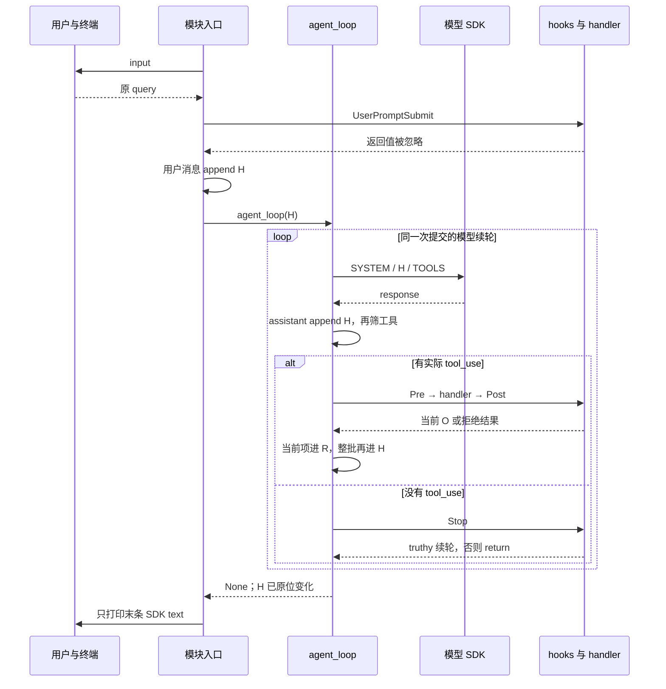
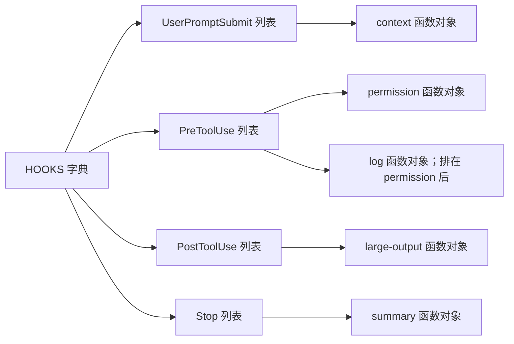
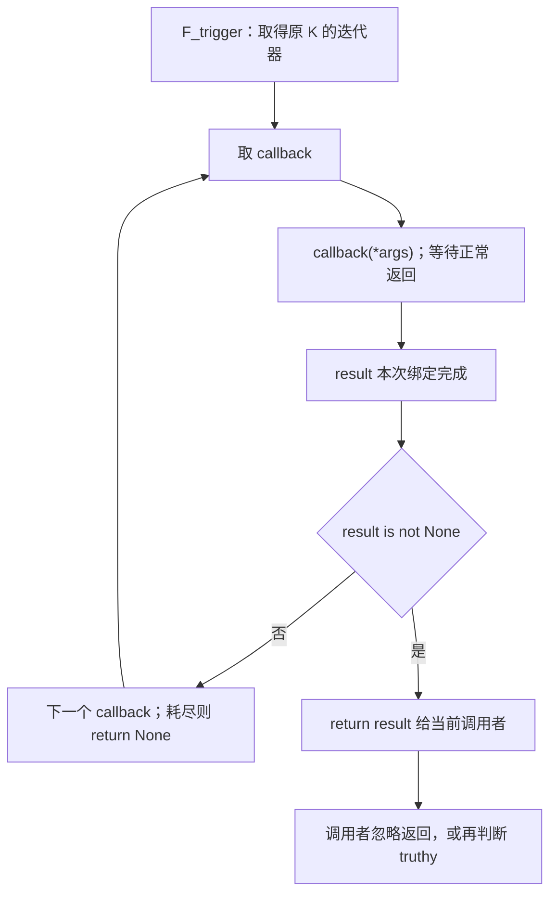
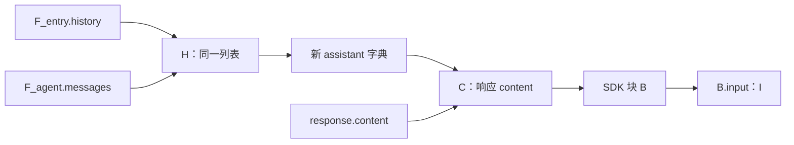
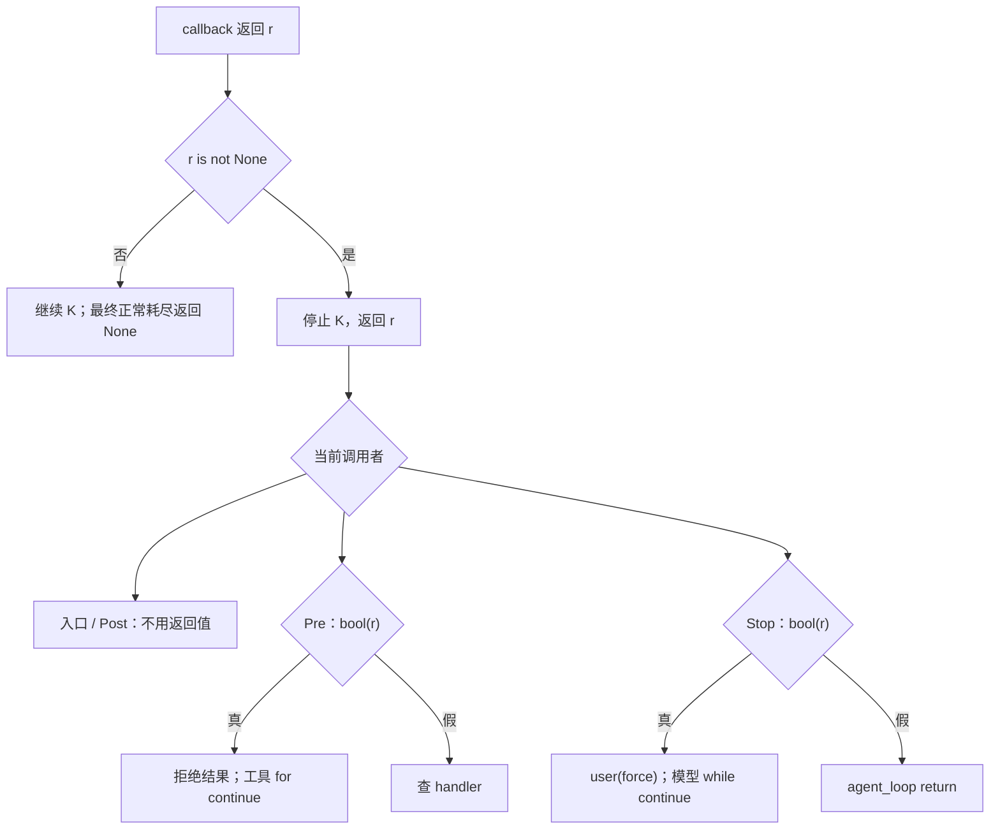
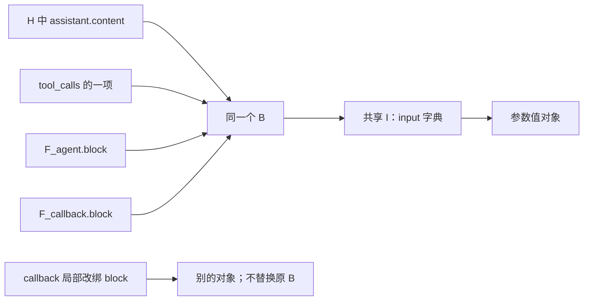
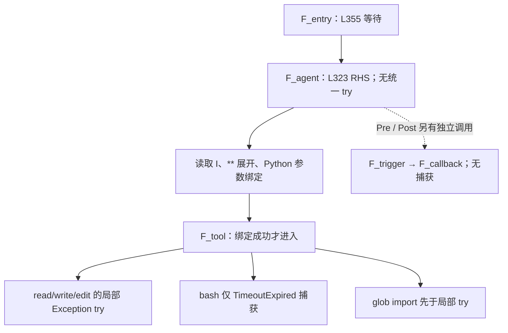
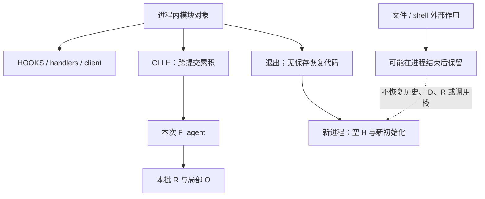

# 1. 从入口建立主线：CLI 提交循环不等于模型续轮

本文以当前 361 行 [s04 源码](../s04_hooks/code.py)为准，沿“输入 → 提交 hook → 请求 → Pre → handler → Post → 整批反馈 → Stop → 展示”逐句下沉，再回到调用者的下一句。只讨论本章五个模型工具、四类 hook 事件、五个默认 callback 和单线程同步 CLI，不借用其他章节的状态或异常包装。

四个事实先固定：本章没有 execute_tool；没有统一 handler try/except；正常工具结果保存原 output，不统一 str；Post 不是 finally，Stop 也不是所有退出必经的清理函数。后文分别用源码的缩进、赋值和返回点证明，不能把 README 的扩展用途当作已经执行的功能。

| 别名 | 本文含义 |
|---|---|
| H | history，也是 agent_loop 的 messages，指同一列表 |
| C | 响应的 content 对象 |
| B／I | 当前工具块／该块的 input 对象 |
| K | 某个事件在 HOOKS 中对应的 callback 列表 |
| R | 当前工具批次新建的 results 列表 |
| O | agent_loop 当前调用帧的 output 绑定 |
| F_entry | 入口所在的模块执行帧，不虚构 CLI 函数 |
| F_agent／F_trigger | agent_loop／某次 trigger_hooks 调用帧 |
| F_callback／F_tool | 某次 callback／handler 的调用帧 |

“默认路径”指现有回调和 handler；“源码静态推断”指根据源码推演但未运行的路径；“扩展假设”指自定义 callback、特殊对象或运行中改表。本文未导入或运行目标模块、工具和用例，也未读取真实配置或密钥。所有示例均不是运行日志。


源码位置：[code.py L335–361](../s04_hooks/code.py#L335)。

```python
if __name__ == "__main__":
    print("s04: Hooks - extension logic on hooks, loop stays clean")
    print("Enter a question, press Enter to send. Type q to quit.\n")

    history = []  # 整段对话历史，传给 agent_loop 后由它就地推进
    while True:   # 外层交互循环：反复读用户输入，直到用户退出
        try:
            # \001/\002 tell Readline the ANSI escapes have zero display width.
            # \001/\002 是 readline 的「不可见定界符」：夹在中间的 ANSI 转义码
            # 不占显示宽度，这样青色提示符才不会让光标错位。
            query = input("\001\033[36m\002s04 >> \001\033[0m\002")
        except (EOFError, KeyboardInterrupt):
            # Ctrl+D（EOF）或 Ctrl+C（中断）时退出。
            break
        # 输入 q / exit / 空行都退出。
        if query.strip().lower() in ("q", "exit", ""):
            break
        # 用户输入进入对话历史之前，先触发 UserPromptSubmit 钩子。
        trigger_hooks("UserPromptSubmit", query)
        history.append({"role": "user", "content": query})
        agent_loop(history)
        # 打印模型最后的文字回复（跳过 tool_use 块）。
        for block in history[-1]["content"]:
            if getattr(block, "type", None) == "text":
                print(block.text)
        # 空行，让下一条提示符清爽地开始。
        print()
```

直接运行文件，且上方初始化全部正常结束，才进入此 if。`__main__` 不是新函数作用域，history、query 和入口展示循环的 block 都在模块执行上下文中；agent_loop 内的同名 block 则是其函数局部绑定。

先执行 L336，再执行 L337。第二次打印失败，第一次可能已经可见，H 却尚未创建。两次完成后，L339 新建空列表并绑定 history；它位于外层 while 之前，因此跨用户提交保留，而不是每读一次 input 就清空。

L345 先调用 input。正常返回后才把字符串绑定 query；若不是第一次输入，RHS 失败时旧 query 绑定可能仍在，但 except 直接 break，不会拿旧 query 再提交。此 try 只覆盖 input，捕获 EOFError、KeyboardInterrupt 后退出的是 **CLI while**。

L350 先求 strip，再对结果 lower，最后检查是否属于 q、exit、空串。规范化文本没有重新赋给 query；“  检查项目  ”进入历史时仍带原空格，纯空白则退出。str 的相关方法产生文本结果，但不需要承诺每次都得到不同身份的字符串对象。退出分支在提交之前，既不 append 用户消息，也不触发 Stop。

非退出输入进入 L353，F_entry 停在提交 hook 调用上。正常返回后 L354 先形成用户消息字典，再 append H；L355 把 H 的引用绑定给 agent_loop.messages，没有列表复制。内层模型循环可以完成许多请求和工具批次，期间外层 CLI 同步等待，不接收下一条提交。

agent_loop 正常 return None 后，F_entry 才继续 L357，取 H 末条 content，逐个检查 SDK text 块并打印。函数不返回一份新历史；CLI 读取的是原位被修改的 H。展示结束后 L361 打印空行，再到外层下一次 input。Stop 与显示之间的失败窗口留到第 26、27 章逐句展开。



本文贯穿主例是“检查项目文件 → 修改文件 → 验证结果”：模型可能选 glob、read_file、edit_file/write_file、bash，最后给文本。它是静态解释主线，不假设模型一定选这些工具或一定完成目标。进入首个请求之前，必须先回溯已经执行的模块初始化。

# 2. 回溯初始化：环境副作用发生时，CLI 尚未建立


源码位置：[code.py L28–62](../s04_hooks/code.py#L28)。

```python
import os          # 操作系统相关功能：读环境变量、判断平台
import re          # 正则表达式：s03 留下的「危险命令」模式匹配
import subprocess  # 子进程管理：执行模型生成的 shell 命令
from pathlib import Path  # 面向对象的路径操作：拼路径、解析、判断是否越界

# readline 提供命令行编辑能力（历史记录、方向键、退格等）。
# 它在 Unix 上通常可用，Windows 上可能不存在，所以用 try/except 包裹。
try:
    import readline
    # 以下四行是 macOS 上 libedit 库的 UTF-8 修复，让终端能正确
    # 处理中文等多字节字符的输入与退格删除。
    readline.parse_and_bind('set bind-tty-special-chars off')
    readline.parse_and_bind('set input-meta on')
    readline.parse_and_bind('set output-meta on')
    readline.parse_and_bind('set convert-meta off')
except ImportError:
    # 没有 readline（例如 Windows 自带 Python）就直接跳过，不影响主逻辑。
    pass

from anthropic import Anthropic    # Anthropic 官方 Python SDK 的客户端类
from dotenv import load_dotenv     # 从 .env 文件加载环境变量（如 API Key）

# override=True：即使系统里已有同名环境变量，也用 .env 里的值覆盖。
load_dotenv(override=True)

# 配了 ANTHROPIC_BASE_URL（走代理/自定义端点）时，
# 移除可能打架的 ANTHROPIC_AUTH_TOKEN，避免两种鉴权方式冲突。
if os.getenv("ANTHROPIC_BASE_URL"):
    os.environ.pop("ANTHROPIC_AUTH_TOKEN", None)

WORKDIR = Path.cwd()  # 工作目录：文件工具与权限判断的基准路径
# 创建 Anthropic 客户端；base_url 默认官方 API，配了环境变量则走自定义端点。
client = Anthropic(base_url=os.getenv("ANTHROPIC_BASE_URL"))
# 从环境变量读模型 ID；用 [] 取值，.env 里没配会直接抛 KeyError。
MODEL = os.environ["MODEL_ID"]
```

模块顺序先导入 os、re、subprocess、Path，再进入可选 readline 区域。import 不是只保存一个将来使用的声明；其失败可以在后续语句尚未开始前中止加载。本章没有 ast/json/YAML 解析流程，也没有 import yaml。

readline 导入正常后，四次 parse_and_bind 按书写顺序运行：先 bind-tty-special-chars，再 input-meta、output-meta、convert-meta。若第三次抛出非 ImportError，前两次终端配置可能已生效，第四次和 SDK 导入尚未发生。except 只匹配 ImportError，不吞掉任意配置异常；此前成功配置也没有补偿。源码注释说明其终端修复目的，不能由此证明任意平台的编辑与删除中文都正确。

Anthropic、load_dotenv 的导入在 readline 区域之后。L51 真正调用 dotenv 并可修改进程环境，override=True 指示加载值可覆盖同名环境变量；返回值未被保存。不是“读取一个配置对象后等待请求时应用”，也不需要读取本地真实 .env 来解释这条语句。

L55 先调用 getenv，再按真假判断。未设置和空字符串不进入分支；非空字符串包括空白串都是真值。进入后 pop 移除 ANTHROPIC_AUTH_TOKEN，缺键则给默认 None，不因缺键报错。后续加载失败不自动恢复这个变量或之前的 dotenv 环境修改。删除意图是避免鉴权方式冲突，不是认证成功证明。

L58 的 Path.cwd() 先返回 Path 才绑定 WORKDIR，基准是**模块加载时 cwd**，不是源码所在目录。L60 先读取端点、求构造实参，再调用 Anthropic，构造正常结束才绑定 client。下一句 L62 才必需读取 MODEL_ID；缺键 KeyError 时客户端可能已创建，而 H、默认 hooks、CLI 提交链都还没建立。

初始化期不存在保护这些步骤的 agent_loop try。准确说法是“本地尚未调用 messages.create”，而不是根据构造源码推测 SDK 内部所有初始化细节；客户端创建与本章显式模型请求是不同阶段。

| 失败时点（源码静态推断） | 已可能完成 | 尚未开始 |
|---|---|---|
| readline 后续配置失败 | 较早配置已生效 | SDK、dotenv 与 CLI |
| dotenv 调用失败 | 不能据源码保证没有部分环境变化 | 后续端点处理、WORKDIR |
| client 构造失败 | dotenv、pop、WORKDIR 已执行 | client 本次绑定、MODEL、H |
| MODEL_ID 缺失 | client 已正常构造 | SYSTEM、工具表、hooks、CLI |

[通用用例加载器](../tests/test_agent_loop_boundaries.py#L49)替换 SDK 和 dotenv，切到临时目录并设置 MODEL_ID。它隔离了源码行为，不证明真实认证、环境配置、网络和生产启动；这些用例本文仅静态阅读，没有执行。

# 3. SYSTEM 是加载时的文本值，不是运行时隔离或状态门禁


源码位置：[code.py L64–75](../s04_hooks/code.py#L64)。

```python
# 根据操作系统告诉模型它面对的 shell 语法，避免生成错误的命令风格。
ENVIRONMENT_PROMPT = (
    "Windows: the bash tool runs through cmd.exe; use cmd.exe syntax, not Unix "
    "Bash or PowerShell syntax, and prefer dedicated file tools for file operations"
    if os.name == "nt"
    else "Unix-like: the bash tool runs the system shell"
)
# 系统提示词：与 s02 相同（本课不靠提示词，而是靠钩子来实现扩展）。
SYSTEM = (
    f"You are a coding agent at {WORKDIR}. Environment: {ENVIRONMENT_PROMPT}. "
    "Use tools to solve tasks. Act, don't explain."
)
```

先求 `os.name == "nt"`，条件表达式只选择一侧文本；另一侧不会作为选中值使用。相邻字符串字面量属于同一文本表达式。ENVIRONMENT_PROMPT 形成后绑定全局名称，下一条 SYSTEM 右侧的 f-string 读取当前 WORKDIR 与该字符串，形成最终系统提示词。

这个字符串不会持有 Path 或环境变量的实时查询：以后改变 cwd，不会自动改变 WORKDIR；即使人为改绑 WORKDIR，也不会自动重建已生成的 SYSTEM。工具读取 WORKDIR 全局对象，SYSTEM 则保存当时格式化的文本，两者可在扩展操作后出现差异，默认 CLI 没有这类重配置入口。

“Windows 用 cmd.exe 语法”“Use tools”“Act, don't explain”是请求中的指导文字，不是 Python 对 shell 语法、工具顺序或回答质量的运行时检查。本章没有“先做某件事才准调用文件工具”的状态分支。平台字符串选择也不建立操作系统沙箱；真实 shell 参数在第 18 章检查。

根 [requirements.txt](../requirements.txt)声明 anthropic>=0.25.0、python-dotenv>=1.0.0、pyyaml>=6.0。最低版本约束不是实际安装版本；尤其根依赖包含 pyyaml，不等于本章导入或使用 YAML。不能由声明推定 SDK 内部如何重试、复制、认证或处理错误。

正常形成 SYSTEM 后，模块继续定义基础 handler；定义函数保存函数对象，函数体尚未执行。等这些定义完成，下一步是建立 TOOLS 与函数分发表。初始化到此仍未提出本章显式模型请求，也未建立用户历史。

# 4. 五个工具和五个函数引用：schema 与真实调用之间没有统一验证器


源码位置：[code.py L148–165](../s04_hooks/code.py#L148)。

```python
# 工具定义列表（发给模型）与「工具名 -> 处理函数」的分发表，均沿用 s02/s03。
TOOLS = [
    {"name": "bash", "description": "Run a shell command.",
     "input_schema": {"type": "object", "properties": {"command": {"type": "string"}}, "required": ["command"]}},
    {"name": "read_file", "description": "Read file contents.",
     "input_schema": {"type": "object", "properties": {"path": {"type": "string"}, "limit": {"type": "integer"}}, "required": ["path"]}},
    {"name": "write_file", "description": "Write content to a file.",
     "input_schema": {"type": "object", "properties": {"path": {"type": "string"}, "content": {"type": "string"}}, "required": ["path", "content"]}},
    {"name": "edit_file", "description": "Replace exact text in a file once.",
     "input_schema": {"type": "object", "properties": {"path": {"type": "string"}, "old_text": {"type": "string"}, "new_text": {"type": "string"}}, "required": ["path", "old_text", "new_text"]}},
    {"name": "glob", "description": "Find files matching a glob pattern; ** matches recursively.",
     "input_schema": {"type": "object", "properties": {"pattern": {"type": "string"}}, "required": ["pattern"]}},
]

TOOL_HANDLERS = {
    "bash": run_bash, "read_file": run_read, "write_file": run_write,
    "edit_file": run_edit, "glob": run_glob,
}
```

先构造 TOOLS 的外层列表，各工具字典及嵌套 input_schema 分别创建，右侧完整完成才绑定 TOOLS。随后创建另一份 TOOL_HANDLERS 字典，将已定义函数对象保存为值；没有在建表时执行 run_bash、run_read 等函数。

| 模型工具名 | 分发表的值 | Python 参数 |
|---|---|---|
| bash | run_bash 函数对象 | command |
| read_file | run_read 函数对象 | path、可选 limit |
| write_file | run_write 函数对象 | path、content |
| edit_file | run_edit 函数对象 | path、old_text、new_text |
| glob | run_glob 函数对象 | pattern |

TOOLS 描述发给模型的接口形状，TOOL_HANDLERS 负责本地查找，二者不是互相实时生成的同一个对象。TOOLS 不携带函数体；模型请求也不会直接收到 Python handler 对象。

分发表值是当时函数对象的引用，不是字符串函数名。保存函数引用也没有冻结其全局环境：函数执行时仍会读取模块中的 WORKDIR 等名称，这与把当时路径格式化进 SYSTEM 字符串不同。扩展假设：以后仅把全局 run_read 改绑成另一个函数，字典中旧值不会自动变化；显式替换 TOOL_HANDLERS["read_file"] 才会改变后续查询。反过来，改 schema 不会自动改 Python 形参或读取逻辑。默认 CLI 不暴露这些修改命令。

required、string、integer 是 schema 说明；源码没有先调用统一 JSON Schema 验证器再分发。Python 函数绑定会检查缺参、多参和关键字形状，但类型注解不自动执行严格类型校验。例如 limit 非空字符串可以在函数体读完文件后才比较失败；缺 path 则可能在进入函数体前就绑定失败。后者不受 handler 自己的 try 保护。

当前源码没有 execute_tool，也没有调用某个统一执行器。分发表查询、条件表达式、Post 和结果构造全在 agent_loop；不能借别章的包装层解释本章异常。五个 handler 的捕获范围还不相同：run_bash 只捕获 TimeoutExpired，三个文本工具在各自体内捕获 Exception，glob 的 import 又位于其局部 try 之前。

本章 [中文 README](../s04_hooks/README.zh.md)与[英文 README](../s04_hooks/README.md)通过省略示例解释扩展点，提到自动 git add、日志文件或通知作为用途。默认表没有这些动作，正文不把它们写成当前实际执行链。

# 5. 注册表先建四个列表，五次登记只保存 callback 引用


源码位置：[code.py L171–176](../s04_hooks/code.py#L171)。

```python
# 钩子注册表：四个事件各对应一个回调列表（一个事件可以挂多个回调，按注册顺序执行）。
HOOKS = {"UserPromptSubmit": [], "PreToolUse": [], "PostToolUse": [], "Stop": []}

def register_hook(event: str, callback):
    # 注册：把回调追加到对应事件的列表里。想加新功能，注册一下即可，不必改主循环。
    HOOKS[event].append(callback)
```

HOOKS 的右侧逐项形成四个新空列表，再组成字典并绑定名称；不同事件不共享一个空列表。register_hook 定义本身不登记任何东西，只有后面的实际调用才运行其函数体。

每次调用先绑定 event、callback，L176 取得 HOOKS，按 event 查 K，再取得 K.append 这个可调用对象，把 callback 引用传入，正常 append 完成后函数隐式返回 None。callback 没有因此运行，也没有被复制。event 不存在，查表 KeyError；event 不可哈希可 TypeError；没有自动创建事件的分支。

没有 callable 检查，所以扩展登记了不可调用对象，append 本身仍可能成功，到触发时才在调用处失败。相同函数可重复登记，没有去重；后续实际执行几次还取决于前面 callback 是否提前返回。源码没有专门注销 API，不能将直接改列表描述为已有 CLI 管理功能。


源码位置：[code.py L270–276](../s04_hooks/code.py#L270)。

```python
# 注册全部钩子：主循环里没有任何一行提到「权限」「日志」「摘要」，
# 这些能力全部通过下面这五行挂接进去——这就是钩子带来的解耦。
register_hook("UserPromptSubmit", context_inject_hook)
register_hook("PreToolUse", permission_hook)
register_hook("PreToolUse", log_hook)
register_hook("PostToolUse", large_output_hook)
register_hook("Stop", summary_hook)
```

模块按这五次调用建立默认链：

| 事件 | K 中的默认顺序 | 实际触发现场 |
|---|---|---|
| UserPromptSubmit | context_inject_hook | 入口 L353 |
| PreToolUse | permission_hook → log_hook | 每工具 L315 |
| PostToolUse | large_output_hook | handler 返回后 L326 |
| Stop | summary_hook | 无工具响应 L303 |

第一个登记完成不等于全部五个已经完成；若后面初始化失败，已发生的列表 append 没有回滚，但 CLI 尚未正常开始。默认正常初始化后，五个函数引用才分别出现在对应列表中。



登记保存的是函数对象，不是对全局 callback 名称的动态链接。扩展假设：登记完再把全局 permission_hook 改绑，旧 K 中的函数仍会被取出；重新登记新函数只是追加，不自动替换旧条目。默认顺序也不等于所有五个 callback 每轮都执行：提交一次跑 context，每个工具跑 Pre/Post，Stop 仅在无工具分支。

正常登记完成后模块继续定义 agent_loop，最后才进入第 1 章入口。为解释入口首次调用的返回语义，先下沉 trigger_hooks。

# 6. trigger_hooks：先完整调用 callback，再绑定 result，再决定是否继续 K


源码位置：[code.py L178–186](../s04_hooks/code.py#L178)。

```python
def trigger_hooks(event: str, *args):
    # 触发：依次调用该事件下的所有回调。
    # 约定（本课的核心设计）：回调返回 None 表示「不干预」，返回非 None 就表示
    # 「拦截」，此时立即停止后续回调并把该结果作为阻止原因返回。
    for callback in HOOKS[event]:
        result = callback(*args)
        if result is not None:  # A hook result blocks this tool call.
            return result
    return None
```

入口第一次停在 L353，或 agent 停在 L315/L326/L303 时，都会创建一次独立 F_trigger。event 接收事件名字符串，`*args` 形成位置参数元组；元组是参数容器，不深拷贝其中 H、B 或 O。Pre 的 args 可表示为 (B,)，Post 为 (B,O)，Stop 为 (H,)。

L182 先从 HOOKS 取 K，并为这次 for 取得该列表迭代器；不先复制 K。每次将列表中的对象绑定局部 callback，再执行 `callback(*args)`。取出元组内引用、按 callback 形参绑定并进入其函数体，正常 return 后，才把返回值绑定 F_trigger.result。

若 callback 抛异常，本次 result 赋值不完成。若之前的 callback 曾返回 None，旧 result 绑定可能仍是 None，但代码不捕获异常，所以不会跳到 if 并把它当放行结果。这里的“本次赋值没发生”与“名称从未绑定”必须区分。F_trigger.result 与 handler 的 O、summary 的 tool_count 都是不同局部变量槽。

L184 用 is not None 做身份判断，不先求 bool(result)。None 才继续下一个 callback；False、0、""、[]、{} 都是非 None，会立即 return。return 退出这一次 F_trigger，把同一个返回对象交给调用者，而不是直接退出工具 for、agent while 或 CLI。

默认 K 全部正常走完，执行 L186 return None。K 为空时 callback 零次调用，也直接返回 None。函数没有 try，事件查询、参数绑定、callback、后续判断的异常都不会在这里转为 Error。



## 原 K 迭代不是快照：仅作扩展静态推演

默认 callback 不修改 K。若扩展 callback 往当前 K 尾部 append，列表迭代可能继续访问新增项；若持续追加，还不能据初始长度保证本次有限结束。删除元素可能移动后项而影响下一次访问。不能把当前 for 写成“固定遍历触发瞬间的 callback 快照”。

若扩展只是把 HOOKS[event] 改绑到新列表，当前迭代器仍关联旧 K，不会自动切换；下一次 trigger 查询才取得新值。往旧列表 append 与替换字典中的列表引用不是同一个动作。异常发生也不恢复注册表。

这些是实现层可变容器语义，不是建议改表，更不是当前 CLI 的动态注册入口。正常默认路径中，context 只打印，接着返回这里，再返回入口 L353；下面精确追踪这条最先发生的提交链。

# 7. 提交 hook 返回了文字，也不会自动改写 query 或阻止提交


源码位置：[code.py L255–257](../s04_hooks/code.py#L255)。

```python
def context_inject_hook(query: str):
    print(f"\033[90m[HOOK] UserPromptSubmit: working in {WORKDIR}\033[0m")
    return None
```

F_entry 在 L353 停下，F_trigger 将 args 中的原 query 字符串绑定给这个 callback 的局部 query。函数并没有使用 query 的内容：先格式化 WORKDIR，再 print，正常完成才 return None。context_inject_hook 的名字和用途注释不等于真的注入了上下文消息。

默认 print 成功后，F_trigger 的 result=None，继续检查 K 是否还有 callback；默认只此一个，耗尽后 return None。两次 None 是不同函数的返回步骤，不应省略成“hook 放行就直接发请求”。


源码位置：[code.py L352–355](../s04_hooks/code.py#L352)。

```python
        # 用户输入进入对话历史之前，先触发 UserPromptSubmit 钩子。
        trigger_hooks("UserPromptSubmit", query)
        history.append({"role": "user", "content": query})
        agent_loop(history)
```

L353 对返回值没有赋值、没有 if，也没有把它连接到 query。F_trigger 正常返回后，F_entry 紧接 L354：先取 history.append，再形成 role/user 与原 query 的字典，最后 append H。成功后 L355 才创建 F_agent，将 H 引用绑定 messages。

扩展假设：callback 返回拒绝文字，F_trigger 确实停止同事件后续 callback，但入口仍继续 L354。callback 返回改写后的新字符串，入口同样不用它；callback 只在自己函数内将 query 重新绑定为其他文本，也不改变模块 query。字符串不可变，不能把局部重新赋值误写成原对象原位修改。

这里没有把“返回值被忽略”写成“异常被忽略”。若格式化、print 或其他扩展 callback 异常，F_trigger 不正常返回，L354 不执行：本次用户消息尚未进入 H、没有本次 SDK 请求、尚无 R。旧 H 保持先前内容，已打印部分不撤销。该异常不在入口 input 的局部 try 中。

| 当前语句与状态 | H | 请求／终端 | 正常后下一句 |
|---|---|---|---|
| 进入 context | 没有本次用户消息 | SDK 未调用 | 格式化并 print |
| context print 完成 | 仍没有本次消息 | cwd 日志已打印 | return None 回 F_trigger |
| trigger 返回 | H 不变 | 返回值被丢弃 | L354 构造并 append |
| 用户 append 完成 | 尾部是原 query | 尚未进入 SDK 调用 | L355 agent_loop(H) |
| callback 异常 | 本次未 append | 日志可能部分可见 | 外溢，不执行后续提交 |

正常路径终于进入 F_agent。此后 callback 的 query 局部帧结束，不代表原 query 文本被清理；H 保存该文本值。下面从 F_agent 的第一条请求分析共享引用与赋值时点。


# 8. SDK 请求：五项实参求值后等待，本轮 response 赋值最后完成


源码位置：[code.py L284–291](../s04_hooks/code.py#L284)。

```python
def agent_loop(messages: list):
    # messages 是完整对话历史，函数就地修改它、无返回值。
    while True:
        # 【第 1 步】把对话历史 + 工具定义发给模型。
        response = client.messages.create(
            model=MODEL, system=SYSTEM, messages=messages,
            tools=TOOLS, max_tokens=8000,
        )
```

调用者 F_entry 暂停在 L355。新 F_agent 的形参 messages 绑定 H 引用，本地没有创建第二份历史。while 也没有建立额外函数帧，之后每次续轮仍在这一个 F_agent 里重用 response、tool_calls、results 等局部名称。

L288 先从全局 client 取 messages 属性，再取 create 可调用对象，然后按书写顺序求实参：MODEL、SYSTEM、messages、TOOLS、8000。MODEL/SYSTEM 是初始化形成的文本，messages 是 H，TOOLS 是既有列表，max_tokens 是本次输出参数。本地没有主动对 H、C 或 schema 复制，SDK 内部是否复制、序列化、重试则不可从此推出。

调用尚未返回时，response 的本次赋值未完成，本轮 assistant 还没有 append，本轮工具尚未筛选或执行。此前用户消息已由入口加入 H；此前提交和工具反馈也仍在。Python 函数体、hook 列表、TOOL_HANDLERS 函数对象没有作为工具可执行代码直接传给模型。

正常 create 返回对象后才绑定 response，随后继续 L293。第一次请求失败，response 可能从未在此帧绑定；第二轮请求失败，上一轮 response 绑定可能仍存在。两种都直接异常外溢，不会“保留旧响应继续执行”。while 不是重试 try，源码不会自动再来一次。

异常可能发生在取方法、构造／处理参数、序列化、网络等待或取得响应的某个阶段，本地没有细粒度请求进度账本。不能由“response 未取得”断言请求没发出，也不能断言服务端没有处理。后续没有补偿前一轮文件变化、删除用户消息或自动补交结果的路径。

本章无显式重试、备用模型、上下文压缩或循环总次数上限。8000 仅作为单次输出参数传入，不约束工具输出、会话历史长度、总费用、HTTP 重试或总运行时间。不要把依赖最低版本推定出的 SDK 行为写成本章策略。

| 时点（源码静态推断） | F_agent 绑定 | H／工具 | 返回或失败后 |
|---|---|---|---|
| 尚在求请求参数 | 本次 response 未完成 | H 已有 query；本轮无工具 | 参数求值失败则外溢 |
| 正在等待 SDK | 本次 response 仍未完成 | 无本轮 assistant/R | 失败外溢，不用旧 response |
| create 正常返回 | response 指向新响应 | H 尚无本轮 assistant | 继续 L293 |
| 上轮反馈已入 H 后新请求失败 | 旧 response 可能仍绑定 | 旧反馈与副作用已存在 | 不删除历史、不回滚 |

# 9. assistant append：H 先变化，工具还未提取


源码位置：[code.py L292–293](../s04_hooks/code.py#L292)。

```python
        # 【第 2 步】模型回复追加为 assistant 消息。
        messages.append({"role": "assistant", "content": response.content})
```

F_agent 从请求返回，停在这句。先取得 messages.append 可调用对象，再从左到右构造字典字段：放 role="assistant"，读取 response.content 得 C，放 content=C，完整形成新字典后才调用 append。

如果 response.content 访问失败，append 尚未调用；如果字典形成成功但 append 失败，不能说消息已经进入 H。默认 H 是内置 list，小消息构造／append 的失败主要涉及资源等非常规情况；扩展自定义容器则另有行为。此处按边界说明，不将其描述成日常普遍故障。

append 正常完成后，H 立即多一条 assistant；F_entry 与 F_agent 指向同一个 H，不必等函数 return 才能从对象上看到变化。代码没有主动深拷贝 C，也没把 SDK 块转换成 dict。H 中 assistant 的 content 字段可以直接引用响应内容列表及其中块。



这里的“共享”是本地没有复制的结论，不推测 SDK 客户端以后是否会复制这些数据。正常 SDK 属性读取取到其 content；若有人扩展成每次访问变化的属性，下一句列表推导式会再次读 response.content，而不是使用一个已保存的 C 局部变量。C 是讲解别名，不是源码真的建立了同名缓存。

append 成功后才去 L296 提取工具；目前没有本轮 R，没有本轮 Pre、handler 或 Post。若随后解析失败，assistant 不会自动撤回。这是第一个“历史已提交，后续工作未开始”的窗口，不应把整个响应处理概括成一次原子动作。

# 10. 工具列表必须整体形成：解析后块失败，前块也没有执行


源码位置：[code.py L295–307](../s04_hooks/code.py#L295)。

```python
        # 【第 3 步】筛出 tool_use 块。
        tool_calls = [
            block for block in response.content if block.type == "tool_use"
        ]
        if not tool_calls:
            # 模型不打算再调工具 = 准备收尾，此时触发 Stop 钩子。
            # 如果钩子返回了非 None（例如「还有测试没跑完，再去检查一遍」），
            # 就把它当成一条 user 消息塞回去并 continue，强行让循环再转一圈。
            force = trigger_hooks("Stop", messages)
            if force:
                messages.append({"role": "user", "content": force})
                continue
            return
```

F_agent 到 L296，先执行右侧列表推导式：再次取 response.content，获得迭代器，逐项绑定推导式自己的 block，读其 type，等于 tool_use 才将该对象收进临时列表。全部迭代正常结束后，tool_calls 才绑定这个新列表。

Python 3 的推导式迭代变量有自己的作用域语义，不把它简单当成后续工具 for 的同一个局部槽；所收集的块对象本身却没有复制。新列表的成员引用来自响应，不是新工具块。该列表也不是执行队列中“边筛边立即调用”的过程。

源码静态推演：C 第一项是合法 tool_use，第二项没有 type。H 中 assistant 已由 L293 加入；推导式在第二项失败，本次 tool_calls 赋值不完成，第一项尚未进入任何 Pre。若上一轮 tool_calls 仍绑定旧列表，也不会回退使用它，因为异常直接离开当前流程。

筛选只看 block.type，不看 stop_reason。实际工具存在，即使 stop_reason=end_turn 也进入工具路径；实际工具为空，即使 stop_reason=tool_use 也走 Stop。文本与工具混排时，文本随 assistant 进入 H，但不会在此处直接显示，工具仍按筛选后的顺序执行。

| 内容形状 | 当前决定 | H／后续状态 |
|---|---|---|
| [] | tool_calls=[] | assistant 已入 H，接着 Stop，不建立 R |
| 仅 SDK text | 无工具 | 接着 Stop；文字不认证业务完成 |
| SDK text 与合法工具混排 | 有工具 | 跳过 Stop 分支，继续 L310 |
| 后块无 type | 推导式异常 | assistant 可已入 H；本轮零工具执行 |
| None／不可迭代对象 | 迭代失败 | 不代表“正常空响应” |
| 可迭代但形状不符的字符串／dict | 元素属性可能失败 | 不能因可迭代就称兼容 |

无工具时，先调用 Stop 并把返回值绑定 force；truthy 才把 force 原样加入 user 消息，continue 回**模型 while**顶部。假值则 return None 到 F_entry，既不建立 R，也不 append 空结果。Stop 的内部统计、原样 content 和异常边界在第 26 章下沉；这里先确定两个继续位置。

[无空结果断言](../tests/test_agent_loop_boundaries.py#L219)参数化范围包含 s04，检查一次请求、末条为 assistant、没有 user 的空 content 数组。[stop_reason 不一致断言](../tests/test_agent_loop_boundaries.py#L243)在 end_turn 响应里放真实工具，检查两次请求及 tool_1 结果。这些用例[关闭了 hooks](../tests/test_agent_loop_boundaries.py#L103)，并[替换成功 bash 映射](../tests/test_agent_loop_boundaries.py#L122)；证明循环分支，不证明默认权限、真实 shell 或 Post 全链。s04 没有 execute_tool，因此不能说用例替换了本章的这个函数。

另须注意[辅助函数](../tests/test_agent_loop_boundaries.py#L93)：它的 None 参数会转换为含空 SDK text 的列表，不是生产 response.content=None。不能拿这一参数化名称宣称生产循环接受 None。正常空列表、空文本、错误形状与函数未返回，是四种不同事实。

有工具时整个无工具 if 被跳过，接下来才建立 R 并逐个触发 Pre。

# 11. 本批 R 与拒绝结果：continue 不进入 Post，也不立即发请求


源码位置：[code.py L309–319](../s04_hooks/code.py#L309)。

```python
        # 【第 4 步】逐个执行工具调用，每个调用前后各有钩子。
        results = []
        for block in tool_calls:
            # s04 change: hook replaces hard-coded check_permission()
            # s04 的关键改动：用 PreToolUse 钩子取代写死的 check_permission()。
            # 被拦下时不执行工具，但仍要回填 tool_result（API 要求一一对应）。
            blocked = trigger_hooks("PreToolUse", block)
            if blocked:
                results.append({"type": "tool_result", "tool_use_id": block.id,
                                "content": str(blocked)})
                continue
```

执行到 L310，说明本轮 response 已取得、assistant 已入 H、工具列表完整成功且非空。新建空列表 R 并绑定 results；与上一批结果不同，是本批的新容器。上一批若已进 H，新局部绑定不会把旧列表清空。

for 每次将当前块绑定 F_agent.block，本文称 B。while/for 不建立函数帧，下一工具会重用同一 blocked、handler、output 局部名称。L315 调用 F_trigger，F_agent 暂停等待；Pre 全链正常返回后，blocked 本次赋值才完成。

Pre 异常时，blocked 的旧绑定可能仍在，但 if 没有执行，不能把旧 False/None 当放行。Pre 正常返回后才在 L316 求其真值，默认拒绝字符串为真，进入拒绝分支。

拒绝分支先取得 R.append，再构造字典：type 为 tool_result，读取 B.id，调用 str(blocked)，形成 content，字典完整才 append。ID 缺失、拒绝对象转换或资源失败，都会使当前 append 没有完成。默认拒绝值是普通文本，特殊 __str__ 失败是扩展假设，不是默认权限字符串的通常行为。

L319 continue 只跳到**工具 for 下一项**，不是模型 while。它跳过 handler 查询、参数展开、调用、Post 和 L328 的普通结果；拒绝结果只在此追加一次。后面还有工具就继续处理；全部完成才 L331 统一把 R 放入 H。

拒绝结果没有统一 is_error 字段。它是本地正常构造的工具反馈，不是异常抛出；“结果内容拒绝了执行”和“工具循环异常中断没有结果”不可混同。源码注释“必须回填”描述协议意图，不排除 Pre 异常、ID 失败或后工具失败让整批反馈缺失。

| 时点（源码静态推断） | R | 本工具副作用／日志 | 后续 |
|---|---|---|---|
| 刚进入 Pre | 本工具尚无项 | 尚无 handler 副作用 | 等待 callback |
| permission 正常拒绝 | 尚待构造 | 拒绝告警可能已打印；log 未跑 | 构造拒绝字典 |
| 拒绝 append 成功 | 有当前拒绝项 | handler 与 Post 均未运行 | 下一工具 |
| 拒绝构造失败 | 当前项未加入 | 早期拒绝打印可能已发生 | 外溢；整批未提交 |
| 全部工具完成 | 可能全是拒绝项 | 不因此保证业务执行过 | L331 提交 R |

默认 Pre 的 permission 与 log 还没具体下沉。先把两层判断放在一张表中，避免把 F_trigger 的 return 当作整个工具循环的 return。

# 12. 非 None 与 truthy：callback 停止不等于工具被拒绝


源码位置：[code.py L178–186](../s04_hooks/code.py#L178)。

```python
def trigger_hooks(event: str, *args):
    # 触发：依次调用该事件下的所有回调。
    # 约定（本课的核心设计）：回调返回 None 表示「不干预」，返回非 None 就表示
    # 「拦截」，此时立即停止后续回调并把该结果作为阻止原因返回。
    for callback in HOOKS[event]:
        result = callback(*args)
        if result is not None:  # A hook result blocks this tool call.
            return result
    return None
```

这是重入相同函数的新调用帧，不是一个跨事件复用 result 的全局执行器。内部判断是 is not None，完全不等于 bool(result)。例如 False 并非 None，因此立刻 return False，K 中后续 callback 不执行。


源码位置：[code.py L315–319](../s04_hooks/code.py#L315)。

```python
            blocked = trigger_hooks("PreToolUse", block)
            if blocked:
                results.append({"type": "tool_result", "tool_use_id": block.id,
                                "content": str(blocked)})
                continue
```

回到 L315 的调用者后，才把该返回对象绑定 blocked，L316 才做真假判断。False、0、空串、空列表、空字典都判假，进入后面的 handler 查询。此时若有后续 callback，它们已经被 trigger 的非 None 短路跳过；不应说“全部检查都通过了”。

默认 permission 只返回 None 或非空拒绝文字，默认 log 返回 None；非 None 假值属于扩展静态路径，并非现有权限回调的真实拒绝类型。登记在已有 callback 后也不会自动跑到已有 permission 前面；若讨论改变链顺序，必须明确是额外改表假设。

| callback 返回 | trigger 内后续 callback | 提交入口 L353 | Pre 调用者 L316 | Post 调用者 L326 | Stop 调用者 L304 |
|---|---|---|---|---|---|
| None | 继续，直到耗尽或别人短路 | 全链正常后继续提交 | 全链最终假值才执行 handler | 正常返回后继续结果 | 全链最终假值才结束 |
| 非 None 假值 | 立即停止 | 仍继续提交 | 仍执行 handler | 仍继续结果 | 结束 agent_loop |
| truthy 值 | 立即停止 | 仍继续提交 | 生成拒绝结果 | 仍继续结果 | 原样追加 user，再续轮 |

表的 None 行不意味着“某个 callback 返回 None 就必然执行工具”；后续 callback 仍可拒绝或抛异常。只有 F_trigger 最终正常返回假值，Pre 调用者才到 handler。入口/Post 虽忽略返回值，也不忽略异常。



扩展假设若返回特殊对象，is not None 本身不触发该对象 __bool__，而调用者的 if 可能触发，甚至在此抛异常。此时 trigger 已正常 return，失败发生在调用者，不该记作 callback 体内错误。默认 None/普通字符串不依赖这种特殊对象行为。

[README](../s04_hooks/README.zh.md)将 Pre 非 None 概括为阻止、Stop 非 None 概括为续轮，源码注释也沿用这种意图描述。对默认回调的实际返回集合通常成立，对 False/空值扩展则必须采用上面的两层语义。本文按源码分支，不把用途约定升级成统一强制协议。下一步沿正常 Pre 回调进入 permission，再返回日志与 handler 查询。


# 13. 权限规则先建立，helper 调用时才 search 并转换为 bool


源码位置：[code.py L192–202](../s04_hooks/code.py#L192)。

```python
DENY_LIST = ["rm -rf /", "sudo", "shutdown", "reboot", "mkfs", "dd if="]
DESTRUCTIVE_COMMAND_WORD = re.compile(
    # 匹配作为「独立命令」出现的 rm/del：忽略大小写，前面是行首或命令分隔符，
    # 后面跟空格/行尾/分隔符（前瞻），避免误伤 "firm" 这类子串。
    r"(?i)(?:^|[;&|()\n])\s*(?:rm|del)(?=\s|$|[;&|()])"
)
DESTRUCTIVE = ["rm ", "> /etc/", "chmod 777"]


def contains_destructive_command(command: str) -> bool:
    return bool(DESTRUCTIVE_COMMAND_WORD.search(command))
```

这些规则在模块初始化时顺序建立，早于默认登记和 CLI。DENY_LIST 右侧先形成列表，再绑定名称；DESTRUCTIVE_COMMAND_WORD 要先完成 re.compile 才绑定正则对象；DESTRUCTIVE 是另一份子串列表。编译若失败，后面 callback 登记与 CLI 都尚未开始，没有回滚已形成对象的专用流程。

运行期，permission 在 L215 调用 contains_destructive_command(command)，把其局部 command 引用传入 helper 的同名形参。helper 先取全局正则，再 search，得到 Match 或 None，bool 完成后把 True/False 返回 permission 的 or 左侧；不是把 Match 对象直接交给工具调用者。

正则逐层解释：`(?i)` 在该模式中忽略大小写；前段允许字符串起点或指定分隔字符 `; & | ( ) 换行`，随后允许空白；主体是 rm 或 del；前瞻检查后面是空白、结尾或指定分隔符，不把这些后续字符当作被命令词消耗的一部分。这个位置规则与 shell 解析不是同一回事。

两个普通列表中的 `pattern in command`／`kw in command` 仍是区分大小写的子串判断，正则的大小写设置不改变它们。它们不识别引号里究竟是数据还是命令，不展开变量，也不认证可执行文件身份。

源码静态推演：`firm file.txt` 中的 rm 不是独立命令词，正则 helper 可为 False；但整个字符串包含 `"rm "`，后面的危险子串仍可能为真。正则注释“避免误伤 firm”只准确描述该正则，不是联合权限条件对所有此类输入的保证。

helper 没有输入类型检查和 try；若 search 参数类型不支持，可直接外溢。但默认 permission 在此之前已经做硬黑名单，错误类型可能更早失败，不能跳过实际先后把所有错误定位到 search。正常 helper 返回后，permission 才决定 or 是否继续求右侧 any。

# 14. bash 权限：硬黑名单优先，确认值只决定门禁，不代表执行成功


源码位置：[code.py L205–224](../s04_hooks/code.py#L205)。

```python
def permission_hook(block):
    """PreToolUse: s03 check_permission() logic moved here."""
    # 工具执行前触发：命中硬黑名单直接拒绝；命中危险规则则打断询问用户。
    if block.name == "bash":
        command = block.input.get("command", "")
        for pattern in DENY_LIST:
            if pattern in command:
                # 红色打印拦截原因，返回非 None → trigger_hooks 会据此阻止执行。
                print(f"\n\033[31m[blocked] '{pattern}'\033[0m")
                return "Permission denied by deny list"
        if contains_destructive_command(command) or any(
            kw in command for kw in DESTRUCTIVE
        ):
            # 黄色打印原因 + 完整参数，让用户看清要执行什么。
            print(f"\n\033[33m[permission] Potentially destructive command\033[0m")
            print(f"   Tool: {block.name}({block.input})")
            # 默认拒绝：直接回车即为 N（fail-safe）。
            choice = input("   Allow? [y/N] ").strip().lower()
            if choice not in ("y", "yes"):
                return "Permission denied by user"
```

F_agent 在 L315 等待，F_trigger 在 L183 等待 callback；进入 F_callback 的 permission。block 绑定 B 原对象引用，尚未调用 handler。先读取 B.name，等于 bash 才进入命令分支；其他名称不运行 command 的读取、黑名单或命令正则。

L209 先读取 B.input 得 I，再 get("command", "")。缺键才得到空串；显式 None 仍是 None。正常字符串 command 与 I 中的值没有主动复制或改写。get 不会因为 schema required 就补写 I["command"]，所以默认空串检查通过后，** 展开仍能因缺参失败。

for 按 DENY_LIST 顺序逐个取 pattern，并做大小写敏感的子串判断。首个命中后先格式化并 print，成功才 return 固定拒绝文字。这个 return 退出 permission 帧，回到 trigger 的 result 赋值；后续黑名单项、helper、any、确认、log、handler 都尚未执行。

若拒绝 print 抛异常，固定拒绝文字根本没有交回；F_trigger.result 和 F_agent.blocked 的本次赋值都未完成。已显示的部分文字不撤销，代码也不会继续按拒绝分支构造 tool_result。类型错误同样如此，例如 command=None，可能在第一项 `pattern in command` 就 TypeError，尚未到 helper 或 handler。

黑名单无命中才求 if 的 or 左侧。helper 返回 True，or 短路，右侧 any 的生成器不被执行；返回 False，才由 any 逐项求 `kw in command`，首个真项就停止，全部假才为 False。条件真进入人工确认，假跳过整个确认区域。

确认分四层：先打印危险提示，再打印完整工具名与 I，之后调用 input；input 正常返回文本才 strip、lower，整条 RHS 正常完成才绑定 choice。最后判断是否属于 y/yes；不属于就 return 拒绝文字，属于则继续流到文件工具 if，普通 bash 名称不匹配，最后 L234 return None。允许确认没有替模型执行命令，也没有说明命令安全或目标已经达成。

| 静态样本 | 首个决定因素 | 未执行部分 |
|---|---|---|
| command 缺失 | get 取空串，默认规则可能都不命中 | 后续真正绑定仍可能缺参 |
| command=None | 硬黑名单成员判断可能 TypeError | helper、确认、log、handler |
| 文本包含小写 sudo | 硬黑名单先命中 | 危险规则与人工允许出口 |
| 独立大写 DEL | 正则可命中 | any 因 or 短路不执行 |
| firm file.txt | 正则不命中，独立 rm 子串仍可命中 | 不能称“正则排除即整体放行” |
| 无规则命中 | 正常流到 None | 不等于真实 shell 安全 |

所有命令文本均为源码分析样本，不在本次交付中执行。权限是启发式，硬黑名单没有确认允许出口；人工确认只用于后面的危险条件。硬黑名单使用子串也可能拒绝只是展示某个词的命令，大小写和位置又可能使某些其他形式不被发现；不能写成完整 shell 语法验证。

[权限参数化用例](../tests/test_permission_command_words.py#L91)包含 s04，覆盖独立词、大小写、分隔符与若干非命令词。[实际断言](../tests/test_permission_command_words.py#L110)固定 input 为 "n"，直接调用权限逻辑，比较 bool(result)。例如 /usr/bin/rm、command rm 可由子串规则命中，不证明正则识别了完整路径或包装词。用例不执行真实 shell、不验证允许后的副作用，也不支持所有危险命令都被发现的结论。

确认 input 的 EOFError 不在入口 input 的 try 内，直接沿 permission → trigger → agent → 入口外溢；choice 本次赋值未完成，handler 尚未进入。KeyboardInterrupt/SystemExit 不属于 Exception，后面 handler 的普通局部 except 同样不能兜底；在这个 Pre 现场本来就没有那些局部 try。

# 15. 文件权限：真实路径判断与后续文件操作没有共享冻结快照


源码位置：[code.py L225–234](../s04_hooks/code.py#L225)。

```python
    if block.name in ("read_file", "write_file", "edit_file"):
        # 文件工具：路径解析后落在工作目录之外，就打断询问用户。
        path = block.input.get("path", "")
        if not (WORKDIR / path).resolve().is_relative_to(WORKDIR):
            print(f"\n\033[33m[permission] Access outside workspace\033[0m")
            print(f"   Tool: {block.name}({block.input})")
            choice = input("   Allow? [y/N] ").strip().lower()
            if choice not in ("y", "yes"):
                return "Permission denied by user"
    return None  # 返回 None = 放行
```

同一个 permission 帧来到第二个 if。只对 read_file、write_file、edit_file 判断路径；glob 与未知工具不走这一分支。bash 即使已经获准，也还会求这个 if，但正常名称不匹配，不会去取 path。

L227 从 I.get 取 path，缺键给空串，不补写原 I；显式 None 不回退。L228 先做 WORKDIR / path，再 resolve，再 is_relative_to(WORKDIR)，最后 not 取反。比较得到在内就跳过确认，继续 return None；越界才开始两次打印与 input。读取 path、拼接、resolve 的异常都没有本地捕获。

Path 拼接遵循平台路径规则，绝对路径可直接指向另一目标，不能只因表达式写 WORKDIR / path 就认定始终在工作区。resolve 也不是“认证文件存在且可读写”；此处没有 exists、is_file 或访问权限验证。某些路径问题会抛错，某些缺失目标能解析出路径，具体不超出所用 pathlib 版本作绝对承诺。

确认通过后，permission 只返回 None；没有把已解析 Path 或打开的文件描述符交给 handler。log 完成后，handler 仍用输入 path 重新拼接和 resolve。这两个检查／使用时点之间，源码没有锁、不可变文件快照或来源认证。单线程只约束当前 Python 调用顺序，不排除其他进程更换链接、文件或目录。

扩展假设：Pre 的后续 callback 若原位修改 I["path"]，handler 读取的是修改后的参数，而不是 permission 先前局部 path 的冻结副本。默认 log 不做这个修改，不能把该扩展推演写成默认权限会主动改路径。

| 当前语句 | H／R | 文件与终端 | 正常下一步／失败去向 |
|---|---|---|---|
| 取得 path | assistant 已在 H，当前结果未进 R | 尚未调用文件 handler | 拼路径与 resolve |
| 范围判断成功为内 | H/R 不变 | 无需确认；不证明文件存在 | return None 回 trigger |
| 越界打印后等待 input | H/R 不变 | 警告可已出现，尚无文件读写 | 正常输入后决定；EOF/中断外溢 |
| 正常拒绝 | 仍无 handler 文件作用 | 只有权限提示／输入发生 | trigger 短路，agent 构造拒绝结果 |
| 正常允许 | H/R 不变 | 不提供文件快照 | trigger 继续 log，再查 handler |

这里的权限 input 与 L222 的 bash 确认不同位置，却同样没有入口 input 捕获保护。L345 发生 EOFError 则局部 break，L222/L231 发生同一异常则整条提交外溢；它们不能写成同一种正常退出。

正常 None 只是 callback 不拦截。若后面 log 或 handler 失败，不会撤销已打印内容，也没有根据先前允许自动重试。glob 的结果过滤另见第 22 章，不能由这个文件 if 推出 shell 或所有工具都有工作区隔离。

# 16. 日志先遍历全部 values、形成完整表示，最后才限制 60 字符


源码位置：[code.py L236–243](../s04_hooks/code.py#L236)。

```python
def log_hook(block):
    """PreToolUse: log every tool call."""
    # 只做观测：灰色打印工具名与前两个参数（截断 60 字符），返回 None 不干预执行。
    # 注意它注册在 permission_hook 之后——一旦权限钩子返回拦截，
    # trigger_hooks 会提前 return，这个日志钩子就不会被调用。
    args_preview = str(list(block.input.values())[:2])[:60]
    print(f"\033[90m[HOOK] {block.name}({args_preview})\033[0m")
    return None
```

正常默认 permission 返回 None，F_trigger 才取下一个 callback=log_hook 并同步调用。B 仍是同一 SDK 块，I 仍是其 input；默认 permission 不改写它们。若 permission 拒绝，trigger 已 return，日志一行都没有执行，因此“log every tool call”的范围必须限定。

L241 先取得外层 str 与 list 可调用对象，随后求实参并实际调用，RHS 的数据计算顺序是：

1. 访问 B.input，取得 values 可调用对象并调用，得到字典值视图。
2. list 消费整个视图，先收集所有值，不是只迭代前两项。
3. [:2] 从新列表取前两项，形成切片列表。
4. str 为这个两项列表形成完整字符串表示，包含相应元素表示。
5. [:60] 对最终字符串取前 60 字符，完成才绑定 args_preview。
6. L242 再读取 name、格式化日志并调用 print。

前两项来自 I 的迭代顺序，不按 schema 属性重新排列；额外键即使 handler 之后不接受，也可先参与 values 列表构造。某个大字符串的完整表示可能已在截断前生成，所以展示上限不是运算量或内存硬上限。对普通字典值，这些步骤不改 I，但也不是只访问两个值的惰性预览。

右侧失败，args_preview 的本次赋值未完成；print 失败，则局部预览可能已存在，终端可能只显示部分内容。两种情况下 handler 查表、参数绑定和文件作用都尚未开始。permission 已经打印或人工确认的状态不补偿。

正常 print 完成后 return None，F_trigger 在 L183 绑定 result，再执行身份判断，默认列表耗尽后 return None，F_agent L315 这时才绑定 blocked。L316 判假，下一句 L322 查分发表。不要从“日志已经出现”推导 handler 已进入或执行成功。

## callback 局部改绑与共享对象修改

扩展静态推演：callback 内写局部 block 指向别的对象，只修改该帧绑定，不替换 F_agent.block，也不替换 tool_calls 中原 B；callback 内对 B.input 的字典原位赋值则修改共享对象，随后 ** 展开可读到新值。若改的是 B 的 input 属性，则保留旧 I 引用的其他局部绑定仍指旧字典，后续 B.input 查询才得到新对象。

H 的 assistant.content 与 tool_calls 都可引用 B，所以原位修改 B/I 可能从 H 的已有消息中立即可见。不是“已入历史就深度冻结”。工具列表成员资格却已在此前筛选，后续改 block.type 也不会自动重跑整个列表推导式。默认回调只有读取、打印和确认，不实施这些修改。



这些关系说明按引用传参的精确影响，不是推荐在 Pre 中绕过权限。登记引用、传递引用、局部改绑与对象原位修改，是四种不同操作。下一章回到 L322，分清取函数与进入函数之前的失败。

# 17. handler 查询、分支选择、** 展开和形参绑定：都没有统一包装


源码位置：[code.py L321–323](../s04_hooks/code.py#L321)。

```python
            # 查分发表拿处理函数；**block.input 按关键字展开参数字典。
            handler = TOOL_HANDLERS.get(block.name)
            output = handler(**block.input) if handler else f"Unknown: {block.name}"
```

F_agent 从 Pre 返回假值后，先读全局 TOOL_HANDLERS 及其 get 方法，再读取 B.name，查询成功才给 handler 本次赋值。不可哈希名称可在 get 处 TypeError；若此前工具留下旧 handler，旧绑定也不会被当作备用，因为异常直接传播。

L323 先求 handler 的真假。默认映射值为函数对象，真值分支才执行 `handler(**block.input)`；假值分支只格式化 Unknown 名称，不展开 handler 参数。但未知工具在更早的 Pre 中仍经过默认 log，坏 input 不保证能走到 Unknown。

选中调用分支后，先读取 I，再按 ** 规则展开关键字，检查可作关键字的键并完成 Python 形参绑定，才开始 F_tool。展开不是把 I 整个字典作为一个实参；command/path 等形参各自取得对应值引用，没有对嵌套值深拷贝。

缺必需参数、多余参数、非 mapping、非字符串关键字等错误，可以在函数体第一句尚未执行时发生。schema/type 注解没有在这句前自动实施统一校验；handler 自己的 try 只从进入函数体后的对应语句起有效，不能捕获进入它之前的绑定失败。

handler 正常 return 才完成 L323 RHS，并给 O 绑定结果。handler 若局部捕获后 return Error，这仍是正常 return，可继续 Post；若抛出未处理异常，没有任何 agent except 将其转成 Error。Post、当前结果构造、R/H append 都不会继续。



## 参数样本逐个定位首次失败

以下是源码静态推演，假设当前是本批第一项、B.id 正常、普通工作区路径可解析、相关文件按表说明存在，默认终端操作正常。共同起点是 H 尾部已含本次 assistant，R=[]；若不是第一项，O 还可能保存前项结果，下表“未完成”均指本次赋值。

| 固定输入 | 首个决定点 | H／R／O | 文件／终端及继续位置 |
|---|---|---|---|
| read_file，I={} | permission 用空 path 检查，log 后形参缺 path | H 已有 assistant，R 仍空，O 本次未完成 | 无读取，Pre 日志可已打印；TypeError 外溢，无 Post |
| read_file，path=None | Pre 的 WORKDIR / path | H 同上，R 空，O 未完成 | 无 handler；通常未到默认 log，异常直接外溢 |
| read_file，path 可读、limit="2" | 体内读完文件后的比较 | 本地 Error 可成为 O，随后才有机会入 R/H | 文件已完整读取；继续第 19、23、24 章 |
| bash，I={} | 空 command 权限检查正常后，绑定缺 command | R 空，O 本次未完成 | 未启动进程；log 可已打印；直接外溢 |
| bash，command=None | Pre 硬黑名单成员判断 | R 空，O 未完成 | helper/log/handler 未运行；外溢 |
| 未知工具，I={} | 查不到 handler，选择 Unknown 分支 | O 为普通 Unknown 文本，R 尚待追加 | log 已打印，无工具副作用；继续 Post |
| 未知工具，I=[] | 默认 log 的 values 属性访问 | O 未完成，R 空 | 没到查表，不能声称已形成 Unknown |
| 特殊块 name=[]、I={} | Pre 可正常结束后，get 的不可哈希键错误 | O 未完成，R 空 | handler 未进入；属于构造畸形块的静态假设 |

这些样本不声称真实 SDK 必然给出畸形块，只定位本地源码若接收到它时的运行边界。某些路径由默认 Pre 先挡住，不能越过它直接说“** 失败会怎样”。

特别固定第二个工具 RHS 失败：第一工具正常得到 O1 并入 R，第二工具绑定失败时 F_agent.output 可能仍是 O1，然而 L323 没正常结束，控制流不会进入 Post，更不会拿 O1 伪装第二个结果。while 和 for 都没有“异常就沿用局部旧值”的语言规则。第 25 章将连同文件、终端和批末提交完整记账。

至此查表与调用前边界已定位。下面分别进入五个默认 handler，分析它们各自能捕获什么、返回到 L323 之后还缺哪些动作。


# 18. bash：等待外部进程、完整捕获、合并与截断各在不同阶段


源码位置：[code.py L81–93](../s04_hooks/code.py#L81)。

```python
def run_bash(command: str) -> str:
    # 执行 shell 命令：shell=True 交给系统 shell，cwd=WORKDIR 固定工作目录，
    # capture_output 捕获 stdout/stderr，text=True 按文本返回，
    # errors="replace" 避免解码崩溃，timeout=120 防止卡死。
    try:
        r = subprocess.run(command, shell=True, cwd=WORKDIR,
                           capture_output=True, text=True, errors="replace", timeout=120)
        # 合并输出并去掉首尾空白；截断到 50000 字符防撑爆上下文。
        out = (r.stdout + r.stderr).strip()
        return out[:50000] if out else "(no output)"
    except subprocess.TimeoutExpired:
        # 超时：返回明确提示，让模型自行调整策略。
        return "Error: Timeout (120s)"
```

F_agent 停在 L323 RHS，Python 已把 I["command"] 对应值绑定给新的 F_tool.command，才执行此函数体。Pre 检查先前已完成，函数不重新做同一套权限判断。类型注解没有自动把错误值转成合法命令。

L86 先取 subprocess.run，再从左到右求 command 与各关键字实参，然后同步调用。shell=True 交给平台 shell；cwd 用模块加载时的 WORKDIR；capture_output 捕获两个流；text=True 取得文本；errors="replace" 配解码错误处理；timeout=120 委托库处理超时。调用正常返回，r 才完成绑定。

等待期间 shell 可以修改文件、启动程序、产生外部效果；Python 尚未拿到 r，不等于命令尚未执行。在单线程调用链中，F_entry 与 F_agent 都等待这个 handler，不会一边继续后面的工具。这个同步顺序不约束 shell 自己或外部进程的并发。

没有显式 encoding，实际默认编码取决于 Python 与环境。replace 不识别 UTF-8/GBK，不保证中文正确，只让部分解码错误以替换字符呈现而非中断。text=True 还涉及文本换行处理，因此也不是原始输出字节保真。平台 SYSTEM 是语法指引，不替代这些运行参数。

run 正常返回后，L89 先读 stdout、stderr，两串相加，再 strip 两端空白，完整成功才绑定 out。拼接不保留跨 stdout/stderr 的实时交错，也不插入专门边界。stdout 若没以换行结束，stderr 会直接接在末尾；strip 也会移除首尾空格，不只换行。

return 先求 out 真值：真才取前 50000 字符，假才取 "(no output)"。截断发生在完整捕获、相加、strip 之后，不是底层 I/O、进程内存或总体上下文预算。没有检查 r.returncode；非零退出的正常结果仍可返回普通输出，两个流为空时甚至仍是占位文本。

只有 TimeoutExpired 在这里匹配 except，直接返回固定超时文字。异常对象的 stdout/stderr 没有被提取加入反馈，不能声称超时分支保存了部分输出。超时文字是 handler 正常返回，之后仍会 Post、构造结果；其他普通异常（例如进程创建、参数处理）若未被库消化则直接越过此 handler，agent 没有统一 Error 包装。

| 源码静态路径 | 外部与局部状态 | 回到调用者后的动作 |
|---|---|---|
| run 启动前失败 | 进程可能尚未开始，r 本次未绑定 | 普通异常外溢，无 Post |
| 进程已运行后超时 | 文件和外部作用可能已发生，r 未正常取得 | 固定 Error 文本 → L323 O → Post |
| 非零退出正常返回 | r 已存在，副作用按命令保留 | 普通 out 或占位 → Post |
| 输出处理异常 | 进程可已执行完，out 本次未完成 | 非 TimeoutExpired 不由本地接住 |
| 返回后 Post 失败 | handler 已完成，O 已绑定 | 外溢；当前结果未进入 R |

“120 秒”不是本章实现的整个用户回合绝对时限，也不撤销此前命令效果。准确边界是没有自建进程组登记、后代追踪和补偿流程，不能因此否认 subprocess.run 自己的超时处理；库处理调用的进程也不等于任意后代与外部作用都被回滚。

[跨章编码策略检查](../tests/test_subprocess_output_encoding.py#L17)包含 s04 源码，[AST 逻辑](../tests/test_subprocess_output_encoding.py#L73)检查 text=True 的 subprocess 调用显式 errors="replace"。这是静态配置证据。[动态中文与替换测试](../tests/test_subprocess_output_encoding.py#L38)加载 s07，不是 s04 动态证据；替换 subprocess.run 主动抛超时的专项也不证明真实进程清理。

正常 return 只把文字交给 L323 完成 O 赋值，handler 本身不打印该 out。Pre 日志、大输出告警、最终 CLI 回答是另外的终端行为；不能把工具 stdout 已捕获写成用户此时已看到它。

# 19. read_file：先形成完整行列表，再决定 limit 是否参与比较与切片


源码位置：[code.py L95–105](../s04_hooks/code.py#L95)。

```python
def run_read(path: str, limit: int | None = None) -> str:
    # 读文件：相对路径拼到 WORKDIR 后 resolve（折叠 ../ 等）。
    try:
        file_path = (WORKDIR / path).resolve()
        lines = file_path.read_text(encoding="utf-8").splitlines()
        # limit：只读前 N 行；截断时附提示说明还剩多少行。
        if limit and limit < len(lines):
            lines = lines[:limit] + [f"... ({len(lines) - limit} more lines)"]
        return "\n".join(lines)
    except Exception as e:
        return f"Error: {e}"
```

从 L323 进入新的 F_tool，path 绑定对应值，未提供 limit 时使用默认 None。先在 try 内执行路径拼接与 resolve，成功后绑定 file_path；下一句再以 UTF-8 read_text 完整读取，splitlines 创建行列表，整串调用正常完成才绑定 lines。路径成功不等于读取成功，读取成功也不等于后面限行逻辑成功。

limit 不传入 read_text。即使要求一行，文件此前也已整体读取和解码。编码失败会在局部 except 变成 Error；不像同类 path=None 若先在 Pre 失败，那时这个 try 根本没有进入。

L101 先判断 limit 真值。假值短路，不求 len、不比较、不切片；真值才计算 len(lines)，然后做小于比较。比较假也跳过切片，最终 join 全部行；比较真才执行 L102。类型注解没有先统一检查“必须 int”。

以下固定完整读取到四行，均是源码静态推演：

| limit | 求值经过与结果 |
|---|---|
| None、0、False | 假值，直接 join 全部四行 |
| True | Python 数值语义为 1，1<4，切一行并提示三行 |
| 正整数 2 | 2<4，切两行并提示两行 |
| 正整数 4 或更大 | 比较假，返回全部，不附提示 |
| -1 | 真且 -1<4，负切片留前三行，文案却算 4-(-1)=5 |
| ""、[]、{} | 假值，可绕过比较，返回全部 |
| 非空字符串 "2" | 真，比较字符串与整数 TypeError，局部 Error |
| 2.0 | 比较真，浮点切片不合法，局部 Error |
| 4.0 | 比较假，不到非法切片，可返回全部 |
| 0.0 | 假值，短路返回全部 |

负数的真实省略数量与提示算式不一致；float 不是一律同句失败，取决于是否到达切片。这些是实现行为，不是新增的输入契约或模型服务端会接受这些类型的保证。

再拆 L102：先取得旧 lines 的切片，计算旧 len(lines)-limit，形成 f-string 和单项提示列表，拼接两列表，整个 RHS 成功才将 lines 改绑到新列表。提示长度仍取自原列表，不是已被切掉的列表。比较／切片失败时，旧 lines 可以存在，但 except 直接返回 Error，不把旧内容作为成功结果返回。

join 用 "\n" 重建 splitlines 后的行，未保留原始行分隔符和终止换行；它不是对任意文件简单 rstrip，也不是字节保真读取。文件可能已经完整读取，才在比较处失败，故 Error 不等于未发生 I/O。该工具不写文件，但外部进程仍可在两次检查间改变文件，代码没有快照保证。

局部 Error 或正常文本 return 到 L323，O 赋值完成后继续 L326；没有直接给模型或终端打印内容。[UTF-8 样本断言](../tests/test_agent_loop_boundaries.py#L164)的参数范围包含 s04，通过辅助函数直调 read/write/edit，检查中文样本。`read == original.rstrip()` 是那个样本的值比较，不能替代这里的 splitlines/join 逻辑；直调不证明权限或 Post 全链，本文也没有执行或宣称当前平台通过。

# 20. write_file：路径、建目录、覆盖、文案形成是四种不同状态


源码位置：[code.py L107–116](../s04_hooks/code.py#L107)。

```python
def run_write(path: str, content: str) -> str:
    # 写文件：整文件覆盖；parents=True 按需建目录，exist_ok=True 忽略已存在。
    try:
        file_path = (WORKDIR / path).resolve()
        file_path.parent.mkdir(parents=True, exist_ok=True)
        file_path.write_text(content, encoding="utf-8")
        # 返回字节数，方便模型确认写入成功。
        return f"Wrote {len(content)} bytes to {path}"
    except Exception as e:
        return f"Error: {e}"
```

调用现场仍是 agent L323。path/content 经 Python 绑定进入 F_tool，值没有主动深拷贝；Pre 使用过的 Path 并未传来，这里重新解析。L110 RHS 成功才给 file_path 绑定真实路径；L111 再求 parent 并 mkdir。

mkdir(parents=True, exist_ok=True) 正常完成才进入 write_text。它可新建一层或多层目录，后续写入失败不撤销目录；exist_ok 也不是“所有已存在对象都可忽略”，例如路径形状不适合仍可失败。没有在这里先验证 content 的严格字符串契约。

L112 覆盖写不是临时文件加原子替换，也没有备份旧内容。底层打开、编码、写入、刷新或关闭的失败时点不同，可能对应文件未动、新建、截断、部分写入或完整写入后报告错误。具体要看实际库实现与错误条件，不能把任何 Error 都断言为已截断，也不能反向保证旧内容完整。

write_text 正常返回，其返回值没有保存；随后才求 len(content)、格式化 path，形成 Wrote 文案并 return。相同内容仍执行覆盖，没有比较后跳过写入。文案 bytes 实际用字符数，不是 UTF-8 字节数；比如普通两汉字字符串的字符数与其 UTF-8 字节数不同。源码的“返回字节数”注释因此不能当准确字节计量。

| 失败阶段（源码静态推断） | 已完成或可能保留的状态 | 捕获后与尚未执行 |
|---|---|---|
| 路径 resolve | 尚无本工具 mkdir/write | 本地 Error；后续若返回可进 Post |
| mkdir 中途 | 部分目录可能已建 | write 尚未开始；不恢复目录 |
| 写入调用失败 | 文件状态取决于失败阶段 | 本地 Error；没有恢复旧内容 |
| 完整写入后文案失败 | 文件已变，不因结果缺失恢复 | 本地 Error；正常文案未交回 |
| 正常文案后 Post 失败 | 完整文件与 O 已有 | 当前结果 append 尚未执行 |
| 整批提交前后工具失败 | 本工具文件与可能的 R 项已存在 | 整批仍可能不进 H |

普通合法 str 的 len 通常不会造成“写后失败”；该行边界可由特殊对象或替换行为构造，属于扩展假设，不写成常见默认故障。真实文件 I/O 的部分副作用则不需要这种扩展假设，代码确实没有补偿。

UTF-8 指明编码，不单独固定文本换行转换。本章未设置跨平台换行策略，不能把一个测试的 UTF-8 字节样本扩大成任意平台都保留原始换行。except 只生成文字；若生成 Error 本身再发生异常，也没有 agent 外层兜底。

成功文案或局部 Error 都先 return L323，之后才 Post、R/H；不会自动直接打印 Wrote，也不认证用户任务已完成。用户可能在 Pre 参数日志看到内容片段，那和看到写入成功反馈是不同事情。

# 21. edit_file：成员判断、替换新串与覆盖 I/O 的失败不能混写


源码位置：[code.py L118–129](../s04_hooks/code.py#L118)。

```python
def run_edit(path: str, old_text: str, new_text: str) -> str:
    # 编辑文件：只替换第一处精确匹配（最后一个参数 1），比整体重写更安全。
    try:
        file_path = (WORKDIR / path).resolve()
        text = file_path.read_text(encoding="utf-8")
        # 找不到原文片段就报错，提醒模型必须给出真实存在的文本。
        if old_text not in text:
            return f"Error: text not found in {path}"
        file_path.write_text(text.replace(old_text, new_text, 1), encoding="utf-8")
        return f"Edited {path}"
    except Exception as e:
        return f"Error: {e}"
```

进入 F_tool 后，先解析路径并绑定 file_path，再完整 UTF-8 读取并绑定 text。L124 才执行 old_text not in text，所以“找不到”之前文件已被读取。old_text 类型不合适，可能在成员判断处抛异常并由本地 except 文本化；读失败则还没到这条判断。

未找到时 L125 正常 return Error 文本，不是抛异常后由 except 捕获。该路径未调用 write_text，文件没有因本工具改变；但不能说没有读取。它返回后 L323 O 正常赋值，照常尝试 Post 与回填。

找到则到 L126：先取得 file_path.write_text 可调用对象，再求 `text.replace(old_text,new_text,1)`，新字符串完整计算成功后才作为参数进入覆盖函数。替换参数错误与写入 I/O 错误不同：前者可能还没有调用 write_text，后者可能已改变文件。一次表达式不能被概括成无中间失败点的“编辑完成”。

末尾 1 只替第一处精确出现，不要求唯一；多个匹配不会因为歧义自动拒绝。空 old_text 通常在字符串成员判断中视为存在，可在开头插入；没有专门空串门禁。content 不做语义解析、语法检查或测试验证。

源码静态推演：原文有两个相同 old，第一次仅改第一处，下一次同输入可能改第二处；old="a"、new="aa" 时新文仍含旧文，重复调用可能继续增长；第一次后 old 完全消失，第二次可正常返回找不到。它们不构成统一幂等行为，更没有自动安全重试保证。

| 当前进度 | 文件状态 | 返回／异常与下一句 |
|---|---|---|
| 完整读完，尚未判断 | 未写，但已经读取 | 执行 L124 |
| 确认找不到 | 本工具未改文件 | L125 错误文本 return → Post |
| replace 计算失败 | write_text 尚未进入 | 本地 Error → Post（若反馈形成成功） |
| 覆盖过程中失败 | 可能截断或部分写；按实际阶段 | 本地 Error；不恢复 text |
| 写入正常，随后 Post 失败 | 新文件保留 | 当前结果可能尚未 append |

读取与覆盖之间没有版本号比较或锁。权限先前的 resolve 也不冻结文件系统，单线程不排除外部修改。覆盖完成才返回 Edited；后续反馈缺失不撤销写入。

[编辑 UTF-8 样本](../tests/test_agent_loop_boundaries.py#L178)将指定 UTF-8 子串替换为中文，检查返回与文件字节；只证明用例断言的样本要求，不覆盖空旧串、多处匹配、写入失败或全链权限。本文这些分支均按源码静态推断，不从测试未覆盖处凭空补出保证。

# 22. glob：先全量枚举，再过滤、去重与排序，最后才限制展示


源码位置：[code.py L131–146](../s04_hooks/code.py#L131)。

```python
def run_glob(pattern: str) -> str:
    # 查找文件：集合去重 + 排序保证输出稳定；** 表示递归匹配。
    import glob as g
    try:
        matches = sorted({
            match for match in g.glob(
                pattern, root_dir=WORKDIR, recursive=True)
            if (WORKDIR / match).resolve().is_relative_to(WORKDIR)
        })
        # 最多 200 条，防止刷屏和吃掉上下文。
        shown = matches[:200]
        if len(matches) > 200:
            shown.append("... (more matches omitted; narrow the pattern)")
        return "\n".join(shown) if shown else "(no matches)"
    except Exception as e:
        return f"Error: {e}"
```

从 L323 进入后，L133 import glob as g 在自身 try 之前。该 import 失败直接外溢：没有函数本地捕获，也没有 agent 的统一 handler 包装。与缺参数在进入函数之前失败是不同位置，但都可能没有 O、没有 Post 和当前结果。

进入 try 后先为 sorted 求参数。调用 g.glob(pattern, root_dir=WORKDIR, recursive=True) 得到候选列表，才逐项进入集合推导式。root_dir 给相对模式提供枚举基准，不是设置进程 cwd；recursive 配合 ** 的匹配能力，不是限制深度或数量。

每项 match 先经过 WORKDIR 拼接、resolve 和 is_relative_to 判断；真才把**原 match 字符串**收进集合，不把真实绝对路径作为返回值。假则过滤该项，继续下一项。resolve/判断若异常，整次集合构造未完成，matches 本次赋值也没完成；本地 except 返回 Error，不提供已经收集的部分项。

集合按字符串相等去重，不按 inode 或真实目标身份去重。不同字符串可指向同一真实对象，仍可能分别出现；模式也可返回目录，代码没有 is_file 过滤。后面 sorted 对完整集合排序，形成完整列表后才绑定 matches；相同候选集给出确定字符串顺序，不是保证变化中文件系统始终给出相同候选。

L141 从 matches[:200] 新建 shown。超过 200 时只对 shown append 提示，不改变 matches；最后 shown 真则 join，假则 "(no matches)"。上限是最多 200 个结果加一条提示，不限制之前扫描、集合存储、resolve 次数或排序成本。

结果过滤在完整 glob 调用之后，不能写成“扫描前禁止走出工作区”。它也不隔离 shell 或其他文件工具，permission 对 glob 本来没有套用三文件确认分支。真实路径过滤并不等于操作系统沙箱或文件身份认证。

| 分支 | 局部状态与返回 | 不能推出 |
|---|---|---|
| 正常零候选／全部过滤 | matches=[]、shown=[]，返回 no matches | 不等于扫描报错 |
| 1–200 项 | 完整排序后全显示 | 不保证全是普通文件 |
| 205 项等超限集合 | 全量 matches 存在，shown 前 200 加提示 | 不是只扫描 200 个 |
| 枚举／过滤／排序异常 | 本地 Error，未正常返回部分清单 | 不保证模型收到部分结果 |
| import 异常 | 局部 try 尚未进入 | 不自动生成 Error 文本 |

[递归断言](../tests/test_agent_loop_boundaries.py#L191)比较根、一级、二级三个 .py 文件的集合；[上限断言](../tests/test_agent_loop_boundaries.py#L206)建立 205 项样本，检查 201 行和最后提示。s04 在其参数范围，辅助函数直接调用 run_glob，所以不是 permission/Post/整批链验证，也不证明扫描沙箱。

五个 handler 至此下沉完成。它们所有正常文本返回都交给 L323 完成 O 绑定，后面还有 Post、ID 读取、R append、H append 和下一次请求；“已经拿到 handler 返回值”仍不是“模型已经读到结果”。


# 23. Post 只观测原 O：不替换结果，也不是 handler 的 finally


源码位置：[code.py L245–250](../s04_hooks/code.py#L245)。

```python
def large_output_hook(block, output):
    """PostToolUse: warn on large output."""
    # 工具执行后触发：只负责告警（输出超过 10 万字符），不修改结果本身。
    if len(str(output)) > 100000:
        print(f"\033[33m[HOOK] Large output from {block.name}: {len(str(output))} chars\033[0m")
    return None
```

调用现场是 F_agent 的 L326。只有 L323 正常结束、O 本次绑定完成，才会调用这个事件；F_trigger 用 (B,O) 构造参数传给 callback，F_callback.output 绑定 O 指向的对象。参数槽不同，对象可相同。

L248 先取得外层 len，再取得 str 可调用对象，读取 output 引用并完成 str 调用，再把所得字符串交给 len，最后与 100000 比较。恰为 100000 判假；100001 才判真。真分支先取得 print，再为 f-string 读取 B.name，随后再次执行 str(output) 与 len；整段文字形成后才调用 print。第二次不是复用第一遍求出的长度。

默认 handler 返回普通字符串，转换只是取得文本表示，不改变 F_agent.O；不能说“经过 Post 已统一转成字符串”。扩展若返回特殊对象，其两次 __str__ 可能表现不同或异常，这是扩展假设，不是假装普通文本通常会转换失败。即使转换有副作用，也与明确重新绑定 O 为字符串不同。

return None 正常退出 callback，再由 trigger 按非 None 规则决定是否继续其他 Post。扩展 callback 返回替代文本，最多停止同事件后面的 callback；调用者不保存返回值，因此没有替换 O 的作用。callback 内局部 `output = 其他对象` 同样只改局部槽，不改调用者 output；对扩展可变 O 原位修改则立即改变共享对象。


源码位置：[code.py L325–328](../s04_hooks/code.py#L325)。

```python
            # 执行之后再触发 PostToolUse 钩子（能拿到输出，可做告警/审计）。
            trigger_hooks("PostToolUse", block, output)  # s04: post hook

            results.append({"type": "tool_result", "tool_use_id": block.id, "content": output})
```

L326 没有 try/finally 关系，只是 L323 后面一条普通语句。拒绝在 L319 continue，参数绑定失败在 L323 外溢，handler 未处理异常同样外溢；三种都到不了 Post。反过来，handler 自己捕获异常并正常返回 Error 文本，L323 已完成，因此仍调用 Post。

| 前置路径 | Post 是否执行 | 当前反馈状态 |
|---|---|---|
| permission 正常拒绝 | 否，continue | 拒绝结果走 L317 |
| 未知工具正常 Unknown | 是 | 尚待 L328 普通结果 |
| read/write/edit/glob 局部返回 Error | 是 | O 为 Error，但不是业务成功 |
| bash 超时局部返回 Error | 是 | O 已形成；外部作用不撤销 |
| 参数绑定失败 | 否 | handler 未进入，O 本次未完成 |
| handler 普通异常未处理 | 否 | 可能有副作用，O 本次未完成 |
| Post 自己抛异常 | 已进入但未正常结束 | 当前 L328 尚未执行 |

Post 返回值忽略不等于异常忽略。告警打印 BrokenPipeError 等异常直接外溢，没有外层 handler 包装把它变为工具 Error，也没有补偿已经完成的写盘或进程作用。

## 大输出的完整静态推演

假设可读文件是一行 100001 个普通字符，read_file 不限行，前面的 permission/log 正常。read_text、splitlines、join 得到长度 100001 的 O；L323 完成；Post 的条件为真，打印告警；Post 正常返回并构造当前结果后，R 中该结果字典的 content 仍是**完整 O**，没有切到 100000，也没有自动另存文件。

若同样长度是 100000，不告警，结果照常回填。若告警打印失败，读取已经完成、O 已绑定，但当前结果没有进入 R。正常 bash 输出已在 handler 限到 50000，通常到不了此阈值；所以“大输出 hook”不是所有工具统一截断器，也不是总体内存预算。

默认 handler 不直接打印工具返回正文；这个 hook 也只输出长度告警，不输出完整内容。模型获得全文要等 R 入 H 后的下一次请求，用户看到最终回答则更晚。

# 24. 当前项进入 R 与整批进入 H：正常 content 保存原 O，不统一 str


源码位置：[code.py L328–331](../s04_hooks/code.py#L328)。

```python
            results.append({"type": "tool_result", "tool_use_id": block.id, "content": output})

        # 【第 5 步】把工具结果作为 user 消息送回，循环回到顶部继续推理。
        messages.append({"role": "user", "content": results})
```

执行到 L328，意味着本工具 handler/Unknown 正常形成 O，Post 全链也正常返回。先取得 R.append，再依字段顺序构造结果：type 常量，读取 B.id，取得 F_agent.output 原引用，字典完整后才 append。

这里没有 str(output)，与拒绝路径 str(blocked) 不同。默认五个 handler 的正常/错误返回确实是文本，但这是**这些函数体的事实**，不是执行器对所有 handler 返回类型实施了字符串保证。也没有统一 is_error 设置或按 Error 前缀解析业务成功。

B.id 在这个时点才读取，没有最早响应时冻结的副本。默认 SDK 块提供正常属性，缺失或扩展修改属于静态分支；若读取失败，O 已有，Post 可能已完成，当前项尚未 append。若非首次工具，R 的前面项还在，不会因此自动提交。

结果 append 成功后只改变局部 R，H 尾部仍为本轮 assistant。工具 for 还有下项就继续 L315；自然耗尽才执行 L331。L331 先取 H.append，再形成 user 字典，把同一 R 引用放入 content，完整形成才 append H。没有对 R、结果字典或 O 深拷贝。

下一模型轮开始时 results 重新绑定新列表，不清空已放进 H 的旧 R；默认后续也不主动改旧 R。因此正常字符串输出是保存在历史中的文本值，不是文件实时视图：之后改磁盘，不会自动改写过去 tool_result.content。


每个箭头只代表前面正常完成才走后面，没有自动补交和回滚含义。handler return 不是 Python 直接把结果注入已完成的模型响应；模型要等下一次请求才能根据反馈生成新参数。

## 扩展非文本结果：本地能保存，不证明 SDK 接受

扩展假设 handler 返回字典 O。Post 计算 str(O) 的长度，不替换 O；之后 content 保存该字典引用。若 Post 对字典原位修改，修改进入 R；Post 仅把自己的 output 参数改绑成另一个字典，则 R 仍保存原 O。R 入 H 后，若有人持有同一可变 O 并再原位修改，历史对象也可能随之变化；这与默认不可变字符串快照不同。

本地没有检测这种 content 是否符合 SDK 接口。它可能已经进入 H，直到下一次 create 的序列化／验证等阶段才失败，实际由安装版本决定；不能写“既然 append 成功，模型一定接受并读取”。反之也不能无依据保证它一定在哪一层报哪种错误。

正常与拒绝字典都由程序构造来满足工具反馈意图，但没有全链事务来保证每个 tool_use 最终都成功配对。当前结果、整批历史提交、SDK 接受和取得后续响应，必须分开记账。

# 25. 多工具部分成功：旧 O 可仍绑定，整批反馈却根本未提交


源码位置：[code.py L310–331](../s04_hooks/code.py#L310)。

```python
        results = []
        for block in tool_calls:
            # s04 change: hook replaces hard-coded check_permission()
            # s04 的关键改动：用 PreToolUse 钩子取代写死的 check_permission()。
            # 被拦下时不执行工具，但仍要回填 tool_result（API 要求一一对应）。
            blocked = trigger_hooks("PreToolUse", block)
            if blocked:
                results.append({"type": "tool_result", "tool_use_id": block.id,
                                "content": str(blocked)})
                continue

            # 查分发表拿处理函数；**block.input 按关键字展开参数字典。
            handler = TOOL_HANDLERS.get(block.name)
            output = handler(**block.input) if handler else f"Unknown: {block.name}"

            # 执行之后再触发 PostToolUse 钩子（能拿到输出，可做告警/审计）。
            trigger_hooks("PostToolUse", block, output)  # s04: post hook

            results.append({"type": "tool_result", "tool_use_id": block.id, "content": output})

        # 【第 5 步】把工具结果作为 user 消息送回，循环回到顶部继续推理。
        messages.append({"role": "user", "content": results})
```

这段连续源码把同一批的提交点放在一起：R 只在 for 前创建一次，L331 只在 for 后执行一次；中间没有“每完成一个就把它放 H”的语句。工具按列表顺序同步运行，但顺序运行不是事务。

主例的源码静态推演：模型先用 glob/read_file 取得项目信息，再在某一响应里给出三个工具：

```text
write_file：写入修改
→ read_file：读取补充信息
→ bash：验证命令
```

同响应三个 input 已在 C 中，后面的路径与命令不会因为第一个返回 Wrote 而自动重算。想基于结果决定新参数，需要整批回填后的新模型请求。若模型让 read_file 指向刚写的文件，它能看到顺序执行后的磁盘状态；这来自已有参数和共享文件，不是 Python 自动把前一 output 传给后一个。

假设前两个工具全部正常，第三个 bash 缺 command：

| 当前语句／进度 | H 尾部 | R／O | 文件／终端 | 下一句或去向 |
|---|---|---|---|---|
| assistant 已追加 | 三个工具块的 assistant | R 尚未建立 | 无本批文件变化 | L310 |
| 第一写盘完成，handler 尚待返回 | 仍为 assistant | O 本次仍等待 | 文件已改，Pre 日志已打印 | 返回文案 |
| 第一结果 append | 仍为 assistant | R=[写入结果]，O=O1 | 文件保留修改 | 第二工具 Pre |
| 第二结果 append | 仍为 assistant | R 有两项，O=O2 | 文件已读，日志已打印 | 第三工具 Pre |
| 第三工具默认 Pre 正常结束 | 仍为 assistant | 两项 R，O 仍旧 O2 | 空 command 检查及日志已过 | L323 参数绑定 |
| 缺 command 绑定 TypeError | 仍为 assistant，无本批 user 结果 | O 本次未赋值，旧 O2 可仍在 | 第三进程未启动，前面作用不撤销 | 外溢，不执行 Post/L328/L331 |

这证明旧 O 不是备用结果：赋值 RHS 失败不清除旧槽，但没有 except 继续流程，后面的 Post 与结果 append 根本不执行。也不能据最终 R 没入 H 推导前两工具没执行。

## 改换后一失败现场，提交状态分别不同

| 后一失败现场 | 已完成 | 当前结果与整批历史 |
|---|---|---|
| Pre callback 异常 | 前面工具及可能的确认/日志 | 当前 handler 未进入，整批 R 未进 H |
| ** 展开／绑定失败 | 当前 Pre 已正常结束 | 当前 body 未进入，无当前结果 |
| handler 未处理普通异常 | 当前 handler 可能已有副作用 | O 本次未完成，无 Post/当前结果 |
| handler 内局部捕获并返回 Error | body 部分工作可能已完成，O 正常形成 | 可继续 Post/R/H，但仍可能后续失败 |
| Post 异常 | 当前 handler 已正常返回且 O 已有 | 当前项未进 R，整批未进 H |
| block.id 读取失败 | 当前 Post 已正常完成 | 当前字典未形成，当前项未进 R |
| 最终 H append 失败 | R 可能完整，工具都已执行 | 不可宣称整批已提交 |
| H 已追加后的下一请求失败 | 本批结果已在 H，副作用已发生 | 没有后续响应；不等于本批未提交 |

H/R append 的极端资源失败、扩展容器行为按静态边界讨论；普通内置小列表并非默认经常失败。若失败，没有自动保存 R、补发结果或恢复输入指针。

## 四类反馈，不从一个前缀推断状态

| 类别 | 本章具体来源 | 返回链与不能推导的结论 |
|---|---|---|
| 正常分支主动返回错误文字 | edit 未找到旧文；Unknown 也是正常分支文本 | O 可正常形成；不等于抛异常 |
| callback 正常拒绝 | permission 返回非空拒绝文字 | 走拒绝 append，不跑 handler/Post；不等于循环异常 |
| handler 局部捕获后 Error | read/write/edit/glob 的 Exception；bash 超时 | O 可形成，副作用可能保留；不是全调用回滚 |
| 未被当前链捕获 | 参数绑定、Pre/Post、SDK、bash 非超时等 | 可能无本工具反馈；不证明此前无作用 |

Error 字符串的生成本身也可能因极端格式化／资源问题失败，源码没有一个最终保证“所有错误都能反馈”的兜底层。KeyboardInterrupt/SystemExit 不属于 Exception，连三个文件工具和 glob 的普通局部捕获也不会处理。

这条批次没有并行调度、事务、自动重放、去重或恰好一次执行保证。已发生的文件变化和终端输出按各自时点存在；只有整批正常结束才到下一模型请求。模型之后生成纯文本，才进入下面的 Stop 路径。

# 26. Stop：只数已有结果，不认证成功，也不覆盖所有退出方式


源码位置：[code.py L261–268](../s04_hooks/code.py#L261)。

```python
def summary_hook(messages: list):
    # 遍历所有消息的内容块，统计 type == "tool_result" 的条数（即工具调用次数）。
    # 注意只有 dict 形态的块才算——assistant 消息里存的是 SDK 对象而非 dict。
    tool_count = sum(1 for m in messages
                     for b in (m.get("content") if isinstance(m.get("content"), list) else [])
                     if isinstance(b, dict) and b.get("type") == "tool_result")
    print(f"\033[90m[HOOK] Stop: session used {tool_count} tool calls\033[0m")
    return None
```

F_agent 的无工具分支在 L303 调用 trigger_hooks("Stop", H)，F_trigger 在 L183 调用 summary_hook。F_callback.messages 与 F_agent.messages 均指 H，但局部绑定属于不同帧；summary 不复制 H，也不访问文件、工具 returncode 或隐藏业务完成状态。

L264 先准备 sum 调用和生成器；生成器被 sum 消费时，外层逐个 m。内层迭代对象通过条件表达式选择：先 m.get("content")、isinstance(list)，为真才再次 get 取列表，否则用空列表。不是 list 就不继续迭代其字符串字符、字典键等内容。消息 m 自己仍被假定有 get，畸形消息可在此失败，没有通用消息验证。

每块先 isinstance(b,dict)，假则 and 短路，不调用 b.get；真才查 type 是否 tool_result。每个符合项 yield 1，sum 全部消费正常完成才绑定 tool_count。随后格式化并 print，正常完成才 return None。打印异常时计数可能已经算完，但 F_trigger.result 与 F_agent.force 的本次赋值还在等待返回。

没有 role 条件，任意消息 list content 中的 dict tool_result 都能计入。普通 assistant SDK tool_use 不计；拒绝、Unknown、局部 Error 都是 tool_result，照样计；工具已执行却整批未入 H 的作用不计。计数不是成功数、工具副作用数、用户任务数或当前提交的专属次数。

H 跨用户提交保留，summary 默认每次遍历整个 H，所以打印累计结果块数。它没有检查任务是否完成，也没有发额外模型请求做摘要。名称 summary 是终端统计，不是内容压缩或业务结果认证。


源码位置：[code.py L299–307](../s04_hooks/code.py#L299)。

```python
        if not tool_calls:
            # 模型不打算再调工具 = 准备收尾，此时触发 Stop 钩子。
            # 如果钩子返回了非 None（例如「还有测试没跑完，再去检查一遍」），
            # 就把它当成一条 user 消息塞回去并 continue，强行让循环再转一圈。
            force = trigger_hooks("Stop", messages)
            if force:
                messages.append({"role": "user", "content": force})
                continue
            return
```

F_trigger 正常 return 后，L303 才赋 force。None/非 None 假值导致 L304 判假，执行 return None，退出 F_agent；truthy 值才构造 user 字典，force **原样**作为 content append H，然后 L306 continue 到模型 while 顶部。没有统一 str、没有额外 UserPromptSubmit，也没有本地续轮总次数上限。

默认 summary 返回 None，所以正常结束当前 agent_loop，不阻止未完成任务停止。若扩展 Stop 返回 False/空串，trigger 已停止后续 callback，调用者仍 return；返回非空字符串或其他 truthy 对象则请求续轮。SDK 是否接受该 content 形状并非本地验证结果，不能把“真值”当成合法消息格式认证。

扩展静态推演：Stop callback 收到 H 原引用，原位 append/修改可以立即被 F_agent 看到；只把其局部 messages 改绑新列表则不替换原 H。默认 summary 不做历史修改。若 callback 既改 H 又抛异常，历史副作用没有回滚，CLI 展示也不执行。

源码注释与 README 的“非 None 则继续”须按实际 if force 限定。扩展强制续轮后，当前无工具文本已在 H，却还没有被入口打印；下一响应才重新筛工具或再次 Stop。反复 truthy 可以让本次提交长期不返回，但这不是默认 summary 行为。

Stop 只在无工具分支执行，不是 finally。工具异常、SDK 异常、Pre/Post 异常、CLI q/exit/空白和入口输入中断退出，都没有自动跑 Stop 的语句。不能把它写成整个进程所有结束路径都进行的收尾清理。

# 27. agent 正常返回之后才展示：回答已入 H，不等于用户已看到


源码位置：[code.py L355–361](../s04_hooks/code.py#L355)。

```python
        agent_loop(history)
        # 打印模型最后的文字回复（跳过 tool_use 块）。
        for block in history[-1]["content"]:
            if getattr(block, "type", None) == "text":
                print(block.text)
        # 空行，让下一条提示符清爽地开始。
        print()
```

F_entry 在 L355 等待 F_agent；只有其正常 return None，才继续展示。返回值没有保存，入口仍读原 H：先取 H[-1]，再取其 "content"，取得迭代器，逐个绑定模块级 block。函数内部同名 block 是 F_agent 局部，不与这里冲突。

每块先 getattr(block,"type",None)，等于 text 才读取 block.text 并 print。getattr 默认值只处理属性缺失这种情况，不是吞掉所有属性读取错误。dict 块的 "type" 键不是该属性，普通字符串字符也不是 SDK text；这里没有统一把任意数据转成文本显示。

只遍历末条，不反向查找此前答案，不合并历史文字，不显示全部工具结果。content 若是 None 会在迭代处失败，字符串／dict 可能按元素被遍历却不显示；某些这类畸形内容在更早生产循环已失败，不能由展示处几句逻辑推定整个循环兼容。正常默认路径末条是最终 assistant 的 SDK 块列表。

多块 text 按顺序各 print 一次，后面的 print 失败不擦除前面显示的块；部分输出后终端失败也不回滚 H。最后 L361 空行正常完成，才到下一次 CLI input。这里同样不受入口 L341–348 只包 input 的 except 保护。

## 不用工具的普通问答：完整返回链

源码静态推演：用户提交正常，首个响应仅有一个 SDK text；L293 assistant 入 H；tool_calls=[]；Stop 统计旧历史中的结果，正常打印并返回 None；F_trigger 返回 None；force=None；L307 return 到 F_entry；L357 才遍历最终 text 并打印。没有 R、没有空 user 工具结果消息，也没有任何 handler 调用。

此例说明 hook 机制不要求模型每次必须使用工具，Stop 统计也不代表本轮有业务执行。通用无空结果用例验证循环分支时替换 hooks，不可用作默认统计和 CLI 全链运行证据。

| 停止位置 | H／文件状态 | 终端与尚未发生 |
|---|---|---|
| 最终 assistant append 完成 | 回答已在 H，文件按早先工具保留 | Stop 尚未运行，答案尚未展示 |
| Stop sum 完成 | H 不变，tool_count 已绑定 | 统计 print 尚可能失败 |
| Stop print 完成 | H 不变 | 统计已显示，CLI 答案仍未显示 |
| Stop 后异常外溢 | 最终 assistant 可仍在 H | F_entry 没进入展示 |
| agent 正常 return | H 已推进 | CLI 才取末条 content |
| 第一 text 打印后第二 text 失败 | H 仍保留全部回答 | 用户只见前面部分；未到下一 input |
| 全部打印和空行成功 | H 保留 | 进入下一次提交 |

最终回答文本不经过本章事实核验或脱敏流程。打印完成只说明该终端调用正常返回，不认证任务成功；回答已经进入历史也不是自动显示保证。

# 28. 退出与生命周期：文件留存不恢复历史、配对 ID 或暂停调用栈


源码位置：[code.py L339–355](../s04_hooks/code.py#L339)。

```python
    history = []  # 整段对话历史，传给 agent_loop 后由它就地推进
    while True:   # 外层交互循环：反复读用户输入，直到用户退出
        try:
            # \001/\002 tell Readline the ANSI escapes have zero display width.
            # \001/\002 是 readline 的「不可见定界符」：夹在中间的 ANSI 转义码
            # 不占显示宽度，这样青色提示符才不会让光标错位。
            query = input("\001\033[36m\002s04 >> \001\033[0m\002")
        except (EOFError, KeyboardInterrupt):
            # Ctrl+D（EOF）或 Ctrl+C（中断）时退出。
            break
        # 输入 q / exit / 空行都退出。
        if query.strip().lower() in ("q", "exit", ""):
            break
        # 用户输入进入对话历史之前，先触发 UserPromptSubmit 钩子。
        trigger_hooks("UserPromptSubmit", query)
        history.append({"role": "user", "content": query})
        agent_loop(history)
```

回到外层下一次 input 时，H 是 L339 那一个列表，HOOKS、TOOL_HANDLERS、client、WORKDIR 均是模块正常初始化的既有对象。默认代码不会每次提交重复登记五个 callback，也不会重建客户端。下一次 agent_loop 是新 F_agent，但 messages 仍接收 H 引用。

| 生命周期 | H | HOOKS／分发表／客户端 | 局部绑定与 R | 文件与终端 |
|---|---|---|---|---|
| 同一 F_agent 模型续轮 | 原列表继续追加 | 复用 | O/response 等可保留旧绑定，R 每批重建 | 工具作用、已打印内容保留 |
| 下一次用户提交 | 仍同 H | 默认原对象继续使用 | 新 F_agent；不恢复上帧局部进度 | 旧文件和终端内容不自动清理 |
| 输入 q/exit/空白或局部中断 | 本次退出输入不入 H | 没有退出时重配置 | 不再进入本次 agent_loop | 不额外跑 Stop 或补交 |
| 新进程启动 | 新建空 H | 重新初始化与登记 | 无旧 R、旧 O、旧暂停帧 | 业务文件可能仍在，旧会话不恢复 |

L345 的 EOFError/KeyboardInterrupt 被局部捕获后 break；L350 的退出判断也 break，不触发提交、模型或 Stop。L222 的 bash 确认和 L231 的文件确认发生相同 EOFError，却沿 callback → trigger → agent 外溢；输入规范化后的 choice 本次未完成，目标 handler 未进入。已执行的前批或同批前项文件作用仍可能保留。

KeyboardInterrupt/SystemExit 不属于 Exception；本章的文件工具普通 except 不处理，agent 本来也无统一捕获。异常退出没有 finally Stop、会话保存或结果补交。不能把“进程结束了”写成“已完成清理并确认所有作用”。



同 cwd 重启可再次读到旧业务文件，不等于模型已经知道上次做过什么；H 从空列表开始，工具 ID 配对和未提交 R 不会从文件存在中恢复。不同 cwd 还可形成另一 WORKDIR；源码路径位置不决定工作区。终端残留文字也不是结构化恢复协议。

R 若已经放 H，其对象可继续被 H 引用；R 若尚未提交而异常退出，没有自动保存到某处。帧结束不等于安全擦除或保证所有引用立刻回收，本文不据此推断运行时内存安全属性。关键事实仅是源码没有历史持久化、恢复和暂停栈重建路径。

## 不同进入方式，责任边界不同

| 进入方式 | 实际经过 | 没有自动附带 |
|---|---|---|
| 直接调用某 handler | 该函数体及其局部 try（若有） | permission、log、Post、R/H、Stop |
| 直接调用 trigger_hooks | 事件查表与 K 中实际 callback | Pre/Stop 调用者的 truthy 业务分支 |
| 直接调用 agent_loop(H) | 请求、内联分发与各事件现场 | CLI UserPromptSubmit、input 捕获、最终展示 |
| 默认 CLI | 当前提交链和模型循环 | 通用事务、统一异常转文本或持久化 |

若程序化传入另一个 H2，agent_loop 使用 H2，summary 也统计它，不会自动合并原 H；但 hooks、客户端、模型和 WORKDIR 仍来自同一模块。默认 CLI 只有一个 H，不应把这说成多个历史彼此自动共享内容，也不能称其具备完整会话隔离。

## 证据与已证明的边界

[文本编码 AST 断言](../tests/test_utf8_text_io.py#L47)的源码集合包含本章，检查文本操作显式声明 encoding；不证明实际文件一定可解码，也不保证跨平台换行。[有色输入提示检查](../tests/test_readline_prompts.py#L52)静态检查 ANSI 转义前后有 Readline 不可见标记，不运行真实终端，也不证明四条 parse_and_bind 在所有平台正确生效。

[通用循环用例](../tests/test_agent_loop_boundaries.py#L219)、[权限样本](../tests/test_permission_command_words.py#L114)、UTF-8/glob handler 用例和[子进程策略检查](../tests/test_subprocess_output_encoding.py#L96)各自只支持正文限定的断言。fake SDK、dotenv、临时 cwd 与测试 MODEL_ID 不证明真实认证、网络或生产启动。没有找到专门覆盖 s04 假值 hook 矩阵、旧 O 绑定和 Post/批次失败窗口的专项断言；这些结论均按源码静态推断，不声称测试通过。

| 触发条件 | 已证明的影响 | 当前处理位置／责任 |
|---|---|---|
| callback 非 None 假值 | 停 K，但 Pre 不拒绝、Stop 不续轮 | trigger 身份判断与调用者真值判断分担 |
| 提交/Post callback 返回替代值 | 不自动改 query/O | 调用者不消费返回值；原位修改另论 |
| 缺参／展开失败 | handler 体内局部 try 尚未进入 | 本章无统一捕获，直接外溢 |
| handler 局部 Error 返回 | 可继续 Post 和回填，作用不自动撤销 | 各 handler 的有限捕获范围 |
| Post 或后工具失败 | 已执行作用与局部 R 可留下，整批 H 缺失 | 本章无回滚、补交与重放 |
| 正常 O 非文本（扩展） | 原样保存，SDK 是否接受未由本地证明 | L328 无统一转换／校验 |
| Stop 统计或 CLI 展示失败 | assistant 可已在 H，用户未必见到答案 | 当前现场无统一兜底 |
| q/exit、异常或进程退出 | 不保证 Stop；无会话恢复 | 入口 break 与缺少 finally/持久化路径 |

这些是当前实现的边界，不是新增改造建议。业务动作由模型生成参数并由现有 handler 执行；permission 只做当前启发式与人工确认，日志只说明执行到观测点，summary 只数已保存结果。类型注解、schema、提示词、README 和注释不能替代实际分支，也不能把路径检查、单线程、短日志或结果数提升为沙箱、一致性、业务成功或恢复保证。

至此返回链闭合：输入真正进入 H，响应先进入 H，工具逐个产生作用与局部结果，整批再进入 H，下一请求才把反馈交给模型，Stop 正常结束后才由入口展示。每个阶段可能已完成而下一阶段未完成；本文所有推演均静态阅读，没有运行目标模块、工具或用例。
