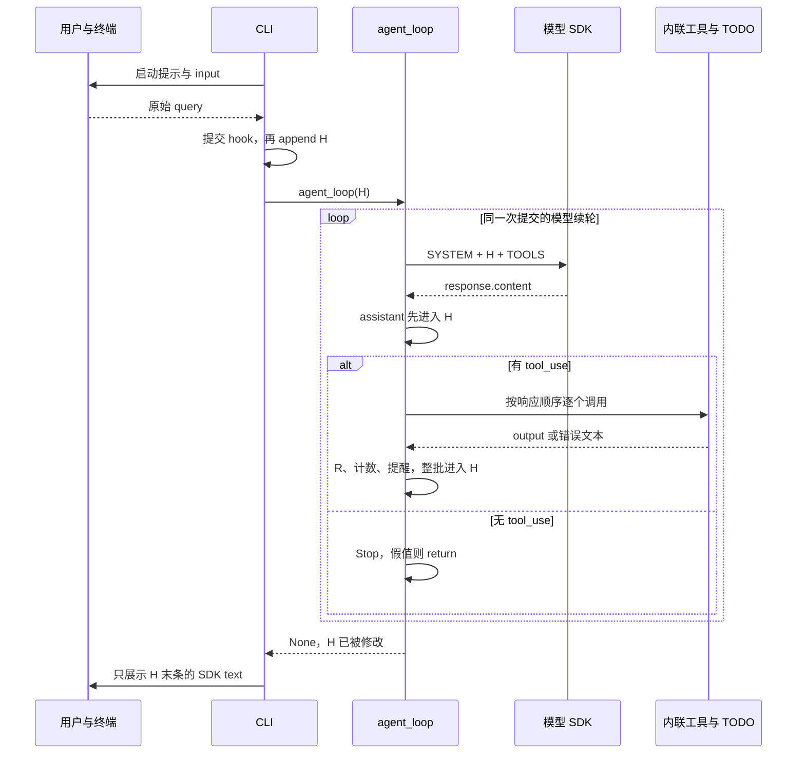
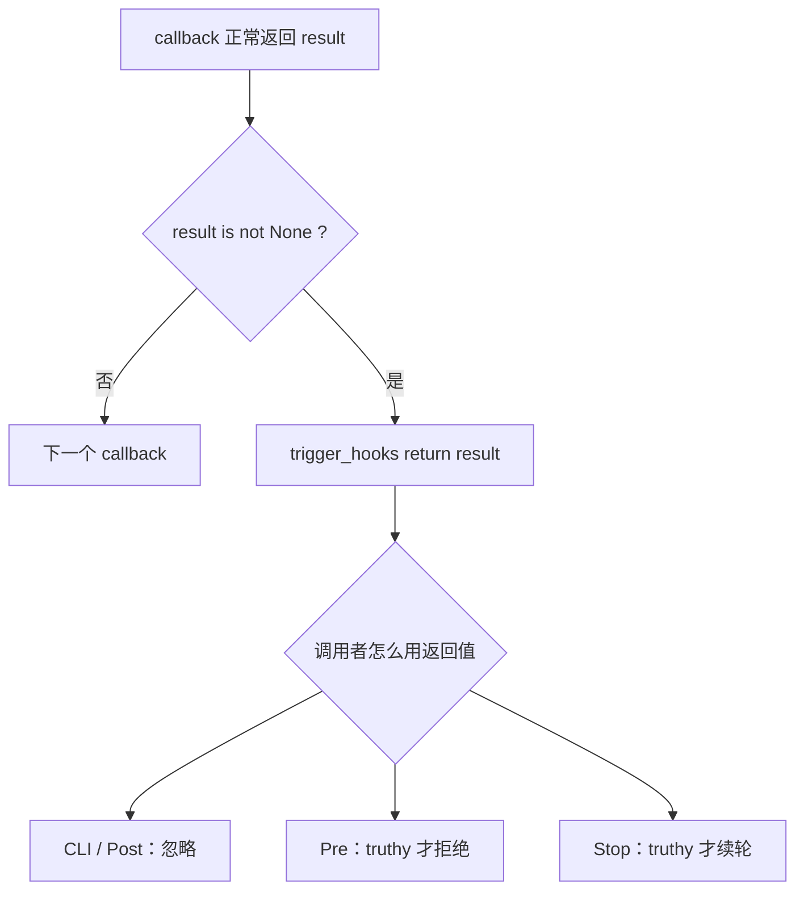
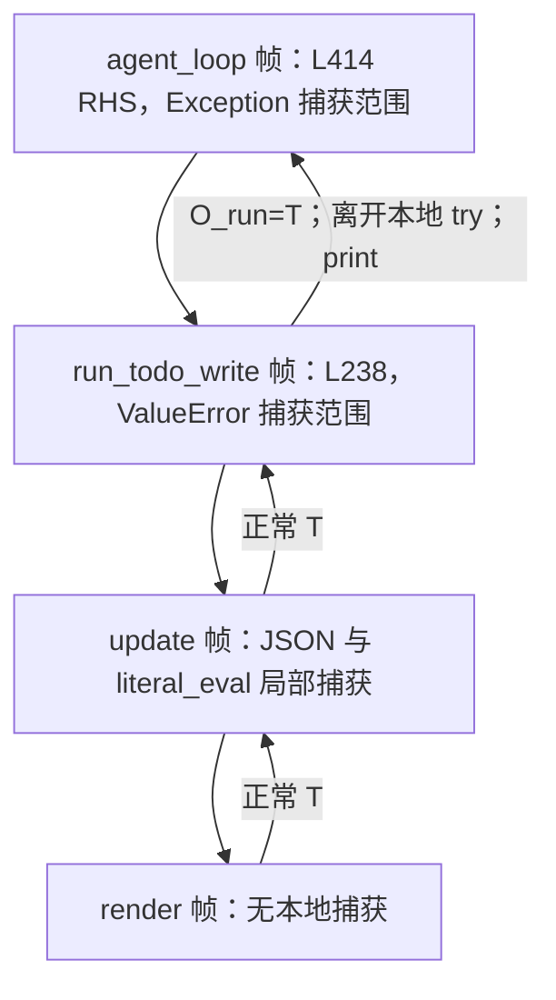
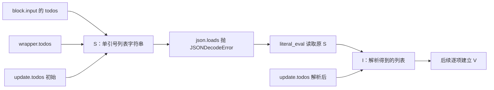
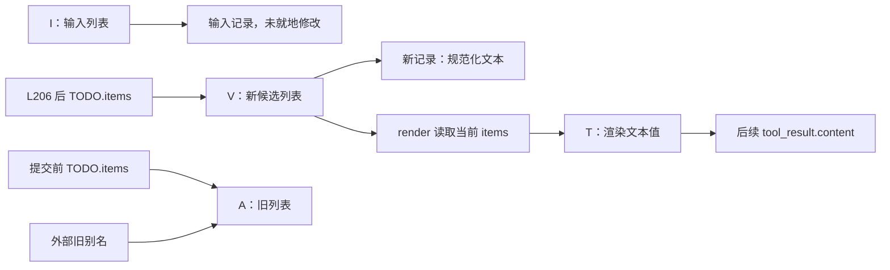
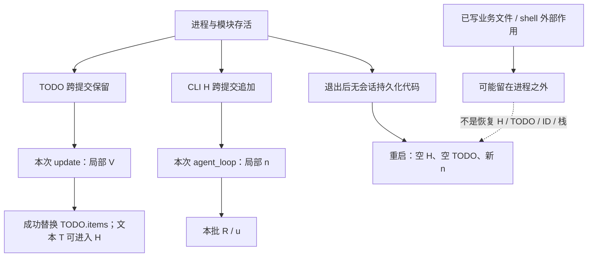

# 1. 从 CLI 进入：外层提交循环与内层模型循环

本文以当前 469 行 [s05 源码](../s05_todo_write/code.py)为准，沿“输入 → 请求 → 内联分发 → TODO 校验与替换 → 工具反馈 → 提醒 → Stop → 展示”下沉，再逐层返回。分析仅涉及本章六个工具、四类 hook 事件、五个默认 callback，以及单线程、同步执行的 CLI。文中“源码静态推演”均不是实际运行记录；没有导入或运行目标模块、工具或用例，也没有读取真实配置或密钥。

阅读别名先固定下来，避免把不同调用帧里的同名变量混为一谈：

| 别名 | 本文对应对象／局部绑定 |
|---|---|
| H | CLI 的 history，也是 agent_loop 的 messages |
| S／I | 字符串 todos 原输入／原生或解析得到的列表 |
| A／V | 更新前的 TODO.items 旧列表／validated 新候选列表 |
| T | render 形成的文本值，不是实时状态视图 |
| R | 当前模型响应对应的局部 results |
| n／u | rounds_since_todo／used_todo |
| O_run／O_agent | wrapper 与 agent_loop 各自调用帧中的 output |


源码位置：[code.py L443–469](../s05_todo_write/code.py#L443)。

```python
if __name__ == "__main__":
    print("s05: TodoWrite - plan before execution")
    print("Enter a question, press Enter to send. Type q to quit.\n")

    history = []  # 整段对话历史，传给 agent_loop 后由它就地推进
    while True:   # 外层交互循环：反复读用户输入，直到用户退出
        try:
            # \001/\002 tell Readline the ANSI escapes have zero display width.
            # \001/\002 是 readline 的「不可见定界符」：夹在中间的 ANSI 转义码
            # 不占显示宽度，这样青色提示符才不会让光标错位。
            query = input("\001\033[36m\002s05 >> \001\033[0m\002")
        except (EOFError, KeyboardInterrupt):
            # Ctrl+D（EOF）或 Ctrl+C（中断）时退出。
            break
        # 输入 q / exit / 空行都退出。
        if query.strip().lower() in ("q", "exit", ""):
            break
        # 用户输入入历史之前先触发 UserPromptSubmit 钩子。
        trigger_hooks("UserPromptSubmit", query)
        history.append({"role": "user", "content": query})
        agent_loop(history)
        # 打印模型最后的文字回复（跳过 tool_use 块）。
        for block in history[-1]["content"]:
            if getattr(block, "type", None) == "text":
                print(block.text)
        # 空行，让下一条提示符清爽地开始。
        print()
```

直接运行本文件，且此前的模块初始化全部完成，才会进入这里。L444、L445 的两个 `print` 依次执行；第二句失败时第一句可能已在终端可见，但 `history = []` 还没有执行。L447 创建一个新列表，绑定 `history`，本文称 H；它不在循环体内，所以下一次用户提交复用同一个列表。

每次 CLI 循环先执行 `input`：提示符中的 `\001`、`\002` 是给 Readline 标记不可见 ANSI 序列的控制字符，不是传给模型的任务文字。`input` 正常返回后，字符串才赋给 `query`。局部 `try` 只覆盖这一句输入；这里的 EOFError 或 KeyboardInterrupt 令 `break` 退出 **CLI 的 while**，不会进入提交 hook。

退出检查先求 `query.strip()`，再求其 `lower()`，再判断成员关系。规范化结果没有写回 `query`；例如输入带前后空格的真实问题，进入 H 的仍是原始字符串。空行、纯空白、q、exit 都会退出，不是忽略后继续等下一条。字符串方法产生文本结果，不应额外承诺每次都分配不同身份的字符串对象。

通过退出判断后，L461 同步触发 UserPromptSubmit。返回值未赋给任何名称，也未参与条件判断；正常返回后继续 L462。L462 先构造新消息字典，再原位 `append` 到 H。随后 L463 把 H 的引用传给 `agent_loop`，没有复制列表。父调用者此时停在这次函数调用上；没有后台推进另一个输入循环。

`agent_loop` 正常 `return` 的值为 None，CLI 不接收新历史；它继续 L465，读取已被函数原位推进的 H 的末条消息。这里只按 SDK 块的 `type` 属性打印 text，最后打印空行，再进入下一次 `input`。关于末条并不必然是可展示答案的情况，第 29 章继续精确分析。

`break`、`return`、`continue` 的层级必须分开：这里的 break 结束交互；模型循环的 return 只交还当前用户提交的控制权；工具循环的 continue 只跳过当前工具剩余语句。只有 input 被局部捕获，后续 hook、SDK 等待、工具和展示期间的中断不受这段 except 保护。



本章贯穿主例是“检查项目 → 修改文件 → 验证结果”。这是解释用任务，并不假设模型一定遵守规划提示。开始追踪其请求之前，必须先回溯已经发生的模块初始化。

# 2. 回溯模块初始化：环境修改早于 CLI，客户端创建不等于请求


源码位置：[code.py L33–64](../s05_todo_write/code.py#L33)。

```python
import ast         # 解析 Python 字面量：兜底处理不是合法 JSON 的列表写法
import json        # 解析模型传来的 JSON 字符串形式的待办列表
import os          # 操作系统相关功能：读环境变量、判断平台
import re          # 正则表达式：危险命令模式匹配（s03 起沿用）
import subprocess  # 子进程管理：执行模型生成的 shell 命令
from pathlib import Path  # 面向对象的路径操作：拼路径、解析、判断越界

# readline 提供命令行编辑能力（历史记录、方向键、退格等）。
# s05 里只保留了一行配置；Windows 上可能没有 readline，所以用 try/except 包住。
try:
    import readline
    readline.parse_and_bind('set bind-tty-special-chars off')
except ImportError:
    # 没有 readline（例如 Windows 自带 Python）直接跳过，不影响主逻辑。
    pass

from anthropic import Anthropic    # Anthropic 官方 Python SDK 的客户端类
from dotenv import load_dotenv     # 从 .env 文件加载环境变量（如 API Key）

# override=True：即使系统里已有同名环境变量，也用 .env 里的值覆盖。
load_dotenv(override=True)

# 配了 ANTHROPIC_BASE_URL（走代理/自定义端点）时，
# 移除可能打架的 ANTHROPIC_AUTH_TOKEN，避免两种鉴权方式冲突。
if os.getenv("ANTHROPIC_BASE_URL"):
    os.environ.pop("ANTHROPIC_AUTH_TOKEN", None)

WORKDIR = Path.cwd()  # 工作目录：文件工具与权限判断的基准路径
# 创建 Anthropic 客户端；base_url 默认官方 API，配了环境变量则走自定义端点。
client = Anthropic(base_url=os.getenv("ANTHROPIC_BASE_URL"))
# 从环境变量读模型 ID；用 [] 取值，.env 里没配会直接抛 KeyError。
MODEL = os.environ["MODEL_ID"]
```

顶层语句顺序不是“先启动 CLI，再加载配置”。先导入 ast、json、os、re、subprocess 和 Path；import 执行各模块的导入机制，不是只声明未来可能用到的名字。本章没有 YAML 导入。根 [requirements.txt](../requirements.txt) 虽然声明 `pyyaml>=6.0`，不能由此说 s05 使用 YAML。

之后进入可选 readline 区域：导入成功才调用唯一一条 `parse_and_bind`。只有 ImportError 被吞掉；例如配置调用的其他异常仍能中断模块加载，后面的 SDK、dotenv 都尚未导入。不要把其他章节多条 Readline 配置搬到本章。

SDK 和 dotenv 导入发生在这个区域之后。`load_dotenv(override=True)` 是一次实际调用，可能修改进程环境；不是只创建一个供后续读取的配置字典。override 指示同名环境变量可被加载值覆盖；具体搜寻和解析行为由所装版本决定，本文不访问真实 .env 来验证。函数返回值未保存，调用正常完成后才检查端点变量。

`os.getenv("ANTHROPIC_BASE_URL")` 先取值，再按真假判断：缺失或空串不进入 pop，非空串（包括纯空白）会进入。`pop(..., None)` 在变量不存在时给出默认值，不因缺键报错；变量若存在就从进程环境移除，后续失败不会自动补回。这里是鉴权变量处理意图，不是实际认证成功的证据。

`Path.cwd()` 完成才绑定 WORKDIR；基准是**模块加载时工作目录**，不是 code.py 父目录，也不是每次工具调用时重新取 cwd。接着先求 Anthropic 构造实参、调用构造器，构造成功才绑定 client。下一句才用 `os.environ["MODEL_ID"]` 必需读取模型名；缺失会 KeyError，此时 client 可能已经创建，CLI 和 TODO 尚未建立。源码不负责把前面环境修改撤销。

创建 client 与调用 `client.messages.create` 是两个不同阶段。本地还没有提出模型请求，不据构造完成推断认证、网络或服务可用；也不推测 SDK 内部是否存在其他初始化行为。


源码位置：[code.py L66–79](../s05_todo_write/code.py#L66)。

```python
# s05 change: SYSTEM prompt adds planning guidance
# s05 的改动之一：系统提示词里加了「先规划」的引导——
# 要求模型在多步任务开始前先调用 todo_write 列计划，并在过程中更新状态。
ENVIRONMENT_PROMPT = (
    "Windows: the bash tool runs through cmd.exe; use cmd.exe syntax, not Unix "
    "Bash or PowerShell syntax, and prefer dedicated file tools for file operations"
    if os.name == "nt"
    else "Unix-like: the bash tool runs the system shell"
)
SYSTEM = (
    f"You are a coding agent at {WORKDIR}. Environment: {ENVIRONMENT_PROMPT}. "
    "Before starting any multi-step task, use todo_write to plan your steps. "
    "Update status as you go."
)
```

`os.name == "nt"` 决定条件表达式的一侧，另一侧字符串不被选中。ENVIRONMENT_PROMPT 是平台说明文本，不是 Python 对 shell 的沙箱或语法强制器。SYSTEM 的 f-string 读取当前 WORKDIR 与环境说明，再与相邻字符串合成固定文本；此后修改其他变量不会自动重写这个字符串值。

“多步任务先用 todo_write”属于模型指引。没有“TODO 必须非空才放行 bash”的分支，也没有“全部 completed 才允许 Stop”的检查。本章不是调度器，三个状态标签不触发文件操作。

根依赖声明为 `anthropic>=0.25.0`、`python-dotenv>=1.0.0`、`pyyaml>=6.0`。最低版本约束不是当前安装版本，更不能证明 SDK 的内部复制、认证、重试或服务端行为。后文只对本地源码明确执行的步骤作结论。

静态断言的环境也须限定：[字符串输入测试的加载器](../tests/test_todo_write_string_input.py#L23)替换了 Anthropic、dotenv、yaml，切换临时 cwd 并设置测试 MODEL_ID。这能隔离单元分析，不证明真实启动、认证或联网成功；fake yaml 的存在不意味着 s05 导入过它。本文引用这些断言但不执行加载器或用例。

# 3. TodoManager 构造：空状态先建立，全局名称最后绑定


源码位置：[code.py L157–161](../s05_todo_write/code.py#L157)。

```python
class TodoManager:
    # 待办管理器：负责校验 + 保存 + 渲染清单。
    def __init__(self):
        # 内部状态就是一个 dict 列表：每项含 content 和 status。
        self.items: list[dict] = []
```

定义 class 会建立类对象；上面的 `__init__` 函数此时尚未因定义而运行。函数体内 `self.items: list[dict] = []` 的类型注解不自动检查今后每次 items 赋值。实际运行效果是创建新空列表，赋给当前实例的 items 属性，没有读取磁盘。


源码位置：[code.py L231–232](../s05_todo_write/code.py#L231)。

```python
# 模块级单例：整个会话共用一份待办清单（状态保存在循环之外，所以跨轮次有效）。
TODO = TodoManager()
```

模块执行到 L232，先求右侧 `TodoManager()`：默认对象构造机制分配实例，执行 `__init__`，空列表与属性绑定完成，初始化正常返回后，整个构造表达式才产生实例供左侧 TODO 绑定。不能在构造尚未完成时称“模块单例已经成功建立”。若初始化异常，首次加载中的 TODO 赋值没有完成；本章也没有 CLI 对顶层失败的补救。

这里“单例”指本模块顶层保存一个常用实例，不是限制别人另建 `TodoManager()` 的语言机制。默认 CLI 不再次构造它；所以 TODO 跨同一进程的多个用户提交保存清单。新进程重新执行构造得到空状态，没有从 H、文件或数据库恢复。


构造返回后的下一步是继续定义 wrapper、建立工具表与 hooks，而不是立刻进入 update。本文后续用 A 指代某次更新开始前 items 指向的列表；第一次 A 就是这里创建的空列表。直接保存 A 的引用与以后替换 TODO.items，是两种不同状态变化，第 17 章会用引用图展开。

# 4. 六个工具的声明与分发表：schema 不等于已执行验证


源码位置：[code.py L249–269](../s05_todo_write/code.py#L249)。

```python
TOOLS = [
    {"name": "bash", "description": "Run a shell command.",
     "input_schema": {"type": "object", "properties": {"command": {"type": "string"}}, "required": ["command"]}},
    {"name": "read_file", "description": "Read file contents.",
     "input_schema": {"type": "object", "properties": {"path": {"type": "string"}, "limit": {"type": "integer"}}, "required": ["path"]}},
    {"name": "write_file", "description": "Write content to a file.",
     "input_schema": {"type": "object", "properties": {"path": {"type": "string"}, "content": {"type": "string"}}, "required": ["path", "content"]}},
    {"name": "edit_file", "description": "Replace exact text in a file once.",
     "input_schema": {"type": "object", "properties": {"path": {"type": "string"}, "old_text": {"type": "string"}, "new_text": {"type": "string"}}, "required": ["path", "old_text", "new_text"]}},
    {"name": "glob", "description": "Find files matching a glob pattern; ** matches recursively.",
     "input_schema": {"type": "object", "properties": {"pattern": {"type": "string"}}, "required": ["pattern"]}},
    # s05: new tool
    {"name": "todo_write", "description": "Create and manage a task list for your current coding session.",
     "input_schema": {"type": "object", "properties": {"todos": {"type": "array", "maxItems": 20, "items": {"type": "object", "properties": {"content": {"type": "string", "minLength": 1}, "status": {"type": "string", "enum": ["pending", "in_progress", "completed"]}}, "required": ["content", "status"]}}}, "required": ["todos"]}},
]

# 分发表多了一个条目：todo_write -> run_todo_write。
TOOL_HANDLERS = {
    "bash": run_bash, "read_file": run_read, "write_file": run_write,
    "edit_file": run_edit, "glob": run_glob, "todo_write": run_todo_write,
}
```

执行 TOOLS 右侧时，依次创建外层列表、各工具字典和嵌套 schema 字典／数组；全部求值成功后才绑定 TOOLS。它保存模型接口说明，不保存真实执行结果。分发表是另一份新字典，值为此前定义好的函数对象引用，建立映射不调用任何工具。

| 模型名称 | TOOL_HANDLERS 中函数 | 关键参数来源 |
|---|---|---|
| bash | run_bash | 模型 command |
| read_file | run_read | 模型 path，可选 limit |
| write_file | run_write | 模型 path、content |
| edit_file | run_edit | 模型 path、old_text、new_text |
| glob | run_glob | 模型 pattern |
| todo_write | run_todo_write | 模型 todos |

TOOLS 与 TOOL_HANDLERS 是两个独立容器，不会自动互相校对。模型请求只带 TOOLS；函数对象和 TODO 实例不直接传入请求。运行时查表得到已保存的函数引用；以后仅重新绑定全局函数名，不会自动替换字典内的旧引用。修改映射本身则会影响后续查询。

todo_write 的 schema 写数组、maxItems、content 字符串及 minLength、状态 enum，并把每项 content/status 都列入 required；实际 update 却兼容字符串输入、允许缺省 status、把非字符串字段转成文本。二者不能互相替代。Python 的形参绑定能检查缺参／多参，却不会因为 `todos: list | str` 自动拒绝任意其他类型。源码注释把 schema 叫第一层约束，是接口意图，不证明本地在调用前跑过 JSON Schema 校验器。

此章尤其不能套用后续章节结构：**s05 没有 execute_tool 函数**。实际查询、try、Post、结果构造都内联在 agent_loop；它们各自的捕获范围以第 11、20 章展示的缩进为准。

[本章 README](../s05_todo_write/README.zh.md)用省略号演示 manager、schema 和 dispatch，介绍规划目的；它不是连续生产源码。例如正文概括用映射下标描述分发，真实执行使用 get；README wrapper 示例也省略本地 ValueError 捕获和颜色打印。分析应返回这里和后文原始代码，不能把示意省略理解为不存在对应失败点。

# 5. hooks 建立后才执行：非 None 短路不等于业务拒绝


源码位置：[code.py L276–288](../s05_todo_write/code.py#L276)。

```python
HOOKS = {"UserPromptSubmit": [], "PreToolUse": [], "PostToolUse": [], "Stop": []}

def register_hook(event: str, callback):
    # 注册：把回调追加到对应事件的列表。
    HOOKS[event].append(callback)

def trigger_hooks(event: str, *args):
    # 触发：依次调用回调；返回非 None 表示拦截，立即停止并返回该结果。
    for callback in HOOKS[event]:
        result = callback(*args)
        if result is not None:
            return result
    return None
```

HOOKS 右侧创建四个不同的空列表，再保存到一个新字典。`register_hook` 被调用时，先取事件对应列表，再 append callback 引用；不会在登记时执行 callback。事件名不存在会在下标处失败，没有自动注册新事件的逻辑。

`trigger_hooks(event, *args)` 接收传来的参数引用；`*args` 在此形成位置实参元组，不深拷贝 query、block 或 H。for 每次从事件列表取 callback，同步执行 `callback(*args)`；正常返回值赋到局部 result 后才检查 `is not None`。非 None 就 return 到本次调用者，后面 callback 不再执行；全部返回 None 才走函数末尾的 return None。它不捕获 callback 异常。


源码位置：[code.py L347–351](../s05_todo_write/code.py#L347)。

```python
def context_inject_hook(query: str):
    """UserPromptSubmit: log working directory."""
    # 用户输入送进 LLM 前触发（这里只是打印工作目录，实际项目可用于注入上下文）。
    print(f"\033[90m[HOOK] UserPromptSubmit: working in {WORKDIR}\033[0m")
    return None
```

默认 context callback 接到原 query 字符串，却没有读取或改写它；只是格式化 WORKDIR 并打印。成功后返回 None，不创建注入上下文的消息。注释中的“实际项目可用于注入”不是当前实现已经注入。


源码位置：[code.py L364–368](../s05_todo_write/code.py#L364)。

```python
register_hook("UserPromptSubmit", context_inject_hook)
register_hook("PreToolUse", permission_hook)
register_hook("PreToolUse", log_hook)
register_hook("PostToolUse", large_output_hook)
register_hook("Stop", summary_hook)
```

这五句登记实际形成：UserPromptSubmit 为 context；PreToolUse 为 permission → log；PostToolUse 为 large-output；Stop 为 summary。不同事件之间没有“每次全执行五个”的统一流程。


源码位置：[code.py L460–463](../s05_todo_write/code.py#L460)。

```python
        # 用户输入入历史之前先触发 UserPromptSubmit 钩子。
        trigger_hooks("UserPromptSubmit", query)
        history.append({"role": "user", "content": query})
        agent_loop(history)
```

入口停在 L461 时，query 已读入，H 尚未追加本次用户消息。trigger_hooks 返回后，入口不检查值，继续 L462、L463。因此扩展 callback 即便返回拒绝文字，也只能停止同事件后续 callback，不能靠此返回值阻止 CLI 提交。默认 context 返回 None；False／空字符串分支是扩展 hook 的静态可能性，不是假装默认 permission 就这样返回。

| callback 返回 | trigger_hooks 对后续 callback | CLI 提交现场 | 工具 Pre 调用者 | Stop 调用者 |
|---|---|---|---|---|
| None | 继续 | 继续提交 | 全部完成后通常执行 handler | 全部完成后通常 return |
| False／空字符串 | 立即停 | 仍继续提交 | 外层判假，仍执行 handler | 外层判假，结束 agent_loop |
| truthy 值 | 立即停 | 仍继续提交 | 拒绝并跳过当前工具剩余部分 | 追加 user content 后模型续轮 |

Post 调用者忽略返回值，仍要区分“返回不干预”与“抛异常中断”。两个判断层级如下。



如果 context 的格式化或 print 抛异常，trigger_hooks 不返回，L462 不执行，H 仍未追加这次 query，也没有进入 agent_loop。异常不受 input 的局部 except 保护；先前用户的 H 与 TODO 不会因此恢复或清空。正常路径则继续父循环的计数器初始化与首个请求。

# 6. 每次 agent_loop 先重置 n，再用既有对象发请求


源码位置：[code.py L374–382](../s05_todo_write/code.py#L374)。

```python
def agent_loop(messages: list):
    # 计数器：距离上一次调用 todo_write 已经过了多少轮（初始为 0）。
    rounds_since_todo = 0
    while True:
        # 【第 1 步】把对话历史 + 6 个工具（含 todo_write）发给模型。
        response = client.messages.create(
            model=MODEL, system=SYSTEM, messages=messages,
            tools=TOOLS, max_tokens=8000,
        )
```

CLI 在 L463 暂停，把 H 引用绑定给函数形参 messages。进入函数先把整数 0 绑定到 rounds_since_todo，简称 n；这只是本次调用帧的局部绑定，不创建新 TODO，也不清空 H。下一次用户提交会再次执行初始化，即使上次清单还含 pending 条目。

while 内先求 `client.messages.create` 这个可调用对象，再按书写顺序求关键字实参：MODEL、SYSTEM、messages、TOOLS、8000。MODEL 和 SYSTEM 是加载时形成的字符串；messages 就是 H；TOOLS 是模块级列表；8000 是本次模型输出参数。这里没有主动复制 H 或工具 schema；SDK 内部如何序列化、保存、复制实参以及实际网络重试，不是本地源码能证明的事实。

调用正常返回后 response 才绑定 SDK 响应对象。请求正在等待时，本地尚未执行本轮 assistant append、工具筛选、R 建立或 n 增加。此时模型也没有直接接触 Python 的 TODO.items、函数体或 hook 列表；清单只可能通过已有文本记录成为消息内容。

8000 不限制会话总 token、清单解析大小、工具输出总量或循环次数。本地 while 没有总轮数上限，没有压缩、备用模型或显式重试。不要把 SDK 可能存在的策略写成本章实现。

SDK 调用异常没有被 agent_loop 捕获：response 的本次赋值未完成，本轮后续逻辑不执行；此前 H 中的用户消息已在，旧工具结果和 TODO 也仍在。某些失败可能发生在发出请求之前，某些发生在请求之后；本地没有请求进度标记，不能只据异常就认定网络未发送或模型未处理。正常返回才继续 L384，进入下一章。

# 7. 响应先入 H，工具列表后形成：解析失败时尚无工具执行


源码位置：[code.py L384–396](../s05_todo_write/code.py#L384)。

```python
        messages.append({"role": "assistant", "content": response.content})

        # 【第 3 步】筛出 tool_use 块；没有则触发 Stop 钩子后收尾。
        tool_calls = [
            block for block in response.content if block.type == "tool_use"
        ]
        if not tool_calls:
            # Stop 钩子返回非 None 时，把它当作 user 消息塞回去继续循环。
            force = trigger_hooks("Stop", messages)
            if force:
                messages.append({"role": "user", "content": force})
                continue
            return
```

L384 先取得 messages.append 这个可调用对象，再求消息字典：按字段顺序放入 role，读取 response.content 放入 content，形成字典后才调用 append。属性访问或字典构造失败，append 尚未发生；append 正常完成才有新的 assistant 历史记录。代码没有主动深拷贝 content：H 的该字段保存所取到对象的引用。

随后 L387–389 完整执行列表推导式：先迭代 response.content，对每块读 `block.type`，只有等于 tool_use 才收进新的列表。新列表不代表新块，块仍来自响应。全部迭代成功后，tool_calls 才被赋值；它不边筛选边调用工具，也不查看 stop_reason。注意 content 属性在 append 和这里分别读取；对普通 SDK 数据对象通常是同一字段，源码却没有先缓存成局部 content 来保证任意自定义属性两次取值一致。

源码静态推演：第一块合法 tool_use、第二块缺 type。assistant 可能已在 H；第二块访问抛异常，使推导式整体失败，tool_calls 的本次赋值未完成。第一块也没有执行，因为工具 for 在后面。没有解析 try，也没有把已入 H 的 assistant 撤销。

| response.content 形状 | 工具提取与接下来路径 | 这里不能认定的事实 |
|---|---|---|
| 空列表 | tool_calls=[]，走 Stop | 不等于 content=None |
| 仅 SDK text 块 | 无工具，走 Stop | 不验证文字是可靠答案 |
| text 与合法 tool_use 混合 | 执行全部实际工具块 | 混合文字不立即显示给用户 |
| stop_reason=end_turn 但有工具 | 仍走工具路径 | stop_reason 不是本地分支条件 |
| 不可迭代值／块无 type | 可能在筛选处异常 | 不保证 H 未改变 |

无工具分支先同步调用 Stop，返回值赋 force；truthy 时构造 user 消息追加 H，然后 continue 到**模型 while 顶部**，保留当前 n；否则 return None 到 CLI。这里不建立 R，也不增加 n。Stop 统计和展示窗口在第 29 章回收。有工具则跳过整个 if，继续 L399 建立 R 与 u。

[通用主循环断言](../tests/test_agent_loop_boundaries.py#L219)包含 s05，断言无工具时只请求一次、末条仍为 assistant、没有 user 空结果；[另一个断言](../tests/test_agent_loop_boundaries.py#L243)给 end_turn 响应放入实际 tool_use，检查两次请求与配对 ID。范围必须限定：该组把 hooks 替换为无操作，成功 bash 映射也被替换；s05 不存在可被替换的 execute_tool。它证明的是本地循环分支，不是权限或真实 shell 全链。

辅助 `empty_tool_use_response(None)` 在[这里](../tests/test_agent_loop_boundaries.py#L93)把 None 换成含空 SDK text 的列表。因此其 None 参数化并未把生产循环的 response.content 设置为 None，不能据此写“本章兼容 content=None”。这一区别也说明正常空结果、错误响应形状、函数未返回不是同一状态。


# 8. 建立本批 R 与 u：拒绝也有结果，但跳过 Post 和 todo 标记


源码位置：[code.py L398–410](../s05_todo_write/code.py#L398)。

```python
        # 【第 4 步】逐个执行工具调用。
        results = []
        used_todo = False  # 记录本轮是否调用过 todo_write
        for block in tool_calls:
            # 执行前先过 PreToolUse 钩子（权限 + 日志）。
            blocked = trigger_hooks("PreToolUse", block)
            if blocked:
                # 被拦下：不执行工具，但必须回填 tool_result（API 要求一一对应）。
                results.append({"type": "tool_result", "tool_use_id": block.id,
                                "content": str(blocked)})
                continue

            handler = TOOL_HANDLERS.get(block.name)
```

执行到 L399，意味着本轮 SDK 已返回、assistant 已入 H、tool_calls 推导式已完整成功且不为空。此时新建空列表 R，再把 False 绑定给 u。它们每个有工具响应都会重建；上一批 R 已进入 H 时不会被新的空列表“清空”，只是本地 results 名称改绑。

for 按 tool_calls 的列表顺序取 block。第一句先调用 Pre；调用者停在 L403，等待 permission、log 等 callback。只有 trigger_hooks 正常返回，返回值才赋给 blocked。hook 若抛异常，这次赋值没有完成，if 与 handler 查询均不会执行；不能把“尚未赋 blocked”解释为“已放行”。

外层以 truthy 判断 blocked。默认 permission 的拒绝文字为真，进入拒绝分支；扩展 callback 若给 False／空串，trigger_hooks 虽已短路后续 callback，此处仍不拒绝。这样甚至可能跳过本应随后运行的 log，但这不是默认返回路径。

拒绝分支也遵守“右侧先完成，append 最后发生”：先构造字典，期间读取 block.id、调用 str(blocked)，成功后才 append R。字段访问或转换失败，当前结果并未加入；前面工具的结果仍可能留在局部 R，而整批还未进入 H。结果只含 type、tool_use_id、content，没有统一 is_error 字段。

L408 的 continue 目标是**工具 for 的下一次迭代**，不是直接发下一次模型请求。它跳过 handler 查询、handler 调用、Post、u 标记以及下方普通结果 append。所有工具处理完，才会走计数与历史提交。如果本批唯一工具被拒绝，R 仍有拒绝结果，u 仍 False，批末通常仍加一。

默认 permission 不检查 todo_write；默认路径的 todo 不会在这里因自身规划内容而被拒绝。只有扩展 Pre 另行返回 truthy，或 callback 自己异常，才会改变这个结论。若前一个 todo 已在同批完成标记，后来另一个 todo 被拒绝，continue 不会把 u 从 True 改回 False。

源码注释“必须回填”说明协议意图，不是无条件保证：Pre 异常、拒绝结果构造失败或后续工具失败，都可能让这一批没有最终 user 结果消息。现在沿正常 Pre 调用先进入权限函数，完成后才返回 L403 的赋值位置。

# 9. 权限表达式：黑名单、正则、确认输入与路径边界


源码位置：[code.py L290–299](../s05_todo_write/code.py#L290)。

```python
DENY_LIST = ["rm -rf /", "sudo", "shutdown", "reboot", "mkfs", "dd if="]
DESTRUCTIVE_COMMAND_WORD = re.compile(
    # 匹配作为独立命令出现的 rm/del（前置边界避免误伤 "firm" 这类子串）。
    r"(?i)(?:^|[;&|()\n])\s*(?:rm|del)(?=\s|$|[;&|()])"
)
DESTRUCTIVE = ["rm ", "> /etc/", "chmod 777"]


def contains_destructive_command(command: str) -> bool:
    return bool(DESTRUCTIVE_COMMAND_WORD.search(command))
```

初始化阶段先建立字符串列表，编译正则，再建立危险子串列表；编译异常会阻止后续模块初始化。helper 运行时才对 command 执行 search，得到 Match 或 None，再 bool 转换。正则的 `(?i)` 只让这次匹配忽略大小写，不改变旁边两组 Python 子串检查的大小写语义。

模式只把字符串开头或指定分隔符后、可选空白之后的 rm/del 当作候选命令词，并检查后置空白／边界。它没有解析 shell 引号、重定向、变量、命令替换或完整可执行文件路径。规则不是“识别所有危险 shell”的证明。


源码位置：[code.py L302–331](../s05_todo_write/code.py#L302)。

```python
def permission_hook(block):
    """PreToolUse: s03 permission logic, registered as an s04 hook."""
    # 工具执行前：bash 先查硬黑名单，再查危险规则；文件工具检查越界。
    if block.name == "bash":
        command = block.input.get("command", "")
        for pattern in DENY_LIST:
            if pattern in command:
                # 红色打印拦截原因；返回非 None 即阻止执行。
                print(f"\n\033[31m[blocked] '{pattern}'\033[0m")
                return "Permission denied by deny list"
        if contains_destructive_command(command) or any(
            keyword in command for keyword in DESTRUCTIVE
        ):
            # 黄色提示 + 展示完整参数，让用户看清要执行什么。
            print(f"\n\033[33m[permission] Potentially destructive command\033[0m")
            print(f"   Tool: {block.name}({block.input})")
            # 默认拒绝：直接回车 = N（fail-safe）。
            choice = input("   Allow? [y/N] ").strip().lower()
            if choice not in ("y", "yes"):
                return "Permission denied by user"
    if block.name in ("read_file", "write_file", "edit_file"):
        # 文件工具：路径解析后落在工作目录之外，就打断询问用户。
        path = block.input.get("path", "")
        if not (WORKDIR / path).resolve().is_relative_to(WORKDIR):
            print(f"\n\033[33m[permission] Access outside workspace\033[0m")
            print(f"   Tool: {block.name}({block.input})")
            choice = input("   Allow? [y/N] ").strip().lower()
            if choice not in ("y", "yes"):
                return "Permission denied by user"
    return None
```

调用现场是 trigger_hooks 在 L285 执行 permission callback；传来的 block 是响应块原引用，input 没有先经过本地 schema 验证。先读 name，只有等于 bash 才取 command。`get("command", "")` 仅在缺键时给空串；显式 None 仍是 None。若 None 进入 `pattern in command`，可能在硬黑名单第一项就 TypeError；尚未进入 handler try，所以不是常规工具 Error 包装。

黑名单按列表顺序逐个检查，匹配区分大小写。首个命中先打印 blocked 原因，再返回固定拒绝文本；后续 pattern、正则、危险子串、确认和 log 都不会执行。打印若先失败，拒绝文字还没有交回调用者，异常直接向 trigger_hooks 与 agent_loop 外溢。即使 print 只输出了一部分，也没有终端补偿。

黑名单无命中才求 if 的左侧 helper。若正则命中，or 短路，`any(...)` 完全不执行；否则生成器按 DESTRUCTIVE 顺序求 `keyword in command`，any 在第一个真值停止，全部假才返回假。正则避免了某些词内误报，不等于整个联合条件也避免：例如文本 `firm file.txt` 不符合独立 rm 命令词，但包含 `rm ` 子串，仍可能触发独立规则。反过来大小写不同又可能只被正则覆盖部分位置，不能升格为 shell 语法安全验证。

危险条件真时，先打印告警，再打印工具与完整参数，然后执行 input。正常返回字符串后才 strip、lower，最后做 `not in ("y", "yes")`。直接回车默认拒绝；y／yes 之外的任何规范化值也拒绝。输入失败时 choice 尚未绑定，handler 尚未执行。允许只表示这一启发式门禁放行，不认证命令业务正确。

bash 分支结束后，第二个 if 仍会检查工具名是否属于三个文件工具；正常 bash 名称不在集合，故不会去解析 path。文件工具先 get path，同样不把显式 None 替换为空串，再做 WORKDIR 拼接、resolve、is_relative_to；not 对判断结果取反。越界才显示确认，拒绝就返回；在内或明确确认才走函数末尾 None。之后 log 运行，handler 稍后还会重新 resolve。

resolve 检查的是检查时的路径状态，没有冻结文件、链接或目录身份；权限通过与实际读写之间并无不可变快照。单线程只说明本 Python 控制流依次执行，不排除外部进程改变文件系统。确认可允许越界访问，因此也不能把该检查写成绝对工作区沙箱。glob 不走这组三文件权限判断，它自己的结果过滤见第 25 章。

| Pre 内失败现场 | 已完成 | 尚未完成／去向 |
|---|---|---|
| command 类型错误 | 已取得 block，可能已进入 bash 分支 | handler 未进入；异常外溢 |
| 越界 resolve 失败 | 可能已拼出 Path | 确认与工具读写未开始；异常外溢 |
| 打印或人工 input 失败 | 告警可能部分可见 | 尚无正常 permission 返回；异常外溢 |
| 正常拒绝 | 门禁判断／可能人工输入完成 | 返回文本；跳过 log、handler、Post |
| 正常 None | 默认权限已放行 | trigger_hooks 接着调用 log |

[权限参数化断言](../tests/test_permission_command_words.py#L91)把 s05 纳入范围，固定 input 返回字符串 "n"，直接调用 permission 并仅比较 bool(result)。其输入覆盖大小写、分隔符和部分非命令词；例如 `/usr/bin/rm file.txt`、`command rm file.txt` 可由子串规则命中，不证明正则识别了全路径或前置包装词。该证据不执行 shell、不覆盖人工允许后的真实副作用，也不证明所有危险命令都会被发现。

EOFError 的来源应分现场：CLI input 的 EOFError 被入口捕获后 break；这里确认 input 的 EOFError 不受入口局部 try 保护，直接外溢。KeyboardInterrupt 同理不在 handler 的 Exception 捕获中。完成权限的正常 None 路径后，控制权回到 trigger_hooks，继续日志 callback。

# 10. 日志截到 60 字符之前，全部值与完整表示已被计算


源码位置：[code.py L333–338](../s05_todo_write/code.py#L333)。

```python
def log_hook(block):
    """PreToolUse: log every tool call."""
    # 只观测不干预：灰色打印工具名与前两个参数（截断 60 字符），返回 None 放行。
    args_preview = str(list(block.input.values())[:2])[:60]
    print(f"\033[90m[HOOK] {block.name}({args_preview})\033[0m")
    return None
```

调用者此刻在 trigger_hooks 的 `callback(*args)`，实参仍是原 block；permission 返回 None，才会取到默认第二个 Pre callback。若 permission 正常拒绝，trigger_hooks 已提前返回，这段一条语句都不执行。

L336 的顺序不能缩写成“取前两个参数打印”：先访问 block.input，取 values 方法并调用，得到值视图；`list(...)` 先消费全部值，创建完整列表；`[:2]` 再生成前两项的新切片；`str(...)` 形成这两个值的完整列表表示；最后 `[:60]` 才截展示文本。前两项按输入映射的迭代顺序，不是按工具 schema 的属性顺序，后续项虽然不展示，也已被 list 遍历。每项中的大字符串或复杂对象表示可能在截断前已经被构造。

右侧任一步失败，args_preview 的本次赋值不完成。即使赋值成功，随后 f-string 对 name 的访问或 print 仍可失败。此时 handler 查询、参数绑定、文件操作和 TODO 更新尚未开始；先前 permission 打印或人工确认则可能已经发生，不会被撤销。

正常 print 完成后 return None，trigger_hooks 回到 result 赋值与 is not None 检查，随后耗尽默认 Pre 列表，最终返回 None 到 agent_loop 的 L403。L403 绑定 blocked，if 判假，才继续 L410 查 handler。日志返回值不写历史；显示上限也不是输入处理的内存上限。

因此 docstring“log every tool call”要限定为到达并完成 callback 的调用：被 permission 拒绝的调用不记录；日志自己的异常也会让记录不完整。相反，日志已经打印只说明分发前走到了这里，不证明 handler 之后成功执行。

# 11. 内联分发：查表在 try 外，参数展开与函数体在 try 内


源码位置：[code.py L410–419](../s05_todo_write/code.py#L410)。

```python
            handler = TOOL_HANDLERS.get(block.name)
            try:
                # 相比 s04，这里多了 try/except：工具抛异常也不会打断整个循环，
                # 而是把异常文本当输出交回模型（例如 TodoManager 的校验报错）。
                output = handler(**block.input) if handler else f"Unknown: {block.name}"
            except Exception as e:
                output = f"Error: {e}"

            # 执行后触发 PostToolUse 钩子（可拿到输出做告警/审计）。
            trigger_hooks("PostToolUse", block, output)
```

回到 agent_loop：Pre 正常返回假值，才执行 L410。先读 block.name，再 `TOOL_HANDLERS.get`，返回函数或 None，最后绑定 handler。这里位于 try 之前；不可哈希工具名会在查表失败，handler 本次赋值没完成，不产生下面的 Error 文本。某些错误块还可能更早就使 Pre 失败，下面区分的是“成功到达该句后”的失败位置，不保证畸形输入一定走到查表。

进入 try 后求条件表达式。先判断 handler 的真假；当前映射值是普通函数，真值分支才求 `handler(**block.input)`。这需要读取 input、按 ** 规则展开关键字、检查键名并做 Python 形参绑定，然后才进入函数体。缺必需参数、多余参数、非 mapping 输入、非字符串关键字等可在 handler 函数体尚未进入时失败。某些非 mapping 输入会在默认 log 的 values 访问处更早失败，不能把所有畸形输入都说成会被这一层包装。

handler 假值分支只格式化 `Unknown: {block.name}`；**不对 input 做 handler 参数展开**。但这不意味着未知工具完全不需要可用 input：此前 Pre log 已尝试读 values。正常未知工具仍继续 Post，不是提前拒绝。

调用或 Unknown 表达式成功，才给 O_agent 绑定 output。普通 Exception 发生时，转入 except，格式化 e 后把 Error 文本赋给 O_agent；异常对象字符串化若自身再失败，不受同一 except 自动重试。KeyboardInterrupt、SystemExit 不继承 Exception，不在此包装范围内。普通内置参数错误通常能变成 Error，但这不等于无条件所有异常都可转文本。

| 失败位置 | 本地捕获／返回 | 尚未执行的步骤 |
|---|---|---|
| Pre callback | 无此处捕获，外溢 | 查表、handler、Post、当前结果 |
| handler 查询 | 无此处捕获，外溢 | handler、Post、当前结果 |
| ** 展开／参数绑定 | agent 的 Exception → Error | handler 函数体未进入；随后仍尝试 Post |
| handler 内未自行处理的普通异常 | agent 的 Exception → Error | 可能已有副作用；随后仍尝试 Post |
| 未知工具正常格式化 | 正常输出 Unknown | 不进入任何 handler；仍执行 Post |
| Post callback | try 已结束，外溢 | u 标记与当前结果 append |
| 当前结果的 str／ID 读取 | handler try 外，外溢 | 当前 append 与批末提交 |

注意 s05 没有“分发函数 return str(output)”这一层。Post 后的最终转换在结果字典构造中（L426），不是从某个 execute_tool 返回；使用 s06 的调用帧会把捕获边界讲错。

正常 todo_write 路径由查表拿到 run_todo_write 函数，模型的 block.input 经 ** 绑定 todos。agent 此刻停在 L414 的右侧函数调用；O_agent 本次赋值尚未完成。下面进入 wrapper，继续追踪 O_run 的独立赋值。

# 12. todo wrapper 的调用帧：绑定方法、隐式 self 与四层调用帧的 try 边界


源码位置：[code.py L235–244](../s05_todo_write/code.py#L235)。

```python
def run_todo_write(todos: list | str) -> str:
    # 工具入口：只负责调用管理器并把渲染结果同时打印给用户。
    try:
        output = TODO.update(todos)
    except ValueError as e:
        # 校验失败不抛异常，而是把错误文本回给模型，让它自己修正重试。
        return f"Error: {e}"
    # 黄色打印清单，让人也能看到 Agent 的当前计划。
    print(f"\n\033[33m## Current Tasks\033[0m\n{output}")
    return output
```

wrapper 进入时，其局部 todos 接收模型输入指向的对象：若是字符串则是 S，若是列表则是 I；函数调用不自动复制列表或字符串。此时 block.input 仍由原响应块引用，agent 的 output 还在等待 RHS。

L238 先访问全局 TODO，再取 update 属性，得到与实例关联的绑定方法。调用 `TODO.update(todos)` 时，Python 把该实例隐式传为 self，把 wrapper.todos 引用作为 update 的 todos 参数。只因为两处形参都叫 todos，不会把两个局部绑定变成同一变量槽。update 内的重新赋值不改写 wrapper.todos，也不写回 input 字典。

wrapper 的 try 只包围这次调用及 O_run 赋值。update 完整返回前，O_run 尚未取得本次结果；调用返回后才绑定 O_run。ValueError 从 update（包括它调用的 render）传出来，会进入 except，直接返回 Error 字符串，不走黄色清单打印。其他普通 Exception 不由这里接住，会向 agent 的 handler try 传播。



这张图表示同步调用栈，不是四个并行执行单元。render 的局部 todo、update 的局部 todo 属于不同帧；内层循环不会覆盖外层绑定。wrapper 的 O_run 与 agent 的 O_agent 也分属两帧，内层已绑定不意味着外层 RHS 已结束。

本地 except 生成 Error 是“捕获后正常返回文本”，不是继续执行失败语句。它不恢复 TODO，也不检查失败发生在状态提交之前还是之后；这个区别在 render 和 print 返回链中决定最终状态。

L243 的 print 已在本地 try 之外。哪怕 print 抛的也是 ValueError，不能因为异常类型相同就说本地 except 会抓住；父调用者 L414 外侧的 Exception 包装仍可能抓住它。正常 print 后才执行 L244 return，再完成 O_agent 赋值。先把调用者停在 L238，进入 update 的解析语句，后面再精确返回这里。


# 13. 字符串解析：右侧失败时，update.todos 仍绑定原 S


源码位置：[code.py L163–173](../s05_todo_write/code.py#L163)。

```python
    def update(self, todos: list | str) -> str:
        # 模型有时直接给列表，有时给一个 JSON 字符串，所以先归一化。
        if isinstance(todos, str):
            try:
                todos = json.loads(todos)
            except json.JSONDecodeError:
                # 不是严格 JSON（比如用了单引号）时，再试 Python 字面量解析。
                try:
                    todos = ast.literal_eval(todos)
                except (SyntaxError, ValueError) as e:
                    raise ValueError("todos must be a list or JSON array string") from e
```

调用者 wrapper 暂停在 L238。update 刚进入时，self 是 TODO 实例，局部 todos 接收同一输入引用；它不先复制或清空 TODO.items。先做 isinstance，仅字符串进入解析分支；原生列表跳过整个分支，tuple、dict、None、bytes 也不会因为“看起来能转成列表”就自动解析。

以单引号字符串 `"[{'content': ' 检查项目 ', 'status': 'IN_PROGRESS'}]"` 为 S，下面是源码静态推演：

| 当前阶段 | block.input["todos"] | wrapper.todos | update.todos | 全局 TODO.items |
|---|---|---|---|---|
| 两层函数刚绑定 | S | S | S | A |
| json.loads 正在计算 RHS | S | S | 仍为 S | A |
| JSONDecodeError 转入 except | S | S | 仍为 S，赋值未发生 | A |
| literal_eval 正常返回 | S | S | 改绑解析列表 I | A |
| 后续构造 V | S | S | I | 仍为 A |
| L206 完成 | S | S | I | 改指向 V |

`todos = json.loads(todos)` 要先取出当前 S、调用 loads，成功取得结果后才改绑局部名称。JSONDecodeError 发生时 RHS 没有结果，因此 except 内的 literal_eval 仍读取原 S；并不是拿“半解析的 JSON”继续修补。literal_eval 成功后，同样只改 update 帧的 todos 绑定，wrapper 仍保存 S，输入字典也没有自动被替换。



只有 JSONDecodeError 触发兜底。JSON 正常解析 `"{}"`、`"null"`、`"123"` 或 JSON 字符串，会把局部 todos 改绑成 dict、None、数字或字符串，随后直接到 list 门禁；不会“因为结果非 list 再尝试 literal_eval”，也不会反复解析嵌套字符串。字符串 `"[]"` 得到空列表后则可以继续清空状态。

literal_eval 只对字面量解析，并不执行任意 Python 调用。其 SyntaxError／ValueError 被内层捕获，再 `raise ValueError(...) from e`；新异常保留 cause 链，wrapper 正常反馈只格式化新异常文本，不把完整 traceback／异常链都交给模型。其他异常例如资源相关异常，未必在这个小 except 范围内；ValueError 还可能在更外层 wrapper 捕获，其他普通 Exception 则可能到 agent。这里没有显式输入长度、解析深度、CPU 或内存额度，不使用 eval 不等于资源安全上限。

[JSON 输入断言](../tests/test_todo_write_string_input.py#L72)与[Python 列表表示断言](../tests/test_todo_write_string_input.py#L87)同时参数化 s05、s15；本处只采用 s05 分支。测试对结果文本使用“Updated 1 或对应清单标记”的兼容条件，另断言状态值；不能说它要求 s05 返回 Updated 1。s05 的实际返回由 render 决定。

[指定调用表达式断言](../tests/test_todo_write_string_input.py#L102)传入 `__import__(...).Path(...).write_text(...)`，检查 Error 与 marker 文件未创建。它支持“这个样本没有按函数调用执行”，不覆盖任意解析资源耗尽，也不等价于所有不可信输入的安全认证。正常解析结束后，控制权仍在 update，下一句进入容器门禁，不返回 wrapper。

# 14. 先检查容器与总条数，再创建 V 与逐项验证


源码位置：[code.py L175–187](../s05_todo_write/code.py#L175)。

```python
        # 以下是一连串「校验」：把错误挡在存储之前，并用清晰的报错
        # 让模型知道该怎么改（这正是「工具返回错误而非崩溃」的思路）。
        if not isinstance(todos, list):
            raise ValueError("todos must be a list")
        if len(todos) > 20:
            # 上限 20 条，防止清单膨胀到把上下文吃光。
            raise ValueError("Max 20 todos allowed")

        validated = []
        in_progress_count = 0
        for index, todo in enumerate(todos):
            if not isinstance(todo, dict):
                raise ValueError(f"todos[{index}] must be an object")
```

执行到这里，todos 可能是原生 I，也可能是解析结果。先 isinstance(list)，为假立即 raise ValueError，不调用 len，更不建立候选。为真才求 len 并与 20 比较；大于 20 立即抛 Max 20，不看第一项是什么。

因此“21 项且第一项不是 dict”的源码静态推演，先失败在条数而非第一项类型。JSON 解析先前可能已经消费大量输入；20 的约束只作用于**解析后列表长度**，不限制输入字符串字节数、每项 content 长度或此前解析成本。list 子类也能通过 isinstance；针对普通模型数据的结论，不扩张为任意用户自定义对象都无异常。

通过两道门禁才创建新的 V，绑定 validated，并把 0 绑定 in_progress_count。V 不是输入 I，也不是旧 A；空列表输入合法，for 零次执行，之后进行中数量为 0，最终提交空 V。

enumerate 默认从 0 计数，每次解包出 index、todo。todo 绑定当前输入元素，不复制其内容。先检查 dict，失败直接 raise，后续 .get、字段转换、该项 append 都尚未执行。这里保证了普通输入不会在非 dict 上继续调用 .get，但类型注解本身没有起保护作用。

| 输入（静态样本） | 首个决定性检查 | V／TODO 状态 |
|---|---|---|
| 原生 tuple 或 JSON 解析出的 dict | 非 list | V 尚未创建；仍 A |
| 21 项，首项为 None | 长度大于 20 | V 尚未创建；仍 A |
| [None] | index=0 非 dict | V 已创建但为空；仍 A |
| 前项合法、后项非 dict | 后项 dict 门禁 | V 可已有候选；仍 A |
| [] | 两门禁通过，循环跳过 | 随后可提交新空列表 |

这些错误先上抛到 wrapper 的 ValueError except，形成 Error 返回，再回到 agent L414 完成 O_agent 赋值；不进入 wrapper 清单打印，却仍可能进入 Post、u 标记和结果回填。保持旧状态的原因是尚未执行 L206，不是 except 做了回滚。

[非法更新断言](../tests/test_todo_write_string_input.py#L134)包含 21 项样本，检查 Error 和旧状态值相等。它没有构造“21 项且首项错误”的优先级组合；该组合是这里由条件顺序得出的静态推断。值相等断言也不直接证明列表身份未变，身份结论来自 L206 前没有 items 赋值的源码路径。

# 15. 字段先转成文本再检查：错误优先级由语句顺序决定


源码位置：[code.py L189–195](../s05_todo_write/code.py#L189)。

```python
            content = str(todo.get("content", "")).strip()
            # status 缺省为 pending，并统一转小写便于比较。
            status = str(todo.get("status", "pending")).lower()
            if not content:
                raise ValueError(f"todos[{index}] requires content")
            if status not in ("pending", "in_progress", "completed"):
                raise ValueError(f"todos[{index}] has invalid status '{status}'")
```

for 的当前 todo 已通过 dict 门禁。先 `todo.get("content", "")`，再 str，最后 strip，完整成功后绑定局部 content；再读取 status，缺键给 pending，str 后 lower，完整成功才绑定 status。随后才开始两个 if。str／strip／lower 都是计算文本值，不把输入记录中的值改为字符串，也不承诺所得字符串对象身份每次不同。

| 字段输入 | content 的最终值与检查 | status 的最终值与检查 |
|---|---|---|
| 缺失 | 空串，拒绝 | pending，允许 |
| None | "None"，非空，允许 | "none"，不在枚举，拒绝 |
| 数字 0／1 | "0"／"1"，允许 | "0"／"1"，拒绝 |
| False／True | "False"／"True"，允许 | "false"／"true"，拒绝 |
| 空串 | 空串，拒绝 | 空串，拒绝 |
| 纯空白 | strip 后空串，拒绝 | 仍为空白，拒绝 |
| " 检查项目 "／"IN_PROGRESS" | content 去两端空白 | 状态转为 in_progress |
| "进行中"／" in_progress " | content 可作为普通文字 | 状态两端不 strip，拒绝 |

这是字段**强制转换**和枚举判断，不是严格字符串类型校验，更不是任务内容真实性、可执行性或完成真实性检查。content 有未知字段、重复语义、内部换行，不在这两句中处理；status 只接受三个归一化后的精确值。

两条转换在 content 非空判断之前都已执行。源码静态推演：`{"content": "  ", "status": "BAD"}` 先得到空 content 和 "bad"，再先报 requires content；不会先报 invalid status。若 status 的自定义对象 __str__ 在转换时抛异常，则可能在检查空 content 前先异常；这是假设外部构造特殊对象，不是普通 JSON 数据的默认情况。

再如 `{"content": None}`，content 转成 "None"，status 缺失变 pending，能通过校验；不能把 README 中“非空 content”扩展为“只接受原生非空字符串”。若 str 本身抛 ValueError，wrapper 会捕获；其他普通异常可被 agent 的 handler try 捕获。无论哪种，在此尚未对当前条目 append，更没有提交 TODO。

本轮 content/status 是局部名称。下一次迭代重新绑定它们不会倒改已经创建的上一条候选字典；候选保存的是当时的文本值。所有字段和数量门禁通过前，self.items 仍是 A。

# 16. 先积累候选，最后查全局数量：第二个进行中不是立即失败


源码位置：[code.py L196–203](../s05_todo_write/code.py#L196)。

```python
            if status == "in_progress":
                in_progress_count += 1
            # 只保留需要的两个字段，丢掉模型可能多传的其它键。
            validated.append({"content": content, "status": status})

        if in_progress_count > 1:
            # 强制「一次只做一件事」：多于一个进行中就直接报错。
            raise ValueError("Only one todo can be in_progress at a time")
```

当前字段合法才进入这里。先比较 status 是否为 in_progress；为真则计数加一并重新绑定计数变量，随后形成新候选字典，再 append 到 V。为假跳过计数语句，仍创建候选。候选只含 content/status 两个字段，原输入的额外键被丢弃，但原输入字典本身没被删除或改写。

append 成功的候选与原 todo 不是同一个 dict。V 不按 content 去重，两个相同文字可以是两项。没有 ID、原位置合并或状态迁移校验；只要本次新集合满足规则，completed 可以下一次回到 pending，pending 也能直接变 completed。

第二个 in_progress 只令计数达到 2，仍会将其候选 append，仍继续验证后续项。到循环全部结束后才检查 `in_progress_count > 1`。因此全局规则不一定是最早报错的规则。

| 源码静态推演 | 执行到的局部状态 | 首个错误／提交情况 |
|---|---|---|
| 两项合法，均 in_progress | V 有两项，计数 2，循环结束 | 最后数量检查报错，仍 A |
| 两项 in_progress，第三项 content 空 | V 只有前两项，计数 2 | 先报第三项 content；数量 if 尚未到达 |
| 第一项合法，第二项 status 非法 | V 有第一项 | 第二项字段错；仍 A |
| 一项 completed、一项 pending | 两候选完成，计数 0 | 数量门禁通过，可提交 |
| 两条同内容 pending | 两候选完成，计数 0 | 不去重，可提交 |

候选部分存在属于 update 的局部构造，不是“部分清单已经保存”。失败传播时 V 没有被赋给 TODO.items；不能因为已经 append V 就说 TODO 已改。反过来，计数 0 合法说明“最多一个进行中”不是“必须有一个进行中”，更不限制实际同时存在多少工具、多少文件或 shell 自己启动多少进程。

[两项进行中断言](../tests/test_todo_write_string_input.py#L141)验证该非法更新返回 Error 且旧状态值保留；“后续字段错误优先于数量错误”没有对应组合断言，本文将其限定为语句顺序的静态推断。通过最终数量门禁后，才抵达唯一的清单属性提交点。

# 17. self.items = V：整体引用替换，不是合并，更不是完整调用事务


源码位置：[code.py L205–207](../s05_todo_write/code.py#L205)。

```python
        # 全部校验通过才整体替换旧状态（要么全成功、要么保持原样）。
        self.items = validated
        return self.render()
```

执行 L206 前，本次解析、所有候选与总数量检查已完成。先取得 validated 指向的 V，再将 self.items 属性改为引用 V；不读 A 的各条内容，不按内容合并，也不保留“没有提交的旧条目”。一次只传一项，含义是整份清单现在只有这一项；传空列表，含义是整份清单变为空。

此句是清单状态提交点，不是渲染、终端、结果或历史提交点。普通实例属性赋值完成后，读取 TODO.items 的调用者立即能取得 V；这在同进程同步逻辑中不必等 wrapper return。若外部早先保存 `old_items = A`，old_items 仍指向 A，不会神奇改为 V；代码没有清空 A，也没有原位替换它的元素。



L207 是 return 表达式，不会在看到 return 关键字时立即退出：先解析 self.render，调用它，等待其返回值，然后 update 才把该值交给 wrapper。如果 render 失败，L206 已完成，代码没有恢复 A 的语句。校验前失败保持旧状态，与提交后失败可能保留新状态，不能混写成“update 全成功或全回滚”。

源码注释“要么全成功、要么保持原样”可以描述**校验阶段**避免部分写入的设计，但不是整个 handler 的事务保证。它不涵盖 render、wrapper print、Post、结果字典或 H append 的失败。

源码静态推演三次正常提交：第一次 V1 为“检查项目、修改文件、验证结果”三项；第二次只提交“验证结果”一项，旧两项不会被自动保留；第三次 [] 清空。每次都有不同的新候选列表；清单提交序号增加三次，但不代表模型请求序号或工具批次数也恰好增加三次。旧 T 与当前 items 的关系在第 26、28 章继续追踪。

# 18. render 的两遍读取：生成 T，不建立清单的实时文本视图


源码位置：[code.py L209–228](../s05_todo_write/code.py#L209)。

```python
    def render(self) -> str:
        # 把内部状态渲染成给模型看的文本清单。
        if not self.items:
            return "No todos."

        lines = []
        for todo in self.items:
            # 状态到标记的映射：pending [ ]、in_progress [>]、completed [x]。
            marker = {
                "pending": "[ ]",
                "in_progress": "[>]",
                "completed": "[x]",
            }[todo["status"]]
            lines.append(f"{marker} {todo['content']}")

        # 末尾附一个完成度统计，给模型一个明确的进度锚点。
        # 注意 sum(bool) 会把 True 当 1 累加，所以直接数出已完成条数。
        done = sum(todo["status"] == "completed" for todo in self.items)
        lines.append(f"\n({done}/{len(self.items)} completed)")
        return "\n".join(lines)
```

调用现场是 update 的 L207，self 仍为 TODO，且正常路径中 items 已经指向合法 V。先判断 `not self.items`；V 为空时直接 return "No todos."，退出 render，既不创建 lines，也不计算 0/0。随后 update 返回同一文本值，wrapper 才能绑定 O_run。

非空则创建 lines。for 每次把 V 的当前候选字典绑定到 render 自己的 todo；与 update 帧中的同名 todo 不冲突。每轮先重新创建三项 marker 映射，再读取 todo["status"]，下标查对应 marker，最后绑定 marker。并不是在定义函数时只建立一个全局 marker 表。

有了 marker，再求 f-string：读 marker、读 todo['content'] 并格式化，得到行字符串；形成成功才 append lines。若某条渲染失败，lines 可能已有前面的行，但 render 尚未 return T，wrapper O_run 本次赋值仍未完成。注意此处失败时清单提交已发生，不能从“文本没形成”反推“状态没变”。

第一遍生成行后，`sum(... for todo in self.items)` 创建新的生成器，再次遍历当前列表，逐个比较状态是否 completed，sum 消费布尔值，True 贡献 1，False 贡献 0；消费完成才绑定 done。这是独立的第二遍，不是复用上次 for 的局部 todo，也不从行里搜索 [x]。

随后先求完成度 f-string，里面读取 done 和 len(items)，前导 `\n` 保存在统计行字符串内；append 后 join 用另一个换行连接各行，所以列表末项前形成一个空行。join 完成才返回 T。content 若自带内部换行，没有专用转义，渲染后的显示行数因此不等于清单条数。

源码静态推演：合法三项的状态依次 completed、in_progress、pending，得到的文本值形式为：

```text
[x] 检查项目
[>] 修改文件
[ ] 验证结果

(1/3 completed)
```

这是按源码推出的 T，不是实际终端日志。历史将来存 T 的文本值，不存 marker 表、lines 或 TODO.items 的实时视图。下一次 items 改绑，不会回溯修改旧字符串；str/strip/lower 的身份优化也不影响“文本值不会被后续列表更新原位改写”这个事实。

默认 update 创建的候选只含合法状态和字符串，因此 marker 查找有相应不变量。若外部 Python 代码擅自修改 items 的结构、替换 render，可能触发 KeyError、TypeError 或人为 ValueError；这是外部破坏状态的静态假设，不应说普通合法输入通常会触发这些错误。单线程默认逻辑也不意味着操作系统输出永不失败。

[渲染断言](../tests/test_todo_write_string_input.py#L121)在 s05 专项中检查 [x]、[>] 与 (1/2 completed)；它没有断言全部行布局、空清单分支或任意异常。完成度仅统计模型提交的标签，不运行验证工具，不认证真实工作完成。

# 19. 返回 T 到 wrapper：O_run 已有值，不等于 O_agent 已完成赋值


源码位置：[code.py L238–244](../s05_todo_write/code.py#L238)。

```python
        output = TODO.update(todos)
    except ValueError as e:
        # 校验失败不抛异常，而是把错误文本回给模型，让它自己修正重试。
        return f"Error: {e}"
    # 黄色打印清单，让人也能看到 Agent 的当前计划。
    print(f"\n\033[33m## Current Tasks\033[0m\n{output}")
    return output
```

沿正常返回链逐句回到调用现场：

1. render 的 L228 完成 join，return T，退出 render。
2. update 的 L207 收到 T，return 表达式完成，再退出 update。
3. wrapper 的 L238 这时才完成 RHS，把 T 绑定 O_run。
4. try 块正常结束，跳过 except；L243 求 f-string 并调用 print。
5. print 正常完成，L244 return O_run。
6. agent L414 收到 T，才完成 O_agent 的本次赋值，随后离开 handler try，进入 L419 Post。

每一步是前一步完成后的继续语句，而非同一个“更新成功”的瞬间。步骤 3 时 TODO 已为 V、O_run 为 T，但 O_agent 的 RHS 仍在等待 wrapper，R 与 H 都没有本工具结果。步骤 4 的 Current Tasks 是即时终端输出，既不是 CLI 最终答案，也不是历史提交。

| 失败情况（源码静态推演） | wrapper 的本次赋值 | 捕获点与可能反馈 | TODO 状态 |
|---|---|---|---|
| 校验抛 ValueError | O_run 未绑定 | wrapper except → Error | 仍 A |
| 提交后 render 抛 ValueError（假设替换或异常状态） | O_run 未绑定 | wrapper except → Error | 可能已为 V |
| 提交后 render 抛其他普通异常 | O_run 未绑定 | 越过 wrapper，由 agent handler try → Error | 可能已为 V |
| 正常 T 后 print 抛 ValueError | O_run=T，wrapper 未正常 return | 本地 try 已结束；agent → Error | 已为 V |
| 正常 T 后 print 抛其他 Exception | O_run=T，wrapper 未正常 return | agent → Error | 已为 V |
| print 发生 KeyboardInterrupt／SystemExit | O_run=T | 两处普通捕获都不处理 | 已为 V，流程外溢 |

print 可以在部分字符已到终端后失败；程序没有把已显示部分擦掉的补偿。所以“用户看见了部分清单”“handler 正常返回”“模型收到结果”必须分别记录。

三种相同 Error 前缀的完整静态对照：

| 路径 | update 是否进入 | L206 是否完成 | T 是否形成 | 回到 agent 后 |
|---|---|---|---|---|
| 模型 todo_write 输入 {}，缺 todos | 否，Python 绑定先失败 | 否 | 否 | 外层 Error；仍可 Post、标记 u |
| 模型 todos=[{"content":""}] | 是，字段检查失败 | 否 | 否 | wrapper Error；仍可 Post、标记 u |
| 合法 todos，但清单 print 普通异常 | 是且正常返回到 wrapper | 是 | 是，O_run 已有 | 外层 Error；仍可 Post、标记 u |

这三条不依赖“输出以 Error 开头”来决定真实清单状态，状态只能由失败位置推导。前两条未创建或未提交 V；第三条已经提交。这里的“仍可”要求 Post 与后续语句正常完成，不是保证必然回填。

若直接调用 update，没有 wrapper/agent 包装；直接调用 wrapper，只有它自己的 ValueError 范围。捕获边界由实际调用链决定，不是函数名自带全局保护。下一章回到 agent 已得到 O_agent 的现场，继续分析还未发生的 Post、标记与结果 append。

# 20. Post → u → R：三个独立窗口，Error todo 也可能被标记


源码位置：[code.py L340–345](../s05_todo_write/code.py#L340)。

```python
def large_output_hook(block, output):
    """PostToolUse: warn on large output."""
    # 执行后告警：输出超过 10 万字符就提醒一句，不修改结果。
    if len(str(output)) > 100000:
        print(f"\033[33m[HOOK] Large output from {block.name}: {len(str(output))} chars\033[0m")
    return None
```

调用者是 agent L419：Pre 已完成，handler 或 except 已形成 O_agent。Post 收到原 block 与这个 output，没有先统一转成字符串再传入。

large-output 条件先求 str(output)，再 len，与 100000 比较；不超过就直接 return None。超过时，print 的 f-string 又调用 str(output) 并求长度；对普通文本转换无副作用，但对外部自定义对象，两次转换可能不是同一结果，也可能在不同阶段失败。该 hook 只打印告警，不截断、不替换、不保存 output。


源码位置：[code.py L419–426](../s05_todo_write/code.py#L419)。

```python
            trigger_hooks("PostToolUse", block, output)

            if block.name == "todo_write":
                used_todo = True

            # 结果统一转成字符串再回填，保证 content 一定是文本。
            results.append({"type": "tool_result", "tool_use_id": block.id,
                            "content": str(output)})
```

L419 的 trigger_hooks 返回值被忽略，却必须正常返回才能继续。Post 若异常，在 handler try 外，不会被 L416 包装为本工具 Error；即使工具已改 TODO 或文件，当前 u 标记和当前 append 仍没发生。早先同批其他工具已置真 u 的情况另算，不能笼统说 Post 失败时 u 永远 False。

Post 正常完成后，才读取 block.name 与 todo_write 比较；相等就设 u=True，不看 O_agent 是否 Error，不检查 TODO 是否替换，也不核验清单完成。u 本批只会从 False 变 True，不被后续普通工具重置。

再执行结果 append：先取字典中的 type 常量，再读 block.id，再 str(output)，形成完整结果字典，最后才 append R。读取 ID 或 str 失败时，可能已经 u=True，但当前结果未加入 R。对已经是普通 str 的 todo 返回值，str 通常不是额外风险点；自定义 handler 返回异常对象是扩展静态路径，不能伪装成默认每次都会发生。即使 append 成功，H 尚未得到整批 R。

| 失败现场 | TODO.items | O_run（本次） | O_agent（本次） | u／R 的进度 |
|---|---|---|---|---|
| update 校验 ValueError | 仍 A | 赋值未完成 | wrapper 正常返回的 Error | Post 正常后仍可置真、回填 |
| L206 后 render 失败 | 可能 V | 赋值未完成 | 内层或外层生成的 Error | 不保证旧状态保留；之后仍可能标记 |
| wrapper print 失败 | V | 已有 T | 外层生成的 Error | Post 正常仍可能标记并回填 |
| Post 失败 | 按 handler 实际结果，可能 V | 可能已有 T | 已有结果或 Error | 当前标记、当前追加尚未发生 |
| block.id／结果转换失败 | 按实际阶段 | 若 wrapper 已返回则已有 T | 已有结果 | u 可能已真，当前项没追加 |

图中的箭头都是正常完成后才走到的下一步，不包含自动补交：


普通 handler 异常被文本化后可以继续；Pre、Post、结果构造外溢则可能中断整批。Error 文本和拒绝文本同样没有统一 is_error 标记。下面沿其他 handler 的真实函数体下沉；它们正常返回都交还 agent L414 的 RHS，接下来仍须经过本章这些步骤，而不是直接到模型。


# 21. bash：完整捕获后才拼接和截断，非零退出不是自动 Error


源码位置：[code.py L85–97](../s05_todo_write/code.py#L85)。

```python
def run_bash(command: str) -> str:
    # 执行命令：shell=True 交给系统 shell，cwd=WORKDIR 固定工作目录，
    # capture_output 捕获输出，text=True 按文本返回，
    # errors="replace" 防解码崩溃，timeout=120 防卡死。
    try:
        r = subprocess.run(command, shell=True, cwd=WORKDIR,
                           capture_output=True, text=True, errors="replace", timeout=120)
        # 合并 stdout/stderr 并去空白；截断到 50000 字符防止撑爆上下文。
        out = (r.stdout + r.stderr).strip()
        return out[:50000] if out else "(no output)"
    except subprocess.TimeoutExpired:
        # 超时：返回提示让模型自行调整策略。
        return "Error: Timeout (120s)"
```

实际调用链是 agent L414 → run_bash(command)。command 来自当前模型块的 input，Pre 已先检查和记录；函数体不再执行同一套 permission。类型注解不保证 command 真是字符串，Python 绑定只先核对参数名和数量。

先取得 subprocess.run，依次构造关键字实参，调用后等待。shell=True 让系统 shell 解释命令；cwd 使用加载时 WORKDIR；capture_output 收集 stdout/stderr；text=True 请求文本模式；errors="replace" 配置解码错误替换；timeout=120 交给库实现超时控制。外部进程可以在等待期间改文件、启动其他程序或触发外部副作用，Python 尚未得到 r 不等于这些事情尚未发生。

这里没有显式 encoding，因此不能写“输出一律按 UTF-8 识别”；具体默认编码取决于运行环境和 Python。replace 让某些不能解码的字节以替换字符呈现，不负责自动识别编码，也不保证中文正确。同样，文本解码与输入命令的 shell 语法是两条问题，ENVIRONMENT_PROMPT 只是指引。

subprocess.run 正常返回后才绑定 r。接着先取 stdout、stderr，两串相加后 strip 两端空白，完整成功才绑定 out。拼接只保留两个流各自收集的文字，不保留跨流的实时交错顺序，也不加专门分隔符；例如 stdout 无换行结尾，stderr 会直接接上。strip 不只删除末尾换行，首尾空格和其他空白也会被去掉。

return 先判断 out 的真假：非空才切前 50000 字符；空则返回 "(no output)"。截断发生在完整捕获、拼接、strip 之后，既不是底层输出量限制，也不是内存硬上限。bash 的正常结果通常不超过 50000 字符，不代表其他工具输出也受此限。

没有读取 returncode。源码静态推演：子进程退出码非零但输出 "failed"，handler 仍返回该普通文本；退出码非零且两个流为空，仍可返回 "(no output)"。这不是“执行成功”的认证，也不是自动 Error。模型只能结合文字和其他信息自行判断。

只有 TimeoutExpired 在本函数局部 except 处理，返回固定超时文本；其他普通异常（进程创建、参数类型等）到 agent 的 Exception 包装。超时文本不撤销已写文件和外部作用。准确表述是：本章没有自建进程组登记、后代追踪或补偿机制；不能因此说 subprocess.run 自身完全不处理超时进程，其库内部处理也不等于任意后代与外部效果都被回滚。

| 静态失败／返回现场 | 文件与请求状态 | 返回后的下一步 |
|---|---|---|
| 启动前普通异常 | 目标进程可能未开始；不能推广到所有错误 | agent 形成 Error，再尝试 Post |
| 已运行后 TimeoutExpired | 部分副作用可能已发生 | 本地超时文本 → O_agent → Post |
| 非零退出正常返回 | 副作用按实际命令保留 | 普通输出 → O_agent → Post |
| 正常结果后 Post 失败 | shell 已结束，副作用不撤销 | 异常外溢；当前结果未 append |

[编码 AST 断言](../tests/test_subprocess_output_encoding.py#L17)的源码集合包括 s05，[实际检查](../tests/test_subprocess_output_encoding.py#L73)寻找 text=True 的 subprocess 调用是否显式 errors="replace"。这是跨章静态策略证据，不证明任何特定机器解码结果。该文件的[动态编码专项](../tests/test_subprocess_output_encoding.py#L38)加载的是 s07，不移用作 s05 动态证据；其替换 subprocess.run 的超时样本也不证明真实超时清理。

正常或已捕获的返回值交给 agent L414 的 RHS，接着 O_agent 赋值、Post、u 判断、R append；bash 名称本身不会置 u，最终计数要等整批结束。

# 22. read_file：先完整读取，再由真假、比较和切片决定 limit


源码位置：[code.py L99–108](../s05_todo_write/code.py#L99)。

```python
def run_read(path: str, limit: int | None = None) -> str:
    # 读文件：相对路径拼到 WORKDIR 后 resolve（折叠 ../ 等）。
    try:
        lines = (WORKDIR / path).resolve().read_text(encoding="utf-8").splitlines()
        # limit：只读前 N 行，截断时附一行提示说明还剩多少行。
        if limit and limit < len(lines):
            lines = lines[:limit] + [f"... ({len(lines) - limit} more lines)"]
        return "\n".join(lines)
    except Exception as e:
        return f"Error: {e}"
```

调用者仍停在 agent L414。path 和可选 limit 都是模型输入；不传 limit 才使用默认 None，显式 None 同样为假。进入局部 try 后，先求 WORKDIR / path，resolve 得 Path，再以 UTF-8 read_text 完整读取，最后 splitlines 生成新行列表；整串调用链成功，lines 才绑定结果。任一步失败，lines 本次赋值未完成，由本地 Exception 返回 Error，随后交给 agent，仍须 Post。

limit 不参与 read_text。哪怕只要一行，文件也已整体读入和解码。splitlines 去掉行分隔符，最后 join 统一用 "\n" 重建，不能把结果称为原始字节、原始换行或原样保留末尾换行。UTF-8 约束是编码约定，不是换行一致性保证。

`if limit and limit < len(lines)` 先判 limit 的真假。假值直接跳过右侧比较，也不做切片；真值才求 len、做比较。比较假则直接 join 全部；比较真才执行 L105。该顺序解释了同一“错误类型”未必总在同一句失败。

以下假设文件已读成四行，是源码静态推演：

| limit | 求值与返回路径 |
|---|---|
| None、0、False | 假值，跳过比较与切片，返回全部四行 |
| 1 | 真且 1<4，保留一行，附 3 more lines |
| 4 或更大正整数 | 比较为假，不附提示 |
| -1 | 真且 -1<4，切片保留前三行，文案却算 4-(-1)=5 |
| True | Python 数值语义为 1，四行时保留一行并提示 3 |
| ""、[]、{} | 假值，可能绕过类型比较，返回全部四行 |
| "2" | 真，字符串与整数比较 TypeError，返回 Error |
| 2.0 | 真且小于 4，切片下标不合法，返回 Error |
| 4.0 | 比较为假，没有切片，因此可返回全部 |
| 0.0 | 假值，同 0 跳过 |

负数样本中，真实省略一行但提示五行，说明文案算式不等于实际省略数量。True 也不是先被 schema 强制转换；是本地按 Python 既有数值语义执行。表格不是新增参数契约，只说明代码缺少统一类型门禁时的真实分支。

L105 的赋值再拆一次：先用旧 lines 做切片，计算 `len(lines) - limit`，形成提示字符串和单项列表，拼接两列表，整个 RHS 完成后才把新列表绑定给 lines。提示中的长度来自原四行列表，不是已经被切片的新列表；切片或拼接失败时旧绑定仍在，但 except 直接返回 Error，不返回旧内容。局部旧列表仍存在不等于模型得到了它。

读取错误、UTF-8 解码错误、limit 比较／切片错误都会在本地文本化，不改文件；然而文件可能在 limit 错误前已全部读取。遇到错误不必然意味着没有 I/O。正常 join 后同样返回 agent L414，不直接发给模型。

[UTF-8 文本用例](../tests/test_agent_loop_boundaries.py#L164)的 GLOB_LESSONS 包含 s05，辅助函数直调 run_read/run_write/run_edit，断言特定中文样本读写和编辑结果。其 `read == original.rstrip()` 是这个样本的值比较，不能解释成源码普遍调用 rstrip。直调 handler 也绕过权限、Post 与批次；本文不声称这些用例已运行或已在当前 Windows 通过。

# 23. write_file：目录、截断、写入与文案不是同一个提交点


源码位置：[code.py L110–119](../s05_todo_write/code.py#L110)。

```python
def run_write(path: str, content: str) -> str:
    # 写文件：整文件覆盖；parents=True 按需建目录，exist_ok=True 忽略已存在。
    try:
        file_path = (WORKDIR / path).resolve()
        file_path.parent.mkdir(parents=True, exist_ok=True)
        file_path.write_text(content, encoding="utf-8")
        # 返回字节数，方便模型确认写入成功。
        return f"Wrote {len(content)} bytes to {path}"
    except Exception as e:
        return f"Error: {e}"
```

Pre 正常放行后，agent L414 绑定 path/content 进入函数。两个参数引用没有主动复制；path 在这里再次解析，permission 的先前 Path 没有传给它，也没有被冻结的文件描述符快照。

L113 的路径表达式完成才绑定 file_path；L114 再读取 parent，mkdir(parents=True, exist_ok=True) 成功才继续。它可能创建一层或多层父目录，后续写失败并不恢复它们。exist_ok 不等于所有现有路径情况都无异常，例如目标父路径形状不合预期仍会失败。

L115 调用 write_text 覆盖目标。它不是原子临时文件替换，也不先保留旧内容；底层打开、编码、写入、关闭任一阶段错误，可能对应未改动、已创建、已截断或部分写入等不同结果。具体阶段取决于实际失败条件，不能只据 Error 断言文件仍原样，更不应把所有异常都断言为已经截断。

write_text 正常返回，其返回值被丢弃，随后才执行 f-string：先 len(content)，再格式化 path，形成结果。默认 str content 的 len 是字符数，不是 UTF-8 编码字节数，尽管文案写 bytes。例如中文两个字符的 UTF-8 编码通常为六字节，源码仍报告字符数量。内容若相同也会执行覆盖调用，不做“不变则跳过”的检测。

| 当前失败点 | 已完成／可能状态 | 未完成与处理 |
|---|---|---|
| resolve 失败 | 尚未 mkdir、write | 本地 Error 返回 |
| mkdir 中途失败 | 某些父目录可能已创建 | write 未开始；不恢复目录 |
| 覆盖打开或写入失败 | 可能无改动，也可能已创建／截断／部分写入 | 本地 Error；不恢复旧文件 |
| 完整写入后文案计算失败 | 目标已写入；不是“写入未发生” | 本地 Error；文件保留 |
| 正常文案后 Post／批次失败 | 文件已写，handler 正常返回 | 当前或整批反馈可能仍缺失 |

“完整写入后 len 失败”对普通合法字符串不是默认常见故障，而是特殊对象／替换操作的静态边界示例；正常 str 结果不需要虚构随机失败来解释。无论是哪一阶段，except 都只生成 Error，不做目录或内容补偿。

编码参数 UTF-8 不意味着在各平台落盘的换行字节绝对相同，write_text 的文本换行处理是另一层语义。本章未配置换行策略；不能拿某个样本的 UTF-8 字节断言，扩大为所有环境的原始换行保证。

正常返回 Wrote 文本或者局部 Error 都回到 agent L414，之后 Post、普通工具不标记 u、构造 R，最后整批进入 H。此函数不改 TODO；即使真实写盘成功，TODO 的 completed 标签也不会自动改变。

# 24. edit_file：替换新串先算完，再进入覆盖 I/O


源码位置：[code.py L121–132](../s05_todo_write/code.py#L121)。

```python
def run_edit(path: str, old_text: str, new_text: str) -> str:
    # 编辑文件：只替换第一处精确匹配（最后的参数 1），比整体重写更安全省 token。
    try:
        file_path = (WORKDIR / path).resolve()
        text = file_path.read_text(encoding="utf-8")
        # 找不到原文片段就报错，提醒模型必须给出真实存在的文本。
        if old_text not in text:
            return f"Error: text not found in {path}"
        file_path.write_text(text.replace(old_text, new_text, 1), encoding="utf-8")
        return f"Edited {path}"
    except Exception as e:
        return f"Error: {e}"
```

当前 agent L414 等待 run_edit。进入局部 try，路径解析完成才绑定 file_path；完整 UTF-8 读取完成才绑定 text。接着执行 `old_text not in text`，因此“未找到”判定发生前文件已经读过。old_text 类型不适合成员判断时，也可能此处抛错并由本地 Error 包装。

条件真时，L128 正常返回 Error: text not found 文本，不是抛异常；write_text 没有调用，文件在这条源码路径中未被本工具改写。该文字不阻止 Post 和结果回填，也没有统一 is_error 字段。与读取本身失败虽然都有 Error 前缀，产生机制不同。

条件假时，L129 先确定要调用的 write_text 方法，再完整求值 `text.replace(old_text, new_text, 1)`，得到新字符串，再把它作为参数进入覆盖写。替换 RHS 若因为 new_text 等参数类型失败，write_text 尚未调用，不能说文件已经截断；覆盖过程中失败则可能出现第 23 章那类 I/O 状态。新字符串计算成功不等于磁盘写入完成。

replace 的 1 只限制第一处精确匹配，不要求旧文在文件里唯一。空 old_text 对字符串成员判断通常为存在，replace 可在开头插入；不存在“空旧串专门拒绝”的分支。若 new_text 仍含 old_text，例如 old="a"、new="aa"，重复调用可能继续增长；若第一次替换后 old 不再出现，第二次可能正常返回找不到。不能笼统叫编辑操作幂等或自动重试安全。

源码静态推演同一文件含两个 old：第一次只改第一个；再次同输入调用可能改第二个。每次都重新读取磁盘，不保存上次版本号，也不验证读取与覆盖之间内容未被外部修改。单线程不提供文件系统一致性快照，permission 的早先检查也没有提供锁。

覆盖正常完成才形成 Edited 文案；其后若 Post 或同批其他工具失败，文件保持已修改，而结果可能尚未进 H。Error 的返回不恢复原 text。函数同样不自动更新清单状态；只有另外调用 todo_write 才会改变 TODO。

[文本用例](../tests/test_agent_loop_boundaries.py#L178)把 UTF-8 子串改成中文并检查相应输出和文件字节，是特定值的 handler 断言，不涵盖多匹配、空旧串、替换参数错误、部分写盘或全链权限。这里后几种情况均以源码静态推断标注，不移用其他章节的保证。

# 25. glob：完整扫描、逐项过滤、排序都早于 200 条展示限制


源码位置：[code.py L134–149](../s05_todo_write/code.py#L134)。

```python
def run_glob(pattern: str) -> str:
    # 查找文件：集合去重 + 排序保证输出稳定；** 表示递归匹配。
    import glob as g
    try:
        matches = sorted({
            match for match in g.glob(
                pattern, root_dir=WORKDIR, recursive=True)
            if (WORKDIR / match).resolve().is_relative_to(WORKDIR)
        })
        # 最多 200 条，防止刷屏和吃掉上下文。
        shown = matches[:200]
        if len(matches) > 200:
            shown.append("... (more matches omitted; narrow the pattern)")
        return "\n".join(shown) if shown else "(no matches)"
    except Exception as e:
        return f"Error: {e}"
```

从 agent L414 进入后，先执行局部 import glob as g，再进入函数自己的 try。import 若失败，不由本地 except 捕获，但仍处于调用者 handler try 中，可以在那里变成 Error。这与文件工具把多数计算包在局部 try 内的边界不同。

L138 先为 sorted 求参数：调用 `g.glob(pattern, root_dir=WORKDIR, recursive=True)`，得到完整候选列表，再逐项在集合推导式里过滤。每项先以 WORKDIR 拼接，resolve，判断是否 is_relative_to(WORKDIR)；真才把原始 match 字符串收进集合，假则跳过。候选不是先 resolve 后输出真实绝对路径，输出仍是匹配字符串。

集合按字符串相等去重，不按 inode 或真实目标身份去重；两个不同匹配字符串即使指同一真实对象，仍可分别保留。glob 也不保证只返回普通文件，模式可匹配目录。过滤涉及真实路径，但不能把“返回项过滤”说成扫描之前阻止所有越界枚举；尤其含外部路径或链接的模式，glob 阶段早于集合过滤。

集合完整构造后才完整排序，排序完成才给 matches 绑定列表。resolve 或过滤途中异常，matches 的本次赋值未完成；局部 except 返回 Error，不给部分匹配结果。无结果则是后续正常 "(no matches)"，与失败文本区分。

L144 再取 matches[:200] 创建新 shown 列表；长度超过 200 时把提示字符串 append 到 shown，不改 matches。最后先判断 shown，非空 join，空则占位。展示上限是 200 个候选加可选第 201 行提示，不是 glob 扫描次数、集合大小、排序成本或内存硬限额。

| 当前集合状态 | 显示结果 | 不能推出 |
|---|---|---|
| 零项且无异常 | (no matches) | 不等于扫描失败 |
| 1–200 项 | 全部排序后显示 | 不证明全是普通文件 |
| 超过 200 项 | 前 200 项＋一条提示 | 不证明只扫描 200 项 |
| glob／resolve／排序等异常 | Error 文本 | 不保证提供局部结果 |

[递归匹配断言](../tests/test_agent_loop_boundaries.py#L191)对根、一级、二级目录的三个 .py 文件比较集合；[上限断言](../tests/test_agent_loop_boundaries.py#L206)建 205 个样本，检查 201 行和最后提示。GLOB_LESSONS 包含 s05，辅助函数直接调用 run_glob，不能推广成 permission 全链验证、扫描沙箱或其他工具都不能访问外部。

返回后仍是 agent L414 完成 O_agent 赋值，然后 Post、名称检查、结果 append。glob 不改 TODO，也不通过路径过滤建立其他文件工具或 shell 的隔离。五个基础工具的下沉完成，现在回到同一个 for，观察多个局部成功如何在整批历史提交之前相互叠加。


# 26. 多工具批次：清单可提交两次，文件可改变，H 仍没有整批结果


源码位置：[code.py L399–426](../s05_todo_write/code.py#L399)。

```python
        results = []
        used_todo = False  # 记录本轮是否调用过 todo_write
        for block in tool_calls:
            # 执行前先过 PreToolUse 钩子（权限 + 日志）。
            blocked = trigger_hooks("PreToolUse", block)
            if blocked:
                # 被拦下：不执行工具，但必须回填 tool_result（API 要求一一对应）。
                results.append({"type": "tool_result", "tool_use_id": block.id,
                                "content": str(blocked)})
                continue

            handler = TOOL_HANDLERS.get(block.name)
            try:
                # 相比 s04，这里多了 try/except：工具抛异常也不会打断整个循环，
                # 而是把异常文本当输出交回模型（例如 TodoManager 的校验报错）。
                output = handler(**block.input) if handler else f"Unknown: {block.name}"
            except Exception as e:
                output = f"Error: {e}"

            # 执行后触发 PostToolUse 钩子（可拿到输出做告警/审计）。
            trigger_hooks("PostToolUse", block, output)

            if block.name == "todo_write":
                used_todo = True

            # 结果统一转成字符串再回填，保证 content 一定是文本。
            results.append({"type": "tool_result", "tool_use_id": block.id,
                            "content": str(output)})
```

这里重新看到连续 for 源码，是为了同时定位多个工具的顺序，而不是把前面各 handler 的状态都归并成一个“成功”。for 在同一线程同步执行；前一个 handler 返回、Post 完成并 append 当前 R，才取后一个 block。响应中的所有参数此前已由模型生成，Python 不会把前一个 output 自动代入或重新计算后一个 input。

源码静态推演：H 已含旧清单文本 T0 和本次用户要求；当前 assistant 的四个工具依次为：

```text
todo_write(V1：检查项目／修改文件／验证结果)
→ write_file(某个项目文件)
→ todo_write(V2：检查项目已完成／修改文件进行中／验证结果待办)
→ 后一工具
```

这里 V1/V2 指经 update 构造并提交的候选，模型实际传入的仍是各自输入列表，不是把 Python 变量 V1 发送给模型。假设前三个工具的 Pre、打印、Post、ID、转换、append 均正常：

| 执行到的位置 | TODO.items | R | H 的尾部／旧文本 | 文件与终端 | u／n |
|---|---|---|---|---|---|
| 刚建立批次 | A | [] | assistant 四块已在；T0 仍在旧消息 | 尚无本批副作用 | False／批前 n |
| 第一 todo 完成当前 append | V1 | [T1 对应结果] | 仍只有本批 assistant，没有 R | 已打印 T1 | True／n 未更新 |
| 文件工具完成当前 append | V1 | [T1、写入文案] | 未新增结果消息 | 文件已改，日志已打印 | True／n 未更新 |
| 第二 todo 完成当前 append | V2 | [T1、写入文案、T2] | T0 不变；T1/T2 尚未入 H | 已打印 T2，文件保留修改 | True／n 未更新 |
| 后一工具还在 Pre | V2 | 前三项仍局部存在 | 仍无整批 user 结果 | 前面作用没有撤销 | True／n 未更新 |

R 的实际项是包含 ID 的字典，上表缩写为文本。T1 与 T2 是两个不同清单版本的**文本值**；V2 替换 V1 后，R 中的 T1 不会变成 T2。旧 H 中 T0 也不会变化。历史没有因此直接引用 V1 旧列表；保留旧文字不代表保留旧列表身份。

若第二次 todo 改为校验失败，保留的是最近一次成功提交的 V1，不是批次开始的 A。R 可有 T1 和一个 Error；没有批次回滚去恢复 A。若第二次成功后后一工具失败，也不会恢复 V1。

同一批次中第一 todo 并不保证后面工具参数来自它的反馈：下一工具的路径、命令、todos 都已经存在于同一响应块。只有整批回填后发起下一次 SDK 请求，模型才有机会读结果并另行生成新参数。


源码位置：[code.py L438–439](../s05_todo_write/code.py#L438)。

```python
        # 把结果（可能含提醒）作为 user 消息送回，循环回到顶部继续推理。
        messages.append({"role": "user", "content": results})
```

这一句在 for 完整结束、计数与提醒处理完成后执行，先形成 user 字典，将 R 引用放入 content，再 append 到 H。没有深拷贝 R 或其中字典；默认逻辑此后重建下一批 R，不再主动修改旧批次。进入 H 也还不是模型消费，必须等下一次请求。

逐个补上“后一工具失败”的真实去向：

| 后一工具失败现场 | 是否可继续闭合批次 | 已有副作用与局部结果 |
|---|---|---|
| handler 内普通 Exception | 通常可，被 L415–416 文本化；仍需 Post／结果正常 | V2、文件、前三项 R 保留，再可能加 Error |
| Pre 异常 | 否，当前 handler try 未覆盖 | V2、文件、日志可能保留，前三项仍未进入 H |
| Post 异常 | 否，handler try 已结束 | 当前工具也可能已执行；当前结果未 append |
| block.id 或最终 str 失败 | 否，普通结果构造未完成 | u 可能已真；当前项不在 R |
| 最终 H.append 失败 | 否，无法确认结果历史提交 | R 可能完整，n 也已变化，文件与 TODO 不撤销 |

对于普通内置 list，append 失败通常涉及资源等非常规条件；外部自定义容器也可能改变方法行为。表中属于按源码边界作的静态失败推演，不是说默认小列表常常写入失败。即便这种极端路径发生，源码仍没有自动补交、事务、回滚、重放、去重或恰好一次执行逻辑。

这同时区分四类反馈：正常分支主动返回错误文本（未找到旧文、权限拒绝），局部捕获后 Error（校验／文件异常），外层 handler 捕获后 Error（参数绑定／wrapper 打印异常），以及未被此处捕获的 Pre、Post、SDK 等外溢。它们不能从统一 Error 前缀反推为“工具没执行”“文件没变”或“整个调用已回滚”。

# 27. n 的精确定义：按到达批末的工具批次计数，不按成功更新计数


源码位置：[code.py L428–430](../s05_todo_write/code.py#L428)。

```python
        # 【第 5 步】更新提醒计数器：本轮用过 todo_write 就清零，否则 +1。
        rounds_since_todo = 0 if used_todo else rounds_since_todo + 1
        if rounds_since_todo >= 3:
```

调用现场是工具 for 已自然结束，包括其中正常 continue 的拒绝工具。只有现在才更新 n。三元表达式先判 u；u 真直接取 0，不计算 `rounds_since_todo + 1`；u 假才取旧 n 加一。R 已有哪些 Error／Unknown／拒绝文本并不直接参与此式。

n 的准确含义是：

> 当前 agent_loop 内，自最近一次初始化、todo 名称标记清零或 reminder 清零后，累计的未标记 todo、且执行到批末计数语句的工具批次数。

因此不是“距上次成功更新的模型轮数”，也不是工具条数、SDK 请求次数、文件修改次数或 TODO 版本数。

| 本批路径 | u 与计数行为 |
|---|---|
| 一批五个基础工具 | u=False，只加一次，不加五次 |
| 普通 handler 报错但被文本化并完成整批 | 若无 todo 标记，仍加一 |
| 未知工具正常走完 Post 与结果 | 若无 todo 标记，仍加一 |
| 全部工具被正常拒绝 | u=False，R 有拒绝结果，仍加一 |
| todo 校验返回 Error | Post 正常后 u=True，仍清零 |
| todo 缺参被外层包装 Error | Post 正常后 u=True，仍清零 |
| 扩展 Pre 拒绝唯一 todo | continue 跳过标记，不据此清零 |
| 拒绝 todo 之前同批已有标记 todo | u 仍 True，批末清零 |
| 中途 Pre／Post／ID 外溢 | 计数句未执行，n 没有本批更新 |
| 无工具的文本响应／Stop 续轮 | 不到达工具批末，n 保留不增加 |

默认 hook 不拒绝 todo，表中的“扩展 Pre 拒绝”不是默认行为。Error todo 清零则不需要扩展 hook：其判断只看 L421 的工具名称。

下面完整固定推演 `n=2` 后缺参 todo。假设 block.id 合法，block.input 为 {}，所有终端操作与 Post 正常：

1. R=[]、u=False；H 已追加本次 assistant 的 todo_write 工具块（type 为 tool_use）。
2. permission 对 todo_write 不查命令或文件路径，返回 None；log 对空 values 得到空列表预览，正常返回 None。
3. 查表得到 run_todo_write。L414 的 ** 空字典展开完成，但 Python 绑定缺少 todos，抛 TypeError；wrapper 函数体、update、render 均未进入，O_run 不存在。
4. 外层 except 将缺参异常文本格式化为 O_agent。这里不伪造依赖 Python 版本的精确报错措辞。
5. Post 收到 Error 文本，正常返回；名称判断相等，u=True。
6. 读取 ID、str(output)、形成字典，append R。TODO.items 仍 A，清单提交序号未增。
7. L429 选择 0，n 从 2 变 0；不求旧 n+1。L430 判假，不生成 reminder。
8. L439 将带 Error 的 R 追加 H，之后才进入下一次 SDK 请求。

这条正常默认 hook 下的失败路径证明：“调用名称已标记”不等于“成功更新清单”。若同样缺参发生在 bash，默认 permission 的 get 给空串，可能到 handler 绑定，但不置 u；批末结果计数语义不同。

三种清零来源分别是：本次 agent_loop 入口 L376 初始化；批末 u 真时 L429；达到阈值提醒后 L436。前两种都不要求读取 TODO 是否为空或 completed。正常模型请求边界通常只见 n=0、1、2；计数到 3 后正常提醒路径会清零，但若途中异常，不能把这个观察升格为所有异常状态的不变量。

# 28. 提醒进入 R，计数先清零，最后才将混合数组放入 H


源码位置：[code.py L430–439](../s05_todo_write/code.py#L430)。

```python
        if rounds_since_todo >= 3:
            # 连续 3 轮没更新待办 → 在工具结果里追加一条 text 块作为提醒。
            # 注意这是在「user 消息」的 content 数组里塞 text 块：
            # 对模型来说它就像随结果一起进来的批注，能温和地把注意力拉回计划上。
            results.append({"type": "text",
                            "text": "<reminder>Update your todos.</reminder>"})
            rounds_since_todo = 0  # 提醒过就重置，避免每轮都唠叨

        # 把结果（可能含提醒）作为 user 消息送回，循环回到顶部继续推理。
        messages.append({"role": "user", "content": results})
```

L430 判真意味着 L429 已把 n 更新到至少 3。随后先构造 type=text、text=提醒字符串的字典，再 append R；这一步没有 tool_use_id。append 成功后才 L436 将 n 绑定 0；最后才构造 user 消息并将 R 放进 H。


reminder 是同一 user 消息数组里的 text 块，不是额外工具、不对应某个 tool_use、不创建额外 CLI 用户提交，也不触发 UserPromptSubmit。它的内容固定，不读取当前 TODO，不附清单全文，不看是否为空、是否全部 completed，更不执行某条任务。

源码静态推演：一批两个基础工具，且批前 n=2，R 正常形状可表示为：

```json
[
  {"type": "tool_result", "tool_use_id": "call_a", "content": "第一个工具结果"},
  {"type": "tool_result", "tool_use_id": "call_b", "content": "第二个工具结果"},
  {"type": "text", "text": "<reminder>Update your todos.</reminder>"}
]
```

这是结构示例，不是实际模型或终端输出。tool_result 要对应工具 ID；reminder 没有也不应该被误解为缺了一个工具 ID。Stop 统计按 type 筛选，所以它不会增加工具结果数。

若 reminder 字典构造或 append 失败，L436 尚未执行，n 仍可能为 3；若 L436 完成后 H.append 失败，R 可能已有提醒，n 已为 0，但历史提交没完成。二者都没有自动恢复旧 n、补发提醒或保存暂停帧。上述失败多属资源／扩展容器等静态边界，不是默认小字典的常见行为保证。即使 H append 成功，下一次 SDK 调用仍可能失败；“进入历史”与“取得后续响应”还差一层。

[第三批提醒专项断言](../tests/test_todo_write_string_input.py#L161)用 fake SDK 提供三轮 glob 与一个最终空 content，真实调用 s05 agent_loop，检查三个 user 结果批次：前两批无 text，第三批 text 恰有一条固定 reminder。它没有从 CLI 触发用户提交 hook；默认 hooks 和 glob 路径则未在该用例中统一禁用。这个断言不证明错误 todo 清零、跨提交初始化或六批重复提醒，后者均由下面语句级静态推演支持。

## 三种时钟放在同一账本

设本次进入时 TODO 为空，清单提交序号 Q=0。模型请求序号是本地 create 调用计数，不是 SDK 内部 HTTP 次数；B 是本次调用中到达 L429 的工具批次序号；Q 只在 L206 成功时增加。全部为源码静态推演，除一行明确的扩展 Stop 外，按默认 hooks 正常返回。

| SDK 请求序号 | 响应与执行 | B | Q（累计清单提交） | n 变化／提醒 |
|---|---|---:|---:|---|
| 1 | 一批 glob | 1 | 0 | 0→1 |
| 2 | 一批 read_file | 2 | 0 | 1→2 |
| 3 | 一批 bash | 3 | 0 | 2→3→0；提醒 1 |
| 4 | 同批五个基础工具 | 4 | 0 | 0→1，只计一批 |
| 5 | 无工具，扩展 Stop 返回 truthy，续轮 | 仍 4 | 0 | 保留 1，不增加 |
| 6 | 缺参 todo，Error 正常回填 | 5 | 0 | 1→0，没有清单提交 |
| 7 | 同批两次合法 todo | 6 | 2 | 两个版本，只执行一次批末计数，0→0 |
| 8 | 无 todo 的工具批次 | 7 | 2 | 0→1 |
| 9 | 无 todo 的工具批次 | 8 | 2 | 1→2 |
| 10 | 无 todo 的工具批次 | 9 | 2 | 2→3→0；提醒 2 |
| 11 | 无 todo 的工具批次 | 10 | 2 | 0→1 |
| 12 | 无 todo 的工具批次 | 11 | 2 | 1→2 |
| 13 | 无 todo 的工具批次 | 12 | 2 | 2→3→0；提醒 3 |
| 14 | 无工具，默认 Stop，函数返回 | 仍 12 | 2 | 不增加；本帧随后结束 |
| 15，下一用户提交 | 新 agent_loop 的首批基础工具 | 新 B=1 | 仍 2 | 重新从 0→1 |

第 8–13 请求是连续六个无 todo 批次，所以生成两次提醒；第 7 请求却是一个批次里的两次清单提交。这就是模型轮次、批末计数、清单状态替换三种时钟不能合一的原因。扩展 Stop 续轮只是证明控制流分支，不是默认 summary 会强制追问。

## 历史文本快照与当前清单分离

再沿同一状态提交链看“三项 → 单项 → 空列表”：假设每次反馈都正常进入 H，分别得到 T3、T1、"No todos."。H 中保留三条历史文本；TODO.items 最终为空；过去 T3 仍然写着三项，T1 仍然写着一项。清空不删除历史、不搜索旧 tool_result、不替换旧 T。

下一次请求传 H，因此模型能看到过去文本与最新空清单反馈；它没有直接读取隐藏 TODO 实例的接口。若直接调用 TODO.update 改状态却没通过工具反馈写入 H，下一次模型请求也不会因为 Python 状态已变就自动包含新清单。这进一步区分“内存已有清单”与“模型获得了清单文本”。

# 29. Stop 只统计已回填结果：最终 assistant 入 H 后仍可能没展示


源码位置：[code.py L353–361](../s05_todo_write/code.py#L353)。

```python
def summary_hook(messages: list):
    """Stop: print tool call count."""
    # Stop 钩子：统计本次会话的工具调用次数（数 tool_result 块的个数）。
    # 只有 dict 形态的块才算——assistant 消息里存的是 SDK 对象而非 dict。
    tool_count = sum(1 for m in messages
                     for b in (m.get("content") if isinstance(m.get("content"), list) else [])
                     if isinstance(b, dict) and b.get("type") == "tool_result")
    print(f"\033[90m[HOOK] Stop: session used {tool_count} tool calls\033[0m")
    return None
```

调用现场是 agent 无工具分支 L392。summary_hook 收到 messages 的引用，也就是 H，不创建会话副本，不读 TODO。先创建生成器，sum 消费时遍历每个 m。对每条消息先检查其 content 是否 list；不是则采用空列表，不继续遍历字符串、字典或其他形状。对普通字典消息，条件与真分支分别调用 get；这不是把内容统一归一化为 list。

内层逐块 b，先 isinstance(dict)，为真才继续 `b.get("type") == "tool_result"`；为假短路，不要求 SDK text/tool_use 块有 get。匹配的每块贡献数字 1，sum 完成后才绑定 tool_count，再格式化并打印计数，最后 return None。顶层消息 m 仍被假设有 get；没有通用消息格式验证或 summary 异常捕获。

它没有 role 条件，故任何 list content 中的 dict tool_result 都能计入。拒绝、Unknown、todo Error、重复调用都计；reminder text 不计；assistant SDK tool_use 本身不计。更重要的是：工具已改文件但整批没进 H，这个副作用不计。计数是历史结果块数，不是成功次数、实际副作用次数、清单版本数或业务任务完成度。

父级 H 跨用户提交保留，故多次 Stop 通常重复统计整个累计历史，不是“只统计刚才这次用户问题”。TODO 即使仍 pending/in_progress，默认 summary 也只打印并返回 None，没有检查或拒绝结束。


源码位置：[code.py L390–396](../s05_todo_write/code.py#L390)。

```python
        if not tool_calls:
            # Stop 钩子返回非 None 时，把它当作 user 消息塞回去继续循环。
            force = trigger_hooks("Stop", messages)
            if force:
                messages.append({"role": "user", "content": force})
                continue
            return
```

Stop 的 return 先赋 force，再按真值判断。trigger_hooks 自身遇到 False／空串就停后续 callback，然而这里判假，直接 return；truthy 才构造 user 消息，force 原样作为 content，不统一 str，再 continue 到模型 while。这个续轮没有新 UserPromptSubmit，也不增加 n；扩展 callback 可改变后续请求，但本地不为其内容做 schema 归一化。

若 Stop 抛异常，最终 assistant 已经通过 L384 进入 H，agent 却不会正常返回 CLI。Stop 打印部分输出后失败也一样：终端可能看到统计片段，看不到最终答案。这里没有回滚最后 assistant 的语句。


源码位置：[code.py L461–469](../s05_todo_write/code.py#L461)。

```python
        trigger_hooks("UserPromptSubmit", query)
        history.append({"role": "user", "content": query})
        agent_loop(history)
        # 打印模型最后的文字回复（跳过 tool_use 块）。
        for block in history[-1]["content"]:
            if getattr(block, "type", None) == "text":
                print(block.text)
        # 空行，让下一条提示符清爽地开始。
        print()
```

只有 agent 正常 return None，CLI 才从 L463 继续。它不使用返回值，而是取 H[-1]["content"]，逐项 getattr(block, "type", None)。SDK text 才访问 block.text 并 print；SDK tool_use 跳过。dict 块虽然可能含 "type":"text"，getattr 不读取该键，通常不打印；字符串迭代出字符也不会当作 SDK text。不是反向搜索答案，不合并历次文本，不全面兼容 dict／字符串／None 等任意 content；某些畸形 content 在更早的生产循环已失败，不能因为这里使用 getattr 就宣称全循环兼容。

源码静态推演的普通问答：首个响应仅有 SDK text，assistant 入 H，tool_calls 为空，默认 summary 统计已有结果后返回 None，agent return，CLI 打印该 text；没有 R、没有空 user 结果、没有 TODO 调用，也没有 n 批末增加。可见规划提示并未成为每个请求必须调用 todo 的硬门槛。

| 停在什么位置 | H／TODO | 终端与后续 |
|---|---|---|
| 最终 assistant append 成功 | 最终内容已在 H；TODO 不自动改变 | 还没触发 Stop，更没 CLI 展示 |
| Stop 统计正常打印 | H 不变 | 统计已显示，最终答案仍未显示 |
| Stop 异常 | assistant 保留；TODO 保留 | CLI 展示不执行；异常外溢 |
| agent 正常 return | H 已推进 | CLI 才开始遍历末条 |
| 某个 text 的 print 失败 | H 已含回答 | 可能前面文本已显示，后面尚未显示 |
| 所有打印正常 | H 与 TODO 仍各自保留 | 用户见到末条文本，然后下一次 input |

展示阶段的普通异常也没有入口统一 except；输入 EOF 捕获不能保护这里。打印成功只说明终端调用完成，不认证回答事实或 TODO 真正完成。至此才从当前用户提交返回到下一次 CLI 输入。

# 30. 三种生命周期：清单、历史和计数器不能互相恢复

下面回看已经证明的建立与返回位置：H 在入口 L447 创建；TODO 在模块 L232 构造；n 在每次 agent_loop 的 L376 创建；R/u 在每个工具响应 L399–400 创建；V 在每次通过容器／长度门禁的 update L183 创建。它们作用域和保存内容不同，不存在“会话状态”一个词就能替代的统一对象。

| 层级 | H | TODO.items | n | R／u／V |
|---|---|---|---|---|
| 同一 agent_loop 继续请求 | 原列表保留并追加 | 最近成功替换状态保留 | 按分支加一、清零或保留 | R/u 每有工具批次重建；V 每更新重建 |
| 下一次用户提交 | 仍使用同一 H | 不自动清空，仍是同一模块实例 | 新调用从 0 开始 | 建立各自新局部容器／绑定 |
| 正常退出再启新进程 | 新建空 H | 新建空清单 | 首次调用重新 0 | 不恢复旧局部对象与暂停点 |

若上次 n=2 后直接产生无工具最终答复并返回，下一用户提交不会接着“第三轮就提醒”；新调用先把 n 设为 0，尽管 H 与 TODO 原样保留。跨提交累积的模型历史与跨提交重置的提醒计数，不是同一生命周期。

TODO 是模块级状态，没有按 H、会话 ID 或用户标识分区。程序化地先后把两个不同列表传给 agent_loop，它们仍访问同一个 TODO；各自 H 只保存自己曾接收的文本，可能与隐藏清单当前状态不同。CLI 默认只有一个 H，所以不会主动出现多个用户并发，但单线程不等于这个全局对象具有会话隔离协议。



退出 q／exit／空白在用户消息追加前 break；输入 EOF／KeyboardInterrupt 也仅在相应 input 现场 break。这里没有退出时补充模型请求、自动完成清单、保存 history、写恢复日志或重建配对 ID 的程序。业务文件与 shell 外部副作用可能保留，已打印终端内容也可能仍在屏幕；它们不恢复 R、u、V、n、历史对象或执行到一半的 Python 栈。

同 cwd 重启会沿相同路径基准读取已有业务文件，但模型不会自动收到旧对话或旧清单；不同 cwd 还可能对应另一个工作区。源码没有磁盘清单文件，所以不能把项目文件存在说成 TODO 恢复；也没有对退出前的未回填工具批次自动重放。

## 直接调用的责任边界

| 进入方式 | 实际经过的捕获层 | 不会自动附带的步骤 |
|---|---|---|
| TODO.update(...) | JSON／literal_eval 局部处理；其他校验向外抛 | wrapper 文本化与打印、Pre/Post、R/H、提醒 |
| run_todo_write(...) | wrapper 的 update 调用 ValueError 捕获 | Pre/Post、外层 Exception 包装、R/H、n |
| agent_loop(H) 工具路径 | 内联 handler Exception 包装，加具体 handler 局部处理 | CLI input 捕获与 UserPromptSubmit；最终 CLI 展示 |
| 完整 CLI | 入口提交链与上述循环 | 仍没有通用总 try、事务或持久化 |

直接调 wrapper 的 print 失败会外溢，不会因为它通常在 agent 里使用就自动获得外层保护。直接改 TODO.items 也不会更新 H。类型注解、schema、提示词、README 与源码注释分别表述接口、意图或描述，只有实际分支与赋值决定这一调用的状态。

## 已证明的边界与当前处理责任

| 触发条件 | 影响 | 当前处理位置／静态确认程度 |
|---|---|---|
| 输入解析／候选校验失败，尚未 L206 | 旧清单值保持；可能有局部 V | wrapper ValueError 文本化；部分样本有专项断言，身份与优先级由源码证明 |
| 清单替换后 render／打印失败 | 新清单可能保留，反馈可为 Error | wrapper 或外层 handler 包装；后置失败与无补偿为静态推断 |
| todo 名称到达标记，即便缺参／校验 Error | n 可清零但没有新清单版本 | L421–429 按名称标记；静态推断，不借三批提醒断言扩大范围 |
| 三个可计数无 todo 批次 | 同一 R 附提醒并清零 | L429–439；三批专项断言支持指定样本，重复／跨提交按源码推演 |
| Pre／Post／SDK／结果构造异常 | 可能留下已执行副作用与未闭合批次 | 当前层不兜底；异常归属按源码缩进确认 |
| 文件或 shell 失败／超时 | Error 与磁盘、外部作用可能同时存在 | 各 handler 或内联 try 仅返回文本；无补偿语句 |
| 标签为 completed 或触发 Stop | 不认证测试、文件与业务目标已完成 | 模型负责生成标签／回答；本地只校验形状、计数、打印 |
| 退出或重启 | 内存不恢复，文件可能仍在 | 无会话持久化／恢复路径，源码静态确认 |

这些限制不是额外改造建议，而是当前实现的执行边界：todo_write 只替换内存清单并返回文本，不自动执行任务；没有条目 ID、增量合并、状态迁移图、完成认证或调度。提示词和计数器影响模型获得什么文字，不能把它们写成基础工具门禁；路径与字符串启发式也不能写成系统沙箱。

本文只使用本章 [源码](../s05_todo_write/code.py)、[中文 README](../s05_todo_write/README.zh.md)、[英文 README](../s05_todo_write/README.md)、[依赖声明](../requirements.txt)及各处明确限定范围的断言。所有异常、打印、批次与生命周期推演均为静态阅读；未执行用例，fake SDK／dotenv／临时目录也不证明真实认证、网络或生产启动成功。没有借用 s15、agents 或其他章节的独立实现来补强 s05 的保证。
