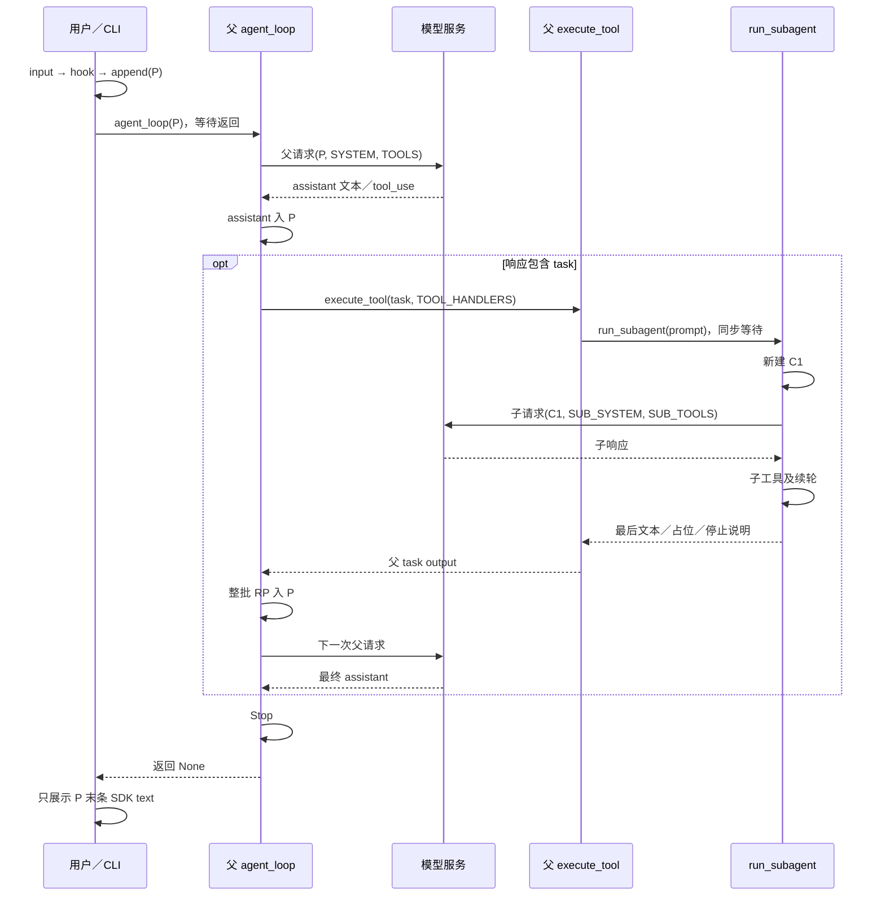
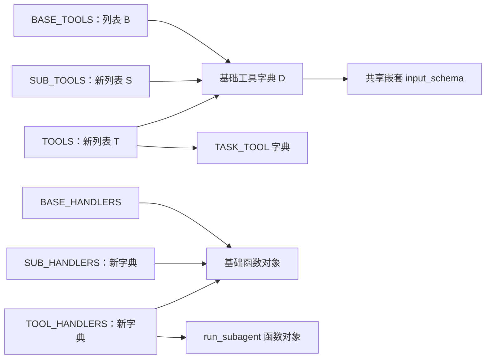
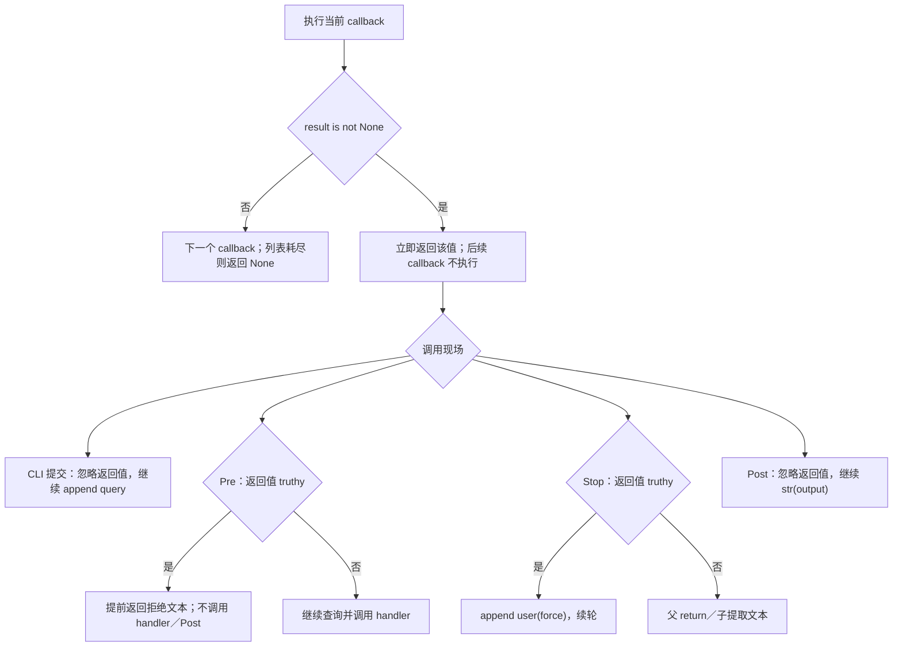
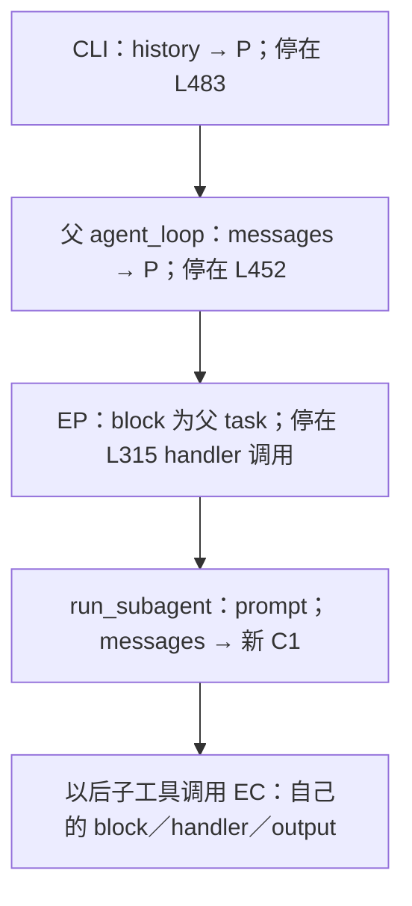
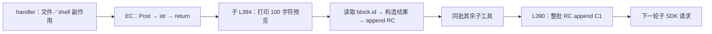
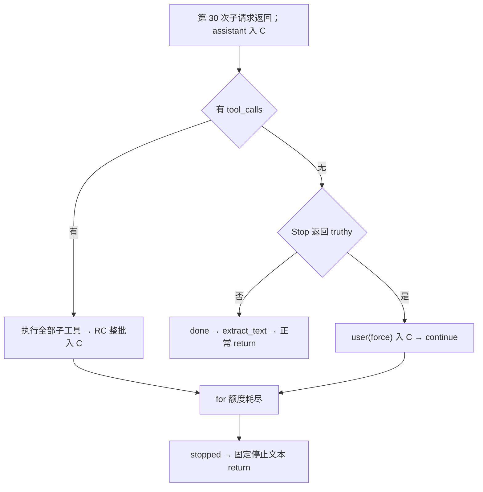
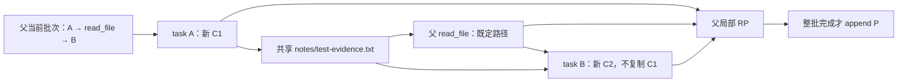
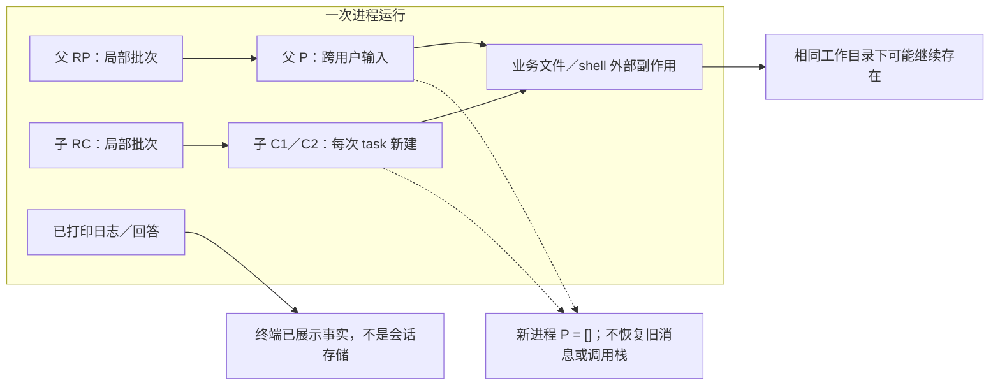

本文分析当前独立实现 [s06_subagent/code.py](../s06_subagent/code.py)，源码共 489 行；辅助材料为本章 [中文 README](../s06_subagent/README.zh.md)、[英文 README](../s06_subagent/README.md)、[根依赖声明](../requirements.txt)及下文逐处引用的断言。行号均指生产源码，不指本文行号。

本文仅作静态源码分析：没有导入或运行目标模块，没有读取真实配置或密钥，没有调用模型、工具或用例。标注“静态推演”的示例不是运行日志；“用例断言”只表示文件中写出了该断言，不表示本次执行或通过。

本章实现的是同进程、单线程、同步嵌套的模型循环：父模型六工具，子模型五工具，四类 hook 事件、五个默认 callback。`task` 是普通 handler，不是后台任务或持久任务记录；不包含技能、压缩、长期记忆、Cron、队友或 MCP。

为跟踪对象而采用以下讲解别名，源码名称不变：

| 别名 | 对象或调用帧 | 不能混同的对象 |
|---|---|---|
| P | CLI 的 history，也是父循环 messages | 子历史 C1、C2 |
| C1／C2 | 每次 run_subagent 新建的消息列表 | 父历史、前一次子历史 |
| RP | 一次父工具批次的局部 results | 已追加进 P 的结果消息 |
| RC | 一次子工具批次的局部 results | 已追加进 C 的结果消息 |
| EP | 父层 execute_tool 调用帧 | 子层 EC |
| EC | 子层 execute_tool 调用帧 | 父层 EP |

“进入历史”指本地列表修改；“模型读取”在本文只追踪到下一次 SDK 调用传入该列表，不宣称服务器确认或模型业务理解。捕获异常、形成 Error 文本、打印 done 与业务成功是不同事实。

# 1. 从 CLI 入口区分用户循环、父循环与子循环

源码：`s06_subagent/code.py`，L463–489（连续原文）。

```python
if __name__ == "__main__":
    print("s06: Subagent - fresh messages, final text returns")
    print("Enter a question, press Enter to send. Type q to quit.\n")

    history = []  # 父对话历史，传给 agent_loop 后由它就地推进
    while True:   # 外层交互循环：反复读用户输入，直到用户退出
        try:
            # \001/\002 tell Readline the ANSI escapes have zero display width.
            # \001/\002 是 readline 的「不可见定界符」：夹在中间的 ANSI 转义码
            # 不占显示宽度，这样青色提示符才不会让光标错位。
            query = input("\001\033[36m\002s06 >> \001\033[0m\002")
        except (EOFError, KeyboardInterrupt):
            # Ctrl+D（EOF）或 Ctrl+C（中断）时退出。
            break
        # 输入 q / exit / 空行都退出。
        if query.strip().lower() in ("q", "exit", ""):
            break
        # 用户输入入历史之前先触发 UserPromptSubmit 钩子。
        trigger_hooks("UserPromptSubmit", query)
        history.append({"role": "user", "content": query})
        agent_loop(history)
        # 打印模型最后的文字回复（跳过 tool_use 块）。
        for block in history[-1]["content"]:
            if getattr(block, "type", None) == "text":
                print(block.text)
        # 空行，让下一条提示符清爽地开始。
        print()
```

直接运行文件、且模块顶层执行全部成功后，才检查 `__name__` 并进入此段。L464、L465 依次打印提示，L467 随后创建新列表 P。提示打印若失败，P 尚未创建；这里没有最外层统一异常处理。

L468 的 `while True` 负责“下一条用户输入”，不是同一问题的工具续轮。L473 先形成带 ANSI 和 readline 不可见定界符的提示字符串，再调用 `input`；成功返回的字符串绑定为 `query`。这里的控制字符用于显示宽度，不清洗用户输入，也不改变后续消息协议。只有这一处 input 在 L469–476 的捕获内。此时 EOFError 或 KeyboardInterrupt 跳到 L476 的 break，退出 CLI while，不进入 hook、父循环或子循环。

L478 对 query 先 strip，再 lower，得到用于判断的临时字符串；结果属于 q、exit、空字符串时退出。`"  Q  "` 会退出，普通请求中的前后空白则仍留在原 query 中：L482 保存的不是规范化后的值。空行是退出，不是忽略后再提示。此处 break 不执行退出前额外摘要或模型调用。

普通输入走到 L481：先同步触发 UserPromptSubmit，正常返回后才执行 L482。函数实参 query 是已有字符串引用，不复制父历史。L482 先构造新的 user 字典，再将其追加到 P；L483 把同一列表引用交给 agent_loop。父循环就地修改 P，正常返回值是 None，CLI 没有接收或替换 history。

L483 正常返回后，L485 才取 P 的末条消息并遍历 content，筛选 SDK text 块后打印，最后打印空行并回到 L473。最终展示的形状限制在第 25 章展开。父请求、权限确认、工具、Stop 或展示阶段异常都不在 L473 的局部捕获内；“用户消息已追加”和“回答已展示”之间有很长的失败窗口。



图中省略了普通工具的重复分支，但没有并行箭头语义：C1 工作时，父栈停在 task 调用内，CLI 也没有读取下一条输入。普通问答若首个父响应只有文本，直接经过父 Stop 返回 CLI，不创建任何子历史，不打印子日志，也不调用基础工具；这是源码静态推演，不能保证真实模型一定这样选择。

接下来暂时回到 L463 之前：上述任何一步成立的前提是模块初始化已经完成。

# 2. 初始化先改变环境，再建立客户端和两个 system

## 2.1 导入与 readline 的局部捕获

源码：`s06_subagent/code.py`，L28–47（连续原文）。

```python
import os          # 操作系统相关功能：读环境变量、判断平台
import re          # 正则表达式：危险命令模式匹配（s03 起沿用）
import subprocess  # 子进程管理：执行模型生成的 shell 命令
from pathlib import Path  # 面向对象的路径操作：拼路径、解析、判断越界

# readline 提供命令行编辑能力（历史记录、方向键、退格等）。
# 它在 Unix 上通常可用，Windows 上可能不存在，所以用 try/except 包裹。
try:
    import readline
    # 以下四行是 macOS 上 libedit 库的 UTF-8 修复，让终端能正确处理中文。
    readline.parse_and_bind('set bind-tty-special-chars off')
    readline.parse_and_bind('set input-meta on')
    readline.parse_and_bind('set output-meta on')
    readline.parse_and_bind('set convert-meta off')
except ImportError:
    # 没有 readline（例如 Windows 自带 Python）直接跳过，不影响主逻辑。
    pass

from anthropic import Anthropic    # Anthropic 官方 Python SDK 的客户端类
from dotenv import load_dotenv     # 从 .env 文件加载环境变量（如 API Key）
```

解释器依次导入 os、re、subprocess 和 Path。L35 进入局部 try，先导入 readline，再顺序执行四条 parse_and_bind；它们是当场调用，不只是登记设置。只有 ImportError 被捕获，包括该 try 内若出现的同类异常。其他终端绑定异常不会被这个 except 吞掉，也不会跳过错误后继续初始化。

L46、L47 在 readline 区域之后导入 Anthropic 和 load_dotenv。第三方包不可用时，CLI 尚未开始。s06 没有导入 yaml；不能把根 requirements 中的 PyYAML 推导成这里存在 frontmatter 或技能扫描。

## 2.2 环境、工作目录、客户端与必需模型配置

源码：`s06_subagent/code.py`，L49–61（连续原文）。

```python
# override=True：即使系统里已有同名环境变量，也用 .env 里的值覆盖。
load_dotenv(override=True)

# 配了 ANTHROPIC_BASE_URL（走代理/自定义端点）时，
# 移除可能打架的 ANTHROPIC_AUTH_TOKEN，避免两种鉴权方式冲突。
if os.getenv("ANTHROPIC_BASE_URL"):
    os.environ.pop("ANTHROPIC_AUTH_TOKEN", None)

WORKDIR = Path.cwd()  # 工作目录：父子两个循环共用同一个（所以文件改动彼此可见）
# 创建 Anthropic 客户端；base_url 默认官方 API，配了环境变量则走自定义端点。
client = Anthropic(base_url=os.getenv("ANTHROPIC_BASE_URL"))
# 从环境变量读模型 ID；用 [] 取值，.env 里没配会直接抛 KeyError。
MODEL = os.environ["MODEL_ID"]
```

L50 调用 load_dotenv 时，override=True 已作为布尔实参求值；调用有机会改变 os.environ，不是返回一个供代码以后读取的独立配置对象。这里没有保存返回值。实际 .env 查找及解析细节由依赖实现决定，本文不读取配置文件，也不据此猜测真实凭据。

L54 获取 ANTHROPIC_BASE_URL 后按 truthy 判断；缺失或空字符串不执行 pop，非空字符串才执行 L55。pop 的默认 None 使目标键不存在时不因这一点抛 KeyError；它确实可能移除当前进程已有环境项。判断成立不证明端点可用或认证正确。

L57 调用 Path.cwd，成功返回后才绑定 WORKDIR。它来自加载时工作目录，不是 code.py 的父目录；本句不创建任何目录。之后 L59 先求值 os.getenv，再调用 Anthropic，构造正常返回后才绑定 client。客户端已构造，不等于已经发出 messages.create 请求。

L61 用下标取 MODEL_ID，键缺失就抛 KeyError；空字符串则能被取出，源码没有额外判空。顺序很重要：MODEL_ID 缺失时，client 的构造以及前面的环境修改可能已经发生，但父／子 system、工具注册和 CLI 尚未继续。不存在“进入 CLI 后再由工具异常处理接住启动错误”的路径。

根 [requirements.txt](../requirements.txt)声明 anthropic>=0.25.0、python-dotenv>=1.0.0、pyyaml>=6.0；它是最低版本约束，不是当前安装版本的证据，也不证明 SDK 网络请求、重试次数或认证行为。

## 2.3 父子 system 是固定字符串，不是隔离执行器

源码：`s06_subagent/code.py`，L63–80（连续原文）。

```python
# 根据操作系统告诉模型它面对的 shell 语法，父子 Agent 共用同一段环境说明。
ENVIRONMENT_PROMPT = (
    "Windows: the bash tool runs through cmd.exe; use cmd.exe syntax, not Unix "
    "Bash or PowerShell syntax, and prefer dedicated file tools for file operations"
    if os.name == "nt"
    else "Unix-like: the bash tool runs the system shell"
)
# 父 Agent 的系统提示词：除了「用工具干活」，还告诉它可以用 task 做聚焦探索。
SYSTEM = (
    f"You are a coding agent at {WORKDIR}. Environment: {ENVIRONMENT_PROMPT}. "
    "Use task for focused exploration or a self-contained subtask."
)
# 子 Agent 的系统提示词：注意这里**没有**提 task 工具——因为子 Agent 也没有。
# 它只被要求「完成任务并把最终答案简洁地返回」，不需要往上汇报中间过程。
SUB_SYSTEM = (
    f"You are a coding agent at {WORKDIR}. Environment: {ENVIRONMENT_PROMPT}. "
    "Complete the given task, then return a concise final answer."
)
```

条件表达式先检查 os.name，只对被选中的分支求值，形成 ENVIRONMENT_PROMPT。它告诉模型应使用哪类 shell 语法，不修改 shell 权限，也不是运行时语法校验。

L71 和 L77 分别求值 f-string 中的 WORKDIR、ENVIRONMENT_PROMPT，再与相邻字面量组成两个字符串。SYSTEM 建议父模型使用 task 做聚焦探索；SUB_SYSTEM 要求完成给定任务并简洁返回。二者是提示，不是代码级任务完成认证。

它们在加载时固定形成，后续没有每轮自动重建。此时只有字符串、客户端和路径等内存对象，没有新建父历史或子历史，更没有专用任务文件。

模块继续向下依次定义五基础 handler、建立 BASE 清单与分发表、建立 hooks 及默认注册、定义共享执行器、派生子容器、定义文本提取与子循环、建立父 task 清单与分发表、定义父循环，最后才到入口。函数定义建立函数对象，不执行函数体；hook 注册与后续真正触发也必须区分。

# 3. 父子工具容器的派生与浅引用

## 3.1 基础声明和可执行函数是两张表

源码：`s06_subagent/code.py`，L161–181（连续原文）。

```python
BASE_TOOLS = [
    {"name": "bash", "description": "Run a shell command.",
     "input_schema": {"type": "object", "properties": {"command": {"type": "string"}}, "required": ["command"]}},
    {"name": "read_file", "description": "Read file contents.",
     "input_schema": {"type": "object", "properties": {"path": {"type": "string"}, "limit": {"type": "integer"}}, "required": ["path"]}},
    {"name": "write_file", "description": "Write content to a file.",
     "input_schema": {"type": "object", "properties": {"path": {"type": "string"}, "content": {"type": "string"}}, "required": ["path", "content"]}},
    {"name": "edit_file", "description": "Replace exact text in a file once.",
     "input_schema": {"type": "object", "properties": {"path": {"type": "string"}, "old_text": {"type": "string"}, "new_text": {"type": "string"}}, "required": ["path", "old_text", "new_text"]}},
    {"name": "glob", "description": "Find files matching a glob pattern; ** matches recursively.",
     "input_schema": {"type": "object", "properties": {"pattern": {"type": "string"}}, "required": ["pattern"]}},
]

# 基础工具的分发表（工具名 -> 处理函数）。
BASE_HANDLERS = {
    "bash": run_bash,
    "read_file": run_read,
    "write_file": run_write,
    "edit_file": run_edit,
    "glob": run_glob,
}
```

BASE_TOOLS 是发给模型的五个工具描述字典，BASE_HANDLERS 是本地查函数用的字典。名称相同是此实现建立的映射约定，不是 SDK 自动把描述字典连接到函数。

| 模型工具名 | 基础 handler | 父分发表 | 子分发表 |
|---|---|---|---|
| bash | run_bash | 有 | 有 |
| read_file | run_read | 有 | 有 |
| write_file | run_write | 有 | 有 |
| edit_file | run_edit | 有 | 有 |
| glob | run_glob | 有 | 有 |
| task | run_subagent | 有 | 无 |

构造每个 schema 的 type、properties、required 字段，只是在构造字典。本地执行器没有通用 schema 校验步骤；后续实际失败位置可能在权限 hook、日志、Python 参数展开／绑定、handler 内部或 SDK 请求中。

## 3.2 子容器先创建，父容器之后展开

源码：`s06_subagent/code.py`，L327–330（连续原文）。

```python
# 子 Agent 的工具集：从基础工具复制一份（list/dict 浅拷贝）。
# 关键点：它里面没有 task，所以子 Agent 无法再派出子 Agent，递归到此为止。
SUB_TOOLS = list(BASE_TOOLS)
SUB_HANDLERS = dict(BASE_HANDLERS)
```

L329 先调用 list(BASE_TOOLS)，得到新外层列表，再绑定 SUB_TOOLS；L330 对字典同理。新容器不意味着新工具字典、新 schema 或新函数。父容器在后面的 task 函数定义之后才构造：

源码：`s06_subagent/code.py`，L398–415（连续原文）。

```python
TASK_TOOL = {
    "name": "task",
    "description": "Run a subagent with fresh conversation context and return its final text.",
    "input_schema": {
        "type": "object",
        "properties": {"prompt": {"type": "string", "minLength": 1}},
        "required": ["prompt"],
    },
}

# 父 Agent 的工具集 = 基础工具 + task；分发表同理多一项。
# 下面这两行就是「父子差异」的最终体现：
#   * 展开（*、**）而不是修改原对象，保证 BASE_TOOLS/BASE_HANDLERS 不被污染，
#     子 Agent 才能拿到干净的那一份。
#   * "task": run_subagent 把「跑一个 Agent 循环」注册成了普通工具，
#     所以主循环完全不需要知道子 Agent 的存在。
TOOLS = [*BASE_TOOLS, TASK_TOOL]
TOOL_HANDLERS = {**BASE_HANDLERS, "task": run_subagent}
```

TASK_TOOL 的 prompt 声明 string、minLength=1，并列入 required。README 的示意 schema 没有展示 minLength，这不是生产代码没有该字段；反过来，生产字典有 minLength 也不代表 run_subagent 自动执行校验。

L414 的星号展开建立新列表，追加的 TASK_TOOL 也是既有字典引用。L415 双星号展开基础映射，再设置 task 对应的函数引用；没有给 BASE_HANDLERS 原地加入 task，所以先前的 SUB_HANDLERS 仍保持五基础项。



静态推演：若在 Python 中修改一个共享工具字典的 description，三个列表里指向该字典的项都能看到变化；若只把 SUB_TOOLS[0] 换成另一个字典，另外两个外层列表的第零项不会自动更换。类似地，向一个 handler 字典新增键不会自动同步到其他字典；它们目前指向的基础函数相同。

这不表示 CLI 提供这些修改命令，而是解释容器语义。本章正常流程不修改工具池。函数引用在构造分发表时保存；以后仅重绑定同名全局函数，不会自动改写已保存的表项。

静态证据：[tests/test_s06_subagent.py](../tests/test_s06_subagent.py)的 test_s06_is_kernel_plus_task（L66–80）断言五基础名称、父多 task、子无 task、父无 todo_write、required prompt 及 large_output_hook 注册。名称用集合比较，不能据此证明顺序、所有 handler 表内容或浅共享身份；这些对象关系来自上面的构造语句。

# 4. 用户提交前的 hooks：非 None 短路不等于拒绝

源码：`s06_subagent/code.py`，L190–204（连续原文）。

```python
HOOKS = {"UserPromptSubmit": [], "PreToolUse": [], "PostToolUse": [], "Stop": []}


def register_hook(event: str, callback):
    # 注册：把回调追加到对应事件的列表。
    HOOKS[event].append(callback)


def trigger_hooks(event: str, *args):
    # 触发：依次调用回调；返回非 None 表示拦截，立即停止并返回该结果。
    for callback in HOOKS[event]:
        result = callback(*args)
        if result is not None:
            return result
    return None
```

HOOKS 的四个值是分别创建的列表。register_hook 先查事件键，再对该列表 append 函数引用；没有调用 callback。键不合法时可能直接 KeyError，源码没有忽略未知事件的逻辑。

trigger_hooks 收到事件字符串和位置实参后，在对应列表上同步遍历。每次先完整执行 callback(*args)，返回值才绑定给 result，然后判断 result is not None。返回 False、空字符串、0 也满足“非 None”，会立即 return 并停止后续 callback；只在所有 callback 返回 None 时才到 L204。

callback 若抛异常，赋值和 None 判断都不完成，后续 callback 不执行；这里没有 except。正常注册顺序为：

源码：`s06_subagent/code.py`，L294–298（连续原文）。

```python
register_hook("UserPromptSubmit", context_inject_hook)
register_hook("PreToolUse", permission_hook)
register_hook("PreToolUse", log_hook)
register_hook("PostToolUse", large_output_hook)
register_hook("Stop", summary_hook)
```

五条调用逐条完成，Pre 的 permission 必定登记在 log 之前；这里还未触发任何事件。实际提交时首次执行的 context callback 是：

源码：`s06_subagent/code.py`，L268–272（连续原文）。

```python
def context_inject_hook(query: str):
    """UserPromptSubmit: log the working directory."""
    # 用户输入送进 LLM 前触发（这里只是打印工作目录）。
    print(f"\033[90m[HOOK] UserPromptSubmit: working in {WORKDIR}\033[0m")
    return None
```

L481 传来的 query 只完成 Python 参数绑定，函数没有把它注入 system 或 history，只打印 WORKDIR。正常返回 None，trigger_hooks 继续到列表末尾并返回 None，CLI 接着执行 L482 的用户 append。print 抛普通异常时则直接离开提交链：P 还没有这条 query，agent_loop 尚未调用。

| callback 返回／抛出 | trigger_hooks 是否继续后续 callback | CLI UserPromptSubmit 调用后 | execute_tool Pre 调用后 | 父／子 Stop 调用后 |
|---|---|---|---|---|
| None | 继续 | 正常结束后仍 append query | 若最终无 truthy 拒绝则执行 handler | 若最终无 truthy force 则结束当前循环函数／提取文本 |
| False／空字符串 | 停止 | 返回值被忽略，仍 append | blocked 假，仍执行 handler | force 假，不续轮 |
| truthy 值 | 停止 | 返回值仍被忽略，继续 append | 提前返回拒绝文本 | append user(force)，续轮 |
| 异常 | 停止并传播 | query 尚未 append | 按当前父／子调用栈传播 | 按当前父／子调用栈传播 |



False 等是扩展 callback 的静态分支，不是默认 permission 的实际返回方案。Post 同样受非 None 短路影响，但 execute_tool 不使用它的返回值；第 19 章解释异常影响。

子历史的首条 prompt 是 run_subagent 直接构造的，不调用 UserPromptSubmit；因此不能从“全局共享 hooks”推导成“每个事件在父子各自动触发一次”。

# 5. 父模型请求：传的是 P，不是父历史快照

源码：`s06_subagent/code.py`，L421–431（连续原文）。

```python
def agent_loop(messages: list):
    # messages 是父对话历史，函数就地修改它、无返回值。
    while True:
        # 【第 1 步】把父对话历史 + 全部工具（含 task）发给模型。
        response = client.messages.create(
            model=MODEL,
            system=SYSTEM,
            messages=messages,
            tools=TOOLS,
            max_tokens=8000,
        )
```

现在返回 CLI：L482 已把用户消息放入 P，L483 调用 agent_loop(P)。参数绑定后，函数局部 messages 与 CLI history 指向同一个列表；局部 response、results 尚未因本次循环而产生。

进入 L423 while 后，L425 先取得 SDK 方法，再顺序求值关键字实参：MODEL 字符串、SYSTEM 字符串、P 引用、TOOLS 列表引用、整数 8000。只有实参准备成功，调用才进入 SDK 方法。返回对象取得后才绑定 response，接下来执行 L433。

| 请求 | model | system | messages | tools | max_tokens | 本地普通异常捕获 |
|---|---|---|---|---|---|---|
| 父请求 L425 | MODEL | SYSTEM | P | TOOLS，六工具 | 8000 | agent_loop 无捕获，直接外溢 |
| 子请求 L356 | 同一 MODEL | SUB_SYSTEM | 本次 C | SUB_TOOLS，五工具 | 8000 | 子循环无捕获；经父 task 调用时可能由 EP 捕获 |

本章只有这两类模型请求，没有独立“对子历史再摘要一次”的请求。8000 是单次模型输出参数，不是整个会话、子任务或工具输出的总预算。

代码没有 list(messages) 或 deepcopy，不能说传入“不可变的请求历史快照”；同样不能从本地传引用断言 SDK 内部继续持有同一列表或怎样序列化。这里能确认的是调用边界上的对象关系。

请求普通异常时，本次 response 赋值尚未完成，L433 不执行；已经加入 P 的用户消息不会撤销。父循环没有本地显式重试、备用模型、压缩、总轮数上限或请求级超时设置；SDK 内部能力由实际依赖决定，本文不推测。

静态推演普通问答：P 原有 n 条消息，用户提交后为 n+1；首次父响应仅文本时，下一章再加 assistant 为 n+2，随后 Stop 正常返回 CLI。它不建立 C，也不调用 task。模型会不会选择工具属于响应内容，不能由输入是一句普通问候就静态保证。

# 6. 父响应入历史与完整工具列表之间的失败窗口

源码：`s06_subagent/code.py`，L432–445（连续原文）。

```python
        # 【第 2 步】模型回复追加为 assistant 消息。
        messages.append({"role": "assistant", "content": response.content})

        # 【第 3 步】筛出 tool_use 块；没有则触发 Stop 钩子后收尾。
        tool_calls = [
            block for block in response.content if block.type == "tool_use"
        ]
        if not tool_calls:
            # Stop 钩子返回非 None 时，当作 user 消息塞回去继续循环。
            force = trigger_hooks("Stop", messages)
            if force:
                messages.append({"role": "user", "content": force})
                continue
            return
```

L433 在 SDK 方法正常返回之后执行。先读取 response.content，形成新 assistant 字典，随后 append 到 P。若属性读取失败，本条 assistant 还没入历史；append 成功后，content 保存的是该响应对象给出的内容引用，没有主动深拷贝或转纯文本。

L436–438 随后遍历 response.content，直接访问每个 block.type。新 tool_calls 列表只保存匹配块的原引用，既不是复制 SDK block，也不读取 stop_reason。列表推导式完整成功后才绑定 tool_calls。

静态推演：response.content 是 [合法 tool_use 块 A，缺少 type 的对象 B]。L433 已保存整个 content；推导式处理 A 时把 A 放进正在构造的临时列表，处理 B 时抛 AttributeError。推导式不返回，L439、L450 和所有工具执行均未到达。本轮没有“A 已先执行”的事实，只有 assistant 已入 P。父处无捕获，CLI 展示也不会继续。

| 响应 content 形状 | L433 后 | 工具提取结果 | 后续位置 |
|---|---|---|---|
| 空列表 | assistant 已追加 | 新空列表 | L441 Stop |
| 只有合法 SDK text 块 | assistant 已追加 | 新空列表 | L441 Stop |
| text 与 tool_use 混合 | assistant 已追加 | 包含 tool_use 的新列表 | L450 创建 RP |
| list 中有无 type 的 dict／对象 | assistant 可能已追加 | 推导式异常 | 父链外溢 |
| None | assistant 可能已追加 | 遍历时 TypeError | 父链外溢 |

空列表没有工具，因此不构造空 tool_result 批次。文本加工具仍先执行工具，不在这里打印文本或把文本当作最终答案。

L441 把 P 传给 Stop；force truthy 时构造 user 消息并追加 P，L444 continue 跳回父 while 的 L425 请求。force 假时 L445 return 结束父函数、返回 CLI L485，而不是退出 CLI。默认 Stop 的统计细节在第 25 章完成；有工具时则进入第 7 章的分发链。

静态证据：[tests/test_agent_loop_boundaries.py](../tests/test_agent_loop_boundaries.py)的 test_parent_loop_does_not_append_an_empty_tool_result_turn（L219–240）包含 s06，断言一次请求、末条为 assistant、没有 user 空结果。其 empty_tool_use_response（L93–100）会把参数 None 换成“含空 SDK text 块的列表”，故不是 response.content=None 兼容性测试；disable_lesson_side_effects 替换 hooks，不能证明真实 Stop 成功。

同文件 test_parent_loop_executes_a_real_tool_call_even_if_stop_reason_disagrees（L243–275）给 stop_reason=end_turn 但含工具的响应，断言两次请求、一个结果批次及配对 ID。它替换执行器等副作用，支持分支依据和回填结构，不证明真实 shell、权限或 task 的运行。

# 7. execute_tool：同一个函数不等于同一层异常边界

父循环已经形成非空 tool_calls，L450 建立新 RP，按响应顺序取块，在 L452 调用 execute_tool(block, TOOL_HANDLERS)。实参是原 SDK 块引用和父分发表引用；EP 是本次新调用帧。

源码：`s06_subagent/code.py`，L304–321（连续原文）。

```python
def execute_tool(block, handlers: dict) -> str:
    # 执行前过 PreToolUse 钩子；被拦就把它返回的原因当作结果。
    blocked = trigger_hooks("PreToolUse", block)
    if blocked:
        return str(blocked)

    # 从传入的 handlers 里查处理函数——这正是父子差异的注入点：
    # 父传 TOOL_HANDLERS（含 task），子传 SUB_HANDLERS（不含 task）。
    handler = handlers.get(block.name)
    try:
        # 工具抛异常不打断循环，转成文本交给模型（例如路径校验报错）。
        output = handler(**block.input) if handler else f"Unknown: {block.name}"
    except Exception as e:
        output = f"Error: {e}"

    # 执行后触发 PostToolUse 钩子（可拿到输出做告警/审计）。
    trigger_hooks("PostToolUse", block, output)
    return str(output)
```

## 7.1 Pre 完整返回后，blocked 才有值

L306 先执行 trigger_hooks，正常返回才把结果赋给本层 blocked。Pre callback 的普通异常不受 L313 的 try 保护。L307 对结果做真假判断，不是 is not None；假值 callback 即使已经使 hook 链短路，也不会令此处拒绝。

若 blocked truthy，先求值 str(blocked)，正常形成字符串才 return。该路径跳过 handler 查询、try、Post。字符串转换自身也在 handler try 外。默认 permission 返回的是非空拒绝字符串，一般直接返回该字符串。

## 7.2 handler 查询、条件分支和参数绑定是不同动作

L312 先读取 block.name，再调用 handlers.get。name 不可哈希可能在这里 TypeError；name 属性缺失也在这里失败。这些都发生在 L313 try 之前。不过同样错误也可能更早在 Pre 中暴露，不能保证总能到达这一行。

进入 try 后，L315 先判断 handler 的 truthy。当前正常表项是函数，选中左侧后才读取并展开 block.input，再执行 Python 参数绑定，随后进入函数体。input 非 mapping、键不是合法关键字、缺参或多参都可能在函数体尚未执行时失败，并被 L316 捕获。

handler 假时只执行 f-string Unknown 分支，不对 handler 做 ** 参数展开。这不等于未知工具必定接受任何 input：Pre 的 log 已经可能调用 input.values 而失败。若 Unknown 字符串正常形成，它也是普通 output，之后还会执行 Post。

L316 捕获 Exception，将异常格式化进 Error 字符串，再绑定 output。它不是回滚，也不是把错误重新 raise；模型以后看到的是内容文本。异常格式化本身若失败，当前 except 不会自动重试；在嵌套场景中还要看父层是否包着它。

## 7.3 Post 和最终字符串转换仍可能阻止返回

离开 try／except 后，L320 调用 Post，实参为同一 block 和 handler 原始 output。调用正常完成才到 L321 的 str(output)。Post 的返回值无论真假都没有保存或替换 output，异常却直接离开当前 execute_tool。

| 本层位置 | 在 L313 try 内 | 若普通异常发生，当前层怎样处理 | 可能已有的业务副作用 |
|---|---|---|---|
| Pre 与 blocked 字符串化 | 否 | 向当前调用者传播 | handler 尚未执行；callback 自身可能有副作用 |
| handlers.get(block.name) | 否 | 传播 | handler 尚未执行 |
| 条件表达式、** 展开、参数绑定 | 是 | 形成 Error 后走 Post | 本次 handler 体尚未开始 |
| handler 函数体 | 是 | 形成 Error 后走 Post | 可能已读盘、建目录、覆盖或执行命令 |
| Post | 否 | 传播 | handler 可能完整执行 |
| 最后 str(output) | 否 | 传播 | handler 和 Post 已完成 |

“向当前调用者传播”还不是“退出程序”：EC 的调用者在 run_subagent 内，而整个 run_subagent 可能位于 EP 的 handler try 内。第 22 章按两层栈解释最终去向。

正常 str(output) 返回后，父调用者 L452 的 output 才赋值，接着构造 RP 元素；子调用者则是 L382，下一句为子预览 L384。函数返回字符串不直接追加任何历史。拒绝、Unknown、Error 均没有统一设置 is_error，不能把字符串前缀当作完整协议级失败标记。

# 8. 权限 hook：逐表达式决定拒绝、确认或异常

## 8.1 命令规则先编译，执行时按顺序匹配

源码：`s06_subagent/code.py`，L207–216（连续原文）。

```python
DENY_LIST = ["rm -rf /", "sudo", "shutdown", "reboot", "mkfs", "dd if="]
DESTRUCTIVE_COMMAND_WORD = re.compile(
    # 匹配作为独立命令出现的 rm/del（前置边界避免误伤 "firm" 这类子串）。
    r"(?i)(?:^|[;&|()\n])\s*(?:rm|del)(?=\s|$|[;&|()])"
)
DESTRUCTIVE = ["rm ", "> /etc/", "chmod 777"]


def contains_destructive_command(command: str) -> bool:
    return bool(DESTRUCTIVE_COMMAND_WORD.search(command))
```

DENY_LIST 和 DESTRUCTIVE 是加载时创建的列表；正则在加载时编译，contains_destructive_command 调用时才对实参 command 执行 search，最后 bool 化匹配结果。正则编译不是命令执行。

模式中的 (?i) 只作用于该正则，允许 RM／DEL 等大小写；前边界为串首或指定 shell 分隔字符，后边界要求空白、串尾或指定分隔字符。它不是完整 shell 语法树，不能推导出任意引号、转义、替代命令及嵌套语法都被正确分类。

源码：`s06_subagent/code.py`，L219–238（连续原文）。

```python
def permission_hook(block):
    """PreToolUse: block denied operations and ask about risky ones."""
    # 工具执行前：bash 先查硬黑名单，再查危险规则；文件工具检查是否越界。
    if block.name == "bash":
        command = block.input.get("command", "")
        for pattern in DENY_LIST:
            if pattern in command:
                # 红色打印拦截原因；返回非 None 即阻止执行。
                print(f"\n\033[31m[blocked] '{pattern}'\033[0m")
                return "Permission denied by deny list"
        if contains_destructive_command(command) or any(
            keyword in command for keyword in DESTRUCTIVE
        ):
            # 黄色提示 + 展示完整参数，让用户看清要执行什么。
            print("\n\033[33m[permission] Potentially destructive command\033[0m")
            print(f"   Tool: {block.name}({block.input})")
            # 默认拒绝：直接回车 = N（fail-safe）。
            choice = input("   Allow? [y/N] ").strip().lower()
            if choice not in ("y", "yes"):
                return "Permission denied by user"
```

Pre 当前先执行 permission。L222 读取 name，只有等于 bash 才取 command。L223 的 .get 默认空字符串仅用于键缺失；显式 None 不会替换，之后 pattern in command 可能直接 TypeError，发生在 EP／EC 自己的 handler try 之外。

L224 从 DENY_LIST 第一项顺序检查。每次 pattern in command 是区分大小写的子串判断，不要求命令边界，也不识别引号上下文。首次命中先打印 blocked，再 return 非空拒绝文本；打印失败时连该拒绝 return 都未完成。硬拒绝不进入人工确认，后续黑名单项、危险规则和日志均不执行。

未硬拒绝才到 L229。先完整执行 contains_destructive_command；结果真就短路，右边 any 不调用。否则 any 逐项计算 keyword in command，命中立即停止。DESTRUCTIVE 的子串匹配仍区分大小写，并独立于正则，所以正则避免的误报可能被它重新引入。例如包含 firm 后紧跟空格的文本可能含有小写 "rm " 子串；正则的命令词边界不能代表整个规则组都避免该误报。这是源码静态推断，不是本次命令实验。

危险规则成立后依次打印提示、完整 block.input，再 input。input 返回后才能 strip、lower；规范化结果只有 y 或 yes 放行，空白和 n 都拒绝。这里返回 None 才允许 trigger_hooks 继续执行 log。prompt 文字里的 fail-safe 只说明普通输入默认拒绝，不表示输入异常被当作拒绝文本处理。

## 8.2 文件路径判断与 handler 使用不是同一个动作

源码：`s06_subagent/code.py`，L240–249（连续原文）。

```python
    if block.name in ("read_file", "write_file", "edit_file"):
        # 文件工具：路径解析后落在工作目录之外，就打断询问用户。
        path = block.input.get("path", "")
        if not (WORKDIR / path).resolve().is_relative_to(WORKDIR):
            print("\n\033[33m[permission] Access outside workspace\033[0m")
            print(f"   Tool: {block.name}({block.input})")
            choice = input("   Allow? [y/N] ").strip().lower()
            if choice not in ("y", "yes"):
                return "Permission denied by user"
    return None
```

工具名属于 read_file、write_file、edit_file 才进入文件分支；task 和 glob 不走此路径确认。L242 读取 path；缺失使用空串，显式 None 继续保留。L243 顺序执行 WORKDIR / path、resolve、is_relative_to，再取 not。绝对路径拼接按 Path 语义可能覆盖左侧路径；范围判断基于解析结果，而不是仅检查 "../" 字符。

路径在范围内时不打印确认，直接到 L249；范围外则先打印、再询问，y／yes 仍可允许。这是可人工放行的策略，不是无法越过的沙箱。类型或路径解析错误可能在进入 handler 前外溢；即使允许，handler 随后也会重新解析和打开，并未锁住之前检查到的对象。

父 task 自身不解析 prompt 中的命令，也不因此提前确认整项子工作；子模型真正输出 bash／文件工具块时再逐项触发相同权限函数。相同规则不保证相同外层异常去向。

| 现场 | 输入动作之前的状态 | EOFError 的本地去向 | KeyboardInterrupt 的本地去向 |
|---|---|---|---|
| CLI L473 | 用户尚未入 P | 局部 except → break | 局部 except → break |
| 父工具权限 L236／L246 | 父 assistant 已入 P，handler 未执行 | Pre 在 EP try 外，向 CLI 外溢 | 同样外溢 |
| 子工具权限 L236／L246 | 子 assistant 已入 C，父 task 等待 | 越过 EC；经 task 调用时可被 EP 捕获为 Error | 不属于 Exception，EP 也不捕获 |

上述异常现场是源码静态推演。子普通异常的捕获也依赖它确实经父 execute_tool 进入，直接调用 run_subagent 没有 EP。

静态证据：[tests/test_permission_command_words.py](../tests/test_permission_command_words.py)的 PERMISSION_LESSONS 包含 s06；test_permission_command_words_cover_position_case_and_boundaries 对 rm、绝对命令路径、小写子串、DEL、分隔符和 model／delimiter 等样本，固定 input 返回 n，断言 bool(result) 与 expected 相同。它不执行命令，不证明允许分支、所有 shell 语法或真实终端异常。

[tests/test_s06_subagent.py](../tests/test_s06_subagent.py)的 test_subagent_file_tools_keep_the_kernel_permission_boundary（L116–132）直接用 SUB_HANDLERS 分发越界 write，固定拒绝，断言拒绝文本和目标不存在。它没有运行子 SDK，也没有验证 EP 包住 EC 的异常路径，更不证明直接调用文件 handler 自带权限检查。

# 9. 日志先完成全量取值和转换，最后才截展示

源码：`s06_subagent/code.py`，L252–257（连续原文）。

```python
def log_hook(block):
    """PreToolUse: log every tool call."""
    # 只观测不干预：灰色打印工具名与前两个参数（截断 60 字符），返回 None 放行。
    args_preview = str(list(block.input.values())[:2])[:60]
    print(f"\033[90m[HOOK] {block.name}({args_preview})\033[0m")
    return None
```

调用现场仍在 Pre 的第二个 callback。只有 permission 正常返回 None，才轮到 log；默认硬拒绝或人工拒绝已经使 trigger_hooks 返回，不会打印这条日志。

L255 不是“仅读前两个值”：先调用 block.input.values，得到视图，再 list 完整枚举所有值；然后切片取前两项，str 形成该子列表完整表示，最后再切 60 个字符。字典值顺序来自输入字典的迭代顺序，不是 schema 字段优先级。返回给 args_preview 的是新字符串，不改变 input。

若 input 无 values、列表构造或字符串表示失败，本次日志赋值不会完成，L256 print 不执行，handler 也尚未开始；这些普通异常仍在当前执行帧 handler try 之外。截 60 只是输出展示限制，不是之前计算或转换成本的上限。

L256 的 f-string 也先完成再 print。print 成功、L257 返回 None，trigger_hooks 才继续检查 callback 列表并返回，execute_tool 的 L306 赋值完成。blocked 假后继续 L312 查询 handler。

注释“log every tool call”应限定为到达并完成此 callback 的调用；拒绝项不会经过它，参数或输出故障也可能使打印未完成。日志写到终端不代表工具已经执行，更不代表结果已入历史。

# 10. task 进入子函数时，父栈正在等待什么

主例静态推演：用户要求查明项目的测试方式，父响应含 task 块，prompt 为“查明本项目采用的测试框架和入口，给出依据”。此字符串来自父模型响应；CLI 的原 query 仍在 P 内，但不会由 Python 自动传给子函数。

父执行到 L452，EP 的 Pre 已通过并记录日志，L312 查到 run_subagent，L315 左支进行 ** 展开和参数绑定。只有它们全部完成才进入：

源码：`s06_subagent/code.py`，L345–350（连续原文）。

```python
def run_subagent(prompt: str) -> str:
    # 这是一个「工具处理函数」，但它内部自己跑了一整套 Agent 循环。
    print("\n\033[35m[Subagent started]\033[0m")
    # 全新、独立的对话历史：只有一条 prompt。
    # 父对话的历史不会传进来——这就是上下文隔离，也是子 Agent 存在的意义。
    messages = [{"role": "user", "content": prompt}]
```

L347 先打印 started。print 失败则 L350 尚未执行，C1 尚未创建；普通异常会回到 EP 的 L316，而不是转成一条子 tool_result。

L350 先取得当前 prompt 引用，构造一个新 user 字典，再构造装着该字典的新列表，最后绑定子帧局部 messages，即 C1。没有 P 的切片或复制，也没有把父 system 放进 C1；SUB_SYSTEM 在子请求的独立参数中提供。

正常 prompt 是不可变字符串，可以共享它的引用而不复制字符。若错误输入让 prompt 指向可变对象，新历史并没有 deepcopy 该对象；“全新消息列表”不等于所有字段都复制或验证。



EP 中的 block 仍是父 task 块。子循环后续同名变量不会覆盖它；EC 返回时只把字符串交回子 L382，不可能误把子 block.id 写成父配对 ID。

| task 输入静态样本 | 能否进入 run_subagent | 在创建 C1 前后发生什么 | 后续责任 |
|---|---|---|---|
| {"prompt": "查测试入口"} | 正常可进入 | started 后建 C1 | 子请求执行 |
| {} | 参数绑定失败，不进入 | 可能已有父日志；无 started、无 C1 | EP 形成 Error 后 Post |
| 多余关键字 | 参数绑定失败 | 同上 | EP 包装 |
| {"prompt": ""} 或空白串 | 本地未禁止 | 可以 started、创建 C1 | SDK／模型实际接受情况不由源码保证 |
| {"prompt": None}／数字／列表 | 本地无类型校验，可能进入 | C1 保存该对象引用 | 后续 SDK／解析可能失败 |
| input 非 mapping | 可能更早在日志失败 | 不保证到达 ** 展开 | 需按真实失败位置判断 |

字符串 minLength、类型注解和提示要求不能代替上述本地行为。无父历史复制也不是保密边界：父模型本就可以把父信息写进 prompt；子工具还能读取共同工作区。

C1 建好后，run_subagent 没有向父返回任何内容，父 L452 的 output 也尚未赋值。下一句进入 L355 for；CLI、父 while 和 EP 都保持同步等待。

# 11. 子请求与三十次迭代：限制的是哪一层

源码：`s06_subagent/code.py`，L352–362（连续原文）。

```python
    # 注意是 for _ in range(30) 而非 while True：
    # 子 Agent 不死不休的代价很高（烧 token 且父 Agent 在阻塞等待），
    # 所以给它一个硬上限，最多 30 轮就必须收工。
    for _ in range(30):
        response = client.messages.create(
            model=MODEL,
            system=SUB_SYSTEM,   # 用子 Agent 自己的系统提示词
            messages=messages,
            tools=SUB_TOOLS,     # 只给基础工具
            max_tokens=8000,
        )
```

range(30) 产生 0 到 29 的迭代值，每轮绑定给局部下划线变量；下划线只是变量名，不负责超时或计费。每次进入循环体先调用一次 client.messages.create。

L356 的实参依次从共享全局 MODEL、SUB_SYSTEM、当前子局部 messages、SUB_TOOLS 和整数 8000 形成。这里 messages 是 C1，不是 P；客户端与父相同，system 和工具清单不同。参数准备失败时尚未进入 SDK 方法；SDK 正常返回才绑定子局部 response，然后继续 L363。

| 对象 | 父请求 | 子请求 | 含义 |
|---|---|---|---|
| client | 同一全局对象 | 同一全局对象 | 无独立网络客户端实例 |
| MODEL | 同一全局配置 | 同一全局配置 | 无自动备用模型 |
| messages | P | C1 | 上下文消息分开 |
| system | SYSTEM | SUB_SYSTEM | 两个已生成的字符串 |
| tools | TOOLS | SUB_TOOLS | 子未声明 task |
| HOOKS | 同一全局注册表 | 同一全局注册表 | 触发时接收不同现场实参 |

子请求普通异常没有在 run_subagent 内就地捕获。它不产生子 assistant、子结果或“请求重试”记录；经父 task 进入时，异常会越过整个子函数交给 EP。先前轮次的 C1、文件和日志不会自动撤销。

三十次限制是显式 Python 循环的上限：每次体内最多到一次 SDK 方法调用，但 SDK 内部若重试不由这个数字约束。第 30 轮能执行多少工具取决于响应中的列表；每个 bash 自有 120 秒参数，确认 input 和模型等待没有在这里设置子任务总超时。多个顺序 task 各自获得新的 range(30)，父 while 自身无此上限。

Stop 要求续轮也会消耗一次迭代；不是只在“执行过工具”后才计轮。末轮三种结果在第 21 章逐句展开。

# 12. 子响应：局部帧独立，assistant 与块仍共享引用

源码：`s06_subagent/code.py`，L363–379（连续原文）。

```python
        messages.append({"role": "assistant", "content": response.content})

        tool_calls = [
            block for block in response.content if block.type == "tool_use"
        ]
        if not tool_calls:
            # 子 Agent 也支持 Stop 钩子强行续命（与父循环逻辑一致）。
            force = trigger_hooks("Stop", messages)
            if force:
                messages.append({"role": "user", "content": force})
                continue
            print("\033[35m[Subagent done]\033[0m")
            # 只把「最终文本」返回给父 Agent；中间的工具输出全部丢弃。
            # 抽取为空时给个占位说明，避免父 Agent 收到空字符串不知所措。
            return extract_text(response.content) or "(no summary)"

        results = []
```

这次 L363 的 messages 是 C1，response 是子帧的响应变量；父 response 仍保存父模型响应，父 tool_calls 仍用于等待后继续同批遍历。Python 不因局部名称相同而覆盖另一个栈帧。

先读取子 response.content，构造新 assistant 字典并 append C1；然后完整执行 L365–367 的推导式。子 tool_calls 是新列表，元素仍是响应原块。若中途 block.type 访问失败，C1 可能已含 assistant，当前子工具尚未执行；异常可以被 EP 转成父 task Error，但不是把这个损坏 assistant 直接复制进 P。

| 当前时点 | P | C1 | RP | RC | 下一句 |
|---|---|---|---|---|---|
| 子 SDK 请求前 | 有父 task assistant | 仅 prompt 或既有子轮次 | 父此前结果可能已有 | 本轮尚未建立 | L356 |
| 子响应取得 | 不变 | 尚未含本次 assistant | 不变 | 尚未建立 | L363 |
| L363 完成 | 不变 | 多一条子 assistant | 不变 | 尚未建立 | L365 |
| 推导式完成且有工具 | 不变 | 同上 | 不变 | L379 新建空列表 | L380 |
| 推导式失败 | 不变 | 子 assistant 可能保留 | task 结果尚未 append | 本轮未建立 | 普通异常回 EP |
| 无工具 | 不变 | 同上 | task 仍未返回 | 不创建空 RC | L370 Stop |

文本与工具混合时 tool_calls 非空，跳过无工具分支，不执行 done 或 extract_text；文本仍在 C1 中，子模型下一轮会带着它继续。循环看实际内容块，不看 stop_reason。

静态证据：[tests/test_s06_subagent.py](../tests/test_s06_subagent.py)的 test_subagent_starts_with_fresh_messages_and_returns_final_text（L83–113），先安排 read_file 再安排最终 SDK text，断言首请求仅一条 prompt、工具为五基础项、返回最终文本。其 create 用 list(kwargs["messages"])记录请求时的外层列表快照，避免后续 append 改变记录长度；这不是生产代码复制父历史的证据，内部字典和块也没有因测试这行而深拷贝。

该用例直接调用 run_subagent，fake Anthropic 和 fake dotenv 在加载器中替换真实依赖，并临时设置 cwd、MODEL_ID 后恢复；它不覆盖父 task 的 Pre／Post 和 RP，也不证明真实认证或网络成功。

另一个静态证据是通用用例 test_subagent_still_executes_a_real_tool_call_with_text_present（L289–313）：空 text 与 read_file 同在 stop_reason=end_turn 的响应中，断言第二次请求及最终 done。execute_tool 被替换为固定文本，hooks 也被替换，不能据此宣称真实 read_file 或权限链已验证。

# 13. 子分发：EC 是新帧，没有 task handler

源码：`s06_subagent/code.py`，L379–382（连续原文）。

```python
        results = []
        for block in tool_calls:
            # 子 Agent 的工具调用同样走权限钩子，安全性不打折。
            output = execute_tool(block, SUB_HANDLERS)
```

L379 先新建空 RC；只有工具列表完整提取后才到这里。L380 顺序取原响应块，L382 先求值 block、SUB_HANDLERS，再调用 execute_tool，建立 EC。此时 EP 仍停在运行 run_subagent 的调用内部。

EC 执行第 7 章同一函数，但 handlers 是子字典。EC 的 blocked、handler、output 均是它自己的局部变量。子 handler 普通异常只需在 EC 内形成文本就可继续，EP 不会因为字符串以 Error 开头而自动进入 except。

静态推演子响应出现名为 task、input 为正常 {"prompt": "..."} 的块：permission 没有 task 特判，log 正常打印后返回；SUB_HANDLERS.get("task") 为 None，条件表达式选 Unknown 分支，不执行 run_subagent 参数展开或调用；Post 完成后返回 Unknown 文本到 L382，接着走 L384。父分发表有 task 不会被自动补查。

若 input 无 values，未知工具也可能在 Pre 中先失败，因此“无 handler 不展开参数”不能扩大成“未知工具任何输入都不会报错”。

双重约束是“子请求未声明 task”和“本地子分发表无 task”。注释中的“递归到此为止”只适用于本章这一条工具分发路径，不是禁止 shell 运行其他程序的系统安全机制。

此后若工具名是 glob／read_file，EC 就在 L315 调用对应基础函数；同一函数也可能由父直接调用，副作用逻辑相同，只是回到 EC 或 EP 的不同调用现场。下面按五个 handler 逐句下沉，再返回子反馈链。

# 14. bash：外部副作用先发生，输出后来才解码、清理和截断

源码：`s06_subagent/code.py`，L86–100（连续原文）。

```python
def run_bash(command: str) -> str:
    # 执行命令：shell=True 交给系统 shell，cwd=WORKDIR 固定工作目录，
    # capture_output 捕获输出，text=True 按文本返回，
    # errors="replace" 防解码崩溃，timeout=120 防卡死。
    try:
        result = subprocess.run(
            command, shell=True, cwd=WORKDIR,
            capture_output=True, text=True, errors="replace", timeout=120,
        )
        # 合并 stdout/stderr 并去空白；截断到 50000 字符防止撑爆上下文。
        output = (result.stdout + result.stderr).strip()
        return output[:50000] if output else "(no output)"
    except subprocess.TimeoutExpired:
        # 超时：返回提示让模型自行调整策略。
        return "Error: Timeout (120s)"
```

调用现场可以是 EC 或 EP 的 L315；command 通常来自对应模型块的 input["command"]。参数完成绑定后进入函数，才到 L90 的局部 try。权限和日志已经先执行过；直接 Python 调用 run_bash 则没有这些前置动作。

## 14.1 subprocess.run 的参数分别约束什么

L91–94 先构造实参，再进入 subprocess.run。shell=True 将命令交给平台 shell，不是把名为 bash 的工具强制变成 Bash 解释器；cwd=WORKDIR 固定此次子进程工作目录。ENVIRONMENT_PROMPT 只是提前告知模型，不校验 command 是否使用正确语法。

capture_output=True 要求捕获 stdout 和 stderr。text=True 让返回流成为文本，errors="replace" 在解码遇到部分非法序列时替换；没有 encoding 实参，实际默认编码取决于运行时和环境。这不是自动识别编码，也不保证中文必然正确。命令可能在捕获完成前已经修改文件、启动其他程序或产生其他外部副作用。

timeout=120 交给 subprocess.run 处理，是该次调用的超时参数，不是父／子整项任务计时器，也不约束权限确认的等待。源码没有自己登记进程组、清理全部后代或撤销命令副作用；这不等于 subprocess.run 自身完全不处理超时后的进程。

run 正常返回后才绑定 result。发生普通 OSError 等异常，run_bash 的 except 只匹配 TimeoutExpired，不会接住它们；它们到 EC／EP 的 handler try 后才形成 Error。若恰是 TimeoutExpired，局部 L100 返回超时文本，不把异常继续抛给分发器。

## 14.2 输出信息经过哪些不可逆变化

L96 先计算 result.stdout + result.stderr，得到新合并字符串，再 strip 去掉两端空白，最后绑定 output。不是先分别 strip 再合并；两个流中间没有自动分隔符，原始交错时间顺序已经丢失。之后 L97 才判断 output truthy：非空取前 50000 字符，空则返回 "(no output)"。

```text
外部 stdout／stderr 原始字节
    → 按运行时编码解码，错误处可能替换
    → 两个完整文本流相加（stdout 在前）
    → 去两端空白
    → 最多 50000 字符或无输出占位
    → execute_tool 的 output
    → Post
    → RC／RP
```

没有读取 returncode，也未传 check=True。静态推演：命令返回非零但只输出一段错误说明，handler 返回该说明；非零且没有输出，handler 返回 "(no output)"。本章没有自动据退出码将它们标为工具失败，模型需要根据已有文本继续判断。

50000 是完整捕获、解码和合并之后的切片，不限制前面的捕获内存。截断后没有在本章另存“完整输出文件”；后续结果批次也只能保存这个返回文本，而不是已被丢弃的原始字节或后半段。

| 失败或返回位置 | 已可能发生 | 尚未发生 | 后续 |
|---|---|---|---|
| run 在启动前失败 | 权限日志 | 不保证命令已开始 | 分发 try 转 Error |
| run 过程中超时 | 命令部分或全部副作用 | 正常 result 赋值未完成 | 返回超时文本后走 Post |
| run 成功、合并／清理失败 | 命令已执行完 | handler 正常结果未形成 | 分发 try 转 Error |
| L97 正常返回 | 命令及输出处理完成 | Post、批次反馈未必完成 | 回 EC／EP 的 L315 |
| 后续 Post 或批次失败 | 同上，文件修改仍在 | 当前／整批结果可能未入历史 | 按父子栈传播，无回滚 |

静态证据：[tests/test_subprocess_output_encoding.py](../tests/test_subprocess_output_encoding.py)的 SOURCE_FILES 包含 s06 的 code.py，test_subprocess_text_calls_replace_decode_errors 用 AST 检查 text=True 的 subprocess.run／Popen 是否显式 errors="replace"。这证明的是检查目标和检查条件，不证明真实解码效果。

同文件动态编码、stderr、空输出和超时文案专项命名为 test_s07_*，加载的是 s07；其中超时测试替换 subprocess.run 抛异常，也不证明真实超时清理。不得将这些用例写成 s06 动态验证，本次亦未执行任何用例或命令样本。

# 15. read_file：limit 判断发生在完整读取之后

源码：`s06_subagent/code.py`，L103–112（连续原文）。

```python
def run_read(path: str, limit: int | None = None) -> str:
    # 读文件：相对路径拼到 WORKDIR 后 resolve（折叠 ../ 等）。
    try:
        lines = (WORKDIR / path).resolve().read_text(encoding="utf-8").splitlines()
        # limit：只读前 N 行；截断时附提示说明还剩多少行。
        if limit and limit < len(lines):
            lines = lines[:limit] + [f"... ({len(lines) - limit} more lines)"]
        return "\n".join(lines)
    except Exception as e:
        return f"Error: {e}"
```

EC／EP 在 L315 用 path、可选 limit 完成绑定；缺少 path 或多参数时尚未进入本函数，会由分发层处理。进入后 L105 才开始本地 try。

L106 是一条从左到右的调用链：先 WORKDIR / path，resolve 得到路径对象，再 read_text(encoding="utf-8") 读取整个文件，最后对完整字符串 splitlines，创建行列表。所有调用成功后才把列表绑定到 lines。路径、打开、读取、UTF-8 解码或 splitlines 中的普通异常都由 L111 捕获，返回 Error 文本；文件不因读取而被本函数写回，但之前已完成的 I/O 不会“撤销成没读过”。

splitlines 去掉行分隔符；L110 用 "\n" 重新拼接，原 CRLF／CR 风格及末尾行结束状态不保证保留。空文件正常得到空列表，join 返回空字符串，不是 "(no output)"，也不自动当作错误。

## 15.1 and 先按真假值分流，再比较

L108 先判断 limit truthy。假则不计算 limit < len(lines)，直接去 L110；真才取得行数并比较。类型注解 int | None 和模型 schema 不会在这里统一检查类型。

以下以五行文件、普通内置值为静态样本，文件在进入本表前都已完整读取：

| limit | 第一项真假 | 比较及切片 | 结果或失败 |
|---|---|---|---|
| None、0、False | 假 | 不比较、不切片 | 返回全部五行 |
| ""、[]、{} | 假 | 不比较 | 错误类型也可能返回全部 |
| 2 | 真 | 2 < 5，切前两行 | 两行加“3 more lines” |
| 5、6 | 真 | 比较假 | 返回全部，无提示 |
| -2 | 真 | -2 < 5，lines[:-2] | 保留三行，但提示为“7 more lines” |
| True | 真 | 按 1 比较并切片 | 五行时保留一行，提示 4 |
| "2" | 真 | 字符串与整数比较 | TypeError → 本函数 Error |
| 0.5 | 真 | 比较真，随后非法切片 | TypeError → 本函数 Error |
| 6.0 | 真 | 比较假，不触及切片 | 返回全部，不因 float 必然失败 |

表格不是建议接受这些值，而是说明本地并非严格类型校验。布尔值可参与整数比较与索引，浮点数是否触及切片取决于比较结果。不能笼统称为“错误类型统一在参数绑定时拒绝”。

## 15.2 右侧完成之后才更换 lines

条件成立才执行 L109。先求 lines[:limit] 得到新列表，再构造提示列表，其中 len(lines) 仍读取旧五行列表，随后相加，全部完成后才让局部 lines 指向新列表。原列表没有被切片赋值修改；如果切片失败，重绑定没有发生，函数转入 except。

负 limit 时 Python 负切片与“原长减 limit”是两套计算，因而出现上表的不一致。提示不是根据切片实际删除量统计。

L110 join 形成新结果字符串，返回 EC／EP 的 L315；然后才走 Post、日志预览及回填。限行仅限制返回内容，不限制 read_text 的底层读取量、解码或 splitlines 成本。返回 Error 也不能推导出未读盘。

静态证据：通用 test_text_tools_use_utf8_for_non_ascii_content 的参数化范围 GLOB_LESSONS 包含 s06，通过 run_text_tool 直接调用读写／编辑 handler，断言中文读取与文件字节。读断言是 read == original.rstrip()，支持该样本的文本结果，不是任意空白都被 rstrip 的实现保证；源码实际是 splitlines 加 join。它没有经过权限、Post 或父子模型循环，本次未执行。

# 16. write_file：目录、覆盖写与返回文案各有提交点

源码：`s06_subagent/code.py`，L115–124（连续原文）。

```python
def run_write(path: str, content: str) -> str:
    # 写文件：整文件覆盖；parents=True 按需建目录，exist_ok=True 忽略已存在。
    try:
        file_path = (WORKDIR / path).resolve()
        file_path.parent.mkdir(parents=True, exist_ok=True)
        file_path.write_text(content, encoding="utf-8")
        # 返回字节数，方便模型确认写入成功。
        return f"Wrote {len(content)} bytes to {path}"
    except Exception as e:
        return f"Error: {e}"
```

当前 handler 参数 path、content 从模型块绑定而来。L118 先解析目标路径并绑定 file_path；此时尚未创建目录或打开文件。L119 再取得 parent，调用 mkdir(parents=True, exist_ok=True)，按需建立祖先目录。已存在目录通常不因 exist_ok 而报错，但路径冲突、权限等仍可失败；前面已创建的中间目录不自动移除。

L120 先求值 content 和编码实参，再调用 write_text。普通字符串写入会进入覆盖路径，已有文件不会因内容相同而跳过，也没有先写临时文件后替换、备份或事务提交。实际打开、截断、写入、关闭均由文件库完成；失败点不同，可能未改文件，也可能已经截断或部分写入。不能从函数捕获到异常一概反推“原内容仍在”。错误类型是否在打开前被库拒绝，属于具体实现校验时点，源码没有自建统一保证。

write_text 正常返回后，其返回数值没有被保存或核对。L122 再计算 len(content)，形成 f-string，其中 path 使用原参数展示，不是 file_path 的规范绝对路径。此处注释和 "bytes" 文案都使用字符数；例如普通字符串“中文”的 len 为 2，而 UTF-8 编码为 6 字节。不能把文案当作落盘字节核验。

| 检查点 | 目录状态 | 文件状态 | 结果与下一句 |
|---|---|---|---|
| L118 后 | 本函数尚未 mkdir | 本函数尚未写 | L119 |
| L119 后 | 目标父目录已可用，可能新建多层 | 本函数尚未覆盖 | L120 |
| L120 内失败 | 可能已创建 | 可能未打开、已截断或部分写入 | L123 → Error；无清理 |
| L120 返回 | 目录已建立 | 库报告写入调用完成 | L122 格式化 |
| L122 返回 | 保留 | 已写内容保留 | 分发 Post，尚未入 RC／RP |
| Post／后续批次失败 | 保留 | 不撤销成功覆盖 | 结果可能缺失，按外层捕获传播 |

对于通常的 str，写后 len 一般可直接完成；仍需把返回文案与写入拆开，因为后面的 Post、结果字典构造或批次追加完全可能失败。Error 不是磁盘状态报告，成功文案也不证明模型后来消费了结果。

encoding="utf-8" 固定文本编码，但未显式设置 newline；平台文本换行行为与 UTF-8 是两个问题，不能据此保证任意平台字节级换行完全相同。

静态证据：test_text_tools_use_utf8_for_non_ascii_content 断言 written 不以 Error 开头，编辑后 read_bytes 等于预期 UTF-8 字节；它只对测试构造样本提出断言。本次未执行，不能推断当前 Windows 上该断言已通过，更不能扩大成任意写入原子性、换行或失败恢复保证。

# 17. edit_file：先完成替换表达式，才可能开始覆盖

源码：`s06_subagent/code.py`，L127–138（连续原文）。

```python
def run_edit(path: str, old_text: str, new_text: str) -> str:
    # 编辑文件：只替换第一处精确匹配（最后的参数 1），比整体重写更安全省 token。
    try:
        file_path = (WORKDIR / path).resolve()
        text = file_path.read_text(encoding="utf-8")
        # 找不到原文片段就报错，提醒模型必须给出真实存在的文本。
        if old_text not in text:
            return f"Error: text not found in {path}"
        file_path.write_text(text.replace(old_text, new_text, 1), encoding="utf-8")
        return f"Edited {path}"
    except Exception as e:
        return f"Error: {e}"
```

L130 解析路径，L131 完整读取 UTF-8 文本并绑定 text。读取失败直接进入本地 except，后面的成员测试、替换、写入都不发生。读取成功并不意味着后面写操作一定成功，代码也没有锁定文件版本。

L133 判断 old_text not in text。普通字符串未找到时 L134 立即返回 Error，跳过 L135 写入；这里是主动错误文本，不是异常。old_text 类型不支持成员测试时可能在此抛异常，同样不会到达写入。

L135 先执行 text.replace(old_text, new_text, 1)，形成完整新字符串，再进入 write_text 调用。替换参数类型错误时，写入调用尚未发生；写入 I/O 失败时，替换字符串已经形成，磁盘可能已受影响。这两个失败不能统一描述成“替换没成功，所以文件未变”。

静态样本逐步推演：

- 文本为“a a”，old_text="a"、new_text="b"：先得“b a”，只替换首处，不要求原文唯一。
- old_text=""、new_text="X"：空串成员测试成立，replace(..., 1) 可在开头插入 X；不是被本地拒绝的空旧文。
- 文本为“a”，将 a 换成 aa：一次后为 aa，再次调用还可能在首处扩展，不能称为幂等。
- 将 old 换成不含 old 的 new：再次调用可能到 L134 返回 text not found；“第二次不再修改”仍不是所有参数的统一保证。
- 第一次覆盖成功、Post 失败：磁盘可能已是新文，模型却没收到本次结果；若模型选择重试，执行器没有去重保护。

L135 返回后，L136 形成 Edited 文本；局部 except 不恢复原 text。即便 text 字符串还曾存在于局部内存，源码没有用它做补偿。函数返回到 EC／EP 的 L315，随后 Post 及 RC／RP 链继续。

通用 UTF-8 用例直接调用 edit handler，断言替换后预期字节，支持具体样本的读改写结果；它不覆盖并发修改、空旧文、重复调用或覆盖失败。这些边界是上述语句的静态推断。

# 18. glob：扫描、真实路径过滤、去重排序全部先于展示上限

源码：`s06_subagent/code.py`，L141–156（连续原文）。

```python
def run_glob(pattern: str) -> str:
    # 查找文件：集合去重 + 排序保证输出稳定；** 表示递归匹配。
    import glob
    try:
        matches = sorted({
            match for match in glob.glob(
                pattern, root_dir=WORKDIR, recursive=True)
            if (WORKDIR / match).resolve().is_relative_to(WORKDIR)
        })
        # 最多 200 条，防止刷屏和吃掉上下文。
        shown = matches[:200]
        if len(matches) > 200:
            shown.append("... (more matches omitted; narrow the pattern)")
        return "\n".join(shown) if shown else "(no matches)"
    except Exception as e:
        return f"Error: {e}"
```

EC／EP 的参数 pattern 完成绑定后进入函数，L143 在本函数局部 try 之前导入 glob。该导入普通异常不会被 L155 捕获，但仍发生在 execute_tool 调用 handler 的 try 内，可在那里转 Error；“handler 局部没有捕获”不等于“父子都没有捕获”。

L145 的赋值右侧先执行 glob.glob(pattern, root_dir=WORKDIR, recursive=True)。它返回候选集合所依据的匹配列表，然后集合推导式逐项检查真实路径：WORKDIR / match，resolve，is_relative_to(WORKDIR)。判断真才保留原 match 字符串，并不是把规范路径放进集合。

完整集合建立之后才 sorted，完整排序返回后才绑定 matches。过滤阶段普通异常会中断整个表达式，L151 不执行，转局部 Error；没有“前面一部分已经展示”的步骤。

## 18.1 字符串去重与真实身份不是一回事

两个相同 match 字符串被集合去重；不同字符串即使最终指向同一真实文件，也不一定去重。返回字符串保留 glob 的形式，不是统一规范绝对路径。glob 不要求每项 is_file，因此目录也可能匹配。

范围过滤在匹配生成之后，不证明底层枚举从未访问范围外路径。绝对 pattern、相对越界形式或链接的具体扫描行为由 glob／文件系统决定，之后的真实路径过滤只决定哪些结果返回；它不是 OS 沙箱，不能限制 bash 的所有操作。

## 18.2 200 是显示条数，不是扫描预算

L151 对已经完整排序的 matches 取前 200 项，形成独立 shown 列表。若原 matches 大于 200，L153 在 shown 末尾追加提示，原 matches 不增加该行。因而 205 个样本可展示 201 行，其中 200 条匹配、1 条提示。

L154 根据 shown 真假决定 join 或 "(no matches)"。空结果是正常文本，不是 L156 的 Error；二者不能合并为“查询失败”。本地异常文本返回后仍经过 Post。

静态证据：通用 test_glob_double_star_matches_files_at_any_depth 给根、一层和两层 .py 样本，断言匹配集合；test_glob_caps_large_result_sets 创建 205 个样本，断言返回 201 行及末条提示。s06 在 GLOB_LESSONS 参数化范围内，run_glob_tool 对 s06 直接调用 run_glob。它们没有证明网络、权限 hooks、范围外枚举隔离或任意文件系统身份去重，本次未执行。

到这里，主例子工具 glob／read_file 的结果字符串已经从 handler 返回。下面继续 EC 的 Post、日志和 RC 回填，不能直接跳到“父拿到结论”。

# 19. 子 Post、预览与整批回填：三个不同的提交窗口

## 19.1 Post 只告警，不改变 handler 结果

源码：`s06_subagent/code.py`，L260–265（连续原文）。

```python
def large_output_hook(block, output):
    """PostToolUse: warn on large output."""
    # 执行后告警：输出超过 10 万字符就提醒一句，不修改结果。
    if len(str(output)) > 100000:
        print(f"\033[33m[HOOK] Large output from {block.name}: {len(str(output))} chars\033[0m")
    return None
```

调用现场是 EC 的 L320：block 是原子工具块，output 是 handler 返回值或 EC 捕获后形成的 Error 字符串。large_output_hook 先 str(output)，再 len，再比较是否严格大于 100000；等于阈值不告警。

若大于，print 的 f-string 还会读取 block.name，并再次 str(output) 求长度。对普通字符串这些转换通常直接；代码结构上仍可能在转换、属性访问或打印处失败。hook 没有返回新正文、不截断、不写文件；正常返回 None。

trigger_hooks 可以因非 None 结果停止后续 Post callback，但 execute_tool 不采用 Post 返回值。不能以扩展 callback 返回“拒绝”为由声称已经执行的文件写入被取消；若 callback 抛异常，则 L321 不执行。

Post 完成后，EC 才 str(output) 并返回，子 L382 的 output 才绑定。EC 本身不 append C1，也不 append RC。

## 19.2 子预览先打印，结果字典之后才构造

源码：`s06_subagent/code.py`，L382–390（连续原文）。

```python
            output = execute_tool(block, SUB_HANDLERS)
            # 灰色缩进打印，方便在终端上区分「父在做」还是「子在探索」。
            print(f"  \033[90m[sub] {block.name}: {output[:100]}\033[0m")
            results.append({
                "type": "tool_result",
                "tool_use_id": block.id,
                "content": output,
            })
        messages.append({"role": "user", "content": results})
```

L384 先取得 block.name、对 output 取前 100 字符、形成完整展示字符串，再 print。切片不更改原 output，RC 后续保存完整 output，不是这个 100 字符预览。空白和控制字符也没有在这里统一清洗。

L385 的 append 只有在实参字典完整形成后才执行；字典求值包含 L387 读取 block.id。id 属性失败时，即使工具已经完成、预览已经打印，本工具还没有对应 RC 元素。没有其他代码自动补上一条失败配对结果。

一个结果 append 后继续下一子工具，不先写 C1。只有整个 for 成功结束，L390 才构造一条 user 消息，content 直接引用当前 RC，然后 append C1；RC 内每项又保存各自完整 output 字符串。



| 当前语句完成 | 文件 | 终端 | RC | C1 本批结果 | 父 RP |
|---|---|---|---|---|---|
| 子 write handler 返回 | 可能已覆盖完成 | Pre 日志可能已有 | 当前项未加入 | 无 | task 项未加入 |
| EC Post 返回 | 不回滚 | 可能有告警 | 当前项仍未加入 | 无 | 不变 |
| L384 返回 | 不变 | 子预览已打印 | 当前项仍未加入 | 无 | 不变 |
| L385–389 append 返回 | 不变 | 已打印 | 当前项在 RC | 仍无 | 不变 |
| 后一工具 Pre 抛异常 | 前面副作用保留 | 前面日志保留 | 前面项仍只在局部 | L390 未执行 | 等待 EP 捕获 |
| L390 返回 | 不变 | 不变 | 完整批次 | 一条 user 消息引用 RC | task 项仍未形成 |
| 下一次子请求取得响应 | 不变 | 不保证最终展示 | 旧 RC 可被历史引用 | 已作为请求参数传入 | 仍需子最终返回 |

静态失败推演：本批第一工具 write_file 已写盘、RC 有第一项；第二工具的 Pre 或 Post 抛普通异常。子函数没有批次补偿，L390 不执行；异常越过子层后可被 EP 转为父 task Error。第一写入仍在，第一 RC 结果没有进入 C1；P 也不会得到这一条子工具结果。错误字符串不包含完整磁盘状态，不能据此认定子任务什么也没做。

另一推演：只有一个工具，handler 成功但 L384 print 因终端错误抛异常。当前 RC 仍空，C1 已有 assistant tool_use，但没有结果 user 消息；父层可能收到 task Error。即使日志预览未打印，也不能倒推工具未执行。

完整 RC 回填后，for 下一次迭代会再发子请求，既没有新建子历史，也没有切回父模型。模型会不会根据输出写出正确结论属于后续响应，不由本地回填成功认证。

# 20. 子 Stop、done 和 extract_text：三种不同的完成事实

## 20.1 无工具时先调用共享 Stop，不先返回文本

源码：`s06_subagent/code.py`，L368–377（连续原文）。

```python
        if not tool_calls:
            # 子 Agent 也支持 Stop 钩子强行续命（与父循环逻辑一致）。
            force = trigger_hooks("Stop", messages)
            if force:
                messages.append({"role": "user", "content": force})
                continue
            print("\033[35m[Subagent done]\033[0m")
            # 只把「最终文本」返回给父 Agent；中间的工具输出全部丢弃。
            # 抽取为空时给个占位说明，避免父 Agent 收到空字符串不知所措。
            return extract_text(response.content) or "(no summary)"
```

此时本轮子 assistant 已入 C1，tool_calls 是完整的新空列表；L379 未执行，不会创建一个空 RC 再追加。L370 先把 C1 传给 trigger_hooks，正常返回才绑定子局部 force。

默认 callback 为 summary_hook，其实现是：

源码：`s06_subagent/code.py`，L275–290（连续原文）。

```python
def summary_hook(messages: list):
    """Stop: print the number of tool results in this message list."""
    # Stop 钩子：统计该消息列表里的工具调用次数（数 tool_result 块的个数）。
    # 注意它接收的是 messages 参数——父子循环各自触发时传的是各自的历史。
    tool_count = sum(
        1
        for message in messages
        for block in (
            message.get("content")
            if isinstance(message.get("content"), list)
            else []
        )
        if isinstance(block, dict) and block.get("type") == "tool_result"
    )
    print(f"\033[90m[HOOK] Stop: session used {tool_count} tool calls\033[0m")
    return None
```

sum 消费生成器：外层逐条 message，先求条件 isinstance(message.get("content"), list)，真才读取 content 作内层可迭代对象，假则使用新空列表。message 自身必须支持 .get，没有在此统一验证；正常 C1 的消息都是字典。

内层逐块先判断 isinstance(block, dict)，真才调用 block.get("type")，避免对 SDK 非 dict 块直接 .get。匹配 tool_result 才生成一个 1，sum 最终得到整数，再绑定 tool_count。没有检查 role 或工具结果的 Error、拒绝文案，也不数 assistant tool_use。C1 中 SDK assistant 块通常不满足 dict 检查，真正计数的是之前回填的 RC 字典。

完整统计成功后 L289 才打印，L290 返回 None。遍历、属性访问或 print 失败都会令 trigger_hooks 无法正常返回；子 force 没有完成赋值，done、extract_text 都不会执行。经父 task 调用时这类普通异常可成为父 task Error，不是子工具 Error。

正常 None 返回使 L371 假，继续 L374。若扩展 callback 返回 truthy 值，L372 先构造新的 user 消息、content 原样引用 force，再 append C1，L373 continue 进入下一次 for 迭代，不执行 done 或提取。没有 str(force)，不合适的形状可能在下一次 SDK 调用失败。

若扩展 callback 返回 False 或空字符串，虽然 hook 链因非 None 停止，L371 仍是假，仍进入 done 路径。是否打印默认 summary 还取决于该扩展 callback 是否排在它之前。默认只有 summary，正常只打印统计、返回 None，不提供业务目标完成证明。

## 20.2 done 打印在文本提取之前

L374 先 print，L377 后求返回表达式。done 的准确含义是程序已经进入“无工具且 Stop 未要求续轮”的路径，并完成该次 print；它不保证最后文本已经提取，更不保证 EP 的 Post、RP 或下一次父请求已经完成。

接着进入 helper：

源码：`s06_subagent/code.py`，L333–342（连续原文）。

```python
def extract_text(content) -> str:
    # 从模型回复的 content 块列表里抽出纯文本，丢掉 tool_use 块。
    # 用 getattr 而非下标，因为这里是 SDK 对象（不是 dict）。
    if not isinstance(content, list):
        return str(content)
    return "\n".join(
        getattr(block, "text", "")
        for block in content
        if getattr(block, "type", None) == "text"
    )
```

这里没有 SDK 调用。传入的是最后 response.content，不是 C1，也不是全部 RC。先检查 content 是否为 list；不是 list 就 str(content) 后 return。是 list 则用生成器逐块 getattr type，只有等于 "text" 的项才读取 text，再由 "\n".join 拼接，最后返回新字符串。

getattr 的默认值只在属性不存在时使用，不把显式 None 变成空串；对象属性访问自身也可能抛异常。list 内的普通 dict 即使含 {"type": "text"} 键，也没有对应 SDK 属性，因此通常被筛掉，不能把键兼容误写成属性兼容。

| 直接传入 helper 的静态样本 | helper 结果 | L377 的 or 分支 |
|---|---|---|
| [] 或无 text 块的列表 | "" | 采用 "(no summary)" |
| 一个 type=text、text="" 的块 | "" | 采用占位 |
| 两个 text="" 的块 | "\n" | truthy，保留换行 |
| text="   " 的块 | 三个空格 | truthy，保留空格 |
| type=text 但没有 text 属性 | "" | 单项时采用占位 |
| type=text 且 text=None | join TypeError | or 尚未完成，不返回占位 |
| list 内 dict text 块 | 通常被忽略 | 全被忽略时采用占位 |
| 非 list 的普通对象 | str(content) | 取决于形成字符串的真假 |

没有 strip，因此“内容为空”不是“没有可读文字”的同义词。两个空项产生的分隔换行也能避开占位。返回非空文本同样不证明答案正确、完整或未泄露工具内容。

helper 的非 list 分支不能倒推整个子循环兼容 None 或字符串：C1 已保存该 content 后，L365 的遍历或 block.type 就可能先失败，根本到不了 helper。tuple 中若装合法 SDK text 块，前面的推导式可能正常无工具，但 helper 因不是 list 而返回 tuple 的字符串表示，不按 text 拼接。这是局部兼容与整条调用链兼容的差别。

## 20.3 从返回表达式到父层还有一次赋值

L377 先调用 extract_text，函数正常返回后判断真假；真就使用原返回字符串，假才使用占位字符串，最后 return 退出 run_subagent。它没有额外调用模型总结、没有遍历整个 C1，也不把子工具轨迹逐条返回父历史。

静态失败推演：最后子响应有 type=text、text=None。C1 已追加 assistant，tool_calls 为空，默认 Stop 完成统计，done 已打印，然后 join 抛 TypeError。EP 捕获后可给父模型 Error，父不会得到 "(no summary)"，因为 or 的左侧不是正常假值，而是没有返回。

README 的“最终文本返回、中间对话不进入父上下文”在容器合并层面成立；它不保证最终文本不引用原始工具输出、不含敏感信息或能代表全部子探索结果。源码注释中的“中间过程全部丢弃”也只能理解为不合并到父消息：没有安全擦除或清除所有其他引用的语句。

静态证据：通用 test_subagent_stops_without_an_empty_tool_result_turn（L278–286）替换 hooks，并给一个空 SDK text 块，断言 run_subagent 返回 "(no summary)" 且一次请求。它不覆盖默认 summary、多个空项、None text 或 done 后失败。那些情况是上述表达式的静态推断。

# 21. 第三十轮的三种终点：最后执行不等于最后被子模型读取

循环末尾的连续原文为：

源码：`s06_subagent/code.py`，L379–394（连续原文）。

```python
        results = []
        for block in tool_calls:
            # 子 Agent 的工具调用同样走权限钩子，安全性不打折。
            output = execute_tool(block, SUB_HANDLERS)
            # 灰色缩进打印，方便在终端上区分「父在做」还是「子在探索」。
            print(f"  \033[90m[sub] {block.name}: {output[:100]}\033[0m")
            results.append({
                "type": "tool_result",
                "tool_use_id": block.id,
                "content": output,
            })
        messages.append({"role": "user", "content": results})

    # 跑到 30 轮还没给出最终答案：返回一句说明，而不是让父 Agent 卡死。
    print("\033[35m[Subagent stopped]\033[0m")
    return "Subagent stopped after 30 turns without a final answer."
```

L355 的 for 是唯一子迭代额度来源。完成第 30 次循环体后，若没有函数 return，for 才自然结束并执行 L393、L394；没有“先检查下一轮能不能继续，再决定本轮是否执行工具”的分支。

## 21.1 第三十轮无工具且 Stop 假

子第 30 次 SDK 返回，L363 append assistant，推导式为空，L370 Stop 返回假。L374 打印 done，L377 提取并 return，函数直接退出，不再执行 L393 stopped。

正常最终文本或占位都是此路径的正常返回。第三十轮不必然返回“超过上限”，因为最终判断在该轮内仍然执行。

## 21.2 第三十轮有工具

L379 创建 RC，L380 逐个执行，全部成功后 L390 append C1。回到 for 要求下一迭代值时，range 已耗尽；不会进行第 31 次 SDK 请求。随后打印 stopped，返回固定停止文本。

| 本轮检查点 | C1 | 文件／工具 | 父层可见内容 |
|---|---|---|---|
| 第 30 次响应追加 | 含最后 assistant tool_use | 尚未执行本批 | task 仍在等待 |
| 本批 handler 完成 | 本批结果可能仍局部 | 副作用可能已发生 | 仍未交父结果 |
| L390 完成 | 含最后 RC user 消息 | 已保留副作用 | 尚无子最终文本 |
| for 耗尽 | RC 留在本地 C1 | 无额外处理 | L394 仅固定停止说明 |
| EP／RP 后续成功 | C1 不自动合并 P | 文件仍保留 | 父得到一条 task 结果 |

因此最后工具结果虽然进入 C1，却没有下一次子模型请求消费；父也没有自动收到该 RC 的详细内容。父以后是否直接读文件或重新委派，由后续响应决定。

## 21.3 第三十轮无工具但 Stop 真

L370 返回 truthy force，L372 追加 user(force)，L373 continue 转向 for 的下一迭代；迭代器立即耗尽，随后 stopped 和固定文本。没有新子请求处理该 force，也没有执行本次原响应的 extract_text 或 done。

此处 continue 不跳过额度，它仍结束并消耗第 30 次迭代。停止后不会再触发一次“最终 Stop”补救。

| 路径 | Stop 是否执行 | done | 最后结果是否经过下一次子请求 | 正常返回 |
|---|---|---|---|---|
| 无工具、Stop 假 | 是 | 是 | 不需要新增工具反馈 | 提取文本／占位 |
| 有工具 | 否 | 否 | 最后 RC 没有后续子请求 | 固定停止说明 |
| 无工具、Stop 真 | 是 | 否 | 最后 force 没有后续子请求 | 固定停止说明 |



L393 print 在 L394 return 之前。若打印抛普通异常，父 EP 可捕获并返回 Error，而不是固定停止说明。若任一分支遇到未被捕获的 BaseException，则不存在本函数正常返回事实。

“最多 30 轮收工”是迭代边界，不是总时间保证：单次请求、人工确认及多工具执行可能仍在当前轮等待。父拿到停止说明后也可能再次调用 task，新子历史重新获得 30 轮。未见该末轮边界的直接专项断言，以上均为源码静态推演。

# 22. 两层异常矩阵：同一抛出位置，外层结局取决于调用栈

## 22.1 EP 的 try 横跨整个子生命周期

EP 在 L315 调用 run_subagent 时尚未离开 try。started、C1 创建、子 SDK、子 Stop、所有 EC、done 和文本提取都发生在这一条 handler 调用返回之前：

```text
CLI L483
└─ 父 agent_loop L452
   └─ EP.execute_tool
      ├─ L306 Pre                 ← EP 的 try 外
      ├─ L312 查询                ← EP 的 try 外
      ├─ L313 try
      │  └─ L315 run_subagent(...)
      │     ├─ started／新 C1
      │     ├─ 子 SDK／解析
      │     ├─ EC.execute_tool
      │     │  ├─ EC Pre／查询      ← EC try 外，但仍在 EP try 内
      │     │  ├─ EC handler try
      │     │  └─ EC Post／str      ← EC try 外，但仍在 EP try 内
      │     └─ 子 Stop／done／extract_text
      ├─ L316 except Exception
      └─ L320 Post／L321 str       ← EP handler try 已结束
```

“在 EC try 外”和“在整个父 task try 外”是两件不同的事。EC 传播的普通异常仍可能沿 run_subagent 退栈，最后由 EP 的 L316 接住；EP 的同位置异常则没有更外一层 task 包装。

## 22.2 按原始失败点追踪捕获与下一句

| 原始失败点 | 本地第一层处理 | 经父 task 调用时的后续 | P／C／结果批次状态 |
|---|---|---|---|
| run_read／write／edit／glob 本地 try 内普通异常 | handler 自己返回 Error | EC 继续 Post，子循环通常继续 | 当前 RC 取决于后续预览与 append |
| run_bash TimeoutExpired | bash 返回超时文本 | EC 继续 Post | 先前外部副作用可能保留 |
| 子 ** 展开、绑定、handler 体未自行捕获的普通异常 | EC 的 except 转 Error | 子循环可继续；EP 不因文本自动异常 | 子结果正常回填仍需后续语句成功 |
| 子 Pre、handler 查询 | EC 不捕获 | 子函数退出，EP 捕获成父 task Error | 当前 RC 批次可能未入 C |
| 子 Post／EC 最后 str | EC 不捕获 | EP 捕获成父 task Error | handler 副作用可能完整发生 |
| 子 SDK／响应解析 | 子循环无局部捕获 | EP 捕获成父 task Error | C 可能只有 prompt，或已有多轮及本次 assistant |
| 子预览／block.id／RC 构造 | 子循环无局部捕获 | EP 捕获成父 task Error | 工具可能完成，当前项或整批未回填 |
| 子 Stop／started／done／stopped／extract_text | 子函数无局部捕获 | EP 捕获成父 task Error | 依阶段已有不同日志、文件与历史 |
| 父 ** 展开／绑定／handler 普通异常 | EP 捕获成 Error | 父 Post 后仍可回填 RP | handler 体未执行或副作用部分发生 |
| 父 Pre／handler 查询 | EP 的 try 不覆盖 | 直接离开父循环 | RP 前面项可能只有局部记录 |
| 父 Post／最后 str | EP handler try 已结束 | 直接离开父循环 | handler／task 可能已经完整完成 |
| 直接 Python 调 run_subagent 的子链外溢 | 没有 EP | 普通异常交直接调用者 | 不自动形成父 task Error |
| KeyboardInterrupt／SystemExit | 不属于 Exception | EC／EP 均不捕获 | 文件、日志和已修改列表不回滚 |

上表“子循环可继续”以 EC 的后续 Post、字符串转换、预览和结果构造正常为前提，不是 handler Error 一形成就保证继续。Error 格式化自身也可能失败；捕获不是绝对不会再抛异常的区域。

拒绝、Unknown 是正常返回路径，不是此表中的异常；它们通常作为文本进入模型反馈。轮次耗尽固定文本同样是普通返回，不由 except 产生。空摘要占位仅适用于 helper 正常返回假值，不能替代异常路径。

## 22.3 同一副作用，两种父批次结果

静态推演 A：子第一工具 write_file 成功，RC 已有第一项；子第二工具 Post 抛 RuntimeError。EC 第二次调用向外传播，C 的本批 L390 未执行。EP 在 L316 将异常转为父 task Error，继续父 Post，正常后可把这个 Error 放入 RP 并执行父后续工具。第一文件改变保留；父只拿到 task 错误文本，没有第一条子工具记录。

静态推演 B：run_subagent 已正常返回结论，EP 的父 Post 抛相同 RuntimeError。此时 EP 的 except 已不覆盖，父 L452 赋值没有完成，当前 task 结果未 append RP；父循环直接退出到异常传播，CLI 不展示回答。子过程及文件同样已经发生，但没有父 task Error 结果被自动生成。

| 账本 | 推演 A：子 Post 异常被 EP 捕获 | 推演 B：父 Post 异常外溢 |
|---|---|---|
| P | 有父 assistant；后续可能完整回填 RP | 有父 assistant；本批 RP 未整批回填 |
| C | 子批次未闭合，随后离开子函数 | 子函数可能正常结束 |
| RC | 第一项可能仅局部存在 | 可能此前已多次回填 |
| RP | 可加入 task Error | 当前 task 尚未加入 |
| 文件 | 已完成副作用保留 | 已完成副作用保留 |
| 终端 | 已有的子日志保留 | done 也可能已经打印 |
| 下一步 | 父 Post → 其余父工具 → 父续轮 | 无本地补救，CLI 展示不继续 |

EOFError 属于 Exception，但输入现场不同：CLI input 处自行 break，父权限 Pre 处外溢，子权限 Pre 处可由 EP 转 Error。KeyboardInterrupt 不能照搬 EOFError 的子权限结论；它是 BaseException 子类，两层 Exception 都不接。

这些嵌套失败窗口没有在已读用例中形成对应完整断言，全部按生产源码静态确认。单线程只意味着本进程按这些语句顺序执行，不保证外部文件系统不变，也不把多个文件操作变成事务。

# 23. 子 return 之后：父 task 的返回、配对和历史提交还没完成

共享执行器在子函数正常返回或 except 形成错误文本后的连续尾部为：

源码：`s06_subagent/code.py`，L313–321（连续原文）。

```python
    try:
        # 工具抛异常不打断循环，转成文本交给模型（例如路径校验报错）。
        output = handler(**block.input) if handler else f"Unknown: {block.name}"
    except Exception as e:
        output = f"Error: {e}"

    # 执行后触发 PostToolUse 钩子（可拿到输出做告警/审计）。
    trigger_hooks("PostToolUse", block, output)
    return str(output)
```

父侧承接及回填为：

源码：`s06_subagent/code.py`，L450–459（连续原文）。

```python
        results = []
        for block in tool_calls:
            output = execute_tool(block, TOOL_HANDLERS)
            results.append({
                "type": "tool_result",
                "tool_use_id": block.id,
                "content": output,
            })
        # 【第 5 步】把结果作为 user 消息送回，循环回到顶部继续推理。
        messages.append({"role": "user", "content": results})
```

## 23.1 从子返回值到父循环 output

子 L377 或 L394 return 的字符串先交回 EP 的 L315。整条条件表达式正常结束，EP 的 output 才赋值；这不是父 agent_loop 的 output，后者仍停在 L452 等待。

接着 EP 执行父 Post，收到父 task block 及子最后文本。它不是对子工具输出再逐条告警，子工具的 Post 早已各自执行。若任务返回文本超过阈值，可能再次出现父 task 层告警，但不表示子完整轨迹被合并。

父 Post 正常后，L321 再转字符串并 return，父 L452 才绑定父局部 output。如果这里失败，子文本虽已计算，父 output 仍未完成本次赋值，L453 不执行。

## 23.2 ID 属于哪个模型轮次，结果就回到哪个历史

L453 先取得 append 方法并求值结果字典；字典中 L455 读取的是父 task block.id，L456 使用父 output。构造成功后才 append RP。RC 内的子 ID 不会自动展开或重新编号到父列表。

| 名称／标识 | 来源 | 配对使用 | 不是 |
|---|---|---|---|
| 父 task 的 tool_use_id | 父响应的 block.id | RP 的该 task 结果 → P | 持久任务编号 |
| 子 read_file 的 tool_use_id | 子响应的 block.id | RC 的该工具结果 → C | 父 task ID |
| prompt | 父模型生成的输入字段 | 子首条 user content | 自动继承的整份父历史 |
| 最终文本 | 最后子无工具响应／占位／停止／Error | 父 task 的 content | 子消息列表或执行回执 |

例如父 ID 为 T1、子读取 ID 为 C_READ1：子结果在 C1 中配 C_READ1，父结果在 P 中配 T1。代码只复制 id 字段，不核验唯一性、完整协议、服务器 ACK 或执行恰好一次；本章没有持久任务身份。

## 23.3 父批次闭合后，下一次请求才携带结果

L457 完成一项 RP 后继续父 for，不立即请求父模型。多个工具全部完成，L459 才创建一条 user 消息，其 content 指向 RP，再 append P。该字典、RP 和 RP 内结果没有深拷贝。随后 while 回到 L425，才把新 P 作为父请求实参。

```text
子最后响应文本
→ 子 extract_text／or／return
→ EP.output
→ 父 Post／str／return
→ 父循环 output
→ 父 task 结果字典
→ RP 局部 append
→ 父同批后续工具
→ P 整批 append
→ 下一次父 SDK 请求
→ 取得后续响应（另一个可失败时点）
```

这条链中任一点成功，不能代替它之后的提交。子 done、父 Post、RP 已有一项和父模型返回新响应，是不同状态。

父 task 正常返回的文本可以是有效结论、空摘要占位、三十轮停止说明，也可以由 EP 转成 Error；没有统一业务成功字段。即使内容正常，模型是否据此做正确判断也不是 Python return 的保证。子最终文本不是用户最终回答：通常还需父模型再作一轮响应，CLI 也只在父函数返回后展示。

# 24. 多个 task 与普通工具混排：历史独立，文件与顺序共享

本章继续父 L450–459 的同一个 for；其进入语句和反馈原文已在第 23 章展示。没有任务队列、线程池或“所有 task 先并行启动再收集”的动作。

## 24.1 将贯穿主例扩展到两个 task

静态假设父模型的一次响应按以下顺序生成三个块，相关权限获准、I/O 和模型响应都正常：

```text
task A：
  查明测试框架与入口，把依据写入 notes/test-evidence.txt，返回结论
read_file：
  path 已固定为 notes/test-evidence.txt
task B：
  读取 notes/test-evidence.txt，补充核对测试入口
```

这不是模型实际生成记录，而是为跟踪语句设定的响应样本。父在开始遍历前已经收到三个块，三个 input 都已形成。read_file 的路径能与 A 对应，是样本明确约定同一路径，不是 A 返回后由 Python 从结论里自动抽取。

| 当前语句／阶段 | 父 P 与 RP | 子历史 | 共享文件 | 下一步 |
|---|---|---|---|---|
| 父 L433、L436 完成 | P 含三个 tool_use；RP 尚未建 | 无本批新 C | 未因这些工具改变 | L450 |
| L452 执行 A | RP 已建，但 A 结果未加入 | 新建 C1，仅 A prompt 起步 | 子工具可读写 WORKDIR | A 的子循环 |
| A 写证据成功 | 父仍等待 EP_A | C1 有其工具过程 | 文件已形成 | A 继续／返回 |
| A 返回且父 Post 成功 | A 文本加入 RP，尚未入 P | C1 不合并到 P | 保留 | 父下一工具 |
| 父 read_file 执行 | RP 暂含 A，读取后再 append | 不创建 C | 可读到 A 成功写入内容 | 下一工具 |
| L452 执行 B | RP 含前两项，仍未整批入 P | 新建 C2，不复制 C1 | B 可读取同一路径 | B 的子循环 |
| B 返回且 L459 成功 | 三项 RP 一起进入 P | C1／C2 仍未合并 | 保留两者副作用 | 下一父请求 |



文件互见来自同一 WORKDIR 和普通文件系统，不来自共享父子消息。B 若需要 A 的具体探索轨迹，Python 不会主动提供；B 可以读共享文件，或在以后父模型取得 A 结果后，由新 prompt 显式携带信息。

每次调用 run_subagent 都重新执行 L350 和 range(30)，所以 C2 是新列表、局部工具统计和额度重新开始。client、MODEL、HOOKS 与基础函数引用仍共享，不能称为全新运行时。

## 24.2 同响应中的后续参数不会因前一结果而重算

在 A 运行期间，父 tool_calls 仍保存同一响应的原块；for 只是随后取下一个 block。代码没有把 A output 解析成模板变量，没有重新请求父模型生成 read_file 或 B 参数，也没有自动注入到后面 input。

真正的反馈闭环是“整批 RP 入 P → 下一父请求 → 新响应中产生新参数”。同批工具的磁盘副作用可以顺序可见，模型反馈却要等批次闭合；二者不能混为一条即时反应链。

## 24.3 后一个父 hook 异常与后一个子 hook 异常不同

静态推演：A 已完整完成，RP 已有 A 结果；父直接 read_file 的 Pre 抛异常。此 Pre 在它自身 EP 的 try 外，父 for 中断，L459 没有执行。P 只有包含三个工具块的 assistant，没有这一整批结果；A 的文件、子日志和 RP 局部项不会自动撤销或补回。

反过来，如果是 B 内部某个子工具 Pre 抛普通异常，EP_B 还包着 run_subagent，通常转成 B 的父 task Error；只要父 Post 等正常，RP 可包含 A、read_file、B Error 并正常回填。不能把“任一后一 hook 失败”都描述为父批次必然丢失。

若 A 自身普通异常被 EP_A 转 Error，父 for 也没有自动 break；通常仍执行后面的 read_file 和 B。样本中的证据文件可能不存在、部分写入或仍是旧版本，需按 A 真正失败时点判断，Error 字符串不能证明是哪一种。

本章没有批次回滚、自动重放、请求去重或业务恰好一次保证。是否再次调用某工具由模型后续响应决定；重新执行 edit 或 shell 的副作用不一定幂等。单线程也不冻结外部程序对相同文件的修改。

# 25. 父 Stop 到 CLI 展示：计数、回答入历史与用户看到不是一回事

## 25.1 父 Stop 使用 P，统计跨本次用户提交的历史

父无工具分支为：

源码：`s06_subagent/code.py`，L435–445（连续原文）。

```python
        # 【第 3 步】筛出 tool_use 块；没有则触发 Stop 钩子后收尾。
        tool_calls = [
            block for block in response.content if block.type == "tool_use"
        ]
        if not tool_calls:
            # Stop 钩子返回非 None 时，当作 user 消息塞回去继续循环。
            force = trigger_hooks("Stop", messages)
            if force:
                messages.append({"role": "user", "content": force})
                continue
            return
```

这里的 messages 是 P，force 是父帧局部变量，既不是子 force，也不是 RP。SDK assistant 已在 L433 入 P；非空文本加工具的响应不会走此处，必须先完成工具续轮。

父调用的默认 callback 仍为下列同一函数：

源码：`s06_subagent/code.py`，L275–290（连续原文）。

```python
def summary_hook(messages: list):
    """Stop: print the number of tool results in this message list."""
    # Stop 钩子：统计该消息列表里的工具调用次数（数 tool_result 块的个数）。
    # 注意它接收的是 messages 参数——父子循环各自触发时传的是各自的历史。
    tool_count = sum(
        1
        for message in messages
        for block in (
            message.get("content")
            if isinstance(message.get("content"), list)
            else []
        )
        if isinstance(block, dict) and block.get("type") == "tool_result"
    )
    print(f"\033[90m[HOOK] Stop: session used {tool_count} tool calls\033[0m")
    return None
```

第 20 章已逐句解释生成器。此处的区别是实参 P：它从 CLI 启动以来跨用户输入保留，因此统计整个当前父历史，不只这一条 query。没有 role 条件；只要某消息的 list content 内有 dict 且 type=tool_result 就计一。字符串 content 不展开成块列表，SDK tool_use 不计，SDK 非 dict 结果块也不会按此条件计入。

| 情况 | 父默认计数 | 子默认计数 | 为什么 |
|---|---|---|---|
| 子做五次工具并返回一次 task | 父成功回填后加 1 | 对该 C 的五项结果计数 | 父只保存 task 结果，不展开 RC |
| 父拒绝／Unknown／Error 结果回填 | 各算一项 | 子同类已回填结果也算 | 不检查 content 成功语义 |
| 写盘成功但结果未回填 | 不因副作用自动加数 | 同样不自动加 | 只扫描历史字典 |
| 下一用户提交再用工具 | P 中旧结果仍计 | 新 task 的新 C 不继承旧 C | 历史生命周期不同 |
| 同一技能式操作或工具重复执行 | 每条已回填结果都计 | 同理 | 本章无去重或类别统计 |

因此“session used N tool calls”严格说是该消息列表中的 tool_result 字典个数，不是成功次数、独立工具种类、底层 shell 子进程数或全部子动作数量。

L289 print 正常后返回 None；父 force 假，L445 return None 返回 CLI L485。若扩展 Stop 返回 truthy 值，先原样 append user(force)，L444 continue 跳回父请求；没有把 force 转字符串，也不退出 CLI。False／空字符串会停止 hook 链，但不触发续轮。

父 Stop 普通异常没有外层 task 包装，直接外溢；最终 assistant 已在 P，CLI 仍未展示它。默认 summary 只打印，不检验目标、文件内容、测试是否通过或任务是否真的完成。

## 25.2 展示只看最后一条 content，不检索之前的“答案”

源码：`s06_subagent/code.py`，L483–489（连续原文）。

```python
        agent_loop(history)
        # 打印模型最后的文字回复（跳过 tool_use 块）。
        for block in history[-1]["content"]:
            if getattr(block, "type", None) == "text":
                print(block.text)
        # 空行，让下一条提示符清爽地开始。
        print()
```

L483 整个 agent_loop 调用正常返回后，L485 才取 history[-1]["content"]。正常流程中这应是最后父 assistant；CLI 不检查 role，不反向搜索较早消息，也不会主动合并多条 assistant 文本。

for 逐项使用 getattr(block, "type", None)；匹配 text 才直接访问 block.text 并 print。这与父／子工具提取中的 block.type 直接访问不同，但也不是任意形状通用适配：

| 末条 content | CLI 行为或边界 |
|---|---|
| SDK text 块列表 | 逐块打印 text，每次 print 自带行结束 |
| 空列表 | 不打印正文，只执行末尾空行 |
| dict 块列表 | 键不是属性，通常被忽略 |
| 普通字符串 | 遍历字符，通常都无 type 属性，不作为整串答案打印 |
| None | for 迭代失败 |
| type=text 但无 text 属性的对象 | 条件通过，随后属性访问失败 |
| 多个 SDK text 块 | 分别打印，不是 extract_text 的换行 join |

这些不都能由正常 SDK 响应到达此处；表格描述展示单元本身的兼容范围，不能跳过前面响应提取可能先失败的事实。

最终回答可能已经 append P、Stop 也已成功，但 print 仍可能因为终端 I/O 失败；或打印前几个文本块后后一个失败，用户只看到部分回答。已经打印的日志不会回滚，也不能当作最终回答成功交付。

主例最终链因此是：子返回测试框架结论，RP 回填，父下一请求取得综合回答，父 assistant 入 P，父 Stop 统计，父 return，CLI 最后才展示。任一普通模型请求异常、父 hook 异常或展示错误都可能在不同位置截断这条链。

通用父循环用例替换 hooks 后断言末条 assistant 和请求次数，不能证明真实 summary 或 CLI 展示；s06 专项也没有通过直接调用子函数来覆盖这段入口打印。这里的展示失败窗口为生产源码静态推断。

# 26. 退出与重启：文件副作用留下，不等于恢复会话

## 26.1 退出没有第二条隐藏执行链

入口 L474–479 的 break 直接退出 CLI while，随后文件没有额外退出 handler；L489 打印空行只属于一次正常回答后的继续路径。q、exit、空白、CLI input 的 EOF／中断都不会额外调用父模型、子模型、Stop、摘要或文件保存。

history 在 L467 每次进程启动新建，本章没有 history 文件加载、子任务登记、日志回放或未完成工作恢复。readline 的交互编辑能力不能当作本程序已持久化模型消息的证据。

普通不使用工具的问答只有内存历史和终端输出；路径或 WORKDIR 变量定义不会主动创建业务目录。若工具创建文件，则文件按普通文件系统生命周期保留，没有与 P／C 的自动一致性提交。



图中的 RP 只进入父 P，RC 只进入相应子 C；虚线表示退出后没有历史或调用栈恢复链。P 与 C 不会因共享文件而合并。

| 状态 | 当前运行内的用途 | 退出／重启边界 |
|---|---|---|
| P | 父请求和 CLI 末条展示 | 无持久化；新进程从空列表起 |
| C1／C2 | 各自子请求上下文 | 不自动合并、存盘或恢复 |
| RP／RC | 尚未闭合或已由历史引用的结果批次 | 无批次恢复日志；未回填不会补交 |
| 业务文件 | 基础工具读写目标 | 正常文件可留下；不说明动作完整或已反馈 |
| shell 外部副作用 | 命令的真实业务效果 | 超时、Error、进程退出不统一撤销 |
| 终端日志 | 权限、执行预览、统计 | 不等于模型历史，也不是恢复协议 |
| 最终展示文本 | 用户实际看到的部分或全部输出 | 不由文件存在或 done 自动证明 |

相同 cwd 重启会重新建立 WORKDIR、client、工具表和 hooks，创建新 P；可以由后续模型工具重新读业务文件，但那是一次新读操作，不是恢复旧 response、工具配对、子循环轮次或暂停调用帧。不同 cwd 可能指向另一工作区，两套路径不能因源文件位置相同就视为相同数据。

子函数退出后没有显式安全擦除 C、response 或结果内容，也不能仅凭局部变量作用域结束保证所有引用立即消失：调用者、SDK 或调试环境是否保留引用不由本源码证明。新历史隔离的是默认消息传递，不是保密或文件权限隔离。

## 26.2 已证明边界与现有处理责任

下表仅汇总前文已经分析的行为。生产源码结论均为静态确认；提到用例的行只表示已有断言支持具体样本，本次没有执行。

| 触发条件 | 影响 | 当前处理位置／责任 | 确认程度 |
|---|---|---|---|
| 父请求或父 Pre／Post 普通异常 | 可能在回答展示前退出；P 与副作用已部分改变 | 当前入口无统一补救；异常向调用者传播 | 第 1、5、7、22、25 章源码 |
| 子 SDK／Pre／Post 等普通异常，经 task 进入 | 子工作中止，父可能收到 Error；先前文件改变保留 | EP 捕获文本后交父模型决定下一步 | 第 22 章嵌套栈静态确认 |
| 子 handler 普通错误被文本化 | 子循环可继续，不自动认定整项失败 | handler／EC 返回反馈，子模型处理 | 第 7、14–19 章源码 |
| KeyboardInterrupt／SystemExit 在非 CLI input 发生 | 两层 Exception 不处理，已有动作不回滚 | 外部运行环境／调用者承接 | 第 8、22 章源码 |
| command 非零退出或输出被截断 | 未按 returncode 自动判错，后半输出未返回 | run_bash 返回现有文本，模型据此判断 | 第 14 章源码；编码仅有对应静态检查 |
| limit 错误类型或负数 | 可能读取后报错、绕过限制或提示不一致 | run_read 本地 Error／实际分支结果 | 第 15 章静态推演 |
| 文件覆盖中或其后失败 | 可能目录已建、文件截断／部分或完整更新 | handler 捕获不回滚，后续模型／用户面对真实文件状态 | 第 16、17、19 章源码 |
| 工具成功后批次未闭合 | 日志和副作用保留，RC／RP 未整批进入历史 | 当前循环没有补交、去重或重放协议 | 第 19、22–24 章源码 |
| 子第三十轮仍需续轮 | 最后 RC／force 无后续子请求 | 固定停止文本返回父层，父模型后续决策 | 第 21 章静态推演 |
| 共享 WORKDIR 或模型在 prompt／结论复制信息 | 父子可通过文件和文本互见内容 | 共享权限 hook、人工确认及具体工具行为；非沙箱 | 第 3、8、10、24 章源码 |
| Stop／done 正常或结果数增加 | 不能认证目标完成或最终已展示 | Stop 只统计，CLI 单独打印 | 第 20、25 章源码 |
| 重启时业务文件仍存在 | 文件可复用，历史、轮次和未完成现场不恢复 | 新 P 和新调用链重新开始 | 本章及入口源码 |

本实现的完成路径是“同步嵌套探索后，最后文本沿普通工具反馈回到父模型”；它减少默认传回父历史的中间消息，但不把文件副作用、异常文本、日志、统计或迭代上限提升为隔离、事务、业务成功和会话恢复保证。
