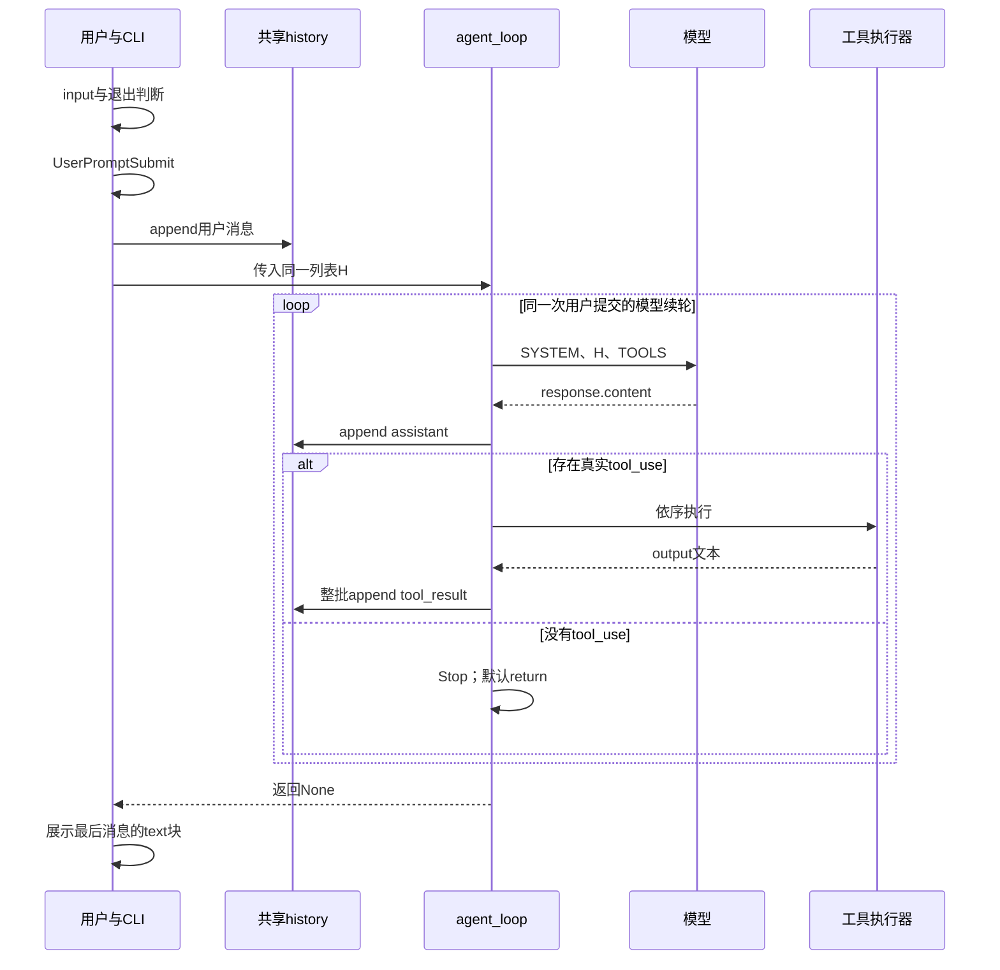
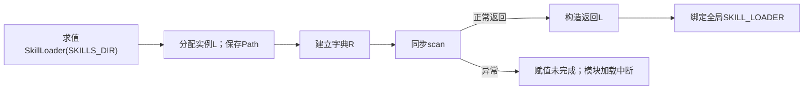
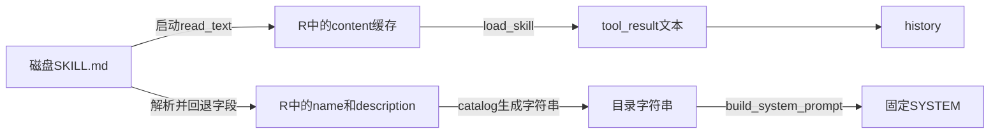
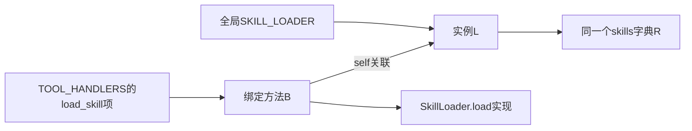
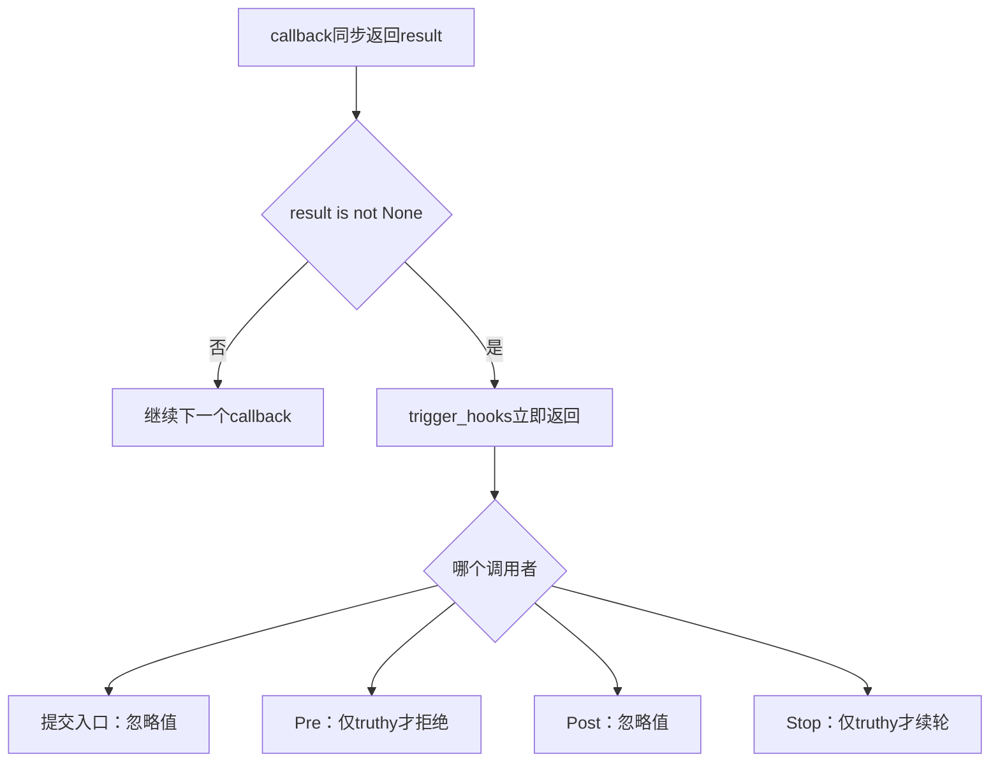
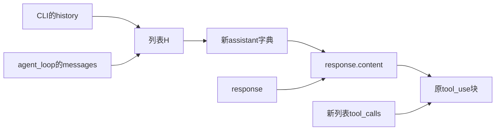
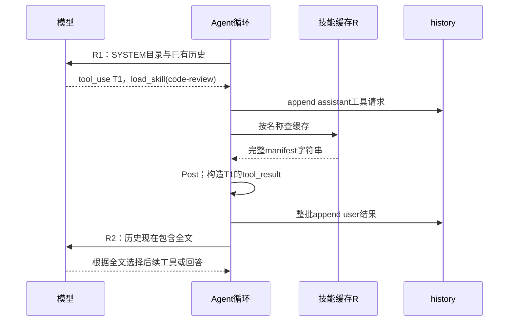
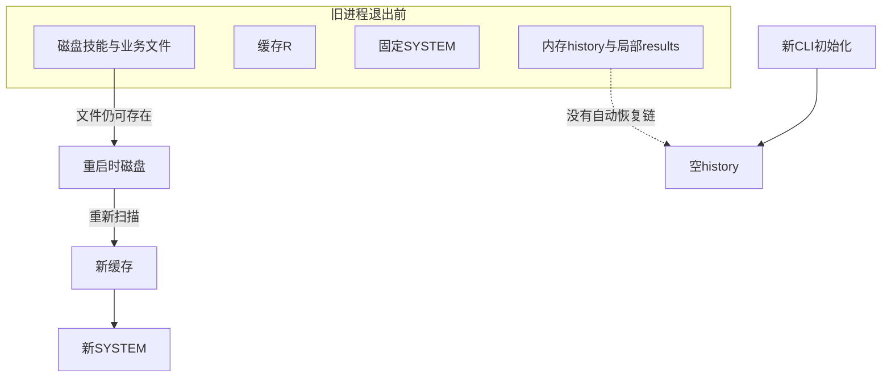

# 1. 从入口建立主线：用户循环不等于模型循环

本文以当前 [s07_skill_loading/code.py](../s07_skill_loading/code.py) 为准，按“遇到调用就下沉、返回后继续调用者下一句”的方式阅读。六个模型工具是五个基础工具加 `load_skill`；四类事件共注册五个默认 callback。源码中提到前章只是在说明教学来源，本章不会运行时加载前章代码。

最重要的时序区别是：**启动扫描已经读取并缓存所有被接受的技能全文；`load_skill` 从缓存返回。“按需”指全文何时披露给模型，不是何时首次读盘。** 下文将磁盘文件、注册表、SYSTEM、history、局部工具结果分别记账。

所有“推演”都是基于源码的静态示例，不是执行日志。本文没有导入或运行目标模块，没有读取真实密钥、调用模型、执行工具、技能脚本或用例。用例章节链接表示只读证据，不表示已运行通过。

源码：[s07_skill_loading/code.py](../s07_skill_loading/code.py) · `__main__` · L481–507。

<!-- source: s07_skill_loading/code.py:481-507 -->
```python
if __name__ == "__main__":
    print("s07: Skill Loading - catalog first, full content on demand")
    print("Enter a question, press Enter to send. Type q to quit.\n")

    history = []  # 对话历史，传给 agent_loop 后由它就地推进
    while True:   # 外层交互循环：反复读用户输入，直到用户退出
        try:
            # \001/\002 tell Readline the ANSI escapes have zero display width.
            # \001/\002 是 readline 的「不可见定界符」：夹在中间的 ANSI 转义码
            # 不占显示宽度，这样青色提示符才不会让光标错位。
            query = input("\001\033[36m\002s07 >> \001\033[0m\002")
        except (EOFError, KeyboardInterrupt):
            # Ctrl+D（EOF）或 Ctrl+C（中断）时退出。
            break
        # 输入 q / exit / 空行都退出。
        if query.strip().lower() in ("q", "exit", ""):
            break
        # 用户输入入历史之前先触发 UserPromptSubmit 钩子。
        trigger_hooks("UserPromptSubmit", query)
        history.append({"role": "user", "content": query})
        agent_loop(history)
        # 打印模型最后的文字回复（跳过 tool_use 块）。
        for block in history[-1]["content"]:
            if getattr(block, "type", None) == "text":
                print(block.text)
        # 空行，让下一条提示符清爽地开始。
        print()
```

## 1.1 从哪一句开始，历史对象由谁持有

只有直接运行此文件，`__name__ == "__main__"` 才进入这段入口；导入模块虽然跳过 CLI，却仍会执行前面的顶层初始化。两个 print 先运行，随后 `history = []` 才创建列表。因此启动提示失败时，连本段历史列表都还没创建。

`history` 位于外层 while 之前，记作列表 H。每次用户提交不会重新赋值 H：`history.append(...)`、后续模型响应和工具结果都积累在同一个对象里。调用 `agent_loop(history)` 是把这个对象引用绑定给形参 messages，不是复制，也不是让调用者等一份“新 history”返回。

`input` 返回字符串 query。`query.strip().lower()` 生成用于判断的字符串值，不原位修改 query。输入 `"  Review README.md  "` 若未命中退出分支，history 保存的仍包括前后空格；输入纯空白、大小写不同的 q／exit 则 break 外层循环，不触发提交 hook、不追加消息、不请求模型。

`try` 的语法范围只有 input 及其前面的注释。捕获 EOFError／KeyboardInterrupt 后 break 只表示在输入处退出；不表示权限确认、SDK 等待或工具执行期间发生这些异常也能回到这里。

## 1.2 两个循环的交接

正常输入后，L499 同步触发 UserPromptSubmit；只有它正常返回，L500 才构造新的 user 消息字典并追加到 H。L501 随即把 H 交给 agent_loop。调用期间外层循环停在这里，不会同时读取下一个用户问题，也没有额外线程或事件入口。

`agent_loop` 内部的 while 负责“请求模型 → 执行工具 → 回填 → 再请求”。没有真实工具调用且 Stop 不要求续轮时才 return，控制权回到 L503，而不是创建另一份会话。

`history[-1]["content"]` 在返回后才求值。CLI 只遍历最后一条消息，并打印其中带 SDK 属性 `type == "text"` 的块；它不是把每一轮 assistant 都流式展示。具体兼容边界留到第 23 章闭合。



入口虽是阅读起点，却不是进程最先执行的代码。现在暂时停在输入之前，回看模块怎样准备客户端、缓存、提示词和分发表。

# 2. 初始化顺序：导入、进程环境、路径与客户端

源码：[s07_skill_loading/code.py](../s07_skill_loading/code.py) · `顶层导入与readline初始化` · L29–50。

<!-- source: s07_skill_loading/code.py:29-50 -->
```python
import os          # 操作系统相关功能：读环境变量、判断平台
import re          # 正则表达式：危险命令模式匹配（s03 起沿用）
import subprocess  # 子进程管理：执行模型生成的 shell 命令
from pathlib import Path  # 面向对象的路径操作：拼路径、解析、判断越界

import yaml        # 解析 SKILL.md 顶部的 YAML frontmatter（--- 包裹的元数据）

# readline 提供命令行编辑能力（历史记录、方向键、退格等）。
# 它在 Unix 上通常可用，Windows 上可能不存在，所以用 try/except 包裹。
try:
    import readline
    # 以下四行是 macOS 上 libedit 库的 UTF-8 修复，让终端能正确处理中文。
    readline.parse_and_bind('set bind-tty-special-chars off')
    readline.parse_and_bind('set input-meta on')
    readline.parse_and_bind('set output-meta on')
    readline.parse_and_bind('set convert-meta off')
except ImportError:
    # 没有 readline（例如 Windows 自带 Python）直接跳过，不影响主逻辑。
    pass

from anthropic import Anthropic    # Anthropic 官方 Python SDK 的客户端类
from dotenv import load_dotenv     # 从 .env 文件加载环境变量（如 API Key）
```

## 2.1 可选导入只覆盖了哪一段

os、re、subprocess、Path 和 YAML 先导入，才进入 readline 的 try。YAML 不在可选导入保护内；如果缺少 PyYAML，程序不会走到客户端或 CLI。readline 可用时，四个 `parse_and_bind` 依序执行，前面的绑定不会因为后面的调用失败而由本章撤销。

这里只 except ImportError。readline 缺失时跳过；如果绑定抛出其他异常则外溢。不能把“readline 可选”写成“终端初始化所有失败均被忽略”。SDK 和 dotenv 的导入位于这段之后，它们失败同样不由该 except 处理。

源码：[s07_skill_loading/code.py](../s07_skill_loading/code.py) · `环境变量、WORKDIR、client、MODEL与平台提示` · L52–74。

<!-- source: s07_skill_loading/code.py:52-74 -->
```python
# override=True：即使系统里已有同名环境变量，也用 .env 里的值覆盖。
load_dotenv(override=True)

# 配了 ANTHROPIC_BASE_URL（走代理/自定义端点）时，
# 移除可能打架的 ANTHROPIC_AUTH_TOKEN，避免两种鉴权方式冲突。
if os.getenv("ANTHROPIC_BASE_URL"):
    os.environ.pop("ANTHROPIC_AUTH_TOKEN", None)

WORKDIR = Path.cwd()  # 工作目录：文件工具与权限判断的基准路径
# 技能目录：注意它是相对「当前工作目录」的，
# 所以要在包含 skills/ 的目录下运行本脚本，技能才能被扫到。
SKILLS_DIR = WORKDIR / "skills"
# 创建 Anthropic 客户端；base_url 默认官方 API，配了环境变量则走自定义端点。
client = Anthropic(base_url=os.getenv("ANTHROPIC_BASE_URL"))
# 从环境变量读模型 ID；用 [] 取值，.env 里没配会直接抛 KeyError。
MODEL = os.environ["MODEL_ID"]
# 根据操作系统告诉模型它面对的 shell 语法，避免生成错误的命令风格。
ENVIRONMENT_PROMPT = (
    "Windows: the bash tool runs through cmd.exe; use cmd.exe syntax, not Unix "
    "Bash or PowerShell syntax, and prefer dedicated file tools for file operations"
    if os.name == "nt"
    else "Unix-like: the bash tool runs the system shell"
)
```

## 2.2 环境改变在什么时点发生

`load_dotenv(override=True)` 是立即调用，不是登记待执行操作。它允许 dotenv 对已有同名环境变量作覆盖；实际发现哪个配置文件、加载什么值依赖库行为和运行环境，本文不读取真实 .env，也不假设其内容。

接着 `os.getenv("ANTHROPIC_BASE_URL")` 先求值。只有值 truthy 才执行 pop；空字符串不进入。`pop(..., None)` 的第二实参处理键不存在，不表示清除所有认证信息。若本句已删除 AUTH_TOKEN，后面客户端构造或 MODEL 读取失败，也没有恢复这项进程环境变化的代码。

## 2.3 路径定义不是目录创建

`Path.cwd()` 在模块加载时执行，得到 Path 对象 WORKDIR。`WORKDIR / "skills"` 创建另一个路径对象，不读目录、不 mkdir。文件工具的相对路径和技能查找根都由它们确定。即使通过绝对路径运行本脚本，cwd 不同仍可能扫描不同位置；不会自动改成源码所在目录。

`Anthropic(base_url=os.getenv(...))` 先求出关键字实参，再进入客户端构造。构造正常返回后才绑定 client；此处没有 `messages.create`，不能称为已经向模型提交请求。它也可能因库、参数或认证配置等初始化条件失败，具体 SDK 内部行为不由本文件证明。

下一句 `os.environ["MODEL_ID"]` 使用必需键读取；缺键则 KeyError。客户端此前可能已构造，但 MODEL、后面的 SkillLoader 单例和 CLI 尚未完成，没有显式关闭或回滚这一初始化序列的逻辑。

平台表达式先判断 `os.name == "nt"`，只求选中分支的字符串值。它告诉模型 Windows 应使用 cmd.exe 风格；真正执行 shell 的参数在 run_bash 中，字符串本身不建立沙箱或修改 cwd。

源码：[requirements.txt](../requirements.txt) · `根目录依赖声明` · L1–3。

<!-- source: requirements.txt:1-3 -->
```text
anthropic>=0.25.0
python-dotenv>=1.0.0
pyyaml>=6.0
```

依赖只给出最低版本，分别支持 SDK、dotenv、YAML 的导入；没有证明本机安装的具体版本、SDK 的重试策略或所有技能示例中的外部程序均可用。比如 PDF 技能建议的 PyMuPDF、ReportLab 和 pdftotext 不能由这三行推导为已安装。

顶层随后定义 SkillLoader 类；定义方法并不执行扫描。真正进入扫描的现场是 L179 的构造表达式。

# 3. SkillLoader 构造：实例何时才能成为全局单例

源码：[s07_skill_loading/code.py](../s07_skill_loading/code.py) · `SkillLoader.__init__` · L80–86。

<!-- source: s07_skill_loading/code.py:80-86 -->
```python
class SkillLoader:
    def __init__(self, skills_dir: Path):
        self.skills_dir = skills_dir
        # 内存索引：技能名 -> {name, description, content}
        self.skills: dict[str, dict[str, str]] = {}
        # 构造时就立刻扫描一次（下面 SYSTEM 依赖它的结果）。
        self.scan()
```

源码：[s07_skill_loading/code.py](../s07_skill_loading/code.py) · `模块级SKILL_LOADER赋值` · L177–179。

<!-- source: s07_skill_loading/code.py:177-179 -->
```python
# 模块级单例：进程启动时扫一次盘。
# 副作用是「启动后再往里加技能不会被发现」——需要重启脚本才会出现在目录里。
SKILL_LOADER = SkillLoader(SKILLS_DIR)
```

## 3.1 右侧调用完成之前，左侧名称尚未提交

执行 L179 时，先读取类和 SKILLS_DIR，进入实例构造。`self.skills_dir = skills_dir` 把传入 Path 引用保存为属性；路径不可变，不会因这一赋值自动扫描。`self.skills = {}` 建立一个新的普通字典 R，类型注解不校验以后写入的值。

L86 立即调用 `self.scan()`。构造函数在 scan 返回前不会结束；scan 的返回值不被保存，也不是向构造函数交回一个新注册表。正常的隐式 None 结束 __init__ 后，构造表达式才返回实例 L，随后赋给全局 SKILL_LOADER。

因此，第一次加载时如果 scan 在读取某个文件处失败，“实例内部可能已有部分记录”和“模块全局单例初始化成功”是不同事实。L179 尚未完成，后面的 SYSTEM、工具表和 hooks 注册不会继续，CLI 没有开始。不能把这个异常说成可被之后 execute_tool 捕获。



源码：[s07_skill_loading/code.py](../s07_skill_loading/code.py) · `SkillLoader.scan的开始阶段` · L121–130。

<!-- source: s07_skill_loading/code.py:121-130 -->
```python
    def scan(self):
        # 扫描技能目录，重建内存索引。
        self.skills.clear()
        if not self.skills_dir.exists():
            # 没有 skills/ 目录不是错误，只是「零个技能」。
            return

        skills_root = self.skills_dir.resolve()
        # 约定：每个技能是 skills/<name>/SKILL.md，sorted 保证顺序稳定。
        for manifest in sorted(self.skills_dir.glob("*/SKILL.md")):
```

## 3.2 clear 修改原对象，不是建立候选快照

`self.skills.clear()` 直接清空 R。若有其他 Python 代码持有 R 的引用，它会立即看到清空；这里没有先建临时表、扫完再替换的提交阶段。

`exists()` 在 clear 之后。目录不存在则 return 当前 scan，构造函数继续结束，最终得到“成功构造但零技能”的实例。没有目录创建，不扫描父目录或提供默认技能，更没有请求模型。普通短问答因此不因定义路径而落盘。

若是已有实例手动重扫，先前记录同样先被清空：目录被删除后重扫得到空缓存，而不是保留旧值。该方法可从 Python 调用，但当前 CLI 和六工具中没有“刷新”入口。

## 3.3 初次失败和重扫失败的状态不是一回事

以下是静态推演：假定排序后有 a、b、c 三份 manifest，a、b 可读，c 解码失败。

| 时点 | 当前实例里的R | 全局名称／调用方 | 后续 |
|---|---|---|---|
| 初次构造，clear后 | 空 | L179 尚未完成 | 开始枚举 |
| 已处理a、b | a、b | 仍未完成全局赋值 | 读取c |
| c失败 | 部分新记录 | 初次构造抛出 | SYSTEM和CLI未建立 |
| 既有实例重扫到c失败 | a、b；旧缓存已丢弃 | 原实例仍被既有引用持有 | 异常返回给手动调用者 |

程序没有保留旧字典副本或恢复已清内容的逻辑。单线程只说明本 CLI 不并行执行 scan，不等于目录在扫描期间不会被其他进程修改。

接下来 scan 计算真实根目录并完成候选排序，进入单文件循环；它并不是每个 load_skill 才走一次。

# 4. 枚举与路径：先检查，再读全文，再解析

源码：[s07_skill_loading/code.py](../s07_skill_loading/code.py) · `SkillLoader.scan的单文件进入条件` · L128–137。

<!-- source: s07_skill_loading/code.py:128-137 -->
```python
        skills_root = self.skills_dir.resolve()
        # 约定：每个技能是 skills/<name>/SKILL.md，sorted 保证顺序稳定。
        for manifest in sorted(self.skills_dir.glob("*/SKILL.md")):
            # 两道检查：必须是真实文件（排除目录/坏链接），
            # 且解析后的路径仍在 skills 目录内（防符号链接指向外部读敏感文件）。
            if (not manifest.is_file()
                    or not manifest.resolve().is_relative_to(skills_root)):
                continue
            content = manifest.read_text(encoding="utf-8")
            metadata, body = self.parse_frontmatter(content)
```

## 4.1 排序在循环之前完成

`self.skills_dir.glob("*/SKILL.md")` 按这一层路径模式枚举：直接子目录里的 manifest 被考虑，嵌套 references、scripts 及更深层 SKILL.md 不会因此递归注册。它与基础 glob 工具不是同一段实现。

`sorted(...)` 消费候选并得到新的排序列表，然后 for 才将第一个 Path 绑定给 manifest。排序按 Path 的比较语义，不按 frontmatter 名称、创建时间或业务优先级；大小写等细节遵循平台和 Python 路径语义。排序并不冻结后面读取的文件内容。

## 4.2 两个 not 与 or 的实际短路

先调用 `manifest.is_file()`，再取反。若“不是文件”成立，or 已为真，不调用后半段 resolve，直接 continue 单文件循环。若是文件，才解析真实路径，并判断它能否相对 skills_root 表示；不在根内则 continue。

continue 跳到下一候选，不会执行本轮 read_text 或 parser，也不是结束整次扫描。已经缓存的其他技能保留。

路径检查分三层事实：模式命中了一个名字、这个名字当前指向文件、这个文件的真实路径当前位于解析后的技能根内。它们都不证明文件内容可信，也不证明后续打开时链接或目标未变化。

## 4.3 技能根与工作区根不可混同

skills_root 来自 skills_dir.resolve，代码没有额外检查 `skills_root.is_relative_to(WORKDIR)`。静态推演如下：

| 布局 | 当前检查的结果含义 |
|---|---|
| 普通skills根中的普通manifest | 真实路径在该根内，可继续读取 |
| manifest链接到skills根外、但仍在工作区内 | 仍越过技能根，应跳过 |
| manifest链接到该技能根内其他文件 | 可能接受，未要求必须是原目录自己的内容 |
| skills目录本身链接到工作区外，manifest在那个真实根内 | 没有独立的工作区根拒绝条件 |

这是源码范围语义，不是已创建链接得到的运行记录。不同 pathlib 版本对部分 OS 错误是返回 False 还是抛出异常，不能只凭这几行统一断言；本方法确实没有围住这些调用的 try。

专项用例的相关连续片段如下：

源码：[tests/test_skill_loading.py](../tests/test_skill_loading.py) · `test_skill_frontmatter_falls_back_for_invalid_or_empty_metadata的越界链接断言` · L174–185。

<!-- source: tests/test_skill_loading.py:174-185 -->
```python
            outside = root / "outside-skill.md"
            outside.write_text("# External skill\n\nDO_NOT_LOAD")
            linked_dir = root / "skills" / "linked-skill"
            linked_dir.mkdir()
            (linked_dir / "SKILL.md").symlink_to(outside)
            lesson = load_lesson(root, lesson_path)
            registry = (lesson.SKILL_LOADER.skills if hasattr(lesson, "SKILL_LOADER")
                        else lesson.SKILL_REGISTRY)
            assert registry["fallback-skill"]["description"] == "Body description"
            assert registry["empty-skill"]["description"] == ""
            assert registry["typed-fallback"]["description"] == "Typed fallback"
            assert "linked-skill" not in registry
```

这里 outside 文件位于临时工作区内、skills 目录外；断言 linked-skill 不注册，支持的是“技能根范围”而不是“只能拒绝工作区外路径”。该测试外层遍历 SKILL_LESSONS，包含 s07 与 s15；不因此把 s15 的其他机制归给本章。创建符号链接还依赖宿主平台能力，本文没有运行它。

## 4.4 真正的全文读取已经发生

通过检查后，L136 执行 `read_text(encoding="utf-8")`。完整字符串形成后才绑定给 content；读取、解码失败不会进入下一句解析，也不会写入本轮记录。此前候选的缓存不会自动清除或回滚。

UTF-8 明确了字符解码，但不代表字节原样保留：文本读取可能做通用换行转换，之后缓存的是这个读取结果，不是原始 bytes。L137 将同一个字符串交给 parser；parser 正常返回之前，metadata/body 的本轮赋值尚未完成。现在沿这条调用下沉。

# 5. frontmatter：从行列表走到元数据和正文

源码：[s07_skill_loading/code.py](../s07_skill_loading/code.py) · `SkillLoader.parse_frontmatter的分隔符阶段` · L88–107。

<!-- source: s07_skill_loading/code.py:88-107 -->
```python
    @staticmethod
    def parse_frontmatter(text: str) -> tuple[dict, str]:
        # 解析 Markdown 顶部的 YAML frontmatter，返回 (元数据字典, 正文)。
        # 各种「不合法」的情况都退化成空字典，绝不抛异常中断启动。
        # keepends=True 保留换行符，方便后面按原样拼接回来。
        lines = text.splitlines(keepends=True)
        # 第一行不是 --- 就没有 frontmatter：元数据为空，整段都算正文。
        if not lines or lines[0].rstrip("\r\n") != "---":
            return {}, text

        # 找到第二个 --- 作为结束标记（从第 1 行开始找，跳过开头那行）。
        # next(..., None) 表示找不到就返回 None。
        closing_index = next(
            (index for index, line in enumerate(lines[1:], start=1)
             if line.rstrip("\r\n") == "---"),
            None,
        )
        if closing_index is None:
            # 只有开头 --- 没有结尾 ---（文件被截断等）：当作没有 frontmatter。
            return {}, text
```

## 5.1 输入对象、行列表和提前返回

调用者停在 scan 的 L137，实参是刚完整读取的 content 字符串。staticmethod 不隐式传 self，只将 text 绑定到该字符串；解析过程中不修改原字符串。

`splitlines(keepends=True)` 先建立新的 lines 列表，包含带行结束信息的字符串。`not lines or ...` 先判断空列表：空文件时直接 return，不访问 lines[0]。非空才取首行，并只去掉末尾 CR／LF 后与精确的 `"---"` 比较。

因此 `"---not frontmatter"`、前置空行、带 BOM 的开头、`"--- "` 都不是被认可的开始行。普通 CRLF 的行结束字符则可被移除。无开始标记时返回一个新空字典和原 text，不尝试 YAML，也不剥去正文空白。

## 5.2 生成器查找不是一次匹配所有分隔符

`lines[1:]` 先形成不含第一行的浅切片，enumerate 从 1 编号，使找到的位置对应原 lines 下标。生成器每次取一行，只删除该行末尾 CR／LF，再判断是否精确等于 `"---"`。

`next(..., None)` 逐项推进，遇到首个满足条件的索引就停止，不验证后面还有多少分隔符。它不会把带缩进的 `"  ---"` 当作结束行，因此 YAML 块标量里的缩进分隔符可以留在 frontmatter 中。这里仍是行规则，不是先用 YAML 语法判断字符串是否处于标量内部。

没有结束行时 closing_index 为 None，返回空元数据和原全文。已有开头但缺结尾不是抛错误的分支，正文第一行仍可能是 `"---"`；后面的描述回退不能自动找到真正 Markdown 标题。

源码：[s07_skill_loading/code.py](../s07_skill_loading/code.py) · `SkillLoader.parse_frontmatter的YAML与返回阶段` · L109–119。

<!-- source: s07_skill_loading/code.py:109-119 -->
```python
        frontmatter = "".join(lines[1:closing_index])          # 两个 --- 之间的内容
        body = "".join(lines[closing_index + 1:]).strip()      # 结束标记之后的正文
        try:
            metadata = yaml.safe_load(frontmatter) or {}
        except yaml.YAMLError:
            # YAML 写错了也只是解析失败，不影响技能被加载（描述会退回正文首行）。
            metadata = {}
        if not isinstance(metadata, dict):
            # 例如 frontmatter 只有一个字符串，就不是字典，统一按空处理。
            metadata = {}
        return metadata, body
```

## 5.3 先形成两段字符串，之后才进入 YAML try

`lines[1:closing_index]` 切片后 join 得到 frontmatter；`lines[closing_index + 1:]` 切片、join、strip 得到 body。strip 去掉两端空白，包括正文开头缩进，不只是“移除分隔符后的空行”。这些都位于 YAML try 之前。

`safe_load` 可能返回 dict、列表、字符串、数值或 None。`or {}` 判断解析结果的真假，不做类型转换：None、False、0、空列表、空字符串等先被替换为空字典；truthy 的列表或字符串随后在 isinstance 检查处被替换。保留下来的 dict 也不因此具有 name、description 等必需字段。

YAMLError 被捕获后 metadata 变为空字典，但 body 已按有结束标记的路径提取，不退回原全文。这与“完全没找到分隔符”的返回不同。

| 输入／失败点 | 返回的metadata | 返回的body | 后续scan |
|---|---|---|---|
| 空文件 | 新空字典 | 原空字符串 | 名称退回目录，描述为空 |
| 无合法开头／无结束行 | 新空字典 | 原全文 | 从原全文首行回退描述 |
| 合法边界、坏YAML | 空字典 | 分隔符之后且strip后的正文 | 使用字段回退，仍可缓存全文 |
| 合法边界、非dict元数据 | 空字典 | 同上 | 同上 |
| 合法dict | 解析字典 | 同上 | 继续字段提取 |
| try外错误或非YAMLError | 没有正常返回 | 无本轮正常返回值 | 异常沿scan外溢 |

safe_load 不是任意 Python 对象执行器，但“安全加载 YAML”不认证文档作者、不验证技能指令、不建立模型信任隔离。注释中的“绝不抛异常”只能理解为这里为常见 YAML 错误提供了回退，不能覆盖整个调用链。

## 5.4 具体断言支持哪种边界

源码：[tests/test_skill_loading.py](../tests/test_skill_loading.py) · `test_skill_frontmatter_requires_standalone_delimiters` · L137–155。

<!-- source: tests/test_skill_loading.py:137-155 -->
```python
def test_skill_frontmatter_requires_standalone_delimiters() -> None:
    invalid_opening = "---not frontmatter\n---\n# Body"
    block_scalar = """---
name: demo
description: |
  before
  ---
  after
---
# Body
"""
    for lesson_path in SKILL_LESSONS:
        with tempfile.TemporaryDirectory() as tmp:
            lesson = load_lesson(Path(tmp), lesson_path)
            assert parse_frontmatter(lesson, invalid_opening) == ({}, invalid_opening)
            for text in (block_scalar, block_scalar.replace("\n", "\r\n")):
                metadata, body = parse_frontmatter(lesson, text)
                assert metadata["description"] == "before\n---\nafter\n"
                assert body == "# Body"
```

该用例遍历的 SKILL_LESSONS 是 s07 与 s15。它要求无效开头原样返回，并对同一块标量分别使用 LF、CRLF，断言 description 包含中间 `---`、body 为 `"# Body"`。它没有证明所有坏 YAML、BOM、读取错误或异常资源消耗都会被捕获。

另一个用例的连续返回断言是：

源码：[tests/test_skill_loading.py](../tests/test_skill_loading.py) · `非mapping YAML的回退断言` · L187–191。

<!-- source: tests/test_skill_loading.py:187-191 -->
```python
            metadata, body = parse_frontmatter(
                lesson, "---\n- not\n- a mapping\n---\nBody"
            )
            assert metadata == {}
            assert body == "Body"
```

现在 parser 正常返回二元组，控制权回 scan L137，解包得到 metadata、body；L139 才开始提取名称。原 content 仍在，未被去掉 frontmatter，当前记录也仍未插入 R。

# 6. 字段回退、描述清洗与缓存写入

源码：[s07_skill_loading/code.py](../s07_skill_loading/code.py) · `SkillLoader.scan的字段提取与记录写入` · L138–156。

<!-- source: s07_skill_loading/code.py:138-156 -->
```python
            # 技能名：优先用 frontmatter 里的 name，缺失则退回目录名。
            raw_name = metadata.get("name")
            name = raw_name.strip() if isinstance(raw_name, str) else ""
            name = name or manifest.parent.name
            # 描述：优先用 frontmatter 里的 description，
            # 缺失则退回正文第一行（通常是 # 标题）。
            raw_description = metadata.get("description")
            description = (raw_description.strip()
                           if isinstance(raw_description, str) else "")
            description = description or body.split("\n", 1)[0]
            # 清洗描述：去掉开头的 "# " 井号标记，并把换行/多余空格压成单个空格，
            # 这样塞进系统提示词时永远是一行干净的文字。
            description = " ".join(str(description).lstrip("# ").split())
            self.skills[name] = {
                "name": name,
                "description": description,
                # 存的是**整个文件原文**（含 frontmatter），load 时原样交给模型。
                "content": content,
            }
```

## 6.1 名称不是对任意值强行str

`metadata.get("name")` 在键缺失时返回 None，显式 YAML null 同样是 None。条件表达式先判断 isinstance；只有字符串才 strip，列表、整数、布尔值都走空字符串分支，而不是直接转换为文本名称。

下一句 `name or manifest.parent.name` 仅在 name 假值时取目录名。因此非空元数据名称可以与目录名完全不同；`" code-review "` 变成 `"code-review"`，纯空白则回退。普通字符串名称区分大小写，内部空白和换行没有被统一压平。

description 同样先进行字符串类型分支。条件成立时 strip，之后仅当 description 假值才执行 `body.split("\n", 1)[0]`。这个 maxsplit 限制只形成至多两个片段，不是寻找第一个非空标题；body 来自无分隔符分支时，前导空行也可能令回退为空。

## 6.2 清洗表达式到底删掉什么

`str(description).lstrip("# ").split()` 从左到右形成中间值。此时默认路径中的 description 已是字符串，str 不是用于给非字符串元数据兜底。

lstrip 的参数是字符集合，反复去掉开头的 # 与普通空格，不要求恰好 `"# "`：`"###  Review"` 也会去掉这些前缀字符。这不是 Markdown 解析，其他标题语法、正文结构和语义均不验证。

无参数 split 按各类空白分词，join 用单个普通空格连接，因此多行 YAML description 被压成一行。name 没有这步，不能从“描述总是一行”推导“整个目录所有字段已安全清洗”。

以下均为静态推演：

| 元数据 | 有效name | description处理 |
|---|---|---|
| name缺失，description缺失 | 目录名 | body首行，再清洗 |
| name为null或列表 | 目录名 | 独立按描述规则处理 |
| name为纯空白字符串 | 目录名 | 不影响描述分支 |
| description为列表或数字 | 独立按名称规则处理 | 先置空，再退回body首行 |
| description为多行字符串 | 同上 | strip后压成单行 |
| 文件为空 | 目录名 | 空字符串仍允许注册 |

对应回退用例建立了 null、空正文和列表元数据样本，其结果断言如下：

源码：[tests/test_skill_loading.py](../tests/test_skill_loading.py) · `元数据回退与链接拒绝的结果断言` · L179–185。

<!-- source: tests/test_skill_loading.py:179-185 -->
```python
            lesson = load_lesson(root, lesson_path)
            registry = (lesson.SKILL_LOADER.skills if hasattr(lesson, "SKILL_LOADER")
                        else lesson.SKILL_REGISTRY)
            assert registry["fallback-skill"]["description"] == "Body description"
            assert registry["empty-skill"]["description"] == ""
            assert registry["typed-fallback"]["description"] == "Typed fallback"
            assert "linked-skill" not in registry
```

断言支持具体样本的描述回退，不是对所有类型和名称的统一验证。尤其列表元数据不是被保存为 `"[bad]"`，而是回退到正文。

## 6.3 记录先在右侧形成，然后才写进共享字典

L151 的赋值不是逐字段往 R 增量写入。右侧先构造含 name、description、content 的新记录字典，然后以 name 为键存入 self.skills。之前的 raw_name、body、description 都是本轮局部绑定；如果在这些计算阶段失败，本轮记录没有提交，但前面候选的记录仍在。

content 是 L136 得到的全文字符串，包含 YAML 和 Markdown。保存它不重新拼接 parser 结果，因此 parser 对 body 的 strip 不会改变 load_skill 返回内容。文本读取的换行转换与“把正文strip后返回”是两件事。

记录没有 manifest 路径、mtime、版本号或内容摘要。目录名称不是查找键的必要条件，模型拿到逻辑名称后也没有自动得到源路径。

## 6.4 同名覆盖不是版本选择

静态设例：按 Path 排序先遇到 `a/SKILL.md`，再遇到 `z/SKILL.md`，二者 name 都是 code-review；中间还有一个名为 pdf 的记录。

```text
处理a后：R = {code-review: F1}
处理pdf后：R = {code-review: F1, pdf: P1}
处理z后：R = {code-review: F2, pdf: P1}
```

最后一次赋值替换旧记录，不合并正文、不比较版本、也不报重名。已有键的插入位置不改变，因此目录可能仍在 code-review 原来的位置，却对应 z 的新内容。这个结论来自普通 dict 赋值语义，不是专项用例已经验证的重名策略。

每轮结束继续下一 manifest。所有候选结束，scan 隐式返回 None；__init__ 随后结束，L179 才绑定完整实例。接下来构造目录和 SYSTEM。

# 7. catalog与SYSTEM：缓存视图如何变成固定字符串

源码：[s07_skill_loading/code.py](../s07_skill_loading/code.py) · `SkillLoader.catalog` · L158–165。

<!-- source: s07_skill_loading/code.py:158-165 -->
```python
    def catalog(self) -> str:
        # 生成给系统提示词用的目录：每行一个「- 名字: 描述」。
        if not self.skills:
            return "(no skills found)"
        return "\n".join(
            f"- {skill['name']}: {skill['description']}"
            for skill in self.skills.values()
        )
```

## 7.1 字典迭代到目录文本的返回链

调用者是 build_system_prompt 的 f-string 表达式。非空检查先执行：R 为空返回占位字符串，不遍历记录。否则创建生成器，join 消费 self.skills.values，依次读取各记录的 name 和 description，形成一条条目录行。

values 是字典视图，不是先复制出来的注册表快照；join 最终得到一个字符串，但没有把 content 拼进目录。默认单线程中没有内部并行修改者；这不构成对外部代码修改或手动重扫的一致性承诺。

目录没有再按名称排序，其顺序继承注册表插入顺序。描述有一行清洗，不代表名字和长度也受限；一个巨大 description 或大量技能仍会形成巨大目录。

源码：[s07_skill_loading/code.py](../s07_skill_loading/code.py) · `build_system_prompt与SYSTEM赋值` · L182–195。

<!-- source: s07_skill_loading/code.py:182-195 -->
```python
def build_system_prompt() -> str:
    # 系统提示词 = 身份 + 环境说明 + 固定的技能目录 + 使用说明。
    # 这份「目录」就是模型知道有哪些技能的唯一途径。
    return (
        f"You are a coding agent at {WORKDIR}. Environment: {ENVIRONMENT_PROMPT}. "
        "Use tools to solve tasks. "
        "Act, don't explain.\n\n"
        f"Skills available:\n{SKILL_LOADER.catalog()}\n\n"
        "Use load_skill to read the full instructions when a skill applies."
    )


# 启动时算一次并存下来：之后每轮请求都复用同一份提示词。
SYSTEM = build_system_prompt()
```

调用现场是模块 L195。先执行 build_system_prompt，在构造返回字符串时依次插入 WORKDIR、ENVIRONMENT_PROMPT 和 catalog 返回文本；只有完整字符串形成，函数才 return，之后绑定全局 SYSTEM。

SYSTEM 是不可变字符串，不是持有 R 并“每次显示最新目录”的对象。之后单独清空或重扫 R 不会修改它；工具改写文件也不会修改它。每次主请求引用的仍是当时生成的字符串值。



## 7.2 目录小与全文缺席，都有适用条件

[s07 README](../s07_skill_loading/README.zh.md) 描述“目录进 system、全文进 tool_result”，与生产函数一致；源码开头“全文留在磁盘上，用的时候再读”的注释若理解为 I/O 行为，则与 scan 的 read_text 和 load 的字典查询不一致。正确区分是：进程已读全文，模型初始只收到目录。

catalog 不主动加入完整 content，但描述回退可以取正文首行。不能说“任何正文字节绝不进入 system”；全文很短、描述很长或名称本身携带文本时，更不能把目录视为固定长度摘要。

专项用例的关键断言是：

源码：[tests/test_skill_loading.py](../tests/test_skill_loading.py) · `test_catalog_stays_small_and_load_skill_returns_the_full_file的断言` · L87–93。

<!-- source: tests/test_skill_loading.py:87-93 -->
```python
        assert lesson.SKILL_LOADER.catalog() == (
            "- code-review: Review code for bugs, regressions, and missing tests."
        )
        assert "code-review" in lesson.SYSTEM
        assert "UNIQUE_FULL_INSTRUCTION" not in lesson.SYSTEM
        assert lesson.SKILL_LOADER.load("code-review") == manifest
        assert lesson.TOOL_HANDLERS["load_skill"]("code-review") == manifest
```

该 fixture 把 UNIQUE_FULL_INSTRUCTION 放在正文后部、使用明确 description，所以断言它不在 SYSTEM，并同时要求 load 和绑定 handler 返回完整 manifest。这证明此样本下的披露位置；没有测量全局目录上限，也没有执行一次真实模型请求。

## 7.3 文本进入的位置不等于执行权限

name、description 直接经 f-string 进入 system，没有目录专用转义或内容来源认证。yaml.safe_load 限定 YAML 加载方式，不保证文本对模型没有误导作用。

完整技能之后作为普通 tool_result 进入 history，不会被本地升级成 SYSTEM，也没有授予新的 OS 权限。反过来，注释中“目录是模型知道技能的唯一途径”也要限定为默认启动发现渠道：用户可告诉模型名称，普通 read_file 同样可读取技能文件。

catalog 返回 build_system_prompt，后者返回模块 L195，初始化继续定义基础函数、创建工具表和登记 hooks。现在下沉说明这些对象是如何连接的。

# 8. 六工具声明、绑定方法与四类事件

源码：[s07_skill_loading/code.py](../s07_skill_loading/code.py) · `TOOLS与TOOL_HANDLERS` · L276–300。

<!-- source: s07_skill_loading/code.py:276-300 -->
```python
TOOLS = [
    {"name": "bash", "description": "Run a shell command.",
     "input_schema": {"type": "object", "properties": {"command": {"type": "string"}}, "required": ["command"]}},
    {"name": "read_file", "description": "Read file contents.",
     "input_schema": {"type": "object", "properties": {"path": {"type": "string"}, "limit": {"type": "integer"}}, "required": ["path"]}},
    {"name": "write_file", "description": "Write content to a file.",
     "input_schema": {"type": "object", "properties": {"path": {"type": "string"}, "content": {"type": "string"}}, "required": ["path", "content"]}},
    {"name": "edit_file", "description": "Replace exact text in a file once.",
     "input_schema": {"type": "object", "properties": {"path": {"type": "string"}, "old_text": {"type": "string"}, "new_text": {"type": "string"}}, "required": ["path", "old_text", "new_text"]}},
    {"name": "glob", "description": "Find files matching a glob pattern; ** matches recursively.",
     "input_schema": {"type": "object", "properties": {"pattern": {"type": "string"}}, "required": ["pattern"]}},
    {"name": "load_skill", "description": "Load the full SKILL.md content by skill name.",
     "input_schema": {"type": "object", "properties": {"name": {"type": "string"}}, "required": ["name"]}},
]

# 分发表：load_skill 直接挂载 SkillLoader 的**绑定方法** load，
# 因为它签名恰好是 (name) -> str，与工具处理函数的约定完全吻合。
TOOL_HANDLERS = {
    "bash": run_bash,
    "read_file": run_read,
    "write_file": run_write,
    "edit_file": run_edit,
    "glob": run_glob,
    "load_skill": SKILL_LOADER.load,
}
```

## 8.1 声明和执行是两套对象

TOOLS 是含六个字典的列表，告知模型名称、用途和输入形状；TOOL_HANDLERS 是另一张字典，执行时按名称寻找 Python callable。它们没有运行时自动互相生成或校验，默认源码只是手工写成一致。

| 模型工具 | Python处理器 | 额外状态／默认参数 |
|---|---|---|
| bash | run_bash | 使用WORKDIR，120秒超时 |
| read_file | run_read | limit默认None |
| write_file | run_write | 使用WORKDIR |
| edit_file | run_edit | 仅替换首处 |
| glob | run_glob | 使用WORKDIR，最多展示200项再加提示 |
| load_skill | SKILL_LOADER.load | 绑定现有SkillLoader实例 |

本章六工具都有 handler，不是 s08 那种名称特判工具。它们是模型可选分支，不是每个请求必经的六个步骤。schema 的 required 与 type 没有在 execute_tool 内变成本地验证器；也未声明统一禁止额外属性的执行规则。

专项工具集合断言：

源码：[tests/test_skill_loading.py](../tests/test_skill_loading.py) · `test_s07_exposes_only_base_tools_and_load_skill` · L123–134。

<!-- source: tests/test_skill_loading.py:123-134 -->
```python
def test_s07_exposes_only_base_tools_and_load_skill() -> None:
    with tempfile.TemporaryDirectory() as tmp:
        lesson = load_lesson(Path(tmp))

        assert [tool["name"] for tool in lesson.TOOLS] == [
            "bash",
            "read_file",
            "write_file",
            "edit_file",
            "glob",
            "load_skill",
        ]
```

它要求名称及顺序恰为这六个；临时根没有技能时仍能加载模块。它没有断言缺失目录从未被创建，后者应由 scan 的代码路径静态确认，而不是扩充测试结论。

## 8.2 为什么调用方法时不用显式传self

`SKILL_LOADER.load` 在构造分发表时就取到绑定方法，讲解上记作 B。B 关联实例 L 和方法实现；以后 `B(name=...)` 相当于把该实例隐式交给 self，再绑定 name。不是将字符串 `"SKILL_LOADER.load"` 保存下来等待 eval。



因此同实例 scan 改 R，B 会读到改变后的 R；仅把全局 SKILL_LOADER 改绑到另一实例，并不会改 B 保存的实例关联。默认 CLI 没有执行这种改绑，相关边界在第 24 章作静态说明。

源码：[s07_skill_loading/code.py](../s07_skill_loading/code.py) · `HOOKS、register_hook与trigger_hooks` · L307–321。

<!-- source: s07_skill_loading/code.py:307-321 -->
```python
HOOKS = {"UserPromptSubmit": [], "PreToolUse": [], "PostToolUse": [], "Stop": []}


def register_hook(event: str, callback):
    # 注册：把回调追加到对应事件的列表。
    HOOKS[event].append(callback)


def trigger_hooks(event: str, *args):
    # 触发：依次调用回调；返回非 None 表示拦截，立即停止并返回该结果。
    for callback in HOOKS[event]:
        result = callback(*args)
        if result is not None:
            return result
    return None
```

## 8.3 列表登记没有执行callback

四个 [] 分别创建，不共享一个列表。register_hook 先按 event 取得列表再 append callback，保存的是函数引用；不知道的事件键会失败，没有动态创建事件。默认调用使用已存在键。

trigger_hooks 接收事件名和位置实参元组，按列表顺序同步调用 callback。任何非 None 结果立即 return，不再遍历剩余 callback；全部返回 None 时才到函数末尾 return None。这里没有 try、隔离线程或自动补偿。

源码：[s07_skill_loading/code.py](../s07_skill_loading/code.py) · `五次默认hook注册` · L410–414。

<!-- source: s07_skill_loading/code.py:410-414 -->
```python
register_hook("UserPromptSubmit", context_inject_hook)
register_hook("PreToolUse", permission_hook)
register_hook("PreToolUse", log_hook)
register_hook("PostToolUse", large_output_hook)
register_hook("Stop", summary_hook)
```

默认事件映射是：UserPromptSubmit→context，PreToolUse→permission后log，PostToolUse→large-output，Stop→summary。这些函数先被定义，注册时不打印 cwd、不询问权限、不统计历史。至此顶层准备完成；直接运行才进入第 1 章 CLI。下面回到用户提交那一句。

# 9. 用户提交：hook短路不等于入口拒绝

源码：[s07_skill_loading/code.py](../s07_skill_loading/code.py) · `context_inject_hook` · L385–389。

<!-- source: s07_skill_loading/code.py:385-389 -->
```python
def context_inject_hook(query: str):
    """UserPromptSubmit: log the working directory."""
    # 用户输入送进 LLM 前触发（这里只是打印工作目录）。
    print(f"\033[90m[HOOK] UserPromptSubmit: working in {WORKDIR}\033[0m")
    return None
```

调用现场重新回到 CLI L499，query 来自 input，H 仍保存此前会话。trigger_hooks 把同一字符串传给 context_inject_hook，后者只构造并打印含 WORKDIR 的日志，返回 None；未使用 query 生成新消息、未修改 SYSTEM，也没有把 cwd 作为额外上下文注入模型。

默认只有这个提交 callback，因此正常返回后 trigger_hooks 遍历结束，回到 L499 的调用点。入口没有把返回值赋给变量，也没有 if 检查，直接执行 L500 append 用户消息，再进入 L501。

## 9.1 三条提交路径的状态账本

| callback行为 | 终端 | history中的本次user | 模型请求 | 入口接下来 |
|---|---|---|---|---|
| 默认打印并返回None | cwd日志已打印 | 尚未追加，随后追加 | 尚未发出 | L500、L501 |
| 扩展callback返回非None | 已发生的打印不撤销 | 仍会追加 | 之后才发出 | 返回值被忽略 |
| callback或print抛异常 | 可能已有部分日志 | 未追加 | 未发出 | 异常外溢，L500不执行 |

“非 None 表示拦截”的注释只描述触发器停止后续 callback，不自动赋予每个调用者相同业务语义。入口忽略返回值，所以不能称为提交授权机制。

## 9.2 非None与truthy在四个现场的不同用途

下面静态表假定其他 callback 都返回 None、handler 存在且不抛异常；False／空字符串由扩展 callback 返回，不是默认权限函数当前使用的出口。

| 某callback返回 | trigger_hooks是否继续后续callback | UserPromptSubmit调用者 | execute_tool的Pre调用者 | Stop调用者 |
|---|---|---|---|---|
| None | 继续 | 忽略返回值并继续提交 | 继续handler路径 | 不要求续轮 |
| False | 立即停止 | 仍继续提交 | blocked为假，仍执行handler | force为假，return |
| 空字符串 | 立即停止 | 仍继续提交 | 同上 | 同上 |
| 非空拒绝文本等truthy值 | 立即停止 | 仍继续提交 | 提前return拒绝文本 | 追加为user并continue |

所以扩展的第一个 Pre callback 返回 False，可能导致后面的 log 不执行，却没有拒绝工具。默认 permission 的返回只有 None 或非空拒绝文本，不会自行进入这个特殊组合。

Post 也使用同一触发器：非 None 只停止后续 Post callback；execute_tool 没有使用其返回值替换 output。异常则不是返回值，无论真或假都谈不上，直接沿调用栈传播。



正常路径继续 L500：创建一条新消息字典并写入原列表 H。接下来 agent_loop 接收 H；如果随后 SDK 抛异常，本次用户消息已经在历史里，与本章 callback 失败时的状态不同。

# 10. 主请求：发送的是固定提示词与同一份会话

源码：[s07_skill_loading/code.py](../s07_skill_loading/code.py) · `agent_loop的请求阶段` · L438–449。

<!-- source: s07_skill_loading/code.py:438-449 -->
```python
def agent_loop(messages: list):
    # messages 是对话历史，函数就地修改它、无返回值。
    while True:
        # 【第 1 步】把对话历史 + 全部工具（含 load_skill）发给模型。
        # system=SYSTEM 里已经带着技能目录，所以模型知道「有哪些技能可加载」。
        response = client.messages.create(
            model=MODEL,
            system=SYSTEM,
            messages=messages,
            tools=TOOLS,
            max_tokens=8000,
        )
```

## 10.1 进入函数后，实参如何绑定

调用者停在 CLI L501。形参 messages 直接指向 H，不做 `list(messages)` 或 deepcopy；函数也不保存一份返回历史。while 每次进入都会重新执行 SDK 调用，但 SYSTEM、TOOLS 等对象没有在循环中重建。

调用表达式先取得 `client.messages.create`，再求出各关键字实参；只有方法和实参求值成功才真正调用。MODEL 是环境读取结果，system 是先前生成的字符串，messages 是 H，tools 是六声明列表，8000 是字面整数。

| 输入 | Python侧对象与来源 | 模型可见内容 |
|---|---|---|
| model | 模块MODEL字符串 | 选择的模型标识 |
| system | 固定SYSTEM字符串 | Agent指令、环境说明、技能目录 |
| messages | CLI的原历史列表H | 历次用户、assistant、工具结果 |
| tools | TOOLS列表 | 名称、用途和输入schema |
| max_tokens | 整数8000 | 单次输出预算参数 |

R、L、绑定方法 B 都没有被直接交给模型。没有 load_skill 结果时，即便进程缓存了所有全文，模型也不会仅因 Python 缓存存在而看到它们。

SDK 怎样复制、规范化、序列化和发送这些对象，不由这段本地代码证明。这里可以确认的是调用方没有主动复制 H，也没有主动将历史 SDK 块转成纯字典或纯文本。

## 10.2 8000没有约束哪些状态

max_tokens 约束该次响应输出，不是总输入长度、会话累计 token、费用或循环次数上限。TOOLS、SYSTEM 和越来越长的 H 都要参与请求，没有本地预算估算、压缩、去重或溢出恢复分支。

第一次普通问答若没有技能目录，SYSTEM 仍包含占位文本；模型不需要先调用 load_skill 才能回答。如果响应没有工具且默认 Stop 正常完成，H 从一条用户消息变为两条消息；此前没有任何源码步骤因 skills 路径定义而 mkdir。

## 10.3 SDK失败时，已经发生了什么

agent_loop 外没有包住 messages.create 的普通异常处理。请求前实参访问失败，不能称为已发出网络请求；进入 SDK 后失败，也不能仅凭异常推断服务器没有处理请求。没有响应时 response 赋值尚未完成，本轮 assistant 不会追加，但此前 H 中的用户与早先工具结果仍在。

也没有显式重试、备用模型或断点续写；SDK 内部是否重试、具体超时配置如何，缺少锁定版本和调用证据，不作推测。入口的 input except 不捕获这里的普通异常或 KeyboardInterrupt。

测试加载器使用的是另一组边界：

源码：[tests/test_skill_loading.py](../tests/test_skill_loading.py) · `load_lesson的fake SDK与dotenv` · L16–25。

<!-- source: tests/test_skill_loading.py:16-25 -->
```python
def load_lesson(workdir: Path, lesson_path: Path = LESSON):
    fake_anthropic = types.ModuleType("anthropic")
    fake_dotenv = types.ModuleType("dotenv")

    class FakeAnthropic:
        def __init__(self, *args, **kwargs):
            self.messages = types.SimpleNamespace(create=None)

    fake_anthropic.Anthropic = FakeAnthropic
    fake_dotenv.load_dotenv = lambda override=True: None
```

该辅助函数还临时切换 cwd、设置测试 MODEL_ID 后执行模块，并在 finally 恢复环境／模块登记。其 FakeAnthropic 只提供 messages 属性，dotenv 被替换为无操作函数。这使静态断言的意图清楚：测生产代码结构与纯本地行为，而非真实认证、配置加载或模型服务成功。本文没有调用它。

SDK 正常返回后，控制权仍在 agent_loop L443；response 绑定返回对象。下一句不是展示答案，而是先将 content 追加进 H。

# 11. assistant先入历史，随后才完整提取tool_use

源码：[s07_skill_loading/code.py](../s07_skill_loading/code.py) · `响应保存与tool_calls推导式` · L450–456。

<!-- source: s07_skill_loading/code.py:450-456 -->
```python
        # 【第 2 步】模型回复追加为 assistant 消息。
        messages.append({"role": "assistant", "content": response.content})

        # 【第 3 步】筛出 tool_use 块；没有则触发 Stop 钩子后收尾。
        tool_calls = [
            block for block in response.content if block.type == "tool_use"
        ]
```

## 11.1 列表、字典和内容块各自共享什么

L451 先访问 response.content，形成一个新的 assistant 字典，然后 append 到 H。content 字段保存原响应的内容对象引用，没有转换或深拷贝。到这一步，CLI 暂未打印文本，工具也尚未执行。

接下来列表推导式完整遍历 response.content。每个 block 都直接访问 `block.type`，只有值精确为 tool_use 才把同一个 block 引用加入新 tool_calls。推导式正常结束才把新列表绑定给 tool_calls；中途遇到错误块，不会交出“前几个调用的半份列表”继续执行。



新列表不等于新内容块。模型输入参数已经在响应中形成；顺序执行只能让本地文件副作用先后发生，不能让模型在同一响应中再阅读刚发生的结果并改变后续参数。

## 11.2 分支依据不是stop_reason

| response.content形状 | 当前行为 | H中的assistant |
|---|---|---|
| 空列表 | tool_calls为空，走Stop | 已追加空content |
| 只有SDK文本块 | 走Stop | 已追加文本块列表 |
| 文本与真实tool_use混合 | 提取工具并执行 | 已同时保存两种块 |
| stop_reason称end_turn，但有tool_use | 仍执行真实工具 | 已追加 |
| stop_reason称tool_use，但无真实工具 | 仍走Stop，不造空结果轮 | 已追加 |
| 普通dict块、None或不可迭代content等不支持形状 | 可能在访问／遍历失败 | L451成功时已经追加 |

本章没有 helper 替 block.type 兼容 dict。对 response.content 的解析失败位于 SDK 正常返回之后，不应和 SDK 请求失败共用“请求未成功”的描述。类似输出被截断也没有本地专门修复分支；只有实际剩下的内容块决定后续路径。

## 11.3 通用用例中None的含义必须读辅助函数

源码：[tests/test_agent_loop_boundaries.py](../tests/test_agent_loop_boundaries.py) · `empty_tool_use_response` · L93–100。

<!-- source: tests/test_agent_loop_boundaries.py:93-100 -->
```python
def empty_tool_use_response(content=None):
    return types.SimpleNamespace(
        stop_reason="tool_use",
        content=(
            [types.SimpleNamespace(type="text", text="")]
            if content is None else content
        ),
    )
```

参数化写了 `([], None)`，但 None 在辅助函数中被换成一个空文本 SDK 形状对象列表，生产代码并未收到 None content。该分支支持“空文本响应”，不证明生产循环兼容真正 None。

对应边界用例的断言如下：

源码：[tests/test_agent_loop_boundaries.py](../tests/test_agent_loop_boundaries.py) · `test_parent_loop_does_not_append_an_empty_tool_result_turn` · L219–240。

<!-- source: tests/test_agent_loop_boundaries.py:219-240 -->
```python
@pytest.mark.parametrize("lesson_path", LESSONS, ids=lambda path: path.parent.name)
@pytest.mark.parametrize("content", ([], None), ids=("empty-content", "empty-text"))
def test_parent_loop_does_not_append_an_empty_tool_result_turn(
        lesson_path: Path, content):
    with tempfile.TemporaryDirectory() as tmp:
        lesson = load_lesson(Path(tmp), lesson_path)
        disable_lesson_side_effects(lesson)
        api = FakeMessagesApi([empty_tool_use_response(content)])
        lesson.client = types.SimpleNamespace(messages=api)
        messages = [{"role": "user", "content": "hello"}]

        if lesson_path.parent.name == "s08_context_compact":
            lesson.agent_loop(messages, "hello")
        else:
            lesson.agent_loop(messages)

        assert api.calls == 1
        assert messages[-1]["role"] == "assistant"
        assert not any(
            message.get("role") == "user" and message.get("content") == []
            for message in messages
        )
```

LESSONS 的 s01–s14 范围包括 s07；disable_lesson_side_effects 将 trigger_hooks 替换为返回 None，所以此断言不覆盖真实 Stop 统计或权限链。它要求一次请求后末条为 assistant，且不存在 content 为 [] 的 user 结果轮。

另一个用例给出 stop_reason=end_turn 但含真实 bash 块，再给文本结束响应，要求两次请求和配对结果：

源码：[tests/test_agent_loop_boundaries.py](../tests/test_agent_loop_boundaries.py) · `真实tool_use与stop_reason不一致时的结果断言` · L268–275。

<!-- source: tests/test_agent_loop_boundaries.py:268-275 -->
```python
        assert api.calls == 2
        tool_result_turns = [
            message for message in messages
            if message.get("role") == "user"
            and isinstance(message.get("content"), list)
        ]
        assert len(tool_result_turns) == 1
        assert tool_result_turns[0]["content"][0]["tool_use_id"] == "tool_1"
```

该用例也替换 execute_tool／bash 等执行路径，不能证明真实命令已执行。它支持模型循环按内容块而非 stop_reason 分支；具体分发现在沿 L470 下沉。

# 12. execute_tool：异常究竟被哪一层捕获

源码：[s07_skill_loading/code.py](../s07_skill_loading/code.py) · `execute_tool` · L419–435。

<!-- source: s07_skill_loading/code.py:419-435 -->
```python
def execute_tool(block) -> str:
    # 执行前过 PreToolUse 钩子；被拦就把它返回的原因当作结果。
    blocked = trigger_hooks("PreToolUse", block)
    if blocked:
        return str(blocked)

    # 查分发表拿处理函数；**block.input 按关键字展开参数字典。
    handler = TOOL_HANDLERS.get(block.name)
    try:
        # 工具抛异常不打断循环，转成文本交给模型。
        output = handler(**block.input) if handler else f"Unknown: {block.name}"
    except Exception as e:
        output = f"Error: {e}"

    # 执行后触发 PostToolUse 钩子（可拿到输出做告警/审计）。
    trigger_hooks("PostToolUse", block, output)
    return str(output)
```

调用者是 agent_loop 的工具 for 循环，block 引用原响应 tool_use；传入时 assistant 已在 H，局部 results 还未必有当前结果。execute_tool 的返回是一个字符串，不直接 append history。

## 12.1 Pre返回值先决定是否提前结束

L421 同步触发 Pre，并等待所有实际被调用的 callback 返回。异常发生在这里，不进入 L427 的 try。正常返回后 blocked 才绑定结果；truthy 时执行 `str(blocked)` 并立即返回 agent_loop，handler 查询、执行和 Post 全部跳过。

None、False 或空字符串则继续。与第 9 章所述一样，False 可能已停止后续 callback，却不阻止当前 handler。

## 12.2 查找和调用之间有一条真实的try边界

`TOOL_HANDLERS.get(block.name)` 在 try 之前。缺少 name 属性或工具名不可哈希可在此失败；不会变成 L431 的 Error。默认 permission 和 log 也可能更早访问同一块而先失败。

进入 try 后，条件表达式先判断 handler。普通函数／绑定方法为真时才执行 `handler(**block.input)`，依序完成 input 获取、关键字展开、参数绑定、函数体执行。未知名称得到 None，选择 Unknown 文本分支，不对 handler 进行展开和调用。

“未知工具不展开参数”不等于“未知工具可以带任意输入而不报错”：Pre log 仍先读取 `block.input.values()`，那里就可能外溢。

## 12.3 不同错误停在哪一层

以下为静态分支，不是已执行错误用例：

| 模型块／参数 | 可能首先失败的位置 | 是否由L430捕获 | 此时handler是否执行 |
|---|---|---|---|
| load_skill缺少name | handler参数绑定 | 是 | 否 |
| load_skill多出参数 | handler参数绑定 | 是 | 否 |
| load_skill的name为列表 | load内部dict.get | 是 | 已进入load |
| input为None／列表 | 默认log的values访问；bash还可能更早失败 | 否 | 否 |
| bash的command显式None | permission的子串判断 | 否 | 否 |
| 文件工具path显式None | permission的Path拼接 | 否 | 否 |
| 工具名称不可哈希，且Pre已正常返回 | TOOL_HANDLERS.get | 否 | 否 |
| run_bash普通启动异常 | handler内部，未被超时except捕获 | 是 | 是 |
| Post打印／转换异常 | L434调用链 | 否 | 可能已成功且有副作用 |
| 最后的str(output)异常 | L435 | 否 | 已完成或已形成Error |

默认 handler 返回字符串，所以最后一类并非默认正常字符串会无故失败，而是说明该句不在 try 内，扩展 handler 返回特殊对象时没有统一保护。Exception 也不包含 KeyboardInterrupt、SystemExit 等 BaseException 子类。

## 12.4 变成Error之后，调用链仍未结束

被捕获的普通异常先格式化为 output 文本，然后仍触发 Post，再 str 返回。异常字符串转换本身也不能借此获得无限兜底保证。没有恢复已写文件、撤销 shell 操作或自动重试。

未知工具、权限拒绝、handler Error 是三条不同路径：未知工具有 Post，拒绝没有 Post，handler Error 通常有 Post。最终回填字典没有统一设置 is_error；模型通过普通 content 看文本，而不是本章本地执行器提供的结构化成功／失败状态。

接下来按真实执行顺序先进入 permission，再进入 log，返回后才走 load_skill 等 handler 分支。

# 13. permission：硬拒绝、启发式确认和路径确认

源码：[s07_skill_loading/code.py](../s07_skill_loading/code.py) · `权限常量、正则与contains_destructive_command` · L324–333。

<!-- source: s07_skill_loading/code.py:324-333 -->
```python
DENY_LIST = ["rm -rf /", "sudo", "shutdown", "reboot", "mkfs", "dd if="]
DESTRUCTIVE_COMMAND_WORD = re.compile(
    # 匹配作为独立命令出现的 rm/del（前置边界避免误伤 "firm" 这类子串）。
    r"(?i)(?:^|[;&|()\n])\s*(?:rm|del)(?=\s|$|[;&|()])"
)
DESTRUCTIVE = ["rm ", "> /etc/", "chmod 777"]


def contains_destructive_command(command: str) -> bool:
    return bool(DESTRUCTIVE_COMMAND_WORD.search(command))
```

进入条件是 execute_tool L421 触发 Pre，默认第一项为 permission_hook。block 来自模型，不能因为 TOOLS 声明了字符串就当成本地已经验证。

正则在模块加载时编译，contains_destructive_command 每次调用只执行 search，再把 Match／None 转成布尔值。它返回 permission 的 if 左操作数，不直接请求确认或执行命令。

源码：[s07_skill_loading/code.py](../s07_skill_loading/code.py) · `permission_hook的bash分支` · L336–355。

<!-- source: s07_skill_loading/code.py:336-355 -->
```python
def permission_hook(block):
    """PreToolUse: block denied operations and ask about risky ones."""
    # 工具执行前：bash 先查硬黑名单，再查危险规则；文件工具检查是否越界。
    if block.name == "bash":
        command = block.input.get("command", "")
        for pattern in DENY_LIST:
            if pattern in command:
                # 红色打印拦截原因；返回非 None 即阻止执行。
                print(f"\n\033[31m[blocked] '{pattern}'\033[0m")
                return "Permission denied by deny list"
        if contains_destructive_command(command) or any(
            keyword in command for keyword in DESTRUCTIVE
        ):
            # 黄色提示 + 展示完整参数，让用户看清要执行什么。
            print("\n\033[33m[permission] Potentially destructive command\033[0m")
            print(f"   Tool: {block.name}({block.input})")
            # 默认拒绝：直接回车 = N（fail-safe）。
            choice = input("   Allow? [y/N] ").strip().lower()
            if choice not in ("y", "yes"):
                return "Permission denied by user"
```

## 13.1 command来自get，但显式None不被默认值替换

仅 block.name 等于 bash 才读取 command。`get("command", "")` 在缺键时给空字符串；显式 None、列表等会原样进入后面判断。缺 command 的空字符串可先通过权限，最终由 handler 缺参数绑定转成 Error；显式 None 则可能在第一个 `pattern in command` 处就 TypeError，根本到不了 handler。

硬黑名单按 DENY_LIST 顺序做区分大小写的子串判断。第一次命中先 print，再返回固定拒绝文本，后面黑名单项、危险规则、log、handler 和 Post 均不执行。若 print 失败，没有拒绝文本返回，但命令仍未执行。

这是子串而非独立命令匹配：静态看 `"echo sudo"` 也能命中，`"rm -rf /tmp/cache"` 含 `"rm -rf /"` 也会硬拒绝；不代表它只拒绝精确删除根目录的命令。大小写变体也不能由这份列表统一覆盖。

## 13.2 正则和传统子串规则必须合起来解释

通过硬黑名单后，先调用 contains_destructive_command。正则识别起始位置或分隔符后的 rm／del，允许空白，要求后边有词边界式条件；`(?i)` 只影响此正则。

左侧为真，or 短路，any 不执行；否则 any 逐项进行危险子串判断。命中一项就停止生成器。这些传统子串规则仍区分大小写。

| 静态命令样本 | 正则分支 | 危险子串分支 | 结论 |
|---|---|---|---|
| rm file.txt | 可命中 | 被or跳过 | 请求确认 |
| DEL file.txt | 可命中 | 被跳过 | 请求确认 |
| echo ready; rm file.txt | 可命中 | 被跳过 | 请求确认 |
| /usr/bin/rm file.txt | 该正则不据此识别路径形式 | `"rm "`可命中 | 仍请求确认 |
| command rm file.txt | 非该正则的命令起始位置 | `"rm "`可命中 | 仍请求确认 |
| firm file.txt | 正则不把firm认成rm | 仍含`"rm "` | 仍可能请求确认 |
| echo del file.txt | 不命中删除命令位置 | 无这些子串 | 默认不请求确认 |

最后两行说明不能把正则注释“避免 firm”扩展成整个 permission_hook 从不误报。此实现不解析引用、转义、变量展开、重定向树或所有 shell 语法；也不证明未命中即安全。

## 13.3 确认是同步阻塞输入，不是工具结果

风险分支先打印两行，再等待 input；用户看见完整 block.input，而不是 log 后面的截断预览。取得字符串后 strip、lower，仅 `"y"` 或 `"yes"` 放行，回车和其他文本均返回拒绝。

放行没有直接执行 bash，而是继续本函数剩余分支，最终返回 None，让 trigger_hooks 再调用 log。拒绝返回非空字符串，触发器短路，execute_tool 随即提前返回；Post 不执行，但调用者仍可将拒绝作为当前 tool_use 的结果回填。

input 在这个函数自己的栈中，不在 CLI L487 的 try 内。EOFError／KeyboardInterrupt 会外溢，不会自动变为用户拒绝文本或正常退出反馈。已打印提示不回滚，当前 handler 尚未执行；同批前面工具是否执行要单独看 results 状态。

源码：[s07_skill_loading/code.py](../s07_skill_loading/code.py) · `permission_hook的文件路径分支` · L357–366。

<!-- source: s07_skill_loading/code.py:357-366 -->
```python
    if block.name in ("read_file", "write_file", "edit_file"):
        # 文件工具：路径解析后落在工作目录之外，就打断询问用户。
        path = block.input.get("path", "")
        if not (WORKDIR / path).resolve().is_relative_to(WORKDIR):
            print("\n\033[33m[permission] Access outside workspace\033[0m")
            print(f"   Tool: {block.name}({block.input})")
            choice = input("   Allow? [y/N] ").strip().lower()
            if choice not in ("y", "yes"):
                return "Permission denied by user"
    return None
```

## 13.4 文件确认检查哪条路径

只处理 read_file、write_file、edit_file，不检查 glob 或 load_skill。path 缺键默认为空字符串，显式 None 不替换；路径拼接失败在 hook 里外溢。绝对路径可覆盖拼接左侧语义，resolve 再进行真实范围判断。

在 WORKDIR 内返回 None，不额外检查文件是否存在、可读、内容类型、父目录写权限等。越界则询问；同意后仍只是放行，不创建文件、不改变 cwd。实际 handler 会再次 resolve，检查与使用不是同一文件句柄，也没有系统级隔离。

技能扫描没有经过这个人工确认：它使用真实 skills_root 的自有检查。load_skill 读取的是缓存，本身也不触发文件路径确认。不能用“文件工具会询问越界”证明启动扫描建立了相同授权边界。

## 13.5 权限用例实际断言的是返回真假

源码：[tests/test_permission_command_words.py](../tests/test_permission_command_words.py) · `COMMAND_CASES` · L91–108。

<!-- source: tests/test_permission_command_words.py:91-108 -->
```python
COMMAND_CASES = (
    ("rm file.txt", True),
    ("/usr/bin/rm file.txt", True),
    ("command rm file.txt", True),
    ("DEL file.txt", True),
    ("echo ready; rm file.txt", True),
    ("echo ready && del file.txt", True),
    ("echo ready || RM file.txt", True),
    ("echo ready | del file.txt", True),
    ("echo ready & rm file.txt", True),
    ("(del file.txt)", True),
    ("rm; echo ready", True),
    ("model list", False),
    ("delimiter file.txt", False),
    ("echo del file.txt", False),
    ("echo; delimiter file.txt", False),
)

```

源码：[tests/test_permission_command_words.py](../tests/test_permission_command_words.py) · `test_permission_command_words_cover_position_case_and_boundaries` · L110–127。

<!-- source: tests/test_permission_command_words.py:110-127 -->
```python
@pytest.mark.parametrize(
    "lesson_path", PERMISSION_LESSONS, ids=lambda path: path.parent.name
)
@pytest.mark.parametrize("command, expected", COMMAND_CASES)
def test_permission_command_words_cover_position_case_and_boundaries(
    tmp_path: Path,
    monkeypatch: pytest.MonkeyPatch,
    lesson_path: Path,
    command: str,
    expected: bool,
) -> None:
    lesson = load_lesson(tmp_path, lesson_path)
    monkeypatch.setattr("builtins.input", lambda _prompt: "n")
    block = types.SimpleNamespace(name="bash", input={"command": command})

    result = permission_result(lesson, block)

    assert bool(result) is expected
```

PERMISSION_LESSONS 包含 s07，input 被固定替换为 n。用例调用权限函数并断言结果真假，覆盖列出的删除位置、大小写与边界；没有运行 shell、没有验证允许后的动作，也不证明所有 shell 风险均被覆盖。firm 的组合误报是上文静态推导，不是该表已有的断言。

默认安全调用到此返回 None，trigger_hooks 回到 Pre 列表继续下一项 log。

# 14. log：截断前，列表和字符串已经完整构造

源码：[s07_skill_loading/code.py](../s07_skill_loading/code.py) · `log_hook` · L369–374。

<!-- source: s07_skill_loading/code.py:369-374 -->
```python
def log_hook(block):
    """PreToolUse: log every tool call."""
    # 只观测不干预：灰色打印工具名与前两个参数（截断 60 字符），返回 None 放行。
    args_preview = str(list(block.input.values())[:2])[:60]
    print(f"\033[90m[HOOK] {block.name}({args_preview})\033[0m")
    return None
```

## 14.1 参数预览不是只访问两个值

block 是同一个响应块。先访问 block.input，并调用 values 取得字典视图；list 消费全部值，形成新列表，里面的对象仍是原参数值引用。随后 `[:2]` 生成至多两个元素的新列表，不按 schema 指定字段顺序挑选，而是按实际 input 字典顺序。

str 接着生成这两个值的完整表示，最外层 `[:60]` 最后才截断。大型 write_file content 即使只显示前 60 字符，也可能先参与完整字符串表示构造；显示限制不能推导为参数遍历或分配硬上限。

args_preview 正常形成后才绑定，再构造 ANSI 日志并 print，最终 return None。没有修改 block.input、history 或 output，也没有开始 handler。

## 14.2 日志失败可能改变程序控制流

| 当前失败点 | 已发生状态 | 未发生状态 | 捕获者 |
|---|---|---|---|
| input没有values | permission可能已通过 | handler未调用 | Pre外溢，无handler try保护 |
| 参数表示构造失败 | 参数对象已存在 | print未调用，handler未调用 | 同上 |
| print失败 | 预览已形成，终端可能部分输出 | handler未调用 | 同上 |
| 正常返回None | 日志已打印 | handler尚未调用 | 回到trigger_hooks |

注释“log every tool call”要限定为实际到达 log 的工具：硬拒绝、人工拒绝、permission 异常都在它之前。日志不是完整审计持久化，也不能凭“看到日志”判断工具已经执行。

第二个默认 Pre 返回 None 后，trigger_hooks 走到 return None；execute_tool L421 绑定 blocked=None，L422 不成立，L426 查找 handler。模型若选择 load_skill，handler 就是第 8 章的绑定方法 B。下一步进入缓存查询。

# 15. load_skill：名称身份、缓存命中与空全文

源码：[s07_skill_loading/code.py](../s07_skill_loading/code.py) · `SkillLoader.load` · L167–174。

<!-- source: s07_skill_loading/code.py:167-174 -->
```python
    def load(self, name: str) -> str:
        # 按名字返回技能全文；找不到时不是报错崩溃，
        # 而是把「有哪些技能可用」一并告诉模型，方便它自我纠正后重试。
        skill = self.skills.get(name)
        if skill:
            return skill["content"]
        available = ", ".join(self.skills) or "none"
        return f"Error: Unknown skill '{name}'. Available: {available}"
```

## 15.1 调用者和self是怎样确定的

现场是 execute_tool L429 选择真分支。`**block.input` 用关键字 name 绑定形参，B 隐式给出 self=L；函数读取 L.skills，也就是 R。普通模型正常参数为 `{"name": "code-review"}`，没有中间路径构造或 YAML 解析。

`self.skills.get(name)` 进行键查询，没有 .strip、lower、目录名 fallback 或别名映射。若注册名为 code-review，`"Code-Review"` 和 `" code-review "` 都是不同键；目录可能叫 a，但元数据指定 code-review 时，a 不会自动成为别名。

## 15.2 错误类型不全走同一出口

| name／调用形状 | 当前执行点 | 函数如何结束 | execute_tool接下来 |
|---|---|---|---|
| 正确已注册字符串 | get返回记录 | 返回content | Post |
| 未注册字符串 | get返回None | 返回Unknown skill文本 | Post |
| None／数字等可哈希非字符串 | 正常注册表通常无对应键 | 通常也是Unknown文本 | Post |
| 列表／字典 | get需要可哈希键 | TypeError | handler try转Error，再Post |
| name缺失或额外参数 | Python绑定尚未进入函数体 | TypeError | 同上 |
| 输入整体不支持默认log | 尚未到本函数 | Pre异常 | 无当前output返回 |

名称注解 str 不拦截这些值。类似 `"../demo"` 的字符串只作为键：未注册就未知；若 manifest 本来将它注册为 name，则可以命中，仍不表示发生路径遍历。不可把“不是路径”误写成“包含斜线一律被拒绝”。

## 15.3 if检查的是记录字典，不是全文真假

命中记录包含三个字段，即使 content 是空字符串，skill 字典仍非空，`if skill` 成立，返回空字符串。空全文是成功查询的结果，不是未知技能。

默认 records 由 scan 建立且没有对外模型修改注册表的工具；若任意 Python 扩展直接破坏字典结构，则可能出现额外失败，但不能把这种情况伪装成本章默认加载路径。

未知分支的 `", ".join(self.skills)` 迭代的是当前注册名称键，按字典顺序形成 available。只有形成的字符串假值才退回 none。错误文本包含请求值与可用名称，但不会自动重试；下轮是否纠正由模型决定。

## 15.4 为什么改盘、删文件后仍可能加载成功

load 内没有 read_text、exists 或 resolve。只要 R 没刷新，删除源文件也不删除缓存；修改源文件不更新缓存；新建目录不新增键。缓存字符串不可变，本次返回也不更新“已加载”集合，因为根本没有那份集合。

节省的是模型初始上下文，而不是启动时的本地 I/O 和全文内存：启动已经花费读取全部接受 manifest 的成本，之后查询避免重复读盘，但可能返回旧版本。

正常 return 回 L429，output 绑定返回字符串；此时工具结果尚未构造，更未进入 H。execute_tool 接下来 L434 执行 Post。

# 16. Post、结果配对和跨模型轮次的全文披露

源码：[s07_skill_loading/code.py](../s07_skill_loading/code.py) · `large_output_hook` · L377–382。

<!-- source: s07_skill_loading/code.py:377-382 -->
```python
def large_output_hook(block, output):
    """PostToolUse: warn on large output."""
    # 执行后告警：输出超过 10 万字符就提醒一句，不修改结果。
    if len(str(output)) > 100000:
        print(f"\033[33m[HOOK] Large output from {block.name}: {len(str(output))} chars\033[0m")
    return None
```

## 16.1 Post不是结果提交，也不是截断器

Post 接收原 block 和当前 output；默认 load 返回字符串，即缓存全文。先 `str(output)` 再 len，与 100000 作严格大于比较：刚好十万字符不告警。超过时，print 的 f-string 又执行一次 str 和 len；之后 return None。

它不截断、不写文件、不替换 output。bash 默认已截成最多 50000 字符，一般不会由这一来源触发阈值；大 read_file 或 load_skill 则可能触发。目录、缓存和历史没有因此获得预算硬限制。

trigger_hooks 的返回值被 execute_tool 忽略。默认或扩展 Post 的异常会阻止 L435 返回，handler 已发生的副作用仍在；函数名“执行后hook”不表示工具结果已经可靠交付。

Post 正常返回后，L435 再 str(output)，返回 agent_loop L470。对默认字符串只是字符串值传递，不序列化 Task、SkillLoader 或记录字典。

源码：[s07_skill_loading/code.py](../s07_skill_loading/code.py) · `agent_loop的结果构造与整批回填` · L468–477。

<!-- source: s07_skill_loading/code.py:468-477 -->
```python
        results = []
        for block in tool_calls:
            output = execute_tool(block)
            results.append({
                "type": "tool_result",
                "tool_use_id": block.id,
                "content": output,
            })
        # 【第 5 步】把结果作为 user 消息送回，循环回到顶部继续推理。
        messages.append({"role": "user", "content": results})
```

## 16.2 配对字典怎样逐项形成

调用返回后，局部 output 才得到当前结果。`results.append({...})` 先构造字典：type 为字面字符串，tool_use_id 读取当前 block.id，content 引用 output。字典完整形成后才调用 append；block.id 访问失败时，handler 虽已执行，当前结果尚未进入 results。

results 是新列表，不是 history 的子列表，直到 L477 才由新 user 字典引用它并 append 到 H。此前任何一步失败都不会由此自动提交半批反馈。

| 身份 | 来源 | 用途 | 不是什么 |
|---|---|---|---|
| 技能名称code-review | 元数据或目录名回退 | 查询R | 不是工具配对ID |
| manifest路径 | 启动枚举 | 读取磁盘样本 | 不随name自动重新解析 |
| tool_use_id | 当前响应block.id | 当前调用与结果配对 | 不是技能版本或文件身份 |

本地没有检查 ID 的唯一性、语义完整性或整批协议认证；只是复制当前块的 id 字段。

## 16.3 模型直到下一次请求才看到全文

以下为静态时序，R1、R2 表示模型请求轮次，T1 只是本次工具配对ID讲解别名：



若 R1 同时请求 load_skill 与 bash，两个调用参数在 R1 响应中已形成。执行器依序执行不会把 T1 结果自动改成第二个调用的新命令；真正在读取技能后重新选择操作，需要 R2。

加载一次后没有消费删除标志。相同内容可再次查询，每次产生新的 tool_result 字典并继续占用请求历史；跨用户输入也没有清空 H。重复内容在 Python 中可以引用同一不可变字符串，不等于后续模型请求按内容去重。

## 16.4 技能指令只是下一轮模型可读材料

仓库样例开头：

源码：[skills/code-review/SKILL.md](../skills/code-review/SKILL.md) · `code-review示例manifest` · L1–8。

<!-- source: skills/code-review/SKILL.md:1-8 -->
```markdown
---
name: code-review
description: Perform thorough code reviews with security, performance, and maintainability analysis. Use when user asks to review code, check for bugs, or audit a codebase.
---

# Code Review Skill

You now have expertise in conducting comprehensive code reviews. Follow this structured approach:
```

此文件下面的清单、命令、输出格式说明只是文本。load_skill 不执行 Markdown 代码块，不动态 import、不安装工具、不自动读取 references/scripts，也不验证模型已经遵守了每条指令。

技能建议执行安全扫描，不等于当前系统有那些依赖；技能名叫 mcp-builder，也不使本章凭空获得 MCP 客户端。引用资源若需要读取，模型仍要选择已有 read_file 或 bash；相对路径按 WORKDIR 解释，没有“已加载技能目录”自动切换。

本地也没有“基础工具执行前必须加载适用技能”的状态检查。模型可直接回答、直接调用文件工具，或通过 read_file 读取 manifest；是否遵循“when a skill applies”属于提示约定，不是执行器硬门禁。

当前批次正常回填后，for 结束、L477 完成，while 回到 L443。R2 若选择基础工具，仍经过同一 Pre／handler／Post 链。下面逐个下沉其实现，再在第 22 章汇合。

# 17. bash：命令、外部副作用与结果文本不是同一个状态

源码：[s07_skill_loading/code.py](../s07_skill_loading/code.py) · `run_bash` · L201–215。

<!-- source: s07_skill_loading/code.py:201-215 -->
```python
def run_bash(command: str) -> str:
    # 执行命令：shell=True 交给系统 shell，cwd=WORKDIR 固定工作目录，
    # capture_output 捕获输出，text=True 按文本返回，
    # errors="replace" 防解码崩溃，timeout=120 防卡死。
    try:
        result = subprocess.run(
            command, shell=True, cwd=WORKDIR,
            capture_output=True, text=True, errors="replace", timeout=120,
        )
        # 合并 stdout/stderr 并去空白；截断到 50000 字符防止撑爆上下文。
        output = (result.stdout + result.stderr).strip()
        return output[:50000] if output else "(no output)"
    except subprocess.TimeoutExpired:
        # 超时：返回提示让模型自行调整策略。
        return "Error: Timeout (120s)"
```

## 17.1 进入subprocess之前和之后

模型选择 bash 后，permission 与 log 已正常返回，execute_tool L429 按 command 关键字调用 run_bash。command 原值传入 subprocess.run，函数没有把技能说明里的命令自动替换进来。

关键字先求值：shell=True 让系统 shell 解释命令，cwd=WORKDIR 设置这次子进程起始工作目录，capture_output=True 分别捕获 stdout／stderr，text=True 进入文本模式，errors=replace 指定解码错误策略，timeout=120 指定等待时限。它是同步调用，主 CLI 此时不读取下一个问题。

实际 shell 选择交给平台和 subprocess；工具名叫 bash 不证明总是 Unix Bash。源码没有指定 executable，也没有逐命令解析和逐文件访问隔离。子命令内部 cd 可以影响同一 shell 的后续语句，但不把本进程 WORKDIR 常量改掉。

没有指定 encoding。文本模式使用的默认编码受 Python／系统配置影响，replace 不自动检测 UTF-8 与 GBK；错误编码下仍可能产生可解码但错误的文字。它主要防止不可解码序列以默认严格策略中断。

subprocess.run 正常返回前，命令的文件修改或外部动作可能已全部发生；函数尚未返回 output 不表示业务动作还没执行。

## 17.2 输出按哪几层丢失信息

正常返回后 result 是 CompletedProcess 类结果对象，L211 才读取两路文本并相加。没有插入换行分隔符，例如 stdout 为 `"A"`、stderr 为 `"B"` 会形成 `"AB"`；无法还原二者在时间上的交错。

strip 删除合并文本两端空白。随后条件表达式先判断 output，非空才截前 50000 字符，否则返回占位文本。即使退出码非零，只要没有抛启动／超时异常，也按同一分支处理；没有 `check=True` 或 returncode 判断。

| 外部原始状态 | 本章可能交给模型的结果 |
|---|---|
| 成功并输出空白 | `(no output)` |
| 非零退出且无输出 | 同样可能是`(no output)` |
| 非零退出并有stderr | 普通合并文本，不自动加Error |
| 输出超过50000字符 | 完整捕获、解码、合并后才截断 |
| 字节不能按默认编码解码 | 使用替换字符，原字节信息丢失 |

因此“外部原始字节 → 解码文本 → 合并strip → 截断结果”是一串不同表示。这里没有 s08 的结果落盘；完整输出不由本章另行保留。50000 是返回文本上限，不是进程输出量或内存使用硬上限。

## 17.3 超时处理不等于副作用撤销

只有 TimeoutExpired 在 run_bash 内被捕获并返回固定 Error。其他普通启动、参数或环境异常若在函数体抛出，返回 execute_tool 的 try 变成 Error；缺少 command 则在进入函数前的参数绑定阶段就失败。

timeout 文本不证明命令从未开始，也不恢复已改文件。subprocess.run 有其自身终止／等待行为，但本章没有自建进程组、后代进程登记和退出清理，不能仅用一个 timeout 推导整棵进程树和所有外部操作都已经撤销。

返回字符串先绑定 execute_tool 的 output，之后还有 Post、str、结果构造和整批追加；当前命令已完成与模型已取得反馈仍是两件事。

## 17.4 编码专项与静态规则各证明什么

源码：[tests/test_subprocess_output_encoding.py](../tests/test_subprocess_output_encoding.py) · `test_s07_bash_decodes_output_without_crashing` · L30–48。

<!-- source: tests/test_subprocess_output_encoding.py:30-48 -->
```python
@pytest.mark.parametrize(
    ("encoding", "payload", "expected"),
    [
        ("utf-8", "'中文'.encode('utf-8')", "中文"),
        ("gbk", "'中文'.encode('gbk')", "中文"),
        ("gbk", "bytes([0xff])", "\ufffd"),
    ],
)
def test_s07_bash_decodes_output_without_crashing(
    monkeypatch: pytest.MonkeyPatch,
    encoding: str,
    payload: str,
    expected: str,
) -> None:
    with tempfile.TemporaryDirectory() as tmp:
        lesson = load_lesson(Path(tmp))
        monkeypatch.setattr(lesson.subprocess.locale, "getencoding", lambda: encoding)

        assert lesson.run_bash(child_command(payload)) == expected
```

此专项默认加载 s07，替换 locale.getencoding，构造子进程输出指定编码的中文或不可解码字节，并断言返回值。它的意图是验证受控编码下的文字与替换策略，不证明生产环境自动识别任何编码。具体 Python 文本编码模式还受运行环境影响，本文没有执行这些场景。

源码：[tests/test_subprocess_output_encoding.py](../tests/test_subprocess_output_encoding.py) · `stderr、空输出与超时文本专项` · L51–70。

<!-- source: tests/test_subprocess_output_encoding.py:51-70 -->
```python
def test_s07_bash_handles_stderr_and_empty_output(
    monkeypatch: pytest.MonkeyPatch,
) -> None:
    with tempfile.TemporaryDirectory() as tmp:
        lesson = load_lesson(Path(tmp))
        monkeypatch.setattr(lesson.subprocess.locale, "getencoding", lambda: "gbk")

        assert lesson.run_bash(child_command("bytes([0xff])", "stderr")) == "\ufffd"
        assert lesson.run_bash(child_command("b''")) == "(no output)"


def test_s07_bash_preserves_timeout_message(monkeypatch: pytest.MonkeyPatch) -> None:
    with tempfile.TemporaryDirectory() as tmp:
        lesson = load_lesson(Path(tmp))

        def time_out(*args, **kwargs):
            raise subprocess.TimeoutExpired(args[0], 120)

        monkeypatch.setattr(lesson.subprocess, "run", time_out)
        assert lesson.run_bash("slow command") == "Error: Timeout (120s)"
```

stderr 和空输出用例调用真实 run_bash；超时用例则把 subprocess.run 替换成主动抛异常的函数，只支持固定文本保留，不证明真实120秒超时和后代清理行为。

同文件 L73–113 的 AST 检查扫描本章等源码中 text=True 的 subprocess 调用是否显式带 errors=replace，还检查生成模板；那是调用形式的静态约束，不证明 shell 执行、解码正确率或退出码处理。测试体另有 runpy 模板读取，本文只读其代码，没有运行它或脚本。

# 18. read_file：先全量读取，limit只改变返回内容

源码：[s07_skill_loading/code.py](../s07_skill_loading/code.py) · `run_read` · L218–227。

<!-- source: s07_skill_loading/code.py:218-227 -->
```python
def run_read(path: str, limit: int | None = None) -> str:
    # 读文件：相对路径拼到 WORKDIR 后 resolve（折叠 ../ 等）。
    try:
        lines = (WORKDIR / path).resolve().read_text(encoding="utf-8").splitlines()
        # limit：只读前 N 行；截断时附提示说明还剩多少行。
        if limit and limit < len(lines):
            lines = lines[:limit] + [f"... ({len(lines) - limit} more lines)"]
        return "\n".join(lines)
    except Exception as e:
        return f"Error: {e}"
```

## 18.1 路径、全文与行列表的形成顺序

进入条件是 read_file 已通过 Pre；execute_tool 用 path 和可选 limit 绑定 run_read。函数 try 从 Path 拼接开始，不含参数绑定。相对 path 基于 WORKDIR，绝对 path 按 Path 规则处理；resolve 折叠路径和解析链接，并不只凭这句证明文件存在或可读。

read_text 完成 UTF-8 全量读取后，splitlines 才生成行列表并赋给 lines。读取失败则 lines 的本轮赋值没完成，返回 Error；limit 错误却可能发生在整份文件已经读取、解码和切行之后。

splitlines 默认不保留行结束符，最后 join 统一用 `"\n"` 连接，因此不等同于原文件逐字节内容，也通常不保留末尾换行。文件本身只读，不会因返回格式变化而被修改。

## 18.2 and短路为什么让错误类型走出不同路径

`if limit and limit < len(lines)` 先判断真假。假值直接跳过比较和切片；真值才比较。只有比较也为真，才进入右侧切片、提示行列表及拼接。

静态设 lines 为五行 L1…L5：

| limit | 比较／切片 | 返回含义 |
|---|---|---|
| None、0、False | 首项为假 | 五行全部返回 |
| 2 | 2<5；取[:2] | 两行加“3 more lines” |
| 5或更大整数 | 比较为假 | 全部返回，没有提示 |
| -1 | -1<5；取[:-1] | 四行，但提示“6 more lines” |
| True | 等价数值1参与比较与切片 | 一行加“4 more lines” |
| 空字符串、空列表等假值 | 比较被短路 | 可能直接返回全部行 |
| 非空字符串 | 与5比较通常TypeError | 返回Error |
| 2.5 | 比较成立，浮点切片失败 | 返回Error |
| 5.5 | 比较不成立，未切片 | 可能正常返回全部行 |

这些是 Python 分支语义，不是 schema 认可这些输入。JSON schema 的 integer 与 Python bool／float 语义不同；没有本地统一校验，就不能保证错误类型总在同一处被拒绝。

## 18.3 右侧完成后，lines才重新绑定

截断分支先取旧 lines 切片，再用旧列表长度计算提示字符串，再拼接两个新列表，最后赋给 lines。不会先改变旧列表再算剩余行数。负数限制由此表现为 Python 负切片，却仍按 `len(lines)-limit` 算提示，二者不一致。

最后 join 得到返回字符串，不把行列表交给 SDK。函数体普通异常在内部转 Error，之后回 execute_tool 仍执行 Post；没有写文件副作用，也没有修改 H。路径缺失等错误可更早在 Pre 或参数绑定处失败，不一定到本 try。

## 18.4 UTF-8用例的具体范围

通用用例的读写编辑步骤经过 run_text_tool 直接调用对应处理器，而不是完整 permission／execute_tool 链。其连续断言是：

源码：[tests/test_agent_loop_boundaries.py](../tests/test_agent_loop_boundaries.py) · `test_text_tools_use_utf8_for_non_ascii_content的断言` · L185–188。

<!-- source: tests/test_agent_loop_boundaries.py:185-188 -->
```python
    assert not written.startswith("Error:")
    assert read == original.rstrip()
    assert not edited.startswith("Error:")
    assert path.read_bytes() == "你好，跨平台\n".encode("utf-8")
```

GLOB_LESSONS 包含 s07；样本要求中文读取、编辑及预期字节。它不验证各种 limit、越界确认或超大文件读取上限。`original.rstrip()` 对应这个特定样本的末尾换行，不表示 run_read 对所有输入都执行 rstrip。

函数返回 execute_tool 的 output 后，仍须经过 Post 与整批反馈，不能把“读取成功”直接写成“模型已看到文件”。

# 19. write_file：目录创建、覆盖写和结果交付的不同完成点

源码：[s07_skill_loading/code.py](../s07_skill_loading/code.py) · `run_write` · L230–239。

<!-- source: s07_skill_loading/code.py:230-239 -->
```python
def run_write(path: str, content: str) -> str:
    # 写文件：整文件覆盖；parents=True 按需建目录，exist_ok=True 忽略已存在。
    try:
        file_path = (WORKDIR / path).resolve()
        file_path.parent.mkdir(parents=True, exist_ok=True)
        file_path.write_text(content, encoding="utf-8")
        # 返回字节数，方便模型确认写入成功。
        return f"Wrote {len(content)} bytes to {path}"
    except Exception as e:
        return f"Error: {e}"
```

## 19.1 进入时权限已通过，但参数不一定完全合法

path 和 content 来自模型输入。函数调用前，Pre 已按 path 做过范围判断并记录日志，但没有检查 content 类型、磁盘空间或父目录可写性。

try 先构造并 resolve 路径，再取得 parent。mkdir 的 parents=True 允许逐层建立父目录，exist_ok=True 允许已经存在的目录；不表示路径上任何已有普通文件都可被忽略。目录创建成功后才调用 write_text，没有创建成功即宣告任务完成的步骤。

write_text 接受的是文本内容，明确 encoding=UTF-8。类型注解本身没有验证 content；实际错误由参数绑定、库方法或函数体操作触发。错误实参是否在打开文件前被库拒绝，要与实际写入阶段区别，不能声称所有错误都已截断，也不能声称所有 Error 都完全无副作用。

## 19.2 覆盖写的状态窗口

| 当前语句／阶段 | 文件系统状态 | 当前返回值 | 失败后的本章处理 |
|---|---|---|---|
| resolve前／期间 | 尚未由本函数写入 | 无 | 普通异常转Error |
| mkdir部分或全部完成 | 可能已有新目录 | 无 | 不删除新目录 |
| write_text进入覆盖写 | 原目标可能被截断、部分写入 | 无 | 不恢复原内容 |
| write_text正常返回 | 文本写入调用已完成 | 尚未形成Wrote文本 | 继续len和格式化 |
| 函数返回Wrote | 文件已改变 | 字符串交execute_tool | 尚需Post及结果回填 |
| Post／后续批次失败 | 文件仍可能保持新内容 | 模型可能没得到反馈 | 没有自动回滚 |

本章没有临时文件替换、备份、版本比较、锁或 fsync 调用。“覆盖完成”不能扩展成跨进程原子事务或崩溃后持久保证。

## 19.3 bytes文案实际计算字符数

L237 在 write_text 返回之后执行 len(content)，并使用原 path 参数形成提示，而非规范化后的绝对路径。对于普通字符串 `"你好"`，len 为2，而 UTF-8编码正文为6字节；实际文件字节还可能涉及文本换行规则。该文案不能作为写盘字节计数。

write_text 的返回计数没有保存，也没有与 len 比较。相同内容再次调用仍进行 mkdir检查和覆盖写，不是本地检测“无需修改”的无副作用路径。

源码只明确 encoding，没有显式 newline 参数。前章用例额外断言固定LF字节；UTF-8编码与平台文本换行处理是不同层次，不能仅凭 encoding 声称字节格式在所有宿主一致。本文未运行该断言，也不据此声称当前平台已失败。

## 19.4 技能文件写入不等于注册表更新

若 path 指向 `skills/code-review/SKILL.md`，写完只改变磁盘文件 D。没有调用 scan，没有替换 R 中 content，也没有生成新 SYSTEM。即使返回 Wrote，随后 load_skill 仍可能返回启动旧全文。

若模型未收到反馈而重复写入，同一路径还会覆盖；没有按 tool_use_id 去重或自动重放判断。函数返回后回 execute_tool，再沿第16章通道返回模型。

# 20. edit_file：先检查原文，再生成新文本，最后覆盖

源码：[s07_skill_loading/code.py](../s07_skill_loading/code.py) · `run_edit` · L242–253。

<!-- source: s07_skill_loading/code.py:242-253 -->
```python
def run_edit(path: str, old_text: str, new_text: str) -> str:
    # 编辑文件：只替换第一处精确匹配（最后的参数 1），比整体重写更安全省 token。
    try:
        file_path = (WORKDIR / path).resolve()
        text = file_path.read_text(encoding="utf-8")
        # 找不到原文片段就报错，提醒模型必须给出真实存在的文本。
        if old_text not in text:
            return f"Error: text not found in {path}"
        file_path.write_text(text.replace(old_text, new_text, 1), encoding="utf-8")
        return f"Edited {path}"
    except Exception as e:
        return f"Error: {e}"
```

## 20.1 读取快照与匹配分支

进入条件是 edit_file 已通过 Pre，path、old_text、new_text 来自模型，都是参数引用；函数不从已加载技能中补参数。

先 resolve，再读取完整 UTF-8 文本并绑定局部 text。此后 `old_text not in text` 检查的是这个局部字符串，不是持续连接文件的视图。未匹配则提前返回错误，不调用 write_text，也不修改文件；Post 仍由调用者执行，因为这是正常返回值。

old_text 不是合适字符串时，可能在 membership 处失败，已经读取的全文不会因此回到“未读取”。new_text 错误则可能直到替换阶段才暴露。函数内部普通异常统一转文本，但失败前读盘与是否已进入覆盖仍要分别记录。

## 20.2 这一行为什么不能直接叫“安全修改”

`file_path.write_text(text.replace(old_text, new_text, 1), encoding="utf-8")` 先取得调用目标，再求实参：replace 必须完整形成新字符串，write_text 才接收到它并开始执行。

若 replace 失败，write_text 尚未调用，原文件未因这句覆盖。若写入过程失败，原文件则可能已被截断或部分改变。函数没有保留原 bytes 作补偿，也不比较磁盘是否已被别人修改；读取到覆盖之间的外部更新可能被旧快照覆盖。

参数1只限制替换次数，不要求唯一匹配。例如文本为 `"foo foo"`，替换 foo→bar 只得到 `"bar foo"`；第二次仍可把剩余 foo 改掉。

空字符串总能匹配普通字符串，replace空串一次会在开头插入 new_text；new_text非空时重复调用还能反复插入。若替换后的内容仍含 old_text，也可能重复修改。反之找不到旧文时重试返回错误。不能给所有输入统一贴“幂等”标签。

## 20.3 返回和缓存边界

write_text 成功返回后，函数才形成 Edited 文本并 return。它只是文件工具结果，不更新 skills、SYSTEM 或先前 H 中的技能全文。返回 execute_tool 后默认 Post 仍可能失败，使文件已改而当前 tool_result 未交付。

通用 UTF-8 用例要求中文替换和预期字节，但直接调用 handler、不覆盖上述权限、并发窗口、重复调用和写入失败推演；这些边界由源码静态确认。

# 21. glob：返回集合过滤，不是扫描沙箱

源码：[s07_skill_loading/code.py](../s07_skill_loading/code.py) · `run_glob` · L256–271。

<!-- source: s07_skill_loading/code.py:256-271 -->
```python
def run_glob(pattern: str) -> str:
    # 查找文件：集合去重 + 排序保证输出稳定；** 表示递归匹配。
    import glob
    try:
        matches = sorted({
            match for match in glob.glob(
                pattern, root_dir=WORKDIR, recursive=True)
            if (WORKDIR / match).resolve().is_relative_to(WORKDIR)
        })
        # 最多 200 条，防止刷屏和吃掉上下文。
        shown = matches[:200]
        if len(matches) > 200:
            shown.append("... (more matches omitted; narrow the pattern)")
        return "\n".join(shown) if shown else "(no matches)"
    except Exception as e:
        return f"Error: {e}"
```

## 21.1 导入、扫描和真实范围过滤

import glob 在函数体但在本地 try 之前，若导入异常由 execute_tool 的外层 handler try 接手，不由 run_glob L270处理。正常导入后进入 try，调用 glob.glob，pattern 来自模型，root_dir=WORKDIR，recursive=True 支持双星语法。

普通 glob.glob 会先得到匹配列表，再由集合推导式逐项检查。每个 match 拼 WORKDIR、resolve、判断真实范围；通过后保留的是原 match 字符串，不是替换为真实绝对路径。

因此：

- 范围过滤可以排除真实目标位于工作区外的匹配。
- 同一真实文件的不同内部名称仍可能保留为不同字符串。
- 没有 is_file 限定，匹配模式可以返回目录。
- root_dir和结果过滤不能证明绝对／越界模式从未枚举过工作区外位置。
- 过滤只约束这次输出集合，不隔离其他文件工具或shell。

它没有走文件三工具的人工越界确认分支；遇到越界匹配是过滤，不是询问后放行。

## 21.2 切片前，扫描、去重、排序已完成

集合完整形成之后 sorted 才得到 matches 列表，再 `matches[:200]` 形成新 shown。超量时向 shown 追加提示，不修改 matches。join最后只拼 shown；无项则返回另一个占位文本。

上限是200个匹配项，不含提示行，所以大量结果时可以看到201行。这是展示限制，不是递归扫描、真实路径检查、集合空间或排序工作量上限。

函数体try内任何普通错误会返回 Error，已经做过的扫描与路径查询不会撤销，但没有本函数写盘操作。路径解析失败可能使整次查找返回错误，而不是一定跳过单项。

## 21.3 对应断言没有证明更多能力

源码：[tests/test_agent_loop_boundaries.py](../tests/test_agent_loop_boundaries.py) · `双星递归与结果显示上限用例` · L191–217。

<!-- source: tests/test_agent_loop_boundaries.py:191-217 -->
```python
@pytest.mark.parametrize("lesson_path", GLOB_LESSONS,
                         ids=lambda path: path.parent.name)
def test_glob_double_star_matches_files_at_any_depth(
        tmp_path: Path, lesson_path: Path):
    (tmp_path / "root.py").write_text("")
    (tmp_path / "one" / "two").mkdir(parents=True)
    (tmp_path / "one" / "one.py").write_text("")
    (tmp_path / "one" / "two" / "deep.py").write_text("")
    lesson = load_lesson(tmp_path, lesson_path)

    matches = set(run_glob_tool(lesson, tmp_path, "**/*.py").splitlines())

    assert matches == {"root.py", "one/one.py", "one/two/deep.py"}


@pytest.mark.parametrize("lesson_path", GLOB_LESSONS,
                         ids=lambda path: path.parent.name)
def test_glob_caps_large_result_sets(tmp_path: Path, lesson_path: Path):
    for index in range(205):
        (tmp_path / f"file-{index:03}.txt").write_text("")
    lesson = load_lesson(tmp_path, lesson_path)

    lines = run_glob_tool(lesson, tmp_path, "*.txt").splitlines()

    assert len(lines) == 201
    assert lines[-1] == "... (more matches omitted; narrow the pattern)"

```

它们的参数化 GLOB_LESSONS 包含 s07，分别要求三种深度文件都被匹配，以及205文件样本返回201行且末行为提示。通过辅助函数直接调用 run_glob，不验证完整工具权限链、所有链接情况或系统沙箱。

glob返回的只是路径文本。模型以后调用read_file读取其中任一路径，还要重新经过Pre、实际读盘和结果回填；并不是glob让文件内容自动进入history。

# 22. 批次闭合：副作用、局部results与history分别何时改变

源码：[s07_skill_loading/code.py](../s07_skill_loading/code.py) · `工具批次执行与结果消息追加` · L465–477。

<!-- source: s07_skill_loading/code.py:465-477 -->
```python
        # 【第 4 步】逐个执行工具调用。
        # 如果模型调了 load_skill，这里就把 SKILL.md 全文读回来当结果——
        # 技能内容从此进入对话历史，后续轮次都能看到（也就会一直占用上下文）。
        results = []
        for block in tool_calls:
            output = execute_tool(block)
            results.append({
                "type": "tool_result",
                "tool_use_id": block.id,
                "content": output,
            })
        # 【第 5 步】把结果作为 user 消息送回，循环回到顶部继续推理。
        messages.append({"role": "user", "content": results})
```

五个基础分支和 load_skill 都在这里汇合。每次进入有工具的响应分支，先建立新的 results=[]。for 按 tool_calls 顺序绑定 block；execute_tool 正常返回后，当前 output 覆盖前一轮局部值，但之前已加入 results 的结果字典不因此消失。

不是每执行一个工具就 append history。L477 位于 for 之外，只有所有调用、Post、结果构造和append均正常完成，才构造一条 user 消息，把整个 results 引用放进去。接着到while下一次迭代，没有重新扫描技能或重建 SYSTEM。

## 22.1 两个工具之间并没有事务

静态设例：一个响应请求 T1 write_file 写入 review.txt，T2 read_file 的path为None。所有名称仅用于解释，不是真实模型输出。

| 当前语句 | 文件状态 | 局部results | H尾部 | 后续 |
|---|---|---|---|---|
| L451保存响应 | 尚未由T1修改 | 尚未创建或随后空列表 | assistant含T1、T2 | 提取工具 |
| T1的write_text返回 | review.txt已写入 | 尚无T1结果 | 同上 | Wrote返回、Post |
| T1结果append完成 | 已写文件 | 含T1 | 仍是assistant | 开始T2 |
| T2的Pre做Path拼接失败 | T1文件不撤销 | T1仍只在局部列表 | 没有整批user结果 | 异常外溢 |
| CLI等待agent_loop返回处 | 文件仍可能为新内容 | 调用栈中断，不持久化 | 未闭合请求批次 | 最终展示未执行 |

T2也可以在log或Post失败，区别是它自身handler是否执行：Pre失败时未执行，Post失败时可能已经有第二份副作用。但都没有自动调用L477补齐错误结果。

如果异常发生在T1的block.id读取，则连T1也没进入results，虽然文件可能已写完。不能根据“结果列表为空”反推出“本批没有执行任何动作”。

## 22.2 所有结果已回填也不是业务恰好一次

L477成功后，H新增一条user结果消息，results不是深拷贝后传进去。代码之后没有修改该列表，但它仍是同一对象。下一次SDK若失败，工具结果已经在H；仍不表示服务器一定取得结果，也没有结果ACK或按ID重试状态。

没有结果自动重放或恰好一次保障。重复工具调用由模型再次发出时会正常再执行，相同写入、同一shell命令不会因为先前tool_use_id被本地去重。错误和拒绝只以文本进入普通结果，不能据此形成任务完成认证。

## 22.3 改写技能文件与读取旧缓存可以同时成立

贯穿示例沿用code-review，假定启动磁盘文本D0被缓存为F0，SYSTEM中的目录为S0。某响应已经决定：

```text
T1: write_file(path="skills/code-review/SKILL.md", content=修订后的完整文本F1)
T2: load_skill(name="code-review")
```

这是静态参数形状，不是执行命令或真实日志。按源码逐句推演：

| 阶段 | 磁盘manifest | L.skills中的content | SYSTEM | 局部results／H |
|---|---|---|---|---|
| 响应到达 | D0 | F0 | S0 | assistant含T1、T2 |
| T1正常写完 | F1 | 仍F0 | 仍S0 | T1结果待构造 |
| T1结果形成 | F1 | 仍F0 | 仍S0 | results含写入文本 |
| T2查询返回 | F1 | 仍F0 | 仍S0 | output=F0 |
| L477完成 | F1 | 仍F0 | 仍S0 | H保存两条配对结果，其中全文为F0 |
| 下一次请求 | 不自动重新读取 | 不自动刷新 | 继续S0 | 模型才看到F0及T1反馈 |

顺序执行只能保证本地主链T1在T2之前被调用；T2实现不读盘，因此不能推导为读取F1。即使T1同时改了description，S0也没有变化。

若模型改用read_file，读取的是当时磁盘版本，可能得到F1；这与load_skill缓存返回F0并存，不是模型加载器自动冲突消解。代码没有把二者版本关系回写给SYSTEM。

## 22.4 同响应“先加载再执行”仍没有跨轮理解

反向设例：T1 load_skill，T2 bash。T2的command已在响应中形成，不会因T1输出而被重新生成。若模型真要按刚读到的新指令决定命令，需先完成这批结果回填，再在下一次请求响应中生成命令。

所以六工具不是一个自动工作流。技能只提供知识，实际执行仍由模型选择和用户确认分支控制；没有“技能已加载”“规范已遵守”“任务已完成”的执行器状态。

全部正常回填之后返回while顶部。最终某响应没有工具，进入Stop；下面沿该分支返回CLI。

# 23. Stop、统计、续轮与CLI展示的最后一段返回链

源码：[s07_skill_loading/code.py](../s07_skill_loading/code.py) · `agent_loop的无工具分支` · L457–463。

<!-- source: s07_skill_loading/code.py:457-463 -->
```python
        if not tool_calls:
            # Stop 钩子返回非 None 时，当作 user 消息塞回去继续循环。
            force = trigger_hooks("Stop", messages)
            if force:
                messages.append({"role": "user", "content": force})
                continue
            return
```

L457只检查tool_calls为空，不检查文本是否非空、回答是否正确或用户目标是否完成。assistant已在H，随后以同一个H传给Stop；默认会调用summary_hook。

源码：[s07_skill_loading/code.py](../s07_skill_loading/code.py) · `summary_hook` · L392–406。

<!-- source: s07_skill_loading/code.py:392-406 -->
```python
def summary_hook(messages: list):
    """Stop: print the number of tool results in this message list."""
    # Stop 钩子：统计该消息列表里的工具调用次数（数 tool_result 块的个数）。
    tool_count = sum(
        1
        for message in messages
        for block in (
            message.get("content")
            if isinstance(message.get("content"), list)
            else []
        )
        if isinstance(block, dict) and block.get("type") == "tool_result"
    )
    print(f"\033[90m[HOOK] Stop: session used {tool_count} tool calls\033[0m")
    return None
```

## 23.1 统计表达式按消息、内容块两层前进

sum消费生成器，不先形成全部计数列表。每轮取H中的一条message，先调用get取得content判断是否为list；是list时再取得该content作为内层遍历对象，否则使用空列表。

它不会把用户字符串逐字符统计，也不要求该message的role=user。内层先判断block是不是dict，再借and短路访问get并比较type。因此SDK assistant的tool_use属性块不计数，dict形状且type为tool_result的块才贡献1。

默认保存的工具结果包括成功、错误、未知和拒绝，全部按同样type计数。重复load_skill也每次增加一项；有副作用却因第22章异常没回填的工具则不在计数中。

| 事实 | 是否等于tool_count |
|---|---|
| 当前用户回合执行的工具数 | 不一定；遍历的是全部H |
| 成功工具数 | 不是；Error和拒绝也计数 |
| 实际发生过副作用的工具数 | 不是；未回填的不计 |
| 不同技能数量 | 不是；重复加载重复计 |
| 已完成用户任务数量 | 不是；没有业务判定 |

tool_count形成后才打印，最后返回None。若消息形状不支持get、迭代异常或print失败，异常在Stop阶段外溢：最后assistant已入历史，但CLI还没展示。本章没有把这些异常转换为一个最终回答。

## 23.2 Stop返回后走return还是continue

默认summary返回None，trigger_hooks结束，force=None，if为假，L463返回agent_loop调用者CLI。return没有表达式，得到None；CLI没有接收该值，因为H已被原位修改。

扩展callback若返回truthy值，触发器先停止后续callback，然后L461追加新的user消息，content直接引用force，没有执行str；continue跳回agent_loop的while，不回到CLI input。force若非字符串，能否被SDK接受还取决于接口，不由本地保证。

扩展callback返回False／空字符串则已停止后续callback，但外层if不成立，仍return。源码注释“非None就续轮”因此要按实际truthy条件限定。默认配置并没有强制续轮callback，summary只打印统计。

Stop在工具分支期间不会运行，也不负责最后再执行一次工具或保存状态。

## 23.3 返回入口之后，展示代码实际支持什么

源码：[s07_skill_loading/code.py](../s07_skill_loading/code.py) · `CLI提交后到最终展示` · L499–507。

<!-- source: s07_skill_loading/code.py:499-507 -->
```python
        trigger_hooks("UserPromptSubmit", query)
        history.append({"role": "user", "content": query})
        agent_loop(history)
        # 打印模型最后的文字回复（跳过 tool_use 块）。
        for block in history[-1]["content"]:
            if getattr(block, "type", None) == "text":
                print(block.text)
        # 空行，让下一条提示符清爽地开始。
        print()
```

正常return回到L501后，L503读取H末条content并迭代。它不遍历整段历史，也不展示先前工具轮assistant文本。getattr(type,None)避免某些不支持属性的块在type判断处报错，但不构成统一内容适配。

| 末条content／块 | 当前CLI的行为 |
|---|---|
| SDK text块 | 满足type后读取text并print |
| SDK tool_use块 | 跳过 |
| 空列表 | 没有文本，最后仍print空行 |
| 字符串content | 遍历字符，各字符无text类型，通常不展示 |
| dict内容块 | 没有SDK属性type，通常跳过 |
| 非可迭代content | 可能在for进入时失败 |
| 自称type=text但缺text属性的对象 | 通过判断后仍可能读取失败 |

默认正常无工具响应是SDK内容块列表；扩展或不支持形状需按表区分，不能把getattr理解成兼容所有消息结构。

最后一个print成功后，控制权回到外层while，才读取下一次用户输入。整个回合期间，主回答先进入H、Stop日志后打印、最终文本最后打印；任何更早外溢异常都可能阻断这个顺序。

## 23.4 无压力问答的完整静态回放

假定skills目录不存在、初始化条件满足、用户输入普通问题、模型返回纯SDK文本：

```text
启动：scan.clear → exists为假 → 不建目录 → 构造成功
提示词：catalog返回占位 → SYSTEM固定
提交：context打印 → H追加user
请求：只发一次主请求 → H追加assistant
判断：tool_calls为空 → summary统计0 → 返回None
显示：CLI打印最后text → 空行 → 等下一次输入
```

这条路径没有工具、没有工具结果消息、没有文件写入或技能执行，也没有为了定义SKILLS_DIR而创建存储目录。它依然需要真实初始化和主模型成功，不能用fake SDK的模块加载测试替代这些条件。

# 24. 刷新、退出与跨进程：哪些状态保留，哪些不会恢复

## 24.1 四份状态不会互相实时同步

前文建立的是磁盘manifest D、实例L的注册表R、SYSTEM字符串S和history H。默认代码只在启动时沿D→R→S建立前两段关系，load_skill再将R里的字符串作为结果送进H；不存在反向同步箭头。

下面只是已有Python方法／变量的静态行为对照，不是新增CLI入口，也不是要求执行这些操作：

| 动作 | 磁盘D | handler关联实例中的R | SYSTEM | 已有H |
|---|---|---|---|---|
| 外部或文件工具修改manifest | 变 | 不变 | 不变 | 旧内容仍在 |
| 删除源manifest | 不存在 | 已缓存项仍在 | 不变 | 不变 |
| 在同实例调用scan | 只读取 | clear后重建，可能部分失败 | 不变 | 不变 |
| 仅调用build_system_prompt | 不变 | 不变 | 全局仍不变，只返回新字符串 | 不变 |
| 显式把返回值赋给SYSTEM | 不变 | 不变 | 变为当前全局loader目录 | 不变 |
| 只改绑SKILL_LOADER到另一实例 | 构造时读取 | 已保存绑定handler仍指旧实例 | 不自动更新 | 不变 |
| 进程正常重启 | 文件保留 | 新实例重新扫描 | 重新构造 | 从空列表创建 |

重建目录字符串和把它赋给全局SYSTEM是两步。仅调用函数而忽略返回值不能刷新后续主请求。

若Python调用者把全局loader改成L2，却未重建TOOL_HANDLERS中的绑定方法，build_system_prompt将从L2读目录，而load_skill handler仍查L1；模型可能看到新目录却从旧实例得到未知技能。这是已保存绑定方法的静态推导，不是默认CLI主动执行的热更新流程。

## 24.2 默认退出没有额外提交

空白、q、exit和input处EOF／KeyboardInterrupt通过break结束用户循环；没有finally额外保存history、重新扫描或卸载技能，没有退出时再请求一次模型的代码。

运行途中其他位置的异常也没有统一顶层恢复器。已写业务文件不因内存栈退出而恢复，未回填results不会被自动补成消息，已完成模型响应也不会自动展示。

本章没有自己的会话归档、结果ACK或从中断语句继续执行的状态。实际shell及操作系统资源仍由对应库／系统行为处理，不能把“没有本章专用清理器”扩展成“任何退出都会清理全部后代”或“完全没有库级处理”。

## 24.3 重启能复用文件，但不是恢复原会话

相同cwd下，技能文件和基础工具修改的业务文件可继续存在；新进程再次读取环境、构造客户端、扫描manifest、生成SYSTEM，然后创建空H。此前哪项技能已加载、哪次命令已执行、哪些结果未交付，并不从manifest里恢复。

不同cwd会改变技能根、文件工具相对路径和权限比较基准。源脚本相同不保证读取同一套技能；进程内后续shell里的cd也不更新模块WORKDIR。



这也区分了“文件可再次读取”“模型获得技能说明”“业务动作发生”“模型回答结束”“用户目标完成”：当前实现没有把它们绑定为一个持久任务生命周期。

## 24.4 已由正文证明的限制汇总

| 触发条件 | 当前影响 | 现有处理／责任边界 | 确认程度 |
|---|---|---|---|
| 初始化导入、环境或扫描失败 | CLI可能尚未开始；早先环境变化不回滚 | 向模块加载调用者外溢，无本章初始化补偿 | 代码静态确认 |
| 技能目录缺失 | 成功构造空注册表 | 目录占位，仍可普通问答；不自动mkdir | 代码静态确认 |
| 内部manifest越过真实技能根 | 跳过该项 | scan范围检查；不等于WORKDIR沙箱 | 代码及具体链接断言意图 |
| manifest不可读／不能UTF-8解码 | 可能中断扫描并留下部分R | 无整批回滚；由当前调用方接收异常 | 代码静态推断 |
| 多文件注册同一name | 后值覆盖，旧键位置保留 | 没有告警或版本选择 | dict与源码静态推断 |
| 启动后修改技能文件 | 磁盘、缓存、SYSTEM和旧H可能分离 | 默认无刷新入口；重启重新走扫描 | 代码静态确认 |
| 名称错误或不可哈希参数 | Unknown文本或handler Error | 模型可据文本再次选择；没有自动纠正 | 代码静态确认 |
| Pre／Post／统计或打印异常 | 可在工具前中断，也可在副作用后阻断反馈 | 没有统一包装或回滚；调用方不能按缺结果推断未执行 | 代码静态推断 |
| 重复load_skill或长技能／会话 | 全文反复进入历史，可能持续增长 | 大输出仅告警，无本章压缩或去重 | 代码静态确认 |
| shell非零退出／超时 | 非零可能是普通文本；超时返回固定Error | 本地不以returncode判失败，不撤销业务副作用 | 代码及限定的专项断言意图 |
| 覆盖写或编辑失败 | 目录可能已建，目标可能部分改变 | handler转Error，无文件恢复 | 代码静态推断 |
| 批次后半段失败 | 前面动作可能完成，整批结果尚未入H | 无批次补偿、自动重放或结果ACK | 代码静态推断 |
| 模型无工具或Stop返回 | 只表示当前循环按条件结束 | 不认证技能遵循或用户目标完成 | 代码静态确认 |
| 退出或重启 | 文件可保留，缓存与会话重建 | 不恢复原history、工具现场或未完成工作 | 代码静态确认 |

表中“断言意图”仅来自只读用例，不表示已执行通过；其他失败推演也不是实际事故记录。当前主线最终是知识按需披露和同步工具反馈，而不是自动调度、权限扩展、事务执行或持久会话恢复。

