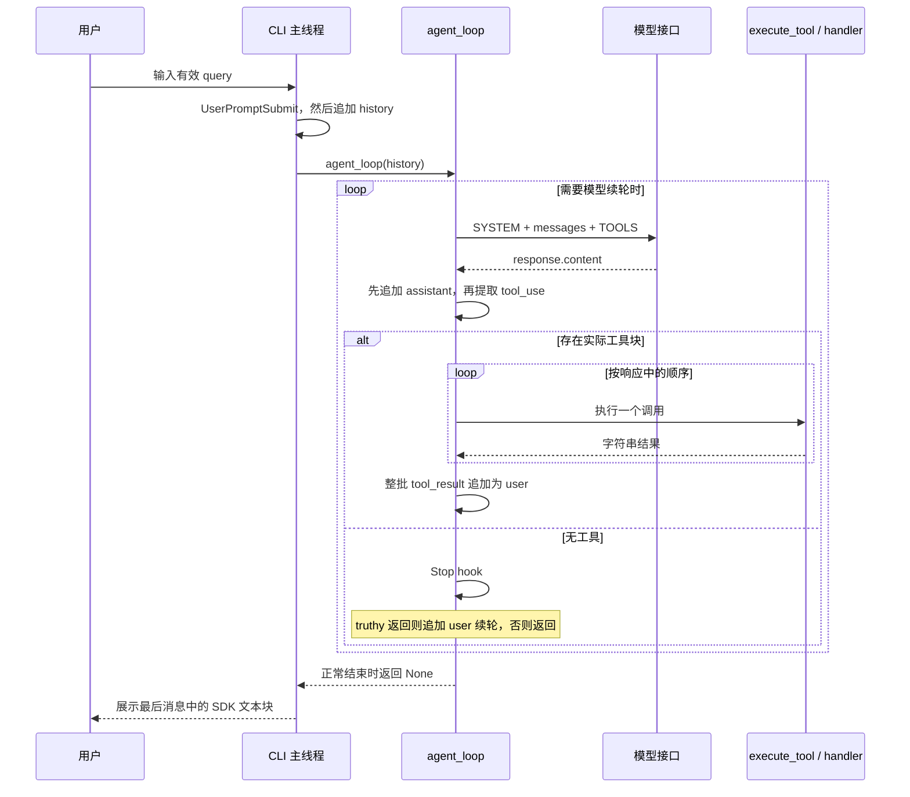
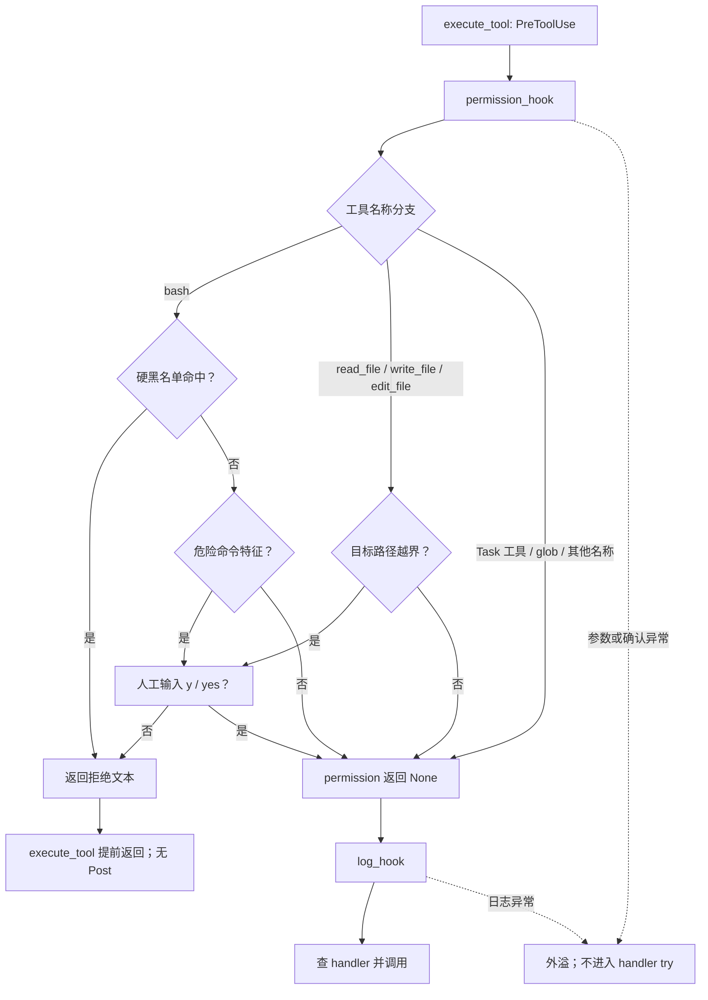
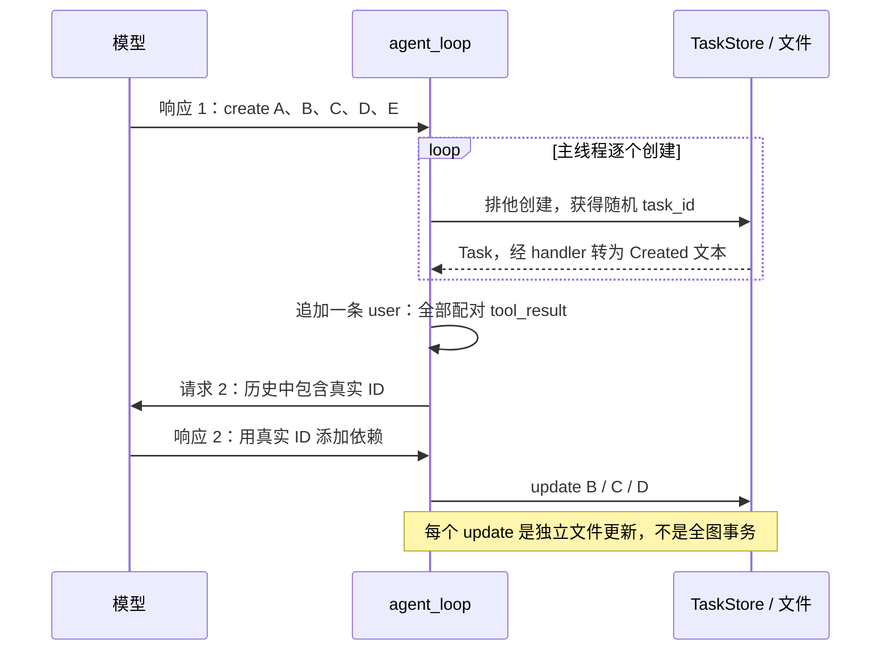
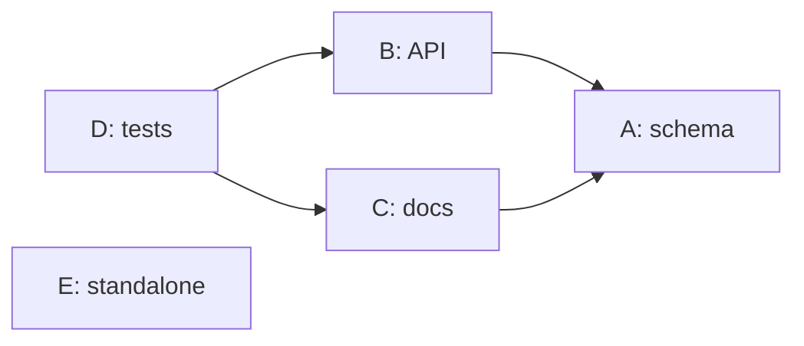
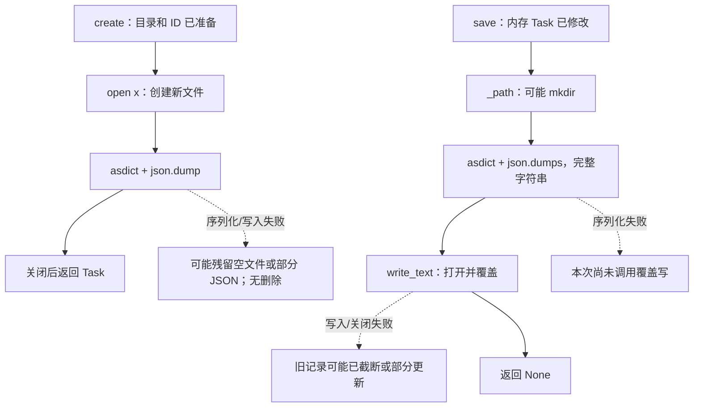
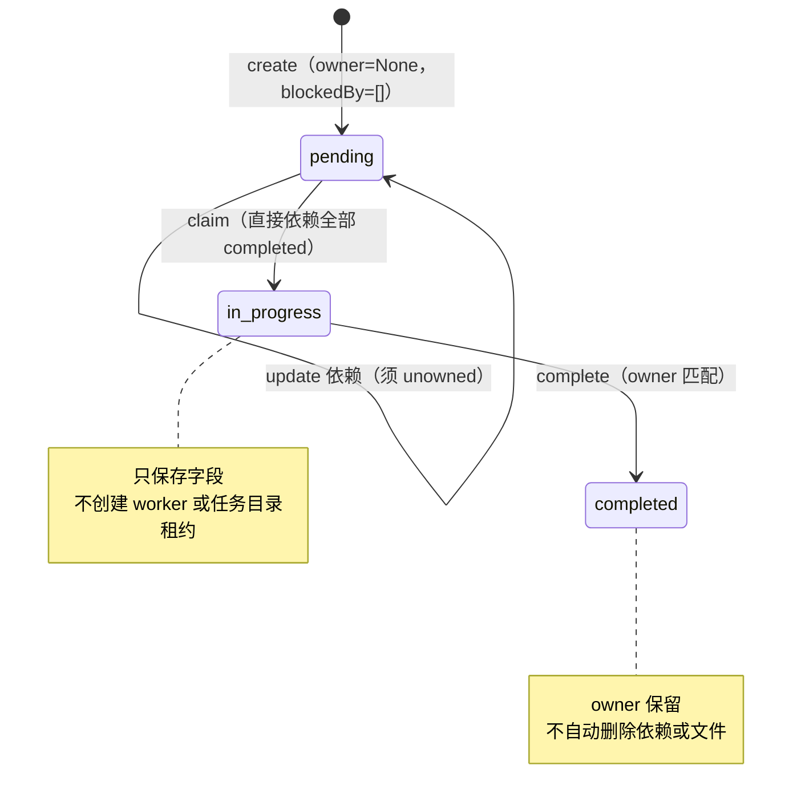
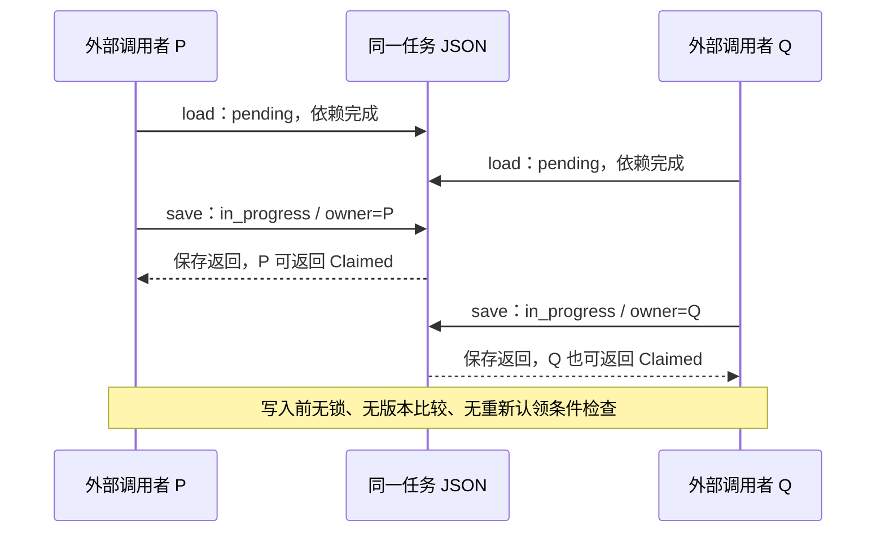
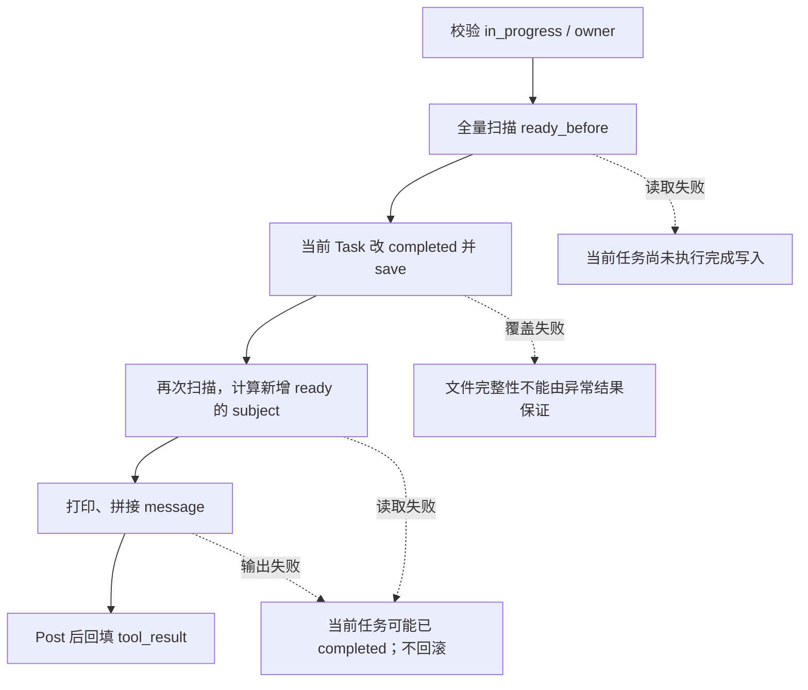
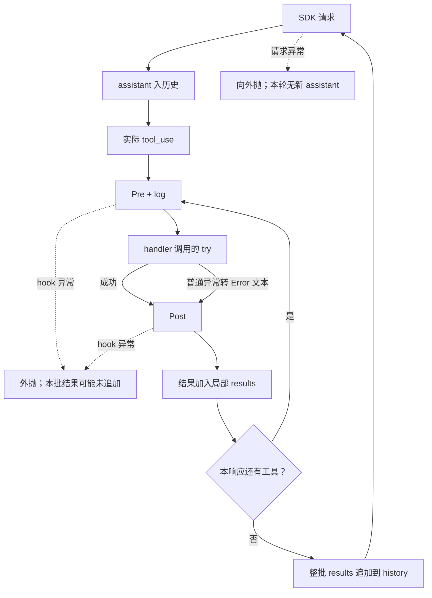
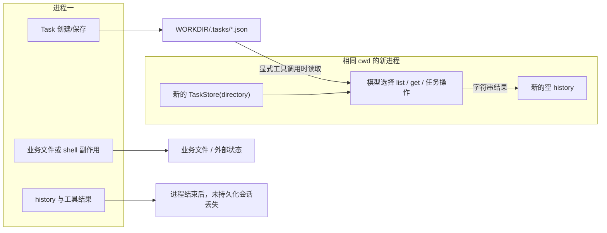

> 分析主体：[s10_task_system/code.py](../s10_task_system/code.py#L677)，入口为 `__main__`（L677），核心为 `agent_loop`（L639）、`execute_tool`（L620）与 `TaskStore`（L104）。本章在编码 Agent 的同步工具循环中加入 JSON 任务记录、依赖检查、认领和完成。
>
> 本文是对当前源码与既有断言的静态分析，没有导入或运行目标模块，没有调用模型、执行工具或运行用例。下文“会返回”“可能失败”等表述是沿源码推导，不是实测日志。代码片段保持当前连续源码及缩进；A/B/C/D/E 是讲解用的任务别名，不是可直接提交的 task_id。

# 1. 先看入口：外层读取用户，内层执行模型与工具

入口符号 `__main__` 从 L677 开始。先看程序最终要运行的完整短入口，再回溯它之前已经完成的模块初始化。

源码：`s10_task_system/code.py:L677–L699`。

```python
if __name__ == "__main__":
    print("s10: Task System - dependencies and task state")
    print("Enter a question, press Enter to send. Type q to quit.\n")

    history = []  # 对话历史，由 agent_loop 就地增删
    while True:   # 外层交互循环：反复读用户输入，直到用户退出
        try:
            # \001/\002 tell Readline the ANSI escapes have zero display width.
            # （\001/\002 告诉 readline 中间的 ANSI 转义码不占显示宽度，提示符才不会错位）
            query = input("\001\033[36m\002s10 >> \001\033[0m\002")
        except (EOFError, KeyboardInterrupt):
            break  # Ctrl+D（EOF）或 Ctrl+C（中断）时退出
        if query.strip().lower() in ("q", "exit", ""):
            break
        # 触发 UserPromptSubmit 钩子（本课只是打印工作目录）。
        trigger_hooks("UserPromptSubmit", query)
        history.append({"role": "user", "content": query})
        agent_loop(history)
        # 打印模型最后的文字回复（跳过 tool_use 块）。
        for block in history[-1]["content"]:
            if getattr(block, "type", None) == "text":
                print(block.text)
        print()  # 空行，让下一条提示符清爽地开始
```

## 1.1 两层循环的职责与进入条件

直接运行该文件时，Python 把当前模块的 `__name__` 设为 `"__main__"`，进入上述分支；被其他代码导入时不进入，但导入仍会执行顶层配置和对象创建。本文件不通过运行时导入复用 s04；“From s04”的源码注释表示教学沿用。

两条 `print` 先输出终端提示，`history = []` 再创建一个空列表。这一赋值在外层 `while True` 之前，因此用户第二次提交时不会重置会话。外层循环每次读一个用户输入；`agent_loop(history)` 内还有一层模型循环，一次用户提交可能产生多轮模型请求与工具调用。

`history` 作为实参传入后，形参 `messages` 指向同一个列表。内层函数的 `append` 会改变外层随后读取的历史，不需要返回新列表。内层正常结束时返回 `None`，CLI 不使用这个返回值，而是直接查看 `history[-1]`。

当前默认执行线是调用栈上的同步串行执行：用户输入结束才进模型，模型返回才执行工具，工具返回才可能发下一次请求。源码没有创建后台线程、队列消费者、自动唤醒入口或另一个同时修改 history 的 Agent 入口。

## 1.2 退出判断与异常保护并不覆盖整个回合

`input` 的提示字符串包含 ANSI 颜色和 readline 的零宽标记。它返回字符串后，`strip().lower()` 只用于比较是否为 `q`、`exit` 或空字符串，不会把清理后的字符串重新赋给 query。有效输入原有的首尾空白仍会进入历史。

`except (EOFError, KeyboardInterrupt)` 仅属于紧邻的输入 try。EOF 或在读取该输入时按中断会 break；空白、q、exit 也会 break。它们都发生在 UserPromptSubmit 和 history.append 之前，因此不形成用户消息。

模型等待、工具执行、权限询问、hooks、最终展示都不在这个 try 里。不能因为入口捕获过 KeyboardInterrupt，就认定整个程序都能把中断转为一次正常输入退出。

## 1.3 主调用与返回关系

`UserPromptSubmit → history.append → agent_loop` 是有效提交的实际顺序。内层正常返回后才打印文字，再回到下一次 input。如果某层异常外溢，入口没有另一个大范围 try/finally 保证继续读输入或补齐工具结果。

下面的主时序图只展示真实控制关系。某次模型可能完全不调用任务工具；图中“工具”是分支，不是每次请求都必须执行的固定工序。



接下来暂时停在入口的 input 之前，回溯模块加载。完成回溯后，第 3 章回到同一个用户提交点。

# 2. 回溯模块初始化：建立配置和对象，不等于已经执行任务

## 2.1 导入、readline 与依赖的实际范围

模块导入区从 L31 开始；readline 的可选导入从 L40 开始。

源码：`s10_task_system/code.py:L31–L53`。

```python
import glob        # 文件名模式匹配（glob 工具用）
import json        # 序列化：把任务读写为 json 文件
import os          # 环境变量、平台判断
import re          # 正则：校验任务 ID、危险命令匹配
import secrets     # 生成密码学安全的随机数（用于任务 ID，避免碰撞）
import subprocess  # 执行模型生成的 shell 命令
from dataclasses import asdict, dataclass  # 定义 Task 数据类、把对象转成字典
from pathlib import Path  # 面向对象的路径操作

try:
    import readline

    # 以下四行是 macOS 上 libedit 库的 UTF-8 修复，让终端能正确处理中文。
    readline.parse_and_bind("set bind-tty-special-chars off")
    readline.parse_and_bind("set input-meta on")
    readline.parse_and_bind("set output-meta on")
    readline.parse_and_bind("set convert-meta off")
except ImportError:
    # Windows 自带 Python 没有 readline，跳过即可，不影响主逻辑。
    pass

from anthropic import Anthropic  # Anthropic 官方 Python SDK 客户端
from dotenv import load_dotenv   # 从 .env 文件加载环境变量
```

`glob/json/os/re/secrets/subprocess` 等在本文件直接使用，`asdict/dataclass` 负责数据对象与字典转换，`Path` 负责路径拼接、解析和读写。没有导入 s04、s11 或其他教学章节，也没有 `threading`、`fcntl`、任务租约或 worktree 运行时。

readline 的 try 同时包括导入和四次 `parse_and_bind`，但 except 只捕获 ImportError。缺少可选模块可跳过；若绑定调用抛出其他类型错误，不能用这个 except 推导它也被忽略。源码注释说这些设置用于 macOS/libedit 的 UTF-8 输入体验，它们不是文件编码或模型输出编码设置。

直接相关的 `requirements.txt:L1–L3` 声明 `anthropic>=0.25.0`、`python-dotenv>=1.0.0`、`pyyaml>=6.0`。本文件使用前两项，没有使用 YAML。最低版本声明不是锁定实际安装版本；不能据此推断当前 SDK 一定采用何种内部重试、网络超时或连接行为。

**状态与返回。** 这些语句改变模块命名空间，readline 设置还可能改变终端输入行为；没有发出 `client.messages.create`。导入失败发生在 CLI 创建 history 之前，后面的 execute_tool 无法处理它。

## 2.2 配置、工作目录和客户端的先后顺序

源码：`s10_task_system/code.py:L55–L63`。

```python
# override=True：即使系统里已有同名环境变量，也用 .env 里的值覆盖。
load_dotenv(override=True)
if os.getenv("ANTHROPIC_BASE_URL"):
    # 配了自定义端点时移除可能冲突的 ANTHROPIC_AUTH_TOKEN，避免两种鉴权打架。
    os.environ.pop("ANTHROPIC_AUTH_TOKEN", None)

WORKDIR = Path.cwd()  # 工作目录：文件工具与路径校验的基准
client = Anthropic(base_url=os.getenv("ANTHROPIC_BASE_URL"))
MODEL = os.environ["MODEL_ID"]  # 从环境变量读模型 ID
```

`load_dotenv(override=True)` 在模块顶层执行，意味着真实运行时 dotenv 可以覆盖已有同名环境变量。本文只读取这段代码，不读取实际 .env 或密钥。

`os.getenv("ANTHROPIC_BASE_URL")` 为 truthy 时才删除 `ANTHROPIC_AUTH_TOKEN`；空值不会进入分支。`pop(..., None)` 让变量不存在时不抛 KeyError。这个修改影响当前进程环境，不是只影响即将创建的一个请求字典。

`WORKDIR = Path.cwd()` 捕获加载当时的工作目录。它不是 `__file__` 的父目录，之后的任务路径和工具路径以这个已保存对象为基准；从仓库根目录启动和从某个子目录启动，可能使用不同的 .tasks。

执行顺序是先构造 `Anthropic(...)`，然后读取 `os.environ["MODEL_ID"]`。因此客户端构造可能先失败；即使它成功，MODEL_ID 缺失仍会在下一句抛 KeyError。代码没有为这个读取提供默认模型。

客户端对象创建与模型请求是两个不同动作：本文件的显式模型请求在 agent_loop:L642。客户端初始化的内部细节不在本章源码中，不额外假定它完全无校验或具有什么网络恢复能力。

**副作用与下一步。** 当前已经可能改变环境、读取 cwd 并构造 SDK 对象；仍没有创建任务或历史。接下来构造提示词。

## 2.3 平台提示与两阶段建图约定

源码：`s10_task_system/code.py:L65–L81`。

```python
# 根据操作系统告诉模型它面对的 shell 语法，避免生成错误的命令风格。
ENVIRONMENT_PROMPT = (
    "Windows: the bash tool runs through cmd.exe; use cmd.exe syntax, not Unix "
    "Bash or PowerShell syntax, and prefer dedicated file tools for file operations"
    if os.name == "nt"
    else "Unix-like: the bash tool runs the system shell"
)
# 系统提示词里强调两条任务系统的使用约定：
#   1) 用任务工具来跟踪依赖关系和进度；
#   2) 先把所有任务节点建出来，等 create_task 返回**运行时生成的真实 ID** 之后，
#      再用 update_task 拿这些确切的 ID 去补依赖——因为 ID 是随机生成的，事前无法预知。
SYSTEM = (
    f"You are a coding agent at {WORKDIR}. Environment: {ENVIRONMENT_PROMPT}. "
    "Use task tools to track dependencies and progress. Create all task nodes "
    "first. After create_task returns runtime-generated IDs, use update_task "
    "with those exact IDs to add dependencies."
)
```

条件表达式根据 `os.name == "nt"` 选择给模型看的环境说明。Windows 分支要求模型生成 cmd.exe 风格命令，Unix-like 分支说明使用系统 shell。真正的执行调用后文是 `subprocess.run(..., shell=True)`，不是启动一个名为 bash 的固定解释器，更不是本文件显式创建 PowerShell。

SYSTEM 的第一部分把 WORKDIR 和环境说明嵌入字符串；后一部分要求先创建全部任务节点，收到运行时 ID 后再添加依赖。这个字符串在初始化时构造，不是每轮查询任务文件重新计算的任务面板。

“先创建所有节点”是提示约定。代码没有维护“全图创建中”的发布标志，也没有在 claim_task 前验证模型是否完成全图规划。模型可以直接调用基础工具，或在只建完部分节点时认领某个 pending 任务；执行层只检查各函数写出的局部条件。

**工程判断。** 将随机身份获取与依赖添加分开，避免模型预猜 ID，且使创建接口简单；代价是图在多个工具调用之间逐步形成，没有整图原子发布。具体跨轮反馈见第 8 章，而不是把提示词当作自动连边算法。

## 2.4 路径常量和 TaskStore 构造没有创建 .tasks

源码：`s10_task_system/code.py:L89–L90`。

```python
TASKS_DIR = WORKDIR / ".tasks"  # 任务文件存放目录
TASK_ID_PATTERN = re.compile(r"^task_[0-9a-f]{8}$")  # 合法 ID 的形状：task_ + 8 位十六进制
```

`TASKS_DIR` 只是一个 Path 对象。`TASK_ID_PATTERN` 编译合法 ID 形状，后续路径函数会实际执行它。定义它们不会 mkdir，也不会扫描旧文件。

Task 类型在模块加载时定义，字段在第 7 章首次构造 Task 时详细解释。此处先看存储对象构造；`TaskStore.__init__` 的起始行是 L108。

源码：`s10_task_system/code.py:L104–L109`。

```python
class TaskStore:
    # 任务的「仓库」：负责在 Task 对象和磁盘上的 json 文件之间来回转换，
    # 并统一做路径安全校验和内容校验。

    def __init__(self, directory: Path):
        self.directory = directory
```

模块随后创建单例：

源码：`s10_task_system/code.py:L250–L250`。

```python
TASKS = TaskStore(TASKS_DIR)  # 模块级单例：整个进程共用一个任务仓库
```

构造函数只把传入的 Path 保存为 `self.directory`。没有任务缓存表、全局状态加载、恢复扫描或线程启动。“整个进程共用一个仓库”指共用这个目录定位与方法对象，不是所有 Task 实例都共享一个会自动同步的内存数据库。

**返回位置。** `__init__` 正常结束后，构造表达式把实例赋给 TASKS，模块继续定义/登记工具与 hooks。直到后续 create/save 调用需要目录时才可能创建 .tasks。

既有证据 `tests/test_task_system.py:L64–L92`：该用例断言 11 个工具、存在 execute_tool、权限 hook 已登记、没有 MEMORY_DIR，并断言加载模块后 .tasks 不存在。这说明断言关注初始化边界，不是证明真实 SDK 初始化或模型请求成功。

## 2.5 工具表与 hooks 的建立时点

模块按源码定义 handler 函数，再建立 TOOLS 和 TOOL_HANDLERS。函数定义使名称可被引用，不会执行函数体；声明字典也不会执行任何工具。两张表的参数差异到第 5 章首次分发时展开。

hooks 的容器与注册函数如下：

源码：`s10_task_system/code.py:L514–L519`。

```python
HOOKS = {"UserPromptSubmit": [], "PreToolUse": [], "PostToolUse": [], "Stop": []}


def register_hook(event: str, callback):
    # 注册：把回调追加到对应事件的列表。
    HOOKS[event].append(callback)
```

`HOOKS` 是四个字符串事件到列表的映射。`register_hook` 只是向对应列表 append 回调引用，不运行回调，也不检查其签名。未知事件会在字典索引处失败，没有自动创建事件或静默忽略。

实际注册顺序为：

源码：`s10_task_system/code.py:L612–L617`。

```python
# 注册回调。
register_hook("UserPromptSubmit", context_hook)
register_hook("PreToolUse", permission_hook)
register_hook("PreToolUse", log_hook)
register_hook("PostToolUse", large_output_hook)
register_hook("Stop", summary_hook)
```

PreToolUse 的 permission 在 log 之前。这个顺序有行为意义：权限拒绝的非 None 返回会让 trigger_hooks 不再调用日志回调。其他三个事件各有一个默认回调。

**初始化收束。** 此时已经建立配置、提示、类型、存储实例、两张工具表和 hooks；尚未创建 Task、读取历史任务、发模型请求或执行 shell。模块执行到 `__main__` 后，才回到第 1 章的 CLI 主线。

# 3. 回到用户提交：hook 先运行，消息后追加

## 3.1 首次进入 trigger_hooks

有效输入通过退出判断后，入口 L692 调用 `trigger_hooks("UserPromptSubmit", query)`。首次深入触发函数：

源码：`s10_task_system/code.py:L522–L528`。

```python
def trigger_hooks(event: str, *args):
    # 触发：依次调用回调；某个回调返回非 None 就视为拦截，立即停止并返回该结果。
    for callback in HOOKS[event]:
        result = callback(*args)
        if result is not None:
            return result
    return None
```

调用中的 event 来自入口固定字符串，`*args` 收集 query；循环中的 callback 来自对应注册列表。每个 `callback(*args)` 都在当前主线程同步执行，前一个返回后才调用后一个。

`result is not None` 不是 truthy 判断。返回 `False`、`0` 或空字符串也会立即 return，剩余回调不会执行；所有回调都返回 None 时函数才走到末尾返回 None。函数不捕获 callback 异常，抛出后后续回调和入口的 history.append 都不会执行。

这里的“非 None 短路”只定义回调遍历规则。是否意味着拒绝用户、拒绝工具或强制续轮，要看调用者如何使用返回值，不能统一解释成授权决定。

## 3.2 默认 context_hook 只是打印，没有注入模型上下文

源码：`s10_task_system/code.py:L590–L593`。

```python
def context_hook(query: str):
    # 用户提交提示词时触发：打印一下当前工作目录。
    print(f"\033[90m[HOOK] UserPromptSubmit: working in {WORKDIR}\033[0m")
    return None
```

query 是函数参数，但函数体没有读取或修改它。唯一显式副作用是向终端打印 WORKDIR，随后返回 None。它既不改 SYSTEM，也不向 messages 插入目录说明；工作目录已经在固定 SYSTEM 中，这与 hook 注入是两回事。

**返回位置。** context_hook 返回 trigger_hooks，后者遍历结束后返回入口 L692。入口没有接住返回值，接着 L693 执行 history.append，L694 调用 agent_loop。

| UserPromptSubmit 情况 | 触发器行为 | 入口是否追加 query |
|---|---|---|
| 默认回调返回 None | 继续并最终返回 None | 是 |
| 自定义回调返回非 None | 短路剩余回调 | 是，入口忽略该返回值 |
| callback 抛出异常 | 异常外溢 | 否，append 尚未执行 |

这个表描述现有调用约定，不是建议添加回调。终端 print 失败也属于 callback 失败，不能认为“只是打印”就不影响后续提交。

## 3.3 用户消息进入共享列表

入口追加的消息为 `{"role": "user", "content": query}`；content 是原始 query 字符串。messages/history 没有复制，既有消息也没有在进入新回合前裁剪。

成功追加后，SDK 失败不会自动撤销这条 user 消息，因为 agent_loop 没有相应异常回滚。默认 CLI 没有 catch 使用户继续输入；若外部 Python 调用方另行捕获异常，才可能观察并继续使用这个已修改列表。

**返回链。** 入口现在同步调用 agent_loop。只有它正常 return，才会进入 CLI 的文字展示；下一章从它第一次 SDK 调用继续。

# 4. 进入 Agent：请求、assistant 入历史与实际工具分流

## 4.1 请求参数来自哪里

`agent_loop` 起始于 L639；第一次与之后每次工具续轮都进入相同 while。

源码：`s10_task_system/code.py:L639–L648`。

```python
def agent_loop(messages: list):
    while True:
        # 调用模型（带上工具定义和系统提示词）。
        response = client.messages.create(
            model=MODEL,
            system=SYSTEM,
            messages=messages,
            tools=TOOLS,
            max_tokens=8000,
        )
```

`model` 使用初始化时读取的 MODEL；`system` 使用固定 SYSTEM；`messages` 是同一个历史列表；`tools` 是模块级固定 TOOLS；`max_tokens=8000` 限制单次输出，不限制整个回合请求数、累计费用或历史长度。

TOOLS 不是执行器。模型可以根据声明生成工具名和参数，真正执行还要经过 execute_tool 和 TOOL_HANDLERS。Task Python 对象没有被直接作为工具结果发送；后续 handler 返回的是字符串，由循环组装为 tool_result 内容。

| 对象 | 内容与来源 | 被谁消费 | 不代表什么 |
|---|---|---|---|
| TOOLS | 模块级声明列表 | SDK tools 参数 | 本地参数已被验证 |
| TOOL_HANDLERS | 工具名到函数引用 | execute_tool | 模型直接执行 Python |
| TASKS | 只保存目录的存储实例 | 任务包装函数 | 内存任务缓存或事务管理器 |
| Task | 创建或读取获得的数据对象 | 业务函数、asdict | 与磁盘自动同步的实体 |
| history/messages | user、assistant、结果消息 | SDK 与 CLI | 持久化聊天记录 |

**异常边界。** while 中没有围绕 SDK 调用的 try。调用失败时不会自动追加 assistant 错误消息、触发 Stop、重新请求或恢复输入循环。8000 上限也没有配套 max_tokens/截断续写分支。

依赖声明不能证明 SDK 内部绝无重试，但本文件没有显式退避、备用模型或网络超时策略。外部服务和 SDK 实现未由这里的调用证明的行为保持未知。

## 4.2 响应先入历史，再检查工具

源码：`s10_task_system/code.py:L649–L655`。

```python
        # 把模型回复追加为 assistant 消息。
        messages.append({"role": "assistant", "content": response.content})

        # 筛出 tool_use 块；没有则这一轮结束。
        tool_calls = [
            block for block in response.content if block.type == "tool_use"
        ]
```

SDK 返回后，先把 `response.content` 放入新 assistant 消息。没有转换成普通字符串，也没有深复制内容块。随后列表推导按原顺序筛选 `block.type == "tool_use"`，得到的元素仍是这些内容块引用。

这一步不检查 stop_reason：即使 stop_reason 声称 end_turn，只要存在真实 tool_use，仍走工具分支；反之，stop_reason 声称 tool_use 但内容没有工具，也不会硬构造空调用。

此时若 `response.content` 结构或 block 属性异常，assistant 消息可能已追加，但筛选未完成；这不是请求本身失败，也不在 handler 异常捕获内。

既有证据 `tests/test_agent_loop_boundaries.py:L13–L34` 的参数范围包含 s10。`test_parent_loop_executes_a_real_tool_call_even_if_stop_reason_disagrees`（L244）用 end_turn 搭配真实工具块，断言两次模型请求和一个配对结果；`test_parent_loop_does_not_append_an_empty_tool_result_turn`（L221）断言空/无工具内容时没有空 user 结果消息。用例关闭默认 hooks 并使用假接口，因此不证明真实权限或 SDK 成功。

## 4.3 把分支和暂存点区分开

无工具时转入 L656 的 Stop 分支，第 19 章再回到这里；有工具时执行 L664–674，第 8 章在首次创建后深入结果回填。主阅读线现在选择模型调用 create_task，但它只是可能分支，并非每次请求的固定步骤。

在这个时点：user 已在历史、assistant 已在历史、任何新 tool_result 尚未追加。接下来执行工具，若发生未捕获异常，不能认为历史仍停留在进入模型之前的状态。

# 5. 统一分发：声明、Python 绑定与 hooks 是不同层

## 5.1 模型看到的 11 个工具

TOOL 声明的起始位置为 L469，保留完整连续定义，以便与后面的真实签名对照。

源码：`s10_task_system/code.py:L469–L492`。

```python
TOOLS = [
    {"name": "bash", "description": "Run a shell command.",
     "input_schema": {"type": "object", "properties": {"command": {"type": "string"}}, "required": ["command"]}},
    {"name": "read_file", "description": "Read file contents.",
     "input_schema": {"type": "object", "properties": {"path": {"type": "string"}, "limit": {"type": "integer"}}, "required": ["path"]}},
    {"name": "write_file", "description": "Write content to a file.",
     "input_schema": {"type": "object", "properties": {"path": {"type": "string"}, "content": {"type": "string"}}, "required": ["path", "content"]}},
    {"name": "edit_file", "description": "Replace exact text in a file once.",
     "input_schema": {"type": "object", "properties": {"path": {"type": "string"}, "old_text": {"type": "string"}, "new_text": {"type": "string"}}, "required": ["path", "old_text", "new_text"]}},
    {"name": "glob", "description": "Find files matching a glob pattern; ** matches recursively.",
     "input_schema": {"type": "object", "properties": {"pattern": {"type": "string"}}, "required": ["pattern"]}},
    {"name": "create_task", "description": "Create a task and return its runtime-generated ID.",
     "input_schema": {"type": "object", "properties": {"subject": {"type": "string"}, "description": {"type": "string"}}, "required": ["subject"], "additionalProperties": False}},
    {"name": "update_task", "description": "Add dependencies using IDs returned by create_task.",
     "input_schema": {"type": "object", "properties": {"task_id": {"type": "string", "pattern": "^task_[0-9a-f]{8}$"}, "addBlockedBy": {"type": "array", "items": {"type": "string", "pattern": "^task_[0-9a-f]{8}$"}, "minItems": 1}}, "required": ["task_id", "addBlockedBy"], "additionalProperties": False}},
    {"name": "list_tasks", "description": "List tasks with status, owner, and dependencies.",
     "input_schema": {"type": "object", "properties": {}}},
    {"name": "get_task", "description": "Get a task by ID.",
     "input_schema": {"type": "object", "properties": {"task_id": {"type": "string"}}, "required": ["task_id"]}},
    {"name": "claim_task", "description": "Claim a pending task whose dependencies are complete.",
     "input_schema": {"type": "object", "properties": {"task_id": {"type": "string"}}, "required": ["task_id"]}},
    {"name": "complete_task", "description": "Complete the task claimed by this agent.",
     "input_schema": {"type": "object", "properties": {"task_id": {"type": "string"}}, "required": ["task_id"]}},
]
```

create_task 不声明 blockedBy，且 additionalProperties 为 False；update_task 要求 task_id/addBlockedBy，包含 ID pattern、数组元素 pattern、minItems=1，并禁止额外字段。get/claim/complete 只把 task_id 声明为 string，没有相同 pattern。

这些是不一致但可直接核对的声明事实。旁边注释关于“pattern 约束合法 ID”不能扩展为所有工具都带 pattern，更不能据此认为本地必然完成 JSON Schema 校验。

实际路由表：

源码：`s10_task_system/code.py:L495–L507`。

```python
TOOL_HANDLERS = {
    "bash": run_bash,
    "read_file": run_read,
    "write_file": run_write,
    "edit_file": run_edit,
    "glob": run_glob,
    "create_task": run_create_task,
    "update_task": run_update_task,
    "list_tasks": run_list_tasks,
    "get_task": run_get_task,
    "claim_task": run_claim_task,
    "complete_task": run_complete_task,
}
```

| 模型名 | handler | 绑定与后续业务检查 |
|---|---|---|
| bash | run_bash | command；权限检查先于 handler |
| read_file | run_read | path、可选 limit |
| write_file | run_write | path/content；内容交给文件 API |
| edit_file | run_edit | path/old_text/new_text |
| glob | run_glob | pattern |
| create_task | run_create_task | subject、可选 description；下层 strip/空值检查 |
| update_task | run_update_task | task_id/addBlockedBy；下层状态、依赖、查环 |
| list_tasks | run_list_tasks | 无参数 |
| get_task | run_get_task | task_id；下层路径和内容检查 |
| claim_task | run_claim_task | task_id；owner 固定为 agent |
| complete_task | run_complete_task | task_id；owner 固定为 agent |

schema 影响模型可见契约；Python 关键字绑定决定函数能接收哪些名字；业务判断决定当前任务能否更新。这三层不能互相替代。源码没有 import jsonschema 或统一 validate 调用。

## 5.2 先执行 PreToolUse，再决定是否拒绝

`execute_tool` 的第一段：

源码：`s10_task_system/code.py:L620–L625`。

```python
def execute_tool(block) -> str:
    # 执行单个工具调用：先过 PreToolUse 钩子，再查分发表执行，最后过 PostToolUse。
    blocked = trigger_hooks("PreToolUse", block)
    if blocked:
        return str(blocked)  # 被拦截：把拦截原因当作结果返回

```

来自 agent_loop 的 block 是模型返回的工具内容块。它先交给 PreToolUse，而不是先查 handler 或先验证输入。触发器依序调用 permission_hook、log_hook；第 6 章立即进入第一个回调。

此处 `if blocked` 与第 3 章触发器的 `is not None` 不同：

| 首个非 None 回调返回值 | 剩余 Pre 回调 | execute_tool 是否拒绝 |
|---|---|---|
| 无，全部 None | 全部已执行 | 否 |
| 空字符串 | 不再执行 | 否 |
| False 或 0 | 不再执行 | 否 |
| 非空拒绝文本 | 不再执行 | 是，返回 str(blocked) |

因此自定义 False 返回可能跳过后续日志，却仍放行 handler。这是静态调用语义，不表示当前默认权限回调真的返回 False。默认回调只返回 None 或非空拒绝文本。

truthy 拒绝路径提前 return，不查询 handler，不调用 PostToolUse，也没有文件或 shell handler 副作用；权限检查本身的打印和人工输入已经可能发生。

## 5.3 放行后的绑定、异常与 Post 继续点

源码：`s10_task_system/code.py:L626–L634`。

```python
    handler = TOOL_HANDLERS.get(block.name)
    try:
        # **block.input 按关键字展开参数字典；未知工具给出提示。
        output = handler(**block.input) if handler else f"Unknown: {block.name}"
    except Exception as error:
        output = f"Error: {error}"  # 工具抛异常不打断循环，转成文本交给模型

    trigger_hooks("PostToolUse", block, output)
    return str(output)
```

`TOOL_HANDLERS.get` 先找函数。条件表达式只执行被选择的分支：已知 handler 才求值 `handler(**block.input)`；未知工具直接得到 Unknown 文本，不执行参数展开。注意 Pre/log 仍可能先访问 input，因此这不是未知输入的统一安全解析器。

`**block.input` 要求可按关键字展开，缺少必需参数或多传 handler 不接收的参数会在 Python 绑定阶段抛出 TypeError，并由这里的 except Exception 转为 Error 文本。类型注解不会使 description 必须是字符串；有些错误类型会进入函数更深处，另一些会先在 Pre hook 的 `.get`、正则或路径运算中失败。

try 只包住输出表达式：Pre 在前面，Post 在后面，路由字典查找也在 try 前。KeyboardInterrupt 等 BaseException 不属于普通 Exception，不能统称“一切工具错误都转文本”。

PostToolUse 收到原始 output，其返回值在这里被忽略；之后才 `str(output)` 返回给 agent_loop。第 8 章在创建成功返回后分析默认 Post 回调。以上是调用继续点；当前主线仍暂停在 L622，先进入第一个 Pre 回调 permission_hook。

# 6. 先过权限与日志：放行路径不是统一的参数验证器

## 6.1 bash 先查硬黑名单

首次由 PreToolUse 调用 `permission_hook`（起始 L543）。进入 bash 分支的条件只有工具名相等。

源码：`s10_task_system/code.py:L543–L551`。

```python
def permission_hook(block):
    # 工具执行前：bash 先查硬黑名单（命中直接拒绝），再查危险特征（询问用户）；
    # 文件工具则检查路径是否越界。
    if block.name == "bash":
        command = block.input.get("command", "")
        for pattern in DENY_LIST:
            if pattern in command:
                print(f"\n\033[31m[blocked] '{pattern}'\033[0m")  # 红色提示
                return "Permission denied by deny list"
```

command 来自 `block.input.get("command", "")`。缺少键时先得到空串，通常通过这一层，随后才在 handler 绑定时报告缺少 command；如果 input 不是预期字典，或 command 类型不支持字符串成员检查，可能就在 hook 中抛出异常。

for 按黑名单列表的顺序做 `pattern in command`，是区分大小写的子串判断，不是解析命令、可执行文件或 shell 引号。第一个命中会先打印，再返回非空拒绝文本。trigger_hooks 因非 None 短路，execute_tool 因 truthy 提前返回；log 和 Post 都不会执行。

黑名单及危险判断的辅助定义如下。`contains_destructive_command` 起始 L539：

源码：`s10_task_system/code.py:L531–L540`。

```python
DENY_LIST = ["rm -rf /", "sudo", "shutdown", "reboot", "mkfs", "dd if="]  # 硬黑名单：命中直接拒
DESTRUCTIVE_COMMAND_WORD = re.compile(
    # 匹配作为独立命令出现的 rm/del（前置边界避免误伤 "firm" 这类子串）
    r"(?i)(?:^|[;&|()\n])\s*(?:rm|del)(?=\s|$|[;&|()])"
)
DESTRUCTIVE = ["rm ", "> /etc/", "chmod 777"]  # 其他危险特征（需人工确认）


def contains_destructive_command(command: str) -> bool:
    return bool(DESTRUCTIVE_COMMAND_WORD.search(command))
```

硬黑名单与危险命令判断是两个层级：前者直接拒绝，后者可能询问。比如包含 `"rm -rf /"` 的更长文本也会命中该子串，代码不验证后面是否恰好是根目录参数；反过来，未命中也不能证明 shell 动作安全。

## 6.2 危险特征命中后才询问人

源码：`s10_task_system/code.py:L552–L559`。

```python
        if contains_destructive_command(command) or any(
            keyword in command for keyword in DESTRUCTIVE
        ):
            print("\n\033[33m[permission] Potentially destructive command\033[0m")
            print(f"   Tool: {block.name}({block.input})")
            choice = input("   Allow? [y/N] ").strip().lower()
            if choice not in ("y", "yes"):  # 默认拒绝（直接回车 = N）
                return "Permission denied by user"
```

or 先求值正则函数，正则已命中时不再计算后面的 any；没有命中才逐项检查 DESTRUCTIVE 子串，any 找到首个真值后停止。

正则前缀 `(?i)` 忽略大小写，命令前边界允许开头、分隔符、括号或换行，后边界允许空白、结尾和部分分隔符。它避免把 delimiter 之类普通单词直接等同于 del，但不处理完整 shell 语法树。DESTRUCTIVE 中的普通子串检查仍区分大小写，不能把两种匹配语义混在一起。

`input(...).strip().lower()` 把 y/yes 作为允许，其余包括空白默认拒绝。允许后不立刻执行 shell，而是继续权限函数，再回到其他 Pre hooks。拒绝则返回文本，既不执行 handler，也不执行 Post。

EOFError 或 KeyboardInterrupt 发生在这次权限 input 时，不受 CLI 那个 input 的 except 保护。PreToolUse 在 execute_tool 的 try 之外，因此也不会被转为 Error。KeyboardInterrupt 本身还不属于普通 Exception。

既有证据 `tests/test_permission_command_words.py:L11–L27` 包含 s10，`COMMAND_CASES`（L91–L107）覆盖命令位置、大小写和词边界，`test_permission_command_words_cover_position_case_and_boundaries`（L114）把确认输入设为 n，断言 `bool(result) is expected`。它证明断言意图是识别需要拒绝/确认的文本，不是证明这些命令被真正执行、危险操作被 OS 隔离或启发式覆盖所有 shell 写法。

## 6.3 文件越界是询问，不是无条件拒绝

源码：`s10_task_system/code.py:L561–L570`。

```python
    if block.name in ("read_file", "write_file", "edit_file"):
        # 文件工具：路径解析后落在工作目录之外，就询问用户是否放行。
        path = block.input.get("path", "")
        if not (WORKDIR / path).resolve().is_relative_to(WORKDIR):
            print("\n\033[33m[permission] Access outside workspace\033[0m")
            print(f"   Tool: {block.name}({block.input})")
            choice = input("   Allow? [y/N] ").strip().lower()
            if choice not in ("y", "yes"):
                return "Permission denied by user"
    return None
```

这个分支只覆盖 read_file/write_file/edit_file。`(WORKDIR / path).resolve()` 计算实际目标；相对路径以 WORKDIR 为基准，绝对路径会按 Path 拼接语义成为绝对目标。`is_relative_to` 检查路径包含关系，不是简单字符串前缀。

越界才打印和询问，y/yes 允许后函数最终返回 None。handler 后续仍自行 resolve 同一参数，没有本章专用 safe_path 再把用户已允许的越界操作硬拒绝。目录内普通文件读写不询问，Task 工具也不会按上述文件名分支询问。

glob 不在这里询问，它在 handler 内过滤结果；bash 也不因可能读写 .tasks 而自动转换成任务工具。任务目录检查、文件人工确认、命令启发式分别作用在不同入口，不能合并称为统一沙箱。

**副作用与边界。** resolve 和确认是执行前的检查，不是对之后所有文件打开加锁；源码没有防止检查后目录链接被其他调用者改变的共同原子机制。这里只报告保护范围，不假定这种竞争已经发生。

## 6.4 权限返回 None 后才进入 log_hook

源码：`s10_task_system/code.py:L573–L577`。

```python
def log_hook(block):
    # 只观测不干预：灰色打印工具名与前两个参数（截断 60 字符），返回 None 放行。
    preview = str(list(block.input.values())[:2])[:60]
    print(f"\033[90m[HOOK] {block.name}({preview})\033[0m")
    return None
```

`block.input.values()` 取得参数值，先全部转为 list，再取前两个，再 str，最后切前 60 个字符。它不是按参数名挑选“关键字段”，也不截断真正交给 handler 的参数；输出顺序取决于输入字典的顺序。

这个 print 只影响终端，不修改 block.input 或 history。参数预览可能包含用户内容、文件文本或命令中的敏感信息，源码没有脱敏。若 input 不支持 values 或打印失败，异常仍在 handler try 之外。

**返回位置。** log_hook 返回 None，trigger_hooks 遍历结束返回 None，execute_tool:L623 不拒绝，继续 L626 查 handler。主线此时选择 create_task；其他工具分支后文都从同一个放行位置进入。



图中的“硬黑名单”“危险命令”只在 bash 分支适用，文件分支只检查越界；Task 工具默认经过 permission 返回 None，再经过日志。第 5 章的 False/空串差异不由默认权限回调产生。

# 7. 创建任务：从模型参数进入目录、身份与 JSON 文件

## 7.1 先经工具适配层，再进入存储层

首次选择 create_task 时，execute_tool 调用：

源码：`s10_task_system/code.py:L413–L417`。

```python
def run_create_task(subject: str, description: str = "") -> str:
    # 工具入口：创建任务，并把「运行时生成的 ID」回给模型。
    task = create_task(subject, description)
    print(f"  [create] {task.subject}")
    return f"Created {task.id}: {task.subject}"
```

这里的 task 接收下层返回的 Task；print 和 Created 文本都在下层成功返回之后。当前先暂停在 L415，进入公共包装函数：

源码：`s10_task_system/code.py:L253–L254`。

```python
def create_task(subject: str, description: str = "") -> Task:
    return TASKS.create(subject, description)
```

包装层不另外校验参数，直接委托 TASKS.create。它保留一个可被 Python 代码直接调用的接口；直接调用 create_task 不会自动经过 execute_tool 的权限、日志或异常转文本。

这两层的返回类型不同：create_task 返回 Task，run_create_task 才把它变成模型可见文本。它们都没有把 Task 以结构化 Python 对象共享给模型。

## 7.2 准备贯穿示例，但不预猜 task_id

后文使用下表静态推演。字母是叙述别名，`A.id` 表示“创建 A 后收到的真实 ID”，不是可以直接写进生产参数的合法字符串。

| 别名 | subject | 创建时 blockedBy | 第二阶段目标依赖 |
|---|---|---|---|
| A | schema | [] | 无 |
| B | API | [] | A.id |
| C | docs | [] | A.id |
| D | tests | [] | B.id、C.id |
| E | standalone | [] | 无 |

这些不是当前仓库已存在的任务，也不是本次执行生成的结果。模型必须先收到真实 ID，才能按第 8 章的反馈链建立右列关系。

## 7.3 subject、目录准备与新 Task 的构造顺序

`TaskStore.create` 起始 L138，先看创建文件前的阶段：

源码：`s10_task_system/code.py:L138–L154`。

```python
    def create(self, subject: str, description: str = "") -> Task:
        # 新建任务：生成随机 ID、写成 json 文件、返回 Task 对象。
        subject = subject.strip()
        if not subject:
            raise ValueError("Task subject cannot be empty")

        self._root(create=True)
        # 最多重试 100 次以应对 ID 碰撞（8 位十六进制实际几乎不会撞）。
        for _ in range(100):
            task = Task(
                id=f"task_{secrets.token_hex(4)}",  # 4 字节 = 8 位十六进制随机数
                subject=subject,
                description=description,
                status="pending",  # 新任务默认「待办」
                owner=None,        # 还没有认领者
                blockedBy=[],      # 暂时没有依赖
            )
```

执行首先是 `subject = subject.strip()`，新变量值保存清理后的标题；全空白标题在创建目录前抛 ValueError。若 subject 不是支持 strip 的对象，会更早失败，而不是因为注解自动被拦截。

description 原样放入 Task，没有 strip、非空或显式字符串检查。正常模型契约声明它为 string，但底层 Python 调用传入可被 JSON 序列化的其他类型，也可能被保存；类型注解不会强制拒绝。

接着先调用 `self._root(create=True)`，成功后才进入 ID 循环。目录准备失败没有分配 Task，不能把它当作随机 ID 碰撞继续尝试。

每次迭代调用 `secrets.token_hex(4)`，4 字节编码为 8 个十六进制字符，再加前缀。空间有限，随机性不等于绝无碰撞；真正避免覆盖依靠后面的排他打开。subject 不是唯一键，同名任务可以拥有不同随机 ID。

Task 的原始定义如下，类起始 L94，装饰器在 L93：

源码：`s10_task_system/code.py:L93–L101`。

```python
@dataclass
class Task:
    # 一个任务的数据结构。@dataclass 会自动生成 __init__、__repr__ 等样板方法。
    id: str               # 任务 ID，形如 task_a1b2c3d4
    subject: str          # 任务标题（一句话说明要做什么）
    description: str      # 详细描述
    status: str           # 状态：pending / in_progress / completed
    owner: str | None     # 认领者；None 表示还没人认领
    blockedBy: list[str]  # 前置依赖：这些任务都完成了，本任务才能开始
```

dataclass 生成字段构造等样板方法，不为 status 建立枚举校验，也不会让 owner 自动成为权限身份。新实例固定 pending、owner=None、blockedBy=[]；每次执行列表字面量产生自己的列表，不是所有新任务共用一个默认依赖列表。

Task 没有创建时间、修改版本、执行日志或业务完成证明字段。后续按文件名排序，因此无法从排序反推创建顺序。

## 7.4 第一次进入 _root：先 mkdir，再检查真实位置

首次调用来自 create:L144；`_root` 起始 L111：

源码：`s10_task_system/code.py:L111–L119`。

```python
    def _root(self, create: bool = False) -> Path:
        # 取得任务目录的绝对路径，并校验它没有跑出工作目录。
        if create:
            self.directory.mkdir(parents=True, exist_ok=True)  # 需要时创建目录
        root = self.directory.resolve()
        # 防目录穿越：任务目录必须落在 workspace 之内。
        if not root.is_relative_to(WORKDIR.resolve()):
            raise ValueError("Task store escapes the workspace")
        return root
```

create=True 时先调用 mkdir。不存在就创建目录链，已存在目录可复用；目标不是目录或权限不足会失败。完成后才 resolve，再检查是否位于 `WORKDIR.resolve()` 内。

因此不能写成“拒绝前完全没有目录副作用”。在普通目录配置下这是按需初始化；目录对象指向异常位置时，校验顺序仍然是上述顺序。检查失败不会自动撤销前面的 mkdir。

`WORKDIR.resolve()` 与 root 都是解析后的路径，检测可识别指向工作区外的任务目录符号链接。成功返回 root Path 后，create 此次并未保存返回值，只把成功调用当作准备与检查完成，继续进入 ID 循环。

**既有证据。** `tests/test_task_system.py:L224–L238` 把 .tasks 建成指向外部目录的符号链接，断言工具返回 `Error: Task store escapes the workspace`，且外部目录没有任务文件。该断言对应这个特定已存在链接场景，不证明所有失败路径都没有任何目录副作用。

## 7.5 _path 把合法身份映射为受限文件位置

新 Task 构造后即将打开文件，在创建代码的 try 中首先求值 `self._path(task.id, create_root=True)`。函数起始 L121：

源码：`s10_task_system/code.py:L121–L132`。

```python
    def _path(self, task_id: str, create_root: bool = False) -> Path:
        # 把任务 ID 解析成对应的 json 文件路径，同时做安全校验。
        # 校验 1：ID 必须严格匹配 task_ + 8 位十六进制，
        #   这样 ".."、"a/b" 之类的输入会被直接拒绝，杜绝目录穿越。
        if not isinstance(task_id, str) or not TASK_ID_PATTERN.fullmatch(task_id):
            raise ValueError(f"Invalid task ID: {task_id!r}")
        root = self._root(create=create_root)
        path = (root / f"{task_id}.json").resolve()
        # 校验 2：解析后仍须落在任务目录之内。
        if not path.is_relative_to(root):
            raise ValueError(f"Invalid task ID: {task_id!r}")
        return path
```

先检查 isinstance 和 fullmatch。非字符串、前缀不符、长度不符、大写十六进制或带路径穿越字符均不能通过这个正则约定。校验发生在本次 _root 调用前；不过 create 先前已经在 L144 准备过目录，不能跨层断言“非法 ID 一定无任何先前副作用”。

随后调用已分析的 _root。create_root=True 使它再次执行 mkdir/检查，这是实际调用次数，不是初始化只做一次。之后拼接 `task_id + ".json"`，resolve 可能解析文件链接，再检查目标仍位于任务 root 内。

两级约束不同：_root 限制任务目录不逃出工作区，_path 限制任务文件不逃出任务目录。成功返回 Path 给创建处，下一步才调用它的 open。

这里没有持有目录句柄的相对打开机制或共同文件锁；路径验证不等于后续所有文件访问已获得 OS 沙箱保证。合法 ID 只是身份形状，不证明对应记录可信、完整或属于某个真实用户。

## 7.6 排他打开、序列化与重试

源码：`s10_task_system/code.py:L155–L165`。

```python
            try:
                # "x" 模式：文件已存在会抛 FileExistsError（借此发现 ID 碰撞），
                # 同时保证绝不覆盖已有任务文件。
                with self._path(task.id, create_root=True).open(
                    "x", encoding="utf-8"
                ) as handle:
                    json.dump(asdict(task), handle, indent=2)
                return task
            except FileExistsError:
                continue  # ID 撞了，换一个再试
        raise RuntimeError("Could not allocate a unique task ID")
```

`open("x", encoding="utf-8")` 成功时创建新文件，不覆盖已经存在的目标。碰撞产生 FileExistsError，except 继续下一次循环，丢弃当前候选 Task，重新生成身份。没有先 exists 再写的竞争窗口式创建判断。

with 体中先 `asdict(task)`，再向已经打开的文件执行 json.dump。asdict 生成字典；dump 使用缩进，未设置 ensure_ascii=False，因此中文通常以 JSON Unicode 转义保存。文件编码仍是 UTF-8，这不属于中文损坏；load 会把转义还原为字符串。

with 正常结束会关闭句柄，随后 return task。close/flush 也处于这个执行范围；关闭时失败不等于之前从未写过内容。

except 的类型只有 FileExistsError，常规用途是 ID 碰撞。严格说它匹配 try 内任何该类型异常，并未另行核验是否确由目标 ID 冲突引发。其他序列化、权限或写入异常不被这里吞掉，经包装层回到 execute_tool 的普通异常分支。

100 次循环都未成功才抛 RuntimeError。随机数调用和 Task 构造位于这一小段 try 之前，其异常不会被 FileExistsError 重试逻辑“修复”。

既有证据 `tests/test_task_system.py:L163–L176` 用固定序列 deadbeef、deadbeef、cafebabe 模拟冲突，断言第二个任务得到不同 ID，列表按文件名返回 second、first。它覆盖一次碰撞重试和稳定排序，不覆盖耗尽 100 次或写入中途失败。

## 7.7 创建的阶段边界与重试责任

| 失败位置 | 已可能发生的副作用 | 当前实现的处理 |
|---|---|---|
| subject 清理或空值判断 | 尚未 mkdir | 异常向上传 |
| 首次 _root | 目录可能已创建 | 无目录回滚 |
| 随机 ID 或构造 | 目录已准备 | 无任务成功返回 |
| open 报 ID 已存在 | 原记录未被本次覆盖 | 换 ID，最多 100 次 |
| open 成功后 asdict/dump/写入失败 | 新文件可能为空或只有部分 JSON | 不删除残留文件 |
| with 关闭失败 | 文件可能已含完整或部分内容 | 不补偿 |
| 成功后包装层 print 失败 | 任务文件已经写入 | 可能转 Error，身份未正常交回 |
| 工具成功但之后模型请求失败 | 文件和已追加结果可能仍在本地 | 无自动重发或去重创建 |

这是“身份不覆盖”，不是完整创建事务。重复 subject 不查重；丢失成功返回后再次执行 create，通常产生另一份任务，不能称作业务恰好一次。

**返回位置。** 成功的 Task 先返回 create_task:L254，再返回 run_create_task:L415。包装层打印 subject，然后返回 Created 字符串给 execute_tool:L629；当前还没走 Post 和结果消息追加，下一章继续。

# 8. 首次工具返回：Post、结果配对与跨轮取得真实 ID

## 8.1 Post 收到的是 handler 输出，不是业务完成认证

创建成功输出已赋给 execute_tool 的 output，继续 L633 调用 PostToolUse。默认回调起始 L580：

源码：`s10_task_system/code.py:L580–L587`。

```python
def large_output_hook(block, output):
    # 执行后告警：输出超过 10 万字符就提醒一句，不修改结果。
    if len(str(output)) > 100000:
        print(
            f"\033[33m[HOOK] Large output from {block.name}: "
            f"{len(str(output))} chars\033[0m"
        )
    return None
```

先把 output 转成字符串计算长度，超过 100000 字符才打印提醒。它不截断、不重写 output，也不把大输出摘要化；返回值始终 None。打印失败仍可能使 execute_tool 没有返回，而创建文件已存在。

输出很短的 Created 文本不会触发提醒。普通 handler 异常形成的 Error 或未知工具文本也会经过这个回调；权限拒绝因提前返回不经过它。

**返回位置。** large_output_hook 返回 trigger_hooks，后者返回 execute_tool:L633，返回值被忽略，L634 执行 str(output)，把字符串交给 agent_loop:L667。Post 的正常结束不证明任务内容真实、文件永远完整或用户目标已完成。

## 8.2 原调用与结果如何配对

此时回到 agent_loop 的工具循环，首次完整查看：

源码：`s10_task_system/code.py:L664–L674`。

```python
        # 逐个执行工具调用并收集结果。
        results = []
        for block in tool_calls:
            output = execute_tool(block)
            results.append({
                "type": "tool_result",
                "tool_use_id": block.id,
                "content": output,
            })
        # 把结果作为 user 消息送回，进入下一轮。
        messages.append({"role": "user", "content": results})
```

results 是本次 assistant 工具响应的局部列表。for 保持 tool_calls 顺序；每次 execute_tool 正常返回后才构造一个字典。`block.id` 是原模型调用身份，content 是工具字符串，字典加入局部 results。

循环执行完才把整个 results 作为一条 user 消息追加，接着回 while 发下一次请求。没有逐工具立刻发回模型，也没有把 handler 返回的 Task 对象放入 messages。

结果结构没有显式设置 `is_error`。拒绝、Unknown 和 Error 前缀是 content 中的文本，执行器不会因这些字样自动撤销前面工具，或强制模型重新规划。

| 身份/对象 | 来源 | 存续与用途 |
|---|---|---|
| block.id / tool_use_id | 模型工具调用 | 把这次结果配对回这次调用 |
| task_id | token_hex 生成并写入文件 | 以后查找、添加依赖、认领和完成 |
| handler 局部 Task | Python 构造或读取 | 业务函数临时使用，不直接发给模型 |
| Created 字符串 | run_create_task | 模型在下一次请求中读取身份信息 |

`tool_use_id` 不是任务文件名，task_id 也不能替代响应块的调用 ID。两者没有执行器自动维护的长期绑定表。

## 8.3 两阶段建图必须跨过一次反馈

假设模型在一个响应中要求创建 A/B/C/D/E。这五个调用参数已在响应返回时全部确定；主线程依序执行它们，并不改变后面工具块里已经确定的参数。

只有这批结果进入 user 消息，下一次 SDK 请求把它们发给模型，模型才有机会依据实际结果生成 B 依赖 A 等 update_task。执行器不识别 `"上一个结果的 id"` 占位语法，不执行字符串插值，也不会把文字 `A.id` 自动解释为某个对象属性。



在完整图尚未补齐时，已经创建的任务都是 pending、blockedBy=[]。源码没有全图发布屏障；若模型提前认领，就只按当时已有依赖检查。这是阶段间可见性边界，不需要假定有额外线程才存在。

既有证据 `tests/test_task_system.py:L115–L147`：用例先调用 create 并从 Created 字符串提取 ID，再用这些 ID update，最后逐条断言 blockedBy。它支持两阶段接口契约；其测试代码本身读取 Python 返回字符串，不证明模型一定遵守 SYSTEM 或能正确解析任意异常输出。

## 8.4 结果消息不是可靠消息队列

模型下一次请求失败时，本地列表中可以已经有结果，文件也已经存在；代码没有结果 ACK、自动重发队列或会话落盘。若同批后一个工具的 Pre/Post hook 外溢，results 可能还没整批追加，但前一个工具已经修改文件。

因此要分别判断“文件创建成功”“handler 返回成功”“tool_result 已进入本地历史”“下一次模型请求成功读取”四个时点。当前主线假设创建结果正常送入下一请求，模型随后选择 update_task，进入第 9 章。

# 9. 更新依赖的入口：先读最新文件，再判断目标能否修改

## 9.1 参数名转换与两个包装层

模型得到真实 ID 后，可能选择 update_task。工具入口起始 L420：

源码：`s10_task_system/code.py:L420–L425`。

```python
def run_update_task(task_id: str, addBlockedBy: list[str]) -> str:
    # 工具入口：用 ID 给任务补依赖。
    task = update_task(task_id, addBlockedBy)
    dependencies = ", ".join(task.blockedBy) or "(none)"
    print(f"  [update] {task.subject} blockedBy: {dependencies}")
    return f"Updated {task.id} blockedBy: {dependencies}"
```

此处 task_id、addBlockedBy 来自新响应的 block.input，不是创建函数仍留在某个局部变量中的对象。L422 成功返回之前，不会执行 join、打印或 Updated 文本。

先进入公共包装层：

源码：`s10_task_system/code.py:L257–L258`。

```python
def update_task(task_id: str, addBlockedBy: list[str]) -> Task:
    return TASKS.update_dependencies(task_id, addBlockedBy)
```

外层采用 schema 的驼峰名字 addBlockedBy，存储方法的形参名为 add_blocked_by；这里按位置传递，完成接口到实现的衔接，不执行自动字段推断。

进入 `TaskStore.update_dependencies`（L183）：

源码：`s10_task_system/code.py:L183–L196`。

```python
    def update_dependencies(self, task_id: str,
                            add_blocked_by: list[str]) -> Task:
        # 给一个任务补充前置依赖。
        if not isinstance(add_blocked_by, list):
            raise ValueError("addBlockedBy must be a list of task IDs")

        task = self.load(task_id)
        # 只有「待办且无人认领」的任务才能改依赖；
        # 已经开始/完成的任务再改依赖会让状态失去意义。
        if task.status != "pending" or task.owner is not None:
            raise ValueError(
                f"Task {task_id} dependencies can only be updated while "
                "pending and unowned"
            )
```

先检查 add_blocked_by 是否为 list，失败时还没有读取目标文件。合法列表才 self.load(task_id)；目标读取失败就不会进入状态判断。此时首次调用 load，立即进入下一节，完成后再返回 L192。

## 9.2 load 的逐层失败位置

`TaskStore.load` 起始 L229：

源码：`s10_task_system/code.py:L229–L239`。

```python
    def load(self, task_id: str) -> Task:
        # 从磁盘读回一个任务，并做基本校验。
        data = json.loads(self._path(task_id).read_text(encoding="utf-8"))
        task = Task(**data)
        # 防篡改：文件里记录的 id 必须和请求的 id 一致。
        if task.id != task_id:
            raise ValueError(f"Task file ID does not match {task_id}")
        # 状态必须是三个合法值之一。
        if task.status not in ("pending", "in_progress", "completed"):
            raise ValueError(f"Invalid task status: {task.status}")
        return task
```

L231 是嵌套表达式，按执行顺序先 self._path，再 read_text，再 json.loads。_path 使用默认 create_root=False，不为这个读取特意创建目录；任务不存在时通常在读文件处得到 FileNotFoundError。

read_text 全量读取 UTF-8 文本。读取成功才解析 JSON；解析成功才进行 `Task(**data)`。构造要求顶层可按关键字展开，字段名与 dataclass 构造签名相符。它不执行 Pydantic 或 JSON Schema，也不逐个核验字段类型。

| 阶段 | 示例条件 | 结果如何传播 |
|---|---|---|
| _path | 非法 ID、任务目录/文件逃出范围 | ValueError，终止此次读取 |
| read_text | 不存在、权限不足、目标是目录 | 相应文件异常，load 不捕获 |
| UTF-8 解码 | 字节不是有效 UTF-8 | UnicodeDecodeError，load 不捕获 |
| json.loads | JSON 截断或语法损坏 | JSONDecodeError，load 不捕获 |
| Task(**data) | 顶层列表、缺字段、多字段 | 通常 TypeError，尚未进行后两项业务检查 |
| ID 一致性 | 文件内 id 不等于请求 id | ValueError |
| status | 不在三个允许值中 | ValueError |
| 其余字段 | description、owner、blockedBy 等类型异常 | 不一定在 load 中拒绝，可能留到后续使用才失败 |

json.loads 并不把 JSON 字典自动变成受完整业务验证的 Task。dataclass 构造只是绑定字段；一个 owner 为非预期 JSON 值或 blockedBy 不是列表的记录可能先通过这里。

“防篡改”的注释应限定为文件身份一致检查。攻击者或普通文件工具若写出 ID 匹配、状态合法的任意内容，这里没有签名或可信来源认证，不能据此宣称内容真实性受到保证。

## 9.3 load 返回的是普通对象，不是活动文件视图

每次调用都重新读文件并构造 Task。前后两次读取相同 ID 不共享一个 identity map；修改返回对象的字段不会触发自动保存。TASKS 单例只有 directory，不保存这些实例。

**返回位置。** 当前 self.load 返回 update_dependencies:L189，局部 task 接住它，接着 L192 判断 pending 和 owner。若读取异常，经 update_task、run_update_task 外溢到 execute_tool 的 except，形成 Error 文本，再经过 Post 和第 8 章的反馈链；这里没有自行创建“坏记录”或跳过到其他任务。

## 9.4 pending 与 unowned 必须同时成立

`task.status != "pending" or task.owner is not None` 使用 or 短路。非 pending 时无需再依靠 owner 判断就拒绝；pending 时 owner 必须精确为 None，不是“只要 falsy 就无人认领”。

因此手工写入空字符串或 False 的 owner，不会被这条规则当作 unowned，即使列表展示可能省略 falsy owner。这个差异来自严格身份条件与展示条件不同，并不是自动修正坏记录。

阻止进行中/已完成任务修改前置条件，可以避免“已经开工后才追加阻塞”的常规顺序矛盾。但没有锁保证状态检查后到写入前它不会被其他进程改变，认领和保存之间仍存在交错空间。

**声明与执行差异。** update schema 要求 minItems=1；本地只要求 list，空列表可继续完成读取、状态检查、空循环和 save。反之，即使 schema 声明了字符串元素，直接执行底层 Python 接口也仍可能遇到嵌套 list/dict 等错误元素，下一章从去重继续。

# 10. 依赖校验与 DFS：边的方向、遍历次序和整批边界

## 10.1 去重发生在逐项 ID 校验之前

回到 update_dependencies，状态检查通过后继续：

源码：`s10_task_system/code.py:L198–L212`。

```python
        # dict.fromkeys 既去重又保持顺序：同一个依赖传入多次也只算一个。
        dependencies = list(dict.fromkeys(add_blocked_by))
        for dependency in dependencies:
            if dependency == task_id:
                raise ValueError("Task cannot depend on itself")  # 不能依赖自己
            if not self.exists(dependency):
                raise ValueError(f"Dependency not found: {dependency}")  # 依赖必须已存在
            # 【防环】若「被依赖者」反过来又依赖本任务，就构成了环，必须拒绝。
            # 只对还没加过的依赖做检查（已存在的说明之前验证过）。
            if dependency not in task.blockedBy and self._depends_on(
                dependency, task_id
            ):
                raise ValueError(
                    f"Dependency cycle detected: {task_id} -> {dependency}"
                )
```

`dict.fromkeys(add_blocked_by)` 按首次出现顺序建立键，转回 list，因此 `[B.id, C.id, B.id]` 得到 `[B.id, C.id]`。这不是排序，也不改变调用者传入列表本身。

哈希是这一步的前提。元素是不可哈希的列表/字典时，可能在任何 exists 或 ID 正则检查之前抛 TypeError；不能笼统说所有坏元素都会得到同一种 Invalid task ID 文案。

for 逐个检查去重后的元素。等于当前 task_id 直接 ValueError，不调用 exists 或 DFS。其他元素先做存在性检查；不存在立即拒绝整次修改，后续元素不检查。

## 10.2 exists 只验证路径和文件存在性

首次调用的方法起始 L134：

源码：`s10_task_system/code.py:L134–L136`。

```python
    def exists(self, task_id: str) -> bool:
        # 该任务文件是否已存在。
        return self._path(task_id).is_file()
```

它先通过 _path 做 ID、目录和范围检查，再调用 is_file。合法形状但不存在的 ID 得到 False，update 将它转换为 Dependency not found；非法形状则 _path 直接抛 ValueError，不会统一变成这个文案。

is_file 不解析内容，不检查 status、owner 或 blockedBy。一个存在但损坏的 JSON 文件可能在这里通过，随后在新边的 DFS load 中才失败。对已经存在的边，DFS 还可能被跳过，不能认为 exists 已经替代内容验证。

**返回位置。** False 在 update:L203 触发拒绝；True 继续 L207，若该边尚未加入，就调用 _depends_on(dependency, task_id)。

## 10.3 查环问的是“新前置是否能返回当前节点”

新增依赖关系表示“当前任务等候前置任务”。图中用箭头指向 blockedBy，即依赖方指向前置方：



正常图中 D 依赖 B/C，B/C 依赖 A。如果准备让 A 再依赖 D，新增边 A→D 会闭环。正确的问题不是“A 现在是否已经依赖 D”，而是“D 能不能沿现有 blockedBy 到达 A”。

`_depends_on` 起始 L167：

源码：`s10_task_system/code.py:L167–L181`。

```python
    def _depends_on(self, task_id: str, target_id: str) -> bool:
        """Return whether task_id transitively depends on target_id."""
        # 判断 task_id 是否「直接或间接」依赖 target_id（用于检测循环依赖）。
        # 做法：从 task_id 出发，沿着 blockedBy 一层层往下找（对依赖图做深度优先遍历）。
        pending = [task_id]  # 待探索队列
        visited = set()      # 已访问集合，防止有环时死循环
        while pending:
            current = pending.pop()
            if current == target_id:
                return True  # 找到了：确实（间接）依赖 target_id
            if current in visited:
                continue
            visited.add(current)
            pending.extend(self.load(current).blockedBy)
        return False
```

参数 task_id 在这个函数里是 DFS 起点，即候选前置；target_id 是待更新任务。命名不能按外层上下文直接猜成同一种身份。

pending 初始只有起点，`pop()` 从列表尾部取，因此实际是栈式深度优先，不是 FIFO。current 等于 target 时立即 True，发生在 visited 检查和 load 之前。否则已访问节点跳过，未访问节点先加入 visited，再 load 它的 blockedBy 并 extend 到栈尾。

## 10.4 用同一张图逐步推演闭环拒绝

静态假设图如上、各节点尚可修改，尝试给 A 添加 D。调用为 `_depends_on(D.id, A.id)`。假设 D 的 blockedBy 顺序为 B、C：

| 步骤 | pop 得到 current | pop 后的栈 | visited / 后续操作 | 本轮结束 |
|---|---|---|---|---|
| 初始 | 尚未 pop | [D] | {} | 进入 while |
| 1 | D | [] | 加入 D，读取 [B,C] 并 extend | 栈 [B,C] |
| 2 | C | [B] | 加入 C，读取 [A] 并 extend | 栈 [B,A] |
| 3 | A | [B] | 命中 target，尚未加入 visited | 立即返回 True |

B 不需要再访问，因为找到一条回路路径已经足够。由 pop 的 LIFO 规则，这次先访问 C；不能把源码注释中的“队列”理解为广度优先顺序。

True 返回 update:L207–L210，引发 Dependency cycle detected，task.blockedBy 尚未 extend，也未调用 save。False 只表示此次可达搜索未发现 target，不表示整个已有文件图已被重新认证为全局 DAG。

若给 D 正常加入 B，搜索从 B 沿 A 结束，无法到 D，返回 False；检查 C 时新建另一个 pending/visited，再搜索 C→A。不同候选之间没有共享遍历缓存，所以相同前置链可能反复读文件。

## 10.5 visited 的保证与未覆盖项

visited 使一次搜索不会重复展开已访问节点；即使磁盘上已有某个环，也不必无限循环。但它不修复该环，也不把已有图全部读完。读到不存在、非法或损坏节点，load 异常仍向上，不能当成“没有依赖”。

外层 `dependency not in task.blockedBy and ...` 先判断已有边。已有边跳过 DFS，但仍执行本轮的 exists；“已存在说明之前验证过”是注释中的假设，不是保存过某种不可伪造验证标志。基础文件工具或其他进程改过图后，假设未必成立。

没有全图锁时，两次独立更新也可能各自在旧图上认为安全。当前代码只在顺序、有效数据的约定下维护每次新增边的局部约束，不提供跨进程图事务。这里是静态保护范围，不是线上故障断言。

## 10.6 整批通过后才修改局部 blockedBy

源码：`s10_task_system/code.py:L214–L220`。

```python
        # 把新依赖并进去（跳过已经存在的，避免重复）。
        task.blockedBy.extend(
            dependency for dependency in dependencies
            if dependency not in task.blockedBy
        )
        self.save(task)
        return task
```

extend 的生成器跳过 task.blockedBy 已有的元素；前面的 dependencies 已保序去重，所以新边按首次出现顺序追加。它修改的是本次 load 得到的列表，不是立即修改磁盘，也不是修改整个图的所有记录。

如果前面一个新依赖合法、第二个缺失，代码还没到 extend，第一条也不追加。若列表类型本身已被坏记录破坏，extend 等操作仍可能失败，load 不会替它保证类型。

L219 进入 save 之前完成的是“整批业务验证”。后面的写入并不因此自动获得回滚能力，下一章专门拆解求值和覆盖顺序。

既有证据 `tests/test_task_system.py:L179–L196` 给出合法依赖与缺失依赖的混合输入，再尝试自依赖，断言返回错误且目标仍无边；`L199–L221` 断言重复边不重复、闭环拒绝、开始后不能改依赖。它们证明这些具体顺序逻辑，不覆盖写失败、手工损坏图或多进程竞争。

# 11. 保存依赖：序列化成功与文件提交不是同一个时点

## 11.1 save 的嵌套表达式按什么顺序执行

update_dependencies:L219 调用 `self.save(task)`，其中 task 是已在内存追加依赖的对象。`save` 起始 L222：

源码：`s10_task_system/code.py:L222–L227`。

```python
    def save(self, task: Task) -> None:
        # 把 Task 对象写回磁盘（覆盖对应的 json 文件）。
        self._path(task.id, create_root=True).write_text(
            json.dumps(asdict(task), indent=2),
            encoding="utf-8",
        )
```

这段只有一个表达式，但不能跳过求值顺序：

1. 先求值 `self._path(task.id, create_root=True)`，可能 mkdir、resolve 和拒绝路径。
2. 取得返回 Path 的 write_text 方法。
3. 求值参数 `asdict(task)`，生成字典，再 `json.dumps(..., indent=2)` 生成完整字符串。
4. 参数求值成功，才调用 write_text，打开目标、覆盖写入并关闭。
5. 正常结束，没有显式 return，返回 None。

因此序列化失败时可能已经准备目录，但 write_text 尚未被调用，不能断言原文件已截断。相反，进入覆盖写之后遇到 I/O 或关闭失败，不能因为 dumps 早已成功就断言原文件完好。

asdict 不是业务校验器，json.dumps 也只是序列化。save 不重新检查 status 合法值、owner 关系、依赖存在性或环。正常工具链依赖调用方先检查；直接构造坏 Task 再 save，可能写出后续 load 拒绝的记录。

## 11.2 创建与更新的失败顺序对照

| 路径 | 打开文件前做了什么 | 文件打开方式 | 序列化失败时的区别 |
|---|---|---|---|
| create | 清理标题、准备目录、生成身份、定位路径 | 新文件排他创建 x | asdict/dump 在打开后，可能已有空或部分文件 |
| save | 定位路径、asdict、完整 dumps | 已有记录覆盖写 | dumps 失败通常尚未进入本次文件打开 |
| 普通 write_file | 定位文件、准备父目录 | 整文件覆盖 | 没有 JSON dumps 层，内容交给 write_text |

此处“通常尚未”仅针对本次 write_text 调用，不否认其他进程可能已经改过文件。代码没有共同锁证明外部状态不变。



save 没有临时文件、os.replace、锁、CAS 或 fsync。正常返回说明本次普通文件 API 调用完成，不是跨进程一致性、断电安全或多文件事务保证。其他读取者在覆盖期间可能看到不完整 JSON，这与“文件名保持不变”并不矛盾。

## 11.3 返回 update 后，格式化也可能失败

save 正常返回 update_dependencies:L219，下一句 return task 把同一局部对象返回 update_task，再返回 run_update_task:L422。

工具适配层随后 `", ".join(task.blockedBy) or "(none)"`。正常数据都是合法 ID 字符串；若记录曾被外部写成不符假设的结构，格式化可能失败。之后 print 也可能失败；这些位置都在文件保存之后，execute_tool 仍可能只收到异常而返回 Error。

成功时返回 Updated 文本，经 Post、str、配对结果进入第 8 章的反馈点。没有额外的数据库事务提交、图版本更新或全局通知。

以 D 正常添加 B/C 为例：

| 时点 | 局部 D.blockedBy | 磁盘 D.blockedBy | 其他任务文件 |
|---|---|---|---|
| load 后 | [] | [] | 不变 |
| 全批校验结束 | [] | [] | 只读过依赖 |
| extend 后 | [B.id,C.id] | [] | 不变 |
| save 正常结束 | [B.id,C.id] | [B.id,C.id] | 不变 |
| 返回 Updated 后 | 局部对象不再作为共享缓存保留 | 同上 | 不变 |

## 11.4 重复更新与完整图不是同一种幂等

重复添加 B.id 不重复边，是依赖集合效果上的去重；仍会 load、检查、save 和打印。空列表也可能重写原文件。它不是完全无副作用的缓存命中。

多个 update 是多个单文件操作。若 B 的依赖已保存、C 的依赖也保存，而 D 的更新失败，前两次不会回滚。所谓“整批校验”限定一次 update 的候选边列表，不包括模型一批工具，更不包括完整图的所有节点。

恢复责任仍在调用方：依据实际记录判断已完成哪一部分。源码没有自动重建图、恢复旧版本或为丢失返回保存另一个操作日志；本文不把这一边界扩展为建设方案。

# 12. 列表与详情：从目录重新读，不是查看运行中缓存

## 12.1 列表工具先取得完整任务列表

从 execute_tool 的另一个可能分支进入 `run_list_tasks`（L428）：

源码：`s10_task_system/code.py:L428–L432`。

```python
def run_list_tasks() -> str:
    # 工具入口：列出全部任务，带状态标记、认领者和依赖。
    tasks = list_tasks()
    if not tasks:
        return "No tasks. Use create_task to add some."
```

无参数 handler 不接受任意额外关键字；多传会在执行器绑定时 Error。函数先同步取得 tasks，成功后才判断是否为空；读取一个坏文件导致的异常不会被这里当作空任务列表。

调用的公共包装层为：

源码：`s10_task_system/code.py:L265–L266`。

```python
def list_tasks() -> list[Task]:
    return TASKS.list()
```

进入 `TaskStore.list`（L241）：

源码：`s10_task_system/code.py:L241–L247`。

```python
    def list(self) -> list[Task]:
        # 列出全部任务（按文件名排序，保证输出稳定）。
        if not self.directory.exists():
            return []
        root = self._root()
        return [self.load(path.stem)
                for path in sorted(root.glob("task_*.json"))]
```

先检查 self.directory.exists，不存在就返回 []，没有 mkdir，也没有先调用 _root。存在才解析和验证 root。这个先后顺序意味着“返回空列表”和“已成功校验一个存在的任务目录”不是相同事实。

glob 只选 `task_*.json`，sorted 按文件路径顺序排序，再逐个把 path.stem 交给 load。文件名符合 glob 但不符合严格 ID 规则的文件，也可能在 load 的 _path 阶段报错，不会自动忽略。

每个文件必须完整读取和构造，整个列表构造成功才返回。一个损坏文件可能让本次 list 全部失败；没有逐项 try/skip。即使无关坏文件对应已完成任务，先全量 load 的行为也会影响使用 list_tasks 的其他流程。

排序基于随机 ID，既不是 FIFO，也不是优先级、创建时间或“最先可执行”的调度顺序。返回 list 只是本次逐文件读取结果，不是加锁快照；文件在扫描期间变化时，记录可能来自不同时间点。

**返回位置。** TaskStore.list 返回 list_tasks:L266，再返回 run_list_tasks:L430；若 []，L432 返回提示文本，否则继续格式化。

## 12.2 状态摘要如何生成

源码：`s10_task_system/code.py:L433–L450`。

```python
    lines = []
    for task in tasks:
        # 状态 -> 复选框记号（[ ] 待办 / [>] 进行中 / [x] 已完成）
        marker = {
            "pending": "[ ]",
            "in_progress": "[>]",
            "completed": "[x]",
        }.get(task.status, "[?]")
        dependencies = (
            f" (blockedBy: {', '.join(task.blockedBy)})"
            if task.blockedBy else ""
        )
        owner = f" [{task.owner}]" if task.owner else ""
        lines.append(
            f"{marker} {task.id}: {task.subject} "
            f"[{task.status}]{owner}{dependencies}"
        )
    return "\n".join(lines)
```

每个 Task 先按 status 取复选框标记，再按 blockedBy truthiness 决定是否显示依赖，按 owner truthiness 决定是否显示 owner。

正常 load 已拒绝非法 status，所以 `"[?]"` 是这里的防御性 fallback，不意味着坏状态文件一定会以未知状态继续显示。坏 owner 的空串/False 可在显示时省略，但 update 的 unowned 检查要求 is None，两者不可混同。

join 依赖时假设元素都是字符串；load 未全面验证该结构，可能在此才失败。subject 通过 f-string 进入摘要，没有长度上限或转义隔离；完整输出只在 Post 中可能触发大输出提醒，不会被统一截断。

append 是添加本地文本行，最终 join 成一个字符串。文件没有被修改；终端默认只打印前面的调用日志，列表内容作为 tool_result 主要交给下一轮模型，除非模型之后选择在最终回答中呈现。

## 12.3 详情从 wrapper 进入完整 JSON 文本

工具 handler 起始 L453：

源码：`s10_task_system/code.py:L453–L454`。

```python
def run_get_task(task_id: str) -> str:
    return get_task(task_id)
```

进入公共 get_task：

源码：`s10_task_system/code.py:L269–L271`。

```python
def get_task(task_id: str) -> str:
    # 以格式化后的 JSON 文本返回任务详情。
    return json.dumps(asdict(load_task(task_id)), indent=2)
```

表达式先 load_task，再 asdict，最后 dumps。此处首次实际使用公共 load_task 包装层：

源码：`s10_task_system/code.py:L261–L262`。

```python
def load_task(task_id: str) -> Task:
    return TASKS.load(task_id)
```

它委托已在第 9 章解释的 TASKS.load，没有额外缓存、异常转换或默认任务。有效 Task 返回 get_task 后才生成完整 JSON 字符串，包含 description、owner 和 blockedBy，不是列表摘要。

UTF-8 是读写文件的编码；dumps 默认的 Unicode 转义是 JSON 文本呈现策略。模型收到含转义的 JSON 文本仍可表达中文，不应将转义误判为文件读取使用了 ASCII。

**返回位置。** JSON 字符串返回 run_get_task，再返回 execute_tool，经过 Post 和结果配对。路径错误或坏文件则抛给执行器转 Error；get_task 自身没有包一层 try。

既有证据 `tests/test_task_system.py:L150–L160` 分别调用非法 ID 的 get_task 与不存在 ID 的 claim_task，断言工具输出以 Error 开头。它说明执行器把普通异常转成结果，不证明这些公共底层函数直接调用时也返回 Error 文本。

## 12.4 列表/详情没有执行进度的自动认证

读取不会修复损坏文件，不自动把遗留 in_progress 改回 pending，也不验证 subject 所描述的业务是否完成。详情的 completed 只是字段值，不能推导某个 shell 成功、文件正确或全部依赖实际业务可信。

目录越大，列表读取的文件越多；没有分页和展示条数上限。该成本将在 complete 的两次全表扫描中重复出现，下一章先沿认领分支进入依赖判断。

# 13. 认领：检查依赖、写入 owner，但不启动业务执行

## 13.1 模型只能通过适配层使用固定 owner

模型选择 claim_task，execute_tool 查到的 handler 起始 L457：

源码：`s10_task_system/code.py:L457–L458`。

```python
def run_claim_task(task_id: str) -> str:
    return claim_task(task_id, owner="agent")
```

task_id 是模型参数，owner 由适配层固定为 agent。模型多传 owner 不会覆盖该固定值，而会因 run_claim_task 不接受这个关键字在参数绑定时报错。

底层 `claim_task(task_id, owner="agent")` 允许 Python 调用者指定其他 owner；这不等于本章已经创建多个 Agent。默认 CLI 只有一条主执行线，owner 是任务记录中的业务字符串，不是登录主体。

## 13.2 先检查状态，再进入直接依赖判断

源码：`s10_task_system/code.py:L292–L299`。

```python
def claim_task(task_id: str, owner: str = "agent") -> str:
    # 认领任务：把 pending 改成 in_progress，并记录认领者。
    task = load_task(task_id)
    if task.status != "pending":
        return f"Task {task_id} is {task.status}, cannot claim"  # 只有待办任务能认领
    dependencies = incomplete_dependencies(task)
    if dependencies:
        return f"Blocked by: {dependencies}"  # 依赖没完成，不允许开始
```

先 load 最新任务文件，非 pending 直接返回业务拒绝文本，不调用依赖检查，也不写入。这个返回不是抛异常，execute_tool 会把它当正常字符串经过 Post 回填。

pending 才调用 incomplete_dependencies。当前没有 `owner is None` 检查，与更新依赖的前置条件不同；若外部写成 pending 且已有 owner，这里可能覆盖它，不是“已有人认领就一定拒绝”。

## 13.3 首次深入 incomplete_dependencies

源码：`s10_task_system/code.py:L274–L284`。

```python
def incomplete_dependencies(task: Task) -> list[str]:
    # 找出这个任务「还没完成」的前置依赖。
    # 依赖任务读不出来时（被删 / ID 非法）也算作未完成，采取保守策略。
    incomplete = []
    for dependency in task.blockedBy:
        try:
            if load_task(dependency).status != "completed":
                incomplete.append(dependency)
        except (FileNotFoundError, ValueError):
            incomplete.append(dependency)
    return incomplete
```

传入 task 是刚读取的本任务。for 遍历它的 blockedBy，依次调用 load_task 读取每个直接前置。只看前置的 status 是否恰好 completed；非 completed 就把这个 ID 追加到 incomplete。

没有读第一条失败就提前返回，而是收集所有能按该逻辑识别的未完成依赖，供调用者展示。没有依赖时循环不执行，返回空列表；not/if 将它解释为没有阻塞。

这不是第 10 章的 DFS，不递归证明前置的前置也全部完成。正常顺序契约下，前置应该先通过自己的认领检查；若文件被手工写成 completed，即使它仍带未完成前置，下游这里仍只认该 completed 字段。

except 覆盖循环体中的 load 与状态比较，类型只有 FileNotFoundError、ValueError：

| 条件 | 是否被此处保守计为未完成 |
|---|---|
| 前置 pending/in_progress | 是，正常状态比较 |
| 前置文件消失 | 是，FileNotFoundError |
| 非法依赖 ID、内容 ID 不符、非法 status | 是，ValueError |
| JSONDecodeError | 是，它属于 ValueError |
| UTF-8 解码错误 | 是，UnicodeDecodeError 属于 ValueError 继承链 |
| 文件权限错误、目标是目录等其他 OSError | 不保证，通常向上传 |
| Task 构造缺/多字段导致 TypeError | 向上传 |
| 本任务 blockedBy 不可迭代 | for 开始时失败，不在循环体 try 内 |

所以“依赖读不出来都当未完成”是注释的概括，不是异常类型的完整事实。把 PermissionError 或 TypeError 统统写成 Blocked by 会误导读者。

**返回位置。** incomplete 返回 claim_task:L297。非空时 L299 返回 Blocked by，尚未改 owner/status；为空才继续下一节。load_task 包装层与真正读文件步骤已在第 9、12 章展开，不重复粘贴。

## 13.4 先改局部字段，再覆盖任务文件

源码：`s10_task_system/code.py:L300–L304`。

```python
    task.owner = owner
    task.status = "in_progress"
    TASKS.save(task)
    print(f"  [claim] {task.subject} -> in_progress (owner: {owner})")
    return f"Claimed {task.id} ({task.subject})"
```

两次赋值先改变本次 load 的普通对象；TASKS.save 正常完成后，后续读取才能得到 in_progress/owner。没有 assignment、租约、版本号或线程局部 cwd 登记。

文件保存与 print 不是同一提交点。save 失败不自动把文件还原；print 失败时文件已经可能处于 in_progress，而调用方只得到执行器的 Error。没有另一个共享任务表需要“回滚”，但这不意味着磁盘必然完好。

成功返回 Claimed 字符串，经过 run_claim_task、execute_tool 的 Post、结果配对进入模型下一轮。成功只证明按这条代码走过状态写入，不会自动执行 subject/description 中的工作。

认领 A 不把 bash/read/write/edit 的 cwd 绑定到 A；这些工具仍使用模块 WORKDIR。也没有一个 owner 同时只能进行一个任务的限制，模型可在多个合法 pending 任务上分别 claim。

## 13.5 状态机与业务执行必须分开理解



图描述这些业务函数在正常数据下的状态转换，不表示 Task dataclass 或 save 本身禁止任意其他字段赋值。文件工具和直接 Python 调用能够越过该业务路径，因此没有把状态机升格为不可绕过的 OS 权限。

重复 claim 同一已进行中任务会被状态拒绝；这与重复 create 产生新身份、重复 update 不重复边是不同的重复调用语义。不能把任务工具统一标为“幂等”。

## 13.6 无锁读—改—写为什么不保证唯一认领

默认 CLI 串行不构造这个竞争，但两个外部进程若共享相同工作目录，可以产生如下合法交错。图只作源码静态推导，不代表本次启动了两个线程或执行过实验。



此交错中最后文件可能记录 Q，但 P 已经收到成功。默认工具都用 agent 时，最终 owner 甚至相同，也不能据此证明只执行了一份业务工作。另一些写入交错还可能暴露部分文件，源码未给统一保证。

open x 的保护只在 create 使用；claim 的 save 是普通覆盖。注释“认领”表达业务动作，不包含跨进程原子所有权承诺。

既有证据 `tests/test_task_system.py:L95–L112` 覆盖依赖阻塞、成功认领、owner 不匹配完成拒绝和最终状态。这些是顺序调用断言，不是并发认领测试；其他章节关于锁/租约的测试不能搬来证明 s10 的唯一认领。

# 14. 完成：前后就绪集合差如何找出新解锁任务

## 14.1 模型完成工具固定 owner，底层先检查状态

handler 起始 L461：

源码：`s10_task_system/code.py:L461–L462`。

```python
def run_complete_task(task_id: str) -> str:
    return complete_task(task_id, owner="agent")
```

模型不能借额外参数选择其他 owner。底层 complete_task 起始 L307：

源码：`s10_task_system/code.py:L307–L313`。

```python
def complete_task(task_id: str, owner: str = "agent") -> str:
    # 完成任务：把 in_progress 改成 completed，并报告因此被「解锁」的下游任务。
    task = load_task(task_id)
    if task.status != "in_progress":
        return f"Task {task_id} is {task.status}, cannot complete"
    if task.owner != owner:
        return f"Task {task_id} is owned by {task.owner}, not {owner}"  # 只能完成自己认领的
```

先读取任务，必须 in_progress；因此 pending 不能直接 complete，completed 再 complete 也会拒绝。然后要求 task.owner 与传入 owner 相等。状态错误先返回，owner 判断不会执行。

两个拒绝都是普通文本而非异常。底层函数并不认证 owner 身份，Python 调用者可传字符串；默认工具把这个选择固定为 agent。这里也没有重新验证当前任务自己的依赖，只验证状态与 owner。

通过后暂时还没写 completed，先扫描其他任务。

## 14.2 ready_before 是有依赖的 pending 就绪集合

源码：`s10_task_system/code.py:L315–L323`。

```python
    # 先记下「完成之前」就已经可开始的任务，
    # 稍后用差集就能算出「因本次完成而被解锁」的任务。
    ready_before = {
        candidate.id
        for candidate in list_tasks()
        if candidate.status == "pending"
        and candidate.blockedBy
        and can_start(candidate.id)
    }
```

首先 list_tasks 完整读取所有文件，成功返回列表后才逐候选求值。集合推导按 and 短路：

1. status 非 pending 的任务不再检查。
2. blockedBy 为空的独立任务不进入集合。
3. 剩余候选才调用 can_start。
4. True 时把 candidate.id 加入 set。

这里首次实际调用 `can_start`（L287）；claim_task 并没有调用它，而是直接调用 incomplete_dependencies。

源码：`s10_task_system/code.py:L287–L289`。

```python
def can_start(task_id: str) -> bool:
    # 任务能否开始：前置依赖全部已完成即可。
    return not incomplete_dependencies(load_task(task_id))
```

can_start 先重新 load 目标，再调用已分析的 incomplete_dependencies，对返回列表取 not。它只回答“依赖是否全部已标为完成”，不检查目标自身是否 pending 或 owner 是否为空。

因此单独对 completed 任务调用 can_start，也可能得到 True，不能把它直接等同于完整认领资格。目标 load 失败发生在 incomplete_dependencies 的 try 之外，会抛出，不会稳定转换成 False。

**返回位置。** bool 返回 ready_before 的集合推导。推导结束保存的是 ID 集合，不是 Task 集合，也没有锁住这些文件。candidate 的状态来自 list 那次读取，can_start 的依赖来自另一次读取，同一个判断里也可能混用不同时间点的数据。

## 14.3 第一次扫描不是写入的一部分

以第 7 章示例图为准，静态假设 A 已认领但尚未完成，B/C/D/E 均 pending：

| 候选 | 状态/依赖 | 是否调用 can_start | 完成 A 前是否进入 ready_before |
|---|---|---|---|
| A | in_progress | 否，第一项短路 | 否 |
| B | pending，依赖 A | 是 | 否，A 还在进行中 |
| C | pending，依赖 A | 是 | 否 |
| D | pending，依赖 B/C | 是 | 否 |
| E | pending，无依赖 | 否，第二项短路 | 否，独立任务不算“因完成而解锁” |

此条件下 ready_before 为空集合。若图中还有另一任务早已因其他已完成前置而 ready，它会进入集合，后面不会误报成本次新解锁。

全量 list 先解析全部文件，所以一个无关坏记录也可能在任何集合计算前使流程失败。此时当前 task.status 仍是 in_progress，尚未执行下节 save。不能把失败都归为“完成已写入”。

## 14.4 保存 completed 后才计算新增集合

源码：`s10_task_system/code.py:L324–L331`。

```python
    task.status = "completed"
    TASKS.save(task)
    # 现在满足：待办 + 有依赖 + 之前不能开始 + 现在能开始了 —— 就是刚被解锁的。
    unblocked = [candidate.subject for candidate in list_tasks()
                 if candidate.status == "pending"
                 and candidate.blockedBy
                 and candidate.id not in ready_before
                 and can_start(candidate.id)]
```

先局部赋值 completed，再用普通 save 覆盖当前文件，owner 不清空。之后再次 list_tasks，全量重读文件；没有反向依赖索引，也不修改下游记录。

列表推导依序要求 pending、有依赖、ID 不在 ready_before、现在 can_start。已在 ready_before 的候选会在第三项短路，不必重复调用 can_start。输出收集 candidate.subject，而不是 ID 或完整对象。

静态示例中的变化为：

| 任务 | 完成 A 后磁盘变化 | 新就绪判断 |
|---|---|---|
| A | status=completed，owner 仍为 agent | 不参与 pending 候选 |
| B | 文件不改，仍 pending，blockedBy=[A.id] | 直接依赖已完成，新增 ready |
| C | 同上 | 新增 ready |
| D | 文件不改，blockedBy=[B.id,C.id] | B/C 仍 pending，不 ready |
| E | 文件不改，无依赖 | 原本可认领，不进入本次解锁报告 |

这是候选集合的前后差，不是从 A 出发把可达任务全部改成完成。B/C 的“解锁”只是以后 claim 的依赖判断变为可通过，不会自动调用 claim，也不会启动业务。

之后完成 B 时，D 仍被 C 阻塞；完成 C 后，若 B 已 completed 且 D 仍 pending，D 才可能新解锁。这是直接前置全部完成的 AND 关系，不是任一前置完成即可开始。

## 14.5 报告的顺序、字段与成功含义

源码：`s10_task_system/code.py:L332–L337`。

```python
    print(f"  [complete] {task.subject}")
    message = f"Completed {task.id} ({task.subject})"
    if unblocked:
        message += f"\nUnblocked: {', '.join(unblocked)}"
        print(f"  [unblocked] {', '.join(unblocked)}")
    return message
```

先 print 当前 subject，再构造 Completed 文本。unblocked 非空才 join 这些 subject，追加 Unblocked 行并打印。

报告顺序沿第二次 list 的随机 ID 文件名顺序，不保证 B 在 C 前；上表用集合意义描述 B/C，不伪造实际随机输出顺序。不同任务可以重名，返回 subject 也可能无法唯一标识任务，必须与任务文件身份区分。

若 subject 字段被外部写成非字符串，列表推导可能先收集它，随后 join 才失败。这时 completed 已保存，甚至第一条 complete 打印已经发生。最终工具 Error 不意味着任务仍未完成。

**返回位置。** message 返回 run_complete_task，再返回 execute_tool，经过 Post，最终进入第 8 章的 tool_result。Unblocked 是信息报告，不是下一批自动执行指令；模型是否继续调用由下一次请求决定。

## 14.6 完成的五个时点与部分成功

| 时点 | 已完成什么 | 此后失败的影响 |
|---|---|---|
| 状态/owner 检查后 | 仅确认当前读到的字段 | 还没写 completed |
| ready_before 计算后 | 持有本地 ID 集合 | 仍未修改当前磁盘状态 |
| save 返回后 | 当前记录已按 API 覆盖为 completed | 后扫描失败不会恢复原状态 |
| 解锁列表生成后 | 本地持有 subject 列表 | 格式化/打印失败仍可能没有成功文本 |
| message 正常返回并回填后 | 结果进入会话链路 | 下一轮模型失败也不撤销 completed |



再次 complete 已保存的任务会走状态拒绝，不重新计算原先那次的 ready_before，因此不能把简单重试理解为恢复同样的解锁报告。当前没有操作日志或补偿事务记录这份中间结果。

## 14.7 扫描成本和一致性边界

一次 complete 除了目标 load 与 save，还做两次目录扫描、排序、全量 load；每个符合条件的 can_start 又重读候选及其直接依赖。多个候选共享同一个前置时可能重复读同一文件。代码没有缓存、增量索引或分页。

这些成本来自当前实现的“用扫描换简单”：不用维护额外反向索引文件，逻辑易于教学跟踪；但列表规模和依赖数会增加文件 I/O，且没有一致性快照。若其他进程创建、修改、认领或完成任务，前后差集不能自动归因为这次保存的单一效果。

既有证据 `tests/test_task_system.py:L104–L112` 断言完成 schema 后输出含 Unblocked: write API，并确认 owner 拒绝与最终 completed。它覆盖该简单顺序场景；双前置、前后扫描失败等本文依据生产代码推导，没有声称现有用例执行过或覆盖了全部边界。

# 15. 并列分支 bash：同步 shell，不自动认定非零退出失败

## 15.1 从同一分发点进入，没有任务前置要求

模型也可能完全不使用 Task 工具，直接选择 bash。它先经过第 6 章权限与日志，再由 TOOL_HANDLERS 调到 `run_bash`（L343）：

源码：`s10_task_system/code.py:L343–L357`。

```python
def run_bash(command: str) -> str:
    # 执行 shell 命令：固定工作目录、捕获输出、超时 120 秒防卡死。
    try:
        result = subprocess.run(
            command,
            shell=True,           # 交给系统 shell 解析（支持管道、重定向等）
            cwd=WORKDIR,          # 固定在工作目录下执行
            capture_output=True,  # 捕获 stdout/stderr
            text=True, errors="replace",  # 按文本返回；解码失败也不崩
            timeout=120,
        )
        output = (result.stdout + result.stderr).strip()
        return output[:50000] if output else "(no output)"  # 截断，防撑爆上下文
    except subprocess.TimeoutExpired:
        return "Error: Timeout (120s)"
```

command 来自模型参数。默认模型接口只声明 command，没有 run_in_background 参数；多传关键字会在 handler 绑定阶段被执行器转成 Error。本函数本身不查某个 task_id、owner 或 blockedBy，也不要求当前存在 in_progress 任务。

直接 Python 调用 run_bash 不会先触发权限 hook。经 execute_tool 调用和直接调用 handler 的保护范围不同，不能把权限检查描述成操作系统禁止执行这些命令。

## 15.2 子进程参数与同步等待

`shell=True` 把字符串交给系统 shell 解析，可解释管道、重定向等，不是参数列表形式的无 shell 执行。工具名为 bash 也不改变操作系统选择的 shell；平台提示只帮助模型生成相应语法。

`cwd=WORKDIR` 固定子进程初始工作目录，不把 shell 限定在目录内。命令仍可访问它有权限访问的绝对路径、改变工作目录或修改 .tasks。

`capture_output=True` 捕获两路输出，`text=True, errors="replace"` 将文本解码错误替换而非因此直接崩溃。代码没指定 encoding="utf-8"，不能由 errors 参数推出解码始终使用 UTF-8；具体默认编码取决于 Python/环境。

`subprocess.run` 是同步调用，等待命令结束或超时期间主线程不发模型请求、不读取新用户输入。没有后台任务身份、通知队列或 worker。

## 15.3 输出处理忽略 returncode

成功取得 CompletedProcess 后，直接把 stdout 与 stderr 拼接、strip，再取前 50000 字符；没有任何读取 `result.returncode` 或 check=True。

因此静态推导：

| 子进程情况 | 本函数按源码产生的结果 |
|---|---|
| 零退出，有输出 | 拼接、去首尾空白、截断后的文本 |
| 非零退出，有输出 | 同样处理，不自动附加退出码或 Error |
| 零或非零退出，两路均空/空白 | 同为 (no output) |
| 正常返回但文本超过上限 | 只保留前 50000 字符，无专门截断说明 |

“命令返回文本”“子进程退出码为零”“业务操作成功”是不同事实。模型仅收到 stderr 的错误内容时可能据文本推断失败，但不是执行器已经做了明确状态判定。

stdout 全部在前、stderr 全部在后，不保持真实时间交错。strip 还会移除有意义的首尾空白；50000 限制在完整捕获与字符串拼接之后，不能限制子进程运行时的输出量或捕获内存。

## 15.4 超时和其他异常的接收层

TimeoutExpired 在 run_bash 内被捕获，返回固定 Error: Timeout (120s)。代码没有把异常中的部分输出组合返回，也没有在模型侧自动查询最终状态。

其他普通启动异常没有被此函数捕获，经 execute_tool 的 except 变成 Error；直接调用 run_bash 时则向调用者抛出。Pre 中的权限异常属于更早的另一条路径。

本章没有 Popen 登记表、start_new_session、显式进程组终止或 atexit 清理。不能把标准库的超时处理扩大为“所有子孙进程均已清理”，也不能把 shell 没有结果报告解释为业务必未发生。

**返回位置。** 无论普通文本还是内部超时文本，都返回 execute_tool:L629，执行 Post，然后由第 8 章构造原 tool_use_id 的一个结果。主线程再执行同响应下一个工具，当前没有后台并行分支。

既有证据 `tests/test_subprocess_output_encoding.py:L17–L21` 的 SOURCE_FILES 范围包含 s10；L96 的 AST 用例检查 text=True 的 subprocess 调用带 errors="replace"。该文件 L38/L51/L62 的动态解码和超时专项明确针对 s07，不能写成已对 s10 实际执行验证。本文未运行这些用例。

# 16. 并列分支 read_file：先全量读取，limit 只裁剪返回行

## 16.1 实际读取与返回链

从同一 execute_tool 放行点进入 `run_read`（L360）：

源码：`s10_task_system/code.py:L360–L369`。

```python
def run_read(path: str, limit: int | None = None) -> str:
    # 读文件：相对路径拼到工作目录后 resolve（折叠 ../ 等）。
    try:
        lines = (WORKDIR / path).resolve().read_text(encoding="utf-8").splitlines()
        if limit and limit < len(lines):
            # 只读前 limit 行，并附上还剩多少行的提示。
            lines = lines[:limit] + [f"... ({len(lines) - limit} more lines)"]
        return "\n".join(lines)
    except Exception as error:
        return f"Error: {error}"  # 出错转成文本交给模型，不打断循环
```

path 先在权限 hook 中用于越界判断，放行后 handler 再拼接、resolve、以 UTF-8 全量 read_text，再 splitlines。读取没有流式行数限制，即使 limit=1 也先把整个文件读入内存。

splitlines 去掉行分隔符，最后用 `"\n".join` 重新拼接，所以输出不是保留原始换行符和尾部换行的逐字节文件镜像。路径由工作目录定位，不随 task owner 或认领状态改变。

这个 try 覆盖文件读取、limit 比较、切片和 join，普通异常在本函数先转成 Error。若类型错误已经在 Pre 的路径检查发生，则根本到不了这里，不能混称为 run_read 已捕获。

## 16.2 limit 的 truthiness、比较和切片必须分开看

关键判断是 `if limit and limit < len(lines)`，不是“limit 不是 None 就取前 limit 行”。先判断 truthiness，才做比较，比较成功才切片。

设正常文件有 5 行，以下是源码推演而非执行结果：

| limit | 判断与切片 | 返回特征 |
|---|---|---|
| None | falsy，跳过 | 全部 5 行 |
| 0 / False | falsy，跳过 | 全部，不是零行 |
| 2 | truthy 且 2<5 | 前 2 行，加 3 more lines |
| 5 或更大整数 | 比较为 False | 全部，无提示 |
| -1 | truthy 且 -1<5 | lines[:-1] 保留 4 行，却提示 6 more lines |
| True | Python 中可当整数 1 使用 | 前 1 行，加剩余提示 |
| 字符串 "2" | 与整数比较失败 | 本函数返回 Error |
| 0.5 | 比较为 True，切片索引不合法 | 本函数返回 Error |
| 10.5 | 比较为 False，不切片 | 可能返回全部，不因类型注解自动拒绝 |

负数提示使用原长度减 limit，而不是根据实际切片结果计算。空文件遇到负数也可能加入并不对应真实遗漏行的提示。不能写成“负数自然被参数验证拒绝”。

`lines[:limit] + [提示]` 右侧先完成，最后才重新赋给 lines，所以提示中的 len(lines) 仍取原列表长度，而不是已切片后的长度。

## 16.3 资源、编码与返回语义

limit 是输出行数裁剪，不是文件读取大小上限，也不是字符数/token 上限；一行极长内容仍可能很大，默认 Post 只提醒，不截断。

有效 UTF-8 文件可正常读取中文；非法编码会在 read_text 失败并转文本。错误信息没有单独的协议 is_error，模型接收的仍是字符串。

**返回位置。** join 或 Error 返回 execute_tool，再进入 Post 和共用配对位置。读取不会改 Task 或文件，但内容会进入模型历史，可能持续占用上下文并发送给外部模型接口；权限允许不等于内容已脱敏。

既有证据 `tests/test_agent_loop_boundaries.py:L166–L188` 的参数范围包含 s10，断言写入中文、读取去尾换行后的文本和编辑后 UTF-8 字节。它覆盖正常中文文本链，不包含上表各个 limit 分支；字节断言的跨平台换行细节也不能仅凭用例存在就宣称全部环境已经运行通过。

# 17. 并列分支 write_file 与 edit_file：覆盖写不是任务事务

## 17.1 write_file 的目录、文件和返回文字分别发生

`run_write` 起始 L372：

源码：`s10_task_system/code.py:L372–L380`。

```python
def run_write(path: str, content: str) -> str:
    # 写文件：整文件覆盖；parents=True 按需建目录，exist_ok=True 已存在也不报错。
    try:
        file_path = (WORKDIR / path).resolve()
        file_path.parent.mkdir(parents=True, exist_ok=True)
        file_path.write_text(content, encoding="utf-8")
        return f"Wrote {len(content)} bytes to {path}"
    except Exception as error:
        return f"Error: {error}"
```

权限 hook 已先判断 path；放行后重新 resolve 目标。先创建 parent 目录链，再 write_text 覆盖文件。不存在的文件会创建，已有文件会整份覆盖，没有追加模式、预期旧内容或版本检查。

content 按 schema 应是字符串，函数没有 JSON 序列化步骤，直接交给文件 API。错误类型由底层 API 报错，但父目录可能已经在之前成功创建。不能说返回 Error 就完全没有文件系统副作用。

write_text 正常结束后才求值返回文案中的 len(content)。这个数字来自 Python 字符串长度，不是实际写入字节数，也没使用写入 API 的返回值。静态例子“你好”长度为 2，UTF-8 编码通常为 6 字节，文案仍称 2 bytes。换行转换等平台文件行为也不是这个 len 在计量。

try 包住路径、mkdir、write_text 和返回文案，普通异常在本函数内转 Error。覆盖写失败可能已经截断或部分写入，没有备份、临时替换或恢复原内容。

**返回位置。** Wrote 文本或 Error 返回 execute_tool，经过 Post 和共用结果配对。成功文本不能证明写入内容符合业务要求，也不会把某个 Task 自动标记 completed。

## 17.2 write_file 的重复与并发语义

同一路径写入同一内容，最终文本可能相同，但仍执行目录检查和实际写入；不是跳过工作。写入不同内容时，后一次可覆盖前一次，源码没有基于任务 owner 的冲突拒绝。

默认 CLI 同一响应的工具顺序执行，不能因此保证所有文件副作用都串行：外部编辑器、另一个进程或由 shell 产生的独立活动不受这个顺序保护。这里只明确保护范围，不假定存在后台任务管理器。

TaskStore 的 save 同样是覆盖写，但它只处理任务 JSON；普通 write_file 可指定 .tasks 内文件，执行器没有禁止这类路径。因此业务任务字段的约束不构成文件级独立保护。

## 17.3 edit_file 先查文本，再只替换第一处

`run_edit` 起始 L383：

源码：`s10_task_system/code.py:L383–L393`。

```python
def run_edit(path: str, old_text: str, new_text: str) -> str:
    # 编辑文件：只替换第一处精确匹配（最后的参数 1），比整体重写更安全省 token。
    try:
        file_path = (WORKDIR / path).resolve()
        text = file_path.read_text(encoding="utf-8")
        if old_text not in text:
            return f"Error: text not found in {path}"  # 找不到原文就报错
        file_path.write_text(text.replace(old_text, new_text, 1), encoding="utf-8")
        return f"Edited {path}"
    except Exception as error:
        return f"Error: {error}"
```

先 resolve、UTF-8 全量读取到局部 text，再判断 `old_text not in text`。找不到立即返回 Error，不调用 write_text；找到则先求值 `text.replace(old_text, new_text, 1)`，再把新字符串覆盖写回。

参数 1 限定替换次数上限，不要求原文本只有一处。函数没有 count==1 检查，不会因多处匹配而拒绝，也不选择 AST 节点或代码语义位置。

若 old_text/new_text 类型不合法，可能在成员判断或 replace 求值时异常。replace 失败发生在这次 write_text 调用之前，不能误写为已经因该异常截断文件。若覆盖写已经开始后失败，原内容又可能不完整，两类阶段必须分开。

没有父目录创建：编辑以已有文件可读取为前提。普通文件异常、类型异常被本函数捕获成 Error；权限 hook 的异常仍在更外侧，不由它保护。

## 17.4 空字符串、多处匹配和重复调用

| 原文/参数条件 | 一次调用效果 | 再次调用的可能行为 |
|---|---|---|
| 旧文本只有一处，新文本不含旧文本 | 替换该处 | 若全文件再无旧文本，返回 not found |
| 旧文本有多处 | 只改第一处 | 后一次继续改剩余第一处 |
| 新文本仍包含旧文本 | 首处替换后仍可能匹配 | 可继续改变内容，不保证幂等 |
| old_text=""，new_text 非空 | 在开头插入一次 | 再次在开头插入 |
| old_text=""，new_text="" | 结果文本可不变，仍执行覆盖 | 可继续成功并重写 |

空字符串属于字符串中的合法子串，不会被“找不到”拒绝。即使空文件也可在开头插入。不能把注释“精确匹配”解释为非空约束或唯一性约束。

读取与覆盖之间没有锁或版本比较。另一个调用者在两步之间改了文件，本次仍可能用旧 text 派生的新字符串覆盖它。这里的“较省 token”是接口收益，不是合并冲突或原子编辑保证。

**返回位置。** Edited 或 Error 返回 execute_tool，经 Post、tool_result 进入下一次模型请求。文件成功修改后不调用 complete_task；Task 完成需要模型另选任务工具，二者没有共同提交点。

既有 UTF-8 用例 `tests/test_agent_loop_boundaries.py:L166–L188` 包含正常 write/read/edit 断言；没有据此把唯一匹配、并发覆盖或空字符串分支写成已执行覆盖。

# 18. 并列分支 glob：输出限额不限制扫描规模

## 18.1 从 handler 进入递归匹配

`run_glob` 起始 L396：

源码：`s10_task_system/code.py:L396–L410`。

```python
def run_glob(pattern: str) -> str:
    # 查找文件：集合去重 + 排序保证输出稳定；** 表示递归匹配。
    try:
        matches = sorted({
            match
            for match in glob.glob(pattern, root_dir=WORKDIR, recursive=True)
            # 只保留确实在工作目录内的结果，防止越界。
            if (WORKDIR / match).resolve().is_relative_to(WORKDIR)
        })
        shown = matches[:200]  # 最多 200 条，防刷屏和吃掉上下文
        if len(matches) > 200:
            shown.append("... (more matches omitted; narrow the pattern)")
        return "\n".join(shown) if shown else "(no matches)"
    except Exception as error:
        return f"Error: {error}"
```

pattern 是模型参数；该工具不进入文件越界确认分支。首先调用 `glob.glob(pattern, root_dir=WORKDIR, recursive=True)` 获取匹配，再在集合推导中逐条过滤。

recursive=True 使 ** 等模式可以递归匹配。glob 本身给出字符串，代码没有额外 is_file 条件，因此某些模式也能返回目录；描述中的“Find files”不能代替实际类型过滤。

每条 match 拼到 WORKDIR 后 resolve，再 is_relative_to(WORKDIR)。这里只决定该匹配是否保留，不是把 glob 本身关在一个文件系统沙箱里；尤其不能据此断言递归扫描过程从未查看目录之外的路径。

## 18.2 去重的是路径字符串，不是实际文件身份

集合推导保存的是原 match 字符串，resolve 结果仅用于判断，不替换返回值。两个不同字符串若指向同一个目录内目标，仍可能同时保留，不能称为按真实 inode/文件身份去重。

sorted 得到完整字符串列表，最后才 `matches[:200]`。若总数超过 200，在截取列表尾部加一条提示；没有匹配则返回 (no matches)。

这意味着正常超量时可有 201 行：200 个结果加提示，不是“所有返回最多 200 行”。排序与路径分隔符沿原始字符串和当前平台，不显式转为 POSIX 格式。

## 18.3 资源和异常边界

扫描、过滤、去重、排序都在展示截取之前进行。200 不限制扫描深度、glob 收集数量、集合大小或排序内存，宽泛模式仍可能耗时和占用资源。

整个 handler 的普通异常转为 Error，但没有独立扫描超时、结果迭代取消或分页。模型不因结果被省略就自动缩小模式；提示只是返回文本，下一步仍由模型决定。

**返回位置。** join 后字符串或 Error 返回 execute_tool，经 Post 和第 8 章配对流程。glob 不修改任务记录，也不自动把文件名关联到某个 task_id。

既有证据 `tests/test_agent_loop_boundaries.py:L193–L217` 包含 s10，断言 **/*.py 覆盖多层路径，205 个文件时输出 201 行且末行是省略提示。这是具体静态断言；源码没有统一路径分隔符转换，不能把用例中的固定字符串预期扩展为已经在所有平台验证成功。

## 18.4 五个基础工具与任务工具的关系

到这里，11 个 handler 的主要实现都已沿分支解释。基础工具不要求任务先认领，任务工具也不检查基础工具实际完成了什么：

| 动作 | 改变的主要对象 | 是否自动推进另一类状态 |
|---|---|---|
| create/update/claim/complete | 某个任务 JSON；局部 Task | 不自动执行业务命令或编辑文件 |
| read/glob | 返回文件内容/路径文本 | 不改任务状态 |
| write/edit | 目标业务文件，也可能是任务文件 | 不自动完成 Task |
| bash | shell 及其文件/系统副作用 | 不依据退出码更新 Task |

这就是当前“可追踪任务状态”的能力边界：信息由模型协调，执行器只实施函数中明确写出的检查。接下来回到统一循环，分析所有这些分支返回后怎样继续。

# 19. 回到模型循环：结果整批回填、异常分层与 Stop 续轮

## 19.1 所有 handler 汇合到同一结果构造位置

回到第 8 章已展示的 `agent_loop:L664–L674`。没有 Task 专属主循环，任务工具与基础工具都走同一个 execute_tool。

若一个响应内依次 write_file、claim_task、complete_task，执行器按这个顺序同步执行，但不判断这三者的业务关系。某个返回 Error、Blocked by、Permission denied 或 Unknown 后，for 不自动 break，也没有 rollback，而是继续下一块。

每个正常返回产生一个工具结果，所有结果在循环完成后才一次追加为 user。不会因为业务拒绝文本就自动设置重试次数或把对应 Task 改成失败状态；本章 Task 只有三种状态，没有 failed。

下一次请求继续使用完整历史、固定 SYSTEM 和固定 TOOLS，没有自动把新任务列表附加为另一条上下文。模型要了解磁盘最新状态，需要显式选择查询工具或从已有结果判断。

## 19.2 handler Error 与 hook 外溢造成的历史不同

以两个工具为例，第一个已写文件，第二个发生问题：

| 第二个工具的情况 | 当前工具结果 | 整批 user 结果能否追加 | 第一个副作用 |
|---|---|---|---|
| 权限正常拒绝 | 拒绝文本 | 正常返回时可以 | 不撤销 |
| 未知工具 | Unknown 文本，再 Post | Post 正常时可以 | 不撤销 |
| handler 普通 Exception | 执行器转 Error，再 Post | Post 正常时可以 | 不撤销 |
| Pre/log 抛异常 | 没有正常返回 | 当前循环中断，局部 results 未提交 | 不撤销 |
| handler 已成功，Post 抛异常 | 当前结果尚未加入 results | 同上 | 当前与前一个副作用都可能存在 |
| 最后的 str(output) 异常 | 正常返回未完成 | 同上 | 已有副作用不撤销 |

普通 handler 出错被文本化，和工具链中断不是同一事实。尤其“前一个工具已成功”不意味着它的 tool_result 已经在 history：它可能仍只在局部 results 中，等待后一个工具结束。



图只展开存在实际工具的路径，省略权限正常拒绝和未知工具的短分支；它们的精确 Post 差异见第 5 章。响应解析错误发生在 SDK 返回后的另一阶段，不能沿图中的“请求异常”自动处理；本章没有统一异常恢复器。

## 19.3 下一次模型失败不回滚上一轮文件

若整批结果已经追加，下一次 SDK 请求失败，history 中保留上一轮 assistant/tool_result，任务或文件修改也保留。默认 CLI 因异常外溢不会自动重试并继续显示错误。

如果是本次首次 SDK 请求失败，则新 user 已追加，但尚无本次 assistant。这些历史差异对外部调用方有意义；本章本身不将它们保存到磁盘，也不自动修复工具配对。

反复调用模型或重发工具可能是模型随后作出的选择，不是执行器实施了失败重试机制。不能因为 while 会续轮，就宣称有可靠重试、恰好一次或业务幂等。

## 19.4 无实际工具才进入 Stop

现在回到第 4 章暂存的无工具分支：

源码：`s10_task_system/code.py:L656–L662`。

```python
        if not tool_calls:
            # 触发 Stop 钩子；若返回内容则当作新的用户消息继续循环。
            force = trigger_hooks("Stop", messages)
            if force:
                messages.append({"role": "user", "content": force})
                continue
            return
```

tool_calls 为空才触发 Stop。返回 force truthy 时，直接把它作为新 user content 追加并 continue，所以下一次 while 确实发新请求，不是只打印“请继续”。

默认回调返回 None，因此通常执行 return，结束这次 agent_loop。若自定义回调返回非 None 但 falsy，它先让触发器短路，随后 if force 不成立，函数仍结束。这与 Pre 的两层判断差异相同。

force 的内容也没有统一 schema 校验或自动压缩；工具循环本身没有总轮数上限。反复产生工具或不断被 Stop 要求继续，会持续增长历史。

Stop 是 Agent 回合中的一个 hook 事件，不是进程退出回调、文件提交或后台等待。SDK 异常、Pre/Post 异常等外溢路径不会自动绕到这个分支。

## 19.5 默认 summary 到底统计了什么

`summary_hook` 起始 L596：

源码：`s10_task_system/code.py:L596–L609`。

```python
def summary_hook(messages: list):
    # 会话结束（Stop）时触发：统计本次会话用了几次工具调用并打印。
    tool_count = sum(
        1
        for message in messages
        for block in (
            message.get("content")
            if isinstance(message.get("content"), list)
            else []  # content 不是列表，就当作没有内容块
        )
        if isinstance(block, dict) and block.get("type") == "tool_result"
    )
    print(f"\033[90m[HOOK] Stop: session used {tool_count} tool calls\033[0m")
    return None
```

生成器遍历全部 messages。只对 content 为 list 的消息遍历块；原始 user 字符串、单个字符串内容都按空列表处理。只计数普通 dict 且 type 等于 tool_result 的块，不按输出成功与否筛选，也不检查 role。

因此正常 CLI 中统计的是从 history 创建以来累计的工具结果块，而不是当前一次用户提交，不是请求数，不是成功命令数，也不是 completed Task 数。

- 权限拒绝、Unknown、Error 只要正常回填，都会计入。
- 多次查询同一任务会反复计入。
- 一次 complete 改一个状态，与统计增加一个结果是不同事实。
- handler 已产生副作用但后续 hook 外溢、结果未追加，就可能不计入。
- 外部调用方若放入其他位置的同形 dict，也会按类型计数，代码没有角色认证。

print 后返回 None，没有修改 messages 或传回任务摘要。若 print 抛异常，正常 return 不发生，入口最终文字展示也不会继续。当前源码没有“Stop hook 出错仍保证收尾”的 finally。

**返回位置。** summary 返回 trigger_hooks，返回 agent_loop:L658；默认 force 为 None，L662 return None 给入口 L694。下一章继续入口最后的展示和退出。

# 20. 返回 CLI、退出与重新读取：持久记录不是执行现场

## 20.1 正常返回后只展示最后消息里的 SDK 文本块

agent_loop 正常返回入口 L694 后执行：

源码：`s10_task_system/code.py:L695–L699`。

```python
        # 打印模型最后的文字回复（跳过 tool_use 块）。
        for block in history[-1]["content"]:
            if getattr(block, "type", None) == "text":
                print(block.text)
        print()  # 空行，让下一条提示符清爽地开始
```

只取 history[-1]，不反向找最近 assistant，也不检查 role。正常主线无工具响应先追加 assistant，默认 Stop 返回 None，因此这里通常正好遍历最终 assistant 内容。

`getattr(block, "type", None) == "text"` 只识别带属性的 SDK 文本对象。普通 dict 的 `{"type":"text"}` 不会因键名相同就通过；若 content 是字符串，遍历的是字符，也不会按整段字符串展示。

本章没有模型异常转 assistant dict 消息的分支，也没有 s12 式多形态反向展示函数。不能把别章打印逻辑带入这里。工具的完整返回内容通常只进 tool_result，不在这段直接打印；用户看到的是 hooks/任务动作的输出和模型最终文本。

正常情况下文字打印完再 print 空行，外层回到 input。模型无工具返回只是当前 Agent 回合结束，不是进程退出；用户下一次仍可复用 history 和磁盘任务。

## 20.2 用户退出与未捕获异常

用户在下次 input 输入空白/q/exit 或发生被捕获的 EOF/中断，会 break 外层循环，模块运行结束。代码没有为 Task 状态增加退出清理，也没有自动 complete、回退 pending 或撤销文件修改。

SDK、响应解析、hooks 或权限输入异常从内层抛出时，没有外围 catch 继续提示，也没有统一 Stop/finally。普通工具错误被文本化不代表这些外层错误也有相同待遇。

本章没有 atexit、SIGTERM handler、后台线程 join 或 shell 进程登记。不能把 s11 的进程退出清理扩大为本章能力。源码也没有把模型回答、业务目标、Task 状态和 shell returncode 聚合成统一进程退出码。

## 20.3 哪些数据留在进程，哪些写在文件

| 状态 | 存储位置 | 进程结束后 | 当前恢复方式或缺口 |
|---|---|---|---|
| query、history、assistant 内容、tool_result | Python 内存 | 本章不保存 | 不自动恢复上下文 |
| SYSTEM/TOOLS/HOOKS/handler 映射 | 模块内存 | 下次重新建立 | 不包含前一会话执行现场 |
| TASKS.directory | 存储实例内的 Path | 下次按 cwd 重建 | 不会自动扫描所有任务 |
| Task 字段 | 创建/保存后的 JSON | 正常文件保留时可再次读取 | 不等于内容已完整可靠落盘或业务已完成 |
| ready_before、unblocked、局部 results | 函数局部变量 | 丢失 | 无日志保存这些中间集合 |
| shell/file 业务副作用 | 文件系统及外部状态 | 不自动撤销 | 任务记录不验证或补偿它们 |

这里的文件保留指普通运行的文件可读性，不是断电一致性承诺：create/save 都没有 fsync 或完整事务。文件损坏会按第 9、12、13 章不同路径失败或阻塞。

任务不是“内存表周期刷盘”，每次方法都直接访问单条文件。启动并不主动 load 这些记录；模型只有选择 list/get 或其他任务操作时，才通过工具取得对应数据。

## 20.4 同 cwd 重启、不同 cwd 启动和遗留进行中任务

同一工作目录重新运行时，TASKS 指向同一 .tasks；模型可查询既有任务。新 history 仍从 [] 开始，旧工具结果和此前的业务推理不在其中。

换一个 cwd，WORKDIR 和 TASKS_DIR 随新加载改变，即使执行的是同一源码文件，也不表示读到上一套任务。不会按源码目录自动寻找某个“上次项目”。

遗留 in_progress 不自动退回 pending。再次 claim 会因状态拒绝；默认 owner 同为 agent 的 complete 可能允许标记完成，但代码不会证明先前工作真的完成，也不从某个 shell 断点继续执行。模型可以继续用基础工具工作，却没有由任务系统恢复一个运行栈。



图中没有从旧 history 到新 history 的恢复边，也没有从业务副作用到任务状态的认证边。新进程只有在显式工具调用时才把任务信息送入会话，不存在自动同步任务。

`s10_task_system/README.zh.md:L38` 的“跨会话保留”、L150 的恢复说明及 L197 的“读文件就能恢复进度”，应按此理解为读取任务元数据，不能解释成自动恢复对话、运行中的工具、文件事务或业务恰好一次。README:L118 也明确本章只处理顺序执行的状态更新，与这里没有任务锁的源码一致。

## 20.5 用返回点明确完成语义

| 已观察到的返回/状态 | 能说明 | 不能说明 |
|---|---|---|
| Created 文本正常回填 | 此创建路径正常返回了某个身份 | 重复请求复用身份或文件永不损坏 |
| Updated 文本 | 此次更新保存并格式化成功 | 整图事务或全局并发无环 |
| Claimed 文本 | 本调用按读到的状态写入认领 | 唯一执行者、工作已启动或有目录租约 |
| Completed 文本 | 完成路径保存并生成报告 | 业务成果正确、测试通过、下游已执行 |
| bash 文本 | 收到捕获输出或固定错误文本 | 子进程必为零退出或业务成功 |
| Stop 正常结束 | 无工具响应未要求继续 | 所有用户目标已经实现 |
| CLI 正常展示 | agent_loop 正常返回且文本可打印 | 所有任务完成或存在统一业务成功码 |

到此主线完整返回外层输入；其他工具分支都回到第 8、19 章同一反馈点，没有隐藏的调度/恢复入口。

# 21. 已证明边界的紧凑收束

本章只汇总前文已定位的事实和静态推断，不列新的建设方案。“责任”描述现有代码由谁承担后果，不代表实现了额外补偿。表中 code.py 及省略文件名的行号均指 `s10_task_system/code.py`。

| 触发条件 | 证据与确认程度 | 影响与当前处理责任 |
|---|---|---|
| 顶层导入、配置或 MODEL_ID 失败 | code.py:L40–L63，代码事实；第 2 章 | 尚未进入 CLI/工具保护；初始化调用者接收异常 |
| 坏参数先进入 Pre/log，或人工确认被中断 | L543–L577、L620–L634，代码事实；第 5–6 章 | 可外溢并中断工具批次，没有统一转文本或回填 |
| 命令启发式未覆盖实际 shell 行为，或人工允许越界 | L531–L570、L343–L410，保护范围事实；实际业务影响依命令而定 | 没有 OS 沙箱或任务级权限隔离，执行者和确认者承担已授权动作 |
| 创建文件后序列化、写入或关闭失败 | L155–L165，静态可达；第 7 章 | 可残留坏记录，代码不删除，后续读取者承担异常 |
| save 覆盖中途失败或与外部读取交错 | L222–L239，静态可达；第 11 章 | 可能丢失旧内容或暴露部分 JSON，无原子替换/版本补偿 |
| 跨进程认领、改依赖或扫描交错 | L183–L220、L292–L331，无锁是代码事实，交错后果为静态推断 | 不保证唯一 owner、全图无环或差集单因果；调用者不能依成功文本推导并发唯一性 |
| pending 记录带 owner、字段类型或依赖结构损坏 | L189–L199、L229–L239、L274–L304，代码事实；第 9、13 章 | 不同操作的检查不相同，可能拒绝、覆盖字段或在后续操作时报错；无统一修复 |
| completed 已保存但后扫描、join 或 print 失败 | L324–L337，静态可达；第 14 章 | 状态可能成功、报告失败；再次 complete 不重放原解锁报告 |
| shell 非零退出但仍返回普通输出 | L346–L355，代码事实；第 15 章 | returncode 不在工具文本中统一判定，模型/调用方不能据非 Error 文本认证成功 |
| 文件覆盖、首次替换或递归扫描超出直观预期 | L360–L410，代码事实；第 16–18 章 | 无文件事务/唯一替换约束；limit/200/50000 多为返回裁剪，不是全面资源硬限 |
| 前一个工具生效，后一个 hook 外溢 | L620–L634、L664–L674，静态可达；第 19 章 | 局部结果未整批入历史，已有副作用不回滚，没有操作 ACK 或自动补发 |
| 历史增长、工具输出含敏感信息或外部文本指令 | L575、L642–L650、L668–L674，数据路径为代码事实；模型行为未确认 | 参数可打印，内容会进入会话/模型请求；没有统一脱敏、压缩或可信内容隔离 |
| 重启后误把任务记录当完整执行现场 | L61、L89、L108–L109、L250、L681，代码事实；第 20 章 | 只按新 cwd 定位记录，无会话、工具运行或中间结果恢复 |
| 输出截断、模型失败或无工具结束 | L642–L662，代码事实；第 4、19 章 | 无显式续写、备用模型、总轮数/费用硬上限或业务完成认证 |

现有用例支持哪些条件，已在对应实现旁注明；本文没有执行它们。特别是其他章节的任务锁、租约、后台唤醒和运行恢复不能作为 s10 的证据。SDK 内部重试、特定端点能力以及某次命令的真实业务效果仍属未由当前源码确认的外部事实。

当前 s10 的核心价值是：用真实运行时 ID 把任务节点落成可重新读取的文件，以追加依赖和状态转换约束顺序工作，再把操作结果反馈给同一个编码 Agent。它没有把任务图升级成自动调度器，也没有把文件持久化升级成事务、授权或完整进程恢复。
