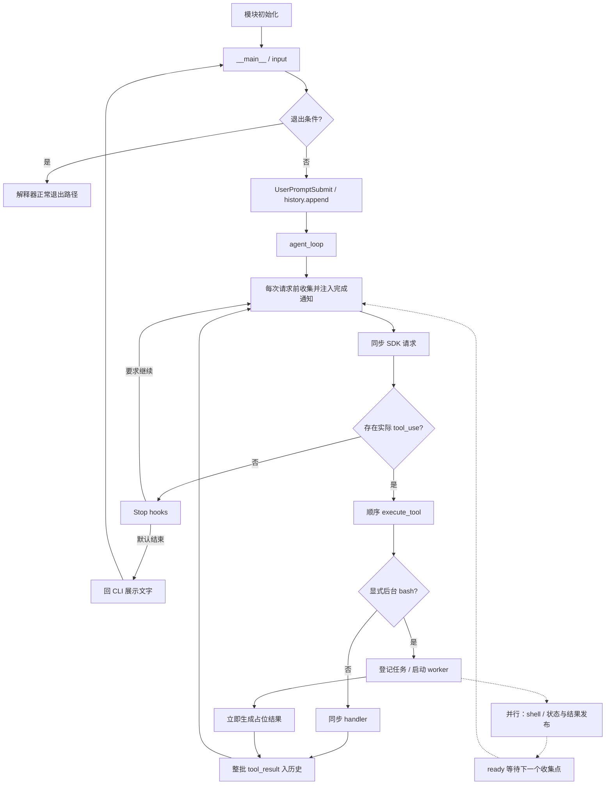
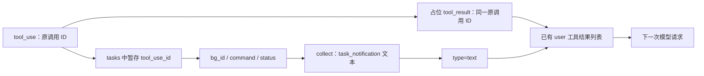
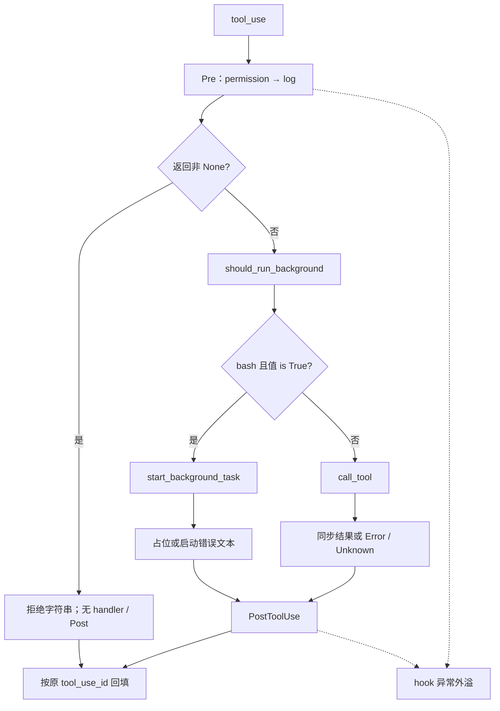
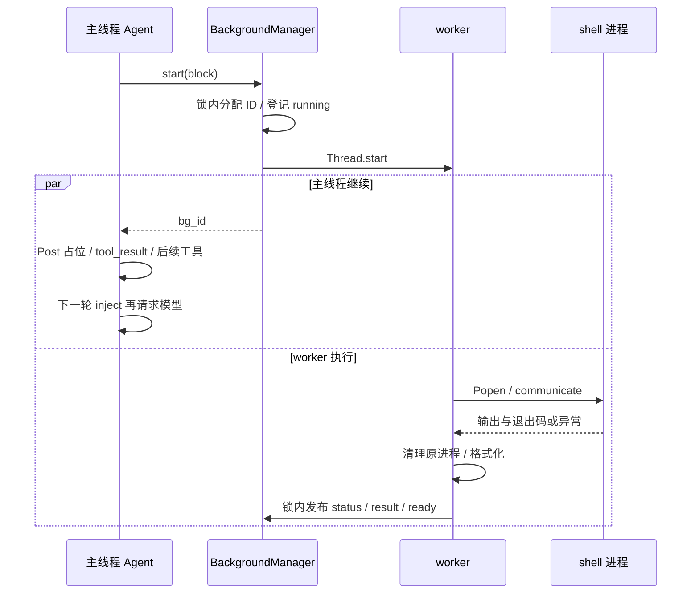
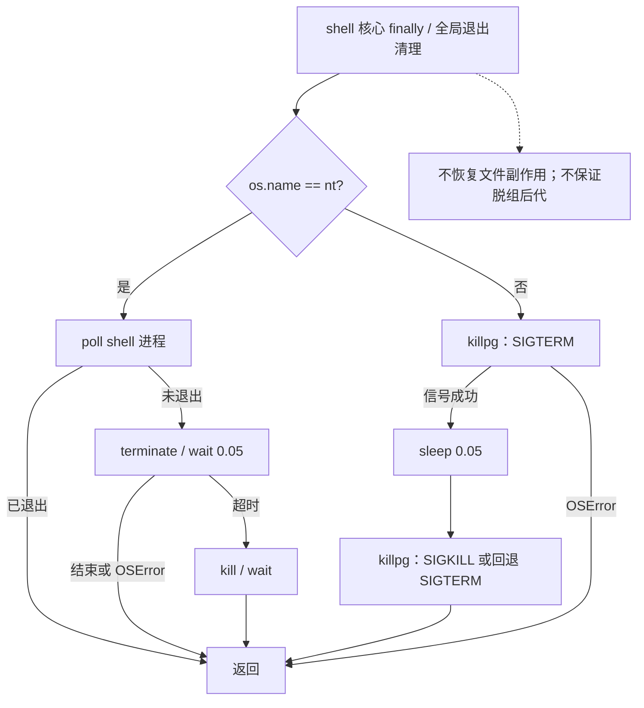
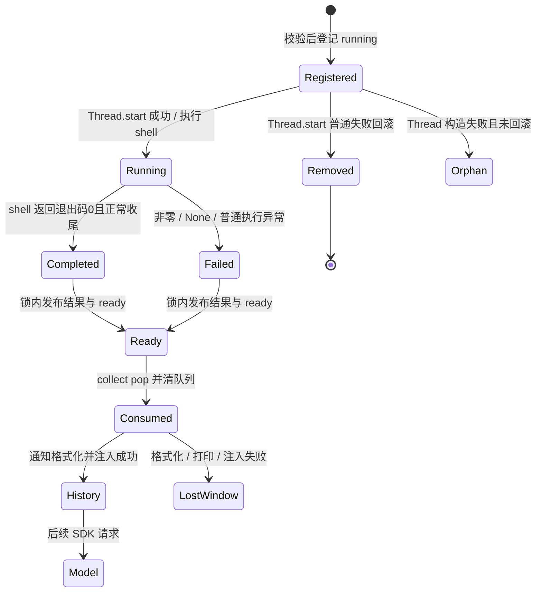
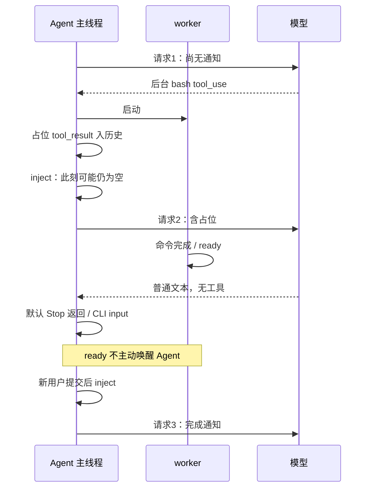
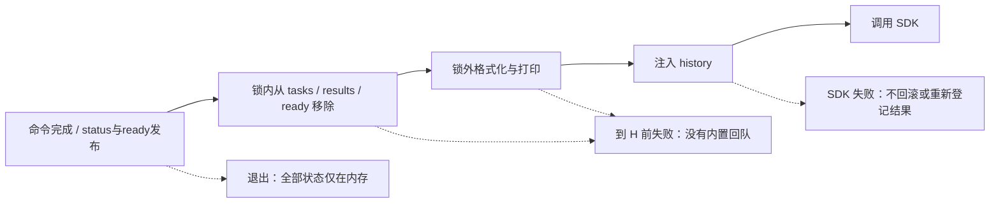

> 待分析代码位置：`s11_background_tasks/code.py`。
>
> 功能描述：从真实 CLI 入口出发，沿调用、分支和返回位置，逐步解释同步工具怎样接入模型循环，显式后台 bash 怎样启动线程和子进程，完成结果怎样以通知进入历史，以及进程退出时实际清理哪些对象。
>
> 阅读约定：关键步骤先展示带准确行号的连续原始源码，再解释参数来源、进入条件、执行过程、状态与副作用、返回位置和异常边界。本文为当前仓库的静态代码分析，未导入或运行目标模块，未调用模型、启动后台线程、执行目标 shell 或发送信号。既有用例仅作为源码断言证据，不表示已经运行通过；不能由实现直接确定的设计理由明确标为基于代码推断。

# 1. 先看入口：只有主线程驱动模型，后台线程执行命令

## 1.1 CLI 如何建立一个跨提交保留的会话

源码定位：`s11_background_tasks/code.py`，`__main__：历史、输入与退出`，L612–L625。

```python
if __name__ == "__main__":
    print("s11: Background Tasks - explicit background Bash execution")
    print("Enter a question, press Enter to send. Type q to quit.\n")

    history = []  # 对话历史，由 agent_loop 就地增删
    while True:   # 外层交互循环：反复读用户输入，直到用户退出
        try:
            # \001/\002 tell Readline the ANSI escapes have zero display width.
            # （\001/\002 告诉 readline 中间的 ANSI 转义码不占显示宽度，提示符才不会错位）
            query = input("\001\033[36m\002s11 >> \001\033[0m\002")
        except (EOFError, KeyboardInterrupt):
            break  # Ctrl+D（EOF）或 Ctrl+C（中断）时退出
        if query.strip().lower() in ("q", "exit", ""):
            break
```

直接执行脚本才进入这个分支。Python 在判断 __name__ 之前已经执行模块顶层初始化；这里先看入口是阅读顺序，不是把初始化放到入口之后执行。

入口打印提示，创建一个 history 列表，然后反复 input。这个列表保留整个进程中先前用户提交、assistant 和工具结果，不是每输入一次就重建。空串、纯空白、大小写变化的 q／exit 都退出，不是忽略空白。

内层 try 只包围 input。此处的 EOF／KeyboardInterrupt 被转换成 break，后面的模型请求、权限确认、hooks 和工具不受这一小段 except 保护。有效 query 不会被 strip 后覆盖，原始文本继续向下传。

## 1.2 用户消息进入 Agent，回来后才展示文字

源码定位：`s11_background_tasks/code.py`，`__main__：提交、调用与展示`，L626–L634。

```python
        # 触发 UserPromptSubmit 钩子（本课只是打印工作目录）。
        trigger_hooks("UserPromptSubmit", query)
        history.append({"role": "user", "content": query})
        agent_loop(history)
        # 打印模型最后的文字回复（跳过 tool_use 块）。
        for block in history[-1]["content"]:
            if getattr(block, "type", None) == "text":
                print(block.text)
        print()  # 空行，让下一条提示符清爽地开始
```

顺序是触发 UserPromptSubmit、追加 user 消息、同步调用 agent_loop，最后遍历 history 的最后一条消息展示 SDK 文本块。主线程在模型请求期间仍被同步占用；“后台”改变的是选定 bash 命令的等待方式，不是把整个 Agent 或所有工具变成异步。

没有 Agent 锁、ConsoleBroker、自动事件线程或轮询输入的调度器。默认 CLI 中只有这个主线程调用模型、修改历史；后台 worker 只写管理器状态和执行命令，不直接向 history append。

主调用链和后台分叉如下：



虚线是并行任务或待消费数据，不是主动唤醒。已经回到 input 后，worker 完成不会使 CLI 自动跳到模型请求。图中“立即”表示不等待命令结束，仍有校验、线程启动、打印和 hooks 的同步成本。

下面回溯入口前的初始化，再从用户提交重新接回主线。

# 2. 模块初始化：配置、回调和管理器何时建立

## 2.1 导入与可选 readline

源码定位：`s11_background_tasks/code.py`，`模块导入与 readline`，L23–L46。

```python
import atexit      # 注册进程退出时的清理函数
import glob        # 文件名模式匹配（glob 工具用）
import os          # 环境变量、平台判断
import re          # 正则：危险命令匹配
import signal      # 信号处理：进程被终止时清理子进程
import subprocess  # 启动子进程执行 shell 命令
import threading   # 线程：后台任务在独立线程里跑；用锁保护共享状态
import time        # 短暂 sleep，给进程留一点退出时间
from pathlib import Path  # 面向对象的路径操作

try:
    import readline

    # 以下四行是 macOS 上 libedit 库的 UTF-8 修复，让终端能正确处理中文。
    readline.parse_and_bind("set bind-tty-special-chars off")
    readline.parse_and_bind("set input-meta on")
    readline.parse_and_bind("set output-meta on")
    readline.parse_and_bind("set convert-meta off")
except ImportError:
    # Windows 自带 Python 没有 readline，跳过即可，不影响主逻辑。
    pass

from anthropic import Anthropic  # Anthropic 官方 Python SDK 客户端
from dotenv import load_dotenv   # 从 .env 文件加载环境变量
```

标准库为退出回调、匹配路径、环境、正则、信号、子进程、线程和短暂等待提供能力。没有动态加载其他教学章节，注释“From s04”指代码组织来源，不是运行时 import s04。也没有持久化 Task、Cron、队友或 MCP 依赖。

readline 导入成功就执行四条绑定；except 只捕获 ImportError，不是忽略一切终端设置错误。Anthropic 和 dotenv 是必须可导入的第三方依赖，缺失会在入口之前失败。

requirements.txt:1–3 声明 anthropic、python-dotenv、pyyaml；当前模块直接使用前两者，没有 YAML 调用。依赖列表没有替程序声明完整的平台和 Python 版本支持矩阵。代码使用联合类型语法、glob 的 root_dir 等 API，实际运行仍需相应 Python 环境。

## 2.2 读取环境、固定工作目录、创建客户端

源码定位：`s11_background_tasks/code.py`，`dotenv、WORKDIR、client 与 MODEL`，L48–L56。

```python
# override=True：即使系统里已有同名环境变量，也用 .env 里的值覆盖。
load_dotenv(override=True)
if os.getenv("ANTHROPIC_BASE_URL"):
    # 配了自定义端点时移除可能冲突的 ANTHROPIC_AUTH_TOKEN，避免两种鉴权打架。
    os.environ.pop("ANTHROPIC_AUTH_TOKEN", None)

WORKDIR = Path.cwd()  # 工作目录：文件工具与路径校验的基准
client = Anthropic(base_url=os.getenv("ANTHROPIC_BASE_URL"))
MODEL = os.environ["MODEL_ID"]  # 从环境变量读模型 ID
```

dotenv override=True 允许加载结果覆盖现有环境变量。自定义端点非空时，代码从当前进程环境删除 AUTH_TOKEN，再创建 SDK 客户端；这是环境修改，不只是读取。本文只分析这些语句，不读取真实配置或密钥。

WORKDIR 在模块加载时取 Path.cwd，之后不是每次工具调用重新取 cwd；也不跟随源码目录定位。SDK 构造在必需的 MODEL_ID 读取之前，构造自身或后续缺失模型变量都可能先于 CLI 报错。

此时创建客户端不等于发起模型请求，实际 create 位于 agent_loop。初始化异常没有被入口的 input except 保护。

## 2.3 system prompt 只要求独立命令，不证明命令独立

源码定位：`s11_background_tasks/code.py`，`ENVIRONMENT_PROMPT 与 SYSTEM`，L58–L71。

```python
# 根据操作系统告诉模型它面对的 shell 语法，避免生成错误的命令风格。
ENVIRONMENT_PROMPT = (
    "Windows: the bash tool runs through cmd.exe; use cmd.exe syntax, not Unix "
    "Bash or PowerShell syntax, and prefer dedicated file tools for file operations"
    if os.name == "nt"
    else "Unix-like: the bash tool runs the system shell"
)
# 系统提示词里多了一句关键约定：只有「相互独立」的 bash 命令才允许放后台。
# 因为后台命令不阻塞主线程，若几件事本有先后依赖，放后台就会乱序执行。
SYSTEM = (
    f"You are a coding agent at {WORKDIR}. Environment: {ENVIRONMENT_PROMPT}. "
    "Use tools to solve tasks. "
    "Set run_in_background to true only for independent Bash commands."
)
```

平台提示告诉模型系统 shell 的语法，Windows 提示 cmd.exe；名叫 bash 的工具不意味着一定使用 Bash。实际执行通过 shell=True 交给当前系统 shell。

新增规则要求仅把 independent Bash commands 放后台。这是模型行为提示：代码没有读取依赖图、比较文件读写集合或等待前置任务的逻辑。模型如果把依赖命令误判为独立，分发器不会自动纠正，后台命令可能与后续操作并发竞争。

## 2.4 进程登记与退出回调：导入已发生进程级副作用

源码定位：`s11_background_tasks/code.py`，`shell 进程集合与锁`，L78–L81。

```python
# 进程登记簿：登记当前所有活着的 shell 子进程，退出时统一收尸。
_shell_processes: set[subprocess.Popen] = set()
# 保护登记簿的锁。用 RLock（可重入锁）：同一线程可以重复加锁而不死锁。
_shell_process_lock = threading.RLock()
```


源码定位：`s11_background_tasks/code.py`，`退出回调与 SIGTERM 注册`，L136–L137。

```python
atexit.register(_stop_all_shell_processes)  # 正常退出时也清理
signal.signal(signal.SIGTERM, _handle_termination_signal)  # 被 SIGTERM 杀掉时清理
```

集合最初为空，RLock 保护后面的登记、快照和移除操作；创建集合本身没有创建子进程。

atexit.register 登记函数引用，不立即执行清理。signal.signal 则在导入时安装 SIGTERM handler，会影响整个进程原有信号处理，并未保存或链式调用先前 handler。Python 通常只允许在主线程设置信号处理器，因此在普通 worker 线程加载模块可能在这里失败，后面的工具与管理器初始化尚未全部完成。

注册顺序也有区别：atexit 先登记，signal 后安装。不能把模块加载写成无副作用的纯函数定义。回调的执行体留到第 18 章实际退出链展开，进程组停止函数则在首次 shell finally 调用时深入。

## 2.5 模型工具声明与 Python handler 是两份表

源码定位：`s11_background_tasks/code.py`，`TOOLS 与 TOOL_HANDLERS`，L248–L284。

```python
TOOLS = [
    {"name": "bash", "description": "Run a shell command.",
     "input_schema": {"type": "object",
                      "properties": {
                          "command": {"type": "string"},
                          "run_in_background": {"type": "boolean"}},
                      "required": ["command"]}},
    {"name": "read_file", "description": "Read file contents.",
     "input_schema": {"type": "object",
                      "properties": {"path": {"type": "string"},
                                     "limit": {"type": "integer"}},
                      "required": ["path"]}},
    {"name": "write_file", "description": "Write content to a file.",
     "input_schema": {"type": "object",
                      "properties": {"path": {"type": "string"},
                                     "content": {"type": "string"}},
                      "required": ["path", "content"]}},
    {"name": "edit_file", "description": "Replace exact text in a file once.",
     "input_schema": {"type": "object",
                      "properties": {"path": {"type": "string"},
                                     "old_text": {"type": "string"},
                                     "new_text": {"type": "string"}},
                      "required": ["path", "old_text", "new_text"]}},
    {"name": "glob", "description": "Find files matching a glob pattern; ** matches recursively.",
     "input_schema": {"type": "object",
                      "properties": {"pattern": {"type": "string"}},
                      "required": ["pattern"]}},
]

# 分发表：工具名 -> 处理函数。
TOOL_HANDLERS = {
    "bash": run_bash,
    "read_file": run_read,
    "write_file": run_write,
    "edit_file": run_edit,
    "glob": run_glob,
}
```

这里只保留五种工具。bash schema 增加可选 boolean 参数 run_in_background，command 仍必填；其他工具没有后台参数。工具描述给模型，handler 表供宿主按名路由，两者不是相互自动生成。

| 模型工具 | Python handler | 后台分支 |
| --- | --- | --- |
| bash | run_bash | execute_tool 可绕开同步 handler，交给 BackgroundManager |
| read_file | run_read | 无，始终按普通 handler 调用 |
| write_file | run_write | 无 |
| edit_file | run_edit | 无 |
| glob | run_glob | 无 |

声明未统一禁止额外字段，也没有本地通用 JSON Schema 验证器。Python 绑定和分支内部校验会在各自位置生效，不能把 schema 当作已经执行过的完整参数验证。

tests/test_background_tasks.py:66–79 的源码断言检查这五个名字、bash 开关、四类 hooks，以及不存在 Task 和 MEMORY_DIR，支持精简内核这一分析边界，不表示运行时加载 s04。

## 2.6 注册 hooks，只登记函数，不执行工具

源码定位：`s11_background_tasks/code.py`，`HOOKS 与 register_hook`，L290–L296。

```python
# 四个事件各对应一个回调列表。
HOOKS = {"UserPromptSubmit": [], "PreToolUse": [], "PostToolUse": [], "Stop": []}


def register_hook(event: str, callback):
    # 注册：把回调追加到对应事件的列表。
    HOOKS[event].append(callback)
```


源码定位：`s11_background_tasks/code.py`，`默认 hooks 注册顺序`，L389–L394。

```python
# 注册回调。
register_hook("UserPromptSubmit", context_inject_hook)
register_hook("PreToolUse", permission_hook)
register_hook("PreToolUse", log_hook)
register_hook("PostToolUse", large_output_hook)
register_hook("Stop", summary_hook)
```

register_hook 直接向对应列表 append，没有事件名检查、去重或锁。正常模块初始化顺序明确：PreToolUse 中 permission 在前、log 在后；Post 只有输出大小提醒，Stop 只有统计。

登记时没有调用 callback。触发器的短路行为在首次用户提交时展开。默认后台 worker 也不遍历这些 hooks。

## 2.7 创建 BackgroundManager，先建状态而不启动线程

源码定位：`s11_background_tasks/code.py`，`BackgroundManager.__init__`，L414–L422。

```python
class BackgroundManager:
    # 后台任务管理器：负责启动后台任务、记录状态、收集结果。

    def __init__(self):
        self.tasks: dict[str, dict] = {}   # task_id -> 任务元信息（命令、状态…）
        self.results: dict[str, str] = {}  # task_id -> 执行结果文本
        self._ready: list[str] = []        # 已完成、等待被收集的 task_id 队列
        self._counter = 0                  # 自增计数器，用来生成 task_id
        self._lock = threading.Lock()      # 锁：保护上面这些共享状态（多线程会并发访问）
```


源码定位：`s11_background_tasks/code.py`，`BACKGROUND 单例与内部字典别名`，L502–L504。

```python
BACKGROUND = BackgroundManager()  # 模块级单例
background_tasks = BACKGROUND.tasks      # 暴露内部字典，便于观察/调试
background_results = BACKGROUND.results
```

单例构造建立两份字典、一份完成 ID 队列、计数器和普通 Lock。直到 start 被调用才会创建线程。

| 内存对象 | 键／元素与用途 | 何时清理 |
| --- | --- | --- |
| tasks | bg_id → 原 tool_use_id、command、status | 完成后被 collect pop；启动失败可移除 |
| results | bg_id → 格式化后的结果文本 | collect pop |
| _ready | 已发布终态的 bg_id，决定收集顺序 | collect 批量清空 |
| _counter | 当前管理器 ID 计数 | 不回收，进程结束丢失 |
| _lock | 管理器发布、创建和消费的进程内互斥 | 不覆盖 shell、history 或文件内容 |

background_tasks 和 background_results 是同一字典的别名，不是复制或只读视图。直接修改它们会绕过管理器锁和状态协议；后文所有并发保证都以调用方遵守默认方法为前提。

shell 登记锁和管理器锁是两把不同的锁。前者保护 Popen 对象集合，后者保护任务元信息和完成队列；没有一把锁覆盖“启动进程—改状态—注入历史”的整个事务。

现在返回入口：初始化已完成，可以执行 UserPromptSubmit 并进入 Agent。

# 3. 用户提交：hook 返回值与异常不是一回事

## 3.1 第一次触发 trigger_hooks

源码定位：`s11_background_tasks/code.py`，`trigger_hooks`，L299–L305。

```python
def trigger_hooks(event: str, *args):
    # 触发：依次调用回调；某个回调返回非 None 就视为拦截，立即停止并返回该结果。
    for callback in HOOKS[event]:
        result = callback(*args)
        if result is not None:
            return result
    return None
```


源码定位：`s11_background_tasks/code.py`，`context_inject_hook`，L367–L370。

```python
def context_inject_hook(query: str):
    # 用户提交提示词时触发：打印一下当前工作目录。
    print(f"\033[90m[HOOK] UserPromptSubmit: working in {WORKDIR}\033[0m")
    return None
```

入口的 query 原文作为参数进入 trigger。callback 按列表顺序执行，首个非 None 结果立即返回，包括 False、0、空字符串；没有 try 或通用异常包装。

调用方 L627 不读取返回值，所以自定义用户 hook 返回拒绝文本，只会阻止后续 callbacks，不会阻止 L628 追加消息。真正能阻断追加的是向上抛异常。

默认 context_inject_hook 只 print WORKDIR 并返回 None，没有把环境信息再塞入 messages，也不改 system。不能根据 inject 这个名字补写上下文注入能力。

## 3.2 追加历史，然后同步进入模型循环

默认 callback 返回后，入口追加一条 role=user、content=query 的字典。这是 history 的原地修改，agent_loop 接收同一个列表引用，不复制为隔离会话。

主线程此时还没有启动任何新的后台任务。先前提交留下的 worker 则可能继续执行，这也是下一步必须收集完成结果的原因。默认 worker 不改这份 history，因此 CLI 本身没有两个线程同时 append；嵌入宿主若并发调用 agent_loop，源码不会自动为其建立会话锁。

**返回位置：** context hook → trigger → 入口 L628 追加消息 → L629 调用 agent_loop，第一件事不是 SDK，而是完成结果注入。

# 4. 第一次进入 Agent：先进入后台结果收集链

## 4.1 每次模型请求之前都收集，不是每次用户输入只收一次

源码定位：`s11_background_tasks/code.py`，`agent_loop：循环开头`，L571–L576。

```python
def agent_loop(messages: list):
    while True:
        # 【关键】每轮调用模型之前，先把后台任务的完成通知注入对话。
        # 放在这里是因为：后台结果只可能在「下一轮」被看到，
        # 而且必须在调用模型之前塞进去，模型才有机会读到它。
        inject_background_results(messages)
```


源码定位：`s11_background_tasks/code.py`，`inject_background_results：调用收集与空结果`，L523–L527。

```python
def inject_background_results(messages: list) -> int:
    # 把已完成的后台任务通知注入到对话里，返回注入了几条。
    notifications = collect_background_results()
    if not notifications:
        return 0
```


源码定位：`s11_background_tasks/code.py`，`collect_background_results`，L519–L520。

```python
def collect_background_results() -> list[str]:
    return BACKGROUND.collect()
```

agent_loop 的 while 每转一次都调用 inject，所以同一个用户请求的工具续轮中也会收集；这与 s12 在 while 外消费定时队列不同。第一次 fresh 会话通常没有完成结果，仍完整经过这个调用链。

inject 先调用包装函数，包装函数直接委托单例 collect，不额外复制、不加重试、不写磁盘。结果为空就返回零；agent_loop 不接收返回值，不因零结果睡眠或等待后台任务。

## 4.2 collect 的锁内部分：完成任务被一次性取走

源码定位：`s11_background_tasks/code.py`，`BackgroundManager.collect：锁内消费`，L475–L485。

```python
    def collect(self) -> list[str]:
        # 收集所有已完成的后台任务结果，打包成给模型看的「通知」文本。
        # 只有在 collect 时才会真正把结果从字典里取出（并移除），避免重复上报。
        with self._lock:
            ready = []
            for task_id in self._ready:
                task = self.tasks.pop(task_id, None)
                result = self.results.pop(task_id, "")
                if task is not None:
                    ready.append((task_id, task, result))
            self._ready.clear()
```

取得管理器锁后按 _ready 顺序遍历，对每个 ID 从 tasks 和 results 各 pop 一次；若任务元信息存在，就把三元组放到局部 ready。最后清空共享 _ready，再释放锁。

running 任务没有被放入 _ready，不会在正常链中被此函数取走。results 缺失会用空字符串；tasks 缺失则即使有结果也不会生成通知，结果仍已 pop。这是对异常／外部修改状态的容忍，不是已实现的取消协议。

消费和 worker 终态发布使用同一锁，正常调用下并发 collect 不会拿走同一份已就绪任务两次；后来的完成发布留给下一次 collect。这是进程内原子取走，不是可靠交付。锁不保护后面格式化、print、history 追加或远端模型接收。

## 4.3 collect 的锁外部分：通知构造发生在移除之后

源码定位：`s11_background_tasks/code.py`，`BackgroundManager.collect：通知格式化`，L487–L499。

```python
        notifications = []
        for task_id, task, result in ready:
            # 用类似 XML 的结构包裹，让模型一眼认出「这是一条后台任务完成通知」。
            notifications.append(
                f"<task_notification>\n"
                f"  <task_id>{task_id}</task_id>\n"
                f"  <status>{task['status']}</status>\n"
                f"  <command>{task['command']}</command>\n"
                f"  <summary>{result[:500]}</summary>\n"
                f"</task_notification>"
            )
            print(f"  [background] collected {task_id}: {task['status']}")
        return notifications
```

锁外对局部三元组构造字符串通知，包含 bg_id、终态、完整 command 和 result 前500字符，然后逐条打印 collected。减少锁内格式化时间使 worker 更容易发布，但也出现明确的消费窗口：

1. 共享 tasks/results/ready 已移除。
2. 通知尚未全部格式化或打印完成。
3. 调用方尚未把通知加入 messages。
4. 模型尚未收到请求。

后面任一步失败都没有自动把这些结果放回管理器。即使通知已 append 到局部 notifications，下一条打印抛异常也可能让整个方法不返回；这批完成结果已失去默认重取入口。

通知不是第二个 tool_result，task 中保存的原 tool_use_id 没有在这里使用。基于代码推断，这是为了避免同一个工具调用被重复配对：原调用已由占位结果答复，完成结果改用独立文本事件。

**返回位置：** collect 正常返回通知列表 → collect_background_results → inject L525。非空时继续下一章的历史合并，空则返回 agent_loop L577 发起请求。

# 5. 通知注入：怎样保留原用户消息和工具结果

## 5.1 先包装为普通文本块

源码定位：`s11_background_tasks/code.py`，`inject_background_results：合并 user 尾部`，L529–L539。

```python
    blocks = [{"type": "text", "text": item} for item in notifications]
    # 通常要把通知并入「最后一条用户消息」，但要小心别把整条历史搞坏：
    if messages and messages[-1].get("role") == "user":
        content = messages[-1].get("content", "")
        if isinstance(content, list):
            content.extend(blocks)       # 内容本来就是块列表，直接追加
        else:
            messages[-1]["content"] = [  # 原来是纯文本，先包成块列表再追加
                {"type": "text", "text": str(content)},
                *blocks,
            ]
```

notifications 是 collect 已格式化的字符串列表。每条外包为 type=text 的块，而不是把标签解析成某种 SDK 特殊任务对象。模型看到的是普通用户内容，其中含有类似 XML 的边界文本。

若最后一条消息是 user，读取其 content。列表形态直接 extend，所以已有 tool_result 块仍在前面，完成通知追加在后面；列表对象本身不被替换。字符串或其他非列表形态则被 str 转成一个原始文本块，再加通知，替换原 content。

正常 CLI 首次请求前，尾部通常是刚追加的用户文本；工具续轮前，尾部通常是工具结果块列表。因此两条分支都直接服务真实调用链，不是只为理论兼容。

## 5.2 没有 user 尾部时另建一条

源码定位：`s11_background_tasks/code.py`，`inject_background_results：新建 user 消息`，L540–L543。

```python
    else:
        # 最后一条不是 user（比如历史为空），就新起一条 user 消息承载通知。
        messages.append({"role": "user", "content": blocks})
    return len(notifications)
```

history 为空或末条 role 不是 user，就 append 一条只含通知文本块的 user 消息。返回 len(notifications)，不是当前后台任务总数或成功命令数。调用方并未使用该数值决定是否继续模型。

三种合并关系可用最小映射表示：

| 注入前尾部 | 注入动作 | 保留内容 |
| --- | --- | --- |
| user + 字符串 | 转成原文本块，再追加通知块 | 原用户文本 |
| user + 块列表 | 原地 extend | 已有 tool_result 与文本块 |
| 空历史／非 user | 追加新的 user 块列表 | 原历史不变 |

原始工具配对与完成通知的数据流如下：



原调用 ID 和 bg_id 是不同命名空间，collect 不沿原调用 ID 再发一次 tool_result。通知可与原占位结果出现在同一次后续模型请求中，但也可能晚很多轮。

## 5.3 通知的证据范围与信任边界

command 不截断，summary 只取结果前500字符；而底层常规 shell 输出已先限制到50000字符。模型不能凭通知获得完整日志，也没有 check／read-result 工具从这个管理器取回剩余文本。收集时 tasks 和 results 都已移除，任务 ID 并不是永久可查询的日志索引。

字符串没有进行 XML 转义：命令或输出中的标签、换行可改变视觉边界，但代码并不运行 XML parser，因此不能把它描述成已解析的结构化安全协议。输出可能来自外部命令，包含不可信文字；作为 user 文本进入历史不等于系统指令或新的授权。

`tests/test_background_tasks.py:122–153` 等待一个任务 completed 后，在假 SDK 调用中复制 messages，断言含通知标签、bg_id、completed 和结果文本，再断言 collect 为空。该源码支持“后续请求前注入”和“正常完成结果只消费一次”，不是磁盘可靠投递、ACK 或失败自动重放的证据。

`tests/test_s_full_background.py:11–12` 指向 agents 目录中的其他模块；即使其中也有 BackgroundManager 或通知合并测试，不能代替当前 s11 实现的证据。

**返回位置：** inject 返回 agent_loop L576；agent_loop 忽略返回数量，立即进入 SDK 请求。注入错误会向外传播，没有 catch 恢复已消费结果。

# 6. 模型请求与响应分流：这里没有 SDK 错误恢复层

## 6.1 请求使用固定配置和持续增长的历史

源码定位：`s11_background_tasks/code.py`，`agent_loop：SDK 请求与 assistant 追加`，L577–L585。

```python
        response = client.messages.create(
            model=MODEL,
            system=SYSTEM,
            messages=messages,
            tools=TOOLS,
            max_tokens=8000,
        )
        # 把模型回复追加为 assistant 消息。
        messages.append({"role": "assistant", "content": response.content})
```

model 来自初始化时的 MODEL，system 来自固定 SYSTEM，messages 是共享历史原引用，tools 是五项固定声明，max_tokens=8000 限制本次响应输出。没有每次重新发现工具，也没有独立子模型或后台模型调用。

在此同步等待模型时，已经启动的命令线程仍可完成并发布结果，但本次请求前的 inject 已结束，新完成结果不会被代码中途追加给这次远端请求；需等下一个显式收集点。

SDK 返回后先把 response.content 原样放到 assistant 历史。没有复制 SDK 内容为自定义结构，也没有检查回答是否客观满足用户需求。请求输出上限不等于总 token、费用或总轮数预算。

## 6.2 异常不被本循环捕获

L571–609 整个 agent_loop 没有 try/except。SDK 请求失败会直接离开该调用；普通 CLI 也只在 input 周围捕获异常，所以通常继续向解释器顶层传播，最终可能进入退出清理。这里不能搬用 s12 的“打印错误后返回、撤回定时消息并回队”机制。

通知若已注入 history，失败不会自动删除；管理器此前已消费，失败也不会重新放回。嵌入宿主可以自己捕获后再调用，但那是外部调用方的选择，不是本模块的内置恢复。SDK 还没返回时不会有本次 assistant；response.content 访问或后续内容解析错误也没有额外保护。

源码未显式实现退避、备用模型、上下文压缩、截断续写或请求总量上限。SDK 自身默认重试和超时不能从依赖名字补写，本文不宣称其绝无内部处理，也不把其他章节的 with_retry 机制归到本章。

## 6.3 提取实际 tool_use，不依赖 stop_reason

源码定位：`s11_background_tasks/code.py`，`agent_loop：工具提取与无工具分支`，L587–L597。

```python
        # 筛出 tool_use 块；没有则这一轮结束。
        tool_calls = [
            block for block in response.content if block.type == "tool_use"
        ]
        if not tool_calls:
            # 触发 Stop 钩子；若返回内容则当作新的用户消息继续循环。
            force = trigger_hooks("Stop", messages)
            if force:
                messages.append({"role": "user", "content": force})
                continue
            return
```

工具列表来自每个内容块的 type 属性，不读取 stop_reason。无真实工具即走 Stop，哪怕 stop_reason 声称 tool_use；存在实际工具则继续分发，即使 stop_reason 是 end_turn。模型内容需满足该对象属性接口，不是任意 dict 块都会被这里识别。

空工具列表不会生成一条空 user 工具结果消息。输出被截断时没有专门恢复分支：若 content 已含工具块就按现有块执行，否则进入 Stop，不能推断自动续写或提高输出上限。

`tests/test_agent_loop_boundaries.py:13–31,221–274` 的 LESSONS 包含 s11，断言无实际工具时不追加空结果，以及 stop_reason=end_turn 的真实工具仍被配对执行。该用例替换 hooks 和后台注入等副作用，不能扩展为同时验证了真实 worker 生命周期。

无工具结束在第 16 章回到此处；现在沿实际工具分支进入 execute_tool。

# 7. 统一分发的第一道：权限与日志先于后台判断

## 7.1 PreToolUse 返回任何非 None 都拒绝

源码定位：`s11_background_tasks/code.py`，`execute_tool：PreToolUse 与后台判断入口`，L546–L552。

```python
def execute_tool(block) -> str:
    # 执行工具：先过 PreToolUse 钩子 → 判断要不要放后台 → 执行 → 过 PostToolUse。
    blocked = trigger_hooks("PreToolUse", block)
    if blocked is not None:
        return str(blocked)  # 被拦截：把拦截原因当作结果返回

    if should_run_background(block.name, block.input):
```

block 来自主模型当前响应。先调用第 3 章分析的 trigger，默认依次执行 permission 和 log。trigger 用非 None 短路，execute 也用 is not None：False／空字符串也会拒绝，并变成工具结果文本，不是只对 truthy 结果拒绝。

Pre 位于后台启动 try 和同步 handler try 之外；hook 抛异常不会被工具层统一转成 Error。拒绝提前返回，不调用 handler、不开线程、不触发 Post。后台参数不能绕过此处权限。

## 7.2 命令规则不是完整 shell 解析

源码定位：`s11_background_tasks/code.py`，`黑名单、破坏性命令规则与 contains_destructive_command`，L308–L317。

```python
DENY_LIST = ["rm -rf /", "sudo", "shutdown", "reboot", "mkfs", "dd if="]  # 硬黑名单：命中直接拒
DESTRUCTIVE_COMMAND_WORD = re.compile(
    # 匹配作为独立命令出现的 rm/del（前置边界避免误伤 "firm" 这类子串）
    r"(?i)(?:^|[;&|()\n])\s*(?:rm|del)(?=\s|$|[;&|()])"
)
DESTRUCTIVE = ["rm ", "> /etc/", "chmod 777"]  # 其他危险特征（需人工确认）


def contains_destructive_command(command: str) -> bool:
    return bool(DESTRUCTIVE_COMMAND_WORD.search(command))
```

黑名单后面按原 command 子串包含判断，区分大小写，可能过宽或漏掉等价写法。删除正则匹配命令起点或特定分隔符后的 rm／del，忽略大小写并检查词边界；另有 rm 空格、写 /etc、chmod 777 等子串触发确认。

两个机制只启发式识别命令文本，不处理所有引号、变量、别名、shell 组合或平台语法。它们既不是系统权限控制，也不证明命令最终访问范围可控。

`tests/test_permission_command_words.py:11–27,91–127` 参数化范围包括 s11，具体覆盖删除词大小写、若干分隔位置、完整路径／command 前缀与普通单词边界。不能由这些断言扩展为完整 shell 安全保证。

## 7.3 bash 权限：黑名单硬拒绝，疑似破坏性再确认

源码定位：`s11_background_tasks/code.py`，`permission_hook：bash 分支`，L320–L336。

```python
def permission_hook(block):
    # 工具执行前：bash 先查硬黑名单（命中直接拒绝），再查危险特征（询问用户）；
    # 文件工具则检查路径是否越界。
    if block.name == "bash":
        command = block.input.get("command", "")
        for pattern in DENY_LIST:
            if pattern in command:
                print(f"\n\033[31m[blocked] '{pattern}'\033[0m")  # 红色提示
                return "Permission denied by deny list"
        if contains_destructive_command(command) or any(
            keyword in command for keyword in DESTRUCTIVE
        ):
            print("\n\033[33m[permission] Potentially destructive command\033[0m")
            print(f"   Tool: {block.name}({block.input})")
            choice = input("   Allow? [y/N] ").strip().lower()
            if choice not in ("y", "yes"):  # 默认拒绝（直接回车 = N）
                return "Permission denied by user"
```

command 从 block.input.get 读取。先遍历黑名单，命中即打印并返回拒绝，不让用户回答 y 覆盖。未命中而被危险特征标记，打印完整工具参数并 input；只有 strip/lower 后的 y 或 yes 放行，其余包括空输入均拒绝。

普通命令不一律询问。后台命令也在主线程进入这个分支，因此后台执行前可以先进行人工确认。worker 不会重复执行此 hook。

s11 没有 s12 request_permission 的“非主线程直接拒绝”判断。默认 CLI 由主线程调用是使用方式，不能说 permission_hook 自身保证任何线程都不争抢 stdin。嵌入宿主改变调用线程时需承担该差异。

权限 input 的 EOF／KeyboardInterrupt 不在 CLI input 的局部捕获范围内，且不在 handler try 内。缺少 command 时 hook 使用空字符串，后面分支决定怎样拒绝；错误类型若先在子串／正则处抛错，则会直接外溢，尚未进入正常 handler 包装。

## 7.4 文件权限：越界询问，不是不可越界

源码定位：`s11_background_tasks/code.py`，`permission_hook：文件路径分支`，L338–L347。

```python
    if block.name in ("read_file", "write_file", "edit_file"):
        # 文件工具：路径解析后落在工作目录之外，就询问用户是否放行。
        path = block.input.get("path", "")
        if not (WORKDIR / path).resolve().is_relative_to(WORKDIR):
            print("\n\033[33m[permission] Access outside workspace\033[0m")
            print(f"   Tool: {block.name}({block.input})")
            choice = input("   Allow? [y/N] ").strip().lower()
            if choice not in ("y", "yes"):
                return "Permission denied by user"
    return None
```

read／write／edit 用 WORKDIR 拼 path 后 resolve，再判断实际路径是否属于 WORKDIR。目录内默认放行，越界则询问；允许后 handler 没有另一层 safe_path 硬拒绝，外部文件确实可被访问。

glob 不走这段，而在自身 handler 过滤输出路径。未知工具也不自动询问确认，接下来由 call_tool 返回 Unknown。后台管理器接口并不是权限入口，直接调用 start_background_task 或 run_bash 可以绕过此 hook；文档区分模型默认入口与可信 Python API。

文件检查和稍后打开是两次操作，没有绑定文件描述符或版本，不能把路径检查写成完整竞态消除。shell 还可自行访问其他路径，固定 cwd 不构成沙箱。

## 7.5 日志只预览输入，异常仍可能中断分发

源码定位：`s11_background_tasks/code.py`，`log_hook`，L350–L354。

```python
def log_hook(block):
    # 只观测不干预：灰色打印工具名与前两个参数（截断 60 字符），返回 None 放行。
    preview = str(list(block.input.values())[:2])[:60]
    print(f"\033[90m[HOOK] {block.name}({preview})\033[0m")
    return None
```

默认权限返回 None 后，日志取输入字典前两个值，字符串化后截60字符；不是完整审计或持久记录。拒绝的调用不会到这里，权限函数自己的打印与日志 hook 是两回事。

log 依赖 input 的映射接口，并可能因打印错误失败。它在 handler try 之外，所以“工具异常都能转文本”只适用于后面明确保护的部分。默认返回 None，最后回 execute_tool L552 判断后台。

权限和执行的分支关系如下：



图中 Post 在两条执行分支之后，但不表示它会在后台命令完成时再次执行。继续深入显式后台判断。

# 8. 显式开关与两条调用分支：schema 不等于统一校验

## 8.1 只有布尔单例 True 才选择后台

源码定位：`s11_background_tasks/code.py`，`should_run_background`，L507–L512。

```python
def should_run_background(tool_name: str, tool_input: dict) -> bool:
    # 该不该放后台：仅当是 bash，且模型显式传了 run_in_background=True。
    return (
        tool_name == "bash"
        and tool_input.get("run_in_background") is True
    )
```

tool_name 来自 block.name，tool_input 来自 block.input。工具名不是 bash 时 and 短路，完全不需要读取后台参数；是 bash 才从输入取开关并做 identity 比较。

| 输入 | 后台判断 | 后续行为 |
| --- | --- | --- |
| bash，开关缺省／false | false | 同步 call_tool |
| bash，JSON true 解码为 True | true | 管理器启动 |
| bash，字符串 "true" | false | 同步 handler 接收该值但不据此后台 |
| bash，数字1 | false | 1 is True 为假 |
| 其他工具，开关 true | false | 普通 handler，额外字段可能绑定失败 |

command 中含 install／build／test 不会自动改变分支。该函数不校验命令类型，也不证明独立性；只是路由选择。

`tests/test_background_tasks.py:82–92` 断言 install 文本不自动后台、bash 显式 true 可以、write_file 即使带 true 也不走后台。字符串／数字行为则直接由 is True 静态推导，不假称用例已覆盖所有类型。

## 8.2 同步调用的参数绑定与错误文本

源码定位：`s11_background_tasks/code.py`，`call_tool`，L397–L407。

```python
def call_tool(block) -> str:
    # 真正执行一个工具：查分发表、按关键字展开参数调用处理函数。
    # 注意本课特意把它从 execute_tool 里拆出来——因为 execute_tool 现在还多了
    # 一步「判断要不要放后台」，拆开后职责更清晰。
    handler = TOOL_HANDLERS.get(block.name)
    try:
        # **block.input 按关键字展开参数字典；未知工具给出提示。
        output = handler(**block.input) if handler else f"Unknown: {block.name}"
    except Exception as error:
        output = f"Error: {error}"  # 工具抛异常不打断循环，转成文本交给模型
    return str(output)
```

按名字查 handler 后，在 try 中进行 kwargs 展开。缺必填参数、额外参数、handler 普通异常会被转换为 Error；未知工具返回 Unknown，不必进行该未知 handler 的参数绑定。最后 str 确保普通分支返回字符串。

但查表前的 Pre 已经触碰参数，某些坏类型先在那里失败；call_tool 的错误包装并不覆盖整个工具链。str(output) 也在其 try 之外，特殊返回对象的转换错误仍可能外溢，虽然默认 handler 返回字符串。

此处先确认共同调用约定。同步 bash 和四个文件 handler 的完整行为在第 14 章分析；现在选择后台分支，说明它并不使用 handler(**input)。

## 8.3 后台分支只读取自己需要的字段

源码定位：`s11_background_tasks/code.py`，`execute_tool：启动 try、占位、Post 与返回`，L552–L566。

```python
    if should_run_background(block.name, block.input):
        # 放后台：立刻返回一个「已启动」的占位结果，真正的输出稍后再收集。
        try:
            task_id = start_background_task(block)
            output = (
                f"[Background task {task_id} started] "
                "The result will be collected on a later turn."
            )
        except Exception as error:
            output = f"Error: {error}"
    else:
        output = call_tool(block)  # 前台：同步执行，直接拿到结果

    trigger_hooks("PostToolUse", block, output)
    return output
```

后台分支 try 包住 start 调用和占位文本构造；启动普通异常转成 Error，然后仍执行 Post。同步分支委托 call_tool 自己处理 handler 普通异常。

管理器按字段读取 command 和 block.id，不把完整 input 展开到 run_bash。因此多余字段在后台分支可能被忽略，而同步分支会遭遇 Python 签名拒绝；不能写成两分支共享一套严格参数校验。例如额外 foo 在后台并不自动拒绝，但在同步 run_bash 绑定时通常得到 TypeError。

Pre／should 判断和最后 Post 不在后台 try 中。Post 对正常后台输出看到的只是 started 占位字符串，不是最终日志。占位承诺的是已返回一个 bg_id，不能证明命令还在运行或已成功结束。


源码定位：`s11_background_tasks/code.py`，`large_output_hook`，L357–L364。

```python
def large_output_hook(block, output):
    # 执行后告警：输出超过 10 万字符就提醒一句，不修改结果。
    if len(str(output)) > 100000:
        print(
            f"\033[33m[HOOK] Large output from {block.name}: "
            f"{len(str(output))} chars\033[0m"
        )
    return None
```

这个默认 Post 只在输出字符串超过100000字符时打印提醒，不截断、不落盘、不修改结果。后台路径传给它的是占位文本，worker 终态没有再次触发 Post，因此最终后台日志不会自动得到同样检查。打印异常仍可能外溢。

`tests/test_background_tasks.py:95–119` 构造一个命中黑名单的后台 bash，断言没有任务登记，且原调用收到 Permission denied 的 tool_result。它直接支持“授权先于后台分发”，不是说所有破坏性命令都会因同一规则被拒绝。

**返回位置：** 下一章先沿 L555 深入 start_background_task；正常返回后回 L556 构造占位，再经 L565 Post 回主循环 L602。

# 9. 启动后台任务：先登记 running，再创建线程

## 9.1 包装函数不额外授权，也不等待

源码定位：`s11_background_tasks/code.py`，`start_background_task`，L515–L516。

```python
def start_background_task(block) -> str:
    return BACKGROUND.start(block)
```

参数 block 是同一个模型工具调用对象，直接交单例 start。这个公开包装没有调用权限 hook、没有检查 run_in_background，也没有等待完成。正常模型入口已经在 execute_tool 做过分支选择；可信 Python 调用方直接调用则绕过该入口，仍会受到 start 自己的 bash／command 校验。

## 9.2 start 的业务检查只覆盖工具名和命令

源码定位：`s11_background_tasks/code.py`，`BackgroundManager.start：输入检查`，L424–L430。

```python
    def start(self, block) -> str:
        # 启动一个后台任务，返回 task_id（形如 bg_0001）。
        if block.name != "bash":
            raise ValueError("Only Bash commands can run in the background")
        command = block.input.get("command")
        if not isinstance(command, str) or not command.strip():
            raise ValueError("Bash command cannot be empty")
```

工具名不为 bash 直接 ValueError；command 必须为 str 且 strip 后非空，否则 ValueError。检查仅用于拒绝空白，不把 strip 后的命令覆盖原值，原文本包括空白仍传入 shell。

这比同步 run_bash 的显式业务校验更多，但不是通用 schema 校验。block.input 需提供 get，block.id 稍后需存在；错误对象可能在不同语句失败。后台开关不在这里检查，因为调用者已经选了路径，直接调用 API 也能强制启动一个合法 bash。

## 9.3 锁内产生 bg_id，并登记工具关联

源码定位：`s11_background_tasks/code.py`，`BackgroundManager.start：ID 与 running 登记`，L432–L439。

```python
        with self._lock:
            self._counter += 1
            task_id = f"bg_{self._counter:04d}"  # 补零成 4 位，如 bg_0001
            self.tasks[task_id] = {
                "tool_use_id": block.id,
                "command": command,
                "status": "running",  # 刚启动，状态是「运行中」
            }
```

管理器锁覆盖计数递增、格式化 ID 和任务表写入，正常多个 start 不会拿到同一个计数。:04d 是最少四位，不会在9999之后截断或重置。计数器只属于这个管理器实例，进程重启或新建实例会从零开始，因此 bg_0001 不具备跨运行唯一身份。

元信息只保存原 tool_use_id、command 和 running。没有 PID、线程对象、开始时间、cwd 快照、预算、退出码或日志路径。tool_use_id 保留用于关联观察，后续 collect 并未把它作为结果配对键。

如果缺 block.id，在构造元信息时可能已消耗计数而没有任务完成登记；本代码不承诺 ID 连续无缺口。running 登记也早于 Thread.start，因此含义是“被接受并准备启动”，不是保证进程已存在。

## 9.4 Thread 构造、start 和日志各有自己的失败窗口

源码定位：`s11_background_tasks/code.py`，`BackgroundManager.start：Thread 启动与回滚`，L441–L455。

```python
        # daemon=True：主程序退出时这个线程会被强制结束，不会拖住整个进程。
        thread = threading.Thread(
            target=self._run,
            args=(task_id, command),
            daemon=True,
        )
        try:
            thread.start()
        except Exception:
            # 线程都没能启动：把刚登记的任务撤掉，避免留下"僵尸"记录。
            with self._lock:
                self.tasks.pop(task_id, None)
            raise
        print(f"  [background] started {task_id}: {command[:60]}")
        return task_id
```

构造 Thread 发生在 start 的局部 try 之前，target 绑定当前管理器的 _run，args 是 bg_id 和 command，daemon=True。它不复制消息历史，也不把原工具调用对象交给 worker。

Thread.start 普通异常会取得管理器锁移除任务，再抛给 execute_tool 转成 Error。counter 不退回，所以失败 ID 不会立即复用。Thread 构造本身若失败，则尚未进入这个补偿 try，running 记录可能保留且没有 worker 来发布终态。

start 成功后再 print started，最后返回 ID。若打印失败，线程可能已经执行命令甚至完成，外层只收到 Error；不存在自动停止这条任务的补偿。daemon 的注释也应收窄为“不阻止解释器退出”，不是保证退出前 worker 能完成清理。

主线程没有保存 Thread 引用或 join 接口。每次成功 start 都创建一条新线程，没有线程池或全局并发数硬上限。120秒限制单条命令的 communicate，不限制短时间可启动多少条命令。

## 9.5 身份与执行对象不要混为一谈

| 身份／对象 | 来源 | 用途与边界 |
| --- | --- | --- |
| tool_use_id | SDK 工具块 block.id | 原调用配对；在 tasks 暂存 |
| bg_id | 管理器计数器 | 当前实例任务索引与完成通知身份 |
| Thread | 每次 start 构造 | 执行 worker，不是模型子代理 |
| Popen／PID | worker 内实际创建进程后产生 | shell 登记与清理 |
| POSIX PGID | start_new_session 下通常以 shell PID 为组标识 | 清理原进程组，不是业务任务身份 |

这些身份没有统一事务：bg_id 已登记时，Thread 或 Popen 可能尚未成功；进程结束后，元信息可能仍等收集；收集删除后，文件副作用仍然保留。

**返回位置：** start 正常返回 bg_id → 包装函数 → execute_tool L556。这里开始必须分开两条并行执行线，不能继续把 worker 当作主线程的同步下一步。

# 10. 主线程得到占位结果，worker 已可并行执行

## 10.1 占位属于原工具调用，不是最终结果

execute_tool 第 8 章的 L556–559 生成 started 文本，经 Post 返回 agent_loop L602。主线程随后把它按原 block.id 构造成 tool_result；仍可继续当前 assistant 中后续工具。这里没有等待 ready，也没有检查 status 是否已终态。

短命令可能在主线程打印 started 之前完成，所以占位文字不能证明任务“现在仍在运行”。它表明启动路径返回了 ID，而不是对终态的查询。

默认 Post 的大输出检测看到这段短占位，worker 最终日志没有再次经过 Post。若 Post 自己抛错，命令可能已启动，但原工具结果尚未回填，管理器也不会因此自动取消任务。

## 10.2 正确的并行时序：只保证线程启动早于它自己的执行



两支没有“主线程一定先发下一次请求”或“worker 一定先完成”的保证。只有在收集点看到 ready，完成结果才会进入当次请求；worker 发布不直接调用模型或追加 history。

线程间共享的是管理器与模块配置，不是独立拷贝的文件系统。后台安装与后续读配置若有真实依赖，仍会竞争同一 WORKDIR；提示独立性不能替代执行依赖保护。

## 10.3 进入 worker：先执行，再格式化，再决定终态

源码定位：`s11_background_tasks/code.py`，`BackgroundManager._run：执行与普通异常`，L457–L465。

```python
    def _run(self, task_id: str, command: str):
        # 后台线程的入口：真正执行命令，然后把结果和状态记下来。
        try:
            output, exit_code = _run_bash_process(command)
            result = _format_bash_result(output, exit_code)
            status = "completed" if exit_code == 0 else "failed"
        except Exception as error:
            result = f"Error: {type(error).__name__}: {error}"
            status = "failed"
```

task_id 和 command 由 Thread 的 args 固定。worker 没有 client.messages.create、工具池、权限询问或独立历史；它不是 subagent，也不会自己解释用户需求。

先调用 _run_bash_process，函数返回后调用 _format_bash_result，退出码为0才 completed，其他包括 None 都 failed。普通 Exception 会统一形成带异常类型的 Error 并标为 failed；这能捕获执行核心 finally 外溢的普通异常，但不捕获 SystemExit／KeyboardInterrupt 等 BaseException，也不包住下面的锁内发布代码。

现在停在 L460，深入共用 shell 核心。必须先走完其 finally 清理，worker 才能拿到正常返回值。

# 11. shell 核心：后台只是换线程，同步调用仍用同一套进程逻辑

## 11.1 Popen 之前：为 POSIX 选择独立 session

源码定位：`s11_background_tasks/code.py`，`_run_bash_process：平台参数与 Popen`，L140–L156。

```python
def _run_bash_process(command: str) -> tuple[str, int | None]:
    # 执行一条 shell 命令，返回 (输出文本, 退出码)；超时或启动失败时退出码为 None。
    process = None
    try:
        # start_new_session (setsid) exists only on POSIX; skip it on Windows.
        # POSIX 上设 start_new_session=True，让子进程另起一个会话/进程组，
        # 这样就能用 killpg 一次性把整组（含孙进程）都杀掉；Windows 不支持，故跳过。
        popen_kwargs = {} if os.name == "nt" else {"start_new_session": True}
        process = subprocess.Popen(
            command,
            shell=True,              # 交给系统 shell 解析（支持管道、重定向等）
            cwd=WORKDIR,             # 固定在工作目录下执行
            stdout=subprocess.PIPE,  # 捕获标准输出
            stderr=subprocess.PIPE,  # 捕获标准错误
            text=True, errors="replace",  # 按文本返回；解码失败也不崩
            **popen_kwargs,
        )
```

command 来自通过 start 检查的字符串；同步入口稍后也会调用同一函数，但不经过 start 的非空校验。process 初始化 None 用于判断启动失败时是否需要清理。

POSIX 分支设置 start_new_session=True，令启动的 shell 建立新的 session／进程组，后面按 process.pid 向原组发信号。Windows 传空 kwargs，没有创建等价的 Job Object 或额外进程树容器。

Popen 使用 shell=True、固定 WORKDIR、stdout/stderr PIPE，text=True 且 errors=replace。环境默认继承宿主，没有按工具构建最小环境；代码也未固定 encoding。替换解码坏字节有助于返回文本，但不能保证保留原始字节证据。

创建进程不是瞬间完成全部任务登记。此时管理器 tasks 已有 running，但 shell 尚未加入 _shell_processes；两个登记簿没有共同提交点。

## 11.2 登记进程后 communicate，同步等待当前命令

源码定位：`s11_background_tasks/code.py`，`_run_bash_process：登记、等待与输出`，L157–L161。

```python
        with _shell_process_lock:
            _shell_processes.add(process)  # 登记，便于退出时清理
        stdout, stderr = process.communicate(timeout=120)  # 等它跑完（最多 120 秒）
        output = (stdout + stderr).strip()
        return (output[:50000] if output else "(no output)"), process.returncode
```

RLock 只保护把 Popen 加入集合，不会在整个 communicate 期间持锁，否则退出清理难以取得快照。communicate 同步读取两条管道并等待，timeout=120；在后台路径阻塞的是 worker，在同步路径阻塞的是 Agent 主线程。

stdout 与 stderr 各自完整取得后串接，再 strip，因此丢失两流的真实交错顺序和首尾空白。输出为空返回 no output，非空只留前50000字符，退出码同时作为第二个 tuple 值返回。非零退出码的常规输出也在这里截断，不像 s12 的非零路径提前返回全量输出。

这是捕获后截断：进程仍可能生成大量数据，communicate 先使用内存保存。截断没有附加“已截断”标记，也没有日志文件供后续恢复。最终通知进一步只保留500字符，模型实际证据更短。

shell 子进程还可能派生后代继承管道；communicate 的返回时点受这些句柄关闭影响，不能简单等同于最初 shell 的用户代码最后一行执行完毕。具体进程拓扑是外部行为，不从一条文本命令推定。

## 11.3 超时与 OSError：退出码 None 不是成功

源码定位：`s11_background_tasks/code.py`，`_run_bash_process：特定异常返回`，L162–L165。

```python
    except subprocess.TimeoutExpired:
        return "Error: Timeout (120s)", None
    except OSError as error:
        return f"Error: {type(error).__name__}: {error}", None
```

TimeoutExpired 返回固定超时文本和 None，没有利用异常中可能存在的部分输出。OSError 返回异常类型与说明以及 None，包含某些进程启动和运行相关系统错误。其他普通异常不在这两个 except 中，继续向调用者传播。

返回 None 表示没有正常完成可用退出码，worker 明确将其判 failed。格式化函数对 None 不再重复加退出码前缀，不代表状态成功。命令超时前或非零退出前可能已经改文件或触发外部动作，这些不会因 Error 文本撤销。

## 11.4 finally 先清理，再允许 tuple 真正返回

源码定位：`s11_background_tasks/code.py`，`_run_bash_process：finally 清理`，L166–L175。

```python
    finally:
        # 无论成功还是失败，都要把进程收干净、并从登记簿里移除。
        if process is not None:
            _stop_process_group(process)
            try:
                process.wait(timeout=0.2)
            except subprocess.TimeoutExpired:
                pass
            with _shell_process_lock:
                _shell_processes.discard(process)
```

只要 Popen 对象已经赋给 process，不论正常、非零、超时或其他异常，都会先调用 _stop_process_group，然后尝试 wait 0.2秒，超时忽略，最后从登记集合 discard。

正常 return 语句的 tuple 已经求值，但控制权要等 finally 完成才交回 worker。因此 status 发布发生在进程清理之后，不是 communicate 一返回就先标 completed。

wait 只捕获 TimeoutExpired；清理函数或 wait 的其他异常可能中断后续 discard，覆盖之前准备返回的结果。若 worker 捕获到这个普通异常，会把任务标 failed，哪怕命令原本退出码为0。这个控制流不能概括成“finally 永远保证登记必清”。

wait 超时被忽略后仍 discard，也不进行最终存活断言；Windows 尤其不能因此承诺后代都已停止。清理不负责恢复文件、回滚安装或撤销网络副作用。

**进入下一层：** L169 首次实际调用 _stop_process_group，下面按平台展开；完成后回 L170 wait／discard，再回 worker L460 接收 tuple。

# 12. 清理进程：Windows 与 POSIX 的保护范围不同

## 12.1 函数的注释目标与实际平台分支

源码定位：`s11_background_tasks/code.py`，`_stop_process_group：函数说明`，L84–L93。

```python
def _stop_process_group(process: subprocess.Popen):
    """Stop a shell process and its children (cross-platform).

    POSIX uses process-group signals (SIGTERM then SIGKILL). Windows has
    neither ``os.killpg`` nor ``signal.SIGKILL``, so it falls back to
    ``Popen.terminate()`` / ``Popen.kill()``.
    """
    # 停止一个 shell 进程及其子进程（跨平台）。
    # 为什么连子进程一起杀？因为用 shell=True 启动时，真正干活的可能是
    # shell 派生出来的子进程；只杀 shell 会留下野进程。
```

函数名和说明表达清理 shell 及子进程的意图，但实现只有两种不同机制。不能因“cross-platform”字样就推定两平台提供完全相同的后代树清理能力。它处理传入 Popen，不查询后台任务表，也不修改任务 status。

## 12.2 Windows：终止的是 Popen 对应进程

源码定位：`s11_background_tasks/code.py`，`_stop_process_group：Windows 分支`，L94–L108。

```python
    if os.name == "nt":
        # Windows 没有进程组信号，只能退而求其次：先 terminate（温和），
        # 不行再 kill（强制）。
        for stop in (process.terminate, process.kill):
            if process.poll() is not None:
                return  # 进程已经退出了
            try:
                stop()
            except OSError:
                return  # 进程已不存在
            try:
                process.wait(timeout=0.05)  # 给它一点时间退出
            except subprocess.TimeoutExpired:
                continue  # 还没退，换更强硬的手段
        return
```

按 terminate、kill 顺序遍历。每次先 poll，进程已退出就直接返回；否则尝试 stop，OSError 也直接返回。stop 后 wait0.05秒，若超时才继续更强手段。

这套逻辑没有遍历子进程树、调用 taskkill /T 或建立 Job Object。最初 shell 已退出但后代仍活着时，poll 的提前返回也不会寻找它们。源码注释说“只能退而求其次”应落实为该边界，不能声称 Windows 与 killpg 一样保证清理整组。

操作系统对 terminate／kill 的具体语义不同于 POSIX 温和信号，再者代码没有确认最后 wait 一定成功。因此“先温和再强制”的展示性注释不应替代平台 API 实际保护范围。

## 12.3 POSIX：对原进程组发信号，不只检查 shell 是否退出

源码定位：`s11_background_tasks/code.py`，`_stop_process_group：POSIX 分支`，L110–L118。

```python
    # SIGKILL is POSIX-only; fall back to SIGTERM on platforms without it.
    # POSIX：给整个进程组发信号——先 SIGTERM（客气），再 SIGKILL（强杀）。
    # 若平台没有 SIGKILL，就退回用 SIGTERM。
    for sig in (signal.SIGTERM, getattr(signal, "SIGKILL", signal.SIGTERM)):
        try:
            os.killpg(process.pid, sig)  # 发给「进程组」（killpg 内部处理组号）
        except (ProcessLookupError, OSError):
            return  # 进程组已不存在
        time.sleep(0.05)
```

先 SIGTERM，后 getattr 获取 SIGKILL，若没有则再次用 SIGTERM。每次 os.killpg(process.pid, sig)，成功后 sleep0.05秒；遇 ProcessLookupError 或 OSError 即返回，不继续另一种信号，也不向上报告具体清理失败。

这里没有按 process.poll 提前返回：即使 shell 已退出，只要同 PGID 后代仍存在，仍尝试清理。正常命令完成也会进入这个函数，因此命令在 shell 文本里自行加 & 并不自动获得持续存活的后台守护进程能力。

独立 session 使初始 shell 的组身份便于定位，却不是安全沙箱。后代主动建立新 session 或改组后，可能离开原组；没有系统级强制容器限制，也没有扫描所有历史后代。注释中“保证不会留下野进程”不能当成绝对结论。

## 12.4 两条清理线如何返回共同调用者



图省略了每次信号后的相同短等待，但保留关键分支。Windows 不向整组发送 killpg，POSIX 也不保证脱组进程被覆盖。

`tests/test_agent_teams_runtime.py:27–32,427–443` 的 BACKGROUND_LESSONS 包含 s11／s15。该具体用例构造 nohup/sh 同组后代，断言原命令结束后延迟写文件不发生；它表达 POSIX shell 场景的清理意图，不能被视为 Windows 后代树行为已得到相同证明。本文不执行它。

**返回位置：** 清理返回 _run_bash_process L170，继续 wait／discard。正常路径最终把输出和先前取得的退出码交回 worker；接下来才做文本格式化和任务终态发布。

# 13. 返回 worker：结果格式化、终态发布和等待收集

## 13.1 退出码格式化与任务状态是两个判断

源码定位：`s11_background_tasks/code.py`，`_format_bash_result`，L178–L183。

```python
def _format_bash_result(output: str, exit_code: int | None) -> str:
    # 统一格式化输出：退出码为 0 或未知（None）时原样返回；
    # 非 0 说明命令失败了，就在输出前面加一行错误提示，让模型能察觉。
    if exit_code in (0, None):
        return output
    return f"Error: command exited with status {exit_code}\n{output}"
```

输入是 shell 核心的 output 和 exit_code。0 或 None 都原样返回 output；非零加 Error 和退出码。None 分支之所以不用再加码，是超时／OSError 已生成解释性文本，不代表 None 被认定成功。

worker 在 L462 单独判断 exit_code==0，因此0为 completed，非零或 None 为 failed。同步调用只拿格式化字符串，没有统一的状态对象。即使命令输出自己包含“success”，退出码非零仍 failed；反过来 completed 也仅代表退出码0，不证明用户需求达成或文件内容正确。

`tests/test_agent_teams_runtime.py:393–425` 在包含 s11 的范围构造 exit7 后台命令，断言任务 failed 且通知包含 status7。它支持退出码与失败通知，不证明每个业务错误都会以非零码表达。

## 13.2 普通 worker 异常转 failed，发布区本身不在同一 try

回到第 10 章展示的 L459–465。执行核心、其 finally 或格式化抛普通 Exception 时，worker 构造带异常类型的 Error，将 status 设 failed，然后继续发布。BaseException 不在这里捕获，线程也没有更外层 finally 保证一定写终态。

接下来的锁操作、tasks 元信息修改、results 赋值和 ready append 在此 try 之后。正常字典操作通常成功，但不能概括成任何线程故障都必然得到终态；进程终止或外部破坏内部表结构都可能越过正常假设。

## 13.3 在同一个锁内同时发布 status、result、ready

源码定位：`s11_background_tasks/code.py`，`BackgroundManager._run：终态发布`，L467–L473。

```python
        with self._lock:
            task = self.tasks.get(task_id)
            if task is None:
                return  # 任务已被移除（比如被取消），不再处理
            task["status"] = status
            self.results[task_id] = result
            self._ready.append(task_id)  # 标记为「可以收集了」
```

按 task_id 查当前 tasks。若不存在直接返回，注释举“取消”只是可能被外部移除的例子，本模块没有模型可用的 cancel 后台工具或正式取消方法。提前移除记录也不会在这里终止已执行命令。

正常存在时先改 status，再登记结果，最后 append ready。collect 使用同一锁，所以遵守方法的消费者不会在这三步之间看见一个半发布项。ready 是允许消费的闸门，不只是 tasks.status 字符串。

锁释放后线程结束。没有触发 Post、没有 append history、没有通知主线程 Condition，更没有调用模型。完成顺序来自 worker 实际取得锁并 append 的顺序，不保证按 bg_id 或启动时间排序。

## 13.4 生命周期只有内存状态，没有业务完成确认



Registered 和 Running 在实际 tasks.status 中都写 running，图是按执行进度细分，不是源码提供的更多枚举。Orphan 表示可能留有 running 记录但没有 worker 的条件性状态；LostWindow 是消费后未完成注入的窗口，不是保存的状态值。

Ready 和 Consumed 也没有持久记录。正常 collect 后任务和结果被删除，没有永久终态查询。完整业务结果的幂等、确认和重放不由这套字段提供。

**返回位置：** worker 发布后退出；后续主线程到第 4–5 章收集／注入链时才获取数据。若当前 agent_loop 已经返回并在 input 等待，结果只留内存 ready，直到另一次用户请求或宿主显式调用继续执行。

# 14. 同步工具分支：选择不同 handler，不是固定执行顺序

## 14.1 同步 call_tool 怎样接回结果链

回到第 8 章的 call_tool。模型可能选择任一基础工具，未被显式后台开关选中的 bash 也走这里。查 handler、kwargs 绑定、调用和普通异常文本化之后，所有正常输出返回 execute_tool，再触发 Post，最后回主循环 L602。

下面五条是并列分支。不存在“必须先 bash 再 read 再 write”的宿主流程；模型给同一响应的工具顺序决定分发顺序，而后台已经启动的进程仍可能与这些分支同时运行。

## 14.2 run_bash 的参数不会自行启动后台

源码定位：`s11_background_tasks/code.py`，`run_bash`，L186–L190。

```python
def run_bash(command: str, run_in_background: bool = False) -> str:
    # bash 工具的入口。注意 run_in_background 参数在这里其实用不到——
    # 「是否放后台」的判断在 execute_tool 里由 should_run_background 完成，
    # 能走到这里的都一定是「前台执行」，所以直接同步跑完返回即可。
    return _format_bash_result(*_run_bash_process(command))
```

run_in_background 默认 False，但函数体完全不检查它，只同步执行共用核心并格式化。正常模型 true 路径早被 execute_tool 分走，故通常到这里的是同步调用；但是可信调用方直接 `run_bash(command, run_in_background=True)` 仍然同步。

这解释了 schema 到执行层的责任分界：是否后台属于分发器，不属于每个处理函数。不能在说明文档里给出直接调用并声称它一定返回 bg_id。

实际 shell 执行、超时、进程组清理和输出截断均复用第 11–12 章；不再重复相同源码。同步异常经 call_tool 包装，后台异常经 worker 形成 failed，二者返回形式不同，但外部副作用都可能已经发生。

**返回位置：** 核心 tuple → _format_bash_result → run_bash 返回文本 → call_tool → Post → 原调用结果。

## 14.3 read_file：全量 UTF-8 读取后再展示行数

源码定位：`s11_background_tasks/code.py`，`run_read`，L193–L203。

```python
def run_read(path: str, limit: int | None = None) -> str:
    # 读文件：相对路径拼到工作目录后 resolve（折叠 ../ 等）。
    try:
        file_path = (WORKDIR / path).resolve()
        lines = file_path.read_text(encoding="utf-8").splitlines()
        if limit and limit < len(lines):
            # 只读前 limit 行，并附上还剩多少行的提示。
            lines = lines[:limit] + [f"... ({len(lines) - limit} more lines)"]
        return "\n".join(lines)
    except Exception as error:
        return f"Error: {error}"  # 出错转成文本交给模型，不打断循环
```

path 与固定 WORKDIR 拼接后 resolve。正常模型入口已经作越界询问，handler 自己没有重新校验是否仍在 WORKDIR 内，因此人工允许外部路径后确实可能读取；直接调用 handler 则不自动执行权限检查。

read_text 固定 UTF-8，splitlines 去掉原始行尾，再用换行连接。末尾换行与 CRLF 形式不按原样保留；这是文本展示工具，不是字节镜像。

limit 只在完整读取之后生效：

- None／0为假，返回全部。
- 正整数小于行数时切片并追加剩余说明。
- 大于或等于总行数时不裁切。
- 负数通常触发负切片；例如 -1 省略末行，但提示按 N+1 计算，会与实际省略数不符。
- 错误字符串比较或浮点切片引起的普通异常转 Error；bool 还可能按整数表现。

因此 limit 不限制磁盘读取或内存占用，返回也可能很大。文件不存在、权限不足、编码不符等普通异常由本地 except 文本化，没有重试。

**返回位置：** 读取字符串／Error → call_tool 字符串化 → Post → tool_result。

## 14.4 write_file：父目录与文件写入是两步副作用

源码定位：`s11_background_tasks/code.py`，`run_write`，L206–L214。

```python
def run_write(path: str, content: str) -> str:
    # 写文件：整文件覆盖；parents=True 按需建目录，exist_ok=True 已存在也不报错。
    try:
        file_path = (WORKDIR / path).resolve()
        file_path.parent.mkdir(parents=True, exist_ok=True)
        file_path.write_text(content, encoding="utf-8")
        return f"Wrote {len(content)} bytes to {path}"
    except Exception as error:
        return f"Error: {error}"
```

resolve 后先 mkdir(parents=True, exist_ok=True)，再 write_text 覆盖整个文件。目录创建与文件覆盖没有共同事务：前者成功、后者失败时目录保留；文件可能在失败前已被截断或部分写入。

没有临时文件替换、旧内容保存、预期版本或文件锁。后台 shell 同时改这个路径时，管理器锁不参与协调，后写者可能覆盖另一方内容。重复写相同文本在没有其他写者时通常得到同样内容，不代表元数据无变化，也不是并发安全幂等保证。

成功文案里的 bytes 来自 len(content)，实际是字符数，不是 UTF-8 编码字节数。类型错误按失败发生点被本地 except 或上层 Python 绑定包装，schema 不自动转成字符串。

**返回位置：** Wrote／Error 经公共链回结果。Error 不能被解释成“文件一定没改”。

## 14.5 edit_file：首处替换，不拒绝多个匹配

源码定位：`s11_background_tasks/code.py`，`run_edit`，L217–L227。

```python
def run_edit(path: str, old_text: str, new_text: str) -> str:
    # 编辑文件：只替换第一处精确匹配（最后的参数 1），比整体重写更安全省 token。
    try:
        file_path = (WORKDIR / path).resolve()
        text = file_path.read_text(encoding="utf-8")
        if old_text not in text:
            return f"Error: text not found in {path}"  # 找不到原文就报错
        file_path.write_text(text.replace(old_text, new_text, 1), encoding="utf-8")
        return f"Edited {path}"
    except Exception as error:
        return f"Error: {error}"
```

先整体读入，检查 old_text 是否出现；不存在则返回 text not found，不写回。出现时 replace(...,1) 只改首处，即使多处匹配也不拒绝。最后仍用 write_text 覆盖整个文件，不是原子局部字节补丁。

old_text 为空时，Python 判断它包含在任意文本中，replace 的首次空匹配会在开头插入 new_text，代码未禁止。new_text 为空则可删除首处匹配。重复调用可能接着修改后面的匹配，也可能旧文本已不存在而失败，不能笼统称为幂等。

读到写之间的后台或外部修改可能被覆盖，写入失败也不恢复旧内容。注释说“更安全省 token”可理解为表达修改意图较局部，不能扩展成唯一匹配、文件锁或事务。

**返回位置：** Edited／Error → call_tool → Post → 结果配对。

## 14.6 glob：过滤展示路径，不限制完整遍历规模

源码定位：`s11_background_tasks/code.py`，`run_glob`，L230–L244。

```python
def run_glob(pattern: str) -> str:
    # 查找文件：集合去重 + 排序保证输出稳定；** 表示递归匹配。
    try:
        matches = sorted({
            match
            for match in glob.glob(pattern, root_dir=WORKDIR, recursive=True)
            # 只保留确实在工作目录内的结果，防止越界。
            if (WORKDIR / match).resolve().is_relative_to(WORKDIR)
        })
        shown = matches[:200]  # 最多 200 条，防刷屏和吃掉上下文
        if len(matches) > 200:
            shown.append("... (more matches omitted; narrow the pattern)")
        return "\n".join(shown) if shown else "(no matches)"
    except Exception as error:
        return f"Error: {error}"
```

glob.glob 在 root_dir=WORKDIR、recursive=True 下先获取匹配，再逐个 resolve，只保留真实目标仍位于 WORKDIR 的条目。集合按返回文本去重，再 sorted，最后取200；多于200再加一行省略提示。

这不是按真实文件身份去重，不保证不同字符串不指向同一目标，也没有 is_file 过滤，所以目录也可能出现。路径过滤位于扫描之后，不能证明 glob 从未扫描父目录或绝对模式对应范围；符号链接与复杂递归仍可能产生较大时间和内存成本。

200限制的是展示，内部先全量收集。空结果返回 no matches，普通错误返回 Error，不向模型提供分批游标或完整匹配文件。

`tests/test_agent_loop_boundaries.py:34,193–217` 的 GLOB_LESSONS 包含 s11，断言双星同时匹配根与深层文件，以及205项匹配展示201行含说明。它不证明扫描成本已被200限制。

**返回位置：** 列表字符串／Error 经公共链回 tool_result，下一轮模型可据此继续，但没有额外后台执行分支。

## 14.7 编码、路径与并发保护的共同边界

`tests/test_agent_loop_boundaries.py:164–188` 对包含 s11 的范围写入、读取和替换中文，断言最终 UTF-8 字节。文件工具明确 UTF-8，shell 输出则未固定同一编码，二者不要混同。

管理器锁只保护任务字典，进程锁只保护 Popen 集合，两者都不锁 WORKDIR 内的真实文件。默认主线程串行 dispatch 也不足以串行所有副作用，因为后台 command 和外部进程可同时读写。提示“独立命令”正是为降低这种风险而设，但代码没有验证。

权限规则、路径 resolve、cwd 和进程组是不同层面的措施：前两者帮助决定／定位文件操作，cwd 决定 shell 起始位置，进程组用于退出清理；没有任何一项自动构成文件事务或操作系统沙箱。

# 15. 工具结果回填：顺序 dispatch 不等于所有副作用顺序完成

## 15.1 一批结果全部构造完才追加历史

源码定位：`s11_background_tasks/code.py`，`agent_loop：工具结果配对与续轮`，L599–L609。

```python
        # 逐个执行工具调用并收集结果。
        results = []
        for block in tool_calls:
            output = execute_tool(block)
            results.append({
                "type": "tool_result",
                "tool_use_id": block.id,
                "content": output,
            })
        # 把结果作为 user 消息送回，进入下一轮。
        messages.append({"role": "user", "content": results})
```

results 是本轮局部列表。每个 block 都先 execute_tool，取得输出再添加同 ID 的 tool_result；for 全部完成才 append 一条 user 消息。不会完成一个工具就立即请求模型，也不会为后续完成通知再次使用原 tool_use_id。

handler Error、Unknown、权限拒绝和后台占位都正常占一个结果位置，没有统一 is_error 状态字段。模型主要通过文本判断含义。后台任务“成功启动”也不等于“命令成功”，后者另由通知描述。

前一个工具已改文件、后一个 Pre／Post 抛错时，局部 results 可能尚未追加历史。外部副作用已发生，assistant 里的 tool_use 还可能缺对应结果。没有失败出口自动补齐所有 tool_result 或回滚本批操作。

## 15.2 后台命令与后续工具的依赖由谁负责

例如模型把“生成配置”标成后台，紧接着同步读取该配置，宿主只保证 start 调用早于 read 调用，不保证生成完成早于读取。read 可能拿旧内容、不存在或中间结果。即使同一个响应中的 handler 依次执行，后台进程的执行线已经分叉。

同理两条后台命令按顺序取得 bg_id，但运行、终态发布和收集顺序未必相同。没有 dependency／join 工具，模型只能从后续通知推断何时可安全继续；在结果未到时不应把占位当成功，但这属于模型遵循提示的边界，代码未建立强制屏障。

## 15.3 每次 while 回到收集点，可能马上看到刚完成的结果

L609 追加后自然回到 L572。如果 worker 已把 ID 放到 ready，下一次 inject 会消费并把通知加在刚形成的 user 工具结果列表后。这样原占位和终态通知可出现在同一次下一轮请求中，不必等新的 CLI 输入。

若 worker 尚未完成，则只带占位去请求模型；完成发生在 inject 之后，不会自动再收集一次。模型接下来若无工具且 Stop 不强制继续，当前 agent_loop 直接返回，结果留待以后输入。没有在结束前额外 drain，亦没有等待全部 tasks。

以下时间线展示等待点，不表示每次都会经历同样轮数：



**返回位置：** 每次工具结果后回 agent_loop L576；无工具后进入下面的 Stop 分支。

# 16. 无工具时 Stop 可以续轮，但默认不等待后台完成

## 16.1 force 控制的是模型循环，不是后台任务调度

源码定位：`s11_background_tasks/code.py`，`agent_loop：Stop 返回值`，L591–L597。

```python
        if not tool_calls:
            # 触发 Stop 钩子；若返回内容则当作新的用户消息继续循环。
            force = trigger_hooks("Stop", messages)
            if force:
                messages.append({"role": "user", "content": force})
                continue
            return
```

没有真实工具时 trigger Stop。trigger 首个非 None 就短路，但这里再按 truthy 判断：False／空串可短路后续 callbacks，却不会要求继续；非空 force 原样作为 user content 追加后 continue。

续轮会再次经过 inject，所以自定义 Stop 可以间接提供新的收集机会；但默认没有“只要后台任务还在就强制等待”的 callback。也没有 Stop 次数上限，持续 truthy 可造成持续模型请求。force 不是合法 API 内容时，下一次 create 还可能失败，代码未验证。

## 16.2 summary 统计全历史中的结果块

源码定位：`s11_background_tasks/code.py`，`summary_hook`，L373–L386。

```python
def summary_hook(messages: list):
    # 会话结束（Stop）时触发：统计本次会话用了几次工具调用并打印。
    tool_count = sum(
        1
        for message in messages
        for block in (
            message.get("content")
            if isinstance(message.get("content"), list)
            else []  # content 不是列表，就当作没有内容块
        )
        if isinstance(block, dict) and block.get("type") == "tool_result"
    )
    print(f"\033[90m[HOOK] Stop: session used {tool_count} tool calls\033[0m")
    return None
```

遍历全部 messages，仅对 content 是 list 的消息逐块检查，计数 type=tool_result 的 dict。它不统计 worker 的真实进程执行次数、不读 tasks 状态，也不只统计当前用户回合。

拒绝、同步 Error、Unknown 和后台占位都计一次；完成通知是 type=text，不额外计一次。若工具已产生副作用但本批结果没入历史，则统计里也没有它。这个口径与 API 结果配对对应，不是成功工作量。

summary 只打印后返回 None；不 join 线程、不检查 ready、不清理进程、不保存会话。打印异常也没有局部包装，会向 CLI 外溢。

**返回位置：** summary → trigger → L594，默认 force 为 None，L597 返回入口 L629 的调用点。此时后台任务仍 running、completed 待收集，或已全部消费，都是可能状态，不能把 Agent 返回等同“全部任务结束”。

# 17. CLI 展示：只打印最后一条消息中的 SDK 文本块

## 17.1 返回后使用的是最后一条，不反向查找

源码定位：`s11_background_tasks/code.py`，`__main__：调用返回后的展示`，L629–L634。

```python
        agent_loop(history)
        # 打印模型最后的文字回复（跳过 tool_use 块）。
        for block in history[-1]["content"]:
            if getattr(block, "type", None) == "text":
                print(block.text)
        print()  # 空行，让下一条提示符清爽地开始
```

agent_loop 正常从无工具分支返回时，最后一条通常是刚追加的 assistant，CLI 遍历其 content，识别有 type=text 属性的对象并打印 block.text。tool_use 不打印。

这里没有 s12 的 print_latest_assistant_text，不反向搜索历史，也不专门兼容 content 为字符串或 dict 文本块：字符串遍历得到字符，dict 块没有相应属性，通常不会按预期显示。SDK 正常块对象是默认成功路径，不能把它扩大成任意响应格式兼容。

## 17.2 失败、正常返回和后台状态没有统一显示协议

SDK／注入／hook 异常若外溢，入口不会到达这段展示，也没有追加统一 assistant 错误消息。后台 worker 的 failed 通知则可能稍后通过正常模型回答表达，不会自动设置主进程失败退出码。

打印最后文本也不查询后台状态。模型若说“任务已启动”，可能随后等待用户输入时命令才完成；模型若说“已完成”，代码也没有独立事实验证器认证它。

成功执行入口空行打印后重新 input。后台 ready 只影响下一次 agent_loop 的收集点，不影响当前 input。若用户此时 q 或 EOF，剩余任务走退出清理，而不是先保证通知全部交付。

## 17.3 不同观察结果能证明什么

| 观察 | 能证明的当前代码事实 | 不能证明 |
| --- | --- | --- |
| started／bg_id 占位 | 启动路径返回了 ID | 仍在运行、命令成功 |
| tasks.status=completed | 核心正常返回0并进入发布 | 目标正确、全部外部副作用已持久化 |
| status=failed | 非零、None 或被捕获执行异常 | 命令毫无副作用 |
| ready 有 ID | 终态结果允许 collect | 模型已看到 |
| collect 返回通知 | 正常消费和格式化完成 | 已注入／已被远端接收 |
| summary 工具计数增加 | 历史已有一个 tool_result | 多一条成功命令 |
| agent_loop 返回 | 当前无工具且 Stop 未续轮 | 所有后台工作都已结束 |
| CLI 正常结束 | 入口退出并触发正常退出机制 | 全部通知已交付、用户目标完成 |

这个实现没有通用业务状态到进程退出码的映射。占位、退出码、终态和用户目标是不同事实，应按各自证据判断。

# 18. 进程退出：回调停止登记的 shell，而不是等待所有通知交付

## 18.1 正常退出为何会进入全局清理

第 2 章 L136 的 atexit.register 已把 _stop_all_shell_processes 登记给解释器正常终止流程。CLI 的空白、q、exit、输入 EOF／中断使入口自然结束，通常进入这一流程；未捕获普通异常造成的解释器退出也可触发正常退出回调。

这不是 CLI 自己包了一层 finally，入口没有对应的显式 try/finally；也不是 BackgroundManager.stop。若模块作为库加载，CLI 分支不执行，但导入时仍会登记这项全局回调。宿主进程如何退出决定回调是否有机会运行。

## 18.2 取进程集合快照后，在锁外逐个清理

源码定位：`s11_background_tasks/code.py`，`_stop_all_shell_processes`，L121–L126。

```python
def _stop_all_shell_processes():
    # 把所有登记在册的 shell 进程全部停掉（退出时调用）。
    with _shell_process_lock:
        processes = list(_shell_processes)  # 先复制一份，避免边遍历边改动
    for process in processes:
        _stop_process_group(process)
```

先持 shell RLock 拷贝当前集合，再释放锁，逐个调用第 12 章的停止函数。这样不把整个逐进程清理耗时都放在登记锁里，worker 有机会继续完成 wait／discard。

本函数没有设置 shutting_down 标志，没有禁止新建 Popen，没有清空集合，也没有调用管理器 collect／Thread.join。集合清理由每个执行核心自己的 finally 正常负责；全局回调只是发起停止，不为所有线程建立统一完成屏障。

快照取得之后的新进程不在列表中；Popen 创建与加入集合之间本来还有一个小窗口。正常单线程退出路径通常足够简单，但有后台 worker 交错时不能据此声称所有可能出现的进程都被原子封锁并收齐。

若某个 _stop_process_group 向外抛未被自身捕获的异常，本函数没有逐项 try 保证继续后面的所有项。即使函数正常返回，也仍受 Windows 清理范围、脱组进程及忽略部分 OSError 等边界影响。

## 18.3 SIGTERM：先清理，再主动抛 SystemExit

源码定位：`s11_background_tasks/code.py`，`_handle_termination_signal`，L129–L133。

```python
def _handle_termination_signal(signum, _frame):
    # 收到 SIGTERM 时：先清理所有子进程，再退出。
    # 退出码用 128 + 信号号，这是 Unix 的惯例（进程被信号 N 杀死时退出码为 128+N）。
    _stop_all_shell_processes()
    raise SystemExit(128 + signum)
```

当 Python 真正调用注册 handler 时，传入信号编号和 frame；frame 不用。handler 先调用全局清理，再抛 SystemExit(128+signum)。例如信号编号15时使用143这一传统数值，但不能把它当成命令业务失败码。

SystemExit 不属于普通 Exception，因此不会被普通工具包装吞掉。解释器正常退出阶段可能再次执行 atexit 清理；已消失的进程组通常在停止函数里被忽略。这里没有只清理一次的全局标志，也没有把回调状态与后台完成状态统一提交。

如果全局清理本身抛错，后面的 SystemExit 语句未必执行；无法捕获的硬终止、os._exit 类路径或进程崩溃也不保证执行 Python handler／atexit。平台外部终止操作是否允许 Python 执行 handler，不能仅凭这个注册语句推定。

## 18.4 源码用例支持的是哪些退出行为

`tests/test_agent_teams_runtime.py:445–491` 对包含 s11 的 BACKGROUND_LESSONS 构造延迟文件写入，外部终止 Agent 后断言延迟写入未出现。它使用 POSIX shell 命令和信号场景，表达对应清理行为的源码意图，不是 Windows 任意终止方式的跨平台运行证明。

用例脚本还有一个值得对齐的细节：直接调用 `lesson.run_bash(..., run_in_background=True)`。按第 14 章，该参数在函数体内不触发后台，因此这是 Agent 在同步 shell 等待期间收到终止的路径，不能把它描述成同时验证了 BackgroundManager 的线程启动、通知发布或通知交付。

`tests/test_subprocess_output_encoding.py:17–21,73–113` 的源码扫描覆盖课程文件，检查文本子进程调用声明 errors=replace；该文件前面的动态乱码与超时用例针对 s07，不改写为 s11 已运行通过的证据。

**返回位置：** 全局清理正常返回给 atexit，或返回给 signal handler 后由其抛 SystemExit。它不返回原模型循环继续工作，也不向模型补发一条“因退出取消”的 tool_result。

# 19. 串起完整时序：恢复、幂等和资源边界究竟在哪里

## 19.1 四个经常被混同的完成时点

主线中至少存在四个独立时点：

1. 启动路径返回：取得 bg_id，原 tool_use 得到占位结果。
2. 命令执行收尾：communicate／清理结束，worker 准备终态。
3. 管理器消费：collect 移除任务结果并格式化通知。
4. 后续请求：通知进入 history 并被用于 SDK 请求。

第1时点可能晚于第2时点，短任务可以很快完成；第2不保证第3立即发生，第3也不保证第4成功。模型目标是否达成还需要命令行为与输出证据，不属于这四个时点中的任何自动判断。

消费窗口可按下图理解：



这不是事务提交协议，没有 ACK、重试账本或落盘日志。正常调用的“只收集一次”帮助避免重复模型通知，却不能等价成必达一次或恰好一次业务执行。

## 19.2 同一次调用、重复调用和进程重启的幂等范围

should_run_background 的判断是确定性路由，不保证命令幂等。模型重复发同一个 command 会分配新 bg_id 并再次执行，没有命令去重键；把同一个 block 再交给 start 也不会按 tool_use_id 复用旧任务。

正常 collect 通过锁与 pop 避免同一已就绪记录被多消费者重复取走；不是远端模型拒绝重复，也不阻止模型依据已有通知再运行命令。外部直接改别名字典还能破坏正常方法的前提。

进程重启会丢失 tasks、results、ready、counter、history 和 Popen 登记，不恢复未交付通知或重建任务；counter 从零再开始。已经写入磁盘的业务文件、安装结果或网络副作用则不会随这些内存对象消失。任务状态丢失与业务副作用保留是不同事实。

文件工具同样没有通用幂等协议：整文件写在无其他写者时可重复覆盖，但可能丢新版本；首处替换可能每次改不同位置。退出清理的重复信号尝试通常容忍进程组不存在，不构成对所有外部副作用的补偿。

## 19.3 资源限制是局部的，而不是统一预算

当前局部限制包括 shell communicate 的120秒、常规命令输出50000字符、通知摘要500字符、glob 展示200项、模型响应8000输出上限。各自对象和生效时点不同：

| 限制 | 何时生效 | 仍未限制 |
| --- | --- | --- |
| shell 120秒 | communicate 等待 | 线程总数、清理附加耗时、外部副作用 |
| 输出50000字符 | 完整捕获之后 | 原始输出量与捕获内存 |
| 通知摘要500字符 | collect 格式化 | 完整 command 长度、事实证据是否足够 |
| glob 200项 | 全量匹配／过滤／排序后 | 遍历资源 |
| max_tokens=8000 | 单次模型响应 | 历史大小、总轮数、总费用 |

没有后台任务并发上限、结果 TTL、任务总量清退、持续历史压缩或全局 token 预算。长期不进入模型循环，已完成结果仍留在管理器，未消费元信息也没有单独的清理策略。源码没有记录真实 API usage，不能把字符上限折算成准确 token 或费用。

这些取舍基于代码推断是为突出“显式异步命令＋通知回填”的最小链路，减少调度组件；成本是生命周期、交付和资源控制都只覆盖局部。

## 19.4 取消和可靠恢复都不能从注释补出来

worker L470 的“比如被取消”只说明任务表可能不存在时跳过发布。没有 cancel 方法、取消工具、任务检查工具或与 Popen 绑定的取消令牌。移除 tasks 的外部操作也不自动停止进程。

atexit／SIGTERM 是退出时尽力清理登记的执行对象，不是 durable 恢复。停止一个进程组也不等于回滚已发生文件写入。因而“慢操作不阻塞当前 Agent”成立的范围是已选择的独立 bash 执行，不代表完整的后台任务调度系统。

# 20. 以当前实现收束：文字差异与已证明的边界

## 20.1 README、注释和源码断言的准确对应

本节只回指已经展开的实现，不用说明文字代替执行代码：

| 原文字／断言 | 实现证据 | 正确阅读方式 |
| --- | --- | --- |
| “下一轮收集” | L572–576 每次模型请求前 inject | 可能是同一用户请求的工具续轮，也可能下一次 CLI 输入；无主动唤醒 |
| “立即返回 bg_id” | L432–455 登记、构造、start、打印后返回 | 不等待命令完成，不是零开销或当前仍 running 的保证 |
| “只有独立命令放后台” | L70 提示；L507–512 仅看名称与布尔值 | 独立性靠模型遵循提示，没有依赖检查 |
| “退出不留野进程” | L94–118 的平台差异及原组信号 | 只能按具体清理范围理解，不保证脱组后代或 Windows 树 |
| “daemon 主进程退出时强制结束” | L442–446 只设置 daemon | 不阻止退出，不保证 worker 的 finally 与通知完成 |
| “任务被取消” | L468–470 仅检查任务是否还在 | 没有公开取消 API 或取消令牌 |
| run_bash 的后台参数 | L186–190 不读参数 | 分发器才决定后台；直接调用仍同步 |
| “编辑更安全” | L224 replace首处后覆盖写 | 不提供唯一匹配、原子编辑或版本锁 |
| ASCII 读取断言 | tests/test_background_tasks.py:156–157；源码含中文 | 与当前源码静态不相容，不声称实际执行失败 |

README 解释的是教学流程，其示意实现可省略计数器、异常等细节；本文原始片段全部来自当前 code.py。跨章测试名称也不替代范围判断：s15 专项自动唤醒、线程启动失败等断言不自动覆盖 s11；agents 目录同名类型也不是当前运行依赖。

## 20.2 紧凑汇总已证明的边界

“确认”指静态代码可以确认的保护范围或缺失，不表示线上事故已发生。条件性风险同时给出触发条件。

| 触发条件与证据 | 影响与确认程度 | 当前补偿或责任边界 |
| --- | --- | --- |
| 非主线程导入；L137 | signal 注册可能失败，模块初始化有进程副作用 | 无本地兼容包装；加载宿主负责线程与 handler 管理 |
| 错误参数或权限输入异常；L320–347 | 可在 handler try 外终止回合 | 普通 handler 有 Error 包装，hooks 无统一恢复 |
| Thread 构造失败；L435–447 | 可能留 running 无 worker，属条件性状态 | start失败有 pop；构造失败未包含在相同补偿中 |
| start后打印或Post异常；L454、L565 | 命令可能已执行，但原结果未回填 | 不自动停止或补齐 tool_result |
| worker 普通执行异常；L459–465 | failed 文本可发布；不是无副作用证明 | 已有 Error 转换，外部副作用无回滚 |
| 发布前 BaseException／进程结束 | 可能没有终态或通知 | 没有持久任务账本或线程统一 join |
| collect后格式化／打印／注入失败；L478–543 | 结果已消费，通知可丢失 | 无回队、ACK 和可靠重放 |
| SDK失败；L577–583 | 直接外溢，已消费通知不重新登记 | 无本层退避／fallback；调用方负责异常处理 |
| Agent返回后任务才完成；L591–597 | ready 等待未来调用，无自动唤醒 | 仅后续模型请求前收集 |
| 并发访问同一路径；L151、L193–244 | 可能旧读、覆盖或部分更新 | 只有独立性提示，无文件事务或依赖锁 |
| Windows／脱组后代／部分OSError；L94–118 | 不能保证全部后代清理 | 原进程或原进程组尽力停止，非沙箱 |
| 退出快照与新进程交错；L123–126、L148–158 | 部分在途新对象可能未纳入快照，条件性风险 | 无全局停止接收／冻结协议 |
| 多任务／长历史／大输出；L442、L577、L159 | 无统一并发与费用硬限，可确认 | 只有各层局部时间／展示限制 |
| 命令或输出含敏感／诱导文本；L333、L491–495 | 终端参数与模型通知可能暴露相关文本或混淆边界 | 没有统一脱敏、转义或可信证据隔离 |
| 进程重启；所有管理器与历史对象均内存 | 未交付结果丢失，业务文件仍可能保留 | 没有完整恢复，业务幂等由命令／宿主承担 |

## 20.3 最后回到一条完整调用链

正常用户链是：模块建立配置、回调、工具与管理器 → CLI 用户 hook／历史追加 → Agent 每轮先 collect／inject → SDK → 实际工具分流 → Pre权限 → 同步 handler 或后台 start → Post → 原调用 tool_result → 下一轮 collect／inject → 无工具 Stop → CLI展示。

后台并行链是：锁内 running登记 → Thread启动 → Popen登记 → communicate → 原进程／进程组清理 → 输出格式化 → status／result／ready同锁发布。它只在主线程的显式收集点重新接回模型，没有另一条自动唤醒主循环的执行线。

退出链是：正常解释器回调或 SIGTERM handler → 对登记Popen取快照 → 平台相关停止。它不等于任务结果落盘、所有通知送达或用户业务完成。

当前实现的核心价值是用较小的管理器把命令执行与模型等待解耦，同时保持一个原始工具调用只对应一个结果。理解它应始终保留这条边界：后台成功启动、命令退出、通知消费、模型接收和用户目标达成，是五种不同事实。
