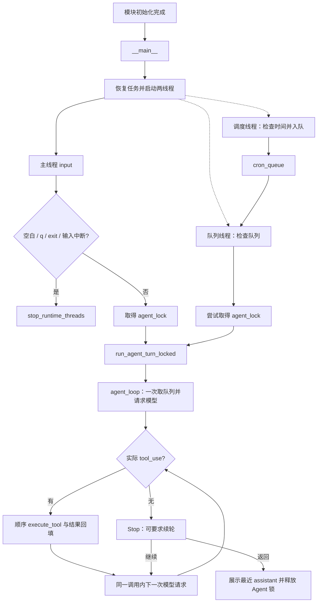
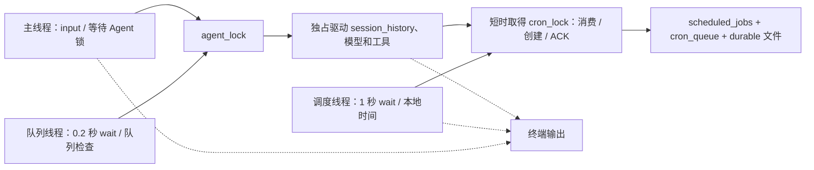
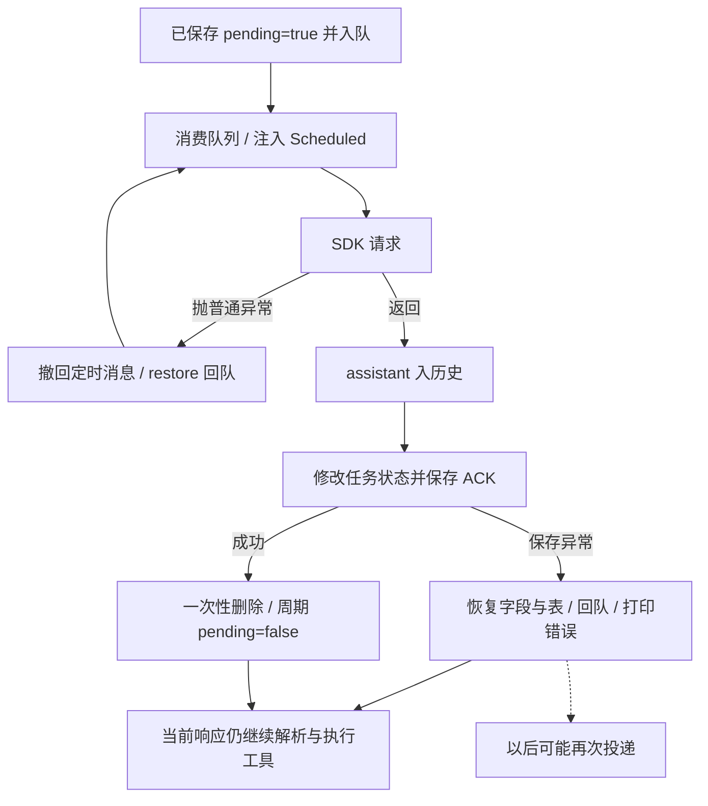
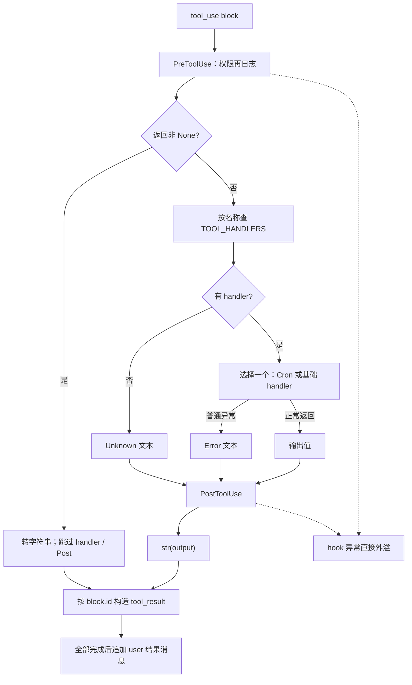
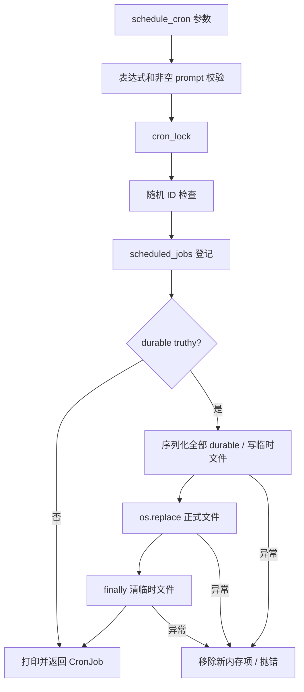
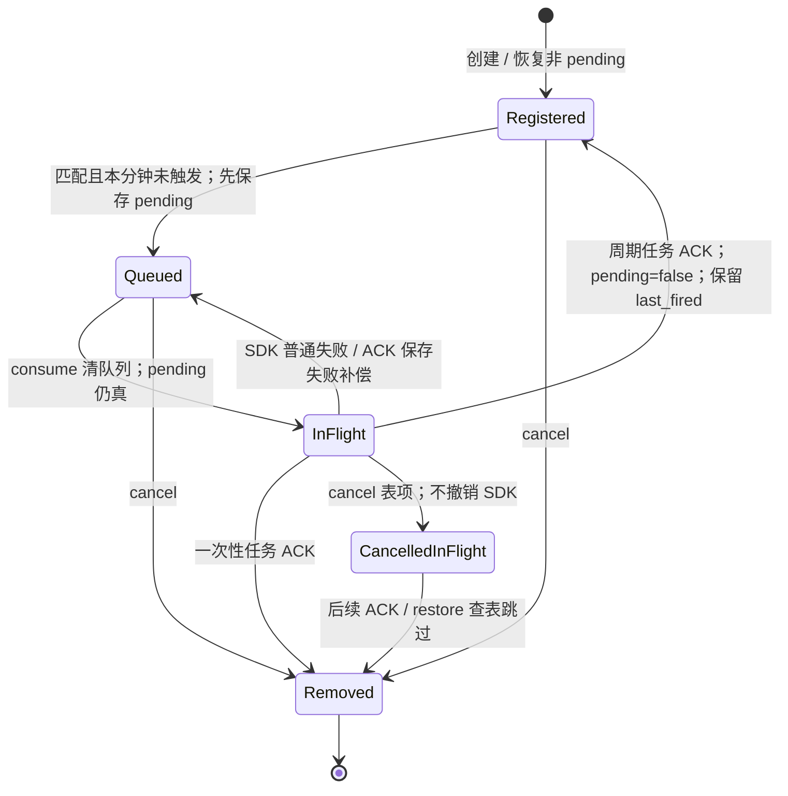
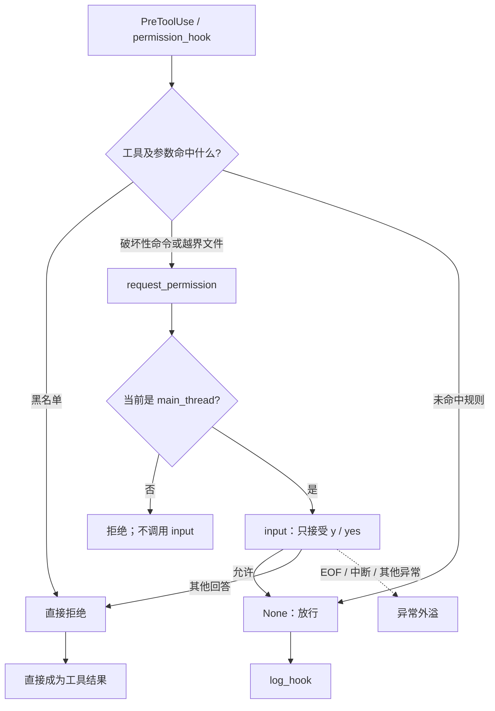
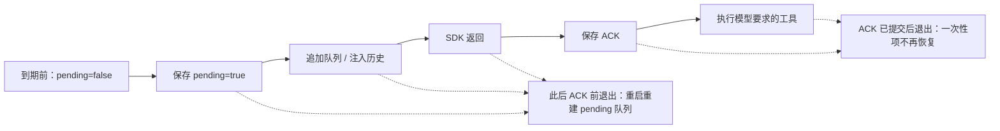

> 待分析代码位置：`s12_cron_scheduler/code.py`。
>
> 功能描述：沿真实入口、函数调用和返回位置，解释这个独立的 Cron Agent 如何接收用户请求、登记定时 prompt、并行检查时间、串行驱动共享会话，以及如何完成持久化、投递确认、失败回队与退出。
>
> 阅读约定：每个关键步骤先展示带准确行号的连续原始代码，再解释进入条件、参数来源、执行顺序、状态与副作用、返回位置和异常边界。本文只做当前源码的静态分析，未导入或运行目标模块，未调用模型、启动调度或执行目标工具。既有用例仅作为源码断言证据，不表示已运行通过。设计意图不能由实现直接确定时，明确标为基于代码推断。

# 1. 从入口确定主线：先启动运行时，再等待用户

## 1.1 入口前半段：启动不是第一个 Python 执行步骤

源码定位：`s12_cron_scheduler/code.py`，`__main__：启动与读取输入`，L903–L917。

```python
if __name__ == "__main__":
    print("s12: Cron Scheduler - run prompts on a local schedule")
    print("Enter a question, press Enter to send. Type q to quit.\n")
    start_runtime_threads()  # 先让调度线程跑起来，后面才可能收到定时任务
    try:
        while True:
            try:
                # \001/\002 tell Readline the ANSI escapes have zero display width.
                # （同上：\001/\002 告诉 Readline，中间这段 ANSI 转义序列「不占显示宽度」，
                #   否则光标位置会算错。这里是青色的提示符 "s12 >> "。）
                query = input("\001\033[36m\002s12 >> \001\033[0m\002")
            except (EOFError, KeyboardInterrupt):
                break  # Ctrl+C / Ctrl+D 退出
            if query.strip().lower() in ("q", "exit", ""):
                break  # 空输入或 q/exit 也退出
```

这段代码只在直接执行脚本时进入；被其他 Python 代码加载时，顶层初始化仍会发生，但这个分支不执行。先展示入口是为了建立阅读起点，并不表示它早于模块导入执行。

入口先打印两条提示，随后同步调用 `start_runtime_threads()`。该函数完成持久任务恢复和两个线程的启动后，主线程才开始等待 `input`。因此，恢复出的待交付任务可能在用户尚未输入时就被队列线程处理，不能把用户提交当成调度系统必需的启动信号。

内层 try 只包围输入语句。EOF 和该处的 KeyboardInterrupt 使循环退出；输入取得后，`strip().lower()` 只用于退出判断。空串、纯空白、大小写不同的 q／exit 都退出，不是忽略空行。有效请求保留原始字符串，并未统一 strip 后再交给模型。

## 1.2 入口后半段：持锁执行整个用户回合

源码定位：`s12_cron_scheduler/code.py`，`__main__：用户回合与 finally`，L918–L922。

```python
            with agent_lock:
                # 拿锁跑一轮：与队列处理线程互斥，保证对话历史不会同时被两个线程改。
                run_agent_turn_locked(query)
    finally:
        stop_runtime_threads()  # 收尾：停掉后台线程，避免资源泄漏
```

有效输入先等待 `agent_lock`，获得锁后调用 `run_agent_turn_locked(query)`。锁覆盖模型等待、工具执行、可能发生的人工确认和最终打印，不只保护 `history.append` 这一行。队列处理线程也竞争同一把锁，所以两个入口不会按默认调用路径同时驱动共享历史。

退出输入循环或 try 内发生异常时，finally 调用 `stop_runtime_threads`。但是 `start_runtime_threads` 在这个 try 之前：启动阶段直接抛错，不会自动进入这里的停止逻辑。模型和权限输入处的 KeyboardInterrupt 也不由内层 input 的 except 捕获；它们可向外传播，同时执行外层 finally。

主链与并行入口的汇合关系如下。图中的定时输入并不绕过 Agent，也不直接执行 shell：



实线表示控制或数据流，虚线表示启动后的并行执行线；不是“先等所有调度结束，再读取输入”。图中下一次模型请求不会重新消费队列，只有下一次进入 `agent_loop` 才会消费。接下来先回溯到达入口之前的初始化，再返回 `start_runtime_threads`。

# 2. 回溯模块初始化：当前代码究竟创建了什么

## 2.1 导入与 readline：可选的是终端增强，不是整个初始化

源码定位：`s12_cron_scheduler/code.py`，`模块导入与 readline`，L25–L49。

```python
import glob        # 文件名模式匹配（glob 工具用）
import json        # 读写 .scheduled_tasks.json：持久化任务的序列化
import os          # 环境变量、进程号、平台判断
import re          # 正则：危险命令匹配
import secrets     # 生成随机任务 ID（cron_xxxxxxxx）
import subprocess  # 启动子进程执行 shell 命令
import threading   # 线程：调度线程、队列处理线程，以及各种锁
from dataclasses import asdict, dataclass  # asdict 把 Job 转成 dict 以便存 JSON
from datetime import datetime              # 取当前本地时间，判断是否到点
from pathlib import Path                   # 面向对象的路径操作

try:
    import readline

    # 以下四行是 macOS 上 libedit 库的 UTF-8 修复，让终端能正确处理中文。
    readline.parse_and_bind("set bind-tty-special-chars off")
    readline.parse_and_bind("set input-meta on")
    readline.parse_and_bind("set output-meta on")
    readline.parse_and_bind("set convert-meta off")
except ImportError:
    # Windows 自带 Python 没有 readline，跳过即可，不影响主逻辑。
    pass

from anthropic import Anthropic  # Anthropic 官方 Python SDK 客户端
from dotenv import load_dotenv   # 从 .env 文件加载环境变量
```

标准库分别提供文件匹配、JSON、环境变量、正则、随机 ID、同步子进程、线程和 dataclass。当前文件没有动态加载其他教学章节，也没有导入 `fcntl`，不能把 s13 的 POSIX 导入限制搬到这里。

readline 的四条绑定在成功导入后立即执行。except 只捕获 ImportError，不能据此声称任意终端绑定错误都会被忽略。Anthropic 和 dotenv 则是必须可导入的依赖，缺失会在到达 CLI 之前失败。

`requirements.txt:1–3` 声明 anthropic、python-dotenv 和 pyyaml；本文件直接使用前两者，没有 YAML 调用。类型联合 `str | None`、`glob(..., root_dir=...)` 等代码也限定了可运行的 Python API 环境，依赖清单本身并未声明完整 Python 版本或平台支持矩阵。

## 2.2 环境、工作目录和 SDK：创建客户端尚不等于发请求

源码定位：`s12_cron_scheduler/code.py`，`dotenv、WORKDIR、DURABLE_PATH、client、MODEL`，L51–L62。

```python
# override=True：即使系统里已有同名环境变量，也用 .env 里的值覆盖。
load_dotenv(override=True)
if os.getenv("ANTHROPIC_BASE_URL"):
    # 配了自定义端点时移除可能冲突的 ANTHROPIC_AUTH_TOKEN，避免两种鉴权打架。
    os.environ.pop("ANTHROPIC_AUTH_TOKEN", None)

WORKDIR = Path.cwd()  # 工作目录：文件工具与路径校验的基准
# 持久化任务落盘的位置：工作目录下的隐藏文件。
# 「durable（持久）」的任务写在这里，下次启动还能恢复；session 级任务只活在内存里。
DURABLE_PATH = WORKDIR / ".scheduled_tasks.json"
client = Anthropic(base_url=os.getenv("ANTHROPIC_BASE_URL"))
MODEL = os.environ["MODEL_ID"]  # 从环境变量读模型 ID
```

`load_dotenv(override=True)` 允许 dotenv 覆盖已有同名环境变量。若自定义端点变量为非空字符串，代码移除进程环境中的 AUTH_TOKEN，再创建客户端；这里是进程环境副作用，不只是配置读取。本文不读取真实 dotenv 文件内容，也不推测真实鉴权值。

`WORKDIR = Path.cwd()` 在模块加载时取值。后来即使调用者切换 cwd，这个对象也不会自动改为新目录。持久文件定位到该目录的 `.scheduled_tasks.json`，并非源码文件旁边。此处只是构造 Path，尚未创建文件或目录。

SDK 客户端在模块顶层立即构造，然后才读取必需的 `MODEL_ID`。缺少 MODEL_ID 会触发 KeyError；SDK 构造也可能先因其配置条件失败。这些错误都早于主循环 try。当前源码没有在这里调用 `messages.create`，不能把“已创建客户端”写成“已经调用模型”。

## 2.3 固定提示词：描述未来工作，但不直接生成计划

源码定位：`s12_cron_scheduler/code.py`，`ENVIRONMENT_PROMPT 与 SYSTEM`，L64–L77。

```python
# 根据操作系统告诉模型它面对的 shell 语法，避免生成错误的命令风格。
ENVIRONMENT_PROMPT = (
    "Windows: the bash tool runs through cmd.exe; use cmd.exe syntax, not Unix "
    "Bash or PowerShell syntax, and prefer dedicated file tools for file operations"
    if os.name == "nt"
    else "Unix-like: the bash tool runs the system shell"
)
# 相比前面几课，这里多了一句：计划在「未来某个本地时间」做的工作要用 schedule_cron。
# 注意是「本地时间」——下面的 cron 匹配用的就是 datetime.now() 的本地时钟。
SYSTEM = (
    f"You are a coding agent at {WORKDIR}. Environment: {ENVIRONMENT_PROMPT}. "
    "Use tools to solve tasks. "
    "Use schedule_cron for work that should start at a future local time."
)
```

平台分支把系统 shell 语法告诉模型：Windows 提示 cmd.exe，其他平台提示系统 shell。后面 shell 工具通过 `subprocess.run(shell=True)` 执行；这里没有自行启动 Bash 或 PowerShell。

SYSTEM 记录固定 WORKDIR，并提示“未来本地时间的工作使用 schedule_cron”。它不解析用户自然语言日期，也不自动登记任务。模型必须实际产生 schedule_cron 调用，handler 才能写任务表。提示词也不构成权限规则，真正的拦截发生在 PreToolUse。

## 2.4 先登记基础工具，再追加三个 Cron 工具

源码定位：`s12_cron_scheduler/code.py`，`基础 TOOLS 与 TOOL_HANDLERS`，L159–L193。

```python
TOOLS = [
    {"name": "bash", "description": "Run a shell command.",
     "input_schema": {"type": "object",
                      "properties": {"command": {"type": "string"}},
                      "required": ["command"]}},
    {"name": "read_file", "description": "Read file contents.",
     "input_schema": {"type": "object",
                      "properties": {"path": {"type": "string"},
                                     "limit": {"type": "integer"}},
                      "required": ["path"]}},
    {"name": "write_file", "description": "Write content to a file.",
     "input_schema": {"type": "object",
                      "properties": {"path": {"type": "string"},
                                     "content": {"type": "string"}},
                      "required": ["path", "content"]}},
    {"name": "edit_file", "description": "Replace exact text in a file once.",
     "input_schema": {"type": "object",
                      "properties": {"path": {"type": "string"},
                                     "old_text": {"type": "string"},
                                     "new_text": {"type": "string"}},
                      "required": ["path", "old_text", "new_text"]}},
    {"name": "glob", "description": "Find files matching a glob pattern; ** matches recursively.",
     "input_schema": {"type": "object",
                      "properties": {"pattern": {"type": "string"}},
                      "required": ["pattern"]}},
]

# 工具名 -> 实际处理函数 的映射表；execute_tool 靠它分发。
TOOL_HANDLERS = {
    "bash": run_bash,
    "read_file": run_read,
    "write_file": run_write,
    "edit_file": run_edit,
    "glob": run_glob,
}
```

模型拿到的是名称、描述和 input_schema；Python 分发拿到的是独立的 handler 字典。声明中的 read_file 对应 `run_read`，不能按名字猜测同名 Python 函数。工具实现此时只被登记，尚未执行。

模型可见 schema 没有统一设置禁止额外字段，当前代码也没有本地通用 JSON Schema 校验器。参数是否可执行，稍后还取决于 Python 参数绑定、hook 和 handler 自身检查。

源码定位：`s12_cron_scheduler/code.py`，`追加 Cron 工具与 handler`，L696–L719。

```python
# 把本课新增的三个工具追加进工具清单。
TOOLS.extend([
    {"name": "schedule_cron",
     "description": "Schedule a prompt with a 5-field cron expression.",
     "input_schema": {"type": "object",
                      "properties": {
                          "cron": {"type": "string"},
                          "prompt": {"type": "string"},
                          "recurring": {"type": "boolean"},
                          "durable": {"type": "boolean"}},
                      "required": ["cron", "prompt"]}},
    {"name": "list_crons", "description": "List scheduled cron jobs.",
     "input_schema": {"type": "object", "properties": {}, "required": []}},
    {"name": "cancel_cron", "description": "Cancel a cron job by ID.",
     "input_schema": {"type": "object",
                      "properties": {"job_id": {"type": "string"}},
                      "required": ["job_id"]}},
])

TOOL_HANDLERS.update({
    "schedule_cron": run_schedule_cron,
    "list_crons": run_list_crons,
    "cancel_cron": run_cancel_cron,
})
```

代码在同一模块中扩展上述两个容器，形成固定八工具池。它不是 s14 那种每轮重新发现服务器的动态工具池，也不是调用 s04 模块获取能力。表中各项是模型可选分支，不是每次请求依次执行的八步。

| 模型工具名 | Python handler | 主要作用 |
| --- | --- | --- |
| bash | run_bash | 同步运行 shell |
| read_file | run_read | UTF-8 读文件 |
| write_file | run_write | 覆盖文件 |
| edit_file | run_edit | 首次文本替换 |
| glob | run_glob | 列举工作区匹配路径 |
| schedule_cron | run_schedule_cron | 创建定时 prompt |
| list_crons | run_list_crons | 展示任务表 |
| cancel_cron | run_cancel_cron | 取消指定任务 |

`tests/test_cron_scheduler.py:62–81` 的源码断言检查这八个名称、四类 hooks，并检查不存在 Task、MEMORY_DIR、background_tasks。这说明用例意图针对精简内核，不表示本章运行时依赖其他章节。

## 2.5 注册 hooks、共享容器与锁，仍未启动线程

源码定位：`s12_cron_scheduler/code.py`，`HOOKS 与 register_hook`，L199–L204。

```python
HOOKS = {"UserPromptSubmit": [], "PreToolUse": [], "PostToolUse": [], "Stop": []}


def register_hook(event: str, callback):
    # 注册一个钩子回调到指定事件上。
    HOOKS[event].append(callback)
```


源码定位：`s12_cron_scheduler/code.py`，`默认 hooks 注册`，L308–L312。

```python
register_hook("UserPromptSubmit", context_inject_hook)
register_hook("PreToolUse", permission_hook)   # 权限检查放在前面，可拦截
register_hook("PreToolUse", log_hook)          # 日志放在后面，只做展示
register_hook("PostToolUse", large_output_hook)
register_hook("Stop", summary_hook)
```

四个事件的 callback 列表在加载时建立。注册只向列表 append 函数引用。PreToolUse 先权限、后日志；PostToolUse 只有大输出提示；Stop 只有会话统计。触发语义等到首次用户提交时展开。

源码定位：`s12_cron_scheduler/code.py`，`任务表、队列与 cron_lock`，L330–L334。

```python
scheduled_jobs: dict[str, CronJob] = {}   # 任务表：id -> 任务对象（全部任务的总账）
cron_queue: list[CronJob] = []            # 待办队列：到点、尚未被 agent 取走的任务
# 保护上面两份共享状态的可重入锁。用 RLock：内部函数会互相调用（如 cancel 里再存盘），
# 同一线程重入加锁不会自己把自己锁死。
cron_lock = threading.RLock()
```


源码定位：`s12_cron_scheduler/code.py`，`运行时状态、agent_lock 与共享历史`，L741–L748。

```python
RUNTIME_STOP = threading.Event()               # 停止信号：set() 后各线程的 wait 会立刻返回 True
runtime_threads: list[threading.Thread] = []   # 已启动的后台线程
runtime_started = False                        # 是否已启动（防止重复启动）
runtime_lock = threading.Lock()                # 保护上面两个启动状态的锁
# agent_lock：保证「同一时刻只有一个线程在跑 agent 循环」。
# 主线程（用户输入）和队列处理线程（定时任务）都要抢这把锁。
agent_lock = threading.Lock()
session_history: list = []                     # 对话历史（唯一的上下文，两个线程共享）
```

模块级任务表和队列最初为空，历史也为空。三种锁各有职责：

| 对象 | 默认调用路径的保护范围 | 不提供的保证 |
| --- | --- | --- |
| cron_lock（RLock） | 本进程任务表、队列和相关保存操作 | 跨进程协调、模型业务事务 |
| agent_lock（Lock） | 两入口的完整 Agent 回合与共享历史 | 终端输出排他、直接 API 调用自动加锁 |
| runtime_lock（Lock） | 启动／停止登记与状态标志 | 证明线程活着、强制终止 SDK |
| RUNTIME_STOP（Event） | 唤醒两个循环的 wait | 中断正在执行的同步工作 |

RLock 允许同一线程在 schedule／ack 等操作持锁时再进入保存函数；不是多个线程可同时修改表。上述状态登记没有启动 Thread。`tests/test_cron_scheduler.py:84–93` 断言导入后 started 为假、线程登记为空、没有这两个名字的运行线程；这里只引用断言，不执行导入。

现在回到入口的 `start_runtime_threads()`。

# 3. 启动的第一步：从文件恢复任务，而不是恢复 Agent

## 3.1 先检查启动状态，再加载文件

源码定位：`s12_cron_scheduler/code.py`，`start_runtime_threads：幂等检查与恢复`，L865–L872。

```python
def start_runtime_threads():
    # 启动后台线程（幂等：重复调用只生效一次）。
    global runtime_started
    with runtime_lock:
        if runtime_started:
            return
        load_durable_jobs()   # 先恢复磁盘上的持久任务，再开线程
        RUNTIME_STOP.clear()  # 清掉可能残留的停止信号
```

函数先获取 runtime_lock，再判断 started。已为真时直接返回，不重复创建线程，也不检查原线程是否已异常结束。因此它是“登记为已启动时不再启动”的保护，不是健康检查。

首次启动调用 load，load 正常返回后才清除停止事件。恢复中的未捕获异常会阻止后续线程创建，runtime_lock 通过 with 释放。

## 3.2 文件不存在、读取失败和顶层形状错误

源码定位：`s12_cron_scheduler/code.py`，`load_durable_jobs：文件级读取`，L466–L477。

```python
def load_durable_jobs():
    # 启动时从磁盘恢复 durable 任务。
    if not DURABLE_PATH.exists():
        return
    try:
        payload = json.loads(DURABLE_PATH.read_text(encoding="utf-8"))
        if not isinstance(payload, list):
            raise ValueError("expected a JSON list")
    except (OSError, json.JSONDecodeError, ValueError) as error:
        # 文件坏了不致命：提示一下然后空手起跑，不让程序起不来。
        print(f"  [cron] could not load {DURABLE_PATH.name}: {error}")
        return
```

不存在文件直接返回，fresh 进程的空表保持为空。存在文件则 UTF-8 全量读取并 JSON 解析，顶层必须为 list。文件读取 OSError、JSON 解码和 ValueError 在此打印后返回；不创建替代文件，也不把坏文件自动修好。

这里“空手起跑”的注释只准确描述 fresh 空表情形：函数没有主动 clear 已有内存状态，重复调用时原表仍可能存在。文件损坏时未来任何成功保存都按当前内存全量重写，不会自动保留无法读取的条目。

`tests/test_cron_scheduler.py:178–186` 写入坏 JSON 后断言打印错误、任务表为空，覆盖的是初始空表的源码场景。错误打印本身也没有额外保护。

## 3.3 第一次遇到 CronJob：字段是数据，不是调度器

源码定位：`s12_cron_scheduler/code.py`，`CronJob`，L318–L327。

```python
@dataclass
class CronJob:
    """一个定时任务（可以用 asdict() 直接转成字典存 JSON）。"""
    id: str                        # 任务 ID，形如 cron_a1b2c3d4
    cron: str                      # 5 段式 cron 表达式：分 时 日 月 周
    prompt: str                    # 到点时要交给 agent 执行的提示词
    recurring: bool                # True=周期任务（每次到点都触发）；False=一次性
    durable: bool                  # True=写入磁盘，重启后恢复；False=只活在本次进程
    pending_delivery: bool = False # 是否已经排进队列、等着被 agent 取走（防止同一分钟重复入队）
    last_fired: str | None = None  # 上次触发的「分钟标记」如 "2026-10-16 09:00"
```

dataclass 自动提供构造和字段赋值，asdict 稍后用于保存。它本身不校验参数，也不创建线程、文件或队列。

| 字段 | 来源与用途 | 需要区分的事实 |
| --- | --- | --- |
| id | 创建时随机生成；恢复时来自 JSON | 本章 cron 身份，不是 Task 身份 |
| cron | 模型或保存文件给出的五段字符串 | 不保存单独的下一次执行时间 |
| prompt | 模型显式传入的任务文本 | 不是已运行命令的结果 |
| recurring | 创建默认 true | false 是首次成功投递确认后删除 |
| durable | 创建默认 true | 控制保存筛选，不保证进程关闭时执行 |
| pending_delivery | 默认 false；入队前置 true | 消费队列后仍可为 true |
| last_fired | 默认 None；到期时写分钟字符串 | 记录最近一次触发，不是交付次数日志 |

对象没有“业务成功”“正在执行工具”“历史发生次数”等字段。pending 是投递状态，不是模型目标状态。

## 3.4 单项恢复：先构造，再校验，再发布到内存

源码定位：`s12_cron_scheduler/code.py`，`load_durable_jobs：逐项恢复`，L479–L502。

```python
    loaded = 0
    with cron_lock:
        for item in payload:
            try:
                # 反序列化 + 逐项校验：磁盘上的内容可能被人手改过，
                # 不能直接信任，坏的那一条跳过，其余照常加载。
                job = CronJob(**item)
                error = validate_cron(job.cron)
                if error:
                    raise ValueError(error)
                if not job.id.startswith("cron_"):
                    raise ValueError("invalid job ID")
                if not job.prompt.strip():
                    raise ValueError("prompt cannot be empty")
            except (TypeError, ValueError) as error:
                print(f"  [cron] skipped invalid saved job: {error}")
                continue
            scheduled_jobs[job.id] = job
            if job.pending_delivery:
                # 上次进程退出时这任务还没被交付：重新排进队列，别把它弄丢了。
                cron_queue.append(job)
            loaded += 1
    if loaded:
        print(f"  [cron] loaded {loaded} durable job(s)")
```

持有 cron_lock 后逐条执行：

1. `CronJob(**item)` 用 JSON 字典展开构造；缺字段、额外字段或不可展开的值可能触发 TypeError。
2. 调用 validate_cron；返回错误字符串时转成 ValueError，使该项走跳过分支。
3. ID 只检查字符串前缀 cron_，不是严格复用随机 ID 正则。
4. prompt 通过 strip 检查非空，但不把 strip 后值写回。
5. 合法项按 ID 覆盖任务表；pending 为 truthy 时把该对象追加队列。
6. 完成后打印加载条数，不是当前不同 ID 的数量。

单项 except 只捕获 TypeError／ValueError。例如 cron 为整数导致 .strip 的 AttributeError、ID 或 prompt 为不支持相应方法的对象，都可能外溢。注解不会把这些值自动转换成正确类型。recurring、durable、pending_delivery 和 last_fired 也没有完整类型与语义验证。

恢复不清表、不清队列、不做重复 ID 拒绝：手改文件中重复 ID 可能覆盖表项，同时留下多个队列对象。正常保存产生的列表来自字典，通常不会生成重复 ID；这里是异常输入或重复加载的边界，不能说默认新启动必然重复。

接下来沿本函数首次调用进入表达式校验；校验返回 None 后才继续当前条目的 ID 和 prompt 检查。

# 4. 恢复时首次进入校验：支持的 Cron 只是代码中的子集

## 4.1 五段解析与逐段规则

源码定位：`s12_cron_scheduler/code.py`，`validate_cron`，L423–L441。

```python
def validate_cron(cron_expr: str) -> str | None:
    # 校验整个 5 段式表达式。返回 None 表示合法。
    fields = cron_expr.strip().split()
    if len(fields) != 5:
        return f"Expected 5 fields, got {len(fields)}"

    # 每段的取值范围：分 0-59、时 0-23、日 1-31、月 1-12、周 0-6。
    field_rules = [
        ("minute", 0, 59),
        ("hour", 0, 23),
        ("day-of-month", 1, 31),
        ("month", 1, 12),
        ("day-of-week", 0, 6),
    ]
    for field, (name, minimum, maximum) in zip(fields, field_rules):
        error = _validate_cron_field(field, minimum, maximum)
        if error:
            return f"{name}: {error}"  # 带上段名，方便定位是哪一段写错了
    return None
```

`cron_expr` 来自当前恢复项，之后 schedule_job 也复用同一函数。strip 后 split 按任意空白切分，必须恰好五段。只有段数错误直接返回字符串；错误类型引发的方法调用异常并不都转换成校验文本。

每段按对应上下界调用单段校验，首个错误被加上 minute／hour 等名称返回。合法返回 None，不会返回规范化表达式，也不修改原任务。日允许 1–31，没有验证某月是否存在该日期；这种表达式可能合法但永远不在特定月份匹配。

星期上限实际为 6。后面的匹配会把星期日映射到 0，因此本实现应写 0 表示星期日。L365 的“0/7”是通用 cron 注释，不是当前验证器对 7 的支持。

## 4.2 通配、步长和列表按此顺序判断

源码定位：`s12_cron_scheduler/code.py`，`_validate_cron_field：通配、步长与列表`，L389–L404。

```python
def _validate_cron_field(field: str, minimum: int, maximum: int) -> str | None:
    # 校验 cron 的单段是否合法。返回 None 表示合法，否则返回错误说明。
    if field == "*":
        return None
    if field.startswith("*/"):
        step = field[2:]
        if not step.isdigit() or int(step) <= 0:
            return f"Invalid step: {field}"  # 步长必须是正整数
        return None
    if "," in field:
        # 枚举：逐个校验，返回第一个错误。
        for part in field.split(","):
            error = _validate_cron_field(part.strip(), minimum, maximum)
            if error:
                return error
        return None
```

每段先检查恰好等于 *，再检查是否以 */ 开头，然后才检查逗号。步长必须由 isdigit 接受并能成功 int 转换，且大于零；它没有与本段 maximum 比较。所以 */100 可在分钟字段通过校验，但不表示每隔 100 分钟运行；匹配时只是对当前分钟数取模。

列表逐项 strip 后递归校验，遇首错返回，空列表项不合法。顺序还带来一个具体限制：`1,*/2` 会进入列表后逐项处理；`*/2,3` 则先命中步长分支，把 `2,3` 当整个步长而拒绝。不能把“支持列表”扩展成任意完整 cron 语法组合。

## 4.3 范围与精确值，仍未执行时间匹配

源码定位：`s12_cron_scheduler/code.py`，`_validate_cron_field：范围与数字`，L405–L420。

```python
    if "-" in field:
        start, end = field.split("-", 1)
        if not start.isdigit() or not end.isdigit():
            return f"Invalid range: {field}"
        start_value, end_value = int(start), int(end)
        if start_value > end_value:
            return f"Range start is greater than end: {field}"
        if start_value < minimum or end_value > maximum:
            return f"Range {field} is outside [{minimum}-{maximum}]"
        return None
    if not field.isdigit():
        return f"Invalid field: {field}"  # 不是数字、也不是上面几种写法
    value = int(field)
    if value < minimum or value > maximum:
        return f"Value {value} is outside [{minimum}-{maximum}]"
    return None
```

范围只按第一个减号分开，要求两端数字、起点不大于终点且不越界；不支持循环范围、名称月份或星期词。普通数字同样先检查 isdigit，再转 int 比较上下界。`a-b/n` 等未实现的写法不会因为其他 cron 库支持就自动可用。

基于代码推断，返回 None／错误文本的轻量约定便于工具把参数错误反馈给模型，但代价是没有统一异常／错误类型体系；调用者仍须区分正常错误文本与方法调用异常。

`tests/test_cron_scheduler.py:96–105` 的具体断言包括工作日表达式通过、周一 09:00 匹配、09:30 不匹配、24 点和少一段被拒绝。它不证明实现支持完整 crontab 语法。实际匹配函数留到调度线程调用它时展开。

**返回位置：** 单段校验返回 validate_cron；全部通过后返回 load_durable_jobs 的 L486，继续当前条目的身份／prompt 检查及入队。恢复结束返回 start_runtime_threads 的 L872，接下来清停止事件并创建线程。

# 5. 返回启动函数：线程开始并行，主线程继续输入

## 5.1 创建线程、启动线程、最后标记 started

源码定位：`s12_cron_scheduler/code.py`，`start_runtime_threads：线程登记与启动`，L873–L887。

```python
        runtime_threads.extend([
            threading.Thread(
                target=cron_scheduler_loop,
                name="cron-scheduler",
                daemon=True,   # daemon：主程序退出时自动结束，不留悬挂线程
            ),
            threading.Thread(
                target=queue_processor_loop,
                name="cron-queue-processor",
                daemon=True,
            ),
        ])
        for thread in runtime_threads:
            thread.start()
        runtime_started = True
```

两个 Thread 对象先一起加入 runtime_threads，再按列表顺序 start。先启动 scheduler，后启动 queue processor；这只说明 start 的调用顺序，不保证两个线程内业务代码的先后执行。started 在两次 start 都返回之后才设为真。

daemon 使它们不单独阻止解释器退出，不意味着退出时一定完成 finally、保存或当前模型请求。若第二次 start 失败，第一条线程可能已经运行，但 started 仍是假；后面的停止函数会因假标志直接返回。当前没有回滚已启动线程和登记表的完整启动事务，故“重复调用只生效一次”只适用于正常成功启动、尚未停止的状态。

恢复可能已把 pending 任务放进队列。因此 queue processor 第一次 wait 结束即可尝试驱动 Agent，与主线程是否已经输入无关。没有恢复任务的新进程中，两个线程通常先空轮询；稍后工具创建任务后才有可触发的数据。

## 5.2 两个入口的等待机制与三条执行线

源码定位：`s12_cron_scheduler/code.py`，`cron_scheduler_loop`，L751–L755。

```python
def cron_scheduler_loop(stop_event: threading.Event = RUNTIME_STOP):
    # 调度线程主体：每秒醒来一次，检查有没有任务到点。
    # 用 stop_event.wait(1.0) 而不是 time.sleep：一旦要停止，能立刻醒来退出，不必等满 1 秒。
    while not stop_event.wait(1.0):
        poll_due_jobs(datetime.now())  # 用本地时间判断是否命中 cron
```


源码定位：`s12_cron_scheduler/code.py`，`queue_processor_loop`，L851–L862。

```python
def queue_processor_loop(stop_event: threading.Event = RUNTIME_STOP):
    # 队列处理线程主体：每 0.2 秒看一眼队列，有任务就抢 agent_lock 去执行。
    while not stop_event.wait(0.2):
        # 双重判断：队列为空就别抢锁了；抢不到锁（主线程正在对话）就跳过，
        # 等下一圈再看——这样定时任务只会在用户没在交互时插空执行。
        if not has_cron_queue() or not agent_lock.acquire(blocking=False):
            continue
        try:
            if has_cron_queue():  # 抢到锁后可能队列已被别人清空，再确认一次
                run_agent_turn_locked()
        finally:
            agent_lock.release()  # 无论成功失败都要放锁
```

这两个是线程入口，不是由主线程逐项调用完成后返回的普通业务步骤。scheduler 的 wait 正常超时返回 False 才轮询；停止事件 set 会使 wait 返回 True，从而退出循环。首次检查前也会等约一秒，不是在 start 内立即 poll。

queue processor 每约 0.2 秒先检查队列，非空才非阻塞抢 Agent 锁；抢不到就继续下一圈。抢到后再次检查，避免任务已被用户入口消费或取消。工作发生时，单次迭代时间还包含整个 Agent 回合，所以 0.2 秒不是准时交付承诺。

下面图示强调锁而非固定时序：



Agent 锁使两个会话入口串行；cron 锁让调度和任务操作协调。调度线程不等待 Agent 锁，因此模型很慢时仍可将其他到期任务入队。终端输出没有被全局控制台锁保护，后台打印可与主线程提示符交错。

此处先认出并行入口。queue processor 真正取得锁后的调用将在第 13 章接回；scheduler 有任务可匹配后的完整链在第 12 章展开。现在返回启动函数的调用者：主线程已经可以执行 input。

# 6. 用户提交：hook 先执行，历史后追加

## 6.1 从持锁调用深入 run_agent_turn_locked

源码定位：`s12_cron_scheduler/code.py`，`run_agent_turn_locked`，L839–L848。

```python
def run_agent_turn_locked(user_query: str | None = None):
    # 跑一轮对话。命名带 locked 是提醒：调用方必须已持有 agent_lock。
    if user_query is not None:
        # user_query 为 None 表示这次跑的是定时任务（消息已在 agent_loop 里注入），
        # 不触发 UserPromptSubmit 钩子、也不追加用户消息。
        trigger_hooks("UserPromptSubmit", user_query)
        session_history.append({"role": "user", "content": user_query})
    agent_loop(session_history)
    print_latest_assistant_text(session_history)
    print()
```

入口把原始 query 作为 user_query 传入。该函数名中的 locked 是约定，不是内部加锁操作。CLI 调用点的 with 和队列入口的 acquire 才是实际互斥来源；嵌入宿主直接调用它或 agent_loop，并不会自动获得同等保护。

用户字符串不为 None 时，先触发 UserPromptSubmit，再把字符串加入唯一的 session_history。即使传入空串，底层函数本身也不拒绝；CLI 的退出判断是上层行为。

None 用于队列入口：既不触发提交 hook，也不预先插入一个空用户消息。定时文本由 agent_loop 自行消费队列后追加。两种入口随后都调用同一函数并展示同一份历史。

## 6.2 首次触发 hooks：非 None 就短路

源码定位：`s12_cron_scheduler/code.py`，`trigger_hooks`，L207–L214。

```python
def trigger_hooks(event: str, *args):
    # 依次触发某事件的所有回调；谁先返回非 None 就立即中断并返回，
    # 相当于「拦截」语义（PreToolUse 里被用来拒绝工具调用）。
    for callback in HOOKS[event]:
        result = callback(*args)
        if result is not None:
            return result
    return None
```


源码定位：`s12_cron_scheduler/code.py`，`context_inject_hook`，L286–L289。

```python
def context_inject_hook(query: str):
    # UserPromptSubmit 钩子：提交问题时注入环境信息。
    print(f"\033[90m[HOOK] UserPromptSubmit: working in {WORKDIR}\033[0m")
    return None
```

trigger 按注册顺序逐个调用，遇到任何非 None 结果立即返回，包括 False、0 和空字符串。它本身没有 try，callback 的异常会传播到触发者。

UserPromptSubmit 调用方忽略返回值：某个回调即使返回“拒绝”，这里只会终止后续 hooks，不会因此阻止消息追加。真正阻止本次追加的是抛异常。默认 callback 只打印 WORKDIR，未把上下文注入 messages，也未变更 system；不能依据函数名补写环境内容注入功能。

**返回位置：** 默认 hook 返回 None，经 trigger 返回 run_agent_turn_locked 的 L845，追加用户消息，然后进入 L846 的 agent_loop。history 是模块级列表的同一引用，不是每个用户请求的新会话。

# 7. Agent 开始前：一次性取出当前全部定时任务

## 7.1 先消费队列，不先请求模型

源码定位：`s12_cron_scheduler/code.py`，`agent_loop：定时消息注入`，L758–L767。

```python
def agent_loop(messages: list, context: dict | None = None):
    # agent 主循环。messages 就是共享的 session_history（原地 append）。
    fired = consume_cron_queue()   # 先把到点排队的定时任务取出来
    scheduled_start = len(messages)  # 记住「插入定时消息前」的位置，失败时要回退到这里
    for job in fired:
        # 定时任务以普通 user 消息的形式注入对话，加 [Scheduled] 前缀加以区分。
        messages.append({"role": "user", "content": f"[Scheduled] {job.prompt}"})
        print(f"  [cron] delivered {job.id}: {job.prompt[:60]}")

    waiting_for_ack = list(fired)  # 还没确认收尾的任务
```

参数 messages 由入口传入 session_history；底层 API 也允许其他列表，函数并不验证其身份。context 是可选透传值，本实现不会更新它，CLI 也没有为它建立上下文管理流程。

fired 接收当前队列的任务对象列表，scheduled_start 记录追加定时消息前的历史长度。若这是用户入口，普通 user_query 已经在 L845 追加，因此该下标位于普通用户消息之后。接着按队列顺序把每个 prompt 包装成独立 user 消息，前缀只用于区分来源，不形成新的权限身份。

等待确认列表在所有注入和打印完成后创建。注入循环不在 SDK 的 try 内：例如终端打印错误或消息对象操作异常会直接外溢。若队列已消费但本地确认列表尚未建立，当前调用没有统一恢复分支；durable pending 数据仍可能支持下次进程恢复，session 任务则没有磁盘后盾。

## 7.2 第一次进入 consume：拿走列表，不确认任务

源码定位：`s12_cron_scheduler/code.py`，`consume_cron_queue`，L602–L607。

```python
def consume_cron_queue() -> list[CronJob]:
    # 取走队列里所有待办任务，并清空队列（交给 agent 去执行）。
    with cron_lock:
        jobs = list(cron_queue)
        cron_queue.clear()
    return jobs
```

锁内复制 list 并清空原队列，使两个遵守 cron_lock 的消费者不会取到同一批现有队列项。浅复制意味着 fired 中仍引用表里同一个 CronJob；不是冻结的任务快照。

这里不修改 pending、不删任务、不写磁盘。pending 为真覆盖“已排队”以及“已被取走但尚未确认”的阶段，所以它不能被简单解释为 `id in cron_queue`。消费与确认分离，是发生模型错误时能够回队的前提。

| 载体 | 保存内容 | 消费队列后的状态 | 进程重启后 |
| --- | --- | --- | --- |
| scheduled_jobs | 所有当前任务对象 | 仍保留待确认任务 | 仅能从文件恢复已保存项 |
| cron_queue | 等待取走的对象引用 | 当前批次被清空 | 不直接保存；由 pending 重建 |
| fired／waiting_for_ack | 当前调用持有的对象引用 | 接管交付与确认 | 丢失 |
| session_history | 用户、定时文本、assistant、工具结果 | 已追加定时文本 | 丢失 |
| .scheduled_tasks.json | durable 定义及 pending／last_fired | 未因消费而修改 | 可恢复保存时状态 |

agent_loop 的 while 在注入之后，所以工具多轮或 Stop 续轮都不会再次调用 consume。新到期项继续留在队列，等待当前函数返回后由下一个入口调用消费。

**返回位置：** consume 返回 L760，完成上述注入，再从 L768 进入模型循环。

# 8. 发起模型请求：失败恢复的范围只覆盖这次 SDK 调用

## 8.1 请求参数与异常捕获的精确边界

源码定位：`s12_cron_scheduler/code.py`，`agent_loop：SDK 请求及失败分支`，L768–L784。

```python
    while True:
        try:
            response = client.messages.create(
                model=MODEL,
                system=SYSTEM,
                messages=messages,
                tools=TOOLS,
                max_tokens=8000,
            )
        except Exception as error:
            if waiting_for_ack:
                # 请求都失败了：把刚注入的定时消息删掉，并把任务放回队列等下次重试，
                # 否则消息会重复累积、任务也算白丢了。
                del messages[scheduled_start:]
                restore_cron_jobs(waiting_for_ack)
            print(f"  [error] {type(error).__name__}: {error}")
            return context
```

每次 while 都使用相同的 MODEL、固定 SYSTEM、当前完整 messages 和固定八工具列表。8000 是当前响应输出上限，不是输入上下文预算、总费用上限或总轮数上限。请求同步等待，期间当前入口仍持有 Agent 锁。

这里未显式配置超时、退避、备用模型、压缩或输出续写。SDK 内部默认重试／超时属于依赖实现和配置，不能因为源码没写就断言 SDK 绝不重试，也不能把其他章节的恢复逻辑当成本章能力。

except 捕获普通 Exception，不覆盖 KeyboardInterrupt 等 BaseException。其 try 只围绕 SDK 调用，不包住响应内容解析、assistant 追加、hooks 和工具。普通 SDK 错误进入分支后：

1. waiting 非空才执行历史撤回和回队。
2. `del messages[scheduled_start:]` 删除当前批次定时消息及该位置之后的内容；正常失败时还没有成功 assistant。
3. 恢复未确认任务。
4. 打印错误并返回原 context，不追加 assistant 错误消息，也不调用 Stop。

没有定时任务时，普通用户消息保留，但不会由该函数自动重试。带定时任务时，用户消息同样保留，只有 scheduled_start 之后被撤回。

## 8.2 深入 restore：仅恢复仍登记的任务

源码定位：`s12_cron_scheduler/code.py`，`restore_cron_jobs`，L644–L655。

```python
def restore_cron_jobs(jobs: list[CronJob]):
    # 交付失败时的回退：把任务重新标为「待交付」并放回队列，下一轮再试。
    with cron_lock:
        queued_ids = {job.id for job in cron_queue}
        for delivered in jobs:
            current = scheduled_jobs.get(delivered.id)
            if current is None:
                continue  # 已被 cancel
            current.pending_delivery = True
            if current.id not in queued_ids:
                cron_queue.append(current)
                queued_ids.add(current.id)
```

先记录队列已有 ID，再对失败批次逐项重新查当前任务表。查表而不是盲目把 delivered 旧对象放回，可以跳过期间已经取消的任务，并使用当前登记对象。正常默认 Agent 入口串行，但调度线程仍能推进其他任务；API 调用者也可能取消。

对存在任务置 pending 为真，未在队列中才追加，并更新 queued_ids，避免同批恢复重复加入。last_fired 保留，不重新计算到期时间；这是失败投递重试，不是又触发一次 cron。

函数没有调用 save。正常链路此前 durable 入队已经保存 pending=true，而失败请求尚未确认，所以恢复内存即可沿用磁盘状态。这个理由依赖正常调用契约，不表示任意调用 restore 都会自动修复磁盘。

**返回位置：** restore 返回 agent_loop L783，打印错误后退出；run_agent_turn_locked 仍继续执行展示函数。队列入口若存活，会约在下一次等待后看到队列再试。没有显式退避或重试总上限，持续 API 错误可能形成反复交付尝试，但并不意味着每次都真正到达了远端模型。

`tests/test_cron_scheduler.py:131–154` 构造一个待交付一次性任务，让 SDK 抛错，断言 messages 撤回为空、队列恰有该 ID、任务表仍保留它。`tests/test_agent_teams_runtime.py:529–559` 的 CRON_LESSONS 明确包含 s12 和 s15，断言回队及持久定义保留；它不是只针对团队章节的结论。

## 8.3 拿到响应：先入历史，再尝试确认

源码定位：`s12_cron_scheduler/code.py`，`agent_loop：成功响应、ACK 与实际工具提取`，L786–L798。

```python
        messages.append({"role": "assistant", "content": response.content})
        if waiting_for_ack:
            # 拿到模型回复就说明「定时任务确实被处理了」，此时才确认收尾
            #（一次性任务会被删除，周期任务重置状态）。这个顺序保证不丢任务。
            try:
                acknowledge_cron_jobs(waiting_for_ack)
            except Exception as error:
                print(f"  [cron] acknowledgement failed: {error}")
            waiting_for_ack = []

        tool_calls = [
            block for block in response.content if block.type == "tool_use"
        ]
```

SDK 调用返回后，先访问 response.content 并追加 assistant，再处理 ACK，最后遍历 content 提取 type=tool_use 的块。这里并未检查回答是否解决问题，也没有等工具完成。

因此 response.content 缺失可能在确认前外溢，content 不是可遍历的正常块列表也可能在确认之后外溢。这些不在前一节 SDK try 的范围内，不能统称为“所有模型处理失败都会回队”。

一旦普通确认流程结束或被捕获到确认错误，调用方都会把本地 waiting_for_ack 清空。这样后续工具轮的 SDK 错误不会再用这份本地列表撤回或回队；确认保存失败的回队由 ACK 函数自己负责。

接下来深入刚刚调用的 acknowledge，再回到工具提取。

# 9. 确认投递：周期任务复位，一次性任务删除

## 9.1 先更新内存，并记录可回滚信息

源码定位：`s12_cron_scheduler/code.py`，`acknowledge_cron_jobs：状态变更与保存`，L610–L630。

```python
def acknowledge_cron_jobs(jobs: list[CronJob]):
    # 任务已成功交付给模型后调用，确认收尾：
    #   周期任务 -> 清掉 pending_delivery，等待下一个时间点再次触发；
    #   一次性任务 -> 直接从任务表里删除。
    changed: list[tuple[CronJob, bool]] = []  # (任务, 原来的 pending 状态)，用于回滚
    removed: list[CronJob] = []               # 被删除的一次性任务，用于回滚
    with cron_lock:
        for delivered in jobs:
            current = scheduled_jobs.get(delivered.id)
            if current is None:
                continue  # 期间已被 cancel，跳过
            changed.append((current, current.pending_delivery))
            if current.recurring:
                current.pending_delivery = False
            else:
                removed.append(current)
                scheduled_jobs.pop(current.id)

        try:
            if any(job.durable for job, _ in changed):
                save_durable_jobs()
```

输入 jobs 是当前调用已交给成功 SDK 请求的批次。持 cron_lock 逐个查最新表项；表中不存在时视为已取消，跳过。changed 保存对象和原 pending，removed 保存被删除的一次性对象。

recurring 为 truthy 时清 pending；否则从表删除。last_fired 都不清除，避免周期任务刚确认就在同一分钟被调度器再次入队。含有任意 durable 改动才保存，保存函数会写整个 durable 表，而非只写这一批。

成功确认后，一次性任务即使模型接下来要求执行的 bash 失败，也已经从任务表与保存文件消失。周期任务则可在后续匹配时再次触发，即使当前 Agent 仍在执行刚确认那批的工具。pending 不是完整业务执行锁。

## 9.2 保存失败：恢复表和字段，并重新排队

源码定位：`s12_cron_scheduler/code.py`，`acknowledge_cron_jobs：失败补偿`，L631–L641。

```python
        except Exception:
            # 落盘失败：把删除的加回去、状态改回原样、重新排回队列，保证不丢任务。
            for job in removed:
                scheduled_jobs[job.id] = job
            for job, pending in changed:
                job.pending_delivery = pending
            queued_ids = {job.id for job in cron_queue}
            for job, _ in changed:
                if job.id not in queued_ids:
                    cron_queue.append(job)
            raise
```

保存抛普通异常后，先补回 removed，再恢复 changed 中原 pending；之后按已有队列 ID 检查，把当前批次对象放回。最后重新抛错，交给 agent_loop 的局部 except 打印。

该补偿使正常唯一任务批次在失败后仍可交付，但它不是多资源事务：assistant 已入历史，模型可能已经处理请求，磁盘可能仍是旧状态。调用方也没有删除已成功注入的定时消息。因此重试会把同一 prompt 再次追加到已有对话；只在“SDK 请求失败”路径才有第 8 章的消息撤回。

本函数的 queued_ids 未在每次追加后更新；正常批次 ID 唯一时足够避免与现有队列重复，但不能据此承诺异常重复输入批次也被完整去重。第 3 章提到的手改重复记录或重复加载，不在正常唯一队列假设之内。

## 9.3 把确认与业务完成分开看
下面图展示正常投递与两种失败，不把 ACK 画在工具执行之后：



SDK 返回是代码能够观察到的边界，不证明远端业务成功；网络异常也不能反向证明远端绝未接收。持久 pending 支持在未确认时重投，但没有远端业务幂等键或业务完成记录，所以“至少一次交付”不能扩展成“业务恰好一次”。

`tests/test_agent_teams_runtime.py:493–527` 在 CRON_LESSONS 中构造 durable 一次性 pending 任务，返回空 content 后断言定时消息已注入、任务及文件记录已删除。这个断言直接支持“即使没有工具执行也确认”，不支持“工具完成后确认”。

**返回位置：** ACK 成功或其异常被局部处理后，回到 agent_loop L794 清空 waiting，再执行 L796–798 的实际工具提取。

# 10. 模型响应分岔：普通回答结束，工具调用进入统一分发

## 10.1 不依据 stop_reason 推断有无工具

源码定位：`s12_cron_scheduler/code.py`，`agent_loop：内容分流与结果配对`，L796–L818。

```python
        tool_calls = [
            block for block in response.content if block.type == "tool_use"
        ]
        if not tool_calls:
            # 模型没再要求用工具 → 这一轮结束。
            force = trigger_hooks("Stop", messages)
            if force:
                # Stop 钩子若返回内容，就把它当作用户消息追加，让模型继续干活
                #（此处 summary_hook 只打印统计、返回 None，所以一般会走到 return）。
                messages.append({"role": "user", "content": force})
                continue
            return context

        results = []
        for block in tool_calls:
            output = execute_tool(block)
            # 每个工具调用都要回一条 tool_result，且 tool_use_id 必须对应，否则 API 报错。
            results.append({
                "type": "tool_result",
                "tool_use_id": block.id,
                "content": output,
            })
        messages.append({"role": "user", "content": results})
```

真实工具列表从 content 块提取；源码没有读取 response.stop_reason。即使 stop_reason 表示 end_turn，只要存在真实 tool_use，仍执行它；即使 stop_reason 表示 tool_use，但没有实际工具块，也不会追加空结果消息。

无工具先进入 Stop 分支，第 17 章回到这里解释。现在沿有工具路径：results 从空列表开始，对每个 block 顺序执行 execute_tool，并用 block.id 配对结果。全部完成才追加一条 user 消息并自然进入 while 下一圈。

因此模型可能只回答，也可能只选基础工具，或创建／查看／取消定时任务。后文各 handler 是分支说明，绝不是同一次请求依次必经的步骤。

`tests/test_agent_loop_boundaries.py:221–274` 参数化 LESSONS 包含 s12：一组断言无实际工具时只请求一次且不追加空 user 列表；另一组构造 stop_reason=end_turn 的真实工具块，断言仍执行并按 tool_use_id 回填。这些用例会替换 hooks 和部分函数，不能扩展为其同时验证了 cron 确认、权限或线程生命周期。

## 10.2 execute_tool 的前置边界：非 None 均可拦截

源码定位：`s12_cron_scheduler/code.py`，`execute_tool`，L722–L735。

```python
def execute_tool(block) -> str:
    # 执行一个工具调用：先过 PreToolUse 钩子（可能被拦），再找处理函数执行。
    blocked = trigger_hooks("PreToolUse", block)
    if blocked is not None:
        return str(blocked)  # 钩子返回了拒绝理由，直接当结果回给模型

    handler = TOOL_HANDLERS.get(block.name)
    try:
        output = handler(**block.input) if handler else f"Unknown: {block.name}"
    except Exception as error:
        # 工具内部异常不能炸掉 agent 循环，转成错误文本给模型看。
        output = f"Error: {error}"
    trigger_hooks("PostToolUse", block, output)
    return str(output)
```

PreToolUse 发生在 handler try 之前。trigger_hooks 只要收到非 None 结果就短路，execute_tool 同样使用 is not None：返回 False 也会拒绝，并转成字符串 "False"。不能套用 s13／s14 的 truthy 拒绝逻辑。

默认权限在日志之前，因此拒绝时不会执行 log_hook，也不会查 handler 或触发 PostToolUse。通过后才按 block.name 查字典。未知工具生成 Unknown 文本，但仍执行 PostToolUse；这与拒绝提前返回不同。

handler 的 kwargs 展开和调用在 try 中，缺少参数、额外参数、schedule 类型检查中的普通异常等通常转成 Error 文本。Pre hook 若先因错误参数触发 TypeError，则不会被这个 try 保护。Post hook 也在 try 外；即使 handler 已成功修改文件，Post 抛错仍可使整个回合外溢。

## 10.3 工具分支的公共返回点
统一分发关系如下；后文每个分支结束都回到同一个位置：



图中异常转文本仅覆盖 handler；不是包住整条工具链的全局保险。被转成文本的错误没有额外设置 is_error 字段，模型凭返回内容识别失败。

下面先跟踪本章新增的 cron 分支；普通工具的权限与执行在第 14–16 章展开。

# 11. 创建、查看和取消：模型可选择的三个 Cron 分支

## 11.1 schedule_cron 的适配器如何区分成功与拒绝

源码定位：`s12_cron_scheduler/code.py`，`run_schedule_cron`，L664–L670。

```python
def run_schedule_cron(cron: str, prompt: str, recurring: bool = True,
                      durable: bool = True) -> str:
    # 工具入口：schedule_cron。给模型返回一句人类可读的结果。
    result = schedule_job(cron, prompt, recurring, durable)
    if isinstance(result, str):
        return f"Error: {result}"  # 返回字符串说明是校验失败
    return f"Scheduled {result.id}: {cron} -> {prompt}"
```

execute_tool 以 `handler(**block.input)` 调用此函数。cron 和 prompt 是必填 Python 参数；recurring、durable 缺省时均取 True。JSON schema 描述这些类型，但本地不自动验证 JSON 值。

适配器调用 schedule_job：返回字符串表示业务校验失败，包装为 Error；返回 CronJob 才读取 id 并生成 Scheduled 文本。它没有捕获异常，持久化、ID 分配或其他普通异常继续交给 execute_tool 转文本。成功结果不会返回完整 dataclass，也没有登记一个后台 shell。

## 11.2 schedule_job：先校验，再在锁内建立身份

源码定位：`s12_cron_scheduler/code.py`，`schedule_job：校验与内存登记`，L515–L533。

```python
def schedule_job(cron: str, prompt: str, recurring: bool = True,
                 durable: bool = True) -> CronJob | str:
    # 新建并登记一个定时任务。成功返回 CronJob，失败返回错误字符串
    # （用「返回字符串 vs 返回对象」来区分成败，调用方 isinstance 判断）。
    error = validate_cron(cron)
    if error:
        return error
    if not prompt.strip():
        return "Prompt cannot be empty"

    with cron_lock:
        job = CronJob(
            id=new_cron_id(),
            cron=cron,
            prompt=prompt,
            recurring=recurring,
            durable=durable,
        )
        scheduled_jobs[job.id] = job
```

参数直接来自适配器，也可由可信 Python 调用方传入。首先复用第 4 章的表达式校验，再检查 prompt.strip 非空；原始 cron／prompt 都原样保存。空白 cron 与空白 prompt 会得到不同错误文本，错误类型则可能抛异常。

进入 cron_lock 后创建对象，new_cron_id 在此调用，因此“查是否占用”与“写入当前表”对本进程其他遵守该锁的线程是一个临界区。对象默认 pending=false、last_fired=None。仅创建表项不会入队，真正到期还要等 scheduler 的下一次检查。

布尔参数没有显式 isinstance 检查。若直接传入字符串 "false"，在 Python truthiness 下仍为真，既可能按 durable 保存，也可能按 recurring 处理。不能把工具 schema 的 boolean 声明当成 handler 已完成的类型保护。

## 11.3 随机 ID：最多尝试一百次，检查的是当前内存

源码定位：`s12_cron_scheduler/code.py`，`new_cron_id`，L505–L512。

```python
def new_cron_id() -> str:
    # 生成一个没被占用的随机任务 ID。
    for _ in range(100):
        job_id = f"cron_{secrets.token_hex(4)}"  # 4 字节随机 → 8 位十六进制
        if job_id not in scheduled_jobs:
            return job_id
    # 100 次都没撞到空位（现实中几乎不可能），直接报错而不是死循环。
    raise RuntimeError("Could not allocate a cron job ID")
```

`secrets.token_hex(4)` 生成八位十六进制文本，拼接 cron_。每次检查当前 scheduled_jobs，遇空闲即返回，100 次都冲突则抛 RuntimeError，不无限循环。

函数本身没加锁，是 schedule_job 的外层锁保护默认创建过程。它不排他创建身份文件，也不检查另一个进程的任务表；不同进程不能依靠这个函数或临时文件名获得共同身份唯一性。

`tests/test_cron_scheduler.py:108–128` 固定随机值序列，断言重复候选被跳过，并在注入保存失败后断言新 ID 未留在任务表。这支持碰撞重试与本地回滚，不证明跨进程一致性。

**返回位置：** ID 返回 CronJob 的 id 参数，构造完成后 L533 发布表项，继续可选保存。

## 11.4 登记后保存失败，回滚的是当前内存表项

源码定位：`s12_cron_scheduler/code.py`，`schedule_job：保存、补偿与返回`，L534–L542。

```python
        try:
            if durable:
                save_durable_jobs()  # 立即落盘，保证「说定了就不丢」
        except Exception:
            # 落盘失败就回滚内存里的登记：宁可没建成功，也不要内存和磁盘不一致。
            scheduled_jobs.pop(job.id, None)
            raise
    print(f"  [cron] scheduled {job.id}: {cron} -> {prompt[:60]}")
    return job
```

durable 为真时在同一个 cron_lock 内保存，成功后才离开锁并打印、返回对象。session 任务不保存，也不会为自己创建单独的文件。若原本已有 durable 文件，新增 session 任务同样不会修改它。

保存抛普通异常时移除新表项并重新抛出，由 execute_tool 反馈 Error。默认普通写入失败、replace 未成功时，这能避免内存宣称创建成功而磁盘没有记录。若保存函数是在 replace 已成功后才抛错，则内存补偿不能倒转磁盘提交；下一节按实际文件步骤解释。

打印发生在保存之后、返回之前。若打印自己失败，任务可能已经创建并保存，而外层却收到 Error。返回文本不是跨内存、磁盘和终端的一次原子承诺。

下面深入刚调用的 save，再回到返回对象的路径。

## 11.5 save_durable_jobs：全量筛选，不是增量追加日志

源码定位：`s12_cron_scheduler/code.py`，`save_durable_jobs：构造保存数据`，L444–L452。

```python
def save_durable_jobs():
    # 把所有 durable 任务写进 .scheduled_tasks.json。
    # 注意：调用前应已持有 cron_lock（本函数内部也加锁，RLock 可重入所以没问题）。
    with cron_lock:
        payload = [
            asdict(job)                    # dataclass -> dict
            for job in scheduled_jobs.values()
            if job.durable                 # session 级任务不落盘
        ]
```

保存函数再次获取 cron_lock。因为创建函数已经持有同一把 RLock，同一线程可以重入；换成普通 Lock 而不调整调用结构会在这里自锁。

payload 遍历当前任务表，对 durable truthy 的对象 asdict。它保存七个字段，包括 pending 和 last_fired；不保存 cron_queue 的顺序、模型历史、工具输出或用户确认。每次都序列化全部 durable 项，因此创建、触发或确认任意一个任务都可能导致 O(N) 序列化与整文件写入，且期间占着 cron_lock。

## 11.6 临时文件、原子替换与 finally 的不同边界

源码定位：`s12_cron_scheduler/code.py`，`save_durable_jobs：临时文件与 os.replace`，L453–L463。

```python
        # 先写临时文件、再用 os.replace 原子替换。
        # 这样即使写到一半崩溃，也不会留下一个半截的 JSON 把旧数据弄坏。
        # 临时名带上 pid 和线程号，避免多线程/多进程同时写时互相覆盖。
        temporary = DURABLE_PATH.with_name(
            f"{DURABLE_PATH.name}.{os.getpid()}.{threading.get_ident()}.tmp"
        )
        try:
            temporary.write_text(json.dumps(payload, indent=2), encoding="utf-8")
            os.replace(temporary, DURABLE_PATH)
        finally:
            temporary.unlink(missing_ok=True)  # 收尾：临时文件已不存在也不报错
```

临时文件放在目标同一目录，名带 PID 与线程 ID。先将完整 JSON 写入临时文件，write_text 正常关闭文件后再 os.replace；替换成功时，读者看到的是新文件而非逐字节覆盖旧文件。json.dumps 没设置 ensure_ascii=False，非 ASCII prompt 在保存文本中可被转义，但恢复后的字符串仍保持内容。

临时名区分不同进程／线程的写入目标，解决的是临时文件名互相覆盖的问题，不是最终文件多写者协调。同一目录的不同进程可以各自用陈旧内存整表覆盖最终文件，RLock 对此没有保护。

finally 尝试删除临时文件，missing_ok 只忽略目标不存在，不忽略所有权限或文件系统错误。存在以下边界：

- 临时写入或 replace 之前失败：旧正式文件通常仍在，调用者可回滚内存。
- replace 成功：正式文件已经变化，后续清理异常仍可能向上传播。
- 进程在清理前终止：可能留临时文件；加载器只读正式路径，不将临时文件自动当备份恢复。
- 没有 fsync 文件或目录：原子替换不能扩展为断电持久性承诺。
- 单文件替换不与当前 assistant、队列或外部 shell 组成事务。

基于代码推断，这个设计选择了教学实现中成本较低的“整表快照＋局部补偿”：易读且通常避免半截正式 JSON，但要支付整表写入、持锁 I/O 和进程间一致性缺口的成本。

新任务正常创建的提交顺序如下：



最后一条异常线尤其重要：内存回滚并不能证明磁盘未提交。图不表示当前已经发生文件系统事故，只表达源码控制流允许的部分成功。

**返回位置：** save 返回 schedule_job L541；打印后返回对象到 run_schedule_cron L667，适配器生成文本，再经 execute_tool 的 PostToolUse 返回 agent_loop L811 的统一结果位置。

## 11.7 list_crons：表项展示，不是执行状态查询

源码定位：`s12_cron_scheduler/code.py`，`run_list_crons`，L673–L688。

```python
def run_list_crons() -> str:
    # 工具入口：list_crons。列出所有任务及其属性。
    with cron_lock:
        jobs = list(scheduled_jobs.values())
    if not jobs:
        return "No cron jobs."

    lines = []
    for job in jobs:
        frequency = "recurring" if job.recurring else "one-shot"  # 周期 / 一次性
        storage = "durable" if job.durable else "session"          # 落盘 / 仅本进程
        lines.append(
            f"{job.id}: {job.cron} -> {job.prompt[:60]} "
            f"[{frequency}, {storage}]"
        )
    return "\n".join(lines)
```

函数不接受参数，额外输入字段会在调用绑定时失败。锁内浅复制当前对象列表，之后锁外格式化；不是把每个字段冻结为快照。调度线程可在格式化期间修改对象的投递字段，虽然这里展示的主要是通常稳定的配置。

空表返回 No cron jobs。非空按当前字典迭代顺序展示 ID、原 cron、prompt 前 60 字符、recurring／one-shot 和 durable／session。它不显示 pending、last_fired、下一次运行时间、最近业务结果或重试次数，也不包含已删除的一次性任务。

这个工具只读内存表，不重新加载文件；文件在进程外变化不会自动体现在列表。**返回位置：** 文本进入 execute_tool 的 PostToolUse，再回到 L811 结果配对。

## 11.8 cancel_cron：取消未来交付，不是撤销已经发生的工作

源码定位：`s12_cron_scheduler/code.py`，`run_cancel_cron`，L691–L693。

```python
def run_cancel_cron(job_id: str) -> str:
    # 工具入口：cancel_cron。
    return cancel_job(job_id)
```


源码定位：`s12_cron_scheduler/code.py`，`cancel_job：删除与失败补偿`，L545–L562。

```python
def cancel_job(job_id: str) -> str:
    # 取消一个任务：从任务表里删掉，如果它还在队列里也一并清掉。
    with cron_lock:
        job = scheduled_jobs.get(job_id)
        if job is None:
            return f"Job {job_id} not found"

        previous_queue = list(cron_queue)  # 存一份快照，供回滚用
        scheduled_jobs.pop(job_id)
        cron_queue[:] = [queued for queued in cron_queue if queued.id != job_id]
        try:
            if job.durable:
                save_durable_jobs()
        except Exception:
            # 落盘失败则把内存状态整体还原，保持「内存 = 磁盘」。
            scheduled_jobs[job_id] = job
            cron_queue[:] = previous_queue
            raise
```

适配器不增加检查，直接传 job_id。cancel 在 cron_lock 内找表项，不存在即返回 not found，此时不保存、不打印取消完成。

存在时先保存整个队列的浅副本，删除表项，再用切片赋值删除队列中的同 ID 项。切片保留 cron_queue 这个列表对象，其他引用仍指向同一容器。durable 才保存；失败则补回任务对象并以切片恢复旧队列，再向上抛错。

补偿在持锁范围内，不会把其他遵守 cron_lock 的线程在中间新增的队列项覆盖掉，因为它们尚不能进入。但补回字典项可能改变其插入位置，回滚不是“每个内存字节完全恢复”，更不覆盖 replace 后异常的磁盘窗口。

源码定位：`s12_cron_scheduler/code.py`，`cancel_job：成功输出`，L563–L564。

```python
    print(f"  [cron] cancelled {job_id}")
    return f"Cancelled {job_id}"
```

成功后离锁打印并返回 Cancelled。已被当前 agent_loop 取走的对象不再位于 cron_queue，已注入的消息也不由 cancel 删除；SDK 请求、工具和模型已有历史都没有撤销令牌。ACK／restore 会重新查表并跳过取消项，但不能阻止模型已经开始的操作。

`tests/test_agent_teams_runtime.py:602–618` 对 s12／s15 的断言是：取消后 consume 返回空。该场景检查仍在队列中的项，不覆盖撤回已经发往模型的任务。

**返回位置：** Cancelled／not found 或异常包装文本统一交给 PostToolUse，再回 agent_loop L811。模型可继续下一轮，不会因为“取消成功”自动退出会话。

# 12. 切换到调度线程：时间怎样变成待交付 prompt

## 12.1 每秒读一次本地时钟，而非严格整秒定时器
第 5 章的 cron_scheduler_loop 每次 wait 超时后调用 `poll_due_jobs(datetime.now())`。datetime 是无显式时区的本地时间；没有配置独立时区、使用 UTC、保存发生时点序列或接入外部调度服务。

循环周期是等待一秒加上扫描、持久化和打印耗时，不是严格一秒。如果某分钟内任一时刻检查到匹配就可以触发；不要求 second==0。反过来，进程停机、长时间无法运行或时间跳变跨过某个匹配分钟，代码没有补算所有遗漏时点。

## 12.2 poll_due_jobs：先看投递状态和分钟标记

源码定位：`s12_cron_scheduler/code.py`，`poll_due_jobs`，L585–L599。

```python
def poll_due_jobs(moment: datetime):
    # 调度线程每秒调用一次：检查所有任务，命中的就入队。
    minute_marker = moment.strftime("%Y-%m-%d %H:%M")  # 精确到分钟的标记
    with cron_lock:
        # 用 list(...) 拷一份再遍历：遍历中可能有别处改任务表，避免踩坑。
        for job in list(scheduled_jobs.values()):
            try:
                if job.pending_delivery or job.last_fired == minute_marker:
                    continue  # 已排队 / 这一分钟已触发过 → 跳过，保证每任务每分钟最多一次
                if cron_matches(job.cron, moment):
                    _enqueue_due_job(job, minute_marker)
                    print(f"  [cron] due {job.id}: {job.prompt[:60]}")
            except Exception as error:
                # 单个任务出问题不能拖垮调度线程，记下错误继续轮询。
                print(f"  [cron] could not enqueue {job.id}: {error}")
```

minute_marker 来自传入 moment，只保留年月日时分。默认线程传本地 now，直接 Python 调用方可传其他 datetime；代码不统一时区或校验来源。

持 cron_lock 后遍历当前任务对象列表。pending=true 时不再触发：不论它还在队列里，还是正等待模型返回，都跳过。last_fired 等于当前分钟也跳过：即使已经 ACK 清 pending，这一分钟不会因为下一秒轮询再次正常入队。

list 拷贝让本轮遍历集合固定，但真正阻止其他正常线程修改表的是外层锁，不是 list 本身。每个任务的判断、匹配、入队和打印在独立 try 内；普通异常打印后继续其他任务。因此持久化暂时失败通常不会直接终止调度循环。若错误处理打印自身失败，或进入循环外发生未保护错误，仍无统一线程重启机制。

调用 _enqueue 前还需要进入 cron_matches。下面沿该调用继续深入。

## 12.3 cron_matches：先判断分、时、月

源码定位：`s12_cron_scheduler/code.py`，`cron_matches：字段与星期映射`，L358–L374。

```python
def cron_matches(cron_expr: str, moment: datetime) -> bool:
    # 判断「当前时刻」是否命中 cron 表达式。只精确到分钟（秒被忽略）。
    fields = cron_expr.strip().split()
    if len(fields) != 5:
        return False  # 段数不对直接不匹配

    minute, hour, day, month, weekday = fields
    # 注意：cron 里 0/7 表示周日，而 Python weekday() 是周一=0…周日=6，
    # 所以要 +1 再对 7 取模，转换成 cron 的编号习惯。
    cron_weekday = (moment.weekday() + 1) % 7
    if not (
        _cron_field_matches(minute, moment.minute)
        and _cron_field_matches(hour, moment.hour)
        and _cron_field_matches(month, moment.month)
    ):
        # 分、时、月必须同时命中，才继续看「日 / 周」。
        return False
```

表达式来自当前任务，通常已在创建／恢复时校验。cron_matches 不调用 validate_cron，少于或多于五段直接 False；其他非法字符串仍可能在单段计算中抛错，由 poll 的每项 except 处理。

Python weekday 是周一0到周日6，公式加一再取模得到周日0、周一1到周六6。没有把输入7归一化为0，因此注释的0/7不能作为当前能力。

分、时、月通过 and 短路；任一失败立即 False，不再求日和星期。秒未参与比较。接下来首次调用的单段匹配规则决定每一个布尔结果。

## 12.4 单段匹配：步长基于当前数值，不基于创建时间

源码定位：`s12_cron_scheduler/code.py`，`_cron_field_matches`，L337–L355。

```python
def _cron_field_matches(field: str, value: int) -> bool:
    # 判断 cron 的「某一段」是否匹配给定的数值。支持 4 种写法：
    #   *     任意值
    #   */n   每 n 步（整除即命中）
    #   a,b,c 枚举任一命中即可
    #   a-b   闭区间
    #   5     精确值
    if field == "*":
        return True
    if field.startswith("*/"):
        return value % int(field[2:]) == 0
    if "," in field:
        # 枚举：拆开后递归匹配，任意一项命中就算命中。
        return any(_cron_field_matches(part.strip(), value)
                   for part in field.split(","))
    if "-" in field:
        start, end = field.split("-", 1)
        return int(start) <= value <= int(end)
    return value == int(field)
```

判断顺序与验证器相近：*、以 */ 开头、逗号、范围、精确数字。

- * 直接 True。
- */n 计算 value % n == 0。例如分钟 */5 匹配0、5、10等，不是创建后再等五分钟；日和月也对实际1起始数值取模。
- 列表递归 any，首个真就短路。
- 范围是闭区间。
- 其他字段按 int 精确比较。

该函数不校验步长正数或上下界，依赖调用契约。直接传 */0 可导致除零，修改内存表达式也能越过创建时校验。正常 poll 会捕获普通异常并记录，但这不等于参数自动修复。不同字段的“步长”也不代表统一持续时间间隔。

**返回位置：** 每次单段结果回到 cron_matches 的对应判断；分时月通过后继续日／星期组合。

## 12.5 日和星期：特殊通配判断后取或

源码定位：`s12_cron_scheduler/code.py`，`cron_matches：日与星期组合`，L376–L386。

```python
    day_matches = _cron_field_matches(day, moment.day)
    weekday_matches = _cron_field_matches(weekday, cron_weekday)
    # 经典的 cron 语义：日 和 周 是「或」的关系（不是与）。
    # 只有两个都写成 * 时才必须都满足（其实此时恒为真）。
    if day == "*" and weekday == "*":
        return True
    if day == "*":
        return weekday_matches
    if weekday == "*":
        return day_matches
    return day_matches or weekday_matches
```

先分别计算两项，再按原字段文本判断：

1. 都是字面量 *：True。
2. 日是 *：只采用星期结果。
3. 星期是 *：只采用日结果。
4. 两者都不是 *：日匹配或星期匹配即可。

例如指定每月1日并指定周一，当前实现表示“每月1日或每个周一”，不是每月1日且恰逢周一。特殊处理按字符串是否恰好等于 *，因此与之值域等价的 */1 在此不被当作字面通配：日为 */1、星期为1时会走 OR，而日项恒真，可能使所有日期匹配。这是代码语义，不宜只用“经典 cron”四字带过。

字段都经过校验也不保证表达式会在预想日期触发；结构合法与调度语义正确是两件事。**返回位置：** cron_matches 返回 poll_due_jobs L594；为真才进入 _enqueue_due_job。

## 12.6 入队：状态先持久化，队列最后可见

源码定位：`s12_cron_scheduler/code.py`，`_enqueue_due_job`，L567–L582。

```python
def _enqueue_due_job(job: CronJob, minute_marker: str | None = None):
    # 把一个「到点了」的任务放进待办队列。
    # 先记下旧值，落盘失败时好回滚（pending_delivery/last_fired 都是为了防重复触发）。
    old_pending = job.pending_delivery
    old_last_fired = job.last_fired
    job.pending_delivery = True
    if minute_marker is not None:
        job.last_fired = minute_marker  # 记下「哪一分钟触发过」，防止同一分钟重复入队
    try:
        if job.durable:
            save_durable_jobs()
    except Exception:
        job.pending_delivery = old_pending
        job.last_fired = old_last_fired
        raise
    cron_queue.append(job)
```

函数自身没有 with cron_lock，默认由 poll 的外层锁保证原子观察；直接 API 调用者须遵循同样约定。步骤为：

1. 保存旧 pending 和 last_fired。
2. pending 置真。
3. 传了 minute_marker 才更新 last_fired；测试或底层调用可省略。
4. durable 任务调用第 11 章的整表保存。
5. 保存普通异常时恢复两个字段并抛出。
6. 保存成功后才 append 队列。

这保证常见保存失败时，消费者看不到一个尚未完成持久化的队列项。若进程在保存完成、append 之前终止，磁盘 pending=true 可在下次启动重建队列；这是先保存再发布的主要价值。

如果是 session 任务，省去保存，只有内存状态。正式文件替换之后再清理异常的特殊窗口同样存在；局部恢复字段不等于正式文件一定没改变。

`tests/test_agent_teams_runtime.py:561–600` 对 CRON_LESSONS 注入首次保存失败，断言 pending 回到 false、队列为空；再调用成功后断言 pending=true、队列有 ID、文件保存 true。其调用显式持 cron_lock，符合本函数契约，并没有验证跨进程锁。

## 12.7 一个任务的多次发生被压缩成哪些状态
正常投递状态可用下图表示；图中“已消费”不等于 completed：



Registered／Queued／InFlight 是本文对容器与字段组合的解释，不是源码 enum。只有一个 pending 位，不能记录“等待期间又错过了三次”。当 pending 长时间为真，后续匹配全部跳过；ACK 后若当前时刻又匹配且与 last_fired 不同，可能立刻产生一个新待交付项，但不会枚举补偿每个遗漏分钟。

last_fired 只防相同分钟的正常触发，失败恢复和重启重投仍可能在同一分钟多次交付。单个任务通常至多一个正常待交付项，也不是“每个 job ID 一生最多执行一次”。

**返回位置：** _enqueue 成功后回 poll L596 打印 due，继续本轮其他任务，最后回 scheduler 的下一次 Event.wait。实际消费由独立队列线程或下一次用户入口完成。

# 13. 队列处理线程：等的是 Agent 锁，不是用户停止打字

## 13.1 has_cron_queue 只回答当前是否有项

源码定位：`s12_cron_scheduler/code.py`，`has_cron_queue`，L658–L661。

```python
def has_cron_queue() -> bool:
    # 队列是否非空（供队列处理线程做快速判断）。
    with cron_lock:
        return bool(cron_queue)
```

函数持 cron_lock 读取 bool，不把对象取走。它返回之后队列可以变化，因此 queue_processor_loop 必须在取得 Agent 锁后再次检查。第一次检查 cron_lock 已释放才尝试 Agent 锁，不是在持 cron_lock 时阻塞等 Agent。

## 13.2 两次检查与非阻塞抢锁如何接回主链
回看 L851–862 的原始线程入口，第 5 章已完整展示。每次迭代依次做：

1. wait 约0.2秒；停止则退出。
2. 队列为空就短路，不获取 Agent 锁。
3. 队列非空则尝试非阻塞获取 Agent 锁，忙则留待下次。
4. 成功获得后再次查队列。
5. 仍有任务才调用 run_agent_turn_locked()。
6. 无论正常返回还是异常，finally 释放 Agent 锁。

None 路径直接进入 agent_loop，由第 7 章消费任务；它不会在队列线程外另造一套模型历史。默认没有同时并行的第二个 Agent，两个入口仍是同一个 session_history 的串行驱动者。

用户 input 时未持锁，定时回合可以运行并打印结果。用户提交时若定时回合正在跑，主线程等待锁；没有抢占正在执行的模型或工具。相反，用户回合先拿到锁且队列已非空时，它会一起消费定时 prompt，这批任务就实际在主线程执行。

因此 README 的“定时回合运行在队列线程、不能确认”准确描述纯队列入口，却不是所有 Scheduled 消息的绝对属性。第 14 章权限规则根据当前线程判断。

## 13.3 正常 API 失败可重试，未保护的线程异常不会自动重启

agent_loop 对普通 SDK 错误正常 return，因此队列线程能够释放锁、下一圈重试。Post hook、错误参数触发的 Pre hook、打印等普通异常若向上逃出 run_agent_turn_locked，finally 只释放锁，不捕获后继续 while；线程会退出。

runtime_started 仍可能为真，start 的幂等检查不会据此启动替代线程。scheduler 可以继续入队，但没有队列消费者时，只能等用户入口再次调用 Agent，或由宿主重新处理运行时。这里是源码允许的条件性路径，不是已经运行观察到的故障。

**返回位置：** 正常定时回合完成后回 queue_processor_loop L861 释放锁，再下一次 wait；Agent 内部工具结果链仍复用第 10 章和第 17 章，不再复制整套循环。

# 14. 工具前置权限：规则命中后，实际线程决定能否询问

## 14.1 先看规则数据与删除命令匹配

源码定位：`s12_cron_scheduler/code.py`，`DENY_LIST、DESTRUCTIVE 与 contains_destructive_command`，L217–L228。

```python
DENY_LIST = ["rm -rf /", "sudo", "shutdown", "reboot", "mkfs", "dd if="]  # 硬性黑名单
# 正则：匹配「命令起始处」的 rm / del（前面是行首或 ; & | ( ) 换行 等分隔符），
# 以避免 "confirm " 这类单词里的 "rm" 被误判。
DESTRUCTIVE_COMMAND_WORD = re.compile(
    r"(?i)(?:^|[;&|()\n])\s*(?:rm|del)(?=\s|$|[;&|()])"
)
DESTRUCTIVE = ["rm ", "> /etc/", "chmod 777"]  # 触发人工确认的关键词


def contains_destructive_command(command: str) -> bool:
    # 判断命令是否形态上像危险删除操作。
    return bool(DESTRUCTIVE_COMMAND_WORD.search(command))
```

DENY_LIST 是子串黑名单，后面直接逐个 `pattern in command`，区分大小写，不理解引号、变量展开或真实可执行文件。DESTRUCTIVE 除 rm 子串外，还包含写 /etc 与 chmod 777 的提示片段。

正则只是在命令开头或指定分隔符之后匹配 rm／del，忽略大小写，并检查后边界，减少把 delimiter 等普通单词判成删除的情况。它不是 shell AST 解析器；别名、编码、组合命令和平台语法都不能由这条表达式完整覆盖。另一个 rm 子串检查也可能较宽，例如文本中出现 rm 后空格就触发，不能把两者合起来称为精确理解命令意图。

`tests/test_permission_command_words.py:11–27,92–127` 的参数化范围包括 s12，具体断言覆盖 rm／del 的大小写、若干分隔位置、完整路径／command 前缀及普通词边界。断言不等于任意 shell 注入都能被阻断，也没有执行这些目标命令。

## 14.2 permission_hook：默认放行，不是全部工具都确认

源码定位：`s12_cron_scheduler/code.py`，`permission_hook`，L246–L266。

```python
def permission_hook(block):
    # PreToolUse 钩子：在工具真正执行前做权限/安全检查。
    if block.name == "bash":
        command = block.input.get("command", "")
        for pattern in DENY_LIST:
            if pattern in command:
                # 命中黑名单：直接拒绝，不给商量余地。
                print(f"\n\033[31m[blocked] '{pattern}'\033[0m")  # 红色提示
                return "Permission denied by deny list"
        if contains_destructive_command(command) or any(
            keyword in command for keyword in DESTRUCTIVE
        ):
            # 疑似破坏性命令：转人工确认。
            return request_permission(block, "Potentially destructive command")

    if block.name in ("read_file", "write_file", "edit_file"):
        path = block.input.get("path", "")
        if not (WORKDIR / path).resolve().is_relative_to(WORKDIR):
            # 越出工作目录的文件访问也要人工确认。
            return request_permission(block, "Access outside workspace")
    return None  # 返回 None 表示放行
```

bash 先读 command，命中任一黑名单直接打印 blocked 并返回拒绝文本，不能用 y 覆盖。未命中但被删除正则或破坏性子串标记，才调用 request_permission。其他普通命令返回 None 继续执行。

read／write／edit 先从 path 解析绝对路径，越出 WORKDIR 才确认。目录内操作默认允许；这里没有“写文件一律审批”。glob 的越界过滤在 handler 自己实现，cron 三个工具则没有专门审批条件。未知工具也不会默认弹确认，随后由分发器返回 Unknown。

hook 读取参数本身依赖类型。例如 block.input 非映射，command 不是可匹配字符串，path 无法与 Path 组合，都可能在 handler try 之外抛错。模型 schema 和 Python 注解没有防止所有这类错误。

路径 resolve 后检查可识别许多 .. 和符号链接越界，但检查与稍后打开文件分离，没有文件描述符级绑定；宿主文件系统在中间变化时不能据此承诺消除所有路径竞态。它更不是限制 shell 访问路径的机制。

## 14.3 request_permission：判断的是当前线程对象

源码定位：`s12_cron_scheduler/code.py`，`request_permission`，L231–L243。

```python
def request_permission(block, reason: str) -> str | None:
    # 向用户征求许可。返回 None 表示放行，返回字符串表示拒绝理由。
    if threading.current_thread() is not threading.main_thread():
        # 关键点：只有主线程能弹交互式提问。定时任务是由后台线程驱动 agent 循环的，
        # 那里没法也没人回答 input()，所以一律拒绝，避免把线程卡死在等待输入上。
        return "Permission denied: scheduled turns cannot request interactive approval"

    print(f"\n\033[33m[permission] {reason}\033[0m")  # 黄色提示
    print(f"   Tool: {block.name}({block.input})")
    choice = input("   Allow? [y/N] ").strip().lower()  # 默认拒绝（直接回车 = N）
    if choice not in ("y", "yes"):
        return "Permission denied by user"
    return None
```

只有真正进入需要确认的分支才调用此函数。当前线程不是 Python main_thread 时立即返回拒绝文本，不调用 input。这里没有查看消息是否带 [Scheduled]，也没有读取 job ID。

主线程打印完整工具参数，再读取回答，strip 后 lower；只有 y 或 yes 放行，其余包括直接回车都拒绝。权限 prompt 的 EOF／KeyboardInterrupt 没有本地捕获，且位于 execute_tool 的 handler try 之外，可能向上终止回合；KeyboardInterrupt 还不会被普通 Exception 包装。

主线程用户回合如果顺带消费了定时队列，则这些 Scheduled 任务可以遇到人工询问。相反，宿主在任意非主线程直接运行普通请求，也会被此线程规则限制。返回文本中“scheduled turns”是使用场景说明，不是精确的来源识别机制。

`tests/test_cron_scheduler.py:157–175` 真正做的是在新 Thread 中调用 permission_hook，并把 input 替换成一旦调用就报错，断言得到固定拒绝字符串。它支持非主线程不读输入，不支持“任何 Scheduled prompt 在任何入口都不能询问”。

权限分支的保护边界如下：



黑名单是硬拒绝，人工拒绝是文本结果，输入异常则是外溢；三者不能合并为同一种失败。

## 14.4 日志与大输出 hook 的作用有限

源码定位：`s12_cron_scheduler/code.py`，`log_hook 与 large_output_hook`，L269–L283。

```python
def log_hook(block):
    # PreToolUse 钩子：简单打印一下调用了什么工具（灰色）。
    preview = str(list(block.input.values())[:2])[:60]  # 取前两个参数值做预览
    print(f"\033[90m[HOOK] {block.name}({preview})\033[0m")
    return None


def large_output_hook(block, output):
    # PostToolUse 钩子：输出过大时提醒一下，帮助发现「一次读了太多东西」。
    if len(str(output)) > 100000:
        print(
            f"\033[33m[HOOK] Large output from {block.name}: "
            f"{len(str(output))} chars\033[0m"
        )
    return None
```

权限返回 None 后才触发日志：只取输入字典前两个值，字符串化后截60字符。日志不是完整审计记录，也没有给每次尝试保存可靠事件。拒绝可能只有权限函数自己的输出，没有 log_hook 输出。

Post hook 在输出字符数超过100000时打印提醒，没有截断、落盘或缩小返回给模型的内容。它对很长的失败 bash 输出尤其可能触发，因为该路径未作50000截断。统计和提示中的 chars 是字符串长度，不是 API token 数。

默认这些回调都返回 None，不改变正常结果。打印等异常仍处于 execute_tool 的 handler try 外。**返回位置：** 权限允许后经 log 回到 execute_tool L728 查 handler；Post 返回后 L735 字符串化输出，再回主循环。

# 15. bash 分支：同步子进程怎样占用当前 Agent 回合

## 15.1 请求 shell，期间没有后台任务 ID

源码定位：`s12_cron_scheduler/code.py`，`run_bash：子进程调用`，L83–L93。

```python
def run_bash(command: str) -> str:
    # 真正执行 shell 命令；一次性跑完并收集输出（对比 s11 的后台执行版本）。
    try:
        result = subprocess.run(
            command,
            shell=True,       # 交给系统 shell 解释，因此支持管道、重定向等语法
            cwd=WORKDIR,      # 在工作目录下执行
            capture_output=True,
            text=True, errors="replace",  # 输出按文本处理，遇到坏编码不抛异常
            timeout=120,      # 兜底超时，防止命令挂死拖住整个循环
        )
```

command 来自模型输入并已按正常分发路径经过权限 hook。handler 本身没有再次调用权限；直接 Python 调用 run_bash 可以绕过那层检查，这是接口分层而非隐藏授权。

subprocess.run 以 shell=True 解释字符串，在固定 WORKDIR 中同步等待，捕获 stdout 与 stderr。Windows 的提示约定与系统 shell 行为相应，不代表工具名 bash 强制使用 Bash。命令可以自行切目录或访问外部路径，cwd 只是起始位置，不构成沙箱。

默认 Agent 锁在等待期间仍被持有。scheduler 仍能入队，但另一个 Agent 入口不能并行执行。这里没有 run_in_background 参数、任务注册、轮询结果或命令完成自动通知；不能把 s11 的进程组管理和后台状态带入。

text=True 未固定 encoding，解码采用 Python／平台相关的文本默认；errors=replace 避免某些坏字节直接导致 UnicodeDecodeError，但替换字符也可能损失原始证据。capture_output 意味着截断显示之前已经捕获全部输出，不是流式内存限额。

## 15.2 退出码、截断和超时走不同返回路径

源码定位：`s12_cron_scheduler/code.py`，`run_bash：输出与超时`，L94–L100。

```python
        output = (result.stdout + result.stderr).strip()  # 标准输出与错误合并展示
        if result.returncode != 0:
            # 非零退出码视为出错，把状态码一并回给模型，便于它自查。
            return f"Error: command exited with status {result.returncode}\n{output}"
        return output[:50000] if output else "(no output)"  # 截断超大输出
    except subprocess.TimeoutExpired:
        return "Error: Timeout (120s)"
```

stdout 和 stderr 按“完整 stdout＋完整 stderr”连接后 strip，无法保留两条流的真实交错顺序。非零退出码先返回 Error 和完整 output，未走50000截断；所以不能笼统写“所有 bash 返回最多50000字符”。

零退出码才把非空 output 截到50000；没有截断标记，模型未必知道剩余内容存在。空输出则返回 no output。非零退出也可能已经产生文件修改或外部副作用，不代表整条命令无效果。

TimeoutExpired 转成固定超时文本，未取用异常中的部分输出。这个工具没有显式创建／登记进程组或递归清理子进程，不能由 subprocess 的超时机制扩展出整个进程树都被可靠终止的保证。其他普通异常如启动失败由 execute_tool 的 try 包装，而 KeyboardInterrupt 不在普通 Exception 保证内。

`tests/test_subprocess_output_encoding.py:17–21,73–113` 的源码级扫描覆盖课程 code.py，断言文本 subprocess 调用声明 errors=replace。该文件前面的乱码／超时动态用例针对 s07，不能把那些断言的参数化范围虚写成 s12 的执行证据。

**返回位置：** bash 的成功、非零、超时或外层 Error 文本经 PostToolUse 交回 agent_loop L811。模型可能据结果继续调用工具；代码没有自动回滚 shell 副作用。

# 16. 文件工具分支：直接文件操作与权限层怎样配合

## 16.1 read_file：先全量读取，再决定展示行数

源码定位：`s12_cron_scheduler/code.py`，`run_read`，L103–L113。

```python
def run_read(path: str, limit: int | None = None) -> str:
    # 读取文件内容，可选只读前 limit 行。
    try:
        file_path = (WORKDIR / path).resolve()
        lines = file_path.read_text(encoding="utf-8").splitlines()
        if limit and limit < len(lines):
            # 截断时补一行说明还剩多少行，让模型知道内容被截了。
            lines = lines[:limit] + [f"... ({len(lines) - limit} more lines)"]
        return "\n".join(lines)
    except Exception as error:
        return f"Error: {error}"
```

path 从模型输入传入，与 WORKDIR 拼接后 resolve。权限正常放行或人工允许越界后，handler 自身不再拒绝越界，因此“允许访问外部文件”在本章可以真正生效，不是 s13 的二次 safe_path 拒绝。

读取固定 UTF-8，并 splitlines 去除行尾。最终用换行连接会规范化原始换行形式，不保证保留末尾换行。文件无论多大都先整体读入，limit 是展示切片，不是 I/O 或内存上限。

limit 的实际条件是 `if limit and limit < len(lines)`：

- None 或0为假，返回全部行。
- 正整数小于总行数时，截取前 limit 行并增加剩余说明。
- 等于或大于总行数时，不添加截断说明。
- 负数为真，通常进入负索引切片，例如 -1 去掉末行，但提示用 N-(-1) 计算，可能报告与实际省略不一致的数。
- 字符串比较或浮点切片等错误由本函数 except 转成 Error；bool 还可能按整数行为参与切片。

返回内容或 Error 字符串，不抛出大多数普通读取异常。**返回位置：** PostToolUse 后按原 tool_use_id 回填，模型收到的是该字符串，而不是原文件句柄。

## 16.2 write_file：先创建父目录，再覆盖全部内容

源码定位：`s12_cron_scheduler/code.py`，`run_write`，L116–L124。

```python
def run_write(path: str, content: str) -> str:
    # 写文件（覆盖式）；父目录不存在就自动创建。
    try:
        file_path = (WORKDIR / path).resolve()
        file_path.parent.mkdir(parents=True, exist_ok=True)
        file_path.write_text(content, encoding="utf-8")
        return f"Wrote {len(content)} bytes to {path}"
    except Exception as error:
        return f"Error: {error}"
```

先 resolve，再 mkdir(parents=True, exist_ok=True)，最后 write_text。没有临时文件、os.replace 或内容版本检查，不能把任务快照保存的原子替换能力搬给通用写文件工具。

父目录创建成功后文件写入可能失败，目录会保留；目标文件也可能在打开后被截断或部分写入。except 仅把异常转为 Error，不恢复旧内容。重复写相同内容在无其他写者时常得到相同文本，但不保证文件时间戳不变，也不能阻止覆盖人工或外部进程的新版本。

返回的 len(content) 是 Python 字符数，不是 UTF-8 编码后的 bytes；中文内容会使文案与真实字节数不同。若参数类型错误，在 write_text 或 len 前后何处失败要看实际类型，schema 不会自动转换。

**返回位置：** Wrote／Error 字符串经 Post 回到统一工具结果；字符串成功只表明该调用未抛出普通异常，非持久性或多文件事务认证。

## 16.3 edit_file：只替换首处，不检查唯一性

源码定位：`s12_cron_scheduler/code.py`，`run_edit`，L127–L137。

```python
def run_edit(path: str, old_text: str, new_text: str) -> str:
    # 精确文本替换：只替换第一次出现的位置（count=1），比整文件覆盖安全。
    try:
        file_path = (WORKDIR / path).resolve()
        text = file_path.read_text(encoding="utf-8")
        if old_text not in text:
            return f"Error: text not found in {path}"
        file_path.write_text(text.replace(old_text, new_text, 1), encoding="utf-8")
        return f"Edited {path}"
    except Exception as error:
        return f"Error: {error}"
```

先全量读取文件，再检查 `old_text not in text`。找不到即返回 Error，不执行写回；找得到则 `replace(old_text, new_text, 1)` 并整文件覆盖。匹配两次也只改第一次，不会拒绝“非唯一匹配”。

old_text 为空字符串时，Python 认为它包含于任意字符串，count=1 的 replace 会在开头插入 new_text；代码未主动禁止。new_text 为空则相当于删去首个匹配。重复同一调用可能修改下一个仍存在的匹配，或者因旧片段不再存在而报错，不天然幂等。

读取与写回之间没有文件锁或预期版本比较，外部改动可能被覆盖；写失败也没有恢复原内容。源码注释称“比整文件覆盖安全”应理解为表达编辑意图更局部，实际落盘仍是整文件覆盖，不能理解成原子局部写入。

**返回位置：** Edited／not found／Error 经 Post 回到同一结果配对点。这里与 s13／s14 要求恰好一次匹配的实现不同，以当前代码为准。

## 16.4 glob：结果有范围过滤，但扫描仍先全量进行

源码定位：`s12_cron_scheduler/code.py`，`run_glob`，L140–L155。

```python
def run_glob(pattern: str) -> str:
    # 按 glob 模式找文件，** 表示递归匹配。
    try:
        matches = sorted({
            match
            for match in glob.glob(pattern, root_dir=WORKDIR, recursive=True)
            # 安全校验：解析后的绝对路径必须仍在工作目录内，
            # 防止 ../../ 之类的模式把工作目录外的文件列出来。
            if (WORKDIR / match).resolve().is_relative_to(WORKDIR)
        })
        shown = matches[:200]  # 结果过多只展示前 200 条
        if len(matches) > 200:
            shown.append("... (more matches omitted; narrow the pattern)")
        return "\n".join(shown) if shown else "(no matches)"
    except Exception as error:
        return f"Error: {error}"
```

glob.glob 以 WORKDIR 为 root_dir、recursive=True 扫描，** 可递归。随后逐个 resolve，并只保留真实目标位于 WORKDIR 下的匹配；符号链接指向外部的项可被过滤。该函数不是依靠文件权限询问实现范围限制。

集合按返回字符串去重，再排序，最后取前200。去重不是按 inode 或真实目标身份，两个不同文本路径仍可能指向同一个对象。没有 is_file 检查，匹配目录也可能返回。

root_dir 和后置过滤不保证扫描从未走出工作区：例如输入包含父目录或绝对模式时，glob 可能先扫描再丢弃结果。不能把“展示结果受限”扩展成“整个文件系统遍历都被沙箱限制”。复杂递归或符号链接结构还可能消耗较多时间和内存。

结果多于200时增加一条提示，最多是200条匹配加1条说明；这是展示限制，不限制全量集合的构建。没有结果返回 no matches，普通错误转成 Error。

`tests/test_agent_loop_boundaries.py:193–217` 的 GLOB_LESSONS 包含 s12，断言 **/*.py 同时覆盖根文件和深层文件，以及205个匹配产生201行并含省略提示。它不证明扫描成本受200上限约束。

## 16.5 这些分支共同的编码与授权边界

`tests/test_agent_loop_boundaries.py:166–189` 对包含 s12 的参数化范围写入中文 UTF-8、读取、替换，再断言最终字节。这支持文件工具显式使用 UTF-8；读取结果 strip／splitlines 的行为仍应按生产代码解释，不能扩展成字节级往返保真。

默认调用链的两层职责是：permission_hook 决定是否允许当前参数；handler 决定如何操作文件。直接调用 handler 不自动授权，人工允许外部路径也不等于沙箱。shell 可以绕过专用文件工具的路径检查，文件系统上其他进程也不遵守 Agent 锁。

**公共返回位置：** 五个基础 handler 都回 execute_tool L734 的 PostToolUse，再以字符串回 L811。大输出提醒不会修改这些结果，文件部分成功也不会被该层统一补偿。

# 17. 返回 Agent：先整批回填，再续轮或执行 Stop

## 17.1 工具串行完成后，结果才一次追加

回到第 10 章已经展示的 L809–818。for 循环里每次 execute_tool 完成，立刻把 output 放入局部 results；但直到所有工具都返回才把结果 user 消息追加历史。它不是每完成一个工具就立即发下一次模型请求。

这一顺序带来三个不同层次：

1. handler 的外部副作用可能已经成功，例如文件已覆盖或任务已保存。
2. 当前结果可能只存在局部 results，尚未进入 messages。
3. 全批消息追加完成后，才具备下一次模型请求所需的工具结果配对。

拒绝、未知工具和被包装的 handler Error 正常占一个结果位置，后续工具继续。若某次 Pre／Post hook 异常向外传播，前面成功工具不会自动回滚，本批结果也可能一条都尚未追加到历史。assistant 已保存真实 tool_use，而缺少完整 tool_result 的历史可能留给后续调用；没有在异常出口自动补齐配对的逻辑。

同一响应内 schedule 成功、随后 cancel 成功是按模型给定顺序产生的两个独立操作；不存在整批事务。工具结果的 content 没有通用成功结构，宿主也不通过业务状态码保证结果可信。

## 17.2 下一轮请求沿用完整历史，不重新取定时队列

结果消息追加后 while 自然回到 L769，请求参数完全复用第 8 章分析。输入已有用户文本、当前定时文本、assistant 工具调用和 user 结果。

消费队列在 while 之前，因此模型在一个函数调用里连续用工具十轮，scheduler 在这期间新产生的任务也不会自动插入其中。队列处理线程如果不是当前持锁者，只能等 Agent 锁；没有“每轮抢占并插队”的机制。

若首个模型响应已经确认定时任务，后续请求错误时 waiting_for_ack 为空：不撤回整段历史、不重投已确认的一次性任务、不撤销工具。若 ACK 保存曾失败并自行回队，本地 waiting 同样已清，当前循环不再次负责它；下一次函数调用才可能重新消费。

多轮迭代没有本地总轮数和总费用上限，基础输出上限也不是总输入预算。持续工具调用会持续积累共享历史。没有主动或被动上下文压缩；上下文超限按普通 SDK 错误处理，不自动摘要后重试。

## 17.3 无工具时 Stop 返回值确实可能改变控制流

源码定位：`s12_cron_scheduler/code.py`，`agent_loop：Stop 与强制继续`，L799–L807。

```python
        if not tool_calls:
            # 模型没再要求用工具 → 这一轮结束。
            force = trigger_hooks("Stop", messages)
            if force:
                # Stop 钩子若返回内容，就把它当作用户消息追加，让模型继续干活
                #（此处 summary_hook 只打印统计、返回 None，所以一般会走到 return）。
                messages.append({"role": "user", "content": force})
                continue
            return context
```

没有真实工具块时才触发 Stop；不追加空工具结果 user 消息。trigger 仍按非 None 短路，但调用者再做 truthy 判断：False／空串虽能短路后续 Stop callbacks，却不会强制续轮。

truthy 的 force 被原样作为 user content 追加，然后 continue。它没有走 UserPromptSubmit，也没有再次消费 cron 队列。若自定义 hook 持续返回非空文本，循环可持续请求模型；代码没有限制 Stop 拦截次数。若 force 不是 API 可接受的内容类型，后续请求可能失败，未做统一转换或校验。

默认 summary_hook 返回 None，所以正常结束。这个本章行为不能被写成“Stop 只打印、返回值永远无效”，也不能把 s17 GoalController 的独立评估加入进来；本模块没有目标控制器或 evaluator。

## 17.4 深入 summary：统计的是整份会话结果块

源码定位：`s12_cron_scheduler/code.py`，`summary_hook`，L292–L305。

```python
def summary_hook(messages: list):
    # Stop 钩子：回合结束时统计这次会话一共用掉了多少次工具调用。
    tool_count = sum(
        1
        for message in messages
        for block in (
            message.get("content")
            if isinstance(message.get("content"), list)
            else []
        )
        if isinstance(block, dict) and block.get("type") == "tool_result"
    )
    print(f"\033[90m[HOOK] Stop: session used {tool_count} tool calls\033[0m")
    return None
```

外层遍历所有 messages，只对 content 是 list 的消息遍历块；只计 dict 且 type=tool_result 的块。因此统计数来自已经回填到历史的工具结果，拒绝和 Error 也计入，尚未追加的局部结果则不计。

它没有只切取本轮范围，也不查询 handler 是否真的成功。默认工具调用块常为 SDK 对象，结果块由代码构造为 dict；这里选择的统计口径与这个历史结构一致，而不是按 stop_reason 或外部副作用次数计数。

输出只打印，不保存统计文件，不变更任务状态，最后返回 None。若打印失败会从 Stop 向外传播，既不走 SDK 失败回队，也不自动生成 assistant 错误。

**返回位置：** summary 返回 trigger，再回 agent_loop L802。默认 force 为 None，于 L807 返回原 context；run_agent_turn_locked 不接收这个值，继续打印最近 assistant。

# 18. 返回 CLI 展示：最新消息不一定来自本次请求

## 18.1 展示函数怎样寻找文本

源码定位：`s12_cron_scheduler/code.py`，`print_latest_assistant_text`，L821–L836。

```python
def print_latest_assistant_text(messages: list):
    # 打印最近一条 assistant 消息里的纯文本（工具调用块不打印）。
    for message in reversed(messages):
        if message.get("role") != "assistant":
            continue
        content = message.get("content", "")
        if isinstance(content, str):
            print(content)
        else:
            for block in content:
                # content 里混着文本块和工具调用块，只挑文本块打印。
                if getattr(block, "type", None) == "text":
                    print(block.text)
                elif isinstance(block, dict) and block.get("type") == "text":
                    print(block.get("text", ""))
        return  # 从后往前找到第一条 assistant 就停
```

从历史末尾向前找第一条 role=assistant 的消息。找到后：

- content 是 str：整串 print。
- 否则遍历内容块，先识别 SDK 对象的 type=text，再识别 dict 的 type=text。
- 只打印文本，不打印 tool_use。
- 处理完这条 assistant 即 return，即使这条没有任何文本，也不继续向前找有文本的 assistant。

因此“最近一条 assistant”和“最近一条有文本的 assistant”不同。工具调用参数、完整工具输出也不是由这个函数统一打印；它们可能只出现在 hooks 或子函数自己的输出中。

字符串／dict 的兼容仅发生在这里和各自明写的代码处。agent_loop 提取工具用的是 block.type，不自动兼容任意 dict 响应，不能把展示兼容推广成整个运行时通用内容协议适配。

## 18.2 错误返回后为什么可能再次打印旧回答

run_agent_turn_locked 在 agent_loop 正常返回后总会调用该函数，没有记录 turn_start，也没有判断本次 SDK 是否产生新 assistant。普通 SDK 错误只打印 error 并 return，因此：

- 历史已有旧 assistant：可能重复展示旧回答。
- fresh 历史只含当前失败用户文本：找不到 assistant，不打印模型文本。
- 后续工具轮请求失败：可能找到当前回合最后一条带工具的 assistant，只打印其文本部分，甚至无文本。
- hook 等异常直接外溢：可能尚未到达展示调用。

这些是显示逻辑的结果，不代表模型又生成了一次回答。run_agent_turn_locked 最后打印空行，返回调用者；用户入口随后释放 with 锁，队列入口随后执行 finally 释放锁。

## 18.3 把宿主可观察的“成功”拆开

| 观察到的结果 | 代码能支持的含义 | 不能自动证明 |
| --- | --- | --- |
| Scheduled 文本 | 创建链正常返回一个任务对象 | prompt 以后一定交付、业务一定完成 |
| due 日志 | poll 中入队步骤已正常返回 | 模型已经接收 |
| delivered 日志 | 定时消息已追加历史并打印 | SDK 已返回、业务已完成 |
| SDK 返回并 ACK | 当前响应返回，状态确认尝试发生 | 工具成功、目标达成 |
| tool_result | 某个输出字符串已配对入历史 | 不是拒绝或错误、无部分副作用 |
| Stop 正常返回 | 默认模型／hook 允许当前调用结束 | 所有未来定时任务已执行 |
| CLI 正常退出 | 入口按其控制流结束 | 全部工作完成、工具副作用已补偿 |

日志中的自然语言是展示标签，尤其 L788“确实被处理了”的注释应收窄到请求返回这一观测边界。没有统一业务状态映射到进程退出码：被捕获模型失败、Error 文本和普通正常回答都可能返回到 CLI；未捕获异常可能退出，但不是精确定义的业务失败码。

# 19. 输入循环结束后：线程停止与持久恢复各能保证什么

## 19.1 stop_runtime_threads：发信号，然后有限等待

源码定位：`s12_cron_scheduler/code.py`，`stop_runtime_threads`，L890–L900。

```python
def stop_runtime_threads():
    # 停止后台线程：发停止信号并等待它们结束。
    global runtime_started
    with runtime_lock:
        if not runtime_started:
            return
        RUNTIME_STOP.set()
        for thread in runtime_threads:
            thread.join(timeout=1)  # 最多等 1 秒，不无限等待
        runtime_threads.clear()
        runtime_started = False
```

函数持 runtime_lock，未登记 started 则直接返回。已启动时 set 全局 Event，使两个线程下一次 wait 立即结束；若线程正在 SDK、shell、文件保存或打印中，Event 不会强行打断它。

对登记线程依次 join(timeout=1)，每条最多等待约一秒，然后无条件 clear 登记并设 started=false。没有 is_alive 检查，也没有强制终止、取消 Future 或中断同步请求。限时返回解决主线程无限等待的问题，但成本是“登记已停止”可能与“执行已结束”不同。

它不执行最后一次 save，也不清空 scheduled_jobs、cron_queue 或 session_history。正常 durable 状态已在创建、入队、ACK、取消时分别保存，停止动作本身不是统一提交点。也没有对 session 任务的退出持久化升级。

## 19.2 正常退出、中断、部分启动和进程结束的差别

入口 input 的 EOF／KeyboardInterrupt 是正常 break，再执行 finally；空白／q／exit 同样如此。工具确认处或 SDK 等待时的 KeyboardInterrupt 可向外传播，但入口 try 内仍先执行停止 finally。普通模型异常通常已在 agent_loop 转成打印和 return，不会自动结束整个 CLI。

启动在入口 try 外；若 load 的未捕获异常或 Thread.start 失败，不能依赖同一 finally 收拾。第 5 章的部分启动状态还可能让 stop 因 started=false 什么都不做。工作线程未捕获异常则只会结束相应线程，不会自动把主线程运行状态标志变成假。

daemon 不提供进程退出时的完整清理保证。解释器结束或进程崩溃可能在任意文件、模型和工具步骤之间发生；没有 s11／s15 的显式 shell 进程组登记和退出清理逻辑，不能把本章 finally 扩展成所有子进程必定被清干净。

## 19.3 重启读取的是任务快照，不是“继续上一条 Python 指令”

下图按提交窗口解释 durable 恢复，横向节点是时间顺序，虚线是退出后的可能恢复效果：



关键窗口分别是：

- 入队状态未保存前退出：没有 pending 记录；恢复后只按当前时间判断，不补跑已错过时点。
- pending 已保存、尚未入队或尚未请求：恢复会重建队列。
- 远端可能已处理但 ACK 未保存：恢复可能再次发同一 prompt。
- ACK 已保存、工具尚未完成：一次性项已删，没有业务重做记录；周期项等待后续匹配，而非恢复当前工具执行。
- ACK 保存失败且本地补偿回队：同进程可重投，成功 assistant 和历史仍在；重启则只加载正式文件，不恢复那份对话。

因此至少一次投递是未确认 prompt 的重投设计，不是完整任务恢复或业务完成保证，且依赖正式文件可读、运行线程能推进等条件。它既可能带来重复业务副作用，也无法保证已确认后未完成业务自动补偿。

任务快照保存 prompt 原文及配置，属于可能敏感的持久文本；没有加密、脱敏或访问控制配置。权限询问也会打印完整参数。模型 messages／工具输出本身不由本章统一写入这个文件，不能泛化成“整个会话都落盘”。

## 19.4 同进程 stop 后再 start：不是全新实例

源码允许再次调用 start：started 已为假时重新 load、clear Event、创建线程。但 stop 没清任务表和队列，load 又只覆盖表项并追加 pending，所以重新 start 不等于 fresh 进程恢复，也不保证无重复队列项。

若旧工作线程在限时 join 后仍存活，再次 clear 同一个 Event 还可能使它继续后续循环，同时新线程也启动。是否实际交错取决于旧同步请求何时结束；这是嵌入宿主重复启停的条件性边界，默认 CLI 只 start 一次、stop 一次，不应描述为默认启动已发生的故障。

同样，两个独立进程在同一 WORKDIR 运行会共享一个文件名，却没有共享锁或选主协议。每个进程都有自己的任务表、调度器和 Agent，因此单进程正确加锁不能推导多进程唯一投递。

**返回位置：** stop 返回入口 finally；正常路径脚本结束，内存历史和 session 任务丢失，已有 shell／文件副作用不自动撤销。

# 20. 收束当前实现：证据、文字差异与完成边界

## 20.1 用一条完整主线回看实现

fresh CLI 正常用户链是：模块建立配置与对象 → start 恢复文件并启动两线程 → input → Agent 锁 → 用户 hook 和历史追加 → agent_loop 一次消费队列 → SDK → assistant 与 ACK → 实际工具分流 → Pre／handler／Post → 配对结果 → 再请求 → Stop → 展示 → 释放锁。

定时并行链是：scheduler 等待 → 本地时间匹配 → 保存 pending／last_fired → 入队；queue processor 等待 → 非阻塞取得 Agent 锁 → 进入同一 agent_loop。主线程也可在先取得锁后消费这批任务。两条链只在 prompt 消费和共享会话处汇合，不存在额外独立“后台命令 Agent”。

持久恢复链只读正式任务快照：校验可用项 → 重建任务表和 pending 队列 → 新历史中的新模型请求。它没有恢复历史、工具执行位置或业务事实。

## 20.2 README、注释和断言应怎样与实现对齐

本节只回指前文已解释的差异，不用说明文字替换执行证据：

| 文字或断言 | 当前代码证据 | 本文采用的准确解释 |
| --- | --- | --- |
| 顶部注释“主线程上的 Agent Loop 空闲时执行” | L851–862 队列线程可调用 Agent | 默认主线程和队列线程均可驱动，同一锁串行 |
| README“定时回合不能交互确认” | L760 一次消费；L233 按线程判断 | 纯队列线程入口如此；主线程合并消费可询问 |
| 星期日“0/7”注释 | L435 只验0–6；L367 只映射至0–6 | 当前支持0，不宣称7可用 |
| “拿到回复说明任务确实被处理” | L786–798 在工具执行前 ACK | 只观测到 SDK 返回，不证明业务完成 |
| 保存失败“保持内存等于磁盘” | L459–463 replace 后仍有 finally | 常见失败有局部补偿，不承诺任意异常都无部分提交 |
| edit“更安全”注释 | L134 首次 replace 后覆盖写 | 意图局部替换，不是唯一匹配或原子文件编辑 |
| context_inject_hook 名称 | L286–289 只 print | 没有附加请求上下文 |
| ASCII 读取断言 | tests/test_cron_scheduler.py:189–190；源码已有中文 | 与当前源码静态不相容，不声称实际运行失败记录 |

测试范围也必须区分：CRON_LESSONS 包含 s12／s15，不意味着团队协议同样属于 s12；编码文件中的 s07 专项用例不能当成 s12 的动态运行结果。本文只引用已读到的具体源码断言，没有运行它们。

## 20.3 紧凑汇总已经证明的实现边界

下面的“确认”表示静态控制流和状态更新可从源码确认，不表示已经观察到线上事故；条件性结果同时写出触发前提。

| 触发条件与证据 | 影响范围与确认程度 | 当前补偿或处理责任 |
| --- | --- | --- |
| 非法保存字段触发未捕获异常；L479–495 | 可能阻止启动；类型保护不完整可确认 | 文件级／部分条目错误已打印跳过，其余由调用者处理输入 |
| 持久写入失败；L534–540、L575–581、L631–641 | 创建／入队／ACK 有不同局部补偿，可确认 | 内存回滚或回队；replace 后部分提交没有统一逆操作 |
| 模型返回前后退出；L786–794 | 未 ACK 可重投；ACK 后不保证业务完成，可确认 | durable pending 支持重投，业务幂等和补偿不在本模块实现 |
| pending 跨多个时间点；L592–595 | 不记录每次遗漏发生，可确认 | 无补跑账本；仅继续当前状态和后续匹配 |
| 普通 SDK 错误持续出现；L777–784、L853 | 可反复回队请求，无显式退避上限，可确认 | 当前只有队列下一轮重试 |
| Pre／Post／Stop 或打印外溢；L724、L734、L801 | 可中断回合或队列线程，副作用可能已发生 | handler try 不覆盖它们；没有统一补齐结果或线程重启 |
| 长历史／长输出／大扫描；L770–775、L97、L143–150 | 请求或资源成本增长；无统一预算可确认 | 局部展示限制与大输出提醒，不是硬资源配额 |
| 需要确认且在非主线程；L233–243 | 工具被拒绝；主线程仍可确认，可确认 | 拒绝文本反馈模型，不自动转交审批 |
| shell 或文件操作部分成功；L86–137 | 外部效果不能随 Error 自动撤销，可确认 | 模型／调用方负责后续处理，无事务与自动补偿 |
| 多进程同目录或同进程反复启停；L447、L871、L896–900 | 可能覆盖快照、重复队列或保留旧线程，属条件性风险 | 本模块只提供进程内锁与限时 join，无跨实例协调 |
| 已取消但已发出请求；L545–564、L618–620 | 取消不撤销在途工具，可确认 | ACK／restore 跳过消失项，业务终止另无实现 |
| prompt 持久化／完整权限参数打印；L449、L239 | 相关文本可能暴露给文件／终端访问者，可确认 | 没有本章内置脱敏或加密 |
| 普通返回与旧 assistant 展示；L821–847 | 可正常返回却未产生新回答或完成目标，可确认 | 没有业务状态统一映射；调用者不能只看退出正常 |

当前代码的清晰价值是把“未来何时发起工作”和“收到工作后怎样驱动模型”拆开：调度只产生待交付 prompt，Agent 锁保护同一历史，pending 与 ACK 支持有限的失败重投。它实现的是进程内、单会话、本地时钟的精简调度运行时，而不是后台命令系统、业务事务调度器或完整断点恢复引擎。
