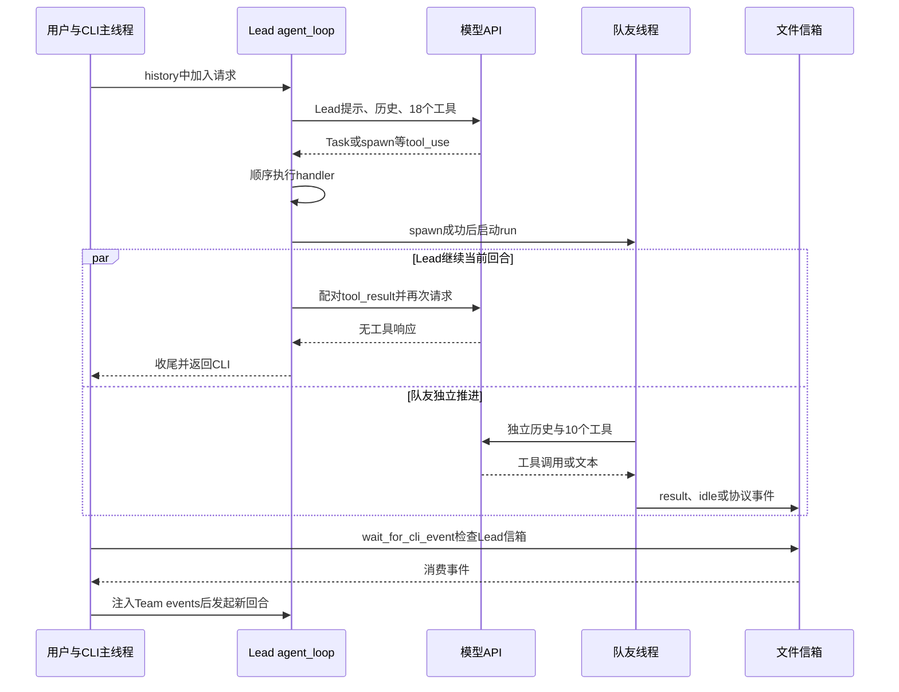
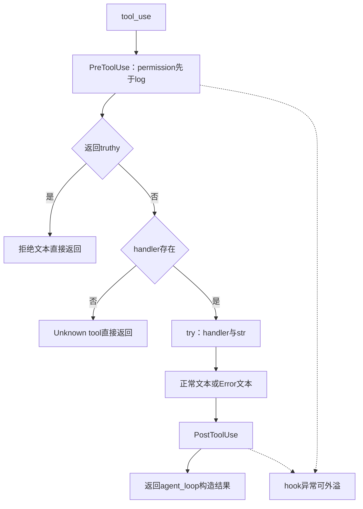
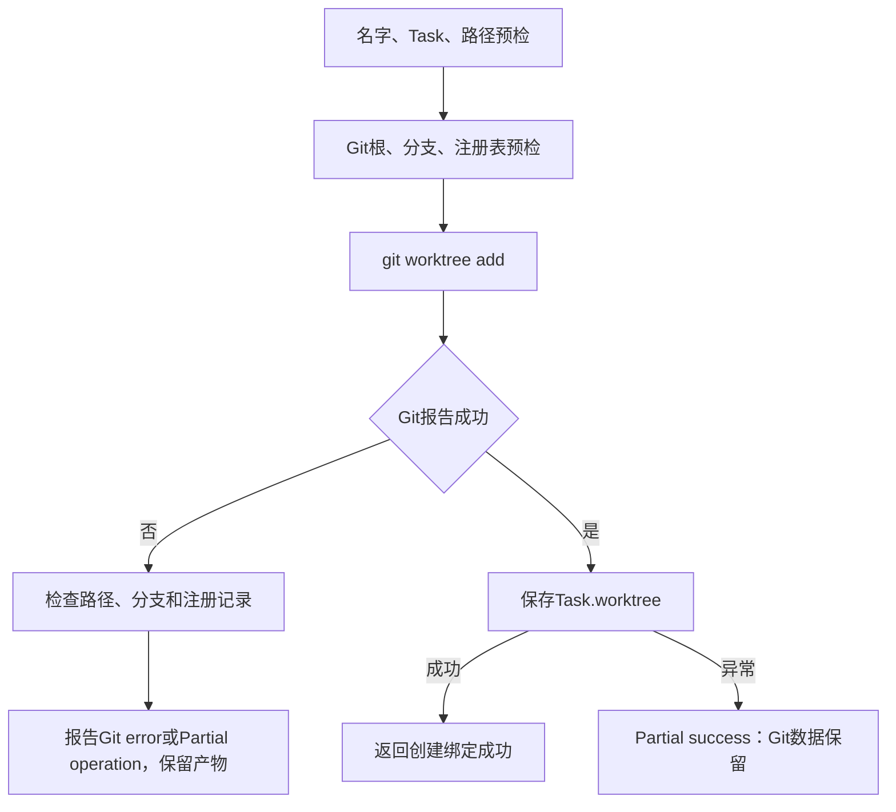
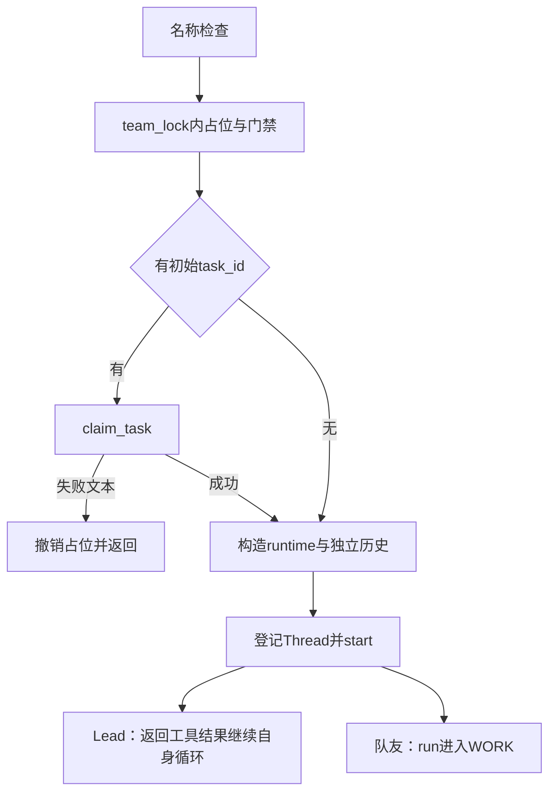
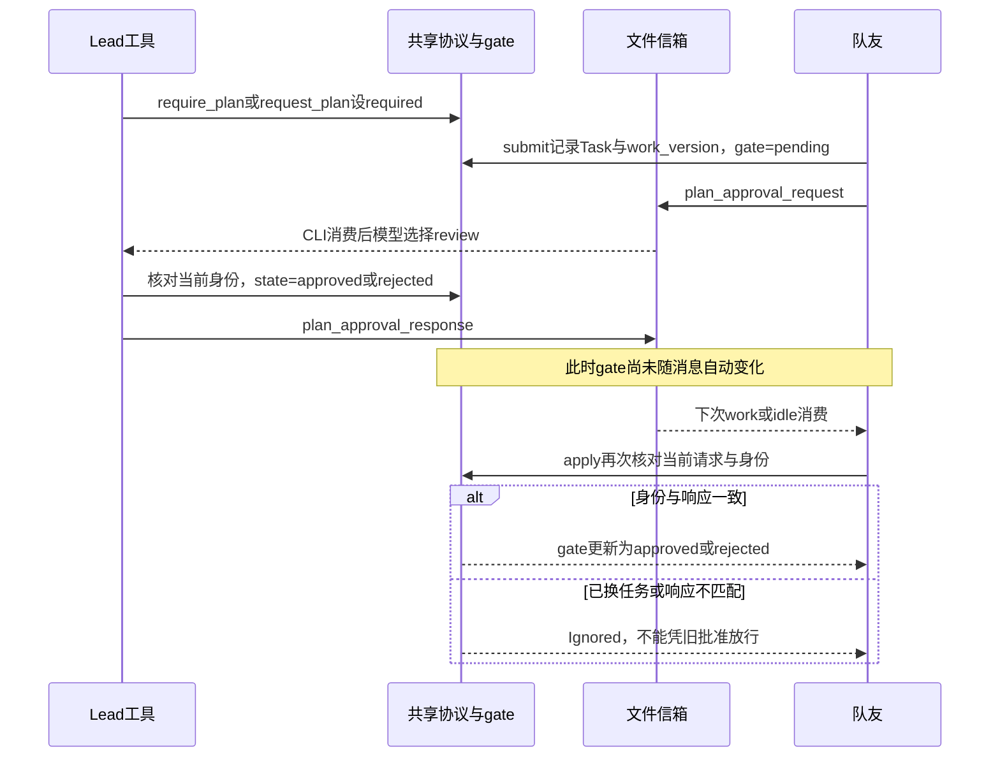
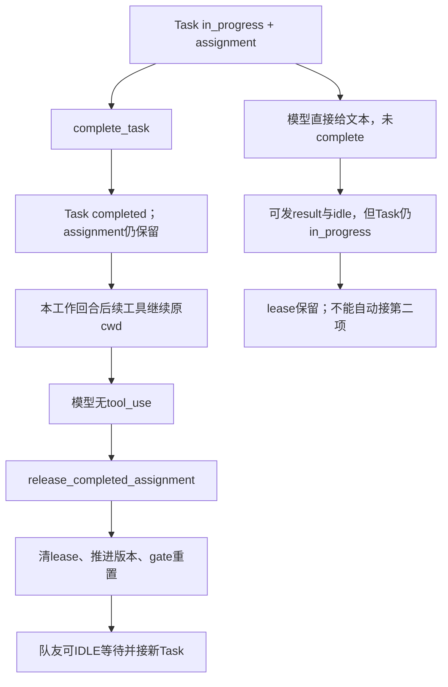
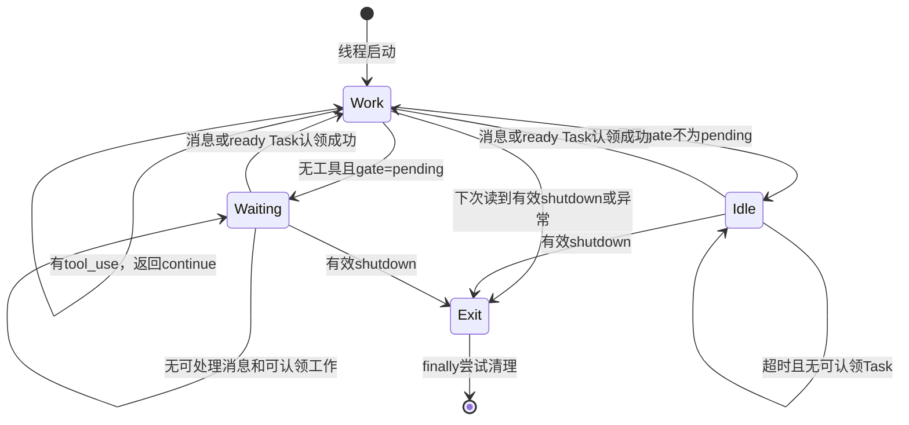
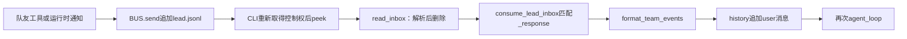
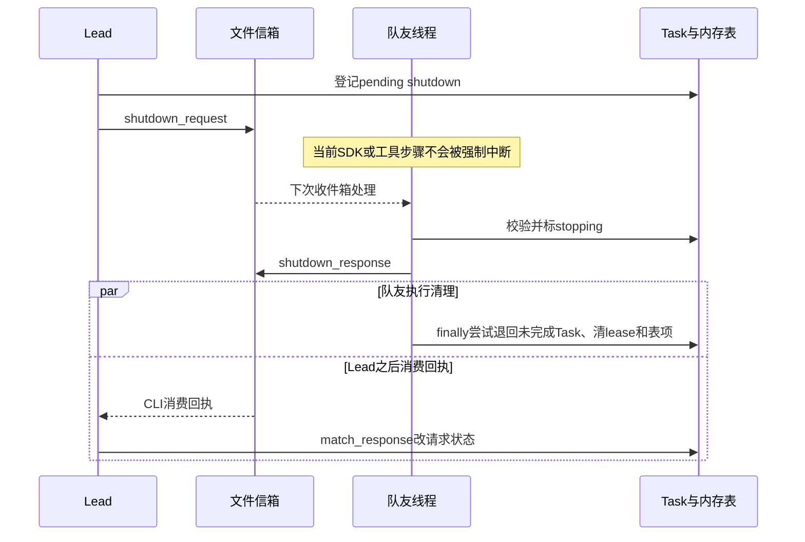

> 待分析代码位置：`s13_agent_teams/code.py`。
>
> 功能描述：从实际程序入口出发，沿调用、分支与返回位置，逐步解释 Lead 如何处理请求、创建和分配持久化任务、启动常驻队友、绑定工具工作目录、执行计划审批，以及如何通过文件信箱把结果交回 Lead。
>
> 阅读约定：先看带行号的连续原始代码，再分析进入条件、执行过程、数据变化、副作用、返回位置和异常。本文为当前仓库的静态源码分析，未导入或运行目标模块，未调用模型、启动队友或执行工具。已有用例仅作为源码断言证据，不代表已运行通过。设计理由若未由实现直接确定，明确标为基于代码推断。

# 1. 从入口确定主线：Lead 等待事件，队友另起线程

## 1.1 先看实际启动入口

源码定位：`s13_agent_teams/code.py`，`__main__：初始化历史与用户分支`，L2072–L2087。

```python
if __name__ == "__main__":
    print("s13: agent teams")
    print("Enter a question, press Enter to send. Type q to quit.\n")
    history = []          # Lead 的对话历史
    had_teammates = False  # 用于判断「刚刚还有队友，现在全关了」好打印提示

    while True:
        kind, payload = wait_for_cli_event()
        if kind == "quit":
            break
        if kind == "user":
            # 用户输入
            if payload is None or payload.strip().lower() in {"q", "exit", ""}:
                break
            trigger_hooks("UserPromptSubmit", payload)
            history.append({"role": "user", "content": payload})
```

这段代码是直接执行脚本时的入口。Python 必须先完成模块顶层初始化，才会判断 `__name__`；这里先展示它，是为了让后面的阅读始终有调用方可回，而不是把初始化误放在入口之后执行。

入口首先打印欢迎信息，然后创建两个跨用户回合保留的变量：

- `history`：Lead 的对话列表，用户消息、模型响应、工具结果和团队事件都进入这里。
- `had_teammates`：展示用的布尔标记，用来识别“之前有队友，现在没有”的变化；不是线程同步器，也不是任务完成条件。

每次循环调用 `wait_for_cli_event`。它返回事件种类和可选文本，入口再决定退出、追加用户请求，或消费团队信箱。最后才进入 Lead 的模型循环。

Lead 就在执行这个入口的主线程中同步工作。队友线程只会在模型选择 `spawn_teammate`、对应 handler 通过前置检查并执行 `Thread.start` 后出现。模块注释中“Lead 和每个 teammate 都是独立线程”应理解为执行上下文分离，不能据此补出一个额外创建的 Lead 线程。[证据：`s13_agent_teams/code.py:24–28,1571–1608,2072–2099`]

## 1.2 入口后半段：两种事件汇合到同一个模型循环

源码定位：`s13_agent_teams/code.py`，`__main__：团队事件、Lead 调用与展示`，L2088–L2108。

```python
        else:
            # 团队事件（wake）：取走信箱；如果全是协议回复而没有真正要看的消息，就跳过本轮。
            inbox = consume_lead_inbox()
            if not inbox:
                continue
            history.append({
                "role": "user",
                "content": format_team_events(inbox),
            })
            print(f"[wake: {len(inbox)} team event(s) -> new turn]")

        agent_loop(history)
        print_last_assistant_message(history)

        if active_teammates:
            had_teammates = True
        elif had_teammates and not BUS.peek("lead"):
            # 队友全没了，信箱也空了 → 收尾提示。
            print("[all teammates shut down]")
            had_teammates = False
        print()
```

用户分支在前一个片段追加原始输入，wake 分支在这里追加格式化团队事件。两条路径最终共同调用 `agent_loop(history)`，并在其返回后展示最后一条消息。

注意 wake 分支的注释说“如果全是协议回复……就跳过”，但实际代码仅检查 `if not inbox`。后面会看到 `consume_lead_inbox` 返回所有读出的消息，没有筛掉协议回复，因此非空协议回复同样可能触发 Lead 调用。本文以实现为准。

本实现不是“每个用户请求都先创建任务再启动团队”。模型可以直接回答，也可以只读文件、自己认领任务，或使用团队工具。下面为了完整理解协作链，选择“创建任务并启动队友”的一种路径深入；其他工具始终是条件分支。

## 1.3 先定位主线与并行线

下图用于区分同步调用与线程启动，不表示模型一定按图选择所有工具。



图中两类模型请求使用同一个模块级 client 和 MODEL，但历史、system 与工具参数不同。信箱通知不会中断 Lead 当前 SDK 请求；必须回到 CLI 事件等待处才能消费。接下来先回溯入口之前的初始化。

# 2. 回到入口之前：配置、容器与提示词如何建立

## 2.1 无条件 POSIX 依赖先于任何业务逻辑

源码定位：`s13_agent_teams/code.py`，`模块导入与readline初始化`，L41–L65。

```python
import fcntl         # 文件锁（flock）：让「同一台机器上的多个进程」也能互斥操作任务板
                     # 注意：fcntl 是 POSIX 专有模块，Windows 上没有，本课脚本只能在类 Unix 下运行
import json          # 任务文件与信箱消息的序列化
import os            # 环境变量、进程号、原子替换文件
import random        # 生成协议请求号 req_000123
import re            # 正则：任务 ID / 目录名 / 队友名 / 危险命令匹配
import secrets       # 生成随机任务 ID（task_xxxxxxxx）
import select        # 带超时地探测 stdin 是否可读（CLI 主循环用）
import subprocess    # 执行 shell 命令、调用 git
import sys           # 访问 stdin，供 select 使用
import threading     # 线程：每个队友一条线程；各种锁与条件变量
import time          # 时间戳、等待超时
from contextlib import contextmanager   # 把「加锁/解锁」写成一个 with 上下文管理器
from dataclasses import dataclass, asdict, field  # field(default_factory=...) 用于默认创建时间
from pathlib import Path                # 面向对象的路径操作

try:
    import readline
    readline.parse_and_bind('set bind-tty-special-chars off')
except ImportError:
    # Windows 自带 Python 没有 readline，跳过即可。
    pass

from anthropic import Anthropic  # Anthropic 官方 Python SDK 客户端
from dotenv import load_dotenv   # 从 .env 文件加载环境变量
```

`fcntl` 是无条件导入，不在平台 try 中。原生 Windows Python 如果没有该模块，会在这里终止，尚未执行 dotenv、创建客户端或进入 CLI。后面提示词包含 Windows 文案，并不能修复这个导入限制。

`select` 用于 stdin 就绪检查；`threading` 用于队友、锁和条件变量；`secrets` 产生任务 ID；`random` 产生协议请求号。json 与 dataclass 承担任务/消息序列化，没有数据库层。

readline 只有 ImportError 被处理。导入成功后 `parse_and_bind` 若抛其他异常，不会由此捕获。可选终端能力与程序整体平台兼容性是两回事。

源码没有导入 s10、s11、s12、s14 或 s15。README 的“复用 s10”是教学代码演进说明，当前文件直接包含所需实现，不是运行时动态加载前一章。

## 2.2 环境覆盖、工作目录、客户端与模型

源码定位：`s13_agent_teams/code.py`，`dotenv、WORKDIR、client与MODEL`，L67–L74。

```python
load_dotenv(override=True)
if os.getenv("ANTHROPIC_BASE_URL"):
    # 配了自定义端点时移除可能冲突的 ANTHROPIC_AUTH_TOKEN，避免两种鉴权打架。
    os.environ.pop("ANTHROPIC_AUTH_TOKEN", None)

WORKDIR = Path.cwd()  # 工作目录：所有路径校验与 git 操作的基准
client = Anthropic(base_url=os.getenv("ANTHROPIC_BASE_URL"))
MODEL = os.environ["MODEL_ID"]  # 从环境变量读模型 ID
```

执行顺序不可交换：

1. dotenv 加载时允许覆盖已有同名环境变量；实际文件定位由依赖库和运行环境决定，本文不读取真实配置。
2. 若 ANTHROPIC_BASE_URL 为 truthy，移除进程环境中的 ANTHROPIC_AUTH_TOKEN。
3. 记录模块加载时的 cwd。
4. 创建 Anthropic 客户端。
5. 用环境字典索引获取 MODEL_ID，缺失则抛 KeyError。

客户端构造早于模型 ID 读取，所以模型配置缺失并不意味着 SDK 构造从未发生。构造也不等于已经发出 messages.create；本模块第一笔显式模型请求在回合循环中。

WORKDIR 是固定 Path 值；它不随任意后续 `os.chdir` 自动更新。任务、信箱和 worktree 根目录由它派生，相对文件操作也由它或任务 cwd 解释，而不是一律相对源码文件。

顶层没有统一启动 try。这些错误不受 execute_tool 或 agent_loop 的局部异常包装保护。

源码定位：`requirements.txt`，`requirements.txt：依赖最低版本`，L1–L3。

```text
anthropic>=0.25.0
python-dotenv>=1.0.0
pyyaml>=6.0
```

依赖声明不等于实际安装版本，也不确定 SDK 内部的重试、超时或并发行为。pyyaml 虽在仓库依赖中，此文件没有因此获得技能扫描或 YAML 记忆能力。

## 2.3 先建立任务与目录租约容器，不立即创建任务

源码定位：`s13_agent_teams/code.py`，`任务根目录、锁与assignment容器`，L80–L97。

```python
TASKS_DIR = WORKDIR / ".tasks"
TASKS_ROOT = TASKS_DIR.resolve()  # 解析成绝对路径，后面做「不许跳出目录」的校验
TASK_ID_PATTERN = re.compile(r"^task_[0-9a-f]{8}$")  # 任务 ID 形状：task_ + 8 位十六进制
task_lock = threading.RLock()        # 线程内的互斥锁（可重入）
TASK_LOCK_PATH = TASKS_DIR / ".lock"  # 跨进程互斥用的锁文件
# 线程局部存储：记录「当前线程」进入 task_store_lock 的嵌套深度和持有的文件句柄。
# 用 thread-local 而不是普通全局变量，多个线程各自持有自己的句柄才不会互相踩。
_task_store_state = threading.local()

# owner -> {"task_id": str, "cwd": Path}. A teammate gets one assignment at
# a time, and every filesystem tool resolves its cwd through this registry.
# （owner → {"task_id": ..., "cwd": ...}：队友同一时刻只有一个「当前任务」。
#   所有文件/命令工具都通过这张登记表解析自己的工作目录，
#   这样任务绑定了 worktree 时，工具就自动落在那个独立目录里干活。）
teammate_assignments: dict[str, dict[str, object]] = {}
# owner -> 版本号。每次任务交接（认领/完成/异常退出）就 +1，
# 用来让「上一轮任务期间发出的审批」自动作废（见 advance_assignment_version）。
assignment_versions: dict[str, int] = {}
```

这里创建的是 Path、正则、RLock、thread-local 和空字典：

- `teammate_assignments` 连接 owner、task_id 与 cwd。
- `assignment_versions` 标记当前进程内的任务交接代次。
- `_task_store_state` 保存每个线程自己的锁嵌套深度和文件句柄。

仅声明 TASKS_DIR 不会 mkdir。第一次进入任务存储锁或实际写操作时，才产生相关目录/文件。任务文件可持久存在；assignment 和版本表不会自动从文件完整恢复。

源码定位：`s13_agent_teams/code.py`，`worktree路径与名字规则`，L418–L420。

```python
WORKTREES_DIR = WORKDIR / ".worktrees"
WORKTREES_ROOT = WORKTREES_DIR.resolve()
VALID_WORKTREE_NAME = re.compile(r"^[A-Za-z0-9][A-Za-z0-9._-]{0,63}$")
```

源码定位：`s13_agent_teams/code.py`，`信箱路径、名字规则与MessageBus锁`，L973–L990。

```python
MAILBOX_DIR = WORKDIR / ".mailboxes"
MAILBOX_ROOT = MAILBOX_DIR.resolve()
VALID_AGENT_NAME = re.compile(r"^[A-Za-z0-9_-]{1,64}$")
RESERVED_TEAMMATE_NAMES = {"lead", "agent"}  # 这两个名字归运行时自己用


def is_valid_agent_name(name: str) -> bool:
    return bool(VALID_AGENT_NAME.fullmatch(name))


class MessageBus:
    """Thread-safe file mailboxes with destructive reads."""
    # 线程安全的文件信箱，读取即清空（取走消息并删掉信箱文件）。

    def __init__(self):
        self._lock = threading.RLock()
        # 条件变量：等待方可以「阻塞等到有新消息」，而不是忙等轮询。
        self._changed = threading.Condition(self._lock)
```

源码定位：`s13_agent_teams/code.py`，`全局MessageBus、队友状态与计划门禁`，L1052–L1063。

```python
BUS = MessageBus()  # 全局唯一的消息总线

# working | waiting_approval | idle | stopping
# 队友状态表：working 干活中 / waiting_approval 等 Lead 批方案 /
#            idle 待命 / stopping 正在关闭。Lead 靠它知道现在有哪些队友。
active_teammates: dict[str, str] = {}
# 方案闸门：not_required 不需要审批 / required 必须交方案 / pending 已交待批
#          / approved 已批准 / rejected 被否决
plan_gates: dict[str, str] = {}
# 每个队友「当前这一份」方案请求的编号（用于忽略过期的审批回复）。
plan_request_ids: dict[str, str] = {}
team_lock = threading.RLock()  # 保护上面三张表
```

BUS 构造时只建立进程内锁和 Condition；没有启动消费者线程。active_teammates、plan_gates、plan_request_ids 是三张不同状态表，后面分别对应展示状态、执行门禁和当前方案关联。

本阶段暂不把“working/idle”等字符串画成一个统一业务状态机：实际运行中 Task、线程循环、active 状态与 gate 并非同一个对象。

## 2.4 固定 system 如何给 Lead 提供工作规矩

源码定位：`s13_agent_teams/code.py`，`ENVIRONMENT_PROMPT、PROMPT_SECTIONS与SYSTEM`，L732–L775。

```python
ENVIRONMENT_PROMPT = (
    "Windows: the bash tool runs through cmd.exe; use cmd.exe syntax, not Unix "
    "Bash or PowerShell syntax, and prefer dedicated file tools for file operations"
    if os.name == "nt"
    else "Unix-like: the bash tool runs the system shell"
)
# 系统提示词拆成几段再拼起来，方便单独阅读和调整：
#   identity  —— 角色与运行环境
#   tools     —— 可用工具清单
#   tasks     —— 任务板的用法规矩（先建节点拿真实 ID，再补依赖；只有 Lead 能改依赖）
#   teams     —— 团队协作规矩（先提方案等用户确认，再 spawn；建 worktree 的时机；
#                spawn 后结束本轮而不是轮询队友状态；收尾时要关掉队友）
#   workspace —— 工作目录
PROMPT_SECTIONS = {
    "identity": f"You are a coding agent. Act, don't explain. Environment: {ENVIRONMENT_PROMPT}.",
    "tools": "Available tools: bash, read_file, write_file, edit_file, glob, "
             "create_task, update_task, list_tasks, get_task, claim_task, "
             "complete_task, "
             "spawn_teammate, list_teammates, send_message, request_shutdown, "
             "request_plan, review_plan, create_worktree.",
    "tasks": (
        "Create all task nodes first. Only after create_task returns "
        "runtime-generated IDs, use update_task with those exact IDs to add "
        "dependencies. Only the Lead changes task dependencies."
    ),
    "teams": (
        "When parallel work would help, first propose a small team with clear "
        "responsibilities and wait for the user's confirmation. Do not call "
        "spawn_teammate before the user confirms. After confirmation, delegate "
        "independent work by creating a Task for each parallel change. Pass "
        "task_id to spawn_teammate when assigning ready work, then "
        "create a task-bound worktree only when a separate working directory "
        "would prevent conflicting edits. A teammate must complete its current "
        "Task before claiming another. A worktree changes tool default cwd "
        "only; it is not a sandbox. Worktree removal stays with the host or "
        "user. After spawning a teammate, end the current turn instead of "
        "polling its status; the runtime will deliver team events and wake the "
        "Lead. React to those events, and shut teammates down when "
        "coordination is complete."
    ),
    "workspace": f"Working directory: {WORKDIR}",
}

SYSTEM = "\n\n".join(PROMPT_SECTIONS.values())
```

各段按字典插入顺序拼接：

- identity 提供编码身份和 shell 环境。
- tools 列出固定能力名。
- tasks 要求先创建节点拿真实 ID，再补依赖，只有 Lead 改图。
- teams 要求先提出团队方案、等用户确认、分配任务、避免轮询并最终关闭队友。
- workspace 写入 WORKDIR。

其中有的规则有执行层支撑，例如队友工具池没有 update_task；有的只是提示约束，例如“用户确认后才能 spawn”和“spawn 后结束本轮”。后面实际 handler 没有用户确认票据，也没有专门强制结束 Lead 回合。

teams 文案含“传 task_id 给 spawn，then create worktree”的先后措辞；但 create_worktree 要求 pending/unowned，spawn 带任务又会先认领。实际可行次序是需要隔离时先创建绑定，再认领/启动；不能照提示中的 then 推断允许认领后创建。

## 2.5 工具与 hooks 注册只建立执行入口

源码定位：`s13_agent_teams/code.py`，`Lead工具汇总与TOOL_HANDLERS`，L1848–L1870。

```python
# Lead 能用的全部工具 = 基础 + 任务 + 团队。
TOOLS = [*BASE_TOOLS, *TASK_TOOLS, *TEAM_TOOLS]

TOOL_HANDLERS = {
    "bash": run_agent_bash,
    "read_file": run_agent_read,
    "write_file": run_agent_write,
    "edit_file": run_agent_edit,
    "glob": run_agent_glob,
    "create_task": run_create_task,
    "update_task": run_update_task,
    "list_tasks": run_list_tasks,
    "get_task": run_get_task,
    "claim_task": run_claim_task,
    "complete_task": run_complete_task,
    "spawn_teammate": run_spawn_teammate,
    "list_teammates": run_list_teammates,
    "send_message": run_send_message,
    "request_shutdown": run_request_shutdown,
    "request_plan": run_request_plan,
    "review_plan": run_review_plan,
    "create_worktree": run_create_worktree,
}
```

源码定位：`s13_agent_teams/code.py`，`默认hook事件与命令规则`，L1875–L1880。

```python
HOOKS = {"UserPromptSubmit": [], "PreToolUse": [], "PostToolUse": [], "Stop": []}
DENY_LIST = ["rm -rf /", "sudo", "shutdown", "reboot", "mkfs", "dd if="]  # 硬黑名单
DESTRUCTIVE_COMMAND_WORD = re.compile(
    r"(?i)(?:^|[;&|()\n])\s*(?:rm|del)(?=\s|$|[;&|()])"
)
DESTRUCTIVE = ["rm ", "> /etc/", "chmod 777"]  # 需人工确认的关键词
```

源码定位：`s13_agent_teams/code.py`，`默认hooks注册顺序`，L1968–L1972。

```python
register_hook("UserPromptSubmit", context_hook)
register_hook("PreToolUse", permission_hook)
register_hook("PreToolUse", log_hook)
register_hook("PostToolUse", large_output_hook)
register_hook("Stop", summary_hook)
```

Lead 有 5 个基础工具、6 个任务工具和 7 个团队工具，共 18 个。handler 表中的基础工具不是直接 run_read 等，而是 run_agent_* 包装，这一层决定任务 cwd。

队友工具后面独立构造，总共 10 个；没有 create/update/get_task、spawn、worktree 管理或审批别人的入口。

注册 hook 只是登记引用，不会提前进行权限确认或 Stop 统计。至此没有任何队友线程，也没有后台命令、Cron、MCP 或长期记忆服务。现在回到 __main__ 的第一笔事件等待。

# 3. wait_for_cli_event：先看Lead信箱，再等待stdin

## 3.1 一次事件等待中的真实顺序

源码定位：`s13_agent_teams/code.py`，`wait_for_cli_event`，L2050–L2069。

```python
def wait_for_cli_event() -> tuple[str, str | None]:
    # CLI 事件循环的核心：同时盯着「键盘输入」和「Lead 的信箱」，谁先来就处理谁。
    # 有了它，队友发来的事件能像用户输入一样把 Lead 唤醒。
    prompt_visible = False
    while True:
        if BUS.peek("lead"):
            # 有团队事件：如果提示符已经打印出来，先换行免得挤在一起。
            if prompt_visible:
                print()
            return "wake", None
        if not prompt_visible:
            print("s13 >> ", end="", flush=True)  # 手写提示符（因为要交替监听）
            prompt_visible = True
        # select 带 0.25 秒超时：既能及时响应输入，又能定期回头检查信箱。
        readable, _, _ = select.select([sys.stdin], [], [], 0.25)
        if readable:
            line = sys.stdin.readline()
            if line == "":
                return "quit", None  # EOF（Ctrl+D / 管道结束）
            return "user", line.rstrip("\n")
```

每次调用的 prompt_visible 从 False 开始。循环第一步始终是 `BUS.peek("lead")`：

1. 已有消息：必要时换行，然后立刻返回 wake。
2. 没消息：尚未显示提示符才打印一次。
3. select 等待 stdin，最多 0.25 秒。
4. 可读时 readline；空字符串表示 EOF，返回 quit。
5. 非 EOF 返回 user，并仅 rstrip 换行。
6. 超时则回到循环重新检查信箱。

因此优先级是“每次循环先看到的Lead消息优先”，不是用户和消息进入公平队列。持续有消息时，普通输入可能延后；输入正在编辑而消息到达时，代码只换行，不具备 ConsoleBroker 的完整重绘能力。

这里的 0.25 秒是检测节奏，不是事件端到端处理时延承诺；Lead 忙于模型/工具时根本不在这个函数里。

## 3.2 首次进入BUS.peek：名字、路径与非空文件

源码定位：`s13_agent_teams/code.py`，`is_valid_agent_name`，L979–L980。

```python
def is_valid_agent_name(name: str) -> bool:
    return bool(VALID_AGENT_NAME.fullmatch(name))
```

源码定位：`s13_agent_teams/code.py`，`MessageBus._path`，L992–L999。

```python
    def _path(self, agent: str) -> Path:
        # 收件人名字 → 信箱文件路径，同样做名字校验 + 目录约束。
        if not is_valid_agent_name(agent):
            raise ValueError(f"Invalid mailbox recipient: {agent!r}")
        path = (MAILBOX_DIR / f"{agent}.jsonl").resolve()
        if not path.is_relative_to(MAILBOX_ROOT):
            raise ValueError(f"Mailbox path escapes directory: {agent!r}")
        return path
```

源码定位：`s13_agent_teams/code.py`，`MessageBus.peek`，L1030–L1034。

```python
    def peek(self, agent: str) -> bool:
        # 只看「有没有消息」，不取走（CLI 用它判断要不要唤醒 Lead）。
        with self._lock:
            inbox = self._path(agent)
            return inbox.exists() and inbox.stat().st_size > 0
```

lead 满足 1–64 位 ASCII 字母、数字、下划线、短横线规则。_path resolve 后要求落在 MAILBOX_ROOT 之下。这里检查的是收件人路径，不是身份认证；BUS.send 的 from 字段后面不会因此获得签名保证。

peek 在 BUS 的 RLock 下检查存在且文件大小大于0。它不解析 JSON，也不消费文件；一个非空但损坏的信箱仍可使 CLI wake。

MAILBOX_ROOT 在初始化时 resolve 后固定；此方法没有像任务路径那样额外比较根目录是否位于 WORKDIR。不要把三种路径检查写成完全相同的一层。

返回 wait_for_cli_event：peek=True 就 wake；False 才执行 stdin 等待。select/readline 异常以及 Ctrl+C 没有在入口外包统一捕获。

## 3.3 返回入口：输入退出和提交各走什么分支

入口代码见第1章 L2078–2087。quit 不追加消息。user 的 payload 若是 None、strip/lower 后为 q、exit、空白，也 break。其余原始 payload 不做 strip 后替换，直接进入 hook 和历史。

这意味着空行结束程序，不是忽略；quit 以外的一段文本即使含 q，也仍是普通任务。

wake 暂时接到第18章的完整消费链。启动前磁盘若已有 lead.jsonl，同样可能第一步就 wake；本实现并不要求本次进程先 spawn 才允许处理遗留信箱。

# 4. 用户提交：有序hooks运行后，原始请求追加history

## 4.1 首次深入hook触发器

源码定位：`s13_agent_teams/code.py`，`register_hook与trigger_hooks`，L1887–L1899。

```python
def register_hook(event: str, callback):
    HOOKS[event].append(callback)


def trigger_hooks(event: str, *args, skip_permission: bool = False):
    # 多了一个 skip_permission：队友那边已经自己做过权限检查，这里跳过 permission_hook。
    for callback in HOOKS[event]:
        if skip_permission and callback is permission_hook:
            continue
        result = callback(*args)
        if result is not None:
            return result  # 谁先返回内容谁就「拦截」
    return None
```

register_hook 对指定列表 append，没有去重、优先级数字或事件合法性包装。trigger_hooks 顺序执行；skip_permission 仅在 callback 与 permission_hook 是同一对象时跳过。

返回值只要不是 None 就短路，False、0、空字符串也会停止后续 hook。这里没有 catch，callback 异常沿调用栈传播。

用户提交调用没有接收 trigger_hooks 的返回值，因此即使自定义 UserPromptSubmit 返回拒绝文本，入口仍会追加用户消息。默认回调没有拒绝逻辑。

源码定位：`s13_agent_teams/code.py`，`context_hook`，L1947–L1949。

```python
def context_hook(query: str):
    print(f"[hook] UserPromptSubmit: working in {WORKDIR}")
    return None
```

该 hook 只打印 WORKDIR，不读取文件、不做任务划分，也不修改 query。若 print 失败，异常在 history.append 前外溢。

返回 __main__：追加一条 user 消息，再调用 agent_loop，同一列表引用会在内部继续追加 assistant 和结果。历史不是复制到独立运行上下文，也没有自动落盘。

## 4.2 当前CLI如何避免自身并发，哪些共享对象仍然存在

用户提交和 wake 都在主线程顺序处理，所以默认 CLI 不会同时跑两个 Lead agent_loop；这来自控制流，而不是显式 agent_lock。

队友可并行修改任务与消息状态，但不直接 append Lead 的 history。每个 TeammateRuntime.messages 独立。模块级 client、MODEL、任务板、BUS、协议与状态表则共享。

若可信调用方在其他线程并发调用 Lead 或改全局表，源码没有额外会话锁。本文只把这种情况列为嵌入边界，不描述成默认 CLI 已经发生竞态。

返回主线：用户提交完成，进入第一笔 Lead 模型请求。

# 5. agent_loop：固定工具请求、真实tool_use分流和下一轮

## 5.1 请求使用哪些参数

源码定位：`s13_agent_teams/code.py`，`agent_loop：SDK请求`，L1993–L2003。

```python
def agent_loop(messages: list):
    # Lead 的 agent 循环：与前面几课相同，只是收尾时多了一步「释放目录租约」。
    while True:
        try:
            response = client.messages.create(
                model=MODEL,
                system=SYSTEM,
                messages=messages,
                tools=TOOLS,
                max_tokens=8000,
            )
```

while 每次都调用同一 client.messages.create：

| 参数 | 来源 | 实际含义 |
| --- | --- | --- |
| model | 顶层MODEL | Lead固定模型名 |
| system | 顶层SYSTEM | 初始化时拼好的字符串 |
| messages | 调用者history引用 | 当前全部会话 |
| tools | 顶层TOOLS | 18个固定声明 |
| max_tokens | 8000 | 单次输出上限参数 |

本章没有 assemble_tool_pool、动态MCP发现或每轮记忆召回。历史和可用工具是直接传给SDK的两类输入，工具名只是模型可选择入口，实际执行还需路由与权限。

SDK 内部是否重试或客户端是否对并发做资源管理，单凭最低依赖版本无法确认。当前代码没有显式退避、fallback、压缩或总费用控制。

## 5.2 SDK普通异常：先写错误，再尝试释放租约和Stop

源码定位：`s13_agent_teams/code.py`，`agent_loop：SDK错误出口`，L2004–L2015。

```python
        except Exception as exc:
            # 调用失败也要收尾：把错误写进对话、释放租约、跑 Stop 钩子后返回。
            messages.append({
                "role": "assistant",
                "content": [{
                    "type": "text",
                    "text": f"[Error] {type(exc).__name__}: {exc}",
                }],
            })
            release_completed_assignment("agent")
            trigger_hooks("Stop", messages)
            return
```

try 仅覆盖 messages.create 调用表达式。捕获 Exception 后，追加本地 dict 文本块，调用 release_completed_assignment("agent")，再触发 Stop 并 return。

释放只针对 completed 租约，不把进行中任务自动退回pending。释放函数或Stop自己再抛错，不由此 except 额外保护。KeyboardInterrupt/SystemExit不属于普通Exception。

此处并不撤销前面工具副作用，错误历史也不持久化。SDK失败后当前Lead回合结束，若收尾成功返回CLI，用户仍可继续输入。

## 5.3 成功响应先入历史，再按实际内容判断

源码定位：`s13_agent_teams/code.py`，`agent_loop：assistant保存与无工具出口`，L2017–L2024。

```python
        messages.append({"role": "assistant", "content": response.content})
        tool_calls = [
            block for block in response.content if block.type == "tool_use"
        ]
        if not tool_calls:
            release_completed_assignment("agent")  # 本轮结束，释放 cwd 租约
            trigger_hooks("Stop", messages)
            return
```

response.content 先 append，然后按 block.type 筛选 tool_use。没有用 stop_reason 控制是否执行。

- 真有工具，即使stop_reason表示end_turn，也继续工具路径。
- 没有实际工具，不追加空结果，释放completed租约、Stop并返回。
- max_tokens没有专门处理；截断只有文本时也会结束，有可执行工具块时按普通工具路径处理。
- response/content/block形状错误发生在try之外，可能外溢；最终展示兼容dict不意味着主循环通用兼容dict块。

已有边界断言以伪响应检查实际tool_use和stop_reason不一致的情况，支持这条分流规则；本文未执行。[证据：`tests/test_agent_loop_boundaries.py:219–275`]

## 5.4 有工具：本响应内部逐个执行，整批回填

源码定位：`s13_agent_teams/code.py`，`agent_loop：工具执行与结果回填`，L2026–L2036。

```python
        results = []
        for block in tool_calls:
            print(f"> {block.name}")
            output = execute_tool(block)
            print(output[:300])  # 终端上只看前 300 字符，完整内容仍回给模型
            results.append({
                "type": "tool_result",
                "tool_use_id": block.id,
                "content": output,
            })
        messages.append({"role": "user", "content": results})
```

results 每个响应新建。依次打印工具名、同步 execute_tool、打印前300字符，再建立带 block.id 的 tool_result。整批完成后才 append user 消息。

这里的300限制仅终端预览；模型收到的是handler最终返回字符串，但handler自身可能已经截掉原始输出。结果没有统一 is_error 标志，拒绝/失败通常只是文本。

同一响应内工具不并发；多个队友才可能各在线程并行。前一个工具成功而后一个hook失败时，前面副作用保留，但results可能尚未进入history。下一轮不会自动恢复残批。

下面进入 execute_tool；被模型选中的具体工具从这里分岔。

# 6. execute_tool：权限、路由、参数绑定与结果包装

## 6.1 分发顺序和局部异常保护

源码定位：`s13_agent_teams/code.py`，`execute_tool`，L1975–L1988。

```python
def execute_tool(block) -> str:
    # 执行工具：先过 PreToolUse 钩子（可拦截），再找处理函数，最后发 PostToolUse。
    blocked = trigger_hooks("PreToolUse", block)
    if blocked:
        return str(blocked)
    handler = TOOL_HANDLERS.get(block.name)
    if not handler:
        return f"Unknown tool: {block.name}"
    try:
        output = str(handler(**block.input))
    except Exception as exc:
        output = f"Error: {type(exc).__name__}: {exc}"
    trigger_hooks("PostToolUse", block, output)
    return output
```

先执行PreToolUse，truthy返回就拒绝；随后查全局handler，缺失直接Unknown tool；try只包参数展开调用和str化；最后触发PostToolUse。

拒绝和未知工具均不执行PostToolUse。普通handler异常转Error，不保证所有工具相关错误都可转结果：前置/后置hook、主循环print以及响应访问都在局部try之外。

trigger_hooks的“非None即短路”与这里的“truthy才拒绝”不同。自定义hook返回False会停止后续hook，却仍执行handler；默认回调遵循None或非空拒绝文本约定。

## 6.2 权限入口：不是所有shell都询问，不是所有工具都检查

源码定位：`s13_agent_teams/code.py`，`check_permission与permission_hook`，L1902–L1932。

```python
def check_permission(block, prompt_user: bool = True) -> str | None:
    # prompt_user=True：可以弹交互式确认框（Lead 在跟人对话）。
    # prompt_user=False：队友场景，不能弹框，只能返回「请 Lead 来跑」。
    if block.name == "bash":
        command = block.input.get("command", "")
        for pattern in DENY_LIST:
            if pattern in command:
                return f"Permission denied by deny list: {pattern}"
        if contains_destructive_command(command) or any(
            keyword in command for keyword in DESTRUCTIVE
        ):
            if not prompt_user:
                return "Permission required: ask Lead to run this command."
            print(f"\n[permission] {block.name}({block.input})")
            if input("Allow? [y/N] ").strip().lower() not in {"y", "yes"}:
                return "Permission denied by user"

    if block.name in {"read_file", "write_file", "edit_file"}:
        raw_path = block.input.get("path", "")
        if not (WORKDIR / raw_path).resolve().is_relative_to(WORKDIR.resolve()):
            # 访问工作区外的路径同样需要授权。
            if not prompt_user:
                return "Permission required: path is outside the workspace."
            print(f"\n[permission] {block.name}({block.input})")
            if input("Allow? [y/N] ").strip().lower() not in {"y", "yes"}:
                return "Permission denied by user"
    return None


def permission_hook(block):
    return check_permission(block, prompt_user=True)  # 默认：Lead 场景，可以问人
```

Lead 的permission_hook允许人工输入：

- bash黑名单按区分大小写子串直接拒绝；特定破坏性写法询问。
- read/write/edit的路径按WORKDIR解析，越界询问。
- 其他工具默认不在这些分支中。

所以 spawn、create_worktree、任务工具没有专门“用户确认团队”的本地状态检查。系统提示要求不能等同授权票据。

文件人工允许只表示这层hook未拦截；后面的safe_path仍可硬拒绝实际cwd之外的目标，第14章将完整展开两层关系。

command/path/input没有统一类型预检；某些错误先在权限hook抛出，尚未进入handler try。

源码定位：`s13_agent_teams/code.py`，`log_hook与large_output_hook`，L1935–L1944。

```python
def log_hook(block):
    preview = str(list(block.input.values())[:2])[:60]
    print(f"[hook] {block.name}({preview})")
    return None


def large_output_hook(block, output):
    if len(str(output)) > 100000:
        print(f"[hook] Large output from {block.name}: {len(str(output))} chars")
    return None
```

permission注册早于log，拒绝会短路日志。log取输入前两个值的60字符预览；large_output只在超过100000字符时提示，不裁剪、不归档。

Post返回值不用于改output，但异常可中断结果回填。“观察性hook”不等于故障不会影响控制流。

## 6.3 Lead与队友工具表对应关系

| Lead工具 | handler | 队友是否获得同名入口 |
| --- | --- | --- |
| bash | run_agent_bash | 是，绑定runtime.bash |
| read_file | run_agent_read | 是，runtime.read |
| write_file | run_agent_write | 是，runtime.write |
| edit_file | run_agent_edit | 是，runtime.edit |
| glob | run_agent_glob | 是，runtime.glob |
| create_task | run_create_task | 否 |
| update_task | run_update_task | 否 |
| list_tasks | run_list_tasks | 是，共用展示函数 |
| get_task | run_get_task | 否 |
| claim_task | run_claim_task | 是，固定队友owner |
| complete_task | run_complete_task | 是，固定队友owner |
| spawn_teammate | run_spawn_teammate | 否 |
| list_teammates | run_list_teammates | 否 |
| send_message | run_send_message | 是，固定队友from |
| request_shutdown | run_request_shutdown | 否 |
| request_plan | run_request_plan | 否 |
| review_plan | run_review_plan | 否 |
| create_worktree | run_create_worktree | 否 |
| submit_plan | Lead没有此工具 | 仅队友 |

工具schema用于模型输入声明；handler签名做Python绑定；业务函数再检查状态与路径。这三层并不等价，本地没有统一schema validator。

下图标识统一分发的分支和异常边界：



现在沿一种实际工具选择进入create_task。后面的Task、worktree、spawn和基础工具都是分支，不是主循环写死的顺序。

# 7. create_task分支：先取得锁，再排他创建任务文件

## 7.1 从模型handler进入创建函数

源码定位：`s13_agent_teams/code.py`，`run_create_task`，L905–L908。

```python
def run_create_task(subject: str, description: str = "") -> str:
    task = create_task(subject, description)
    print(f"  \033[34m[create] {task.subject}\033[0m")  # 蓝色：新建任务
    return f"Created {task.id}: {task.subject}"
```

模型的subject与可选description经Python参数绑定进入包装函数。包装本身不捕获create_task异常，由外层execute_tool兜普通异常。成功后先打印，再返回运行时ID；若打印失败，文件可能已创建，但调用方收到Error而不知道完整ID。

源码定位：`s13_agent_teams/code.py`，`create_task`，L183–L205。

```python
def create_task(subject: str, description: str = "") -> Task:
    # 新建任务，初始状态 pending、无 owner、无依赖。
    subject = subject.strip()
    if not subject:
        raise ValueError("Task subject cannot be empty")
    with task_store_lock():
        for _ in range(100):
            task = Task(
                id=f"task_{secrets.token_hex(4)}",
                subject=subject,
                description=description,
                status="pending",
                owner=None,
                blockedBy=[],
            )
            try:
                # 以 "x" 模式创建：文件已存在就报错。靠这个原子性来避免 ID 撞车。
                with _task_path(task.id).open("x", encoding="utf-8") as handle:
                    json.dump(asdict(task), handle, indent=2)
                return task
            except FileExistsError:
                continue  # 撞了就换个随机 ID 重试
    raise RuntimeError("Could not allocate a unique task ID")
```

subject先strip；空白标题抛ValueError。错误类型可能在strip时就失败。随后进入task_store_lock，内部最多尝试100个随机ID。

暂停在with处，第一次进入存储锁，先解释互斥为什么嵌套仍可用。

## 7.2 task_store_lock：线程重入与POSIX文件锁

源码定位：`s13_agent_teams/code.py`，`task_store_lock`，L100–L126。

```python
@contextmanager
def task_store_lock():
    """Serialize task mutations across threads and host processes."""
    # 序列化任务变更：既要防同一进程内的多线程打架，也要防同机多进程打架。
    # 双层锁：
    #   * task_lock（RLock）——只管本进程内的线程；
    #   * fcntl.flock(LOCK_EX) 锁 .lock 文件——管跨进程（比如你同时开了两个 s13）。
    # depth 计数让它可重入：嵌套调用时只在最外层真正加/解文件锁。
    with task_lock:
        depth = getattr(_task_store_state, "depth", 0)
        if depth == 0:
            # 只有最外层才去拿文件锁；句柄存在 thread-local 里，等最外层退出时释放。
            TASKS_DIR.mkdir(parents=True, exist_ok=True)
            handle = TASK_LOCK_PATH.open("a+", encoding="utf-8")
            fcntl.flock(handle.fileno(), fcntl.LOCK_EX)  # 独占锁：拿不到就阻塞等待
            _task_store_state.handle = handle
        _task_store_state.depth = depth + 1
        try:
            yield
        finally:
            # finally 保证即使 with 体内抛异常也会解锁、关文件。
            _task_store_state.depth -= 1
            if _task_store_state.depth == 0:
                handle = _task_store_state.handle
                fcntl.flock(handle.fileno(), fcntl.LOCK_UN)
                handle.close()
                del _task_store_state.handle
```

执行步骤：

1. 获得本进程task_lock。
2. 从当前线程的local读取depth，默认0。
3. 最外层创建.tasks目录、打开.lock并flock独占锁；拿不到会等待。
4. 将句柄保存在本线程local，depth加1。
5. yield进入调用方操作。
6. finally减depth；最外层退出才解文件锁、关闭句柄并删local句柄。

create/update/claim调用save_task时会再次进入这个管理器。RLock允许同线程重入，depth避免内层重复开文件锁并错误提前释放。

这是双层互斥，不是所有任务函数一律加跨进程锁。load/list等只拿task_lock；后面的worktree流程和退出清理也有仅持进程锁再调用save_task的路径，不能将所有读—改—写都笼统描述成跨进程事务。

异常边界也有阶段区别：文件打开与flock发生在yield对应try之前；如果锁获取阶段失败，不能宣称后面的finally必定负责全部句柄清理。yield之后正常和普通异常才会进入所示finally；解锁/close本身失败也可能覆盖原异常。

**基于代码推断**：用thread-local记录最外层持锁状态，是为了让多个共享helper自由组合，同时保留跨进程写入序列化。代价是获取、重入和释放协议要严格一致，也没有锁等待超时。

返回create_task，继续构造Task。

## 7.3 Task是持久记录，不是队友线程对象

源码定位：`s13_agent_teams/code.py`，`Task数据结构`，L158–L167。

```python
@dataclass
class Task:
    # 一条共享任务。字段名与 JSON 保持一致，所以用 asdict() 直接落盘。
    id: str
    subject: str
    description: str
    status: str          # pending | in_progress | completed
    owner: str | None
    blockedBy: list[str]  # 依赖的任务 ID 列表：全 completed 才能开工
    worktree: str | None = None  # 绑定到的工作目录名（None 表示就用 WORKDIR）
```

Task保存业务工作单元：

- id：任务文件身份。
- subject/description：模型要做什么。
- status：pending/in_progress/completed。
- owner：认领者名字。
- blockedBy：依赖ID列表。
- worktree：可选工作检出名，不是绝对路径。

初始创建设pending、owner=None、blockedBy=[]。同一Task可被不同队友在不同阶段认领；同一常驻队友也可先后执行多个Task。它们不是一一对应生命周期。

create_task每次用secrets.token_hex(4)产生8位十六进制后缀，不能让模型指定任意ID。description没有完整显式类型检查，dataclass也不自动做运行时类型验证。

## 7.4 _task_path：格式合法与真实落点都要满足

源码定位：`s13_agent_teams/code.py`，`_task_path`，L170–L180。

```python
def _task_path(task_id: str) -> Path:
    # 把任务 ID 换成文件路径，同时做两层安全校验。
    if not isinstance(task_id, str) or not TASK_ID_PATTERN.fullmatch(task_id):
        # 形状不对就拒绝：这样 ".."、"/" 之类的注入根本进不来。
        raise ValueError(f"Invalid task ID: {task_id!r}")
    path = (TASKS_DIR / f"{task_id}.json").resolve()
    if (not TASKS_ROOT.is_relative_to(WORKDIR.resolve())
            or not path.is_relative_to(TASKS_ROOT)):
        # 再确认解析后的真实路径仍落在 .tasks/ 内（防符号链接绕出去）。
        raise ValueError(f"Invalid task ID: {task_id!r}")
    return path
```

先要求字符串且完整匹配task_加8位十六进制，再构造.json并resolve。还要求TASKS_ROOT在WORKDIR下、文件路径在TASKS_ROOT下。

这防止普通task_id注入../或绝对路径，但不是给整个进程套文件沙箱。检查结果与实际open之间没有文件描述符绑定，外部路径并发变动不在这层事务内。

返回create_task的open("x")：文件已存在才换ID；其他异常不自动重试。创建采用直接json.dump，**不是save_task的临时文件替换**。若排他创建后写JSON失败，可能留下不完整文件；下一次调用会创建新ID，不会自动修好原文件。

成功return Task后，with退出释放锁，回run_create_task打印并返回文本，再经execute_tool/PostToolUse进入Lead结果。随机ID按字典排序不近似可靠创建时间，后文任务扫描不应称FIFO。

# 8. update_task分支：拿到真实ID后建边，再原子替换单条任务

## 8.1 声明与实际业务校验分别在哪里

源码定位：`s13_agent_teams/code.py`，`TASK_TOOLS`，L1737–L1774。

```python
TASK_TOOLS = [
    # 用 JSON Schema 里的 pattern 限制任务 ID 形状，让模型从一开始就写对 ID。
    {"name": "create_task",
     "description": "Create a task and return its runtime-generated ID.",
     "input_schema": {"type": "object",
                      "properties": {
                          "subject": {"type": "string"},
                          "description": {"type": "string"}},
                      "required": ["subject"],
                      "additionalProperties": False}},
    {"name": "update_task",
     "description": "Add dependencies using IDs returned by create_task.",
     "input_schema": {"type": "object",
                      "properties": {
                          "task_id": {"type": "string",
                                      "pattern": "^task_[0-9a-f]{8}$"},
                          "addBlockedBy": {
                              "type": "array",
                              "items": {"type": "string",
                                        "pattern": "^task_[0-9a-f]{8}$"},
                              "minItems": 1}},
                      "required": ["task_id", "addBlockedBy"],
                      "additionalProperties": False}},
    {"name": "list_tasks", "description": "List shared tasks.",
     "input_schema": {"type": "object", "properties": {}}},
    {"name": "get_task", "description": "Get one task by ID.",
     "input_schema": {"type": "object",
                      "properties": {"task_id": {"type": "string"}},
                      "required": ["task_id"]}},
    {"name": "claim_task", "description": "Claim a ready task.",
     "input_schema": {"type": "object",
                      "properties": {"task_id": {"type": "string"}},
                      "required": ["task_id"]}},
    {"name": "complete_task", "description": "Complete an owned task.",
     "input_schema": {"type": "object",
                      "properties": {"task_id": {"type": "string"}},
                      "required": ["task_id"]}},
]
```

create_task没有blockedBy输入；update_task声明task_id与addBlockedBy，要求数组、最少1项和ID模式。模型应先拿运行时ID再建边。

但minItems和additionalProperties只是声明：业务update_task显式要求list，却不要求非空；空列表可能作为无新增边操作保存。额外参数通常由Python签名拒绝，而非通用schema验证器。

源码定位：`s13_agent_teams/code.py`，`run_update_task`，L911–L920。

```python
def run_update_task(task_id: str, addBlockedBy: list[str]) -> str:
    try:
        task = update_task(task_id, addBlockedBy)
    except ValueError as exc:
        return f"Error: {exc}"
    except FileNotFoundError:
        return f"Error: Task {task_id} not found"
    dependencies = ", ".join(task.blockedBy) or "(none)"
    print(f"  \033[34m[update] {task.subject} blockedBy: {dependencies}\033[0m")
    return f"Updated {task.id} blockedBy: {dependencies}"
```

包装将ValueError与文件不存在转成可读错误；其他普通异常仍可被execute_tool包装。成功展示的是完整blockedBy，而不只新增部分。

## 8.2 第一次读任务：load_task的校验边界

源码定位：`s13_agent_teams/code.py`，`load_task`，L277–L286。

```python
def load_task(task_id: str) -> Task:
    # 读一条任务，并校验内容自洽（防止有人手改坏了文件）。
    with task_lock:
        data = json.loads(_task_path(task_id).read_text(encoding="utf-8"))
        task = Task(**data)
        if task.id != task_id:
            raise ValueError(f"Task file ID does not match {task_id}")
        if task.status not in {"pending", "in_progress", "completed"}:
            raise ValueError(f"Invalid task status: {task.status}")
        return task
```

读取持task_lock，但不独立获取flock；被update/claim的外层存储锁调用时，才处在那层跨进程互斥里。

先UTF-8读JSON，再Task(**data)，随后只显式核对ID与合法status。非对象JSON、额外字段、缺字段可能由参数绑定失败；owner、blockedBy元素类型、worktree语义等并未在此全面验证。

单条原子replace通常使读者看到旧文件或新文件，但直接创建中的半写文件、外部手改文件以及跨多文件读取不由此获得完整快照一致性。

返回update_task，判断能否修改依赖。

## 8.3 状态、去重、存在性和查环

源码定位：`s13_agent_teams/code.py`，`update_task：校验与查环调用`，L224–L251。

```python
def update_task(task_id: str, addBlockedBy: list[str]) -> Task:
    """Add dependency edges after create_task has returned real task IDs."""
    # 追加依赖边。依赖只能指向 create_task 真实返回过的 ID，因为要在校验里读文件。
    if not isinstance(addBlockedBy, list):
        raise ValueError("addBlockedBy must be a list of task IDs")

    with task_store_lock():
        task = load_task(task_id)
        if task.status != "pending" or task.owner is not None:
            # 已经开工或已被认领的任务，不允许再改依赖：否则可能凭空产生环。
            raise ValueError(
                f"Task {task_id} dependencies can only be updated while "
                "pending and unowned"
            )

        dependencies = list(dict.fromkeys(addBlockedBy))  # 去重且保持原顺序
        for dependency in dependencies:
            if dependency == task_id:
                raise ValueError("Task cannot depend on itself")
            if not _task_path(dependency).is_file():
                raise ValueError(f"Dependency not found: {dependency}")
            if dependency not in task.blockedBy and _task_depends_on(
                dependency, task_id
            ):
                # 关键：若「新依赖」反过来依赖本任务，就会形成环 —— 谁都开不了工。
                raise ValueError(
                    f"Dependency cycle detected: {task_id} -> {dependency}"
                )
```

只有pending且owner is None允许改依赖，避免开工后的任务图结构被这一公开接口改变。addBlockedBy先用dict.fromkeys保序去重，非哈希元素可能在这里抛TypeError。

逐条依赖：

1. 自己不能依赖自己。
2. ID和路径须合法，文件须存在。
3. 若不是已有边，则检查新依赖是否已经反向依赖当前Task。
4. 找到反向路径就拒绝整次追加。

错误尚在内存阶段时，不会执行最终save；但“当前Task未写入”不等于外部所有文件都被锁成全局不可变状态。

源码定位：`s13_agent_teams/code.py`，`_task_depends_on`，L208–L221。

```python
def _task_depends_on(task_id: str, target_id: str) -> bool:
    """Return whether task_id transitively depends on target_id."""
    # task_id 是否（直接或间接）依赖 target_id —— 建边前用它查环。
    pending = [task_id]
    visited = set()
    while pending:
        current = pending.pop()
        if current == target_id:
            return True
        if current in visited:
            continue  # 防重复访问（依赖图可能有菱形结构）
        visited.add(current)
        pending.extend(load_task(current).blockedBy)
    return False
```

这段是显式栈遍历，不是递归函数调用。pending从新依赖ID出发，遇目标立即True，visited避免菱形重复遍历和已有环导致无穷访问。

它读取每个节点的blockedBy继续扩展；依赖文件坏了可能抛错，不会把任意损坏都默认为“无环”。对一次遍历，访问开销与可达节点/边有关，还包括多次JSON读取，不能因栈算法简单就声称大图低成本。

返回update_task：全部校验通过才扩展边。

源码定位：`s13_agent_teams/code.py`，`update_task：追加边并保存`，L253–L258。

```python
        task.blockedBy.extend(
            dependency for dependency in dependencies
            if dependency not in task.blockedBy
        )
        save_task(task)
        return task
```

只追加尚不存在的依赖，所以重复添加同样边在正常数据下不重复堆积；但仍可能重写文件。没有删除边、整体替换图或图版本发布接口。

## 8.4 save_task：单文件替换，不是整图事务

源码定位：`s13_agent_teams/code.py`，`save_task`，L261–L274。

```python
def save_task(task: Task):
    # 原子写：先写临时文件，再 os.replace 覆盖目标文件。
    with task_store_lock():
        path = _task_path(task.id)
        temporary = path.with_name(
            f".{path.name}.{os.getpid()}.{threading.get_ident()}.tmp"
        )  # 临时名带 pid + 线程号，避免并发写互相覆盖
        try:
            temporary.write_text(
                json.dumps(asdict(task), indent=2), encoding="utf-8"
            )
            os.replace(temporary, path)  # 同目录内的替换是原子操作
        finally:
            temporary.unlink(missing_ok=True)  # 收尾清理（失败时也别留垃圾）
```

嵌套进入task_store_lock，构造带PID和线程ID的同目录临时名，将asdict(task)序列化写完，再os.replace目标。finally尝试删除残留临时文件。

正常替换提供单文件可见性切换，不等于fsync耐久性，也不保证任务文件、内存assignment、Git注册表和信箱消息同步提交。

写临时文件失败通常保留旧目标；replace成功后临时清理异常仍可能使调用者看到失败，但目标已经更新。直接可信调用save_task也没有业务状态转换检查，它接受传入Task，因此公开业务函数的约束不能扩大成所有内部写入都受同一规则保护。

返回update_task → run_update_task → execute_tool →统一结果回填。

## 8.5 list/get与依赖就绪判断

源码定位：`s13_agent_teams/code.py`，`list_tasks、get_task与can_start`，L289–L321。

```python
def list_tasks() -> list[Task]:
    # 列出全部任务（按文件名排序 ≈ 按创建顺序）。
    with task_lock:
        if not TASKS_DIR.exists():
            return []
        if not TASKS_ROOT.is_relative_to(WORKDIR.resolve()):
            raise ValueError("Tasks directory escapes workspace")
        return [load_task(path.stem)
                for path in sorted(TASKS_DIR.glob("task_*.json"))]


def get_task(task_id: str) -> str:
    """Return full task details as JSON."""
    # 返回任务完整详情，JSON 文本直接交给模型读。
    task = load_task(task_id)
    return json.dumps(asdict(task), indent=2)


def can_start(task_id: str) -> bool:
    """Check if all blockedBy dependencies are completed.
    Missing dependencies are treated as blocked."""
    # 依赖全部完成才能开工；依赖文件不存在也按「阻塞」处理 —— 失败要保守。
    task = load_task(task_id)
    for dep_id in task.blockedBy:
        try:
            dep_path = _task_path(dep_id)
        except ValueError:
            return False  # ID 非法 → 当作阻塞，不放行
        if not dep_path.exists():
            return False
        if load_task(dep_id).status != "completed":
            return False
    return True
```

list_tasks不存在目录就返回空；存在时按task_*.json文件名排序、逐个load。由于ID随机，源码注释“≈按创建顺序”不成立。坏文件可以使整次列表失败，没有跳过损坏记录。

get_task返回完整JSON，是展示，不改变Task。

can_start逐条检查blockedBy。非法依赖ID或缺失文件返回False；依赖status不是completed也阻塞。损坏JSON等其他异常仍可传播，不是所有错误都变False。它只检查依赖，不检查当前Task必须pending，这由认领/扫描层另做。

源码定位：`s13_agent_teams/code.py`，`run_list_tasks与run_get_task`，L923–L946。

```python
def run_list_tasks() -> str:
    # 把任务板渲染成带图标的清单：[ ] 待办 / [~] 进行中 / [x] 已完成。
    tasks = list_tasks()
    if not tasks:
        return "No tasks. Use create_task to add some."
    lines = []
    for t in tasks:
        icon = {"pending": "[ ]", "in_progress": "[~]",
                "completed": "[x]"}.get(t.status, "[?]")
        deps = f" (blockedBy: {', '.join(t.blockedBy)})" if t.blockedBy else ""
        owner = f" [{t.owner}]" if t.owner else ""
        worktree = f" (worktree: {t.worktree})" if t.worktree else ""
        lines.append(f"  {icon} {t.id}: {t.subject} "
                     f"[{t.status}]{owner}{deps}{worktree}")
    return "\n".join(lines)


def run_get_task(task_id: str) -> str:
    try:
        return get_task(task_id)
    except ValueError as exc:
        return f"Error: {exc}"
    except FileNotFoundError:
        return f"Error: Task {task_id} not found"
```

展示把status转换图标，附owner、依赖与worktree。文本状态不是新权威记录，模型不能仅改展示字符串完成任务。

两阶段建图没有统一发布屏障：空闲队友可能看见刚创建且blockedBy仍空的Task并认领，随后update因非pending/unowned而拒绝。因此调用契约要求先建图再分工，但已有队友自动扫描时并不自动暂停。这里说明的是条件性并发边界，不是已发生的故障。

已有断言要求create不接受依赖字段、update使用真实返回ID，且队友工具不含update；支持的是接口分工，不是全图事务。[证据：`tests/test_agent_teams_runtime.py:150–196`]

# 9. create_worktree分支：先验证所有前提，再建Git检出与任务绑定

## 9.1 从Lead工具包装进入

源码定位：`s13_agent_teams/code.py`，`TEAM_TOOLS：create_worktree声明`，L1834–L1846。

```python
    {"name": "create_worktree",
     "description": "Create and bind a task worktree.",
     "input_schema": {
         "type": "object",
         "properties": {
             # 负向先行断言 (?!.*\.\.)：从 schema 层就挡住含 ".." 的名字
             "name": {"type": "string",
                      "pattern": "^(?!.*\\.\\.)[A-Za-z0-9][A-Za-z0-9._-]{0,63}$",
                      "maxLength": 64},
             "task_id": {"type": "string"}},
         "required": ["name", "task_id"],
         "additionalProperties": False}},
]
```

源码定位：`s13_agent_teams/code.py`，`run_create_worktree`，L1703–L1704。

```python
def run_create_worktree(name: str, task_id: str) -> str:
    return create_worktree(name, task_id)
```

源码定位：`s13_agent_teams/code.py`，`create_worktree：名字、路径与任务预检`，L585–L610。

```python
def create_worktree(name: str, task_id: str) -> str:
    """Create and bind a dedicated worktree after all inputs validate."""
    # 先做完全部校验，再真正创建并绑定 worktree。
    error = validate_worktree_name(name)
    if error:
        return f"Error: {error}"
    try:
        path = _worktree_path(name)
        task_path = _task_path(task_id)
    except ValueError as exc:
        return f"Error: {exc}"
    branch = _worktree_branch(name)

    with task_lock:
        if not task_path.exists():
            return f"Error: Task {task_id} not found"
        task = load_task(task_id)
        if task.status != "pending" or task.owner is not None:
            # 只允许给「还没开工」的任务建目录，避免换个目录继续改同一件事。
            return f"Error: Task {task_id} must be pending and unowned"
        if task.worktree:
            return f"Error: Task {task_id} already uses worktree '{task.worktree}'"
        if any(t.worktree == name for t in list_tasks() if t.id != task_id):
            return f"Error: Worktree '{name}' is already bound to another task"
        if path.exists():
            return f"Error: Worktree path already exists: {path}"
```

name先验证；task_id先转安全任务路径。进入task_lock后要求任务存在、pending、owner=None、尚未绑定，且同名worktree未被其他Task使用、目标路径不存在。

这里的主锁是task_lock，不是task_store_lock。它防本进程并发，但不能把整个Git操作与跨进程认领/改Task都统一锁住；后面的save_task仅保护其自己的写入阶段。

## 9.2 名字、路径和分支是三层身份

源码定位：`s13_agent_teams/code.py`，`validate_worktree_name、_worktree_path与_worktree_branch`，L423–L445。

```python
def validate_worktree_name(name: str) -> str | None:
    # 名字限制得比较严：必须以字母/数字开头，只含字母数字点下划线连接符，最长 64。
    if not isinstance(name, str) or not VALID_WORKTREE_NAME.fullmatch(name):
        return ("worktree name must be 1-64 letters, digits, dots, "
                "underscores, or dashes, and start with a letter or digit")
    if name in {".", ".."} or ".." in name:
        return "worktree name cannot contain '..'"  # 再兜一层，杜绝路径穿越
    return None


def _worktree_path(name: str) -> Path:
    # 名字 → 绝对路径，并确认没跑出 .worktrees/ 之外，且不等于该目录本身。
    path = (WORKTREES_DIR / name).resolve()
    if (not WORKTREES_ROOT.is_relative_to(WORKDIR.resolve())
            or not path.is_relative_to(WORKTREES_ROOT)
            or path == WORKTREES_ROOT):
        raise ValueError(f"Worktree path escapes directory: {name!r}")
    return path


def _worktree_branch(name: str) -> str:
    # 每个 worktree 一个专属分支，统一加 wt/ 前缀方便识别。
    return f"wt/{name}"
```

名字须1–64位、字母数字开头、仅允许指定字符，并拒绝任意“..”子串；比单纯防路径段更严格，a..b也拒绝。

_worktree_path要求根在工作区内、目标在根内且不等于根。分支统一为wt/name。分支身份必须再经Git验证，合法目录名不自动等于合法Git引用。

返回create_worktree，进入Git预检。

## 9.3 首次进入Git辅助层：完整机器输出和展示截断分开

源码定位：`s13_agent_teams/code.py`，`_run_git与run_git`，L448–L468。

```python
def _run_git(args: list[str], cwd: Path | None = None) -> tuple[bool, str]:
    """Run Git without shell interpolation and preserve machine output."""
    # 调用 git：参数以列表传入、不经过 shell，因此不存在命令注入；
    # 并且完整保留输出、不做截断——内部解析（如 porcelain 格式）靠它。
    try:
        result = subprocess.run(
            ["git", *args], cwd=cwd or WORKDIR,
            capture_output=True, text=True, errors="replace", timeout=30,
        )
    except (OSError, subprocess.TimeoutExpired) as exc:
        # git 不存在或超时：转成 (False, 错误信息)，让调用方统一处理。
        return False, f"{type(exc).__name__}: {exc}"
    output = (result.stdout + result.stderr).strip()
    return result.returncode == 0, output or "(no output)"


def run_git(args: list[str], cwd: Path | None = None) -> tuple[bool, str]:
    """Run Git and bound only the text returned to the model."""
    # 对外版本：只在「返回给模型看」的文本上做长度限制，内部逻辑仍用完整输出。
    ok, output = _run_git(args, cwd)
    return ok, output[:5000]  # 截断到 5000 字符，防止一大坨日志灌进上下文
```

_run_git用参数列表，不开shell，30秒超时，捕获stdout/stderr并按前后拼接。正常返回(bool,文本)，空输出用(no output)。

参数列表避免shell字符串插值，不意味着任意Git参数和仓库配置都无需信任。这里参数主要由宿主构造，没有给模型一个任意Git参数工具。

run_git只是调用后截5000字符；_registered_worktrees专门用_run_git，避免注册表解析被展示预算截断。但create_worktree的一些判断也用run_git结果，例如仓库根字符串，不能泛化成“所有内部调用都不截断”。

源码定位：`s13_agent_teams/code.py`，`create_worktree：Git预检与创建调用`，L612–L631。

```python
        ok, root = run_git(["rev-parse", "--show-toplevel"])
        if not ok or Path(root).resolve() != WORKDIR.resolve():
            # worktree 必须建在「仓库根目录」这个前提下，否则相对路径全乱套。
            return "Error: Working directory must be the root of a Git repository"
        ok, branch_check = run_git(["check-ref-format", "--branch", branch])
        if not ok:
            return f"Error: Invalid worktree branch '{branch}': {branch_check}"
        exists, _ = run_git(["show-ref", "--verify", "--quiet",
                             f"refs/heads/{branch}"])
        if exists:
            return f"Error: Branch '{branch}' already exists"  # 不覆盖已有分支
        entries, registry_error = _registered_worktrees()
        if registry_error:
            return f"Error: {registry_error}"
        if path in entries:
            return f"Error: Worktree path is already registered: {path}"

        WORKTREES_DIR.mkdir(parents=True, exist_ok=True)
        ok, result = run_git(["worktree", "add", "-b", branch,
                              str(path), "HEAD"])
```

顺序是根目录必须等于WORKDIR、分支格式合法、同名分支不存在、worktree路径未注册，然后mkdir并从HEAD新建分支/checkout。

不是在仓库任意子目录都能创建；不是复用现有分支；也不自动合并其他队友结果。

## 9.4 Git注册表如何成为工作目录依据

源码定位：`s13_agent_teams/code.py`，`_registered_worktrees`，L471–L488。

```python
def _registered_worktrees() -> tuple[dict[Path, dict[str, str]], str | None]:
    # 解析 `git worktree list --porcelain`：返回 {绝对路径: 各字段} 以及错误信息。
    ok, output = _run_git(["worktree", "list", "--porcelain"])
    if not ok:
        return {}, f"cannot read Git worktree registry: {output}"
    entries: dict[Path, dict[str, str]] = {}
    current: dict[str, str] = {}
    # porcelain 格式是「空行分隔的记录块」，末尾补一个空字符串以便收尾同一个逻辑。
    for line in output.splitlines() + [""]:
        if not line:
            raw_path = current.get("worktree")
            if raw_path:
                entries[Path(raw_path).resolve()] = current
            current = {}
            continue
        key, _, value = line.partition(" ")  # 形如 "branch refs/heads/wt/foo"
        current[key] = value
    return entries, None
```

按空行切记录，首空格分key/value，worktree路径resolve为字典键；末尾补空行收尾。它保存解析字段，没有在此断言每条记录完整或解码任意特殊路径转义。

源码定位：`s13_agent_teams/code.py`，`_registered_worktree与task_worktree_cwd`，L491–L519。

```python
def _registered_worktree(name: str) -> tuple[Path | None, str | None]:
    # 校验某个 worktree：路径合法 + git 已注册 + 目录真实存在 + 分支符合预期。
    try:
        path = _worktree_path(name)
    except ValueError as exc:
        return None, str(exc)
    entries, error = _registered_worktrees()
    if error:
        return None, error
    if path not in entries:
        return None, f"worktree '{name}' is not registered with Git"
    if not path.is_dir():
        return None, f"worktree '{name}' is missing at {path}"
    expected_branch = f"refs/heads/{_worktree_branch(name)}"
    if entries[path].get("branch") != expected_branch:
        # 分支被人手动切走了 → 拒绝使用，否则后续操作会作用在错误的线上。
        return None, (f"worktree '{name}' is not registered on expected "
                      f"branch '{_worktree_branch(name)}'")
    return path, None


def task_worktree_cwd(task: Task) -> tuple[Path, str | None]:
    """Resolve a task cwd, failing closed for broken worktree bindings."""
    # 解析任务的工具工作目录；worktree 绑定有问题时「失败即拒绝」（fail closed）：
    # 返回错误并退回 WORKDIR，也绝不悄悄在错误的目录里干活。
    if not task.worktree:
        return WORKDIR, None
    path, error = _registered_worktree(task.worktree)
    return (path or WORKDIR), error
```

绑定的工作目录必须：

1. 路径通过约束。
2. Git注册表含该路径。
3. 目录真实存在。
4. branch字段等于refs/heads/wt/name。

无worktree才正常返回WORKDIR。绑定坏了会返回error；虽tuple中的Path可能是WORKDIR，调用者必须先看error，不能把它作为降级可用目录。

这是一处重要实现：目录存在本身不足以信任，要同时核对Git登记与分支。收益是保守避免错误目录写入，代价是相关工具可能反复调用Git，且检出不是操作系统沙箱。

返回create_worktree，检查add调用结果。

## 9.5 Git失败：识别半成品但不擅自删除

源码定位：`s13_agent_teams/code.py`，`create_worktree：Git失败与partial operation`，L632–L656。

```python
        if not ok:
            # 创建失败时可能已经留下「半个成品」（目录/分支/注册记录），
            # 这里只做「检测 + 如实报告」，绝不自动删除任何 git 数据，
            # 把处置权交给人和 Lead。
            entries, registry_error = _registered_worktrees()
            branch_exists, _ = run_git(
                ["show-ref", "--verify", "--quiet", f"refs/heads/{branch}"]
            )
            artifacts = []
            if path.exists():
                artifacts.append(f"checkout path '{path}'")
            if registry_error is None and path in entries:
                artifacts.append("registered Git worktree")
            if branch_exists:
                artifacts.append(f"branch '{branch}'")
            if artifacts:
                return (
                    "Partial operation: git worktree add reported an error "
                    f"after leaving {', '.join(artifacts)}. Task {task_id} "
                    "remains unbound and no Git data was deleted. Run "
                    f"`git worktree list`, inspect '{path}' and '{branch}', "
                    "then keep or remove those artifacts manually after "
                    f"preserving any work. Git error: {result}"
                )
            return f"Git error: {result}"
```

Git报错后重新查注册表、分支和路径。发现任一产物就返回Partial operation，说明Task仍未绑定、未删除Git数据；未发现产物则返回Git error。

检测本身也可能失败，不能保证“没有检测到”等于“所有外部状态绝对没变”。保留产物让用户保住可能有价值的数据，但也意味着下次同名操作可能因路径/分支已在而被拒绝。

## 9.6 Git成功后，最后保存任务绑定

源码定位：`s13_agent_teams/code.py`，`create_worktree：保存绑定与部分成功`，L658–L668。

```python
        try:
            task.worktree = name
            save_task(task)  # 目录建好了，最后把绑定关系写进任务
        except Exception as exc:
            # 目录已建但绑定失败：同样如实报告、保留数据，不擅自回滚删除。
            return (f"Partial success: Worktree '{name}' was created at "
                    f"{path} on branch '{branch}', but task binding failed: "
                    f"{exc}. Git data was retained for manual recovery.")

    print(f"  \033[33m[worktree] created: {name} at {path}\033[0m")
    return f"Worktree '{name}' created at {path} for task {task_id}"
```

创建成功才给内存Task写worktree=name并save。保存失败返回Partial success，checkout和分支保留；没有跨Git和JSON的事务或自动删除补偿。

成功后打印和返回也在文件变更之后，展示失败不撤销。完整返回链是create_worktree → run_create_worktree → execute_tool/PostToolUse →本响应结果。

以下图对照副作用先后，尤其关注两个“已创建”窗口：



既有断言覆盖坏绑定不可认领、Git失败保留产物、绑定失败保留checkout等，证明相关源码契约，不代表本次执行过Git。[证据：`tests/test_agent_teams_runtime.py:1835–1944`]

# 10. claim_task：文件所有权、内存租约和版本如何依次建立

## 10.1 Lead直接认领与spawn内部认领汇合

源码定位：`s13_agent_teams/code.py`，`run_claim_task`，L949–L956。

```python
def run_claim_task(task_id: str) -> str:
    # Lead 认领任务时 owner 固定叫 "agent"。
    try:
        return claim_task(task_id, owner="agent")
    except ValueError as exc:
        return f"Error: {exc}"
    except FileNotFoundError:
        return f"Error: Task {task_id} not found"
```

Lead的Task owner固定叫agent；消息协调身份lead是另一命名用途。模型不能通过此工具传owner伪装队友。

源码定位：`s13_agent_teams/code.py`，`claim_task：锁内读取、可用性与依赖`，L344–L363。

```python
def claim_task(task_id: str, owner: str = "agent") -> str:
    """Atomically claim one task and bind the owner's filesystem cwd."""
    # 原子地认领一个任务，并把 owner 的工具工作目录绑定到这个任务。
    with task_store_lock():
        task = load_task(task_id)
        if task.status != "pending":
            return f"Task {task_id} is {task.status}, cannot claim"
        if task.owner:
            return f"Task {task_id} is already owned by {task.owner}"
        assignment = teammate_assignments.get(owner)
        if assignment:
            # 手里还攥着上一个任务的目录租约：必须先结束那一轮，才能接新活。
            return (f"Owner {owner} must finish the current work turn for "
                    f"{assignment['task_id']} before claiming another task")
        current = _owner_in_progress(owner)
        if current:
            return (f"Owner {owner} must complete {current.id} before "
                    "claiming another task")
        if not can_start(task_id):
            return f"Blocked by: {_incomplete_dependencies(task)}"
```

在task_store_lock中读取最新记录后依次排除：

1. 不为pending。
2. owner为truthy。
3. 本进程该owner还持有assignment，包括completed但未释放的租约。
4. 磁盘存在该owner其他in_progress任务。
5. 依赖不满足。

扫描候选不代替这里的最新检查；多个队友/进程看到同一Task，认领时仍需竞争同一存储锁。

源码定位：`s13_agent_teams/code.py`，`_owner_in_progress与_incomplete_dependencies`，L324–L341。

```python
def _owner_in_progress(owner: str) -> Task | None:
    # 找出这个 owner 当前正在做的任务（用于「一人同时只能一个任务」的约束）。
    return next((task for task in list_tasks()
                 if task.status == "in_progress" and task.owner == owner), None)


def _incomplete_dependencies(task: Task) -> list[str]:
    # 列出还没做完的依赖，用于给模型一句可读的「被谁挡住了」。
    incomplete = []
    for dep_id in task.blockedBy:
        try:
            dep_path = _task_path(dep_id)
        except ValueError:
            incomplete.append(dep_id)
            continue
        if not dep_path.exists() or load_task(dep_id).status != "completed":
            incomplete.append(dep_id)
    return incomplete
```

_owner_in_progress遍历任务找首条进行中记录，不靠仅内存判断。_incomplete_dependencies提供阻塞ID文本，非法ID/缺失视为未完成；其他文件损坏仍可抛错。

## 10.2 先保存Task，再发布本进程assignment

源码定位：`s13_agent_teams/code.py`，`claim_task：cwd校验、保存与版本推进`，L364–L375。

```python
        cwd, error = task_worktree_cwd(task)
        if error:
            # 任务绑定的 worktree 坏了（没注册/分支不对/目录不在）就拒绝开工——
            # 宁可不开工，也不要跑到错误的目录里去改文件。
            return f"Cannot claim {task_id}: {error}"
        task.owner = owner
        task.status = "in_progress"
        save_task(task)
        teammate_assignments[owner] = {"task_id": task.id, "cwd": cwd}
        advance_assignment_version(owner)  # 新任务 = 新版本，旧审批自动失效
    print(f"  [claim] {task.subject} -> in_progress (owner: {owner})")
    return f"Claimed {task.id} ({task.subject})"
```

task_worktree_cwd在第9章已展开，错误直接返回，不使用回退Path干活。通过后：

- Task对象owner/status改为owner/in_progress。
- save_task提交文件。
- 内存登记task_id与cwd。
- advance_assignment_version推进审批身份。
- 解锁后打印并返回Claimed。

文件更新与两个内存更新不是跨对象事务。保存成功后内存更新、版本推进或打印失败，可能留下“Task已被认领但工具返回错误”。源码没有自动撤销这些部分成功。

已持completed租约的owner不能在同一工作回合立刻认领下一项，这保证后续文件工具不突然切目录；释放位置在回合边界，而不是complete_task返回时。

## 10.3 advance_assignment_version如何使旧方案失效

源码定位：`s13_agent_teams/code.py`，`advance_assignment_version`，L129–L155。

```python
def advance_assignment_version(owner: str):
    """Invalidate old approvals without clearing an explicit plan requirement."""
    # 推进版本号，让「上一个任务期间」的审批失效，但不会误清掉「明确要求出方案」的状态。
    #
    # 为什么需要？队友可能完成任务 A 后立刻认领任务 B，
    # 此时它手里若还留着针对 A 的审批结果，绝不能拿来当作 B 的通行证。
    # 做法：版本号 +1，老的审批记录里存的是旧版本号，自然对不上。
    # 又因为「要求出方案」这件事会跨任务保留（gates 保持 required），
    # 这里只把 approved 打回 required，而不是清成 not_required。
    with task_lock:
        assignment_versions[owner] = assignment_versions.get(owner, 0) + 1
        # 下面几个全局量定义在文件更靠后的位置，这里用 globals() 按名字取，
        # 避免「函数必须先于变量定义」的顺序问题（取不到就是 None，跳过即可）。
        gates = globals().get("plan_gates")
        request_ids = globals().get("plan_request_ids")
        team = globals().get("team_lock")
        if team is not None:
            team.acquire()  # 按固定顺序（先 task_lock 再 team_lock）加锁，避免死锁
        try:
            if (isinstance(gates, dict) and owner in gates
                    and gates[owner] != "not_required"):
                gates[owner] = "required"  # 旧批准作废，但「必须出方案」保留
            if isinstance(request_ids, dict):
                request_ids.pop(owner, None)  # 丢掉指向旧方案请求的编号
        finally:
            if team is not None:
                team.release()
```

先持task_lock递增owner版本，再按task→team顺序获取team_lock。若已有门禁且不是not_required，改回required；删除plan_request_ids中的当前指针。

它不删除旧ProtocolState，也不取消已经执行的工具。显式“必须出计划”的要求可跨交接保持，但旧批准不能继续用。

globals().get让函数定义时不必先存在后面的协议全局；实际调用通常已经模块初始化完成。它不是外部配置查询。

注释概括“认领/完成/异常退出就+1”，但complete_task自身不调用这里；完成后由release_completed_assignment在工作回合边界推进。这一时间差后面结合目录租约解释。

## 10.4 认领竞争与恢复的边界

正常公开claim之间，文件锁把“检查可用—写owner/status”序列化；同一Task不会通过两个并发正常claim同时归属两owner。既有断言覆盖线程竞争及POSIX跨进程认领，本文没有运行。[证据：`tests/test_agent_teams_runtime.py:1480–1509,1646–1680`]

但assignment版本和租约是进程内的；其他进程不知道本进程completed租约还未释放。工作区、Git和消息又不是同一文件事务，不能据此宣称整个团队恰好一次执行或全局串行。

返回Lead的直接认领工具，或返回spawn继续初始化线程。接下来进入后一条分支。

# 11. spawn_teammate：先占身份、可选认领，再启动常驻线程

## 11.1 从薄包装进入启动逻辑

源码定位：`s13_agent_teams/code.py`，`TEAM_TOOLS：spawn_teammate声明`，L1795–L1808。

```python
TEAM_TOOLS = [
    # Lead 独有的团队管理工具。
    {"name": "spawn_teammate",
     "description": "Spawn a persistent teammate.",
     "input_schema": {"type": "object",
                      "properties": {
                          "name": {"type": "string",
                                   "pattern": "^[A-Za-z0-9_-]{1,64}$"},
                          "role": {"type": "string"},
                          "prompt": {"type": "string"},
                          "task_id": {"type": "string",
                                      "pattern": "^task_[0-9a-f]{8}$"},
                          "require_plan": {"type": "boolean"}},
                      "required": ["name", "role", "prompt"]}},
```

源码定位：`s13_agent_teams/code.py`，`run_spawn_teammate`，L1620–L1623。

```python
def run_spawn_teammate(name: str, role: str, prompt: str,
                       task_id: str | None = None,
                       require_plan: bool = False) -> str:
    return spawn_teammate_thread(name, role, prompt, task_id, require_plan)
```

包装原样传五个参数，没有额外确认。task_id可省略；require_plan默认False。注解/schema不自动保证布尔类型，实际条件使用Python truthiness。

源码定位：`s13_agent_teams/code.py`，`spawn_teammate_thread：名字检查与占位`，L1571–L1590。

```python
def spawn_teammate_thread(name: str, role: str, prompt: str,
                          task_id: str | None = None,
                          require_plan: bool = False) -> str:
    """Claim an initial Task, then start one persistent teammate."""
    # 先替队友认领初始任务，成功后再启动线程。
    if not is_valid_agent_name(name):
        return ("Invalid teammate name: use 1-64 letters, digits, "
                "underscores, or dashes")
    if name.lower() in RESERVED_TEAMMATE_NAMES:
        return f"Invalid teammate name: '{name}' is reserved by the runtime"
    with team_lock:
        if any(existing.casefold() == name.casefold()
               for existing in active_teammates):
            # 大小写不敏感地查重，避免出现 "Alice" 和 "alice" 两个队友。
            return f"Teammate '{name}' already exists"
        # 先占位再启动：这样并发的两次 spawn 不会同时通过查重。
        active_teammates[name] = "working"
        plan_gates[name] = "required" if require_plan else "not_required"
        assignment_versions[name] = 0

```

检查名称规则后，再按lower拒绝lead/agent保留名。查重用casefold，避免Alice/alice同时存在；其他消息接收接口仍按具体字典键查找，不自动忽略大小写。

持team_lock先插入active=working、gate=required或not_required、version=0。先占位避免本进程两个spawn同时通过查重，但此时队友尚未启动，也未必认领任务。list_teammates看到working不保证线程已经执行。

## 11.2 有初始Task：线程启动前完成认领

源码定位：`s13_agent_teams/code.py`，`spawn_teammate_thread：初始认领与失败回滚`，L1591–L1602。

```python
    if task_id:
        try:
            claimed = claim_task(task_id, owner=name)
        except (FileNotFoundError, ValueError) as exc:
            claimed = f"Error: {exc}"
        if not claimed.startswith("Claimed "):
            # 认领失败 → 回滚刚才的占位，不做「起了个没活的队友」这种事。
            with team_lock:
                active_teammates.pop(name, None)
                plan_gates.pop(name, None)
                assignment_versions.pop(name, None)
            return f"Cannot spawn teammate '{name}': {claimed}"
```

task_id truthy才认领，调用第10章claim_task(owner=name)。常见缺文件/ValueError转文本；若不是Claimed前缀，移除刚才三项占位并返回Cannot spawn。

它没有覆盖任意启动异常：claim抛其他Exception、runtime初始化失败或Thread.start失败，都不是这段回滚分支。不能把“初始认领失败可回滚”扩大为“整个spawn事务化”。

初始require_plan先设required，再由claim推进版本；advance不会把required清掉。这使队友第一条修改工具前门禁已存在，不是等线程跑起来后才补设。

已有断言在模拟Thread.start不执行的情况下，检查任务已经in_progress、owner与assignment已登记；另一个断言确认require_plan在启动前有效。它们是源码证据，本文不运行。[证据：`tests/test_agent_teams_runtime.py:226–249,1748–1781`]

## 11.3 TeammateRuntime建立独立提示和历史

源码定位：`s13_agent_teams/code.py`，`TeammateRuntime.__init__：身份、历史与初始任务`，L1323–L1355。

```python
class TeammateRuntime:
    """One persistent teammate with separate messages and WORK/IDLE phases."""
    # 一个常驻队友：独立对话历史 + WORK/IDLE 两个阶段循环。

    def __init__(self, name: str, role: str, prompt: str,
                 task_id: str | None, require_plan: bool):
        self.name = name
        # 队友的专属系统提示词：说明身份、收尾方式、以及「工作目录不是沙箱」。
        self.system = (
            f"You are '{name}', a {role}. Use tools to complete the assigned "
            "Task, then call complete_task and report a concise result. "
            "If the first user message contains [Assigned task], that Task is "
            "already claimed; do not call claim_task for it again. "
            "When asked for a plan, call submit_plan and wait for approval "
            "before bash or file changes. File and shell tools use the Task's "
            "working directory; that directory is not a sandbox. The runtime "
            "delivers your final text to Lead. Use send_message only for "
            "intermediate coordination, and address the coordinator as 'lead'."
        )
        self.messages = [{"role": "user", "content": prompt}]
        if task_id:
            # 初始任务已经由 spawn 时代为认领了，这里把任务信息拼进首条消息。
            task = load_task(task_id)
            cwd = assignment_cwd(name)
            self.messages[0]["content"] += (
                f"\n\n[Assigned task {task.id}] {task.subject}\n"
                f"{task.description}\nWork directory: {cwd}"
            )
        if require_plan:
            self.messages[0]["content"] += (
                "\n\n[Plan required] Submit a plan and wait for Lead approval "
                "before changing files or using bash."
            )
```

name作为运行身份。system说明任务工具、初始任务已认领无需重复claim、计划要求、任务cwd非沙箱及结果由运行时投递。

messages只以prompt建立，不复制Lead的整份history。若有task_id，就load任务并解析assignment_cwd，把标题、描述、目录拼入首条user；如果require_plan为truthy，再追加计划要求。

这些提示是给模型理解已有运行状态，不是Task状态的权威来源。队友跨任务保留messages，因此旧任务上下文也会累积，不会在新任务时自动清空或压缩。

此处第一次实际调用assignment_cwd，先进入它核对任务与目录，再返回runtime初始化。

### 11.3.1 首次进入assignment_cwd：校准登记并确认真实目录

源码定位：`s13_agent_teams/code.py`，`assignment_cwd`，L522–L546。

```python
def assignment_cwd(owner: str) -> Path:
    # 取某个 owner 当前该用的工作目录（含一致性校验）。
    with task_lock:
        assignment = teammate_assignments.get(owner)
        task = _owner_in_progress(owner)
        if task and (not assignment or assignment.get("task_id") != task.id):
            # 登记表缺失或过期：以任务板为准重建登记（自愈）。
            cwd, error = task_worktree_cwd(task)
            if error:
                raise ValueError(error)
            assignment = {"task_id": task.id, "cwd": cwd}
            teammate_assignments[owner] = assignment
        elif not assignment:
            return WORKDIR  # 没在干任何任务 → 就待在主工作目录
        task = load_task(str(assignment["task_id"]))
        if task.status not in {"in_progress", "completed"} or task.owner != owner:
            # 任务已被取消/易主 → 这个目录租约失效，禁止继续用它改文件。
            raise ValueError(f"Assignment for {owner} is no longer active")
        cwd, error = task_worktree_cwd(task)
        if error:
            raise ValueError(error)
        if cwd.resolve() != Path(assignment["cwd"]).resolve():
            # 登记时记的目录和现在算出来的不一致 → 保守拒绝（可能被人动过）。
            raise ValueError(f"Assignment cwd changed for task {task.id}")
        return cwd
```

持task_lock先读取内存assignment，再扫描该owner当前in_progress任务：

- 有进行中任务且登记缺失/指向旧任务：校验worktree后重建。
- 无进行中任务且无登记：返回WORKDIR。
- 仍有登记：load对应Task，status须in_progress或completed，owner须匹配。
- 重新解析cwd，与登记cwd不同则拒绝。
- 通过才返回Path。

重建发生在最终校验前，外部坏数据或存储异常可外溢；不是完整崩溃恢复。保留completed允许同一工作回合complete之后继续读取/运行检查而不突然切目录。

已有断言覆盖进程重建、旧lease替换以及完成后同回合仍处于worktree，支持这条helper和调用路径的行为。[证据：`tests/test_agent_teams_runtime.py:1535–1644`]

返回TeammateRuntime.__init__：初始claim刚建立登记，正常返回同一cwd并继续首条消息拼装；外部绑定若在间隔中失效，初始化可抛错，此时尚未启动线程，也没有完整spawn回滚。下面回到构造函数，建立该队友的工具路由。

## 11.4 队友handler固定自身身份，不能管理整个团队

源码定位：`s13_agent_teams/code.py`，`TeammateRuntime.__init__：handlers`，L1356–L1369。

```python
        # 队友能用的工具集合（比 Lead 少：不能建任务、不能管别人）。
        self.handlers = {
            "bash": self.bash,
            "read_file": self.read,
            "write_file": self.write,
            "edit_file": self.edit,
            "glob": self.glob,
            "send_message": lambda to, content: _teammate_send_message(
                name, to, content),
            "submit_plan": lambda plan: _teammate_submit_plan(name, plan),
            "list_tasks": run_list_tasks,
            "claim_task": self.claim,
            "complete_task": self.complete,
        }
```

源码定位：`s13_agent_teams/code.py`，`TEAMMATE_TOOLS`，L1776–L1793。

```python
TEAMMATE_TOOLS = [
    *BASE_TOOLS,  # 队友也要能读写代码、跑命令
    {"name": "send_message",
     "description": "Send an intermediate message to 'lead' or an active teammate.",
     "input_schema": {"type": "object",
                      "properties": {"to": {"type": "string"},
                                     "content": {"type": "string"}},
                      "required": ["to", "content"]}},
    {"name": "submit_plan",
     "description": "Submit a work plan for Lead approval.",
     "input_schema": {"type": "object",
                      "properties": {"plan": {"type": "string"}},
                      "required": ["plan"]}},
    # 从 TASK_TOOLS 里挑出三个给队友用（队友不能新建任务、不能改依赖）。
    next(tool for tool in TASK_TOOLS if tool["name"] == "list_tasks"),
    next(tool for tool in TASK_TOOLS if tool["name"] == "claim_task"),
    next(tool for tool in TASK_TOOLS if tool["name"] == "complete_task"),
]
```

队友拿到5个基础工具、send_message、submit_plan、list_tasks、claim_task、complete_task，共10个。

文件工具是绑定实例方法，owner取self.name；消息与计划lambda捕获初始化参数name，而不是让模型传from；不能仅靠工具参数冒充另一个owner。没有create/update/get_task和worktree管理入口，独立SDK请求中也没有这些声明。

但“模型看不到入口”不是对整个可信Python进程的操作系统隔离，shell仍以宿主权限执行。工具池的角色分工与安全沙箱是不同层面。

## 11.5 真正启动线程，然后两条执行线独立推进

源码定位：`s13_agent_teams/code.py`，`spawn_teammate_thread：构造线程、启动与返回`，L1604–L1615。

```python
    runtime = TeammateRuntime(name, role, prompt, task_id, require_plan)
    thread = threading.Thread(target=runtime.run, daemon=True)  # daemon：主程序退出即结束
    with team_lock:
        teammate_threads[name] = thread
    thread.start()
    print(f"  [teammate] {name} spawned as {role}")
    assigned = f" for {task_id}" if task_id else " without an initial Task"
    return (
        f"Teammate '{name}' spawned as {role}{assigned}. "
        "End this turn; the runtime will deliver its events."
        # 提醒 Lead：本轮就到此为止，别去轮询队友——事件会通过信箱送上来。
    )
```

构造runtime后创建daemon Thread，把引用放入teammate_threads，再start。线程可能在start返回前就开始调用模型；Lead的print和工具结果回填与队友执行没有固定先后。

start失败时线程引用、active占位和可能已认领Task没有这段代码中的回滚。start成功后print失败，Lead可能收到工具Error，但队友实际已运行。均需区分返回值与副作用。

返回给Lead的“End this turn”是文本提醒，agent_loop仍会照常处理同响应剩余工具并请求下一轮，不会在这里break。



图中两条输出线不是串行。没有初始Task也先进入一次WORK，不是直接跳过模型进入IDLE；模型可查看任务或给出文本，再由运行时等待。下面跟随新线程。

# 12. TeammateRuntime.run进入WORK：先读信箱，再请求模型

## 12.1 run只控制三种返回指令，不等于active状态表

源码定位：`s13_agent_teams/code.py`，`TeammateRuntime.run：循环与兜底异常`，L1531–L1545。

```python
    def run(self):
        # 队友线程主循环：continue 就一直干；idle 就等活；stop 就退出。
        try:
            state = "continue"
            while state != "stop":
                if state == "idle" and not self.wait_for_work():
                    break  # 等到关闭请求
                state = self.work()
        except Exception as exc:
            # 兜底：线程里任何未预期异常都要报给 Lead，不能无声死掉。
            try:
                BUS.send(self.name, "lead",
                         f"{type(exc).__name__}: {exc}", "error")
            except Exception:
                pass
```

局部state初始continue。若上轮是idle，先wait_for_work；否则直接work。work返回continue、idle或stop；stop退出while。异常兜底尝试发送error，发送再失败则吞掉。finally清理在第19章完整展开。

局部state、active_teammates的working/waiting_approval/idle/stopping和Task.status是三层状态。不能因state返回idle就断言active一定是idle，也不能因active=working就断言Task正在进行。

## 12.2 首次读队友信箱：完整解析后删除文件

源码定位：`s13_agent_teams/code.py`，`MessageBus.read_inbox`，L1026–L1028。

```python
    def read_inbox(self, agent: str) -> list[dict]:
        with self._lock:
            return self._read_unlocked(agent)
```

源码定位：`s13_agent_teams/code.py`，`MessageBus._read_unlocked`，L1001–L1009。

```python
    def _read_unlocked(self, agent: str) -> list[dict]:
        # 读走全部消息，然后把文件删掉（破坏性读）。调用方需已持锁。
        inbox = self._path(agent)
        if not inbox.exists():
            return []
        msgs = [json.loads(line) for line in inbox.read_text(encoding="utf-8").splitlines()
                if line.strip()]
        inbox.unlink()
        return msgs
```

read_inbox持BUS自己的RLock，内部检查路径、读取所有UTF-8文本、逐非空行json.loads，全部列表构造成功后unlink。

- 没文件返回[]。
- 一行JSON坏了，列表构造失败，unlink尚未执行，文件仍在。
- 解析成功后删除，消息暂存在调用栈中；若后续处理失败，没有自动回队。
- 删除失败则本次函数抛错，即使消息已经在内存被解析。
- 进程内锁保护同一个BUS实例的读写，不是跨进程flock。

不是“先删再读”，也没有逐消息ACK、事务消费或去重ID。初次正常新队友通常无消息，返回[]。

源码定位：`s13_agent_teams/code.py`，`TeammateRuntime.handle_inbox`，L1416–L1446。

```python
    def handle_inbox(self, inbox: list[dict]) -> bool:
        """Append work messages and return True for a valid shutdown."""
        # 处理收件箱：把消息追加进对话；若收到有效关闭请求则返回 True。
        work_messages = []
        for msg in inbox:
            msg_type = msg.get("type", "message")
            if msg_type == "shutdown_request":
                accepted, notice = apply_shutdown_request(self.name, msg)
                if not accepted:
                    work_messages.append(notice)  # 身份不符的关闭请求当普通消息看
                    continue
                # 先回执再退出，让 Lead 明确知道关闭已完成。
                BUS.send(self.name, "lead", "Shutdown acknowledged.",
                         "shutdown_response",
                         {"request_id": notice, "approve": True})
                return True
            if msg_type == "plan_approval_response":
                _, notice = apply_plan_response(self.name, msg)
                work_messages.append(notice)  # 无论采纳与否都让模型看到结论
                continue
            if msg_type == "plan_request":
                work_messages.append(f"[Plan required] {msg['content']}")
                continue
            work_messages.append(
                f"[Message from {msg['from']}] {msg['content']}"
            )
        if work_messages:
            # 多轮之间用「一条 user 消息」批量注入，保持 messages 结构合法。
            self.messages.append({"role": "user",
                                  "content": "\n".join(work_messages)})
        return False
```

空inbox使循环不进入，返回False且不追加user。非空时按类型分支：

- shutdown先校验协议；有效则发回执并立即True。
- plan response调用apply_plan_response，将采纳/忽略通知追加给模型。
- plan_request转文本提示。
- 其他消息按from/content包装。

最后将work_messages合成一条user消息。它不根据自然语言猜“请关闭”就停止；控制依赖类型与协议状态。计划与关闭helper在第15/19章对应分支深入。

若同一批较前消息已放work_messages，随后有效shutdown立即return，前面内容不会append；后续批内消息也不会处理，而信箱已被删除。这是批消费与早退结合的实际边界。

## 12.3 WORK发起独立模型请求

源码定位：`s13_agent_teams/code.py`，`TeammateRuntime.work：信箱、状态、SDK与响应`，L1448–L1473。

```python
    def work(self) -> str:
        """Run one model turn. Return continue, idle, or stop."""
        # 跑一轮模型对话，返回下个状态：continue 继续 / idle 待命 / stop 结束。
        if self.handle_inbox(BUS.read_inbox(self.name)):
            return "stop"  # 收到关闭请求：本轮就此收尾
        with team_lock:
            active_teammates[self.name] = "working"
        try:
            response = client.messages.create(
                model=MODEL,
                system=self.system,
                messages=self.messages,
                tools=TEAMMATE_TOOLS,
                max_tokens=8000,
            )
        except Exception as exc:
            # 模型调用失败：把错误报给 Lead 然后停止，别让线程默默卡住。
            BUS.send(self.name, "lead",
                     f"{type(exc).__name__}: {exc}", "error")
            return "stop"

        self.messages.append({"role": "assistant",
                              "content": response.content})
        tool_calls = [
            block for block in response.content if block.type == "tool_use"
        ]
```

先handle_inbox，有效关闭就stop；否则把active设working，再同步请求同一client/MODEL，但system=self.system、messages=self.messages、tools=TEAMMATE_TOOLS。

即使先前gate=pending，进入work也会短暂/继续标working；真正能否修改工作区看gate，不看展示状态。模型等待期间不会再读取信箱。

SDK普通异常尝试BUS.send error并stop。这是首次在工作分支遇到发送调用，先深入它，再回到work。

源码定位：`s13_agent_teams/code.py`，`MessageBus.send`，L1011–L1024。

```python
    def send(self, from_agent: str, to_agent: str, content: str,
             msg_type: str = "message", metadata: dict | None = None):
        # 发消息 = 往对方信箱文件末尾追加一行 JSON。
        # 用「追加」而不是「读-改-写」，天然避免写冲突。
        msg = {"from": from_agent, "to": to_agent,
               "content": content, "type": msg_type,
               "ts": time.time(), "metadata": metadata or {}}
        with self._changed:
            MAILBOX_DIR.mkdir(parents=True, exist_ok=True)
            with self._path(to_agent).open("a", encoding="utf-8") as handle:
                handle.write(json.dumps(msg, ensure_ascii=True) + "\n")
            self._changed.notify_all()  # 唤醒所有在等待消息的线程
        print(f"  [bus] {from_agent} -> {to_agent}: "
              f"({msg_type}) {content[:50]}")
```

建立包含from/to/content/type/ts/metadata的dict，然后持Condition锁创建目录、append一行JSON、notify_all，释放锁后打印预览。

ensure_ascii=True将非ASCII内容转义写入，但UTF-8读JSON会还原；不代表中文丢失。时间戳用于展示，没有据此排序、过期或去重。

持同一BUS锁时，本进程发送与破坏性读取不会互相穿插；注释“追加天然避免写冲突”不能延伸成多进程JSONL事务。没有fsync与跨进程锁，其他进程也不会因本Condition自动被唤醒。

文件写入成功后print失败，消息已在磁盘而调用可报错；metadata/content也没有统一结构校验。_path校验收件人形状，但from字段是调用者提供的数据，不是认证身份。

返回SDK错误分支：send正常则work返回stop；send本身失败则外层run捕获并尝试再次报错，最终进入finally。

## 12.4 模型真有工具时，结果进入下一次WORK

源码定位：`s13_agent_teams/code.py`，`TeammateRuntime.work：顺序工具与continue`，L1474–L1484。

```python
        if tool_calls:
            results = []
            for block in tool_calls:
                output = _run_teammate_tool(
                    self.name, block, self.handlers
                )
                results.append({"type": "tool_result",
                                "tool_use_id": block.id,
                                "content": output})
            self.messages.append({"role": "user", "content": results})
            return "continue"  # 还要继续用工具
```

本响应tool_calls非空才建立results，逐个_run_teammate_tool后配对ID，append user结果，return continue。

run接到continue后立即再调用work，下一笔模型请求前再次读信箱。因此关闭消息能在工具响应批次之间被处理，但不能在同一批每个工具之间被保证处理。不要把s15不同的检查节奏带入这里。

若响应无实际工具，不创建空结果，转第16章result/IDLE路径。已有专门边界断言检查s13这两种tool_use分支，本文未执行。[证据：`tests/test_agent_loop_boundaries.py:316–350`]

# 13. 队友工具分发：计划门禁、非交互权限和hooks

## 13.1 修改型工具先看gate，再检查危险命令权限

源码定位：`s13_agent_teams/code.py`，`_run_teammate_tool`，L1195–L1217。

```python
def _run_teammate_tool(name: str, block, handlers: dict) -> str:
    # 队友执行工具的统一入口（与 Lead 的 execute_tool 分开，规则更严）。
    gate = plan_gates.get(name, "not_required")
    if block.name in {"bash", "write_file", "edit_file"}:
        # 会改动工作区的三类工具：必须先过方案闸门。
        if gate != "approved":
            if gate != "not_required":
                return (f"Blocked: plan status is {gate}. Submit or revise the "
                        "plan and wait for approval before changing the workspace.")
        blocked = check_permission(block, prompt_user=False)  # 队友问不了人
        if blocked:
            return blocked
    handler = handlers.get(block.name)
    if not handler:
        return f"Unknown tool: {block.name}"
    # 权限检查已经在上面按需做过，这里跳过 permission_hook，避免重复检查/重复弹窗。
    trigger_hooks("PreToolUse", block, skip_permission=True)
    try:
        output = str(handler(**block.input))
    except Exception as exc:
        output = f"Error: {type(exc).__name__}: {exc}"
    trigger_hooks("PostToolUse", block, output)
    return output
```

只有bash/write_file/edit_file进入前半段：

1. 读plan_gates，缺失默认not_required。
2. gate是approved或not_required时可继续；required/pending/rejected等会返回Blocked。
3. check_permission(prompt_user=False)，需要确认就返回Permission required，不读取stdin。
4. 其他工具不走这段check_permission。
5. 找handler，未知直接文本。
6. 执行PreToolUse但跳过默认permission_hook。
7. try内执行handler，异常转Error。
8. PostToolUse后return。

这里把所有bash都视为计划门禁对象，即使只是查看状态；读文件/glob仍可用于做计划。Task complete另有门禁，不应只看这三个名称就认为完成操作无约束。

队友read_file没有经过同一文件permission分支，但handler中的safe_path仍限制实际基准目录；不能因此说队友可随便越界读取。

## 13.2 与Lead分发不同：Pre返回值没有被用于拒绝

队友调用 `trigger_hooks(...skip_permission=True)` 后没有接收返回值。默认log返回None，正常无差异；若扩展Pre hook返回拒绝文本，它只影响后续hook链是否继续，不会阻止这条handler调用。

Lead execute_tool会看truthy blocked；队友这里靠前面的gate/check_permission拦截，而不是复用同样的Pre决策协议。二者不能以“都调用hooks”概括成相同安全语义。

Pre/Post异常仍在handler try外，可能由run兜底变error并退出线程，而不是每次都产生对应tool_result。先前工具已有副作用时不会回滚。

## 13.3 拒绝仍是模型输入，不会自动停整个队友

Blocked/Permission required/Unknown/Error都通常作为字符串进入本轮tool_result，然后continue再次模型请求。运行时没有“拒绝N次就停止”的统一限制。

required/pending表示必须交方案，不是禁止所有推理；模型仍可读、列任务、发中间消息或提交计划。若不停请求被拒绝工具，历史和模型调用仍可继续增长。

已有断言在gate=pending时要求写/编辑handler没有执行，approved才执行；缺参数转TypeError结果的用例只覆盖handler绑定路径，不覆盖全部hook异常。[证据：`tests/test_agent_teams_runtime.py:731–777`]

返回work：结果配对后进入下一轮。下面沿workspace工具进入cwd解析和五个具体handler。

# 14. 工作区工具：先确定assignment目录，再读写或执行shell

## 14.1 Lead包装：未认领时允许使用主工作区

源码定位：`s13_agent_teams/code.py`，`BASE_TOOLS：五个workspace工具声明`，L1710–L1735。

```python
BASE_TOOLS = [
    {"name": "bash", "description": "Run a shell command.",
     "input_schema": {"type": "object",
                      "properties": {"command": {"type": "string"}},
                      "required": ["command"]}},
    {"name": "read_file", "description": "Read file contents.",
     "input_schema": {"type": "object",
                      "properties": {"path": {"type": "string"},
                                     "limit": {"type": "integer"}},
                      "required": ["path"]}},
    {"name": "write_file", "description": "Write content to a file.",
     "input_schema": {"type": "object",
                      "properties": {"path": {"type": "string"},
                                     "content": {"type": "string"}},
                      "required": ["path", "content"]}},
    {"name": "edit_file", "description": "Replace exact text once.",
     "input_schema": {"type": "object",
                      "properties": {"path": {"type": "string"},
                                     "old_text": {"type": "string"},
                                     "new_text": {"type": "string"}},
                      "required": ["path", "old_text", "new_text"]}},
    {"name": "glob", "description": "Find files by glob pattern; ** matches recursively.",
     "input_schema": {"type": "object",
                      "properties": {"pattern": {"type": "string"}},
                      "required": ["pattern"]}},
]
```

模型看到的path、command、content、old_text、new_text和limit来自这组schema；实际传值仍会经过Python绑定、权限与handler，不因声明存在就自动完成全部本地校验。

源码定位：`s13_agent_teams/code.py`，`_agent_cwd与run_agent_*`，L869–L899。

```python
def _agent_cwd() -> tuple[Path | None, str | None]:
    # Lead 自己的工具也要按「当前认领的任务」决定目录，所以同样走登记表。
    try:
        return assignment_cwd("agent"), None
    except (FileNotFoundError, ValueError) as exc:
        return None, f"Error: Invalid task assignment: {exc}"


def run_agent_bash(command: str) -> str:
    cwd, error = _agent_cwd()
    return error or run_bash(command, cwd)  # 有错就先返回错误，不做无效操作


def run_agent_read(path: str, limit: int | None = None) -> str:
    cwd, error = _agent_cwd()
    return error or run_read(path, limit, cwd)


def run_agent_write(path: str, content: str) -> str:
    cwd, error = _agent_cwd()
    return error or run_write(path, content, cwd)


def run_agent_edit(path: str, old_text: str, new_text: str) -> str:
    cwd, error = _agent_cwd()
    return error or run_edit(path, old_text, new_text, cwd)


def run_agent_glob(pattern: str) -> str:
    cwd, error = _agent_cwd()
    return error or run_glob(pattern, cwd)
```

每个run_agent_*先_agent_cwd，后调用基础handler；error or run_*利用短路保证目录错误时不执行工具。

_agent_cwd固定owner=agent，捕获文件不存在和ValueError；其他异常由上层execute_tool处理。Lead没有任何assignment/in_progress任务时，assignment_cwd正常回WORKDIR，因此不强制每笔Lead读写都先建Task。

## 14.2 队友包装：先要求已有assignment

源码定位：`s13_agent_teams/code.py`，`TeammateRuntime.current_cwd与workspace方法`，L1371–L1398。

```python
    def current_cwd(self) -> tuple[Path | None, str | None]:
        # 队友的工具目录：没认领任务就不许动工作区。
        if self.name not in teammate_assignments:
            return None, "Error: Claim a Task before using workspace tools."
        try:
            return assignment_cwd(self.name), None
        except (FileNotFoundError, ValueError) as exc:
            return None, f"Error: Invalid task assignment: {exc}"

    def bash(self, command: str) -> str:
        cwd, error = self.current_cwd()
        return error or run_bash(command, cwd=cwd)

    def read(self, path: str, limit: int | None = None) -> str:
        cwd, error = self.current_cwd()
        return error or run_read(path, limit=limit, cwd=cwd)

    def write(self, path: str, content: str) -> str:
        cwd, error = self.current_cwd()
        return error or run_write(path, content, cwd=cwd)

    def edit(self, path: str, old_text: str, new_text: str) -> str:
        cwd, error = self.current_cwd()
        return error or run_edit(path, old_text, new_text, cwd=cwd)

    def glob(self, pattern: str) -> str:
        cwd, error = self.current_cwd()
        return error or run_glob(pattern, cwd=cwd)
```

队友先检查自己的名字是否在assignment表，没有就返回Claim a Task。与Lead的允许根目录默认值不同。

存在登记后assignment_cwd重新核对真实任务。最终基础handler得到显式cwd，不调用os.chdir，所以一个队友不会通过改变进程cwd把另一个队友的相对路径改掉。

需注意“进行中Task可重建assignment”的helper能力与这个前置检查并不完全相同：队友包装在登记缺失时会先拒绝，未必走到helper自愈；可信宿主或Lead直接调用helper则可能重建。不能把helper恢复能力写成所有入口自动恢复。

## 14.3 返回共同目录解析：不重复创建Task，也不自动释放lease

assignment_cwd的连续源码与逐句过程已在第11.3.1节首次调用时展开。这里的两类包装再次复用它：Lead可在无任务时返回WORKDIR；已有assignment则核对owner、状态、worktree和登记cwd；completed登记可保留到工作回合边界。

此处不会创建新的Task、切换Git分支或清除lease。解析成功后返回包装函数，将显式Path传给基础handler；失败则包装返回错误而不执行实际workspace操作。接下来进入各文件handler共用的safe_path。

## 14.4 safe_path：实际cwd内的硬边界

源码定位：`s13_agent_teams/code.py`，`safe_path`，L782–L788。

```python
def safe_path(p: str, cwd: Path | None = None) -> Path:
    # 把相对路径解析到给定基准目录下，并确保没有跳出该目录。
    base = (cwd or WORKDIR).resolve()
    path = (base / p).resolve()
    if not path.is_relative_to(base):
        raise ValueError(f"Path escapes workspace: {p}")
    return path
```

base取显式cwd或WORKDIR并resolve；目标resolve后必须is_relative_to(base)，否则ValueError。绝对路径、..和符号链接都按实际落点判断。

对文件工具，这是handler级硬限制。Lead check_permission若按WORKDIR发现越界并让用户yes，只能放过前置hook；safe_path仍可能拒绝。因此不能照搬s14“越界确认后可执行”的结论。

反之，路径在WORKDIR内却在当前任务worktree之外，前置权限可能不询问，但safe_path会拒绝。两层判断的基准不同，行为要按这条数据流理解。

解析和使用之间未锁住文件系统，外部符号链接变化仍有条件性检查—使用边界；safe_path更不约束shell内部自己访问其他路径。

## 14.5 bash：命令规则、执行目录与结果文本

源码定位：`s13_agent_teams/code.py`，`contains_destructive_command`，L1883–L1884。

```python
def contains_destructive_command(command: str) -> bool:
    return bool(DESTRUCTIVE_COMMAND_WORD.search(command))
```

规则常量在第2章，实际判定是黑名单区分大小写子串、rm/del命令词大小写不敏感正则，加额外破坏性子串。它不是shell解析器，也不是每条shell都确认。

Lead可询问，队友不能询问；禁止/确认判定发生在handler之前。危险操作未被启发式覆盖时，shell仍以宿主权限执行。

现有命令词断言列出rm、DEL、分隔符之后的删除命令与model/delimiter等非命令片段，并在模拟拒绝输入后检查结果。它支持样例中的词边界，不证明完整shell语法识别或安全沙箱。[证据：`tests/test_permission_command_words.py:91–127`]

源码定位：`s13_agent_teams/code.py`，`run_bash`，L791–L810。

```python
def run_bash(command: str, cwd: Path | None = None) -> str:
    # 在指定目录执行 shell 命令（默认 WORKDIR）。
    try:
        result = subprocess.run(
            command,
            shell=True,
            cwd=cwd or WORKDIR,
            capture_output=True,
            text=True, errors="replace",
            timeout=120,
        )
        output = (result.stdout + result.stderr).strip()
        output = output[:50000] if output else "(no output)"
        if result.returncode:
            return f"Error: command exited with status {result.returncode}\n{output}"
        return output
    except subprocess.TimeoutExpired:
        return "Error: Timeout (120s)"
    except OSError as exc:
        return f"Error: {type(exc).__name__}: {exc}"
```

传完整command、shell=True、cwd或WORKDIR，捕获stdout/stderr，text=True/errors=replace，120秒超时。

正常返回后先把stdout与stderr拼接并strip，再取50000字符。两路输出不是按原时间交织；无显式encoding，不能声称固定UTF-8，replace可能损失原始字节。

非零码转Error文本，超时只返回Timeout，不保留部分输出。50000是全量捕获之后的切片，不是内存硬限额；没有截断标记或原始输出归档。

没有显式进程组、atexit登记或SIGTERM清理。不能从subprocess对直接子进程的处理推断所有shell后代都被终止；超时/非零前仍可能发生文件或外部副作用。

返回workspace绑定方法 → 队友/Lead分发 → Post →tool_result。这里不自动重试、不撤销命令。

## 14.6 read_file：UTF-8全量读后，才应用limit

源码定位：`s13_agent_teams/code.py`，`run_read`，L813–L822。

```python
def run_read(path: str, limit: int | None = None,
             cwd: Path | None = None) -> str:
    # 读文件，可选只读前 limit 行。
    try:
        lines = safe_path(path, cwd).read_text(encoding="utf-8").splitlines()
        if limit and limit < len(lines):
            lines = lines[:limit] + [f"... ({len(lines) - limit} more lines)"]
        return "\n".join(lines)
    except Exception as e:
        return f"Error: {e}"
```

safe_path后read_text并splitlines；读取和解码全部完成，才判断limit。返回join后的文本视图，不保留原始换行字节、行号和末尾换行。

limit=None/0/False不裁剪；正数小于行数才裁；负数会进入Python负切片，并使“剩余行数”文案不准确；True可能当1用；错误类型或浮点切片可能报错后转Error。大于行数的某些非整数值甚至不会触发切片，因此不是统一整数验证。

小limit不减少前置I/O和内存。内容可能进入终端和远程模型；目录合法不代表内容无敏感信息。

## 14.7 write_file：先建父目录，再整体覆盖

源码定位：`s13_agent_teams/code.py`，`run_write`，L825–L833。

```python
def run_write(path: str, content: str, cwd: Path | None = None) -> str:
    # 写文件（父目录不存在就创建）。
    try:
        fp = safe_path(path, cwd)
        fp.parent.mkdir(parents=True, exist_ok=True)
        fp.write_text(content, encoding="utf-8")
        return f"Wrote {len(content)} bytes to {path}"
    except Exception as e:
        return f"Error: {e}"
```

safe_path成功后mkdir parents，再write_text UTF-8。没有临时文件、备份、比较版本或原子replace；与save_task机制不同。

空内容清空文件；mkdir成功后后续错误不撤销目录。写入失败可能截断或部分修改，Error不证明原内容仍在。len(content)是字符串字符数量，Wrote N bytes文案不能当UTF-8字节数。

重复写相同内容可使最终文本相同，但仍可能覆盖别人中间修改或改变元信息，不等于请求层恰好一次。

## 14.8 edit_file：唯一匹配保护，不是版本锁

源码定位：`s13_agent_teams/code.py`，`run_edit`，L836–L849。

```python
def run_edit(path: str, old_text: str, new_text: str,
             cwd: Path | None = None) -> str:
    # 精确替换：这里要求 old_text 必须**唯一**（出现次数 != 1 就报错），
    # 比 s12 只替换第一处更严格，避免改错地方。
    try:
        target = safe_path(path, cwd)
        content = target.read_text(encoding="utf-8")
        count = content.count(old_text)
        if count != 1:
            return f"Error: Expected 1 occurrence, found {count}"
        target.write_text(content.replace(old_text, new_text), encoding="utf-8")
        return f"Edited {path}"
    except Exception as exc:
        return f"Error: {exc}"
```

先safe_path、全量读、count(old_text)，只在非重叠出现次数恰为1时replace并整文件覆盖。零处和多处直接拒绝，不写入；不是“总是替换第一处”。

空old_text未显式拒绝：空文件中次数为1，可插入new_text；非空文件通常多于1而拒绝。new_text为空可删除；new_text仍含old_text时重复执行可能继续改，普通替换后重复执行也常变0匹配失败。

读取与覆盖间没有版本比较或文件锁，外部修改可被旧副本覆盖。唯一文本匹配减少误改位置，不理解语法，也不提供跨文件事务。

## 14.9 glob：基于Path.glob扫描，再过滤和展示

源码定位：`s13_agent_teams/code.py`，`run_glob`，L852–L866。

```python
def run_glob(pattern: str, cwd: Path | None = None) -> str:
    # 按 glob 模式找文件，结果以「相对基准目录」的形式展示。
    try:
        base = (cwd or WORKDIR).resolve()
        matches = [
            str(path.relative_to(base))
            for path in sorted(base.glob(pattern))
            if path.resolve().is_relative_to(base)  # 过滤掉指向目录外的符号链接
        ]
        shown = matches[:200]
        if len(matches) > 200:
            shown.append("... (more matches omitted; narrow the pattern)")
        return "\n".join(shown) or "No files found"
    except Exception as exc:
        return f"Error: {exc}"
```

用当前base.glob(pattern)，先sorted全部路径，再过滤真实落点在base内，转换为相对路径，最后展示200条并附省略提示。

这不是s14的glob.glob集合去重实现，不能搬来相同内部步骤。此处无显式set去重，也没有is_file筛选，目录可能返回；无结果文本是No files found。

200限制展示，不限制扫描/排序/路径解析成本。过滤真实链接落点发生在遍历之后，不能保证没有访问过外部目录元信息。非法模式和I/O等普通异常转Error。

既有UTF-8与glob边界断言支持编码和展示行为，本文不把源码断言写成容量实测。[证据：`tests/test_agent_loop_boundaries.py:164–216`]

至此五个workspace分支都返回统一分发点。下面跟随另一个队友工具submit_plan进入审批链，不能理解为每次读写之后都会自动提交计划。

# 15. submit_plan分支：审批身份、消息投递与执行门禁如何衔接

## 15.1 两种进入条件：启动时require_plan，或Lead后来要求

源码定位：`s13_agent_teams/code.py`，`TEAM_TOOLS：request_plan与review_plan声明`，L1821–L1833。

```python
    {"name": "request_plan",
     "description": "Require a teammate plan before workspace changes.",
     "input_schema": {"type": "object",
                      "properties": {"teammate": {"type": "string"},
                                     "task": {"type": "string"}},
                      "required": ["teammate", "task"]}},
    {"name": "review_plan", "description": "Approve or reject a plan.",
     "input_schema": {"type": "object",
                      "properties": {
                          "request_id": {"type": "string"},
                          "approve": {"type": "boolean"},
                          "feedback": {"type": "string"}},
                      "required": ["request_id", "approve"]}},
```

启动require_plan已在第11章说明。运行中的Lead也可选择request_plan：

源码定位：`s13_agent_teams/code.py`，`run_request_plan`，L1664–L1671。

```python
def run_request_plan(teammate: str, task: str) -> str:
    # 要求队友先交方案：把闸门设为 required 并发一条 plan_request。
    if teammate not in active_teammates:
        return f"Teammate '{teammate}' is not active"
    with team_lock:
        plan_gates[teammate] = "required"
    BUS.send("lead", teammate, task, "plan_request")
    return f"Plan requested from {teammate}"
```

先查active，持team_lock设gate=required，然后发plan_request。先关门，再投递文本，所以即使队友尚未读消息，下一次修改工具也可能看到required。

但不是即时撤销：队友可能已读过旧gate并正在执行工具；该函数没有停止进程或锁住整次工具副作用。send失败时gate已改变，没有回滚；直接消息和这个控制工具的作用不同。

传入参数名task只是方案要求文本，不是Task ID绑定修改，也不创建新Task。

返回Lead工具结果，队友在下一次work或idle读到该消息。handle_inbox把它转成[Plan required]文本；真正gate已由Lead侧设置，而不是模型看懂文字才生效。

## 15.2 队友提交：在task→team锁下记录当前身份

源码定位：`s13_agent_teams/code.py`，`_teammate_submit_plan`，L1167–L1192。

```python
def _teammate_submit_plan(from_name: str, plan: str) -> str:
    # 队友提交方案：登记一条 pending 请求 + 关上闸门，然后发消息给 Lead。
    with task_lock:
        assignment = teammate_assignments.get(from_name)
        task_id = str(assignment["task_id"]) if assignment else None
        work_version = assignment_versions.get(from_name, 0)
        with team_lock:
            if plan_gates.get(from_name) == "pending":
                return "A plan is already waiting for review."  # 不许重复提交
            request_id = new_request_id()
            pending_requests[request_id] = ProtocolState(
                request_id=request_id,
                type="plan_approval",
                sender=from_name,
                target="lead",
                status="pending",
                payload=plan,
                work_version=work_version,  # 记下「哪个版本的任务」
                task_id=task_id,
            )
            plan_gates[from_name] = "pending"
            plan_request_ids[from_name] = request_id
            active_teammates[from_name] = "waiting_approval"
    BUS.send(from_name, "lead", plan, "plan_approval_request",
             {"request_id": request_id})
    return f"Plan submitted ({request_id}). Wait for Lead's decision."
```

来自队友绑定lambda的from_name不是模型可传的任意发送者。函数持task_lock取当前assignment ID与版本，再持team_lock：

1. gate=pending时拒绝重复提交。
2. 分配request_id。
3. 建ProtocolState。
4. gate=pending，记录当前request指针。
5. active=waiting_approval。
6. 释放状态锁后BUS.send给lead。
7. 返回Plan submitted。

请求入内存和消息入文件不构成事务。send失败时pending记录/门禁可能已经存在，再submit会被“已有方案待审”阻止；本模块没有超时撤销或自动重发。

该函数并未要求当前必有assignment；可记录task_id=None。以后认领会推进版本，使旧计划不再适用于新任务，不能凭“先批一个无任务计划”保证未来任务都能修改。

## 15.3 ProtocolState与请求号：关联而非认证

源码定位：`s13_agent_teams/code.py`，`ProtocolState、pending_requests与new_request_id`，L1066–L1088。

```python
@dataclass
class ProtocolState:
    # 一次协议交互的状态记录（请求-响应模式：关闭请求 / 方案审批）。
    request_id: str
    type: str          # "shutdown" 或 "plan_approval"
    sender: str
    target: str
    status: str        # pending / approved / rejected
    payload: str
    work_version: int | None = None  # 发出请求时的任务版本号
    task_id: str | None = None       # 发出请求时绑定的任务
    created_at: float = field(default_factory=time.time)


pending_requests: dict[str, ProtocolState] = {}


def new_request_id() -> str:
    # 生成一个没被占用的请求编号（req_ + 6 位数字）。
    while True:
        request_id = f"req_{random.randint(0, 999999):06d}"
        if request_id not in pending_requests:
            return request_id
```

字段分别记录请求号、类型、双方、状态、方案文本、工作版本、Task ID和创建时间。created_at没有被用于审批过期计时；所谓“过期”主要是身份/当前请求不匹配，而非达到某个TTL。

new_request_id循环随机生成六位数字，跳过已存在的key；调用者在team_lock内使用。它没有密码学身份认证能力，也没有持久化协议状态。pending_requests里不只有pending记录，approved/rejected完成记录也仍可保留；没有清理上限实现。

返回提交函数，消息进入lead信箱。Lead如何wake见第18章；这里只沿下一次Lead选择review_plan继续。

## 15.4 review_plan：先校准任务身份，再改变协议状态

源码定位：`s13_agent_teams/code.py`，`current_work_identity`，L1158–L1164。

```python
def current_work_identity(owner: str) -> tuple[int, str | None]:
    # 取 (任务版本号, 当前任务 ID)。审批时会连同这一对一起核对，
    # 确保「批准的是这个任务的这份方案」。
    with task_lock:
        assignment = teammate_assignments.get(owner)
        task_id = str(assignment["task_id"]) if assignment else None
        return assignment_versions.get(owner, 0), task_id
```

身份来自当前进程assignment与assignment_versions，不是读取Git commit或文件内容。没有assignment时task_id=None。

源码定位：`s13_agent_teams/code.py`，`run_review_plan`，L1674–L1700。

```python
def run_review_plan(request_id: str, approve: bool,
                    feedback: str = "") -> str:
    # Lead 审批方案：核准/否决后把结论发回队友。
    state = pending_requests.get(request_id)
    if not state:
        return f"Request {request_id} not found"
    work_version, task_id = current_work_identity(state.sender)
    with team_lock:
        # 锁内重新取一次 state：上面取过之后可能已被别的线程处理掉。
        state = pending_requests.get(request_id)
        if not state:
            return f"Request {request_id} not found"
        if state.type != "plan_approval":
            return f"Request {request_id} is not a plan"
        if state.status != "pending":
            return f"Request {request_id} already {state.status}"
        if (state.work_version != work_version or state.task_id != task_id):
            # 队友已经换任务了 → 这份旧方案不再适用，别批。
            return f"Request {request_id} belongs to an earlier assignment"
        if plan_request_ids.get(state.sender) != request_id:
            return f"Request {request_id} is not the current plan"
        state.status = "approved" if approve else "rejected"
    content = feedback or ("Plan approved." if approve
                           else "Revise the plan and submit it again.")
    BUS.send("lead", state.sender, content, "plan_approval_response",
             {"request_id": request_id, "approve": approve})
    return f"Plan {state.status} ({request_id})"
```

先找请求，取sender当前工作身份，再持team_lock重取请求，依次检查：

- 请求仍存在。
- type必须plan_approval。
- status必须pending。
- 记录的work_version/task_id匹配。
- 当前plan_request_ids确实指向本请求。

通过后state.status变approved或rejected，释放锁后才发送响应给队友。approve按truthiness使用，没有完整布尔类型业务校验；异常输入会带来与声明不符的状态/metadata边界。

审批结论已经写内存，但队友gate仍通常pending，直到它消费并应用回复。这避免“模型嘴上批准就立即无限放行”，但引入协议状态与执行门禁两阶段更新。

current_work_identity取样与team锁之间不是持同一锁的全程事务；最终队友侧还有一次身份交叉校验。不能将局部锁概括成任意并发下绝对无竞态。

## 15.5 队友应用回复：必须是Lead对当前这份计划的结论

源码定位：`s13_agent_teams/code.py`，`apply_plan_response`，L1220–L1251。

```python
def apply_plan_response(name: str, msg: dict) -> tuple[bool, str]:
    """Apply only the Lead response for this teammate's current plan."""
    # 只接受「Lead 对本人当前这份方案」的回复，其余一律忽略。
    metadata = msg.get("metadata", {})
    request_id = metadata.get("request_id", "")
    work_version, task_id = current_work_identity(name)
    with team_lock:
        state = pending_requests.get(request_id)
        expected_id = plan_request_ids.get(name)
        # 一长串交叉校验：方向 + 编号是本人当前那份 + 请求类型/双方身份
        # + 任务版本与任务 ID 都没变 + 状态确实是已批/已否 + approve 字段自洽。
        valid = (
            msg.get("from") == "lead"
            and msg.get("to") == name
            and request_id == expected_id
            and state is not None
            and state.type == "plan_approval"
            and state.sender == name
            and state.target == "lead"
            and state.work_version == work_version
            and state.task_id == task_id
            and state.status in {"approved", "rejected"}
            and metadata.get("approve", False)
            == (state.status == "approved")
        )
        if not valid:
            return False, "[Ignored plan response: request mismatch]"
        plan_gates[name] = state.status  # 闸门跟着结论走
        active_teammates[name] = "working"
        plan_request_ids.pop(name, None)
        outcome = state.status
    return True, f"[Plan {outcome}] {msg['content']}"
```

handle_inbox仅在plan_approval_response类型时调用这里。先取本队友当前版本/Task，再在team_lock内核对：

1. from=lead、to=本人。
2. request_id为当前plan指针。
3. ProtocolState存在且类型正确。
4. state.sender=队友、target=lead，方向与响应相反。
5. 工作版本和Task ID一致。
6. state已由Lead审成approved或rejected。
7. metadata.approve与结论一致。

不合法返回Ignored，不打开门禁。合法后gate跟随state、active=working、删当前plan指针；通知文本进队友user消息。

不能只伪造一个“from=lead且approve=true”的JSON就放行，内存协议状态必须对应；但文件消息本身也没有签名，多进程/外部写信箱的信任假设仍需区分。

若审核结果消息发送失败，state已经不是pending，再次review会already approved/rejected；源码没有自动重投当前回复。若队友换任务，旧方案会因版本或ID不匹配失效。

## 15.6 拒绝重交、批准失效和普通消息

被拒后gate=rejected，修改工具继续Blocked；重新submit会产生新request，state旧记录保留但当前指针替换。重复pending提交不产生新请求。

普通send_message不调用advance_assignment_version、不改gate，所以“继续做”不会自动撤销批准；真正任务交接才推进身份。相反，只收到审批文本但未通过apply校验，也不能开门。

已有断言检查拒绝后必须新提交、错误request_id或尚未review的响应不能放行、版本变化使旧审批被拒绝。它们没有证明计划内容正确或文件版本未变。[证据：`tests/test_agent_teams_runtime.py:921–984,1731–1746`]



图中approved不表示Task完成，也不绑定文件hash。回到_run_teammate_tool：后续修改调用看到approved才通过计划条件，还要经过非交互危险命令权限与cwd检查。

# 16. complete_task与WORK收尾：完成记录、result和租约不是一回事

## 16.1 两种完成入口都固定owner

源码定位：`s13_agent_teams/code.py`，`run_complete_task`，L959–L965。

```python
def run_complete_task(task_id: str) -> str:
    try:
        return complete_task(task_id, owner="agent")
    except ValueError as exc:
        return f"Error: {exc}"
    except FileNotFoundError:
        return f"Error: Task {task_id} not found"
```

源码定位：`s13_agent_teams/code.py`，`TeammateRuntime.claim与complete`，L1400–L1414。

```python
    def claim(self, task_id: str) -> str:
        try:
            return claim_task(task_id, owner=self.name)
        except ValueError as exc:
            return f"Error: {exc}"
        except FileNotFoundError:
            return f"Error: Task {task_id} not found"

    def complete(self, task_id: str) -> str:
        try:
            return complete_task(task_id, owner=self.name)
        except ValueError as exc:
            return f"Error: {exc}"
        except FileNotFoundError:
            return f"Error: Task {task_id} not found"
```

Lead固定agent，队友固定self.name。包装只把常见ValueError/缺文件变文本，持久化/JSON等其他普通错误仍由分发边界处理。

Task complete没有直接把代码结果写进Task字段；Task没有result字段。完成记录主要是status变化，最终文本另由MessageBus发送，不能把二者写成同一个原子提交。

## 16.2 complete_task检查状态、归属与计划门禁

源码定位：`s13_agent_teams/code.py`，`complete_task：状态、owner、门禁与lease重建`，L378–L399。

```python
def complete_task(task_id: str, owner: str = "agent") -> str:
    """Complete an assignment only when the caller owns it."""
    # 只有任务的 owner 本人才能把它标记为完成。
    with task_store_lock():
        task = load_task(task_id)
        if task.status != "in_progress":
            return f"Task {task_id} is {task.status}, cannot complete"
        if task.owner != owner:
            return (f"Task {task_id} is owned by {task.owner}, "
                    f"not {owner}; cannot complete")
        gate = globals().get("plan_gates", {}).get(owner, "not_required")
        if gate in {"required", "pending", "rejected"}:
            # 方案还没被 Lead 批准（或已被否决/要求重做）时不许收工。
            return f"Task {task_id} cannot complete while plan status is {gate}"
        assignment = teammate_assignments.get(owner)
        if not assignment or assignment.get("task_id") != task.id:
            # 登记表里没有对应记录（比如进程重启后残留的状态）：补登记一次，
            # 顺便校验 worktree 仍然可用。
            cwd, error = task_worktree_cwd(task)
            if error:
                return f"Task {task_id} cannot complete: {error}"
            teammate_assignments[owner] = {"task_id": task.id, "cwd": cwd}
```

在task_store_lock内：

- 非in_progress直接返回，重复complete不会当作幂等成功。
- owner不匹配拒绝。
- gate为required/pending/rejected拒绝完成。
- assignment缺失或指向其他Task时，重新校验worktree并登记。

门禁检查明确列这三个字符串，不是“任何非approved都不能完成”；not_required允许。直接可信改表为未知值没有同等拒绝保证。

lease重建发生在status修改前，避免任务完成后才发现目录绑定坏掉；但内存登记已修改后后续保存失败，也不是自动回滚。

源码定位：`s13_agent_teams/code.py`，`complete_task：保存completed与列出可开工任务`，L400–L411。

```python
        task.status = "completed"
        save_task(task)
        # 顺手看看：完成这一步之后，有哪些原本被阻塞的任务现在可以开工了？
        unblocked = [t.subject for t in list_tasks()
                     if t.status == "pending" and t.blockedBy and can_start(t.id)]
    print(f"  [complete] {task.subject}")
    msg = f"Completed {task.id} ({task.subject})"
    if unblocked:
        # 把「解锁了哪些任务」告诉模型，帮助它安排下一步。
        msg += f"\nUnblocked: {', '.join(unblocked)}"
        print(f"  [unblocked] {', '.join(unblocked)}")
    return msg
```

保存completed，随后扫描所有pending、有blockedBy且can_start的任务标题。它没有记录“完成前哪些就ready”，因此Unblocked可包含早已就绪的任务；不是精确的本次差分。

如果保存成功而后续list/print失败，调用者可能收到Error，Task却已经completed，重试又得到cannot complete。返回错误与副作用必须按时点判断。

此函数没有pop assignment、推进版本、移除worktree、合并分支或向Lead发送最终result。调用完仍回到工具结果，当前模型可以继续使用旧cwd。

## 16.3 队友无工具时，先取文本，再按gate决定通知

源码定位：`s13_agent_teams/code.py`，`_last_assistant_text`，L1148–L1155。

```python
def _last_assistant_text(content) -> str:
    # 从模型返回的 content 里取出第一段纯文本（忽略工具调用块）。
    for block in content:
        if getattr(block, "type", None) == "text":
            return block.text.strip()
        if isinstance(block, dict) and block.get("type") == "text":
            return str(block.get("text", "")).strip()
    return ""
```

函数名带last，实际遍历到第一段text就返回strip，不拼接所有文本段。第一个text为空也立即返回空，不继续找下一段；SDK对象与dict文本在这里都兼容。

源码定位：`s13_agent_teams/code.py`，`TeammateRuntime.work：result、waiting_approval与IDLE`，L1486–L1502。

```python
        # 没有工具调用 = 这一轮说完了。把结论交给 Lead。
        summary = _last_assistant_text(response.content)
        gate = plan_gates.get(self.name, "not_required")
        if gate != "pending" and summary:
            BUS.send(self.name, "lead", summary, "result")  # 最终结论作为 result 事件
        if gate == "pending":
            # 方案还没批完：停在等审批状态，等 Lead 回复再继续。
            with team_lock:
                active_teammates[self.name] = "waiting_approval"
        else:
            # 正常收工：释放目录租约、进入待命，并通知 Lead 自己空闲了。
            release_completed_assignment(self.name)
            with team_lock:
                active_teammates[self.name] = "idle"
            BUS.send(self.name, "lead", "Waiting for more work.",
                     "idle_notification")
        return "idle"
```

没有tool_use时：

1. 取summary和gate。
2. gate不是pending且summary非空，发送result。
3. gate=pending，把active设waiting_approval，不发送正常idle_notification。
4. 其他gate尝试释放completed租约，active=idle，再发送idle_notification。
5. 无论上述两种展示状态，函数都返回局部指令idle。

因此required/rejected但模型给出文本，也可以发result并进入IDLE；没有检查Task必须completed才发送result。Task仍in_progress时lease保留，claim_next_task会拒绝第二项。

result与idle是两次send。若第一次成功第二次失败，Lead可能只看到result；没有成对消息事务。空summary不发result，但非pending仍可发idle。

## 16.4 release_completed_assignment为何延迟到工作回合边界

源码定位：`s13_agent_teams/code.py`，`release_completed_assignment`，L549–L564。

```python
def release_completed_assignment(owner: str) -> bool:
    """Release a completed cwd lease only at a model turn boundary."""
    # 只在「模型一轮结束」这个安全时刻释放已完成的目录租约，
    # 保证一轮之内工具用的目录始终一致。
    with task_lock:
        assignment = teammate_assignments.get(owner)
        if not assignment:
            return False
        task = load_task(str(assignment["task_id"]))
        if task.status != "completed" or task.owner != owner:
            return False  # 任务还没完成 → 租约继续留着
        teammate_assignments.pop(owner, None)
        advance_assignment_version(owner)
        if owner in globals().get("plan_gates", {}):
            globals()["plan_gates"][owner] = "not_required"  # 任务结束，方案要求清零
        return True
```

只处理当前assignment对应Task确实completed且owner一致的情况。否则False，租约继续。

通过后pop assignment、advance版本，再把已有gate设not_required。注意advance可能先把approved设required，但释放函数随后重置not_required；“新认领保留显式要求”和“旧任务完成释放后清门禁”是不同调用上下文。

工作回合边界指“模型不再产生工具”或Lead SDK错误出口等位置，不是每次模型请求结束。工具来回多轮期间complete后的cwd仍可保留，这也是为什么claim检查已有lease。

正常路径的两层状态如下：



图中result是模型文本通知，不是完成状态的硬证明。已有断言支持事件顺序与lease延迟释放，但没有把result文本当外部事实认证。[证据：`tests/test_agent_teams_runtime.py:1033–1085,1511–1568`]

返回run：work返回idle，下一次循环先进入wait_for_work。

# 17. IDLE：优先消息，超时后扫描并原子认领下一项

## 17.1 等待入口不是另一个模型循环

源码定位：`s13_agent_teams/code.py`，`TeammateRuntime.wait_for_work`，L1504–L1529。

```python
    def wait_for_work(self) -> bool:
        """Wait for a message or atomically claim the next ready Task."""
        # 待命：先等消息（最长 IDLE_SCAN_INTERVAL 秒），没消息就去任务板原子地捡一个可开工任务。
        while True:
            inbox = BUS.wait_for_messages(self.name, IDLE_SCAN_INTERVAL)
            if inbox:
                before = len(self.messages)
                if self.handle_inbox(inbox):
                    return False  # 收到关闭请求
                if len(self.messages) > before:
                    return True  # 有新消息进了对话 → 回去干活
                continue  # 全是无需处理的协议消息 → 继续等

            task = claim_next_task(self.name)
            if not task:
                continue  # 没活可捡 → 接着等
            cwd = assignment_cwd(self.name)
            self.messages.append({
                "role": "user",
                "content": (
                    f"[Auto-claimed task {task.id}] {task.subject}\n"
                    f"{task.description}\nWork directory: {cwd}"
                ),
            })
            print(f"  [idle] {self.name} claimed {task.id}: {task.subject}")
            return True
```

while先等待自己的消息，最多IDLE_SCAN_INTERVAL。非空则记录messages长度、handle_inbox：

- 有效关闭返回False，run退出。
- 新user消息使长度增加，返回True，run继续work。
- 没追加可处理内容，继续等。

只有本次等待返回空才claim_next_task；成功后解析cwd，将Task ID/标题/描述/目录追加一条user消息，再返回True。

active表不在这里立刻设working，要等work开头。所以Task已认领与展示状态更新之间也有短暂窗口。

## 17.2 Condition等待与超时使用单调时钟

源码定位：`s13_agent_teams/code.py`，`IDLE_SCAN_INTERVAL`，L1288–L1288。

```python
IDLE_SCAN_INTERVAL = 2.0  # 等消息最多等 2 秒，超时就去扫任务板
```

源码定位：`s13_agent_teams/code.py`，`MessageBus.wait_for_messages`，L1036–L1049。

```python
    def wait_for_messages(self, agent: str,
                          timeout: float | None = None) -> list[dict]:
        """Block until the agent has messages or timeout expires."""
        # 阻塞等待新消息，或到超时返回空列表。
        # 用 monotonic 时钟算截止时间，不受系统时间被调整的影响。
        deadline = None if timeout is None else time.monotonic() + timeout
        with self._changed:
            while not self.peek(agent):
                remaining = (None if deadline is None
                             else deadline - time.monotonic())
                if remaining is not None and remaining <= 0:
                    return []  # 超时：返回空，调用方再决定要不要去捡任务
                self._changed.wait(remaining)
            return self._read_unlocked(agent)
```

deadline基于monotonic，避免系统时间调整影响等待。持Condition后，while peek防虚假唤醒；剩余<=0返回[]；wait期间释放对应锁，让send取得锁并notify。

收到通知不等于必有自己的消息，因为notify_all会唤醒各等待者，所以必须重新peek本人信箱。超时可能[]，随后才扫描Task。

这里也调用同一破坏性_read_unlocked，不新增ACK。其他进程写文件不会触发本进程Condition，但有限超时结束时会重新检查，默认队友仍有机会读到。

消息优先并非全程原子优先级：等待返回空后到扫描/claim之间仍可收到新消息；代码不把消息检查和Task认领放在同一联合事务中。

## 17.3 扫描候选：状态、owner、依赖与worktree全部检查

源码定位：`s13_agent_teams/code.py`，`scan_unclaimed_tasks`，L1291–L1303。

```python
def scan_unclaimed_tasks() -> list[Task]:
    """Return ready tasks whose optional worktree binding is usable."""
    # 返回可以开工的任务：无人认领、依赖已满足，且绑定的 worktree 可用。
    with task_lock:
        ready = []
        for task in list_tasks():
            if (task.status != "pending" or task.owner is not None
                    or not can_start(task.id)):
                continue
            _, error = task_worktree_cwd(task)
            if not error:
                ready.append(task)
        return ready
```

持task_lock读取任务，要求pending、owner is None、can_start，再要求task_worktree_cwd无error。坏绑定不加入ready，不会把worktree任务自动降级根目录。

Task文件名排序决定候选顺序，不是按创建时间/优先级。扫描多个任务会重复读取依赖，绑定任务还可能重复查Git，随着目录/图规模增长存在实际I/O成本；没有索引或通知式ready队列。

## 17.4 真正竞争发生在claim_task，不在扫描列表

源码定位：`s13_agent_teams/code.py`，`claim_next_task`，L1306–L1317。

```python
def claim_next_task(name: str) -> Task | None:
    """Claim the first still-available task, never a second assignment."""
    # 认领第一个还能拿到的任务；已经有任务在手就返回 None，绝不并发接两个。
    with task_lock:
        if teammate_assignments.get(name) or _owner_in_progress(name):
            return None
    for task in scan_unclaimed_tasks():
        # 逐个尝试：并发环境下别人可能刚抢走，所以要看返回是否真是 "Claimed"。
        result = claim_task(task.id, owner=name)
        if result.startswith("Claimed "):
            return load_task(task.id)
    return None
```

先用本地锁检查assignment或磁盘in_progress，不空则None。对每个候选调用跨进程存储锁保护的claim_task，只有返回Claimed前缀才load并返回Task；竞争失败换下一项。

候选过期是正常情况；扫描不是预留。它也依赖文本前缀作为成功协议，不是typed结果对象，维护时不能随意改文案。

若claim后再load/cwd失败，Task可能已经归本人，run外层会尝试退出清理；不是“没拿到最终Task对象就没有认领副作用”。

回wait_for_work：追加任务消息，回run → work，复用原system、history、工具和协议机制。自动任务发现不新建线程、不新建一次性子代理。

## 17.5 常驻循环的真实状态关系



Waiting是active状态为waiting_approval的分析节点；代码局部state仍是idle并调用同一个wait_for_work，不能误写为有第二套审批线程。

队友历史没有10轮上限截断，WORK的continue可以持续；既有s13断言使用11次工具再文本，检查历史保持与调用次数。这个断言不等于费用或正确性保证。[证据：`tests/test_agent_teams_runtime.py:779–817`]

# 18. 消息并行线接回Lead：文件通知、协议匹配与新回合

## 18.1 普通消息有两个发送入口

源码定位：`s13_agent_teams/code.py`，`TEAM_TOOLS：list_teammates与send_message声明`，L1809–L1815。

```python
    {"name": "list_teammates", "description": "List active teammates.",
     "input_schema": {"type": "object", "properties": {}}},
    {"name": "send_message", "description": "Message a teammate.",
     "input_schema": {"type": "object",
                      "properties": {"to": {"type": "string"},
                                     "content": {"type": "string"}},
                      "required": ["to", "content"]}},
```

源码定位：`s13_agent_teams/code.py`，`run_list_teammates与run_send_message`，L1626–L1642。

```python
def run_list_teammates() -> str:
    # 列出队友及其当前状态。
    with team_lock:
        if not active_teammates:
            return "No active teammates."
        return "\n".join(
            f"{name}: {status}"
            for name, status in sorted(active_teammates.items())
        )


def run_send_message(to: str, content: str) -> str:
    # Lead 给某个队友发消息。
    if to not in active_teammates:
        return f"Teammate '{to}' is not active"
    BUS.send("lead", to, content)
    return f"Sent to {to}"
```

list_teammates持team_lock排序状态并展示，没有查每个Thread.is_alive，也不意味着working标签对应的Task一定正在处理。

Lead send_message仅允许字典中活跃的具体名字；没有把to=lead当普通自发消息入口。active检查和BUS.send之间不是持续持team锁的事务，队友可恰在间隔退出，文件仍可能写入。

源码定位：`s13_agent_teams/code.py`，`_teammate_send_message`，L1276–L1282。

```python
def _teammate_send_message(from_name: str, to: str, content: str) -> str:
    # 队友之间发消息：只允许发给 lead 或仍活着的队友。
    with team_lock:
        if to != "lead" and to not in active_teammates:
            return f"Agent '{to}' is not active"
    BUS.send(from_name, to, content)
    return f"Sent to {to}"
```

队友可发lead或当前active队友，from固定自身。直接BUS.send则只校验收件人名字/路径，不核对活跃注册表、from身份或msg_type集合。因此消息工具的限制和底层总线能力不是同一层。

消息send并不替对方claim Task、改assignment或改gate；只有对应控制工具和消费handler才改变这些状态。

返回分发后，普通消息与result等一样只是已经写入文件，不保证对方已读、更不保证已经执行。

## 18.2 从BUS.send回到CLI：通知文件而非打断Lead

send的原始实现已在第12章首次展开。给lead写入并notify不自动调用agent_loop，因为Lead并非在Condition上等，而是wait_for_cli_event用peek/select轮询。

三种时间情况：

| 到达时Lead在哪里 | 当前代码行为 | 何时进入模型 |
| --- | --- | --- |
| CLI等待事件 | 之后peek发现非空 | 消费并追加Team events后 |
| SDK请求或同步工具中 | 信箱可积累，当前调用不被中断 | agent_loop返回CLI之后 |
| 人工权限确认中 | input继续等待用户 | 确认及当前回合结束之后 |

所以“自动唤醒”成立于CLI重新取得控制权之后，不是抢占式中断。若Lead持续产生工具，队友事件可能长时间留在文件。

工具日志、队友BUS打印和CLI提示符可以交错；本章没有统一stdout broker。

## 18.3 consume_lead_inbox：先取走，再更新协议状态

源码定位：`s13_agent_teams/code.py`，`consume_lead_inbox`，L1120–L1132。

```python
def consume_lead_inbox() -> list[dict]:
    """Consume Lead events and update protocol state before model delivery."""
    # 取走 Lead 的信箱；在交给模型之前，先用这些回复更新协议状态机。
    msgs = BUS.read_inbox("lead")
    for msg in msgs:
        metadata = msg.get("metadata", {})
        request_id = metadata.get("request_id", "")
        if request_id and msg.get("type", "").endswith("_response"):
            # 形如 plan_approval_response / shutdown_response 的回复先入库。
            match_response(msg["type"], request_id,
                           metadata.get("approve", False),
                           msg.get("from", ""), msg.get("to", ""))
    return msgs
```

先BUS.read_inbox破坏性取走整批。对每条消息，metadata中的request_id非空且type以后缀_response结束，才调用match_response；处理后返回原msgs。

它没有过滤协议回复，match失败的消息也保留在返回列表中。入口注释“全是协议回复则跳过”不对应实际实现；除非msgs为空，非空批仍可成为Lead新user消息。

metadata不是dict、type不是字符串等坏结构可能在这里抛错；文件可能已删，后续未处理消息没有自动补回。总线json.loads成功只证明JSON语法，不证明消息业务字段合法。

## 18.4 match_response：类型、方向和pending三项匹配

源码定位：`s13_agent_teams/code.py`，`match_response`，L1091–L1117。

```python
def match_response(response_type: str, request_id: str, approve: bool,
                   from_agent: str, to_agent: str) -> bool:
    """Match one protocol response to one pending request."""
    # 把一条「回复」与一条「待处理请求」对上号：类型、方向、状态都要匹配。
    with team_lock:
        state = pending_requests.get(request_id)
        if not state:
            print(f"  [protocol] unknown request_id: {request_id}")
            return False
        # 请求类型 → 期望的回复类型
        expected = {
            "shutdown": "shutdown_response",
            "plan_approval": "plan_approval_response",
        }[state.type]
        if response_type != expected:
            print(f"  [protocol] expected {expected}, got {response_type}")
            return False
        if from_agent != state.target or to_agent != state.sender:
            # 方向和原来的请求必须相反：原来 A→B 提问，只能 B→A 回答。
            print(f"  [protocol] {request_id} responder mismatch")
            return False
        if state.status != "pending":
            print(f"  [protocol] {request_id} already {state.status}")
            return False  # 一次性：已处理过的请求不接受第二次回复
        state.status = "approved" if approve else "rejected"
    print(f"  [protocol] {request_id} -> {state.status}")
    return True
```

持team_lock按request_id找state。请求type映射期望response_type；随后要求from=state.target、to=state.sender，且state.status仍pending。通过后按approve truthiness设approved/rejected。

对正常关闭链，Lead→队友的request对应队友→Lead的response，所以Lead消费可完成匹配。计划审批则由Lead review先改state、队友apply处理回信；不是所有_response都用同一条路径完成。

重复已终态请求会拒绝，不再次改state。未知请求或方向错误只打印并False；consume并不会因此丢弃它们。未知state.type若出现在可信代码改表等情况下，映射索引也可能抛错，没有通用协议validator。

这个一次性状态判断只在本进程pending_requests有效，未持久化、未绑定进程代次或消息签名。

## 18.5 format_team_events：结构化消息变成一条user文本

源码定位：`s13_agent_teams/code.py`，`format_team_events`，L1135–L1145。

```python
def format_team_events(msgs: list[dict]) -> str:
    # 把一批事件渲染成一段文本，作为 user 消息注入 Lead 的对话。
    lines = []
    for msg in msgs:
        metadata = msg.get("metadata", {})
        request_id = metadata.get("request_id")
        suffix = f" request_id={request_id}" if request_id else ""
        lines.append(
            f"[{msg['type']}{suffix}] {msg['from']}: {msg['content']}"
        )
    return "[Team events]\n" + "\n".join(lines)
```

逐条提取type/from/content，metadata有request_id就附后缀，最后[Team events]加换行。没有保留完整JSON、to、ts或其他metadata作为模型可见结构。

返回入口 L2089–2099：inbox非空，append user文本、打印wake计数，再agent_loop。事件和普通请求共享Lead history，但wake不触发UserPromptSubmit hook。

工具结果、队友结论和计划文本是上下文数据，不应被当宿主system指令。当前没有专门可信/不可信引用包装或内容清洗；协议状态改变靠Python分支，而模型仍可能受消息文本影响。



图中删除先于协议应用和history追加，因而没有“成功交付给Lead模型才删除”的可靠消费语义。既有断言支持运行时拥有收件箱入口、事件按result等格式注入，不证明消息恰好一次。[证据：`tests/test_agent_teams_runtime.py:198–224`]

# 19. request_shutdown与线程退出：回执先发，finally随后尝试清理

## 19.1 Lead登记关闭请求，再写队友信箱

源码定位：`s13_agent_teams/code.py`，`TEAM_TOOLS：request_shutdown声明`，L1816–L1820。

```python
    {"name": "request_shutdown",
     "description": "Ask a teammate to shut down.",
     "input_schema": {"type": "object",
                      "properties": {"teammate": {"type": "string"}},
                      "required": ["teammate"]}},
```

源码定位：`s13_agent_teams/code.py`，`run_request_shutdown`，L1645–L1661。

```python
def run_request_shutdown(teammate: str) -> str:
    # 请求队友关闭：登记一条 pending 的 shutdown 请求，再发关闭消息。
    if teammate not in active_teammates:
        return f"Teammate '{teammate}' is not active"
    with team_lock:
        request_id = new_request_id()
        pending_requests[request_id] = ProtocolState(
            request_id=request_id,
            type="shutdown",
            sender="lead",
            target=teammate,
            status="pending",
            payload="",
        )
    BUS.send("lead", teammate, "Finish the current step and shut down.",
             "shutdown_request", {"request_id": request_id})
    return f"Shutdown requested from {teammate} ({request_id})"
```

先要求teammate活跃，再在team_lock内分配新request_id并建pending shutdown状态。随后BUS.send，返回Shutdown requested。

重复调用会生成新的请求，不按队友去重复用同一个pending。发送失败时内存请求仍在；没有超时回收或自动重发。

这是关闭请求，不是Thread.kill，不中断网络或shell，不调用join。队友可能在当前SDK或一整批工具结束后，才到下一次handle_inbox。

## 19.2 apply_shutdown_request只认Lead发给本人的活跃请求

源码定位：`s13_agent_teams/code.py`，`apply_shutdown_request`，L1254–L1273。

```python
def apply_shutdown_request(name: str, msg: dict) -> tuple[bool, str]:
    """Accept only a pending shutdown request sent by Lead to this teammate."""
    # 只接受 Lead 发给本人、且仍在 pending 的关闭请求。
    request_id = msg.get("metadata", {}).get("request_id", "")
    with team_lock:
        state = pending_requests.get(request_id)
        valid = (
            msg.get("from") == "lead"
            and msg.get("to") == name
            and state is not None
            and state.type == "shutdown"
            and state.sender == "lead"
            and state.target == name
            and state.status == "pending"
            and active_teammates.get(name) != "stopping"  # 别重复关
        )
        if not valid:
            return False, "[Ignored shutdown request: request mismatch]"
        active_teammates[name] = "stopping"
    return True, request_id
```

校验from/to、请求存在、type=shutdown、sender=lead、target=本人、status=pending，且active不已为stopping。通过才active=stopping并返回request_id。

不会因普通文本写着“shutdown”就接受；也不只凭消息from字段相信。重复请求在stopping阶段会拒绝。不过state还没变approved，最终由Lead消费回执匹配完成。

## 19.3 handle_inbox：发回执后立即返回stop信号

对应原始代码见第12章L1422–1431：接受关闭后BUS.send shutdown_response，approve=True，然后return True。

在work开头读到时，work直接stop；在wait_for_work读到时，返回False让run break。两条路径都进入run finally。

**顺序含义**：Shutdown acknowledged是在任务退回和状态清理之前发送，不是“所有清理已成功完成”的硬证明。Lead可能先消费回执，再看到队友仍短暂stopping或后续cleanup error。

发送回执失败可使run异常退出并尝试error；没有先标记协议已完成。正常回执进入lead文件后由第18章match_response将pending→approved。

已有断言检查错方向关闭请求不被接受、重复请求被拒绝、回复必须来自指定队友，支持的是这组关联规则，不是立即停止能力。[证据：`tests/test_agent_teams_runtime.py:985–1031`]

## 19.4 run finally：先处理assignment，再移除队友表项

源码定位：`s13_agent_teams/code.py`，`TeammateRuntime.run：finally清理`，L1546–L1564。

```python
        finally:
            # 收尾：把没做完的任务退回任务板，并清掉本人在各种表里的痕迹。
            try:
                release_teammate_assignment(self.name)
            except Exception as exc:
                try:
                    BUS.send(
                        self.name, "lead",
                        f"Assignment cleanup failed: {type(exc).__name__}: {exc}",
                        "error",
                    )
                except Exception:
                    pass
            with team_lock:
                active_teammates.pop(self.name, None)
                plan_gates.pop(self.name, None)
                plan_request_ids.pop(self.name, None)
                teammate_threads.pop(self.name, None)
            print(f"  [teammate] {self.name} finished")
```

先release_teammate_assignment；失败尝试发送Assignment cleanup failed，发送再失败忽略。之后持team_lock移除active、gate、当前plan指针和线程引用，最后打印finished。

没有pop pending_requests，也没有在正常线程退出时pop assignment_versions。因此历史协议记录和版本计数仍可留在本进程；spawn同名又会重设版本初值，不能称作持久全局代次。

线程引用被pop不等于宿主join完成；最后print仍在这个线程内。active为空只表达运行时注册表已移除，不认证所有文件/外部业务都完成。

## 19.5 release_teammate_assignment：未完成工作退回pending

源码定位：`s13_agent_teams/code.py`，`release_teammate_assignment`，L567–L582。

```python
def release_teammate_assignment(owner: str):
    """Return abandoned teammate work to the task board on thread exit."""
    # 队友线程退出时善后：把它没做完的任务退回任务板，别让任务永远卡在「进行中」。
    with task_lock:
        try:
            task = _owner_in_progress(owner)
            if task:
                task.status = "pending"   # 退回待认领
                task.owner = None
                save_task(task)
        finally:
            # 无论成功失败都要清掉本地状态，防止脏登记卡住下一次认领。
            teammate_assignments.pop(owner, None)
            advance_assignment_version(owner)
            if owner in globals().get("plan_gates", {}):
                globals()["plan_gates"][owner] = "not_required"
```

持task_lock查owner的in_progress Task，找到就status=pending、owner=None、save_task。finally不论保存是否成功，都清本地assignment、推进版本，并重置已有gate。

只处理_owner_in_progress找到的首条；正常公开接口维持一owner一Task，坏文件或外部改写打破约束时没有全量修复机制。

这里读—修改外层是task_lock，save_task才取得存储锁，所以不能与claim_task的全段跨进程锁等量齐观。文件保存失败后本地仍清登记，可能留下磁盘in_progress孤儿状态。

completed Task不会被退回pending；若还持completed lease，本地assignment也会在finally清除。已写代码、已执行shell、已提交分支都不回滚，即使Task退回pending，下一个owner也会看到原文件副作用。

## 19.6 正常退出、异常退出和主进程退出不能混为一谈

| 路径 | 当前处理 | 保留的边界 |
| --- | --- | --- |
| 有效关闭消息 | 回执、退出循环、finally | 回执早于清理完成 |
| SDK普通异常 | error事件、stop、finally | error投递也可能失败 |
| dispatch/hook普通异常 | run兜底error、finally | 已执行工具不回滚 |
| runtime构造或start失败 | 外层工具可能转Error | run尚未运行，没有该finally兜底 |
| 主进程正常break/被终止 | daemon随进程结束 | 不保证线程finally、回执或任务退回 |
| BaseException | run的except不捕获 | 若线程栈正常展开可进finally；进程强退不保证 |

本章没有统一停止所有队友并join的退出协议，也没有自动启动时扫描/回收所有孤儿任务。Task文件留下不等于完整恢复。



图中回执消费和finally可能交错，不能靠回执证明文件清理成功。已有异常断言模拟dispatch失败后要求Task恢复pending、owner清空和error事件；只支持该受控异常路径，不能扩大为崩溃耐久保证。[证据：`tests/test_agent_teams_runtime.py:1142–1185`]

# 20. 返回Lead：结果进入下一轮，最终释放租约、Stop与CLI展示

## 20.1 从任何工具分支回到同一个配对位置

前面所有Lead工具分支最终回到第5章L2026–2036。正常返回、权限拒绝、未知工具、handler Error都通常成为对应tool_use_id的content；整体append后才发下一笔模型请求。

完整副作用与反馈顺序是：

`handler执行 → str结果 → PostToolUse → 终端300预览 → results追加 → 整批user入history → SDK再次请求`。

后续阶段失败不撤销前面的Task、文件、Git或信箱。tool_use_id用于对话配对，不作为业务幂等键，不阻止重复工具执行。

同一响应内一个create成功、下一个update失败不会回滚节点；spawn成功后后一个工具失败也不会停止队友。因此模型下一轮需要依据各结果理解部分成功，不存在整批事务。

## 20.2 正常无工具与SDK错误的收尾范围

正常出口见L2021–2024，SDK错误出口见L2004–2015。都先release_completed_assignment("agent")，再Stop。其他hook、响应处理或工具过程异常外溢，不保证到达这两处。

release不会取消进行中Task，也不会关队友。模型不再调用工具只表示当前Lead推理停止，并没有独立用户目标评估器。

Stop返回值被忽略；自定义hook返回“继续执行”不能让主循环强制续轮。不能把s17 Goal控制能力带到本章。

## 20.3 summary_hook统计的是已有结果块

源码定位：`s13_agent_teams/code.py`，`summary_hook`，L1952–L1965。

```python
def summary_hook(messages: list):
    # 回合结束时统计用掉的工具调用次数。
    tool_count = sum(
        1
        for message in messages
        for block in (
            message.get("content")
            if isinstance(message.get("content"), list)
            else []
        )
        if isinstance(block, dict) and block.get("type") == "tool_result"
    )
    print(f"[hook] Stop: session used {tool_count} tool calls")
    return None
```

遍历整个history，仅content为list时遍历，其中dict且type=tool_result计1。结果数量包含拒绝、Unknown和Error；不统计尚未回填的已执行工具，不等于模型请求次数、成功次数、队友调用次数或费用。

队友的messages没有直接合并到Lead历史，队友工具不会自动一并计入Lead Stop数量。队友work自身也没有调用这个Stop钩子。

large_output/log/summary只是终端行为，没有持久审计或统一计费实现。

## 20.4 最终展示只看最后一条消息

源码定位：`s13_agent_teams/code.py`，`print_last_assistant_message`，L2039–L2047。

```python
def print_last_assistant_message(history: list):
    # 只打印本次回合最后一条 assistant 消息里的文本部分。
    if not history:
        return
    for block in history[-1].get("content", []):
        if getattr(block, "type", None) == "text":
            print(block.text)
        elif isinstance(block, dict) and block.get("type") == "text":
            print(block.get("text", ""))
```

空history提前返回；否则遍历最后一条content。兼容SDK属性文本块和本地dict文本块，不打印tool_use。

早先assistant在工具前写的解释保留在history，但这里不补打整个回合全部文本。该函数名含assistant，实际没有先筛role，仅假设调用前agent_loop已经留下合适的最后消息。

返回入口后检查active_teammates与had_teammates。active非空就记had=True；过去有队友、现在active空且Lead信箱也空，才打印all teammates shut down。

这是展示条件，不是join、Git合并确认、任务全completed或外部业务认证。若线程启动后很快结束、入口尚未观察到active，had可能从未变True，也不必然打印提示。

## 20.5 CLI退出没有自动撤销或全团队优雅关闭

用户q/exit/空白/EOF触发break；没有遍历request_shutdown，也没有等待线程。未捕获的select、input、hook或其他异常也可结束进程。

线程为daemon，退出时不能保证它们完成finally。任务、消息与worktree等文件可能保留；内存历史、协议表与active表丢失。脚本没有按Task/工具/目标成功状态主动设置业务退出码。

主链至此返回最初的wait_for_cli_event或结束。下面最后补充一个不在模型工具池中的宿主入口。

# 21. 宿主补充入口remove_worktree：移除checkout，但保留分支

## 21.1 为什么它不是complete_task之后的自动步骤

源码定位：`s13_agent_teams/code.py`，`remove_worktree：名字、绑定、Task与lease前检`，L671–L695。

```python
def remove_worktree(name: str, discard_changes: bool = False) -> str:
    """Remove a registered checkout while always retaining its branch."""
    # 删除一份工作检出，但**永远保留分支**——分支里可能有还没合并的提交。
    error = validate_worktree_name(name)
    if error:
        return f"Error: {error}"

    with task_lock:
        path, error = _registered_worktree(name)
        if error:
            return f"Error: {error}"
        bound = [task for task in list_tasks() if task.worktree == name]
        if not bound:
            return f"Error: Worktree '{name}' is not bound to a task"
        active = [task for task in bound if task.status != "completed"]
        if active:
            # 任务没完成就不许拆目录，否则队友正干到一半会很懵。
            return (f"Error: Worktree '{name}' is bound to active task "
                    f"{active[0].id}; complete it before removal")
        leased = [owner for owner, assignment in teammate_assignments.items()
                  if Path(assignment["cwd"]).resolve() == path.resolve()]
        if leased:
            # 还有人正拿这个目录当 cwd → 等这一轮结束再删。
            return (f"Error: Worktree '{name}' is still in use by "
                    f"{', '.join(sorted(leased))}; wait for the turn to end")
```

TOOL_HANDLERS没有remove_worktree，队友工具也没有；它只供可信宿主Python调用。函数本身不弹用户确认，discard_changes是否已取得明确授权由宿主负责。

顺序为名字合法、Git登记与分支可用、确实有Task绑定、所有绑定Task均completed、没有assignment仍使用该cwd。completed但本回合lease未释放仍拒绝。

前半段持task_lock，不是全程flock；跨进程其他运行时的内存lease不可见。不能因本地leased为空就承诺其他进程绝未使用该checkout。

## 21.2 脏数据检查包括ignored，显式discard才force

源码定位：`s13_agent_teams/code.py`，`remove_worktree：Git状态与移除`，L696–L713。

```python
        ok, status = run_git(
            ["status", "--porcelain", "--ignored"], cwd=path
        )
        if not ok:
            return f"Error: Cannot verify worktree '{name}' status: {status}"
        if status != "(no output)" and not discard_changes:
            # 有未提交改动（含被忽略文件）时默认拒绝，要求显式 discard_changes=True。
            changed = len([line for line in status.splitlines() if line.strip()])
            return (f"Error: Worktree '{name}' has {changed} uncommitted "
                    "change(s); preserve or discard them manually")

        args = ["worktree", "remove"]
        if discard_changes:
            args.append("--force")  # 只有明确要求时才强制
        args.append(str(path))
        ok, result = run_git(args)
        if not ok:
            return f"Git error: {result}"
```

git status --porcelain --ignored读取变更；命令失败保守拒绝。非空状态且未discard则拒绝，包括tracked、untracked和ignored内容；没有只看Git已跟踪文件。

discard=True时加--force，其他前置状态/lease条件并不因此绕过。Git移除失败返回Git error；没有自动分支删除。

## 21.3 checkout已移除后，再逐Task解绑

源码定位：`s13_agent_teams/code.py`，`remove_worktree：解绑与部分成功`，L715–L726。

```python
        try:
            for task in bound:
                task.worktree = None  # 解除绑定，回到默认工作目录
                save_task(task)
        except Exception as exc:
            # 目录删了但解绑失败：如实报告，数据（分支）已保留。
            return (f"Partial success: Worktree '{name}' was removed and "
                    f"branch '{_worktree_branch(name)}' retained, but task "
                    f"unbinding failed: {exc}. Manual recovery is required.")

    print(f"  [worktree] removed: {name}; branch retained")
    return f"Worktree '{name}' removed; branch '{_worktree_branch(name)}' retained"
```

先Git移除，再把每个绑定Task的worktree=None逐个保存。保存失败返回Partial success，说明checkout已删但Task绑定可能未全部更新；分支保留。

没有多Task原子提交、自动回建checkout或自动修复绑定。保留wt/name让已提交工作不因移除检出而丢失，但未提交数据在明确force后不可据此保证保留。

Task完成、代码合并、保留分支和移除checkout是四个独立动作，当前代码没有自动merge。已有断言检查脏/ignored保护、active Task拒绝和干净本地提交随分支保留，本文没有执行这些操作。[证据：`tests/test_agent_teams_runtime.py:1946–2085`]

返回宿主调用者，不返回默认模型tool_result链。模型即使伪造remove_worktree名称，也只会从统一分发得到Unknown tool；不能据函数存在就认定模型可调用。

# 22. 执行后的数据边界：持久Task不等于完整运行恢复

## 22.1 沿调用链产生的数据分别留在哪里

| 数据 | 写入点 | 是否由本模块持久化 | 重新启动实际能拿回什么 |
| --- | --- | --- | --- |
| Task字段 | create/save/claim/complete | .tasks单条JSON | 可重新读字段；不自动恢复线程/历史 |
| assignment | claim或cwd重建 | 内存 | 仅特定helper可由进行中Task重建 |
| assignment version | advance/spawn | 内存 | 不继承旧进程版本 |
| active/gate/current plan | spawn、协议、work、退出 | 内存 | 没有自动恢复 |
| ProtocolState | submit/shutdown/review/match | 内存 | 旧信箱请求号可能找不到对应state |
| 消息 | BUS.send | .mailboxes JSONL | 尚未消费文件可能读到；已删批无重放 |
| Lead/队友历史 | 各自append | 内存 | 无完整会话恢复 |
| worktree绑定 | Task.worktree | Task JSON | 使用前仍校验实际Git注册/分支 |
| checkout与分支 | Git worktree命令 | Git与文件系统 | 不自动合并、回滚或删除 |
| 普通文件与shell副作用 | 基础handler | 文件/外部系统 | 可能继续存在，与对话是否成功无关 |

[证据：`s13_agent_teams/code.py:80–167,183–286,344–411,522–726,983–1132,1327–1568,1993–2108`]

“进程重启后assignment可重建”只描述具体helper能力。没有resume命令、线程恢复器、协议事件重放或对所有孤儿in_progress任务自动回收。

例如旧owner任务仍in_progress，直接用spawn带同一task_id会因不pending而认领失败；不能写成“重启后spawn自动接着干”。文件持久化解决记录可见性，不恢复模型程序计数器或线程栈。

## 22.2 当前代码的状态层次不应压成一个“完成”

| 层次 | 关键状态 | 谁推进 | 不自动代表 |
| --- | --- | --- | --- |
| Task | pending/in_progress/completed | Task业务函数与退出清理 | 模型文本真实、代码已合并 |
| assignment lease | 有/无及cwd | claim、helper、release | 文件版本锁或跨进程租约服务 |
| work version | 进程内整数 | spawn/advance | Git提交或持久审批epoch |
| plan gate | not_required/required/pending/approved/rejected | 协议与release | 业务正确性或OS权限 |
| ProtocolState | pending/approved/rejected | review/match | 回信已经送达、线程清理结束 |
| 队友展示 | working/waiting_approval/idle/stopping | runtime与协议 | 与Task状态严格一一对应 |
| run局部指令 | continue/idle/stop | work/wait | 对外持久状态机 |

基于代码推断，这些分层把“做哪项工作”“是否允许修改”“在哪个目录做”和“线程下一步干什么”分开，便于组合。代价是调用方必须维护各层一致性，不能用一个字段代替全部判断。

## 22.3 已解释过的关键窗口与当前责任

| 已有证据 | 触发条件 | 影响与当前处理 |
| --- | --- | --- |
| create直接x写，save替换 | 写中断或坏JSON | 单文件创建可能损坏；无自动修复，任务存储维护者负责 |
| Task先落盘，再登记内存 | claim后续步骤失败 | 磁盘与本地状态部分成功；无统一回滚 |
| 建节点与补边分开 | 已有IDLE队友同时扫描 | 任务可能提前认领；没有全图发布屏障 |
| worktree外层只task_lock | 多进程同时改Task/Git | 非全流程跨进程事务；宿主需理解部分成功 |
| 审批状态先改，消息后发 | BUS发送失败 | pending或终态与gate/投递不同步；无自动重发 |
| 信箱解析后删，再处理 | 处理失败/进程退出 | 已取走批不回队；不是可靠消息ACK |
| complete不马上清lease | 同回合继续文件操作 | cwd保持一致，但暂不能再认领/移除worktree |
| result不检查Task完成 | 模型只给最终文本 | 可result/IDLE但Task仍in_progress，不能接第二项 |
| shutdown先回执后清理 | 回执到达时清理仍在 | approved不证明cleanup完成；错误可能随后到达 |
| daemon线程且无join | 主进程退出 | finally不保证执行，可能留孤儿Task/文件状态 |

这些是源码可确认的条件性机制，不是已发生事故。文档不补出自动补偿、可靠队列或生产恢复能力。

## 22.4 安全和成本边界只按当前实现解释

- 计划批准控制后续工具入口，不验证方案事实、文件版本或工具真实效果。
- shell cwd、worktree和文件safe_path不是同一个隔离层；shell仍可访问宿主有权访问的资源。
- 未绑定worktree的多个Task可共同使用WORKDIR，并不自动避免文件冲突。
- 没有全会话预算、请求并发总限额或历史压缩；每个线程同步调用SDK，不等于全局请求串行。
- 文件/工具/消息文本可能进入模型与终端；日志预览不脱敏，也不构成完整审计。
- SDK内部重试、真实模型正确率、耗时、费用、外层沙箱与终端采集策略未知。

以上结论分别来自第5、6、9、12–18章已展示的实现；没有新增外部系统假设，也没有将潜在影响描述为实际损害。

# 23. 对照说明资料，回到当前实现的完整闭环

## 23.1 容易被注释或名称误导的地方

| 名称或表述 | 当前源码实际行为 |
| --- | --- |
| 复用s10 | 本文件独立实现，不运行时导入s10 |
| Lead和队友独立线程 | Lead由CLI主线程运行，spawn只创建队友线程 |
| 先用户确认再spawn | system要求，没有对应确认状态机 |
| spawn后结束本轮 | 文本提醒，agent_loop未强制停止 |
| 文件名排序约创建顺序 | ID随机，排序不是创建时间顺序 |
| 追加消息天然避免写冲突 | 本进程BUS锁保护，不是跨进程可靠队列 |
| 全是协议回复就不唤醒 | consume不筛掉回复，非空批仍可唤醒 |
| _last_assistant_text | 取第一段text，不是最后段/全文 |
| complete记录结果 | 主要记录status，没有Task.result字段 |
| 完成即推进审批版本 | complete不直接推进，release边界才推进 |
| worktree防冲突 | 可选目录分离，不是沙箱或自动merge |
| 120秒超时结束 | 不证明整个后代进程树停止或无部分副作用 |
| Wrote N bytes | 实际len(str)字符计数 |
| shutdown acknowledged | 回执先于finally清理完成 |

[证据：`s13_agent_teams/code.py:24–28,289–297,378–411,549–582,745–775,825–833,1001–1049,1120–1155,1422–1431,1531–1615,2088–2097`]

README明确把Task、worktree、运行时投递与类型协议作为团队能力，并说明没有带入后台任务/Cron；源码与这个总体范围一致。本文不把README里的简化代码片段当作完整异常保护，也不照抄其中未由代码强制的行为承诺。[证据：`s13_agent_teams/README.zh.md:39–53`]

## 23.2 一次协作路径的调用返回关系

读完正文后，应能按下面顺序定位每一个返回点：

1. __main__经wait_for_cli_event拿到输入，提交hook后将请求写入Lead history。
2. agent_loop调用模型，响应决定直接停止还是进入统一工具分发。
3. create_task返回真实ID，update_task使用这些ID建立依赖；需要隔离则在认领前建worktree。
4. claim或spawn先完成任务认领，持久owner/status与本地cwd建立后，spawn才启动队友。
5. Lead把spawn等结果回填继续自身模型循环；队友并行进入run/work，使用独立历史。
6. 队友修改工具经过gate、权限、assignment和safe_path/shell等实际执行分支。
7. submit_plan通过文件事件接回Lead，review后队友再次校验身份，gate才更新。
8. complete标记Task完成，当前回合cwd仍保留；模型无工具后发result、释放完成lease并转IDLE。
9. IDLE优先消息，超时后从任务板竞争认领，复用同一WORK历史与线程。
10. Lead在CLI消费文件事件，把文本注入同一history，开始新协调回合。
11. shutdown在队友下一次收件箱检查生效，回执与finally完成不是同一时刻。
12. 主进程退出丢失内存状态，持久文件与Git副作用不会因此自动恢复或撤销。

其中第3–9项是模型选择与条件驱动的可能分支，不是写死必经流程。真实的必经骨架是“等待事件—请求模型—执行其实际工具—回填—直到无工具或错误返回”。

## 23.3 最准确的完成语义

| 看到的现象 | 能说明 | 不能说明 |
| --- | --- | --- |
| Created task_id | 创建函数走到返回 | 图已完整发布、任务已执行 |
| Claimed | 认领路径走到成功返回 | 工作已完成、无后续部分失败 |
| Worktree created | Git创建与任务绑定返回成功 | 隔离全部资源、已合并代码 |
| Plan approved | 协议已审为批准 | 队友已应用、事实正确、文件未变 |
| Completed | Task完成路径到达返回 | result已送达、lease已释放 |
| result文本 | 队友给出一段最终文本 | Task一定completed、内容客观正确 |
| idle_notification | 队友走到通知路径 | 一定无未完成任务、可以立刻移除目录 |
| shutdown_response | 有效请求被队友接受并回信 | 清理全部成功、线程已join |
| Lead Stop统计 | 历史中相应数量的结果块 | 全团队调用量或成功率 |
| 正常CLI退出 | 当前退出路径未外溢错误 | 所有目标达成、队友已优雅关闭 |

s13的核心实现是：以持久Task提供共享工作身份，用assignment把工具路由到任务目录，用独立线程与历史保留常驻队友，再通过文件信箱和协议把并行结果接回同一个Lead循环。

理解它最重要的不是给每个类贴设计模式标签，而是始终分清：谁调用、在哪个线程、读写什么状态、错误在哪里被捕获、返回后下一步是什么。本文沿这条执行链说明了已经实现的协作逻辑，也保留了当前代码没有提供的事务、恢复和安全保证边界。
