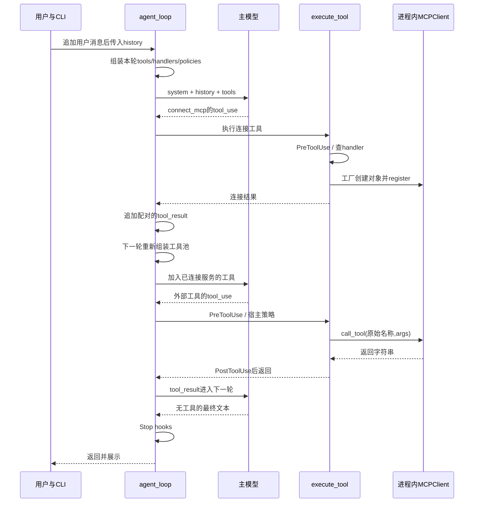
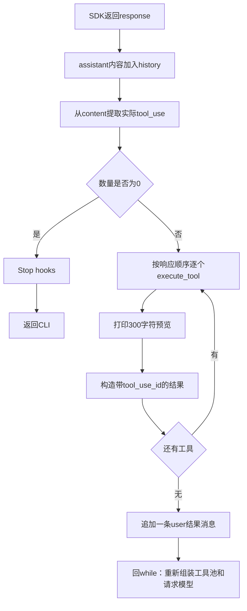
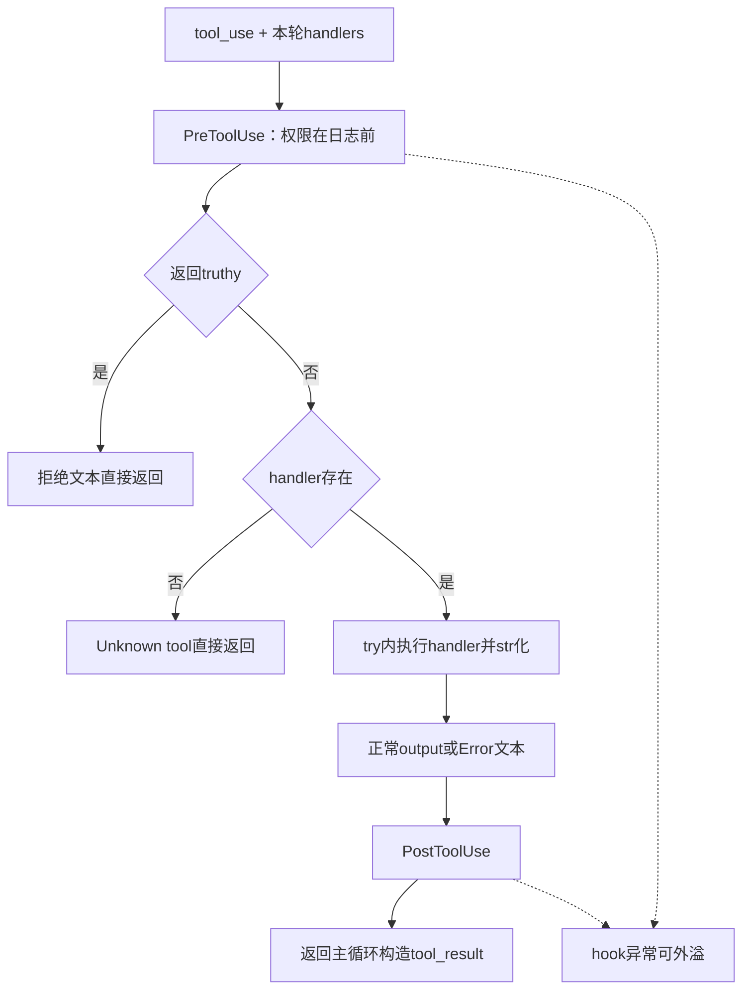
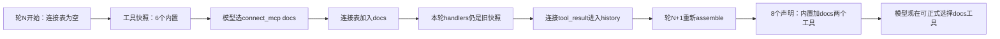
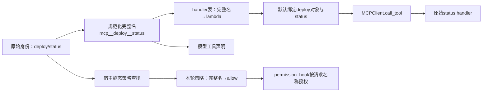
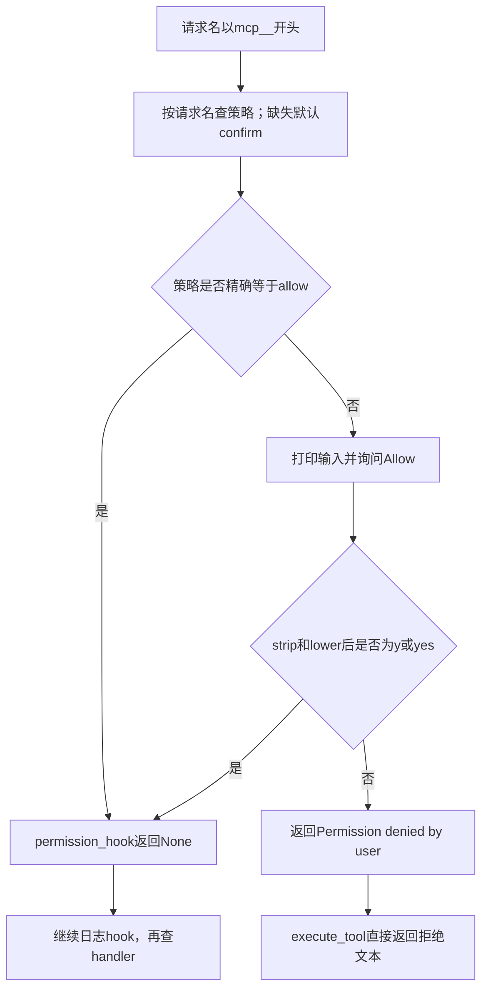
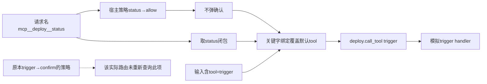
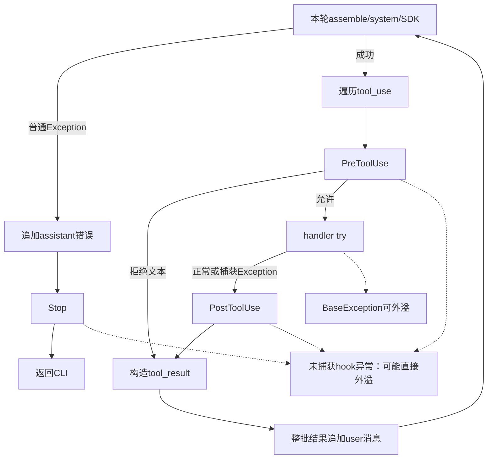
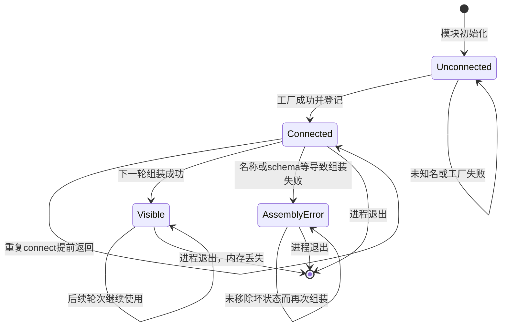

> 待分析代码位置：`s14_mcp_plugin/code.py`。
>
> 功能描述：从程序实际入口出发，沿调用、条件分支及返回位置，逐步还原编码 Agent 如何连接模拟 MCP 服务、动态发现并授权工具、执行调用、回填结果和结束回合；深入说明各步骤的副作用、失败路径与工程边界。
>
> 阅读约定：先展示带准确行号的连续原始代码，再分析行为；长函数按执行阶段拆分。本文基于当前仓库静态源码，不导入或运行目标模块，不发起模型请求，也不执行示例工具。现有用例仅作为源码断言证据，不代表已运行通过。代码事实、基于代码的推断和未知信息分别说明。

# 1. 先看入口：用户请求如何驱动整个程序

## 1.1 入口建立一份长期保留的会话历史

源码定位：`s14_mcp_plugin/code.py`，`__main__ 启动与提交`，L635–L650。

```python
if __name__ == "__main__":
    print("s14: MCP tools")
    print("Enter a question, press Enter to send. Type q to quit.\n")
    history = []  # 整个会话的对话历史（Lead 的上下文）

    while True:
        try:
            query = input("s14 >> ")
        except (EOFError, KeyboardInterrupt):
            # Ctrl+D / Ctrl+C 都当作退出。
            break
        if query.strip().lower() in {"q", "exit", ""}:
            break
        trigger_hooks("UserPromptSubmit", query)
        history.append({"role": "user", "content": query})
        agent_loop(history)
```

执行这段入口前，Python 已经完成模块导入、配置读取、客户端创建、全局容器建立及 hooks 注册。先展示入口是为了确定阅读方向，不表示这些初始化在入口之后才执行。

入口本身按以下顺序运行：

1. `__name__ == "__main__"` 成立时打印欢迎信息；作为模块导入时不进入这个交互循环。
2. 建立一次 `history=[]`，它位于输入循环之外，因此多次用户提问使用同一列表。
3. 等待 stdin 输入。
4. 处理输入结束、输入中断和退出文本。
5. 对有效输入执行提交 hook、追加用户消息。
6. 把同一个 history 对象传给 agent_loop。
7. agent_loop 返回后打印最后一条消息中的文本，再等待下一次输入。

主调用栈不是 HTTP Controller—Service—数据库，而是：

`__main__ → trigger_hooks(UserPromptSubmit) → history.append → agent_loop → 动态工具池/模型 → execute_tool → handler → tool_result → 模型下一轮 → 返回入口`。

模型并非每次都会连接 MCP。它可以直接回答，也可以只用文件或 shell 工具；连接、搜索、部署状态等是模型选择的工具分支，而不是所有请求必须顺序执行的固定步骤。[证据：`s14_mcp_plugin/code.py:588–632,635–657`]

## 1.2 实际业务：把外部能力加入同一个 Agent 循环

这段代码解决的是“工具来源可扩展”的编排问题：

- 基础工具由宿主定义，包括 shell、读文件、写文件、编辑和 glob。
- MCP 服务对象提供工具声明和调用 handler。
- 宿主负责连接注册、模型侧名称、工具池组装、权限和错误转换。
- 模型根据用户请求选择工具，工具结果再作为对话输入驱动后续动作。

这里的 MCP 服务是本地对象与 Python 函数，不是已经接通的远程文档系统或部署平台。“查询部署状态”“触发部署”在本实现中都只是生成字符串，不会操作真实部署环境。

参与者和数据对象的关系如下：

| 对象 | 实际职责 | 不代表什么 |
| --- | --- | --- |
| 用户 | 输入任务、在特定分支人工授权 | 没有用户/租户账户模型 |
| 主模型 | 根据提示、历史和工具声明作答或选择工具 | 不直接获得 MCP 内部 handler 引用 |
| Agent 宿主 | 动态组装、权限检查、执行与回填 | 不是完整分布式工作流平台 |
| MCPClient | 保存 tools 与原始名称到 handler 的映射 | 不是网络连接或协议会话实现 |
| history | 本进程会话上下文 | 不是真正持久化审计日志 |
| mcp_clients | 已连接服务的内存注册表 | 不是真实远程连接池 |
| mcp_tool_policies | 本轮模型工具名对应的授权快照 | 不提供身份认证或资源归属检查 |

[证据：`s14_mcp_plugin/code.py:204–262,347–384,387–449`]

## 1.3 主调用时序预览

下面的图只展示“用户要求使用外部工具”的一种正常轨迹。它用于定位后续逐段深入的位置，不表示每次模型响应都会按此选择。



连接表在连接 handler 中变化，模型工具列表在**下一轮组装**时才变化；所有工具按主线程中的同步调用执行。图中的 MCP 调用没有网络边界，也没有任务线程或事务提交点。

现在回到入口之前，解释第一行用户输入出现前已经建立的运行环境。

# 2. 入口前初始化：配置、客户端、工具和权限容器从何而来

## 2.1 导入与可选终端能力

源码定位：`s14_mcp_plugin/code.py`，`模块导入与readline初始化`，L42–L56。

```python
import glob          # 按通配符查找文件（glob 工具）
import os            # 读环境变量、判断当前是不是 Windows
import re            # 正则：清洗工具名、识别危险命令
import subprocess    # 执行 shell 命令
from pathlib import Path  # 面向对象的路径操作

try:
    import readline  # 让终端输入支持方向键和历史记录
    readline.parse_and_bind("set bind-tty-special-chars off")
except ImportError:
    # Windows 自带 Python 没有 readline，跳过即可。
    pass

from anthropic import Anthropic  # Anthropic 官方 Python SDK 客户端
from dotenv import load_dotenv   # 从 .env 文件加载环境变量
```

标准库分别承担 glob、环境读取、名称/命令识别、子进程及路径处理。readline 导入失败仅跳过终端编辑能力，不影响后续逻辑；但是 catch 只覆盖 ImportError，导入成功后 parse_and_bind 的其他异常并不在这个处理范围内。

文件没有导入 s04、s13 或 s15。注释“From s04”表达教学代码来源，不是类继承、代理或运行时依赖。当前模块自己定义基础工具、hooks 和主循环，不能把其他章节的增强能力直接套进来。

同时，它没有为 MCP 导入 HTTP 客户端、协议 SDK、JSON-RPC 编解码器或创建 stdio 子进程。后文将看到 MCPClient 完全调用进程内函数。这一判断不影响主模型使用 Anthropic SDK 发起远程请求，两者是不同依赖方向。[证据：`s14_mcp_plugin/code.py:42–56,204–242,594–600`]

## 2.2 环境变量覆盖、鉴权处理和真实客户端创建

源码定位：`s14_mcp_plugin/code.py`，`顶层配置与client创建`，L58–L65。

```python
load_dotenv(override=True)
if os.getenv("ANTHROPIC_BASE_URL"):
    # 配了自定义端点时移除可能冲突的鉴权变量，避免两种鉴权方式打架。
    os.environ.pop("ANTHROPIC_AUTH_TOKEN", None)

WORKDIR = Path.cwd()  # 工作目录：所有相对路径和工具执行都以它为基准
client = Anthropic(base_url=os.getenv("ANTHROPIC_BASE_URL"))
MODEL = os.environ["MODEL_ID"]  # 从环境变量读取模型 ID
```

顺序如下：

1. `load_dotenv(override=True)` 允许 dotenv 覆盖同名已有环境变量。具体找到哪个文件由库与调用环境决定；本文没有读取真实 dotenv 内容。
2. 存在 truthy ANTHROPIC_BASE_URL 时，从进程环境移除 ANTHROPIC_AUTH_TOKEN。
3. WORKDIR 取当前终端/进程工作目录。
4. 创建 Anthropic client，自定义 base_url 从环境读取。
5. 用字典索引要求 MODEL_ID 存在，不存在会抛 KeyError。

客户端创建早于 MODEL_ID 读取，因此“缺少模型配置时启动失败”并不意味着客户端初始化从未尝试。客户端构造本身还可能因依赖/配置问题失败；入口外面没有统一启动异常捕获。

WORKDIR 是模块加载时的一个 Path 值，不会自动跟随之后任意 `os.chdir` 更新。BASE_SYSTEM 也会在初始化时把它拼成字符串。相对源码文件的位置与工作目录没有强制相同要求。

**副作用与边界**：这里已经可能修改进程环境、初始化 SDK 资源，但没有源码层面的 messages.create 调用。不能把“创建客户端”写成“已成功调用模型”，也不能从配置键推断真实密钥、端点或模型值。[证据：`s14_mcp_plugin/code.py:58–65,594–600`]

依赖文件只声明最低版本：

源码定位：`requirements.txt`，`依赖声明`，L1–L3。

```text
anthropic>=0.25.0
python-dotenv>=1.0.0
pyyaml>=6.0
```

这些声明不等于当前安装版本。SDK 内部超时、重试、连接池和远程端点兼容性保持未知；本模块自身的恢复逻辑在后文按实际代码说明。

## 2.3 固定系统提示在模块加载时生成

源码定位：`s14_mcp_plugin/code.py`，`ENVIRONMENT_PROMPT 与 BASE_SYSTEM`，L67–L79。

```python
# 告诉模型当前宿主的 shell 环境：Windows 走 cmd.exe，其他系统走系统 shell。
ENVIRONMENT_PROMPT = (
    "Windows: the bash tool runs through cmd.exe; use cmd.exe syntax, not Unix "
    "Bash or PowerShell syntax, and prefer dedicated file tools for file operations"
    if os.name == "nt"
    else "Unix-like: the bash tool runs the system shell"
)
# 基础系统提示：说明工作目录、执行环境，以及「用外部工具前先 connect_mcp」的规矩。
BASE_SYSTEM = (
    f"You are a coding agent at {WORKDIR}. Environment: {ENVIRONMENT_PROMPT}. "
    "Use built-in and connected MCP "
    "tools to solve tasks. Call connect_mcp before using a server."
)
```

OS 分支只选择给模型看的环境描述。Windows 提示说明 shell 工具经 cmd.exe，Unix-like 提示说明走系统 shell；它不是自行实现 shell，也不会因此把 Bash/PowerShell 语法自动转换。

BASE_SYSTEM 包含工作目录、环境、使用内置及已连接工具的职责，并提示先 connect_mcp。必须区分：

- “先连接再使用”在提示中是行为规则。
- 真正使未连接服务不可正常路由的机制，是初始工具池里没有相应声明和 handler。
- 提示“编码 Agent”不会授予更多工具，也不是对 shell、文件或 MCP 的安全沙箱。
- 目录路径进入 system prompt，属于给模型的上下文数据。

固定提示生成后不会在每轮按 cwd 重建；每轮只在 assemble_system_prompt 中附加连接名单。[证据：`s14_mcp_plugin/code.py:75–79,445–449`]

## 2.4 服务工厂表和空连接状态

源码定位：`s14_mcp_plugin/code.py`，`连接状态与宿主策略`，L245–L262。

```python
# 已连接的服务器：name → MCPClient。
# 连接是可累加的——连上 docs 后再连 deploy，两边的工具都会进入工具池。
mcp_clients: dict[str, MCPClient] = {}
# 外部工具的授权策略：完整工具名（mcp__server__tool）→ allow / confirm。
# 每轮组装工具池时重新填充，未登记的工具默认 confirm。
mcp_tool_policies: dict[str, str] = {}
# 模型侧工具名只允许字母、数字、下划线和短横线，其余字符统一换成下划线。
_DISALLOWED_CHARS = re.compile(r"[^a-zA-Z0-9_-]")

# Authorization comes from host configuration, never server descriptions.
# 授权来自宿主配置，而不是服务器在 description/annotations 里的自述：
# 服务器说自己是「只读」不能作为放行依据。未登记的组合一律 confirm。
MCP_HOST_POLICY = {
    ("docs", "search"): "allow",
    ("docs", "get_version"): "allow",
    ("deploy", "status"): "allow",
    ("deploy", "trigger"): "confirm",
}
```

源码定位：`s14_mcp_plugin/code.py`，`MOCK_SERVERS工厂表`，L340–L344。

```python
# 可连接的服务器工厂表：connect_mcp 只接受这里登记过的名字。
MOCK_SERVERS = {
    "docs": _mock_server_docs,
    "deploy": _mock_server_deploy,
}
```

加载模块只登记函数引用，不调用工厂。因此初始状态：

- 已连接服务为0。
- 动态权限快照为空。
- 可连接服务名称为 docs/deploy。
- 静态策略允许 docs.search、docs.get_version、deploy.status，要求确认 deploy.trigger。

MCP_HOST_POLICY 是宿主 Python 字典，不是读取服务器 annotations 后推断的权限。策略的键使用服务器注册名与工具原名，策略快照的键则是模型侧完整工具名，二者在组装阶段转换。

这些都是进程内可变对象，没有加载连接持久化文件、权限数据库、租户上下文或外部配置中心。退出后连接表消失；人工允许也没有被写成跨调用的授权记录。[证据：`s14_mcp_plugin/code.py:247–262,437–442,511–517`]

## 2.5 hooks 在入口前注册，但此时没有运行回合

源码定位：`s14_mcp_plugin/code.py`，`HOOKS事件容器`，L454–L455。

```python
# 四个钩子事件：用户提交、工具调用前、工具调用后、一轮结束。
HOOKS = {"UserPromptSubmit": [], "PreToolUse": [], "PostToolUse": [], "Stop": []}
```

源码定位：`s14_mcp_plugin/code.py`，`默认hooks注册顺序`，L557–L562。

```python
# 注册顺序就是执行顺序：permission_hook 先判权限，log_hook 再打印日志。
register_hook("UserPromptSubmit", context_hook)
register_hook("PreToolUse", permission_hook)
register_hook("PreToolUse", log_hook)
register_hook("PostToolUse", large_output_hook)
register_hook("Stop", summary_hook)
```

四个事件分别对应用户提交、工具执行前、工具执行后和回合结束。注册只是把函数引用追加到列表；不会在注册时提前校验用户输入、执行 shell 或触发 Stop。

权限在日志前的顺序有明确影响：权限拒绝后是否还执行 log_hook，取决于 trigger_hooks 的短路语义，下一章首次调用时进入实现。

当前模块没有 Task、后台命令队列、cron 调度、队友线程、记忆目录或 worktree 初始化。进程级状态的简洁降低了教学复杂度，代价是没有这些机制带来的恢复、隔离和事件调度能力。

模块初始化完成，现在回到 __main__ 的输入循环。

# 3. 用户提交：先检查退出，再执行提交hook，最后追加历史

## 3.1 输入判断不会先改历史

源码定位：`s14_mcp_plugin/code.py`，`__main__ 输入与提交阶段`，L640–L650。

```python
    while True:
        try:
            query = input("s14 >> ")
        except (EOFError, KeyboardInterrupt):
            # Ctrl+D / Ctrl+C 都当作退出。
            break
        if query.strip().lower() in {"q", "exit", ""}:
            break
        trigger_hooks("UserPromptSubmit", query)
        history.append({"role": "user", "content": query})
        agent_loop(history)
```

输入的处理顺序决定副作用：

1. 等待 input。此时尚未追加新消息。
2. EOFError/KeyboardInterrupt 只在这个 input 调用周围捕获，直接 break。
3. strip 再 lower，空白、q、exit 都 break；大写 Q 和前后带空白的 exit 也退出。
4. 未命中退出条件时，原始 query 进入 hook 和 history，并未把 strip 后的字符串作为实际任务文本。
5. UserPromptSubmit 完成后才 append，再进入 agent_loop。

所以输入空行不是继续等待，而是结束会话；若输入“q 后面还有其他文本”，并不等于恰为 q，会作为正常任务提交。

输入期间 Ctrl+C 被当作退出，不等于整个程序任意位置 Ctrl+C 都已安全处理。权限确认、模型等待和 subprocess 等阶段不在这个小 try 中。

## 3.2 首次进入 trigger_hooks：有序调用与非None短路

源码定位：`s14_mcp_plugin/code.py`，`register_hook 与 trigger_hooks`，L471–L483。

```python
def register_hook(event: str, callback):
    # 注册钩子：同一个事件可以挂多个回调。
    HOOKS[event].append(callback)


def trigger_hooks(event: str, *args):
    # 依次执行回调；只要某个回调返回非 None，就把它当成「拦截结果」直接返回。
    # PreToolUse 正是靠这个机制拒绝危险的工具调用。
    for callback in HOOKS[event]:
        result = callback(*args)
        if result is not None:
            return result
    return None
```

register_hook 按调用顺序 append，没有去重、优先级排序或事件名合法性包装。重复注册同一 callback 会再次执行；不存在的事件名可能 KeyError。

trigger_hooks：

1. 找事件列表。
2. 按注册顺序执行 callback。
3. 返回值非 None，就立即返回。
4. 全部返回 None，最终返回 None。

它没有 catch callback 异常，异常会沿调用者传播。短路不是“抛异常才中止”，也不是“仅 truthy 才中止”：False、空字符串、0 也会停止后续 hooks。工具分发层又用 truthiness 判断拒绝，这种差异后文展开。

## 3.3 提交hook只打印目录，不改变query

源码定位：`s14_mcp_plugin/code.py`，`context_hook`，L534–L537。

```python
def context_hook(query: str):
    # UserPromptSubmit 钩子：提示当前工作目录。
    print(f"[hook] UserPromptSubmit: working in {WORKDIR}")
    return None
```

默认提交 hook 忽略 query 内容，仅打印当前 WORKDIR，然后返回 None。它不做参数校验、权限判断、上下文压缩或记忆召回。打印失败属于 hook 异常，会在追加新 user 消息前外溢。

入口调用 trigger_hooks 时没有使用其返回值决定提交是否继续，因此将来若注册一个“返回拒绝原因”的 UserPromptSubmit hook，只靠这个返回值并不能阻止消息追加；只有异常或修改调用方逻辑才会改变控制流。默认 hook 无此拒绝行为。

返回入口：hook 完成后，history 追加 `{"role":"user","content":query}`，然后把列表传入 agent_loop。传入不是复制，主循环中的 assistant/tool_result append 会直接留在这份会话历史中。

## 3.4 会话状态共享的真实范围

本模块采用同步顺序 CLI，没有 agent_lock、stdin broker 或自动事件线程。一个用户回合执行期间，入口不会同时读取下一条普通任务；遇到特定工具确认时才会再次读取 stdin。

这种结构自然避免默认CLI同时修改历史的线程竞争，但不是实现了通用线程安全。若外部嵌入方并发调用 agent_loop 或修改全局连接表，代码没有提供会话锁、策略版本或连接表快照锁；该风险属于条件性嵌入边界，不应说成默认顺序CLI已经发生竞态。

history 和 mcp_clients 的寿命也不同：history 由入口创建，连接表是模块全局。可信调用方即使创建一份新的 messages，也可能继续使用同一模块原先连接的服务；这里没有按会话隔离连接/权限注册表。[证据：`s14_mcp_plugin/code.py:247,250,588–632,638–650`]

返回调用链：`agent_loop(history)` 开始第一轮，先组装工具池。

# 4. 第一轮工具池：六个声明、六个handler、空动态策略

## 4.1 agent_loop先调用组装器，不先请求模型

源码定位：`s14_mcp_plugin/code.py`，`agent_loop 循环与请求调用点`，L588–L600。

```python
def agent_loop(messages: list):
    # Agent 主循环：每一轮都重新组装工具池和系统提示，
    # 这样本轮的 connect_mcp 能让下一轮看到并使用新发现的工具。
    while True:
        try:
            tools, handlers = assemble_tool_pool()
            response = client.messages.create(
                model=MODEL,
                system=assemble_system_prompt(),
                messages=messages,
                tools=tools,
                max_tokens=8000,
            )
```

进入 while 后先 assemble_tool_pool，成功才计算 system 并发起 SDK 请求。调用顺序与函数声明顺序无关：虽然 MCP 工厂在文件中早于主循环，未连接时它们不会自行执行。

首次进入组装器，先看公共初始化：

源码定位：`s14_mcp_plugin/code.py`，`assemble_tool_pool 初始复制`，L387–L400。

```python
def assemble_tool_pool() -> tuple[list[dict], dict[str, callable]]:
    """Combine built-in tools with every connected server tool."""
    # 每轮对话前重新组装工具池：内置工具 + 所有已连接 MCP 服务器的工具。
    # 之所以每轮都重新组装，是因为模型可能在本轮中途 connect_mcp，
    # 下一轮它就应该能「看见」并使用新发现的工具。
    global mcp_tool_policies
    tools = list(BUILTIN_TOOLS)
    handlers = dict(BUILTIN_HANDLERS)
    policies: dict[str, str] = {}
    # 记录「工具名 → 来源」，用于发现改名/清洗之后的重名冲突。
    origins = {
        tool["name"]: f"built-in tool {tool['name']!r}"
        for tool in tools
    }
```

tools 和 handlers 分别是内置容器的浅复制；origins 记录模型名已归谁所有，用于防止后面动态工具覆盖已有路由。policies 是本次局部空字典，不是立刻清空全局策略。

新列表并不深复制每个工具字典，后面追加的 schema 也不深复制；可信代码若原地改工具定义，容器复制不提供不可变隔离。

## 4.2 五个基础工具如何声明

源码定位：`s14_mcp_plugin/code.py`，`BASE_TOOLS 与 BASE_HANDLERS`，L163–L199。

```python
# 工具「声明」：告诉模型每个工具叫什么、干什么、参数长什么样。
# 真正的执行逻辑在 BASE_HANDLERS 里按名字对应。
BASE_TOOLS = [
    {"name": "bash", "description": "Run a shell command.",
     "input_schema": {"type": "object",
                      "properties": {"command": {"type": "string"}},
                      "required": ["command"]}},
    {"name": "read_file", "description": "Read file contents.",
     "input_schema": {"type": "object",
                      "properties": {"path": {"type": "string"},
                                     "limit": {"type": "integer"}},
                      "required": ["path"]}},
    {"name": "write_file", "description": "Write content to a file.",
     "input_schema": {"type": "object",
                      "properties": {"path": {"type": "string"},
                                     "content": {"type": "string"}},
                      "required": ["path", "content"]}},
    {"name": "edit_file", "description": "Replace exact text once.",
     "input_schema": {"type": "object",
                      "properties": {"path": {"type": "string"},
                                     "old_text": {"type": "string"},
                                     "new_text": {"type": "string"}},
                      "required": ["path", "old_text", "new_text"]}},
    {"name": "glob", "description": "Find files by glob pattern; ** matches recursively.",
     "input_schema": {"type": "object",
                      "properties": {"pattern": {"type": "string"}},
                      "required": ["pattern"]}},
]

# 工具名 → 执行函数。模型返回 tool_use 时就按这个名字来查表。
BASE_HANDLERS = {
    "bash": run_bash,
    "read_file": run_read,
    "write_file": run_write,
    "edit_file": run_edit,
    "glob": run_glob,
}
```

两张表承担不同职责：

| 名称 | 模型输入声明 | Python执行入口 | 主要作用 |
| --- | --- | --- | --- |
| bash | command，必填字符串 | run_bash | 执行系统shell |
| read_file | path必填，limit可选integer | run_read | 读UTF-8文本 |
| write_file | path/content必填 | run_write | 创建或覆盖文件 |
| edit_file | path/old_text/new_text必填 | run_edit | 唯一精确替换 |
| glob | pattern必填 | run_glob | 按模式查找路径 |

声明告诉模型应怎样调用，handler 才决定实际副作用。这里的 required/type 不会自动生成 Python 本地运行时校验器；参数绑定和业务检查的具体结果要在工具分支中分析。

## 4.3 连接工具是第六个内置能力

源码定位：`s14_mcp_plugin/code.py`，`CONNECT_TOOL 与内置汇总`，L370–L384。

```python
# connect_mcp 本身也是一个工具：模型必须先调它，才能发现外部工具。
# enum 限定只能连 docs / deploy，避免模型臆造服务器名。
CONNECT_TOOL = {
    "name": "connect_mcp",
    "description": "Connect to an MCP server and discover its tools.",
    "input_schema": {
        "type": "object",
        "properties": {"name": {"type": "string", "enum": ["docs", "deploy"]}},
        "required": ["name"],
    },
}

# 宿主自带、永远可用的工具：基础工具 + connect_mcp。
BUILTIN_TOOLS = [*BASE_TOOLS, CONNECT_TOOL]
BUILTIN_HANDLERS = {**BASE_HANDLERS, "connect_mcp": run_connect_mcp}
```

CONNECT_TOOL 的 name 枚举告诉模型只选 docs/deploy。真正实现也用工厂表检查未知名称；不能只因 schema 有 enum 就认为任意异常输入都在本地进入通用验证器。

BUILTIN_TOOLS/BUILTIN_HANDLERS 在模块初始化时汇总，后面每轮从它们复制。它们没有自动执行连接，也不含 mcp__docs__search 等外部工具。

首次 mcp_clients 为空，组装循环不进入任何服务器。最终执行：

源码定位：`s14_mcp_plugin/code.py`，`assemble_tool_pool 发布策略并返回`，L441–L442。

```python
    mcp_tool_policies = policies
    return tools, handlers
```

本轮 policies 为空，替换全局 mcp_tool_policies，然后返回六个工具的声明与路由。每轮新建保证连接变化能在下一轮被看见，但“快照”只是结构上的局部容器，没有跨线程不可变版本保护。

现有用例具体断言初始六个名字、docs 工具不存在，连接并重新组装后 docs 工具出现并能调用。它支持“发现前后能力变化”，不代表真实网络服务被连通。[证据：`tests/test_agent_teams_runtime.py:367–391`]

返回 agent_loop：tools/handlers 已就绪，下一步组装本轮 system prompt 并请求模型。

# 5. 工具池返回后：拼system、请求模型，再处理失败分支

## 5.1 首次进入assemble_system_prompt

源码定位：`s14_mcp_plugin/code.py`，`assemble_system_prompt`，L445–L449。

```python
def assemble_system_prompt() -> str:
    # 系统提示里追加已连接服务器名单，让模型知道当前有哪些外部能力可用。
    if not mcp_clients:
        return BASE_SYSTEM
    return BASE_SYSTEM + "\n\nConnected MCP servers: " + ", ".join(mcp_clients)
```

没有连接时直接返回 BASE_SYSTEM；有连接时在后面增加一段服务器名单。join 遍历字典键，默认顺序由连接登记顺序决定，没有额外排序。

这里没有把 MCPClient 内部对象或 handler 源码塞进提示。模型能使用哪些参数主要由独立 tools 列表给出；system 中的名单只提供能力背景，不是新的授权凭证。服务名称在当前默认工厂表中固定，可信扩展方改变注册表后可能引入任意名称文本。

服务器 description 和 inputSchema 在 assemble_tool_pool 中被转给模型。这些是外部能力数据，默认模拟值固定可信；未来若接入不可信来源，不能把其中的描述指令等同宿主规则。当前代码没有提示词内容清洗、签名或可信分层编码，annotations 不参与授权也不等于 description 对模型毫无影响。

返回 agent_loop，system 参数已求值，SDK调用使用前文 L594–600 的参数：

- model：模块初始化时读取的 MODEL。
- system：刚拼好的字符串。
- messages：同一份完整会话历史。
- tools：本轮动态工具声明。
- max_tokens：固定8000。

max_tokens 是单次请求输出参数，不是总上下文额度、全会话费用或循环次数上限。代码没有 usage 累计，也没有根据剩余预算决定是否继续。

## 5.2 本地没有退避、降级或截断恢复

agent_loop 的每个工具结果都会驱动下一次模型请求，但这是正常工具反馈循环，不是网络失败重试。

源码没有：

- 针对429/529的指数退避。
- 备用模型切换。
- 自动压缩、归档或裁剪历史。
- max_tokens截断时提高上限或续写。
- 统一最大轮次、工具次数或token总预算。

这些“没有”限定于本模块显式代码。SDK自身是否重试、实际端点是否支持指定工具格式、请求超时多少，不能由本文件和最低依赖版本确认。

性能方面，每轮传当前全部工具和历史，连接增加会扩大声明输入，历史随成功回填持续增长；这是动态能力与简单上下文管理的取舍，没有真实指标可据此宣称容量或QPS。

## 5.3 工具池异常与SDK异常进入同一捕获

源码定位：`s14_mcp_plugin/code.py`，`agent_loop 请求准备/模型异常出口`，L601–L611。

```python
        except Exception as exc:
            # 模型调用失败：把错误写成一条 assistant 文本，触发 Stop 钩子后结束本轮。
            messages.append({
                "role": "assistant",
                "content": [{
                    "type": "text",
                    "text": f"[Error] {type(exc).__name__}: {exc}",
                }],
            })
            trigger_hooks("Stop", messages)
            return
```

该 except 与前文 try 对应，捕获范围包含 assemble_tool_pool、assemble_system_prompt 求值及 messages.create。名字冲突、schema形状错误和网络调用异常，都可能被转换为：

`[Error] 异常类型: 消息`。

然后：

1. 在 history 追加一条assistant消息，content使用本地dict文本块。
2. 调用Stop hooks。
3. 返回当前用户回合。
4. 入口打印该错误消息后仍可等待下一次用户输入。

不是所有“模型调用失败”注释所包围的错误都来自模型：本地工具池配置错误也走这里。错误保留类型字符串，便于区分，但没有结构化错误码、重试标志或可恢复性分类。

Stop hook 在 except 块内调用，却没有单独保护。如果Stop抛错，这次错误收尾仍可能外溢。KeyboardInterrupt/SystemExit等BaseException也不属于普通Exception捕获。

**状态与补偿**：此处不回滚连接表、已发生文件操作或前面轮次成功的工具。若错误由某个已连接服务的定义引起，连接仍在，下次组装可能继续失败；没有自动断开隔离或删除坏连接。

返回路径说明：失败时本章直接回到CLI；正常成功时才进入下一章的响应内容处理。

# 6. 正常响应入历史：按实际tool_use分流，而不是相信stop_reason

## 6.1 assistant响应先保存，再判断是否有工具

源码定位：`s14_mcp_plugin/code.py`，`agent_loop 响应保存与无工具分支`，L613–L620。

```python
        messages.append({"role": "assistant", "content": response.content})
        tool_calls = [
            block for block in response.content if block.type == "tool_use"
        ]
        if not tool_calls:
            # 没有工具调用 = 模型这一轮说完了，触发 Stop 钩子并结束。
            trigger_hooks("Stop", messages)
            return
```

顺序很重要：

1. 不论后面是否执行工具，先把 response.content 作为assistant内容append。
2. 遍历响应块，以属性 `block.type == "tool_use"` 过滤。
3. 没有实际工具块则调用Stop并返回。
4. 有工具块才继续执行。

没有使用 stop_reason 控制工具循环。即使 stop_reason 为 end_turn，但 content 真有tool_use，代码仍执行；相反，即使stop_reason声称tool_use，但只有空/文本块，也不会追加空工具结果并再次请求。

现有边界用例通过伪响应断言这两种行为：无真实工具仅调用模型一次，不制造空user结果；stop_reason不一致但存在tool_use时，仍回填对应ID并调用下一轮。它们不是当前环境实际运行记录。[证据：`tests/test_agent_loop_boundaries.py:219–275`]

## 6.2 SDK对象兼容范围

这里直接用 response.content、block.type，期待SDK对象形状；没有对dict响应块的通用兼容分支。异常如果发生在这个try之后，不受上章SDK请求except保护。

入口最终打印代码兼容dict文本块，是因为错误分支自己构造了dict；不能把这种最终展示兼容性扩展成主循环任意SDK输入形状都能处理。

同样，本模块没有因max_tokens提前分流。截断响应若仍有可执行tool_use对象，按正常工具逻辑处理；若只有文本，则走无工具结束。不能补写自动续写或工具调用完整性恢复。

## 6.3 有工具时，先建立本响应的结果列表

源码定位：`s14_mcp_plugin/code.py`，`agent_loop 顺序执行与结果汇总`，L622–L632。

```python
        results = []
        for block in tool_calls:
            print(f"> {block.name}")
            output = execute_tool(block, handlers)
            print(output[:300])  # 终端只显示前 300 字符，完整输出仍回给模型
            results.append({
                "type": "tool_result",
                "tool_use_id": block.id,
                "content": output,
            })
        messages.append({"role": "user", "content": results})
```

results 在本轮响应内部新建。同一响应里的工具按出现顺序调用，没有gather、线程池或并行参数。前一个工具等待权限或执行shell时，后一个不会先执行。

每个调用的下一步是 execute_tool；其返回后先终端打印300字符预览，再把完整output放入tool_result。整批都走完才将results追加为一条user消息。

这形成一个结果未回填窗口：前几个工具可能已经成功产生副作用，但后一个工具的hook异常或终端打印异常使整批没有append到history。程序没有撤销已经成功的工具，也没有按单个结果立即持久化。

下面的分流图用于区分“无工具结束”和“执行工具后继续”，不是两条都走。



图中没有事务边界：追加消息只是内存操作，不能证明文件/shell副作用已原子提交，Stop也不是用户目标自动验收器。

现在跟随第一个实际tool_use，进入统一分发。

# 7. execute_tool：权限在handler之前，异常保护却不覆盖所有步骤

## 7.1 先看执行公共入口

源码定位：`s14_mcp_plugin/code.py`，`execute_tool`，L565–L583。

```python
def execute_tool(block, handlers: dict[str, callable]) -> str:
    # 执行一次工具调用，分三步：
    #   1. 先跑 PreToolUse 钩子，返回非空就当作被拒绝；
    #   2. 按工具名查 handler（可能是内置工具，也可能是 MCP 工具）；
    #   3. 执行完再跑 PostToolUse 钩子（只观察，不影响返回结果）。
    blocked = trigger_hooks("PreToolUse", block)
    if blocked:
        return str(blocked)
    handler = handlers.get(block.name)
    if not handler:
        # 工具池是动态的，模型可能调用已不存在（或名字拼错）的工具。
        return f"Unknown tool: {block.name}"
    try:
        output = str(handler(**block.input))
    except Exception as exc:
        # 工具异常转成文本返回给模型，让它自行决定怎么补救。
        output = f"Error: {type(exc).__name__}: {exc}"
    trigger_hooks("PostToolUse", block, output)
    return output
```

参数来源：

- block 是模型返回的tool_use对象，含name、input、id。
- handlers 来自**本轮模型请求前**组装，不在每个工具前重新创建。

执行分为四段：

1. 调PreToolUse。
2. truthy拦截结果直接转字符串返回。
3. 从handlers查函数；不存在直接返回Unknown tool。
4. 调handler并将普通异常转文本，之后PostToolUse，再返回output。

两个提前返回都不执行PostToolUse。被拒绝时甚至不查handler，未知mcp工具可能先让用户确认后才发现没有路由，这不是“先查是否存在再授权”的实现。

try仅包住 `str(handler(**block.input))`。权限hook、handler查找前逻辑、PostToolUse以及调用方print不在这个保护范围内。

## 7.2 PreToolUse实际先调用permission_hook

源码定位：`s14_mcp_plugin/code.py`，`permission_hook`，L486–L517。

```python
def permission_hook(block):
    # PreToolUse 钩子：按工具类型分三道路障。
    # 1) 内置 bash：命中 deny list 直接拒绝；疑似破坏性命令弹窗确认。
    if block.name == "bash":
        command = block.input.get("command", "")
        for pattern in DENY_LIST:
            if pattern in command:
                return f"Permission denied by deny list: {pattern}"
        if contains_destructive_command(command) or any(
            keyword in command for keyword in DESTRUCTIVE
        ):
            print(f"\n[permission] {block.name}({block.input})")
            if input("Allow? [y/N] ").strip().lower() not in {"y", "yes"}:
                return "Permission denied by user"

    # 2) 文件工具：路径解析后若跑出 WORKDIR，同样需要用户确认。
    if block.name in {"read_file", "write_file", "edit_file"}:
        raw_path = block.input.get("path", "")
        if not (WORKDIR / raw_path).resolve().is_relative_to(WORKDIR.resolve()):
            print(f"\n[permission] {block.name}({block.input})")
            if input("Allow? [y/N] ").strip().lower() not in {"y", "yes"}:
                return "Permission denied by user"

    # 3) 外部 MCP 工具：按宿主策略处理。
    #    allow 直接放行；confirm（包括未登记的）一律弹窗确认。
    if block.name.startswith("mcp__"):
        policy = mcp_tool_policies.get(block.name, "confirm")
        if policy != "allow":
            print(f"\n[permission] External tool {block.name}({block.input})")
            if input("Allow? [y/N] ").strip().lower() not in {"y", "yes"}:
                return "Permission denied by user"
    return None
```

三类分支：

- bash：命中绝对黑名单直接拒绝；其他特定破坏性写法要求确认。
- read/write/edit：解析路径超出WORKDIR时要求确认，而非一律禁止。
- mcp__前缀：查询宿主策略，非allow时确认。

connect_mcp不匹配以上任何类型，默认返回None；glob也没有单独确认分支，它的结果范围限制在handler中。

这里先定位共同门禁，具体shell与文件条件在后面的实际工具分支进一步拆解；第一次跟随的connect_mcp会直接放行，不读取人工确认。

权限hook没有先验证block.input一定是dict、command/path一定是字符串。错误类型可能在get、字符串membership、regex或Path拼接时抛错，而不是进入handler异常包装。其触发与输入有关，不能说所有参数错误都会变成tool_result。

## 7.3 权限允许后才执行日志hook

源码定位：`s14_mcp_plugin/code.py`，`log_hook`，L520–L524。

```python
def log_hook(block):
    # 每次工具调用打印一行预览，方便观察 agent 正在做什么。
    preview = str(list(block.input.values())[:2])[:60]
    print(f"[hook] {block.name}({preview})")
    return None
```

取input字典的前两个值组成预览，再截到60字符。它只打印，不改变输入；返回None继续后续hook。

因为permission_hook注册在前，非None返回会短路，所以：

- 权限拒绝字符串不会再经过log_hook。
- 需要确认的分支此前可能打印了完整block.input，但那不是统一审计。
- 黑名单直接拒绝可能没有这条工具参数日志。
- 日志预览只看前两个值，不能当作完整参数记录。

这里也可能含敏感路径、命令、服务名或输入内容；源码没有脱敏与访问隔离实现。

## 7.4 非None短路与truthy拦截不是同一规则

trigger_hooks见第3章：任何非None都提前返回。execute_tool见本章：只有truthy才拒绝。

| 某个PreToolUse回调返回 | 后续hook | execute_tool是否继续handler |
| --- | --- | --- |
| None | 继续 | 取决于后续结果 |
| 非空拒绝字符串 | 停止 | 不执行 |
| False、空字符串、0 | 停止 | 仍继续 |
| 抛异常 | 不再继续 | 当前调用外溢 |

默认回调返回None或非空拒绝字符串，正常符合约定；扩展回调若误以为False代表拒绝，会失效，还会跳过后续检查。设计收益是简洁可组合；代价是协议由约定维持，返回类型没有统一对象来强制区分allow/deny。

## 7.5 handler参数绑定不等于完整schema验证

`handler(**block.input)` 依赖Python关键字绑定。缺少必填参数、普通基础handler收到额外参数、input不是映射等，通常产生TypeError，并在这一段try内转为 `Error: TypeError: ...`。

但参数值类型注解不强制执行。错误值可能：

- 在权限hook提前抛错。
- 进入handler后被handler自己的catch转成Error。
- 被Python自动格式化为字符串而实际接受。
- 对MCP闭包的特殊参数client/tool产生路由影响。

因此不能将工具schema里的required、type与真正的业务约束混为一层。当前没有调用通用JSON Schema validator来统一拒绝额外字段或强制值类型。

## 7.6 PostToolUse只观察返回值，但并非绝对不影响流程

源码定位：`s14_mcp_plugin/code.py`，`large_output_hook`，L527–L531。

```python
def large_output_hook(block, output):
    # 工具返回结果过大时提示一下，防止一大坨输出悄悄灌进上下文。
    if len(str(output)) > 100000:
        print(f"[hook] Large output from {block.name}: {len(str(output))} chars")
    return None
```

大于100000字符才打印警告，不截断、不落盘、不调整下一轮输入；正好100000不警告。

其返回值被execute_tool忽略，但callback若抛错会阻止output返回和tool_result构造。所以注释“只观察，不影响返回结果”只能解释为默认正常hook不改output，而不是任何hook故障都不能影响执行。

权限与分发图如下，用来标识提前返回和异常边界。



图中handler普通异常被转换，hook异常不在同一捕获内；拒绝与未知工具不经过PostToolUse。现在进入首次连接工具的handler链。

# 8. 连接分支：run_connect_mcp进入工厂，创建进程内服务对象

## 8.1 从薄适配器进入connect_mcp

源码定位：`s14_mcp_plugin/code.py`，`run_connect_mcp`，L365–L367。

```python
def run_connect_mcp(name: str) -> str:
    # 给 BUILTIN_HANDLERS 用的入口，保持和其它工具 handler 一样的调用形式。
    return connect_mcp(name)
```

这个函数只保持与其他关键字handler一致的调用形式，没有独立状态、网络或权限逻辑；name原样传给connect_mcp。

源码定位：`s14_mcp_plugin/code.py`，`connect_mcp`，L347–L362。

```python
def connect_mcp(name: str) -> str:
    # 连接服务器：已连接就提示；未知名字返回可选项。
    # 成功后登记到 mcp_clients，下一轮 assemble_tool_pool() 就能看到它的工具。
    if name in mcp_clients:
        return f"MCP server '{name}' already connected"
    factory = MOCK_SERVERS.get(name)
    if not factory:
        return f"Unknown server '{name}'. Available: {', '.join(MOCK_SERVERS)}"
    server = factory()
    mcp_clients[name] = server
    names = ", ".join(tool["name"] for tool in server.tools)
    print(f"  [mcp] connected: {name} -> {names}")
    return (
        f"Connected to MCP server '{name}'. "
        f"Discovered {len(server.tools)} tools: {names}"
    )
```

逐句看副作用的先后：

1. name已在mcp_clients，直接返回already connected，不重新调用工厂。
2. 从MOCK_SERVERS按原名取factory。
3. 未找到，返回Unknown server并列出可用项，不修改连接表。
4. 调factory；它成功返回前不登记连接。
5. 把对象写入mcp_clients。
6. 从server.tools收集原始工具名，打印连接信息。
7. 返回发现数量和名字的文本。

name没有统一显式类型校验。name为不可哈希对象时，字典membership/查找可能抛TypeError，由外层execute_tool包装；普通未知字符串则返回正常错误提示文本。直接可信调用connect_mcp而不经execute_tool时，异常保护范围不同。

## 8.2 首次进入docs工厂

源码定位：`s14_mcp_plugin/code.py`，`_mock_server_docs`，L275–L303。

```python
def _mock_server_docs() -> MCPClient:
    # 模拟一个文档服务器：search 搜索文档、get_version 取 API 版本。
    # annotations 只是服务器自述，真正的权限仍由 MCP_HOST_POLICY 决定。
    server = MCPClient("docs")
    server.register(
        tool_defs=[
            {
                "name": "search",
                "description": "Search the documentation.",
                "inputSchema": {
                    "type": "object",
                    "properties": {"query": {"type": "string"}},
                    "required": ["query"],
                },
                "annotations": {"readOnlyHint": True},
            },
            {
                "name": "get_version",
                "description": "Get the documentation API version.",
                "inputSchema": {"type": "object", "properties": {}},
                "annotations": {"readOnlyHint": True},
            },
        ],
        handlers={
            "search": lambda query: f"[docs] Found 3 results for '{query}'",
            "get_version": lambda: "[docs] API v2.1.0",
        },
    )
    return server
```

工厂创建MCPClient("docs")，向其register两个声明和两个lambda：

- search需要query，返回固定数量“Found 3 results”的格式化字符串。
- get_version无需参数，返回固定“API v2.1.0”。
- readOnlyHint是声明注解，不会被用作授权。

不存在搜索索引、数据库、HTTP调用、结果列表或分页。即使query完全不同，结果数量仍是文本常量3；版本号也是模拟服务字符串，不是仓库、SDK或实际远程接口版本证据。

当前暂停在server.register，首次遇到MCPClient，下一节深入对象与注册后再返回工厂。

## 8.3 MCPClient初始化：只是两个容器

源码定位：`s14_mcp_plugin/code.py`，`MCPClient与__init__`，L204–L214。

```python
class MCPClient:
    """Small in-process stand-in for MCP tools/list and tools/call."""
    # 极简 MCP 客户端：真实项目里这里会走 stdio/HTTP 等协议与独立进程通信，
    # 本课用「进程内注册函数」来模拟，重点放在工具发现、命名和路由上。

    def __init__(self, name: str):
        self.name = name
        # tools：服务器声明的工具清单，相当于 MCP 的 tools/list 结果。
        self.tools: list[dict] = []
        # _handlers：工具名 → 真正执行的函数，相当于 tools/call 的落点。
        self._handlers: dict[str, callable] = {}
```

name保存为属性，tools和_handlers初始化为空列表/字典。没有打开socket、启动子进程、握手、会话ID或鉴权。类名Client和tools/list、tools/call类比描述的是抽象职责，不是网络协议已经实现的证据。

它的工程价值是给宿主一个清楚边界：发现得到声明，调用按原名转交handler。实现代价是远程超时、断线重连、协议错误、认证和取消全部不在本章范围，不能把“进程内成功”推为“外部服务可靠”。

## 8.4 register先校验名称，再一次替换容器

源码定位：`s14_mcp_plugin/code.py`，`MCPClient.register`，L216–L230。

```python
    def register(self, tool_defs: list[dict], handlers: dict[str, callable]):
        # 注册一个服务器的全部工具，先做三项校验：
        #   1. 每个工具名必须是非空字符串；
        #   2. 同一服务器内工具名不能重复；
        #   3. 每个声明过的工具都必须有对应 handler，否则调用时无函数可执行。
        names = [tool.get("name") for tool in tool_defs]
        if any(not isinstance(name, str) or not name for name in names):
            raise ValueError("Every MCP tool needs a non-empty name")
        if len(set(names)) != len(names):
            raise ValueError(f"Duplicate MCP tool name on server {self.name!r}")
        missing = [name for name in names if name not in handlers]
        if missing:
            raise ValueError(f"Missing MCP handlers: {', '.join(missing)}")
        self.tools = list(tool_defs)
        self._handlers = dict(handlers)
```

校验顺序：

1. 从每个tool_def取name；元素本身不是dict等情况可能在get时抛错，没有单独预检。
2. 名称须为非空字符串；仅空白字符串不被strip后拒绝。
3. 同一列表中原始名称不能重复。
4. 每个声明名都必须在handlers中出现。
5. 全部通过后，浅复制声明列表与handler字典。

保护了“声明有名字、同服务原名唯一、声明有执行入口”。未保护的范围：

- 不校验description、annotations或schema深层结构。
- 不验证每个handler一定可调用。
- 不拒绝handlers中存在额外未声明键。
- 不深复制每个tool_def/schema，外部代码仍可修改共享定义。
- 不检查不同服务规范化之后会不会撞名，那是组装器后续职责。

在校验失败前，旧self.tools/_handlers一般不被这两次赋值替换，体现了“先验证再发布”的小范围顺序保护。但它不是线程安全事务，也不能保证任意自定义容器/内存故障下完全原子。正常实现没有并发注册入口，默认CLI不需要为它假设分布式一致性。

返回docs工厂：register成功后return server；再返回connect_mcp继续登记连接。

## 8.5 返回connect_mcp：连接成功与本轮工具可用之间有间隔

登记连接早于names拼接和print。若登记后展示失败，execute_tool可能返回Error，但mcp_clients已含该服务；再次连接会already connected。它没有因展示错误撤销对象。

factory若在创建/注册时失败，则尚未写入连接表；外层工具边界把异常转成文本，下一轮可由模型重新选择。但程序不会自动重试factory。

重复连接的幂等只在当前模块内：相同键不重复创建对象，不意味着真实网络重复连接协议或进程重启恢复。连接表没有落盘。

返回位置：`connect_mcp → run_connect_mcp → execute_tool`。execute_tool运行PostToolUse后返回连接文本，主循环才打印预览并构造结果；**此刻不跳转执行新发现的search**。

## 8.6 deploy是并列工厂分支，不是连接docs之后必跑

源码定位：`s14_mcp_plugin/code.py`，`_mock_server_deploy`，L306–L337。

```python
def _mock_server_deploy() -> MCPClient:
    # 模拟一个部署服务器：trigger 会触发部署（破坏性），status 只查询状态。
    server = MCPClient("deploy")
    server.register(
        tool_defs=[
            {
                "name": "trigger",
                "description": "Trigger a deployment.",
                "inputSchema": {
                    "type": "object",
                    "properties": {"service": {"type": "string"}},
                    "required": ["service"],
                },
                "annotations": {"destructiveHint": True},
            },
            {
                "name": "status",
                "description": "Check deployment status.",
                "inputSchema": {
                    "type": "object",
                    "properties": {"service": {"type": "string"}},
                    "required": ["service"],
                },
                "annotations": {"readOnlyHint": True},
            },
        ],
        handlers={
            "trigger": lambda service: f"[deploy] Triggered: {service}",
            "status": lambda service: f"[deploy] {service}: running (v1.4.2)",
        },
    )
    return server
```

只有模型选择connect_mcp(name="deploy")才进入。注册结构与docs相同，区别是：

- trigger声明service、标记destructiveHint，handler返回Triggered字符串。
- status也需要service，handler返回固定running与v1.4.2字符串。
- 没有服务身份、环境、部署流水号、请求去重或真实部署状态存储。

注释“trigger会触发部署”描述工具意图；当前函数只是lambda字符串。真实是否触发业务副作用应看handler而非名称或annotations。本章后面的授权绕过风险也只静态证明这个模拟handler路由可变，不声称已触发真实部署。

返回deploy工厂后同样由connect_mcp登记，再回到通用分发。下一章跟随连接结果进入history和下一轮。

# 9. 连接结果先回填：新能力在下一轮工具池才可见

## 9.1 返回主循环的确切位置

源码定位：`s14_mcp_plugin/code.py`，`agent_loop 工具返回后的回填`，L625–L632。

```python
            output = execute_tool(block, handlers)
            print(output[:300])  # 终端只显示前 300 字符，完整输出仍回给模型
            results.append({
                "type": "tool_result",
                "tool_use_id": block.id,
                "content": output,
            })
        messages.append({"role": "user", "content": results})
```

连接handler返回后：

1. 终端打印前300字符。
2. 生成type=tool_result的dict。
3. 用原始block.id作为tool_use_id配对。
4. 继续本响应中剩余工具。
5. 全部结束后将results作为一条user消息append。
6. while自然进入下一轮。

SDK侧tool_use保存在assistant内容中，结果放在user侧，形成显式调用—反馈结构。output是字符串，不添加统一is_error字段；拒绝、Unknown tool、Error、MCP error都可能只是content中的文本，模型自行解释。

终端300字符限制只发生在print，不截断history中的output。连接返回文本列出发现的原始名称，也不等于相应模型声明已经在当前request的tools中出现。

## 9.2 “同响应先连接后使用”的旧快照问题

假设模型一条响应同时提出connect_mcp("docs")和mcp__docs__search。这里仅说明源码条件性行为，并非一次实际模型输出：

- 请求前handlers没有docs工具。
- 执行连接会改mcp_clients，不改当前局部handlers。
- 执行同响应中的search仍用旧handlers。
- PreToolUse先运行；若策略表尚无该名，默认要求确认。
- 用户拒绝则返回Permission denied；允许后才查旧表，得到Unknown tool。

所以不能笼统说“第二个一定直接Unknown tool”：它可能先被权限拒绝。准确结论是**连接成功不使同一响应旧路由自动获得新工具**。

如果docs本来已连接且本轮已组装，那同名工具当然可用；问题只针对在本轮中途才新增的能力。[证据：`s14_mcp_plugin/code.py:593,350–356,570–576,511–516,623–632`]

这种按轮刷新让SDK请求的工具声明和实际路由在正常情况下相对应，避免每个调用中途不断变化；代价是连接动作需要下一轮模型请求才能正式利用，增加一次交互往返。

## 9.3 能力数量的增长不是固定串行流程

| 当前连接表 | 下一轮声明数量 | 外部模型工具 |
| --- | --- | --- |
| 空 | 6 | 无 |
| 仅docs | 8 | docs.search、docs.get_version对应的完整前缀名 |
| 仅deploy | 8 | deploy.trigger、deploy.status对应的完整前缀名 |
| docs与deploy | 10 | 两个服务的四个工具全部加入 |

这些数量来自当前两工厂的固定定义，不代表任意扩展服务的容量。再次连接同服务不会继续增加数量，也没有断开/刷新工具让模型主动删除某个服务。

状态变化可画成跨轮图：



连接表改变和工具快照发布有两个不同时间点。图中没有磁盘检查点或跨进程传播；若进程此时退出，连接状态丢失，history也不自动保存。

现在回到下一轮agent_loop中的assemble_tool_pool，进入之前跳过的已连接分支。

# 10. 第二轮组装：名称、schema、handler和策略如何同时产生

## 10.1 先遍历连接表与原始工具声明

源码定位：`s14_mcp_plugin/code.py`，`assemble_tool_pool 规范化、长度和碰撞`，L402–L419。

```python
    for server_name, server in mcp_clients.items():
        safe_server = normalize_mcp_name(server_name)
        for tool_def in server.tools:
            raw_name = tool_def["name"]
            safe_tool = normalize_mcp_name(raw_name)
            # 统一加前缀 mcp__<服务器>__<工具>：
            # 既避免与内置工具重名，也让权限策略能看出工具来自哪个服务器。
            prefixed = f"mcp__{safe_server}__{safe_tool}"
            if len(prefixed) > 64:
                # 模型侧工具名有长度上限，超了就是配置问题，直接报错。
                raise ValueError(f"MCP tool name is longer than 64 characters: {prefixed}")
            origin = f"MCP tool {server_name!r}/{raw_name!r}"
            if prefixed in origins:
                # 清洗后撞名会让一个名字路由到两个工具，必须显式拒绝。
                raise ValueError(
                    "MCP tool name collision after normalization: "
                    f"{prefixed!r} maps both {origins[prefixed]} and {origin}"
                )
```

server_name取mcp_clients的字典键，server取对象；真正用于模型命名和策略查找的是这个键，而不是自动从server.name属性重取。默认connect_mcp让它们相同，但可信代码直接修改注册表时不一定。

每个tool_def的原始name先被取出，再与server_name一起规范化。这里是在组装工具快照，并不调用工具handler，也不访问模拟服务之外的数据。

## 10.2 首次进入normalize_mcp_name

源码定位：`s14_mcp_plugin/code.py`，`normalize_mcp_name`，L265–L272。

```python
def normalize_mcp_name(name: str) -> str:
    """Replace characters outside the model tool-name alphabet."""
    # 把服务器名/工具名清洗成模型接受的字符集。
    normalized = _DISALLOWED_CHARS.sub("_", name)
    if not normalized:
        # 清洗后为空就没法拼出合法工具名，直接报错而不是静默跳过。
        raise ValueError("MCP names cannot normalize to an empty string")
    return normalized
```

_DISALLOWED_CHARS在初始化时定义为允许ASCII字母、数字、下划线、短横线之外的字符。sub把每个不允许字符替换为下划线，不是删除，也没有strip或大小写统一。

因此：

- docs.one变成docs_one。
- get.version变成get_version。
- 空字符串仍为空，会ValueError。
- 只有空格或中文的字符串可能变为若干下划线，并不因“不含字母”自动拒绝。
- 非字符串输入可能由re抛类型错误。

这种规则使模型侧字符集可控，但不是可逆编码，也不是全局唯一映射。两个不同原始名称可得到同一规范化名称，必须由调用方检测碰撞。

返回组装器L409，拼成 `mcp__<safe_server>__<safe_tool>`。

## 10.3 完整名称长度与来源冲突

最终长度按Python字符串len比较，大于64拒绝，等于64允许；限制落在完整前缀名，不是仅服务器或工具段。规范化后均为ASCII，最终字符长度也避免了Unicode字节长度歧义。

origins最初含内置工具名，每加入一个动态工具再登记来源，因此不仅检查同服务器，也检查跨服务规范化后的冲突。遇到冲突抛ValueError而不是覆盖handler。

例子 `docs.one/get.version` 与 `docs_one/get_version` 都得到 `mcp__docs_one__get_version`。错误消息列出两个来源，帮助区分“原名不同但模型名相同”。

既有用例具体构造这两个MCPClient，再要求assemble_tool_pool抛包含collision和规范化名字的ValueError。它验证的契约是“拒绝静默覆盖”，不是自动替用户重命名。[证据：`tests/test_agent_teams_runtime.py:895–919`]

工程收益是让工具身份保持唯一、日志与权限查找不歧义；成本是新增服务可能导致整个工具池组装失败，而不是仅隔离坏工具。当前agent_loop把该错误写为assistant并结束回合，连接表仍留着坏来源。

## 10.4 schema只做有限顶层检查

源码定位：`s14_mcp_plugin/code.py`，`assemble_tool_pool schema与模型声明`，L420–L429。

```python
            schema = tool_def.get("inputSchema", {})
            # MCP 的 inputSchema 必须是顶层 object，才符合模型工具的 input_schema 约定。
            if not isinstance(schema, dict) or schema.get("type", "object") != "object":
                raise ValueError(f"Invalid input schema for {origin}")
            origins[prefixed] = origin
            tools.append({
                "name": prefixed,
                "description": tool_def.get("description", ""),
                "input_schema": schema,
            })
```

读取inputSchema，缺失时使用空dict。检查是：

- 必须dict。
- 若有type，其值须为object；缺type默认视为object。

因此空dict可通过；显式type=array/string或None等被拒绝。注释“必须顶层object”不能被理解为“必须显式写type=object”，也不能理解为“全部JSON Schema关键词已验证”。

没有检查properties/required/items的深层合法性、description是否字符串、额外字段策略，也没有在execute_tool时用schema验证实际输入。

通过后把schema对象本身放入模型声明，字段从MCP的inputSchema映射为模型SDK期望的input_schema。annotations没有被转成授权，亦未在此追加到模型工具声明。description直接取值，默认空字符串。

这种适配层隔离了两种命名约定，减少每个工具手写桥接；代价是当前转换很薄，复杂schema兼容性仍取决于SDK/端点，源码不足以承诺全部MCP定义都可被接受。

## 10.5 handler闭包为何用默认参数

源码定位：`s14_mcp_plugin/code.py`，`assemble_tool_pool handler闭包`，L430–L435。

```python
            # 注意 lambda 的默认参数：把当前的 client/tool 绑定进闭包。
            # 如果直接引用循环变量，所有工具最后都会指向最后一个服务器/工具。
            handlers[prefixed] = (
                lambda *, client=server, tool=raw_name, **kwargs:
                client.call_tool(tool, kwargs)
            )
```

循环每次构造一个lambda，并把当前server/raw_name作为默认参数保存。否则直接引用循环变量会在调用时可能都指向最后一个工具。

普通输入如query="hooks"会落入kwargs，执行：

`已保存的client.call_tool(已保存的原始tool, kwargs)`。

这是一种函数适配/路由表设计：模型只需一个平面工具名，handler内部恢复具体服务对象和原始名称。收益是通用分发不需要为每个服务写if/elif。

但默认参数不是不可覆盖的闭包常量；client/tool仍是可由调用者传入的关键字参数。首次见到这段代码必须保留这个区别。下一章完成正常调用后，第12章基于同一源码单独推导授权偏离路径，不将其掩盖为“完全安全绑定”。

## 10.6 策略按原始身份查询，再按完整模型名发布

源码定位：`s14_mcp_plugin/code.py`，`assemble_tool_pool 策略构造与发布`，L436–L442。

```python
            # 策略按「服务器 + 原始工具名」查宿主配置；没登记的一律 confirm。
            policies[prefixed] = MCP_HOST_POLICY.get(
                (server_name, raw_name), "confirm"
            )

    mcp_tool_policies = policies
    return tools, handlers
```

MCP_HOST_POLICY以(server_name,raw_name)查宿主配置。规范化后的prefixed只作为本轮查权限的键。未配置组合默认confirm，不看readOnlyHint、destructiveHint或描述中的“安全”自述。

这里是两级映射，而非“直接用规范化名字去静态策略表查”：

| 层次 | 例子 | 用途 |
| --- | --- | --- |
| 注册服务器键 | deploy | 找到MCPClient |
| 原始工具名 | status | 找到服务内部handler |
| 模型名称 | mcp__deploy__status | 模型声明、handler表、权限快照 |
| 静态策略键 | (deploy,status) | 查宿主配置allow |
| 本轮策略项 | mcp__deploy__status→allow | permission_hook快速判断 |

全部循环成功后才 `mcp_tool_policies=policies`。如果中途异常，局部tools/handlers/policies不返回，全局策略仍可能保持上轮对象；但默认顺序主循环立即走异常结束，不会正常继续用半成品执行工具。

连接表不在这次局部发布的回滚范围里，已连接服务不会自动移除。这是“先构造再发布本轮策略”的小范围一致性，不是连接、工具定义与权限跨对象的事务。

下图用于对照声明、策略和实际路由。普通输入不覆盖绑定时，三者应落到同一工具。



图中默认绑定的限制将在第12章展开；它不是永远不能被输入影响的不可变路由。成功组装返回agent_loop，模型获得新tools并可能选择外部工具，下一章进入该分支。

# 11. 正常MCP调用：先按宿主策略授权，再调用服务内部handler

## 11.1 permission_hook的外部工具分支

源码定位：`s14_mcp_plugin/code.py`，`permission_hook MCP授权`，L509–L517。

```python
    # 3) 外部 MCP 工具：按宿主策略处理。
    #    allow 直接放行；confirm（包括未登记的）一律弹窗确认。
    if block.name.startswith("mcp__"):
        policy = mcp_tool_policies.get(block.name, "confirm")
        if policy != "allow":
            print(f"\n[permission] External tool {block.name}({block.input})")
            if input("Allow? [y/N] ").strip().lower() not in {"y", "yes"}:
                return "Permission denied by user"
    return None
```

进入条件是block.name以mcp__开头，不要求该名字此刻确实存在handlers；因此未知外部名字也先经过默认confirm。

策略精确等于字符串allow才直接放行。confirm、缺失、误填deny或其他值都进入人工确认；当前没有把deny解释为绝对禁止的MCP专用分支。

确认接受strip/lower后的y、yes，其他字符串拒绝。允许一次不会写回MCP_HOST_POLICY，不会把后续调用永久改成allow；每次确认策略的调用仍会再次询问。

EOFError/KeyboardInterrupt发生在确认input时，不在__main__普通提问的try内，也不在execute_tool的handler try内，可能向外传播。不能把“Ctrl+C安全退出”的输入注释扩展到所有位置。

权限拒绝直接回到execute_tool的提前返回；允许则继续log_hook，查当前handlers，执行闭包。

下面只展开MCP权限分支，区分“宿主允许”“人工允许”和“拒绝返回”的控制流；此图假设策略查询、终端打印与input均未抛异常。



图中的人工允许只作用于本次调用，没有更新策略表；策略误填为deny也会走询问，不是不可覆盖的拒绝。允许后查找handler仍可能失败，因此权限通过与工具存在是两个独立条件。随后回到本章正常授权链，继续说明宿主策略的来源。

## 11.2 宿主策略不采信服务自述

现有用例对deploy.status要求None，对deploy.trigger在人为输入no时要求拒绝；对一个名为third_party.erase、输入description声称readOnly的未知外部工具，也要求no时拒绝。

源码定位：`tests/test_agent_teams_runtime.py`，`test_mcp_permission_uses_host_policy的调用与断言`，L627–L649。

```python
                    status = types.SimpleNamespace(
                        name="mcp__deploy__status", input={"service": "web"}
                    )
                    trigger = types.SimpleNamespace(
                        name="mcp__deploy__trigger", input={"service": "web"}
                    )

                    self.assertIsNone(lesson.permission_hook(status))
                    with patch("builtins.input", return_value="no"):
                        self.assertEqual(
                            lesson.permission_hook(trigger),
                            "Permission denied by user",
                        )

                    spoofed = types.SimpleNamespace(
                        name="mcp__third_party__erase",
                        input={"description": "Erase records. (readOnly)"},
                    )
                    with patch("builtins.input", return_value="no"):
                        self.assertEqual(
                            lesson.permission_hook(spoofed),
                            "Permission denied by user",
                        )
```

这些是源码断言，本文没有执行。它们支持“宿主策略优先于工具自述”和“未知默认确认”，但没有覆盖后文的client/tool关键字覆盖情形，不能仅凭测试名称断言所有授权路径安全。

角色与资源权限也未实现：service只是handler参数，没有当前用户、角色、环境归属、签名或重放校验。在模拟中返回字符串；若将来替换为真实handler，不会自动获得这些业务保护。

## 11.3 闭包把kwargs交给MCPClient.call_tool

第10章闭包在正常输入下将service或query放进kwargs，恢复原始工具名。首次进入call_tool：

源码定位：`s14_mcp_plugin/code.py`，`MCPClient.call_tool`，L232–L242。

```python
    def call_tool(self, tool_name: str, args: dict) -> str:
        # 按工具名找到 handler 并执行。
        handler = self._handlers.get(tool_name)
        if not handler:
            # 未知工具不让整个循环崩掉，转成文本错误回给模型。
            return f"MCP error: unknown tool '{tool_name}'"
        try:
            return str(handler(**args))
        except Exception as exc:
            # handler 内部异常同样转成文本，模型能看到原因并自行补救。
            return f"MCP error: {type(exc).__name__}: {exc}"
```

步骤：

1. 按tool_name从_handlers找函数。
2. 没有或值为falsy，返回MCP error: unknown tool。
3. 在try内执行handler(**args)并str化。
4. handler普通异常转成MCP error，带异常类型与文本。

这层try不包前面的_handlers.get；若tool_name被改成不可哈希值，可能在查找处抛错，外层execute_tool仍可能转为普通Error。默认模型合法名称下不会由此出现新协议行为。

缺少query/service、传多余字段，通常由原始lambda的参数绑定产生TypeError，再转MCP error。query/service即使不是字符串，也可能被f-string接受并格式化，说明schema声明并没有在本地自动强制类型。

## 11.4 两层错误转换的差别

| 错误位置 | 当前转换层 | 返回形态 |
| --- | --- | --- |
| 原始MCP handler缺参/异常 | MCPClient.call_tool | MCP error: 类型: 消息 |
| MCP原始工具不存在 | MCPClient.call_tool提前返回 | MCP error: unknown tool |
| 闭包client被错误类型覆盖等 | execute_tool | Error: 类型: 消息 |
| 内置handler参数绑定异常 | execute_tool | Error: 类型: 消息 |
| Pre/Post hook异常 | 不在上述try内 | 可能外溢，无tool_result |
| 组装或SDK请求异常 | agent_loop前半try | assistant错误消息并Stop |

错误文本统一回模型便于模型下一轮改参数，这是收益；代价是没有结构化失败类型、is_error或自动重试策略。“返回字符串”不证明真实业务成功，字符串中也可能就是错误。

## 11.5 返回完整调用栈

普通search返回固定格式文本后：

`原始lambda → call_tool → 组装时闭包 → execute_tool的output → PostToolUse → agent_loop的tool_result → 下一轮模型`。

每个返回都同步等待，没有网络异步线程或任务状态轮询。readOnlyHint只留在原始tool_def，授权仍来自宿主策略。

至此正常路由闭环已经还原。接下来保留同样调用栈，只改变输入中的特殊关键字，分析一个不能被默认绑定注释掩盖的安全边界。

# 12. 同一调用链的危险分支：输入可覆盖tool，导致授权与执行偏离

## 12.1 先把相关原始逻辑放在各自位置

授权使用的是模型请求名称：

源码定位：`s14_mcp_plugin/code.py`，`permission_hook 按block.name取策略`，L511–L516。

```python
    if block.name.startswith("mcp__"):
        policy = mcp_tool_policies.get(block.name, "confirm")
        if policy != "allow":
            print(f"\n[permission] External tool {block.name}({block.input})")
            if input("Allow? [y/N] ").strip().lower() not in {"y", "yes"}:
                return "Permission denied by user"
```

实际执行采用可被关键字覆盖的默认参数：

源码定位：`s14_mcp_plugin/code.py`，`MCP handler的client/tool默认参数`，L432–L435。

```python
            handlers[prefixed] = (
                lambda *, client=server, tool=raw_name, **kwargs:
                client.call_tool(tool, kwargs)
            )
```

模型输入又被直接展开：

源码定位：`s14_mcp_plugin/code.py`，`execute_tool handler查找与关键字展开`，L573–L581。

```python
    handler = handlers.get(block.name)
    if not handler:
        # 工具池是动态的，模型可能调用已不存在（或名字拼错）的工具。
        return f"Unknown tool: {block.name}"
    try:
        output = str(handler(**block.input))
    except Exception as exc:
        # 工具异常转成文本返回给模型，让它自行决定怎么补救。
        output = f"Error: {type(exc).__name__}: {exc}"
```

三个片段是不同源码位置，不拼接成一段假装连续的程序。组合它们得到的风险是静态数据流结论，以下不执行任何工具。

## 12.2 一个只用于说明的输入对象

前置条件：deploy已连接，本轮工具池成功组装，mcp__deploy__status在宿主策略里为allow，trigger为confirm。

假设工具请求名称仍是mcp__deploy__status，输入为下面的数据对象。它是分析示例，不是源码片段、运行记录或已执行操作：

```json
{"service": "web", "tool": "trigger"}
```

逐步追踪：

1. permission_hook按block.name查询，命中status的allow，不询问。
2. execute_tool仍按status取出其handler闭包。
3. 调用闭包时展开input。
4. Python将tool="trigger"绑定到lambda的关键字参数，覆盖默认status。
5. kwargs里剩service="web"；tool这个字段不会再原样传给原始handler导致“多余参数”。
6. client仍是deploy对象，实际执行call_tool("trigger",{"service":"web"})。
7. 原始trigger lambda被调用，得到模拟Triggered文本。

这条静态链说明：**授权所依据的工具身份与真正执行的工具身份可以不一致**。它不是简单“模型调用了未授权名称”的问题，而是请求仍叫允许的status，实际路由在权限检查之后变化。

当前MCP schema没有本地额外字段验证；即使将来仅在声明里补additionalProperties=False，如果分发仍不做本地校验，也不能把声明当作执行时保证。

## 12.3 不能把风险描述扩大成任意代码执行

可确认范围：

- 同一已绑定MCPClient中，tool可转向其_handlers接受的其他原始名称。
- 当前deploy示例中可以从status的allow路径转到trigger的模拟handler。
- 原始handler也没有再次检查宿主策略。
- 工厂register不拒绝额外handler；可信扩展若放了未声明入口，也需注意原始名称可调用边界。

不能据此断言：

- 模型能构造任意Python MCPClient对象。
- 覆盖client就能切换到任意真实服务器。
- 真实部署已被触发。
- 仓库已发生安全事故。

JSON输入中的client只能是普通可序列化值，覆盖后通常没有call_tool属性，导致外层Error；它是参数命名冲突/路由故障，不等于注入一个任意可执行对象。可信Python调用方当然能传对象，但权限级别和模型输入不同。

## 12.4 日志与错误处理无法代替路由身份一致性

log_hook打印的是block.name和输入值预览，不重新记录“最终实际raw_name”。主循环标题也打印请求名status。返回的Triggered字符串可能暴露异常行为，但那发生在实际handler之后，不能当作事前授权。

execute_tool和call_tool捕获异常只处理失败；这条覆盖路径可能正常成功，没有异常迫使回滚。宿主默认confirm的安全设计解决了“未登记工具应确认”，却没有覆盖“允许名字的内部路由可改”。

工程判断：默认参数确实解决循环晚绑定；将它同时当作不可变可信身份则超出了机制。当前实现缺少请求身份到执行身份不可被输入改写的保证，需要修复的是这一授权边界，而不是把正常闭包适配整体视为错误模式。本文仅记录问题和修复责任，不修改业务源码。

此图用于标识授权与执行分叉的位置：



图中trigger仍只是本章本地lambda，真实远程部署不在图内。静态风险已能确认，实际触发频率、模型是否生成该字段以及外部部署影响均没有运行证据。

返回主调用链：无论正常MCP结果还是这类路由结果，只要没有异常外溢，仍进入主循环统一回填。下面展开其他模型可选的基础工具分支；它们不是MCP完成后必定依次执行的步骤。

# 13. 基础工具分支一：bash从命令规则进入系统shell

## 13.1 先回到公共入口的bash权限分支

源码定位：`s14_mcp_plugin/code.py`，`shell规则与contains_destructive_command`，L456–L468。

```python
# 绝对禁止的命令片段：出现即拒绝，不给确认机会。
DENY_LIST = ["rm -rf /", "sudo", "shutdown", "reboot", "mkfs", "dd if="]
# 匹配「命令开头或分隔符之后的 rm/del」；用词边界避免把 firmware 之类误判成删除。
DESTRUCTIVE_COMMAND_WORD = re.compile(
    r"(?i)(?:^|[;&|()\n])\s*(?:rm|del)(?=\s|$|[;&|()])"
)
# 其他高危写法：命中后需要人工确认（不是直接拒绝）。
DESTRUCTIVE = ["rm ", "> /etc/", "chmod 777"]


def contains_destructive_command(command: str) -> bool:
    # 判断命令里是否出现了独立的 rm / del 命令。
    return bool(DESTRUCTIVE_COMMAND_WORD.search(command))
```

源码定位：`s14_mcp_plugin/code.py`，`permission_hook bash分支`，L486–L499。

```python
def permission_hook(block):
    # PreToolUse 钩子：按工具类型分三道路障。
    # 1) 内置 bash：命中 deny list 直接拒绝；疑似破坏性命令弹窗确认。
    if block.name == "bash":
        command = block.input.get("command", "")
        for pattern in DENY_LIST:
            if pattern in command:
                return f"Permission denied by deny list: {pattern}"
        if contains_destructive_command(command) or any(
            keyword in command for keyword in DESTRUCTIVE
        ):
            print(f"\n[permission] {block.name}({block.input})")
            if input("Allow? [y/N] ").strip().lower() not in {"y", "yes"}:
                return "Permission denied by user"
```

实际优先级：

1. 取command，缺失时暂用空字符串做权限判断；handler缺参仍在后面处理。
2. 遍历DENY_LIST，按**区分大小写的子串包含**判断。
3. 命中直接返回拒绝，不给人工覆盖机会。
4. 未命中，调用contains_destructive_command，再检查DESTRUCTIVE子串。
5. 疑似破坏性操作打印完整工具输入，要求y/yes。
6. 其他命令直接允许，不是每次shell都确认。

不能把s15“每条shell确认”的策略移植到这里，也不能把黑名单说成完整命令语法分析。

regex在命令开头或指定分隔符之后匹配rm/del，大小写不敏感，并检查命令词后的字符边界；额外DESTRUCTIVE用子串查rm空格等写法。两套规则不是同一逻辑：某些路径前缀/command包装依赖rm子串触发；其他大小写、别名、引号、环境变量展开、不同可执行文件和shell语法不由该正则完整覆盖。

## 13.2 规则减少误判，但仍不是shell解析器

源码的词边界避免把delimiter等含del的普通名字一律当删除。现有用例列出rm、DEL、命令分隔符、command包装等应要求确认的输入，以及model、delimiter、echo del等不应被拦截的输入；确认被模拟为n，再断言结果真假。

源码定位：`tests/test_permission_command_words.py`，`COMMAND_CASES`，L91–L107。

```python
COMMAND_CASES = (
    ("rm file.txt", True),
    ("/usr/bin/rm file.txt", True),
    ("command rm file.txt", True),
    ("DEL file.txt", True),
    ("echo ready; rm file.txt", True),
    ("echo ready && del file.txt", True),
    ("echo ready || RM file.txt", True),
    ("echo ready | del file.txt", True),
    ("echo ready & rm file.txt", True),
    ("(del file.txt)", True),
    ("rm; echo ready", True),
    ("model list", False),
    ("delimiter file.txt", False),
    ("echo del file.txt", False),
    ("echo; delimiter file.txt", False),
)
```

这些断言支持当前规则预期的样例范围，不能推广为对所有shell语法、恶意命令或安全使用场景完备。源码里字符串黑名单也可能匹配到参数或纯文本，不代表它识别了真正将执行的程序。

command类型没有在权限入口明确验证。None、数字、列表等可能在子串、regex阶段出错而外溢；即使schema声明string，也没有统一执行时检查。shell字符串可包含多条命令，cwd限定不阻止命令访问工作目录外的文件和网络。

## 13.3 权限允许后才进入run_bash

源码定位：`s14_mcp_plugin/code.py`，`run_bash`，L84–L105。

```python
def run_bash(command: str) -> str:
    # 在 WORKDIR 下执行 shell 命令，合并 stdout/stderr 返回；
    # 结果最多回给模型 50000 字符，避免一次刷爆上下文。
    try:
        result = subprocess.run(
            command,
            shell=True,              # 交给系统 shell 解释（Windows 上是 cmd.exe）
            cwd=WORKDIR,             # 固定在工作目录里执行
            capture_output=True,     # 捕获输出，不直接打到终端
            text=True, errors="replace",
            timeout=120,             # 超过 120 秒直接杀掉，防止卡死
        )
        output = (result.stdout + result.stderr).strip()
        output = output[:50000] if output else "(no output)"
        if result.returncode:
            # 非零退出码也当作结果返回，让模型自己判断怎么处理。
            return f"Error: command exited with status {result.returncode}\n{output}"
        return output
    except subprocess.TimeoutExpired:
        return "Error: Timeout (120s)"
    except OSError as exc:
        return f"Error: {type(exc).__name__}: {exc}"
```

执行步骤：

1. subprocess.run接收完整command，shell=True。
2. cwd=WORKDIR决定初始目录。
3. capture_output=True收集stdout/stderr，执行时不流式显示。
4. text=True并errors=replace把输出解码为文本，不可解码字节用替代字符。
5. 设置120秒timeout。
6. 子进程返回后将stdout放前、stderr放后，strip。
7. 非空截前50000字符；空白输出变成(no output)。
8. returncode非零返回带退出状态的Error文本；零返回output。

stdout+stderr不是按真实时间交错合并，只是两个缓冲字符串拼接。外部命令边运行边输出的顺序信息可能丢失，工具也不会立即展示进度。

errors=replace避免解码异常直接掩盖命令结果，但不保证按UTF-8解码；没有指定encoding，所用编码取决于平台/Python环境。替代字符意味着原始字节并未完整保留。

## 13.4 120秒与50000字符分别限制什么

timeout限制subprocess.run等待，不是全会话执行预算。捕获输出仍可能在返回前占大量内存；50000是在已经收集并拼接完整输出后切片，不是流式限额或进程输出硬上限。

截断文本没有追加“已省略”的标记，也没有把完整stdout/stderr归档。主循环再打印300字符时，模型最多收到此handler已保留的部分，不能说“终端短、模型完整”就代表所有原始shell输出被完整保存。

超时返回 `Error: Timeout (120s)`，不保留异常中的部分输出；OSError带类型名转文本。其他普通异常可由外层execute_tool捕获。非零退出码返回并不抛出，而是交模型决定如何继续。

## 13.5 子进程清理和副作用边界

本函数没有显式创建进程组、登记活跃进程、atexit清理或SIGTERM handler。不能把subprocess对直接子进程的超时行为扩大成“所有后代进程都已终止”。shell=True时还要区分shell进程与其启动的程序。

即使最终超时或非零退出，前面子命令也可能已写文件、发网络请求或提交外部操作。代码没有事务回滚、业务流水号、结果查询或补偿；模型再次执行同一command不自动幂等。

平台提示帮助模型选对shell语法，但执行真正交给系统。cwd只是工作位置，不是沙箱；规则允许一条命令不代表其全部副作用已被资源权限约束。

返回位置：run_bash返回文本到execute_tool，执行PostToolUse，再进入本轮results；是否再次执行由下一轮模型决定，不由handler自动重试。

# 14. 基础工具分支二：read_file先做路径确认，再全量读取后切片

## 14.1 文件权限的条件是“越界询问”，不是“越界拒绝”

源码定位：`s14_mcp_plugin/code.py`，`permission_hook 文件路径分支`，L501–L507。

```python
    # 2) 文件工具：路径解析后若跑出 WORKDIR，同样需要用户确认。
    if block.name in {"read_file", "write_file", "edit_file"}:
        raw_path = block.input.get("path", "")
        if not (WORKDIR / raw_path).resolve().is_relative_to(WORKDIR.resolve()):
            print(f"\n[permission] {block.name}({block.input})")
            if input("Allow? [y/N] ").strip().lower() not in {"y", "yes"}:
                return "Permission denied by user"
```

raw_path来自block.input.path，缺失默认空字符串仅用于权限判断。拼WORKDIR、resolve真实路径、再判断是否位于WORKDIR.resolve之下。

- 相对路径以WORKDIR为基准。
- 绝对路径按Path规则可覆盖前面的基准，随后再检测归属。
- `..`和符号链接的真实落点参与resolve结果。
- 工作区内默认允许，不询问每次读写。
- 越界打印工具输入并询问，y/yes可以允许。

所以真实边界是“正常模型分发有一次路径确认机会”，不是一个不可越过的目录隔离。文件handler本身不重复限制归属，直接可信调用可以绕过这个hook。

权限检查与实际读取间也没有打开同一文件描述符或锁定解析结果。外部进程如果在间隔中替换符号链接/路径，存在条件性的检查—使用时序差异；默认单线程CLI不等于文件系统没有外部并发。

## 14.2 run_read的实际读取顺序

源码定位：`s14_mcp_plugin/code.py`，`run_read`，L108–L117。

```python
def run_read(path: str, limit: int | None = None) -> str:
    # 读取文本文件；limit 只取前 N 行，并在末尾标注还剩多少行没显示。
    try:
        lines = (WORKDIR / path).resolve().read_text(encoding="utf-8").splitlines()
        if limit and limit < len(lines):
            lines = lines[:limit] + [f"... ({len(lines) - limit} more lines)"]
        return "\n".join(lines)
    except Exception as exc:
        # 文件不存在、编码错误等异常都转成文本，交给模型处理。
        return f"Error: {exc}"
```

路径再次resolve后read_text(UTF-8)，再splitlines建立行列表。只有读取/解码全部完成，才判断limit。

返回值以换行join，没有行号、字节偏移或原始换行符保留。文件最后的换行、CRLF与某些Unicode换行形式会被splitlines归一处理，所以它是供模型阅读的文本视图，不是原始文件字节归档。

文件不存在、目录误当文件、权限错误、非UTF-8编码等在handler内转Error；没有自动尝试其他编码，也没有二进制读取路径。

## 14.3 limit的实际边界

| 输入limit | 代码行为 | 对阅读结果的影响 |
| --- | --- | --- |
| None、0、False | falsy，不裁剪 | 返回全部行 |
| 正整数且小于总行数 | 前limit行加省略说明 | 剩余数按原总行数-limit |
| 大于等于总行数 | 不裁剪 | 返回全部行 |
| 负整数 | truthy，通常进入负切片 | 可能返回去掉末尾若干行，省略数文案不合真实剩余数 |
| True | Python可当索引1使用 | 可能表现为首行限制，非独立类型校验 |
| 字符串等错误值 | 比较或切片时可抛异常 | handler捕获后返回Error |
| 某些浮点数 | 小于行数时切片可能失败 | 未统一拒绝所有非整数路径 |

负limit的省略数使用len(lines)-limit，负数相减会变大，不等于实际省略行数。这是基于表达式可确认的语义，不是运行得出的事故。

limit不是分页：不能选择起始行，不减少前置全量读取和splitlines成本。大文件即使limit很小，仍可消耗与原文件大小相关的内存和读取时间；返回全部内容也可能迅速扩大history。

## 14.4 幂等、敏感信息与异常位置

普通读取不修改文件，重复读取的值却可能因文件变化不同；不是稳定快照读取。权限hook对越界确认不能检测文件内容是否含密钥，UTF-8文本可能进入tool_result、下一轮模型和终端预览。

若错误类型在permission_hook的Path拼接处发生，run_read的catch根本还未进入；只有进入handler后的读取/切片异常才由本函数转Error。这体现参数校验边界并未统一。

返回execute_tool后按普通路径回填，read_file不会自动为后续edit锁文件或保存版本号。

# 15. 基础工具分支三：write_file创建父目录，然后整文件覆盖

## 15.1 从同一文件权限门进入run_write

源码定位：`s14_mcp_plugin/code.py`，`run_write`，L120–L128。

```python
def run_write(path: str, content: str) -> str:
    # 写文件：父目录不存在会自动创建；同名文件会被整体覆盖。
    try:
        target = (WORKDIR / path).resolve()
        target.parent.mkdir(parents=True, exist_ok=True)
        target.write_text(content, encoding="utf-8")
        return f"Wrote {len(content)} bytes to {path}"
    except Exception as exc:
        return f"Error: {exc}"
```

参数来自模型path/content，文件路径权限先经过第14章的hook。handler依次：

1. 拼WORKDIR并resolve目标。
2. mkdir(parents=True,exist_ok=True)确保父目录。
3. write_text以UTF-8写内容，已有同名文件整体覆盖。
4. 返回Wrote文案。
5. 普通异常捕获后只返回Error字符串。

它没有追加模式、diff、备份、临时文件或原子replace。空content会把目标写为空文件。原文件存在时覆盖是实际业务副作用，模型只收到成功文本不代表旧数据可恢复。

## 15.2 字符数与bytes文案不一致

len(content)对Python字符串是字符数量，不是UTF-8字节数。包含中文等多字节字符时，返回“Wrote N bytes”不能作为实际写入字节统计。它也没有采用write_text返回值或stat检查最终文件大小。

现有UTF-8用例在读写编辑后断言最终文件字节等于UTF-8编码内容，支持显式编码这一事实；没有断言Wrote文本的计数准确，不能把两者混成同一质量保证。[证据：`tests/test_agent_loop_boundaries.py:164–188`]

## 15.3 失败可能已经留下父目录或部分文件变化

mkdir成功之后，后续类型错误、权限错误、磁盘写入失败仍会返回Error，已经创建的父目录不回滚。若写文件过程中失败，当前实现没有保证旧内容完整保留；具体残留取决于失败时点和文件系统。

异常文本不附“是否已修改”的结构化状态，模型只能从文本推断；自动重试并非总是安全业务操作。

同path、同content、稳定环境下重复写入通常得到同样最终文本内容，但：

- 重复创建时间、修改时间等文件元信息不一定相同。
- 两次之间其他执行者的修改可能被覆盖。
- 路径/链接变化可能改变真正落点。
- 不能据最终内容相同宣称请求、审计、外部流程都幂等。

这里用简单覆盖换取少量代码和易理解行为；代价是没有版本冲突检测、原子更新和恢复能力。当前模块没有自动补偿，文件拥有者需要面对丢失旧内容的风险。

返回位置：write结果交execute_tool/PostToolUse，再回到tool_result，不会自动读取验证或保留旧版本。

# 16. 基础工具分支四：edit_file以唯一匹配限制误替换

## 16.1 先计数，只有恰为1才写回

源码定位：`s14_mcp_plugin/code.py`，`run_edit`，L131–L143。

```python
def run_edit(path: str, old_text: str, new_text: str) -> str:
    # 精确替换：old_text 必须在文件里恰好出现 1 次。
    # 0 次说明文本对不上，多次说明可能改错位置，两种情况都拒绝执行。
    try:
        target = (WORKDIR / path).resolve()
        content = target.read_text(encoding="utf-8")
        count = content.count(old_text)
        if count != 1:
            return f"Error: Expected 1 occurrence, found {count}"
        target.write_text(content.replace(old_text, new_text), encoding="utf-8")
        return f"Edited {path}"
    except Exception as exc:
        return f"Error: {exc}"
```

与write_file共用文件路径权限，但编辑逻辑不同：

1. resolve目标，UTF-8读取整个文本。
2. content.count(old_text)计匹配次数。
3. 不是1，直接Error，未执行write_text。
4. 恰为1，执行str.replace并整文件写回。
5. 返回Edited。
6. 读取、类型、写入等普通异常转Error。

它不是“只替换首次出现”：必须恰好一处。零处避免对不上版本时盲改，多处避免模型没定位清楚时误改多个位置；收益是简单而有效的文本定位保护，代价是重复片段必须由模型提供更大上下文。

## 16.2 精确匹配也有Python字符串边界

count计算非重叠出现次数，不等同于正则或语法节点匹配。替换可能改变注释、字符串字面量或任何相同文本，不理解代码语义。

空old_text不是专门拒绝项：Python中空字符串出现次数为len(content)+1。非空文件通常因此多于1而拒绝；空文件次数为1，replace可能把new_text插入。不能把“old_text必须非空”作为代码已经实现的规则。

new_text为空可以删除唯一片段；old_text与new_text相同仍可能整体写回。错误类型没有独立业务验证，通常在字符串方法/写入处由catch处理，或在更早的路径hook失败。

## 16.3 唯一匹配不是并发版本锁

读—计数—替换—写回没有文件锁、mtime比较、内容hash条件或原子replace。另一个进程在读取之后改文件，本次仍可把基于旧副本的整文件覆盖回去，丢失对方修改。

默认CLI同响应工具顺序执行，避免它自己并行读写，但不能防外部编辑器、其他进程或可信嵌入并发。函数没有跨文件事务；一个edit成功、下一个失败不会撤回前者。

重复执行同样edit通常在第一次把old_text替掉后，第二次变成0匹配并报错，所以不是“成功响应可任意重放仍成功”的请求幂等。如果new_text本身含old_text，下一次还可能继续匹配并产生不同内容；不能仅以“精确替换”推断安全重复。

返回位置：匹配拒绝与写成功都以文本回到execute_tool，不触发自动版本恢复。

# 17. 基础工具分支五：glob先全量扫描，再过滤和截取展示

## 17.1 glob没有独立权限确认，范围过滤在handler中

源码定位：`s14_mcp_plugin/code.py`，`run_glob`，L146–L160。

```python
def run_glob(pattern: str) -> str:
    # 按 glob 模式查找文件，** 表示递归匹配。
    try:
        matches = sorted({
            match
            for match in glob.glob(pattern, root_dir=WORKDIR, recursive=True)
            # 解析后的真实路径必须仍在 WORKDIR 内，防止 ../ 之类的越界匹配。
            if (WORKDIR / match).resolve().is_relative_to(WORKDIR.resolve())
        })
        shown = matches[:200]  # 结果太多时只显示前 200 条，提示模型缩小范围
        if len(matches) > 200:
            shown.append("... (more matches omitted; narrow the pattern)")
        return "\n".join(shown) if shown else "(no matches)"
    except Exception as exc:
        return f"Error: {exc}"
```

路径数据流：

1. glob.glob(pattern,root_dir=WORKDIR,recursive=True)展开模式。
2. 对每个match解析真实路径。
3. 仅保留仍在WORKDIR.resolve内的结果。
4. 放进set去重。
5. sorted产生确定排序。
6. 前200条展示，超过则附一个提示行。
7. 无结果返回(no matches)，异常转Error。

root_dir为相对模式提供基准，不是拒绝所有绝对模式或越界模式的唯一机制；实际返回范围由resolve/is_relative_to过滤。

这与read/write/edit越界可以人工允许不同：glob没有越界确认分支，越界匹配被排除，不因用户y而返回。

## 17.2 输出上限不等于扫描上限

200限制的是最终展示，不是扫描、resolve调用或内存集合大小。glob.glob本身生成列表，随后集合、排序又保留结果，递归大目录时资源使用仍随遍历/匹配规模增长。

设返回过滤后不同匹配数为M，排序约O(M log M)，集合/结果列表空间随M增长；整体扫描开销还依赖目录树大小和模式，不能只按前200条描述为常量成本。

路径真实解析过滤可以排除指向工作区外的符号链接结果，但发生在glob已经遍历匹配之后，不能据此保证完全未访问过越界目录元信息；是否递归跟随特定链接还受glob/Python/文件系统行为影响。

## 17.3 返回的是路径，不保证都是文件

没有is_file筛选，模式可以匹配目录；description“Find files”不意味着每一项一定是普通文件。

排序/去重提升返回稳定性，不提供目录快照一致性。扫描期间外部文件可以创建、删除或移动；得到路径不保证下一次read仍存在。

既有用例断言**/*.py覆盖根与多层子目录；另一个构造205个匹配，要求201行，其中最后一行为省略提示。它们支持递归与展示规则，不是大目录容量实测。[证据：`tests/test_agent_loop_boundaries.py:191–216`]

返回位置：run_glob文本进入execute_tool，再进入本轮results。至此五个基础分支均已讲完，下面回到共同反馈和异常传播，不表示五个工具刚刚顺序执行了一遍。

# 18. 所有工具分支汇合：结果反馈、部分成功和异常传播

## 18.1 从handler返回并不等于模型已经收到结果

第6章展示的L622–632是共同汇合点。一次工具返回至少经过以下阶段：

`handler副作用完成 → 返回字符串 → PostToolUse → 主循环打印 → results.append → 全批工具结束 → history.append(user结果) → 下一轮SDK请求`。

在这条链上任何后续阶段失败，已经完成的文件写入、shell或MCP handler调用都不会自动撤销。这解释了为什么“模型没看到成功结果”与“工具没执行过”不是同义词。

正常路径下每个tool_use_id得到对应结果，结果顺序与请求工具块顺序一致。没有消息ID去重、工具请求流水号、成功产物索引或持久投递确认。tool_use_id只用于对话关联，不被用作handler幂等键。

## 18.2 正常、拒绝、未知和错误如何回到下一轮

| 本次工具结果 | 是否执行handler | 是否执行PostToolUse | 通常是否继续模型下一轮 |
| --- | --- | --- | --- |
| 权限拒绝字符串 | 否 | 否 | 是，作为结果文本 |
| 未知工具 | 否 | 否 | 是，作为Unknown tool |
| 正常内置/MCP返回 | 是 | 是 | 是 |
| handler普通异常 | 已尝试，可能有部分副作用 | 是 | 是，作为Error文本 |
| MCP内部handler异常 | 已尝试 | 是 | 是，作为MCP error文本 |
| PreToolUse异常 | 通常尚未执行handler | 否 | 不保证，可能外溢 |
| PostToolUse异常 | handler可能已完成 | hook执行中断 | 不保证，结果可能未回填 |
| 主循环print异常 | handler/后置hook已完成 | 已执行 | 不保证 |
| 模型请求/组装错误 | 本轮新工具尚未分发 | 无新工具Post | 错误assistant并Stop，不自动重试 |

[证据：`s14_mcp_plugin/code.py:232–242,565–583,592–632`]

这里“通常继续”限定默认hook和终端操作正常；程序没有“任何错误都自动进入下一轮”的总保护。

权限拒绝也可能导致模型下一轮再次请求相同工具，人工确认就会再次出现。本模块没有拒绝次数上限、防重复询问或自动停止规则。正常循环由模型是否仍产生工具决定，不能从单次deny推出任务已终止。

## 18.3 参数错误分层定位，不能只看错误前缀

一个错误参数可能沿不同路径结束：

1. **PreToolUse前/内**：例如input不是dict，command不是字符串，path不可拼接；可能直接外溢。
2. **普通handler绑定**：例如缺path或多参数；execute_tool转Error。
3. **内置handler内部**：文件编码、匹配次数、I/O等；函数可能直接返回Error。
4. **MCP闭包绑定**：普通kwargs交内部handler，client/tool却被当作路由参数。
5. **MCP原始handler绑定**：缺query/service或多字段；call_tool转MCP error。
6. **组装阶段schema**：不是实际调用参数错误，agent_loop先结束当前回合。

返回内容中可能是正常文本包含“Error”字样，模型需结合上下文解释，没有独立typed结果对象将成功/拒绝/未知/失败和副作用状态严格区分。

README“工具输入错误留在工具边界”成立于被这些try覆盖的路径；对permission/log/post等外部步骤不能无限推广。[证据：`s14_mcp_plugin/README.zh.md:145–155`；`s14_mcp_plugin/code.py:486–524,565–583`]

## 18.4 工具批次不是事务，也不是可靠消息批提交

若同响应含write_file、edit_file、MCP调用：

- write成功后edit失败，文件不回到原样。
- 第一个结果已在results中，但后续hook异常，results可能未追加到history。
- 模型可能只见原assistant里有调用，没有完整tool_result。
- 进程退出后results和history都消失，实际文件却可能保留。

同样，connect已登记而后续工具失败，连接不会回滚。默认CLI没有重新执行残批、补齐结果或从中间恢复的机制。

这种简单设计把每个工具边界做得直观，收益是容易理解和扩展；代价是需要把“部分副作用成功、整体对话失败”的状态交给调用方理解。自动重试在当前机制下可能重复非幂等操作，不能被当作统一安全恢复手段。

异常路径图用于划分错误进入历史还是退出当前栈：



图中普通Exception捕获不是磁盘/外部事务回滚；虚线表示不由该局部catch兜底。默认没有新的线程或消息队列承担这些失败的恢复。

# 19. 无工具时真正返回：Stop统计、CLI展示与进程退出

## 19.1 无工具不代表目标已被客观验证

源码定位：`s14_mcp_plugin/code.py`，`agent_loop 正常停止条件`，L613–L620。

```python
        messages.append({"role": "assistant", "content": response.content})
        tool_calls = [
            block for block in response.content if block.type == "tool_use"
        ]
        if not tool_calls:
            # 没有工具调用 = 模型这一轮说完了，触发 Stop 钩子并结束。
            trigger_hooks("Stop", messages)
            return
```

实际终止条件只有tool_calls为空，或前面异常出口返回。没有独立Goal、评估模型、任务状态机或结果验收器。

模型可以给一个文本答案就停止，即使用户目标并未满足；也可以一直产生工具而继续循环。任务正确性依赖模型判断与工具事实，不能把return当作业务完成证明。

调用Stop后才return；Stop的返回值并不被agent_loop拿来强制继续。即使扩展Stop callback返回“不允许停止”的字符串，trigger_hooks只是短路返回，该返回值被忽略，主循环仍结束。要改变停止行为需要调用方控制逻辑，而当前源码并未提供。

## 19.2 首次完整展开summary_hook的统计口径

源码定位：`s14_mcp_plugin/code.py`，`summary_hook`，L540–L554。

```python
def summary_hook(messages: list):
    # Stop 钩子：统计本次会话一共发生了多少次工具调用。
    tool_count = sum(
        1
        for message in messages
        # 只有 content 是列表时才可能包含 tool_result 块。
        for block in (
            message.get("content")
            if isinstance(message.get("content"), list)
            else []
        )
        if isinstance(block, dict) and block.get("type") == "tool_result"
    )
    print(f"[hook] Stop: session used {tool_count} tool calls")
    return None
```

遍历整个messages，而非只看最后一条或本次用户输入范围。只在message.content为list时遍历，其中block须dict且type为tool_result才计数。

所以它统计的是**会话中已经回填的结果块数**：

- 包含拒绝、Unknown tool和Error。
- 同一响应三个工具通常贡献3。
- 不是成功handler次数。
- 不是主模型调用次数。
- 不是连接数、远程请求次数或费用。
- 已执行但结果未成功append的工具可能不计。
- 用户此前轮次的结果继续累计。

它只打印数量，不产生审计记录、Trace、指标存储或完成状态。每个正常结束和模型/组装普通错误出口会调用它；其他未捕获异常不保证调用Stop，因此也没有“所有退出路径都有一致清理”的保证。

## 19.3 返回入口后，只打印最后一条消息

源码定位：`s14_mcp_plugin/code.py`，`__main__ 最终文本展示`，L651–L657。

```python
        # 打印本轮最后一条 assistant 消息里的文本部分（tool_use 块不打印）。
        for block in history[-1].get("content", []):
            if getattr(block, "type", None) == "text":
                print(block.text)
            elif isinstance(block, dict) and block.get("type") == "text":
                print(block.get("text", ""))
        print()
```

history不为空的正常前提来自已经append用户消息及agent_loop自己的append。代码选history[-1]，不是重新遍历本次所有assistant消息。

展示兼容两种文本块：

1. SDK对象块有type/text属性。
2. 本地错误分支生成的dict文本块。

tool_use不打印，工具过程前面已有单独标题与输出预览。早先assistant中若包含“先解释再tool_use”的文本，该文本保存在history，但入口最后这段不保证把它补打出来。无文本最终响应也可能只显示空行。

这一区别影响可观测性：终端展示不是完整会话转储，history又没有自动落盘。不能以终端缺失某段文本证明模型未曾生成，也不能以摘要计数证明完整调用详情可追溯。

## 19.4 程序何时继续，何时终止

正常无工具/受捕获错误返回后，CLI继续input。q、exit、空白、输入EOF或输入时中断会退出while，脚本自然结束，没有显式根据工具Error设置进程退出码。

其他阶段未捕获异常可终止程序，已发生副作用不会自动撤销。程序没有统一atexit清理、MCP disconnect或shell进程登记；模拟MCP对象不需要真实网络关闭，但不能把这种简化移植成真实连接关闭策略。

正常进程结束并不等于：

- 用户任务已完成。
- 所有工具都成功。
- shell没有遗留后代工作。
- deploy确实部署完成。
- 连接和历史下次还能恢复。

## 19.5 连接状态的简单生命周期

下面图示的是本地注册表状态，不是网络会话状态机。



Visible不是源码中的枚举字段，而是“本轮已能向模型发布”的分析节点；未实现自动disconnect、重连或修复转换。Connected和Visible的区分反映前文跨轮快照，不是多线程网络异步。

# 20. 沿链路回看数据：哪些能留下，哪些完全不能恢复

## 20.1 内存与副作用的分界

| 数据/资源 | 从哪里产生 | 保存范围 | 退出后与恢复边界 |
| --- | --- | --- | --- |
| WORKDIR、MODEL、BASE_SYSTEM | 顶层初始化 | 模块内存 | 下次启动重新读取，不保存旧版本 |
| history | CLI与agent_loop append | 进程内会话 | 没有转录持久化与会话恢复 |
| mcp_clients | connect成功登记 | 模块全局 | 退出丢失，重新连接 |
| MCPClient.tools/_handlers | 工厂register | 对象内存，浅复制 | 无远程重发现或磁盘目录 |
| tools/handlers/origins | 每轮assemble | 局部快照 | 下一轮重建，整轮失败不返回半成品 |
| mcp_tool_policies | assemble最后发布 | 模块全局 | 基于静态策略重建，无用户授权账本 |
| results | 每个assistant工具批次 | 临时列表后入history | 未入history即异常时没有补齐机制 |
| 文件写/编辑 | 工具handler | 实际文件系统 | 可持续存在，不自动回滚或重放恢复 |
| shell副作用 | 系统进程执行 | 文件/外部系统 | 超时或Error不证明未发生 |
| 终端日志 | print/hooks | stdout及外部终端环境 | 模块不负责持久留存或脱敏 |
| 模拟服务返回值 | lambda字符串 | tool_result/history | 不对应真实外部业务状态存储 |

[证据：`s14_mcp_plugin/code.py:58–79,84–160,204–262,347–449,565–657`]

这里没有数据库表、SQL索引、缓存TTL、消息ACK、任务恢复、唯一请求约束或事务配置可供追踪；不是漏查一层Repository，而是当前功能的存储模型本来就不使用这些组件。

docs.search没有真实检索缓存，mcp_clients也不是按TTL管理的数据缓存。应分别称作模拟返回和连接注册表，避免把教学对象误命名成生产基础设施。

## 20.2 必须成立的业务不变量及实际覆盖范围

| 期望不变量 | 当前保护 | 剩余边界 |
| --- | --- | --- |
| 每个模型工具名指向唯一来源 | 规范化后碰撞检测 | 路由默认参数仍可被输入覆盖 |
| 每个服务声明都有handler | register缺失检查 | 不检查可调用性/完整schema |
| 未登记外部工具不静默放行 | policy默认confirm | 不是绝对deny；按请求名授权 |
| 已连接能力下一轮可见 | 每轮重建工具池 | 同响应仍旧快照；坏定义会阻塞发布 |
| 工具结果关联对应调用 | tool_use_id回填 | 回填前异常可留下已执行无结果 |
| 文件编辑不误替多个相同片段 | count必须恰为1 | 不理解语法，也不是版本锁 |
| glob返回不越过工作区 | 真实路径过滤 | 不等于扫描阶段安全沙箱 |
| shell错误供模型判断 | 非零/超时文本 | 不证明无部分副作用 |
| 回合结束可被理解 | Stop统计结果块 | 不是目标评估或完整审计 |

这些不变量中有些只提供局部保护。不能把“工具名唯一”推导为“实际执行目标绝对不可篡改”，也不能把“返回结果有ID”推导为“副作用恰好一次”。

绝对不应发生的目标包括未经所需授权执行危险工具、把服务自述当宿主权限、同一规范化名静默覆盖路由；当前代码分别有不同强度的保护，第12章说明第一项仍存在可确认缺口。

## 20.3 设计价值与代价都来自具体边界

已展现的工程设计不是按类名猜模式：

- **工具声明与handler分离**：让模型能力描述和执行代码各自维护，收益是通用分发，成本是两表和schema/签名必须保持一致。
- **工厂注册表**：把可连接来源限定在可信宿主，收益是没有任意URL连接入口，成本是增加服务需要改宿主注册内容。
- **MCPClient适配边界**：隔离发现与调用职责，便于未来替换实现；当前没有真正协议层，替换不等于已有网络可靠性。
- **每轮工具池重建**：自然吸收连接变化，避免硬编码全部外部工具；成本是每轮重复遍历/输入扩张与坏定义影响整体。
- **命名空间和来源检测**：解决重名和规范化歧义；成本是配置错误在模型请求前阻断，而不是降级隔离。
- **宿主策略与注解分离**：拒绝服务自我授权；成本是额外宿主配置与交互等待，且路由身份必须保持一致。
- **hooks链**：把权限/日志/结束行为从handler抽离；成本是返回协议、顺序和异常边界需要共同遵守。

架构是单进程、同步、轻量化的“模型循环加工具适配”。没有循环依赖到其他教学模块，也没有为了当前功能建立Controller/Domain/Repository等并不存在的层次。

## 20.4 重复执行与一致性的实际边界

重复connect在同一模块内不再创建对象，属于局部幂等；普通外部工具调用、shell、edit和write不能因此自动获得同样语义。

例如：

- 重复docs.search返回相同格式，是模拟函数确定性，不是请求去重。
- 重复deploy.trigger只是重复生成文本，没有真实部署幂等证据。
- 重复write可有相同最终内容，但可能覆盖其他修改。
- 重复edit可能第二次失败或继续改变文本。
- 模型响应相同工具ID不阻止再次调用，因为没有去重表。
- 整个进程重启后内存幂等状态消失，文件副作用仍在。

一致性仅有顺序执行与局部先校验后发布，不存在跨工具、跨文件、模型请求和外部系统的原子事务。模型请求失败也不撤销上轮工具成果；当前没有补偿、对账、重放或人工介入协议的实现。

这不是已经发生数据损坏的陈述，而是源码能够确认的保护边界。

# 21. README、注释和现有用例能证明什么，不能证明什么

## 21.1 说明资料与源码一致的核心部分

本章README明确写出docs/deploy为进程内模拟、真实transport不在实现范围，且不带入Task/Background/Cron/Team/Worktree。这与当前源码依赖和状态模型一致。

工具池每轮组装、外部名加前缀、碰撞拒绝、宿主权限不采信annotations、错误工具结果反馈，也都有对应执行代码，不只是说明中的概念。[证据：`s14_mcp_plugin/README.zh.md:23–29,88–143,159–169`；`s14_mcp_plugin/code.py:387–449,486–517,565–632`]

README里的示例为便于说明省略了部分校验与捕获；本文引用的Python代码以实际code.py为准，不将README中的省略号或翻译片段冒充生产实现。

## 21.2 必须限定的注释和描述

| 文档/注释表述 | 源码实际情况 | 应采用的解释 |
| --- | --- | --- |
| 连接外部MCP服务器 | 工厂创建本地MCPClient对象 | 展示发现/分发边界，不是真实网络连通 |
| docs找到3条结果 | 固定格式字符串 | 不是检索统计 |
| trigger触发部署 | 本地lambda返回文本 | 不代表真实部署执行 |
| API v2.1.0/running v1.4.2 | 常量文本 | 不是实际软件/部署版本证据 |
| schema必须顶层object | dict缺type也允许 | 只是有限顶层检查 |
| 默认参数绑定工具 | 解决循环晚绑定但仍可覆盖 | 不是不可变路由身份 |
| 参数错误留在工具边界 | 仅相应try覆盖路径 | hook/响应处理等仍可外溢 |
| PostToolUse只观察 | 默认返回不改output | 异常可阻断后续回填 |
| Stop统计工具调用 | 累计已回填tool_result | 包含拒绝/错误，不是成功次数 |
| 120秒杀掉 | subprocess超时处理，无显式进程组管理 | 不承诺所有后代已停止 |
| Wrote N bytes | len(str)字符数 | 多字节文本下文案不准确 |
| 终端只看300字符，模型完整 | 相对handler返回值完整 | shell原始输出可能已截至50000 |
| limit只读前N行 | 全文件读完后切片 | 不是读取I/O限额或分页 |

[证据：`s14_mcp_plugin/code.py:84–160,275–337,420–435,527–583,625–626`；`s14_mcp_plugin/README.zh.md:128,145–155,199`]

## 21.3 既有断言只支持它实际覆盖的路径

已有代码提供几类直接相关断言，本文把它们放回对应机制理解，而不以测试名称代替事实：

- MCP基础内核断言连接前6个工具、连接后发现docs并得到模拟文本，支持动态工具池。
- 宿主策略断言status允许、trigger拒绝和伪readOnly仍需确认，支持请求名策略分支。
- 碰撞断言构造规范化同名来源，要求ValueError，不支持“自动重命名”。
- 主循环边界断言按实际tool_use处理，避免空结果续轮。
- 文本工具断言UTF-8字节结果，glob断言递归和200条加提示的展示规则。
- 命令词断言覆盖样例的大小写/分隔符/词边界，不证明完整shell解析。
- 子进程源码检查要求text=True时errors=replace，支持解码替代策略，而非所有平台输出永不乱码。

[证据：`tests/test_agent_teams_runtime.py:367–391,620–649,895–919`；`tests/test_agent_loop_boundaries.py:164–275`；`tests/test_permission_command_words.py:91–127`；`tests/test_subprocess_output_encoding.py:75–113`]

其中若干用例对多个章节参数化；只取实际包含s14且适用当前实现的断言，不能把s15的后台进程组、线程锁、任务租约等断言迁移成s14能力。本文未执行上述用例，未报告通过率或运行结果。

## 21.4 缺失上下文保持未知

下列信息源码不足，不能编造：

- 实际安装的Python、SDK和dotenv版本，以及SDK内部重试、超时和连接管理。
- 真实模型/端点是否会生成不合法工具参数，具体准确率、时延和费用。
- 终端stdout是否被外部系统保存、谁有访问权限。
- 当前工作目录包含什么敏感文件、文件系统/符号链接权限与外部并发情况。
- 若可信宿主替换工厂或handlers，真实服务的鉴权、幂等、补偿与部署状态含义。
- 生产环境是否额外套了沙箱、RBAC、审计或费用控制。

这些未知不影响解释当前代码路径，却限制将教学实现当作生产能力的判断。本文不为这些缺口提出测试、监控或验证建设方案。

# 22. 风险收束：触发条件、影响和当前恢复责任

本章仅汇总前文已分析的内容。省略路径的函数和行号均指`s14_mcp_plugin/code.py`。机制“确认”表示源码可确认，不代表已在当前环境触发，更不代表线上事故。

## 22.1 R01：授权工具名与实际执行工具名可能不一致

**证据与确认**：permission_hook L511–516按block.name授权，闭包L432–435允许tool关键字覆盖，execute_tool L578直接展开输入；静态链可确认。

**触发条件与影响**：deploy已连接并组装，status按allow放行，输入额外tool=trigger，可转向trigger模拟handler而未走其confirm。影响同一client内的原始路由与授权一致性。

**当前恢复/修复责任**：当前无执行前身份重核对，正常成功路径不会因异常回滚。需要由宿主维护者修复路由可信边界；本文不改源码，也不声称真实部署被触发。

## 22.2 R02：参数检查发生在不同层，有些错误绕过工具异常包装

**证据与确认**：permission_hook L490–515、log_hook L522在handler try之外；execute_tool L577–581只包调用。范围确认。

**触发条件与影响**：input非dict、command/path类型错误、确认input中断或hook故障，可能外溢并使当前回合/进程提前结束，已有副作用不回滚。

**当前恢复/修复责任**：没有统一错误转换或补齐结果流程；调用方不能把未收到tool_result解释为未执行。部分工具已成功时需要由使用者辨认实际结果，源码无自动补偿。

## 22.3 R03：非None短路与truthy拦截协议可能被扩展hook误用

**证据与确认**：trigger_hooks L479–483与execute_tool L570–572判断不同，机制确认。

**触发条件与影响**：新PreToolUse hook返回False/空字符串，后续检查被短路，handler却继续。默认hook目前不采用这种返回值，但扩展风险存在。

**当前恢复/修复责任**：hook协议由宿主代码维护，没有typed决策对象。已执行副作用不会因为后来发现回调误用而自动回滚；不能把默认用例推为所有扩展回调安全。

## 22.4 R04：名称/schema配置错误可能阻断全部动态工具池

**证据与确认**：assemble L402–442中碰撞、超长名和非法schema抛错，agent_loop L601–611结束回合；connect L356已保存对象。机制确认。

**触发条件与影响**：可信扩展注册了冲突/坏定义，下一轮无法发模型请求；连接表不移除，后续输入可能继续同样失败。

**当前恢复/修复责任**：无内置断开、隔离坏工具或自动回滚连接。维护者负责注册定义的恢复；当前docs/deploy默认配置不因这条潜在扩展风险被描述成已坏。

## 22.5 R05：同响应新连接的工具仍受旧路由快照限制

**证据与确认**：agent_loop L593一次组装后L623–625重复使用handlers，connect只更新mcp_clients，机制确认。

**触发条件与影响**：同响应先connect再调用新外部工具，可能先默认确认，允许后仍Unknown tool；连接本身可能已经成功。

**当前恢复/修复责任**：下一轮重新组装才正式可用，模型可根据结果调整；源码不自动即时刷新，也不回滚连接。重复连接不会解决旧快照所在轮次的路由问题。

## 22.6 R06：shell启发式保护不等于权限沙箱

**证据与确认**：DENY_LIST/regex/子串L456–468、bash权限L486–499、shell=True L90。保护范围确认。

**触发条件与影响**：未覆盖的命令语法、其他危险程序或展开方式可能不询问；误匹配也可能多询问。cwd不限制目录外访问，进程以宿主权限执行。

**当前恢复/修复责任**：命令副作用无自动撤销或隔离。实际命令、外部权限和是否造成损害未知；不能据某次Error推断安全未执行。

## 22.7 R07：超时、非零退出与结果截断可能留下结果未知

**证据与确认**：run_bash L88–105先执行后截断，无进程组登记、原始输出归档或状态确认。机制确认。

**触发条件与影响**：超时前已部分写入/提交外部动作，后代仍可能运行；截断丢失关键错误；捕获大输出先占内存，50000并非前置内存上限。

**当前恢复/修复责任**：当前不查询最终业务结果、不补偿、不保留完整输出。重复执行可能重复副作用，责任由命令使用者和外部业务承担。

## 22.8 R08：文件越界是允许人工授权，不是硬隔离

**证据与确认**：permission_hook L501–507用户yes可放行，run_read/write/edit L108–143不自带归属限制。范围确认。

**触发条件与影响**：用户允许后可读取/覆盖工作区外文本；直接可信调用handler绕过hook；路径检查和使用间外部链接变化存在条件性时序风险。

**当前恢复/修复责任**：无内容级敏感检测、版本锁或沙箱；部署层是否额外限制未知。越界授权不等于敏感数据可以无限传播，也不提供回滚。

## 22.9 R09：写入与编辑没有原子替换和并发版本保护

**证据与确认**：write_text L125/L140直接覆盖，edit先全量读再写。机制确认。

**触发条件与影响**：磁盘/权限故障可能部分成功，外部并发编辑可能被旧副本覆盖；多工具部分成功不回滚。

**当前恢复/修复责任**：当前不备份、不保留旧内容、不补偿已创建目录。需要恢复时由文件拥有者基于外部可用信息处理，模块没有自动修复能力。

## 22.10 R10：读取limit和glob展示上限不限制前置资源消耗

**证据与确认**：run_read L111先全量读取，run_glob L149–157先全量glob/set/sort再200条；机制确认。

**触发条件与影响**：大文件、巨大目录树或大量匹配，可能占用内存、阻塞同步会话；负limit等导致误导省略文案。

**当前恢复/修复责任**：没有分页/流式读取或扫描配额；用户看到短结果不代表代价很小。容量、实际延迟未知，不虚构指标。

## 22.11 R11：历史持续增长、工具声明反复发送，缺少总预算和上下文恢复

**证据与确认**：history L638及多次append，agent_loop L591无限while、固定max_tokens L599；无裁剪/usage预算。机制确认。

**触发条件与影响**：长会话、长文件输出、重复工具循环或多服务定义增加请求体和费用；上下文超限只进入普通错误，没有压缩恢复。

**当前恢复/修复责任**：模型无工具或错误才结束当前回合，没有统一业务完成保证。程序不持久化会话，重启会丢历史和连接但保留外部副作用。

## 22.12 R12：日志与终端预览既可能泄露，也不构成完整审计

**证据与确认**：权限打印完整input L497/L505/L514，log预览L522–523，工具print L626，summary只计数L540–554。行为确认，具体数据敏感性未知。

**触发条件与影响**：命令、文件片段、query/service含敏感信息时进入终端/模型；权限拒绝可能跳过log，输出又被截断，难以仅凭终端还原全部事件。

**当前恢复/修复责任**：本模块无脱敏、持久审计或数据保留策略。外层终端采集和访问控制未知，不声称泄漏已发生。

## 22.13 R13：服务声明和工具schema是可变浅复制数据

**证据与确认**：register L229–230、assemble L393–394/L425–429浅复制与共享字典，未做完整schema验证。机制确认。

**触发条件与影响**：可信扩展修改定义或handler、schema深层非法、额外handler可被原始调用，可能让声明、输入预期和实际行为不一致。

**当前恢复/修复责任**：默认固定工厂避免多数变更来源，但并未建立不可变版本快照。模块没有schema版本绑定或自动兼容迁移，扩展维护者承担定义一致性责任。

## 22.14 R14：默认顺序CLI没有并发，不等于可安全并发嵌入

**证据与确认**：全局mcp_clients/policies无锁，assemble迭代连接并最后替换策略；默认入口顺序执行。条件性边界确认。

**触发条件与影响**：外部宿主并发改连接、重复connect或重组策略，可能迭代冲突、重复工厂或使权限与handler快照不一致。默认CLI中没有这些生产线程。

**当前恢复/修复责任**：本模块未提供会话/连接隔离API、锁或版本核对；不推断当前已发生竞态。若嵌入并发宿主，线程安全属于调用者与扩展边界，不是现有能力。

## 22.15 R15：模拟返回值和正常退出容易被误当业务完成

**证据与确认**：docs/deploy工厂L275–337只返回字符串，Stop L617–620依赖无工具，入口无业务退出码映射。机制确认。

**触发条件与影响**：把Found 3、版本号、Triggered、running文本当外部事实，把无异常退出当用户目标满足，会高估系统实际能力。

**当前恢复/修复责任**：需要正确解释模拟和完成语义，当前无真实结果认证或独立目标评估；本文不补出远程部署能力，也不把“确认后调用”描述成“部署已验证成功”。

# 23. 执行链闭环：逐步返回后，读者应如何解释最终结果

## 23.1 主链与分支在何处汇合

完整主线是：

`模块初始化 → __main__ → input与退出判断 → UserPromptSubmit → history追加 → agent_loop → assemble_tool_pool → assemble_system_prompt → SDK → assistant追加 → 提取实际tool_use → execute_tool → PreToolUse → handler → PostToolUse → tool_result批量回填 → 下一轮 → 无工具 → Stop → 返回CLI → 最后一条assistant展示`。

其中handler分支是：

- 连接：run_connect_mcp → connect_mcp → 工厂 → MCPClient.register → 登记连接。
- 外部调用：组装闭包 → MCPClient.call_tool → 原始handler。
- 文件/shell：对应run_bash/read/write/edit/glob。

连接改变下一轮工具池，外部工具执行改变结果，文件与shell可能改变外部世界；不能把这些不同副作用压成一个“调用成功”。

## 23.2 各种成功现象的证明边界

| 可见现象 | 能证明什么 | 不能证明什么 |
| --- | --- | --- |
| client对象创建 | SDK初始化走到相应位置 | 模型请求成功、密钥有效 |
| Connected to MCP server | 工厂返回且完成连接文本路径 | 真实网络连通、下一轮一定组装成功 |
| 工具出现在tools | 本轮组装产生该声明 | 模型必然调用、schema深层正确 |
| allow | 当前请求名策略放行 | 实际路由不可被参数改变 |
| 用户yes | 这次交互允许继续 | 永久授权、资源归属合法 |
| Wrote/Edited | handler到达成功返回 | 多文件事务、旧数据可恢复 |
| shell返回0 | 直接命令返回码为0 | 全部外部业务状态最终正确 |
| MCP结果文本 | 模拟handler返回并被str化 | 真实部署/检索事实 |
| tool_result进入history | 对应ID的反馈已在内存会话 | 持久投递、结果被模型正确理解 |
| Stop统计N | 历史中有N个结果块 | N次成功执行或用户目标达成 |
| CLI正常结束 | 退出路径没有该层未捕获异常 | 所有副作用成功、一切可重放 |

## 23.3 这段代码最准确的工程定位

s14是一个**同步编码Agent循环中的动态工具发现与路由教学实现**：以进程内MCPClient模拟外部工具清单和调用入口，宿主统一做名称转换、策略判断、工具分发与对话反馈。

真正的亮点是把工具来源扩展与主循环解耦，并用命名碰撞检查和宿主侧授权清晰展示信任边界；真正的难点是这些边界必须一直保持一致，尤其不能让不可信输入改写已授权身份。

理解它应同时保留两面：它已经完整演示了“连接—发现—授权—调用—反馈”的主线，但没有真实MCP传输、持久恢复、任意副作用幂等、安全沙箱或业务完成认证。按实际代码和保护范围理解，才能看到工程价值，也避免把模拟文本和局部异常包装误读为生产级能力。
