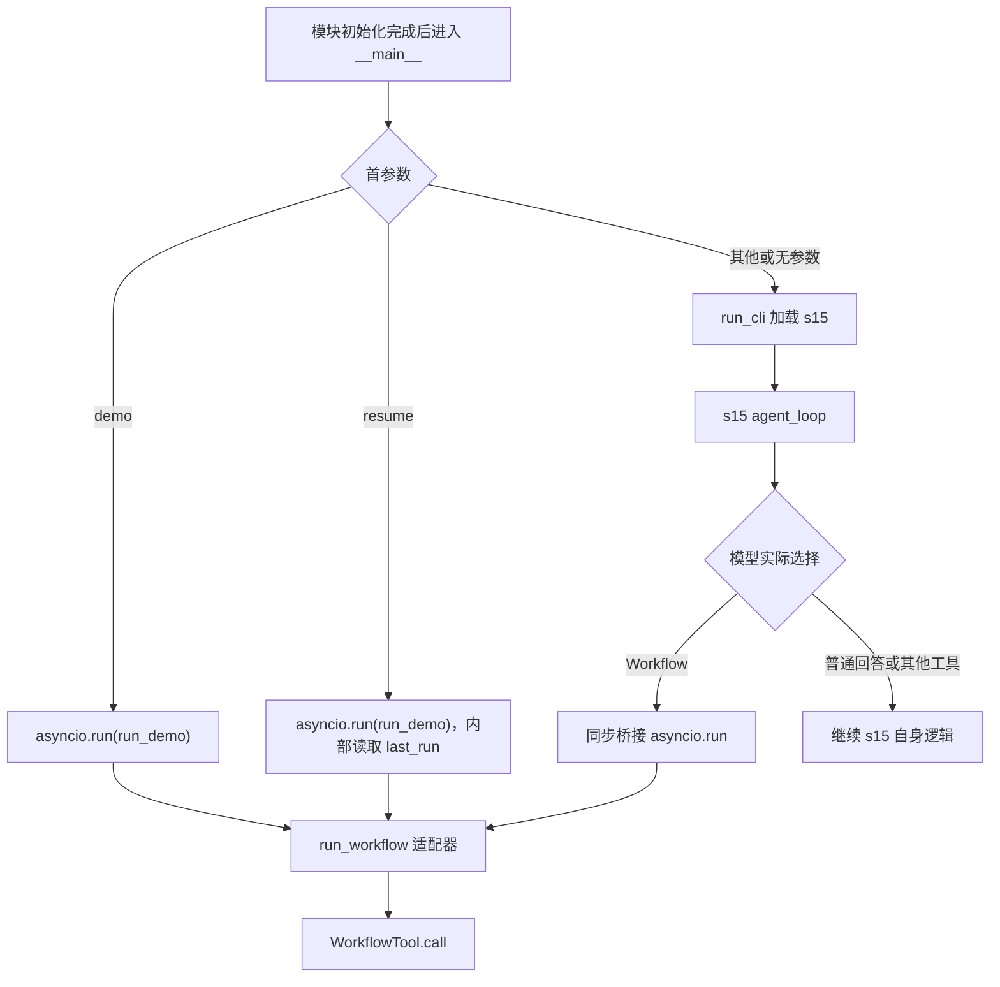
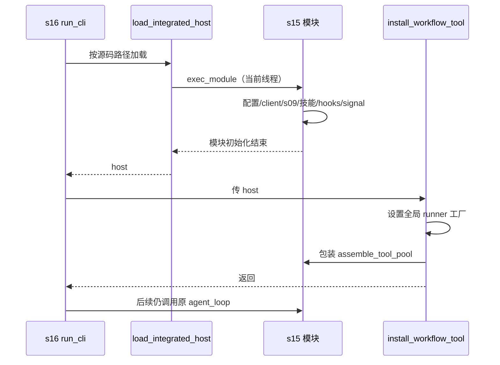
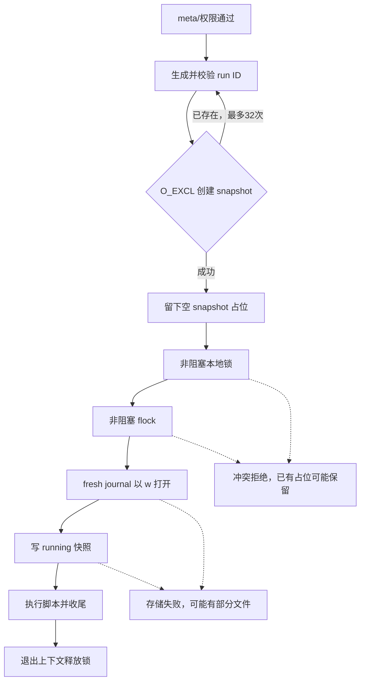
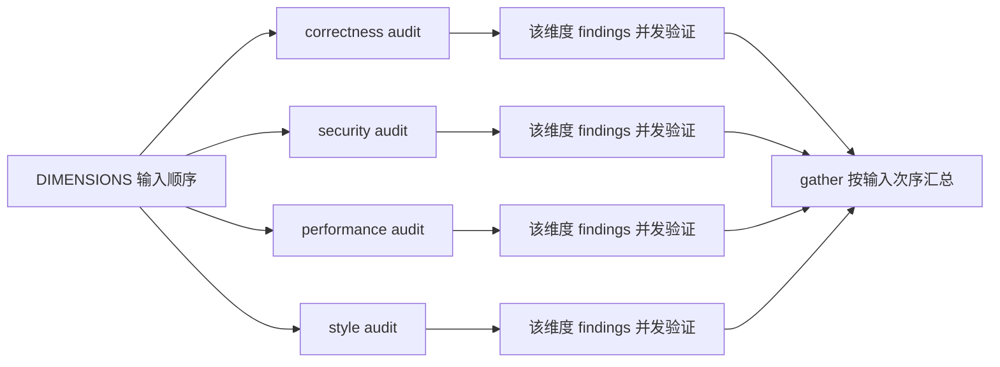
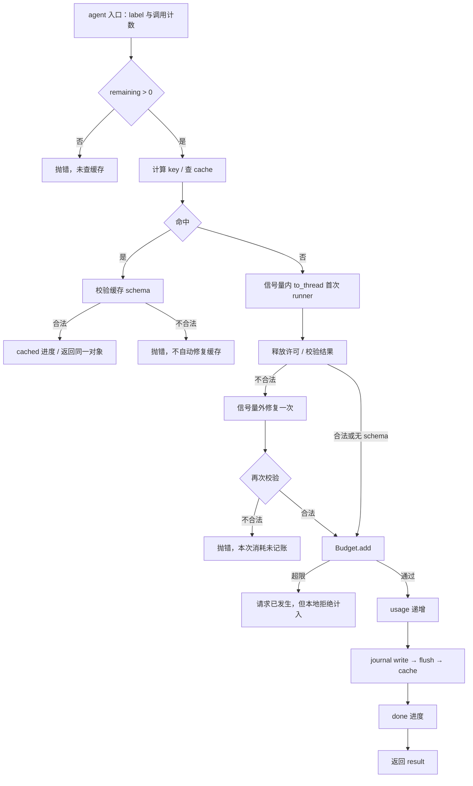
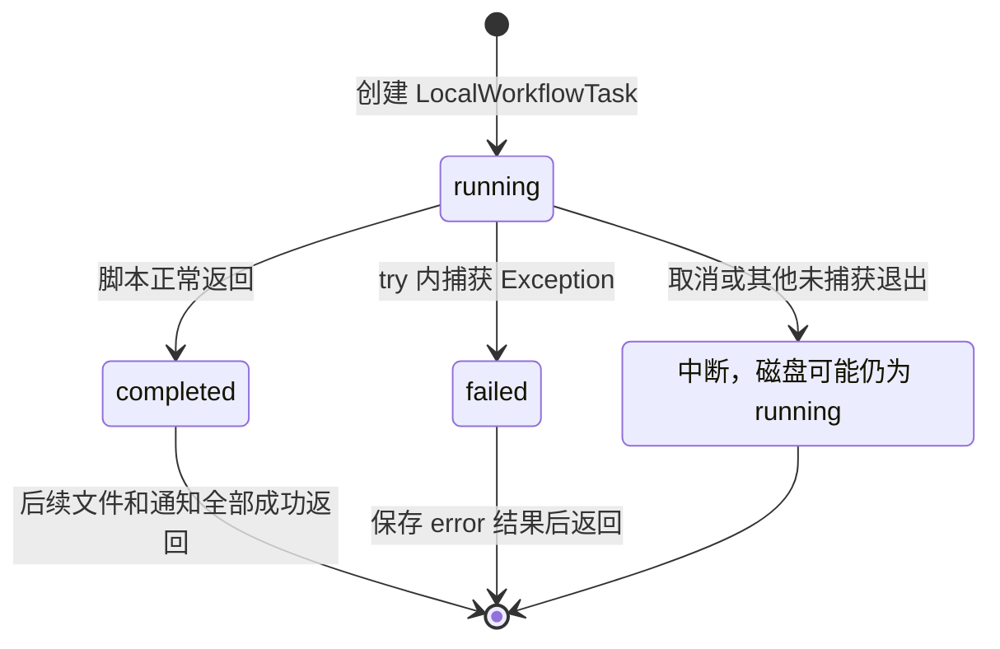
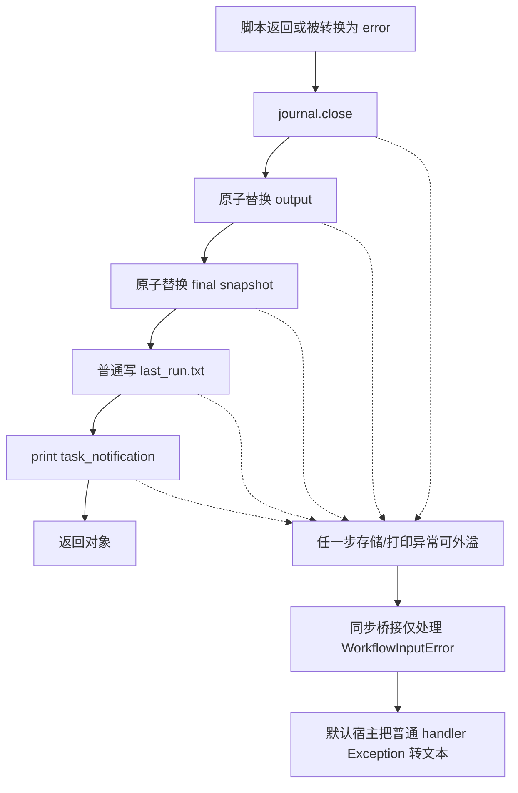
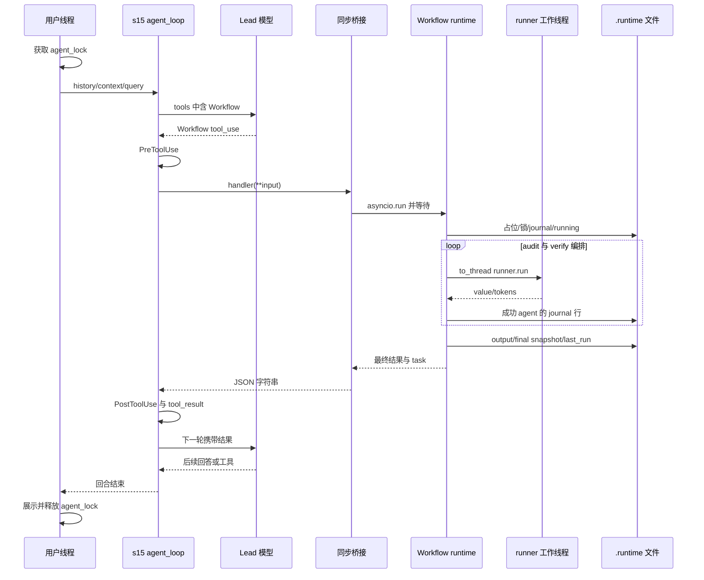
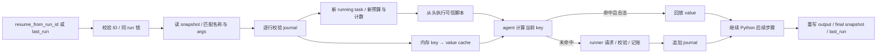
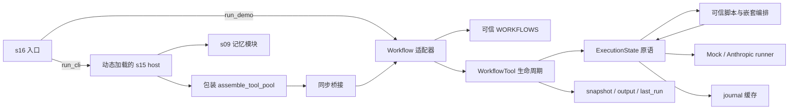

> 待分析代码位置：`s16_workflow_runtime/code.py`。
>
> 功能描述：从真实程序入口出发，沿函数调用、条件分支和返回位置，深度还原 Workflow 如何接入编码 Agent、执行可信编排、并发调用模型、校验结构化结果、控制资源、持久化结果，以及恢复时真正能够恢复的内容。
>
> 阅读约定：本文以默认交互入口中的“新 run”为主线；`resume`、`demo` 和嵌套调用在实际分岔处说明，再分别展开。所有 Python 片段均为所标行号的连续原文，不将解释性伪代码冒充实现。分析基于当前仓库静态源码；相关用例只作为断言证据，未执行目标程序、模型请求或用例。

# 1. 先到程序入口：三条路径不是三个连续步骤

源码定位：`s16_workflow_runtime/code.py`，`__main__`，L1104–L1109。

```python
if __name__ == "__main__":
    # （中文）带 demo / resume 参数进演示模式，否则进交互式 CLI。
    if sys.argv[1:] and sys.argv[1] in {"demo", "resume"}:
        asyncio.run(run_demo(sys.argv[1:]))
    else:
        run_cli()
```

## 1.1 入口逐句执行

Python 执行本文件时，会先完成导入、常量赋值、函数和类定义以及注册表建立，再到这个入口。这里先展示入口是为了建立阅读主线，并不意味着模块初始化发生在入口之后。

1. `__name__ == "__main__"` 仅在直接作为脚本运行时成立。被其他 Python 文件按模块加载时，下面的 CLI 选择不执行。
2. `sys.argv[1:]` 先判断是否存在用户参数，避免无参数时访问 `sys.argv[1]`。
3. 首参数恰为 `demo` 或 `resume`，创建临时 asyncio 事件循环，等待 `run_demo` 整体结束。
4. 无参数，或首参数为其他字符串，进入 `run_cli()`。其他字符串并没有在这里变成提交给 Agent 的问题，也没有使用 argparse 拒绝未知命令。
5. 两个分支互斥；运行 demo 不先启动交互宿主，也不会在 demo 结束后自动进入 REPL。

最外层没有 `try/except`。模块导入错误、宿主初始化错误、演示中的输入错误和未在下层处理的存储错误，都可能直接终止执行。后文会逐层说明哪些异常被转换成文本或 failed 状态，不能将局部捕获扩大成“程序绝不崩溃”。[证据：`s16_workflow_runtime/code.py:1104–1109`，`run_demo:1029`，`run_cli:1064`]

下面的图用于定位三个入口的汇合点，不表示默认 CLI 必然调用 Workflow。



默认交互的模型先决定是否使用 Workflow；demo/resume 直接调用适配器，不经过 Lead 模型与宿主权限 hooks。三条路径从 `run_workflow` 开始共用工作流运行时，而不是共用全部上游初始化。

## 1.2 这段代码解决什么业务问题

这里的“业务”是编码 Agent 的运行编排，不是 HTTP 请求、订单、库存或数据库事务：将一个已知、反复出现的多步过程保存为可信 Python 函数，让模型负责每一步的内容判断，宿主代码负责顺序、分支和汇总。

示例业务是“四个维度审查文本 → 对每条 finding 再作判断 → 过滤 → 按严重度汇总”。主模型不需要用多轮聊天重新规划这些固定步骤。它只需选择已登记的工作流名，并提供输入材料。

必须区分四个对象：

| 对象 | 谁创建/选择 | 实际含义 |
| --- | --- | --- |
| Lead 会话 | s15 CLI 和主模型 | 持有对话历史、选择工具、接收最终工具结果 |
| 已注册 Workflow | 宿主 Python 代码 | 一段可信的编排函数和元数据 |
| Workflow run | `WorkflowTool.call` | 一次有身份、锁、journal 和结果文件的执行 |
| Workflow agent | `ctx.agent` 与 runner | 一次受编排控制的模型/Mock 调用，不是 s15 常驻队友 |

示例的成功输出是结构化 `confirmed` 列表；“工作流 completed”只表示函数正常返回，不能证明所有 finding 都是客观存在的问题。[证据：`s16_workflow_runtime/code.py:868–914,951–972,764–775`]

# 2. 回溯入口前：初始化建立了能力，但尚未运行工作流

## 2.1 无条件导入决定平台门槛

源码定位：`s16_workflow_runtime/code.py`，`模块导入`，L45–L57。

```python
import asyncio              # 异步编排原语：gather、Semaphore、to_thread
import fcntl                # POSIX 跨进程文件锁，保证同一个 run 只被一个进程执行
import hashlib              # sha256：生成跨进程稳定的语义哈希（journal 缓存键）
import importlib.util       # 按文件路径动态加载 s15 集成 host
import json                 # 快照、journal、工具输入输出的 JSON 序列化
import os                   # O_CREAT|O_EXCL 原子占位、os.replace 原子替换、平台判断
import re                   # workflow 名称与 runId 的格式校验
import secrets              # 生成不可预测的 runId 随机后缀
import sys                  # 命令行参数、把动态加载的模块注册进 sys.modules
import threading            # 进程内 run 级互斥锁
from contextlib import contextmanager  # 实现 workflow_run_lock 上下文管理器
from dataclasses import dataclass      # RunnerOutput：结果值 + token 数
from pathlib import Path               # 面向对象的路径操作
```

`fcntl` 没有放进 `try/except ImportError`，也没有 Windows 替代实现。普通原生 Windows Python 通常没有此模块，因此可能在入口选择前就导入失败；连无需 API 的 demo 也无法越过该门槛。这是源码可确认的兼容边界，不是当前环境中已运行得出的结果。

紧接着的系统提示虽然有 Windows 分支，却不能弥补导入失败：

源码定位：`s16_workflow_runtime/code.py`，`WORKFLOW_AGENT_ENVIRONMENT`，L61–L67。

```python
WORKFLOW_AGENT_ENVIRONMENT = (
    "Host OS: Windows. This workflow agent only responds to its supplied step; "
    "it has no direct shell or file tools."
    if os.name == "nt"
    else "Host OS: Unix-like. This workflow agent only responds to its supplied "
         "step; it has no direct shell or file tools."
)
```

该变量只告诉模型“宿主是什么 OS、当前子调用没有文件或 shell 工具”。它既不配置操作系统适配层，也不授予或收回 Python 脚本权限。后文真实 runner 没有传 `tools`，才是子模型无直接工具的请求级证据。

工程上使用 POSIX flock 简化了跨进程互斥；代价是平台耦合。s15 的可选 `fcntl` 降级不会自动适用于 s16 的这个无条件导入。[证据：`s16_workflow_runtime/code.py:46,61–67,164`；`s15_integrated_harness/code.py:201–205`]

## 2.2 资源常量、存储根和 MISS

源码定位：`s16_workflow_runtime/code.py`，`运行时常量`，L76–L84。

```python
AGENT_CAP = 1000                       # hard cap on agent() calls per run
CONCURRENCY = 8                        # parallelism cap (semaphore)
STORE = Path(__file__).parent / ".runtime"   # snapshots + journals live here
MISS = object()                        # journal cache miss sentinel
# （中文）WORKFLOW_NAME_RE：meta.name 必须是 1-64 位，字母/数字开头，
# 只能包含字母、数字、'.'、'_'、'-'（要能安全地拼进文件名）。
# RUN_ID_RE：runId 形如 wf_<name>_<16 位小写十六进制>。
WORKFLOW_NAME_RE = re.compile(r"^[A-Za-z0-9][A-Za-z0-9._-]{0,63}$")
RUN_ID_RE = re.compile(r"^wf_[A-Za-z0-9][A-Za-z0-9._-]{0,63}_[0-9a-f]{16}$")
```

逐项含义：

- `AGENT_CAP=1000`：每个共享 ExecutionLimits 对象的 `agent()` 尝试计数上限。不能提前解释为 1000 次付费 API 请求，因为缓存命中也计数、一次结构修复又可能发两次请求。
- `CONCURRENCY=8`：用于创建 asyncio 信号量，后文只包围首次 runner 调用，修复调用并未处于同一保护范围。
- `STORE`：以本源码文件所在目录定位 `.runtime`，不是随终端 cwd 自动切换。默认宿主的 WORKDIR 则取 `Path.cwd()`，两者可以不同。
- `MISS`：独立对象哨兵，区分“没有记录”和“记录值合法地等于 None”。
- 两个正则限制元数据名称和 run ID 的格式，后文会看到它们用于文件路径拼接前的检查。

此处只是创建 Path、object、正则等内存对象，没有调用 `mkdir` 或打开 journal。目录创建发生在 run 身份预留、锁和 journal 初始化等真正使用点。[证据：`s16_workflow_runtime/code.py:76–84,107,160,441`]

## 2.3 默认 Mock 与可信注册表

源码定位：`s16_workflow_runtime/code.py`，`RUNNER_FACTORY 默认值`，L427–L428。

```python
# （中文）默认用 mock；install_workflow_tool 挂到 s15 host 时会换成真实 runner。
RUNNER_FACTORY = MockAgentRunner
```

源码定位：`s16_workflow_runtime/code.py`，`SAMPLE_META 与 DIMENSIONS`，L853–L860。

```python
SAMPLE_META = {
    "name": "review-changes",
    "description": "Review changed files across dimensions, verify each finding",
    "phases": ["Review", "Verify"],
}

# （中文）演示用的审查维度，以及一段带 SQL 注入隐患的示例改动。
DIMENSIONS = ["correctness", "security", "performance", "style"]
```

源码定位：`s16_workflow_runtime/code.py`，`WORKFLOWS 与 WORKFLOW_TOOL`，L916–L935。

```python
# Saved workflow registry
# （中文）注册表是唯一的「可信代码」来源：模型只能按名字选择，
# 不能提交任意 Python 代码。
WORKFLOWS = {SAMPLE_META["name"]: (SAMPLE_META, sample_workflow)}

# （中文）暴露给模型的工具定义：workflow 名 + args + 可选的 resume runId。
WORKFLOW_TOOL = {
    "name": "Workflow",
    "description": "Run a saved workflow by name. Pass input in args.",
    "input_schema": {
        "type": "object",
        "properties": {
            "name": {"type": "string"},
            "args": {"type": "object"},
            "resume_from_run_id": {"type": "string"},
        },
        "required": ["name"],
        "additionalProperties": False,
    },
}
```

模块执行时注册的只是函数引用，不会调用 `sample_workflow`。此时：

1. 唯一内置 Workflow 名是 `review-changes`。
2. 元数据由宿主提供，工具输入里没有 `script` 或 `meta` 字段。
3. tool schema 要求 `name`，允许可选 `args` 对象和恢复 ID，并声明禁止其他顶层属性。
4. 默认工厂是 Mock 类，只有交互安装函数才换成真实 runner 工厂。
5. FINDINGS_SCHEMA、VERDICT_SCHEMA 已经成为内存字典，后文在第一次审查调用前解释约束。

注册表是能力白名单：模型不能通过这个适配器上传 Python 源码。但它不是 Python 沙箱，可信调用方仍可直接传函数给底层 `WorkflowTool.call`。名称格式校验也不负责确保多个注册项永不互相覆盖。

本文件顶层没有导入 Anthropic SDK、加载 dotenv、创建真实客户端或发起模型请求。依赖声明中有 `anthropic>=0.25.0`、`python-dotenv>=1.0.0`、`pyyaml>=6.0`；它们主要由交互路径加载的宿主使用。声明不是实际安装版本证据，也不足以推断 SDK 内部重试、连接池或线程安全保证。[证据：`requirements.txt:1–3`；`s16_workflow_runtime/code.py:45–59,428,990–1025`]

现在回到入口的默认分支，进入 `run_cli`。

# 3. run_cli 第一步：动态加载 s15，再包装其工具池

## 3.1 调用点与宿主加载

源码定位：`s16_workflow_runtime/code.py`，`run_cli 启动段`，L1064–L1073。

```python
def run_cli():
    """Run the cumulative s15 host with Workflow added to its tool pool."""
    # （中文）交互模式：加载 s15 host、装上 Workflow 工具，然后把主循环
    # 交给 s15 的 agent_loop——本课只是在工具池里多了一个 Workflow。
    host = load_integrated_host()
    install_workflow_tool(host)
    host.CONSOLE.set_prompt(PROMPT, READLINE_PROMPT)
    host.CLI_ACTIVE = True
    host.start_runtime_services()
    print("s16: workflow runtime")
```

`run_cli` 的前两步依次是加载宿主、安装 Workflow；任何一步异常都阻止后面的控制台设置与服务启动。首次遇到 `load_integrated_host`，进入其实现：

源码定位：`s16_workflow_runtime/code.py`，`load_integrated_host`，L1014–L1025。

```python
def load_integrated_host():
    """Load s15 lazily so deterministic workflow tests need no API key."""
    # （中文）按文件路径懒加载 s15 的 code.py，注册进 sys.modules 后执行。
    # 放在函数里而不是模块顶层，是为了让不涉及 API 的测试可以只导入本文件。
    path = Path(__file__).resolve().parents[1] / "s15_integrated_harness" / "code.py"
    spec = importlib.util.spec_from_file_location("integrated_host", path)
    if spec is None or spec.loader is None:
        raise RuntimeError(f"unable to load integrated host from {path}")
    host = importlib.util.module_from_spec(spec)
    sys.modules[spec.name] = host
    spec.loader.exec_module(host)
    return host
```

执行顺序：

1. 由当前模块绝对位置定位同仓库的 s15 文件，不依赖用户 cwd 去搜索 Python 模块。
2. 为名为 `integrated_host` 的模块创建 spec；spec/loader 缺失时抛 RuntimeError。
3. 创建模块对象并先放进 `sys.modules`。
4. `exec_module(host)` 在当前调用线程同步执行 s15 顶层代码。
5. 成功后返回 host，`run_cli` 才进入安装步骤。

将模块放进 sys.modules 有助于运行时模块身份解析，但这里不是通用的单例加载器：函数没有先检查缓存并返回已有 host。重复调用会创建另一个模块对象、替换同名注册项，并再次执行顶层副作用；exec 失败后也没有移除已经注册的部分初始化模块。[证据：`s16_workflow_runtime/code.py:1018–1025`]

## 3.2 exec_module 内部已发生什么，未发生什么

源码定位：`s15_integrated_harness/code.py`，`宿主顶层配置`，L73–L86。

```python
load_dotenv(override=True)  # 让 .env 覆盖同名系统环境变量
if os.getenv("ANTHROPIC_BASE_URL"):
    # 使用自定义端点时，移除可能冲突的鉴权变量，避免两套鉴权方式打架。
    os.environ.pop("ANTHROPIC_AUTH_TOKEN", None)

WORKDIR = Path.cwd()  # 工作目录：所有相对路径、任务目录、工具执行都以它为基准
client = Anthropic(base_url=os.getenv("ANTHROPIC_BASE_URL"))
MODEL = os.environ["MODEL_ID"]          # 主模型 ID（必须配置）
PRIMARY_MODEL = MODEL                   # 正常情况使用的模型
FALLBACK_MODEL = os.getenv("FALLBACK_MODEL_ID")  # 连续 529 时切换的备用模型

SKILLS_DIR = WORKDIR / "skills"                          # 技能目录
TRANSCRIPT_DIR = WORKDIR / ".transcripts"                # 压缩前的完整对话存档
TOOL_RESULTS_DIR = WORKDIR / ".task_outputs" / "tool-results"  # 超长工具结果落盘位置
```

宿主会按 dotenv 的 `override=True` 规则加载配置，自定义端点存在时删除另一个鉴权环境变量，取终端 cwd 建立工作目录、创建 SDK 客户端，并要求 MODEL_ID 存在。这里客观说明配置逻辑，不读取任何真实配置值。

随后还会动态加载 s09：

源码定位：`s15_integrated_harness/code.py`，`load_memory_runtime 与顶层调用`，L104–L124。

```python
def load_memory_runtime():
    """Load s09 once and share this host's client, model, and workspace."""
    # 直接按文件路径加载 s09 的代码，并让它的 client/模型/工作目录
    # 与本课保持一致，相当于把「记忆」能力复用进来。
    path = Path(__file__).resolve().parents[1] / "s09_memory" / "code.py"
    spec = importlib.util.spec_from_file_location(
        f"integrated_memory_{id(client)}", path
    )
    if spec is None or spec.loader is None:
        raise RuntimeError(f"Unable to load memory runtime from {path}")
    runtime = importlib.util.module_from_spec(spec)
    spec.loader.exec_module(runtime)
    runtime.WORKDIR = WORKDIR            # 覆盖 s09 的工作目录
    runtime.MEMORY_DIR = WORKDIR / ".memory"        # 记忆文件放本课自己的目录
    runtime.MEMORY_INDEX = runtime.MEMORY_DIR / "MEMORY.md"  # 记忆索引文件
    runtime.client = client              # 共用同一个 API 客户端
    runtime.MODEL = MODEL                # 共用模型
    return runtime


MEMORY_RUNTIME = load_memory_runtime()   # 模块加载时只初始化一次
```

`exec_module(runtime)` 先执行 s09 自己的模块初始化；返回后才把 s15 的工作目录、记忆路径、client 和 MODEL 覆盖给它。因此“最终共享宿主客户端”不等于“加载 s09 时没有创建过自己的客户端”。

技能扫描在 s15 顶层被调用，hooks 随顶层注册，shell 清理也在导入阶段注册：

源码定位：`s15_integrated_harness/code.py`，`宿主退出处理注册`，L1044–L1045。

```python
atexit.register(_stop_all_shell_processes)               # 正常退出时也清理
signal.signal(signal.SIGTERM, _handle_termination_signal)  # 捕获终止信号
```

s15 自己的 `__main__` 不成立，因此不会自动执行它的 CLI 入口，也不会仅因为导入就启动其全部运行服务。之后 s16 会显式启动服务。

`signal.signal` 的线程限制值得特别注意：默认直接运行 s16 时，加载发生在主线程；若嵌入方从非主线程调用 `load_integrated_host`，顶层 SIGTERM 注册可能失败。不是“动态加载”本身天然后台化了执行。[证据：`s15_integrated_harness/code.py:874,1045,2074–2078,3646`]

## 3.3 返回 run_cli，安装 Workflow

源码定位：`s16_workflow_runtime/code.py`，`install_workflow_tool`，L990–L1011。

```python
def install_workflow_tool(host):
    """Extend the s15 host tool pool without changing its dispatch loop."""
    # （中文）不改 s15 的分发循环，只做两件事：
    #   1. 把 RUNNER_FACTORY 换成使用宿主 client/model 的真实 runner；
    #   2. 包住 host.assemble_tool_pool，在原工具池末尾追加 Workflow 工具。
    global RUNNER_FACTORY
    RUNNER_FACTORY = lambda: AnthropicAgentRunner(host.client, host.MODEL)
    if getattr(host, "_workflow_tool_installed", False):
        # （中文）幂等：重复安装直接返回。
        return
    base_assemble = host.assemble_tool_pool

    def assemble_with_workflow():
        # （中文）先取 s15 原有的工具和处理器，再追加 Workflow（避免重复追加）。
        tools, handlers = base_assemble()
        if not any(tool.get("name") == "Workflow" for tool in tools):
            tools.append(WORKFLOW_TOOL)
        handlers["Workflow"] = run_workflow_sync
        return tools, handlers

    host.assemble_tool_pool = assemble_with_workflow
    host._workflow_tool_installed = True
```

逐句还原：

1. 先把模块级 RUNNER_FACTORY 改为 lambda。该闭包持有 host 引用，每次创建 runner 时读取 host.client 和 host.MODEL。
2. 再检查 host 的安装标记。重复安装同一个 host 不会再套一层包装，但第一步仍已执行。
3. 保存原来的 `assemble_tool_pool` 为 `base_assemble`。
4. 新函数每次先调用旧组装器，获得原有工具与 handler。
5. 工具声明里没有 Workflow 时追加声明；handler 字典中始终将 Workflow 映射到同步桥接。
6. 替换 host 函数，并置安装标记。

这是运行时函数包装/装饰式扩展，不是类继承，也不是把 s15 主循环复制一份。“继承工具”的模块常量只是说明文字；实际复用证据在这个包装与后续调用关系。

收益是 s15 原工具、动态 MCP 组装与主循环保持原样；成本是对宿主函数名、返回值形状和全局变量有隐式契约，后续宿主接口改变会影响扩展。若原工具池已经存在同名 Workflow 声明，包装不检查它与新 handler 的 schema 是否匹配，而是直接覆盖 handler；这是扩展名冲突的边界。

安装的幂等范围只有“不重复追加包装/声明”，不是整个函数完全无副作用。更进一步，RUNNER_FACTORY 属于 s16 模块，不属于单个 host：同一模块实例交替安装不同 host，后安装的工厂会影响先前 host 的 Workflow 调用。[证据：`s16_workflow_runtime/code.py:995–1011`]

相关用例的具体断言是：原 bash 仍在工具列表中、Workflow 在其后，handler 指向同步桥接；另一用例检查工厂得到的 runner 使用指定 client/model。它们支持接入契约，不等同于已在当前环境运行真实请求。[证据：`tests/test_workflow_goal_lessons.py:305–320,407–424`]

下图展示加载与包装的先后，强调宿主主循环并未被替换。



默认路径在宿主加载前没有模型客户端；宿主加载完成不代表已经发出模型请求。模型调用发生在主循环和后续 runner 中。至此返回 `run_cli`，继续控制台与会话初始化。

# 4. 从控制台输入到 Lead：串行回合里才可能选中 Workflow

## 4.1 启动服务与共享对象

源码定位：`s16_workflow_runtime/code.py`，`run_cli 服务和会话初始化`，L1070–L1083。

```python
    host.CONSOLE.set_prompt(PROMPT, READLINE_PROMPT)
    host.CLI_ACTIVE = True
    host.start_runtime_services()
    print("s16: workflow runtime")
    print("Enter a question, press Enter to send. Type q to quit.\n")
    history = []
    context = host.update_context({}, history)
    session_state = {"active_user_request": "(no active user request)"}
    # （中文）守护线程运行 s15 的异步事件循环（cron 触发、队友事件等）。
    threading.Thread(
        target=host.async_event_loop,
        args=(history, context, session_state),
        daemon=True,
    ).start()
```

设置 s16 提示符、标记 CLI_ACTIVE 后，进入宿主服务启动：

源码定位：`s15_integrated_harness/code.py`，`start_runtime_services`，L2902–L2915。

```python
_runtime_services_started = False
_runtime_services_lock = threading.Lock()


def start_runtime_services():
    """Start durable scheduling once when a CLI host becomes active."""
    # CLI 启动时调用一次：恢复持久任务并启动 cron 调度线程。
    global _runtime_services_started
    with _runtime_services_lock:
        if _runtime_services_started:
            return
        load_durable_jobs()
        threading.Thread(target=cron_scheduler_loop, daemon=True).start()
        _runtime_services_started = True
```

服务锁和布尔标记让同一宿主模块的成功启动调用只执行一次：先恢复 durable cron，再启动调度守护线程，最后置标记。该函数不是启动所有队友或所有后台命令；那些仍需后续具体工具触发。

返回 s16 后：

1. `history=[]` 创建同一 Lead 的历史容器。
2. `host.update_context({}, history)` 返回包含记忆和连接信息的新字典。
3. `session_state` 保存最近用户的权威请求文本。
4. 事件线程持有初始化时 history、context、session_state 的引用。

源码定位：`s15_integrated_harness/code.py`，`update_context`，L3388–L3394。

```python
def update_context(context: dict, messages: list) -> dict:
    return {
        "memory_catalog": MEMORY_RUNTIME.read_memory_index(),
        "memories": MEMORY_RUNTIME.load_memories(messages),
        "connected_mcp": list(mcp_clients.keys()),
        "active_teammates": list(active_teammates.keys()),
    }
```

此函数返回新字典而不原地更新传入的 context。因此必须区分：

- history 由用户线程与事件线程共享同一个列表，宿主多数压缩通过切片替换保留列表身份。
- session_state 是共享字典，用户提交时原地改 active_user_request。
- 用户循环后来使用 `context = host.update_context(...)`，只是重绑定自己的局部变量；事件线程仍握着创建它时传入的旧 context 对象。
- agent_loop 每轮自己又计算新 context，因此不能把局部引用差异直接等同于“Workflow 一定拿到过期记忆”；真正结论是这些入口没有一个永远统一的共享 context 引用。

[证据：`s16_workflow_runtime/code.py:1075–1085,1099`；`s15_integrated_harness/code.py:3493,3642`]

## 4.2 stdin 锁与 Lead 锁的范围不同

源码定位：`s16_workflow_runtime/code.py`，`run_cli 输入与提交`，L1084–L1101。

```python
    while True:
        try:
            query = host.CONSOLE.ask()
        except (EOFError, KeyboardInterrupt):
            break
        if query.strip().lower() in ("q", "exit", ""):
            break
        # （中文）串行处理一轮用户输入：
        # hooks -> 追加消息 -> agent_loop -> 重新计算上下文 -> 打印回复。
        with host.agent_lock:
            host.trigger_hooks("UserPromptSubmit", query)
            turn_start = len(history)
            session_state["active_user_request"] = query
            history.append({"role": "user", "content": query})
            host.agent_loop(history, context, query)
            context = host.update_context(context, history)
            host.print_turn_assistants(history, turn_start)
        print()
```

源码定位：`s15_integrated_harness/code.py`，`ConsoleBroker.ask`，L143–L147。

```python
    def ask(self, prompt: str | None = None) -> str:
        # 加锁保证同一时刻只有一个线程在等终端输入。
        with self._lock:
            active_prompt = self.readline_prompt if prompt is None else prompt
            return (self.reader or input)(active_prompt)
```

`CONSOLE.ask` 的锁只保护一次 stdin 读取。输入结束后锁释放，再检查退出条件；`q`、`exit` 和去掉空白后的空字符串都会退出，不是忽略空行后继续。EOF/KeyboardInterrupt 只在 ask 周围被捕获；执行 Workflow 时发生的中断并不落在这个小 try 中。

拿到非退出输入后，主线程持 `host.agent_lock` 做完整一轮：

1. UserPromptSubmit hooks。
2. 记录 turn_start。
3. 修改最近请求。
4. 追加 user 消息。
5. 调用 host.agent_loop。
6. 返回后重新计算 context。
7. 打印本轮 assistant 文本。

Lead 锁覆盖主模型等待、所有同步工具、Workflow、PostToolUse、正常收尾中的记忆处理，直到打印完成。它不只保护一次列表 append。相应代价是长 Workflow 会阻塞同一 Lead 的新回合；模型子调用虽并发，Lead 本身仍被这把锁串行化。

## 4.3 自动事件是另一条入口，但仍竞争同一把锁

源码定位：`s15_integrated_harness/code.py`，`async_event_loop 事件检查`，L3612–L3622。

```python
def async_event_loop(history: list, context: dict, session_state: dict):
    # 后台事件循环：每秒检查 cron 队列、Lead 收件箱和后台任务；
    # 有事件时主动跑一轮 agent_loop，让主线程可以继续等待用户输入。
    while True:
        time.sleep(1)
        with agent_lock:
            with cron_lock:
                fired = list(cron_queue)
            inbox = consume_lead_inbox(route_protocol=True)
            if not fired and not inbox and not has_pending_background():
                continue
```

源码定位：`s15_integrated_harness/code.py`，`async_event_loop 返回 Lead`，L3635–L3643。

```python
            # 有定时任务时以它作为权威请求，否则沿用用户最近一次请求。
            active_request = (
                "\n".join(scheduled_requests)
                if scheduled_requests
                else session_state["active_user_request"]
            )
            agent_loop(history, context, active_request)
            context.update(update_context(context, history))
            print_turn_assistants(history, turn_start)
```

事件线程每秒检查，但要先拿 Lead 锁。Workflow 执行期间，cron 调度、已经启动的后台命令、队友线程可以继续生产事件；事件消费并再次驱动同一 Lead 则等待锁释放。它们不是 Workflow 内部 pipeline 的阶段。

事件入口可能因定时请求而自行让模型选择 Workflow；默认 permission_hook 对 Workflow 没有人工确认分支，所以不能假定 Workflow 仅能由主线程的用户即时授权发起。

Workflow 进度使用本模块的 print，并未调用宿主 ConsoleBroker/terminal_print。若从自动事件回合执行，输出可能与等待输入的终端展示交错；这不影响 run 文件锁，却说明事件展示不是专用消息通道。[证据：`s16_workflow_runtime/code.py:536–547`；`s15_integrated_harness/code.py:2000–2038,3612–3643`]

现在进入 `host.agent_loop`。本次只跟踪与 Workflow 能力接入直接相关的部分，不展开 s15 全部工具和压缩算法。

# 5. 宿主先调用主模型，只有实际 tool_use 才进入 Workflow

## 5.1 刷新工具池，模型才看得见新增能力

源码定位：`s15_integrated_harness/code.py`，`agent_loop 请求准备与主调用`，L3492–L3497。

```python
        prepare_context(messages, active_request)
        context = update_context(context, messages)
        tools, handlers = assemble_tool_pool()   # 可能刚连了新 MCP，重新组装

        try:
            response = call_llm(messages, context, tools, state, max_tokens)
```

`assemble_tool_pool` 已被包装，因此这里得到“原有工具 + Workflow”。同样，agent_loop 最初 L3462 的组装也会走包装。函数每轮刷新工具池，而不是仅启动时冻结一份。

主模型可能：

- 直接回答：没有 Workflow 执行。
- 选其他工具：进入 s15 对应分支。
- 选 Workflow：才走下文。
- 一条响应选多个工具：宿主按响应中的出现顺序逐个执行，不并发启动这些 Lead 工具。

源码定位：`s15_integrated_harness/code.py`，`call_llm`，L3445–L3456。

```python
def call_llm(messages: list, context: dict, tools: list,
             state: RecoveryState, max_tokens: int):
    # 组装系统提示后发起模型调用，统一包在重试逻辑里。
    system = assemble_system_prompt(context)
    return with_retry(
        lambda: client.messages.create(
            model=state.current_model,
            system=system,
            messages=messages,
            tools=tools,
            max_tokens=max_tokens),
        state)
```

Lead 请求传 tools 和完整宿主提示，并由 s15 with_retry 包裹。不能把这层恢复能力自动归属于 Workflow 的子模型调用；后者有自己的 runner，直接调用同一 client，但没有调用这个函数。

### 模型没有正常返回时，Workflow handler 尚未进入

源码定位：`s15_integrated_harness/code.py`，`agent_loop 主模型失败与 cron 确认`，L3496–L3513。

```python
        try:
            response = call_llm(messages, context, tools, state, max_tokens)
        except Exception as e:
            if is_prompt_too_long_error(e) and not state.has_attempted_reactive_compact:
                # 上下文超长：先尝试被动压缩一次，然后重试本轮。
                messages[:] = reactive_compact(messages, active_request)
                state.has_attempted_reactive_compact = True
                continue
            # 其它错误：把未确认的定时任务放回队列，把错误写进历史并结束本轮。
            restore_cron_jobs(unacknowledged_cron_jobs)
            messages.append({"role": "assistant", "content": [
                {"type": "text", "text": f"[Error] {type(e).__name__}: {e}"}]})
            release_completed_assignment("agent")
            return

        # 模型调用成功：定时任务算已投递（一次性任务可删除）。
        acknowledge_cron_jobs(unacknowledged_cron_jobs)
        unacknowledged_cron_jobs.clear()
```

这段位于工具分发之前：主模型异常若被识别为上下文过长且尚未尝试被动压缩，会压缩后重试；其他普通错误则恢复尚未确认的 cron 投递、追加错误 assistant 消息、释放已完成 assignment 后返回。因还没有进入 Workflow handler，这条分支不会创建新 Workflow run。

prepare_context、update_context 和工具池组装在该 try 之前；它们自己的异常不是被这个模型调用 except 统一兜住。不能据“主请求有捕获”推导整个宿主启动/准备都安全返回。

模型请求一成功，cron 就先 acknowledge，再处理响应。若定时 prompt 让模型选择 Workflow，acknowledge 表示 prompt 已交给模型，不表示工作流或业务成功；之后 Workflow failed 不会自动触发这里的 cron 回队。

源码定位：`s15_integrated_harness/code.py`，`agent_loop 输出截断处理`，L3515–L3528。

```python
        if response.stop_reason == "max_tokens":
            # 输出被截断：第一次先提高上限重试；仍不够就续写，最多两次。
            if not state.has_escalated:
                max_tokens = ESCALATED_MAX_TOKENS
                state.has_escalated = True
                print(f"  \033[33m[max_tokens] retry with {max_tokens}\033[0m")
                continue
            messages.append({"role": "assistant", "content": response.content})
            if state.recovery_count < MAX_RECOVERY_RETRIES:
                messages.append({"role": "user", "content": CONTINUATION_PROMPT})
                state.recovery_count += 1
                continue
            release_completed_assignment("agent")
            return
```

Lead 首次 max_tokens 截断会提高输出上限重新请求，此响应尚未进入正常工具分发；后续截断会按宿主恢复计数追加续写，达到限制则提前返回。不能因为截断文本里出现 Workflow 名称，就说其 handler 已执行。

这些是 Lead 主循环的行为；Workflow runner 没有调用该恢复分支。返回阅读主线：只有响应走过这些分支并被作为正常响应处理，才继续下面的 tool_use 遍历。

## 5.2 从响应块进入 hooks

源码定位：`s15_integrated_harness/code.py`，`agent_loop 工具分岔与 PreToolUse`，L3544–L3565。

```python
        for block in response.content:
            if block.type != "tool_use":
                continue
            print(f"\033[36m> {block.name}\033[0m")

            if block.name == "compact":
                # compact 是模型主动要求压缩：本轮结束后统一处理。
                results.append({
                    "type": "tool_result",
                    "tool_use_id": block.id,
                    "content": "[Compaction requested. This completed turn will be summarized.]",
                })
                compact_requested = True
                continue

            # 权限/日志等前置钩子；被拦截时直接返回拒绝原因。
            blocked = trigger_hooks("PreToolUse", block)
            if blocked:
                results.append({"type": "tool_result",
                                "tool_use_id": block.id,
                                "content": str(blocked)})
                continue
```

`compact` 有特殊分支，但 Workflow 不在这个分支。对 Workflow，宿主拿原始 tool_use 块触发 PreToolUse；有 truthy 拦截结果就生成拒绝 tool_result，不进入 handler。

进入 hooks 实现：

源码定位：`s15_integrated_harness/code.py`，`register_hook 与 trigger_hooks`，L1983–L1993。

```python
def register_hook(event: str, callback):
    HOOKS[event].append(callback)


def trigger_hooks(event: str, *args):
    # 依次执行钩子；第一个返回非 None 的钩子决定结果（短路）。
    for callback in HOOKS[event]:
        result = callback(*args)
        if result is not None:
            return result
    return None
```

源码定位：`s15_integrated_harness/code.py`，`默认 hooks 注册`，L2073–L2078。

```python
# 注册各类钩子：权限检查在日志之前，保证被拒绝的调用也能留下日志。
register_hook("UserPromptSubmit", user_prompt_hook)
register_hook("PreToolUse", permission_hook)
register_hook("PreToolUse", log_hook)
register_hook("PostToolUse", large_output_hook)
register_hook("Stop", stop_hook)
```

注册顺序是权限在前、日志在后；第一个非 None 返回就短路。因此权限拒绝时，日志 hook 实际不会执行，尽管注释声称“保证被拒绝调用也能留下日志”。这是实现与注释偏差。调用处用 truthy 判断拦截，扩展 hook 若返回空字符串或 False，会短路后续 hooks，却不阻止 handler；默认拒绝字符串不存在该问题。

源码定位：`s15_integrated_harness/code.py`，`permission_hook`，L2000–L2038。

```python
def permission_hook(block):
    # The permission layer sees the raw tool_use before dispatch. It can deny,
    # ask the user, or allow execution to continue.
    # （中文）权限检查发生在工具真正执行之前：
    #   * bash：命中危险命令黑名单直接拒绝；否则主线程里询问用户；
    #   * 文件工具：路径必须在工作区内；
    #   * MCP 工具：宿主策略不是 allow 时，同样要人工确认。
    if block.name == "bash":
        command = block.input.get("command", "")
        if not isinstance(command, str):
            return "Permission denied: shell command must be a string"
        for pattern in DENY_LIST:
            if pattern in command:
                return f"Permission denied: '{pattern}' is on the deny list"
        # 异步轮次（后台事件/队友）没有交互终端，无法弹确认，只能拒绝。
        if threading.current_thread() is not threading.main_thread():
            return ("Permission denied: interactive shell approval is unavailable "
                    "during an asynchronous turn")
        terminal_print("\n\033[33m[permission] shell command\033[0m")
        terminal_print(f"  {command}")
        choice = CONSOLE.ask("  Allow? [y/N] ").strip().lower()
        if choice not in ("y", "yes"):
            return "Permission denied by user"
    if block.name in ("read_file", "write_file", "edit_file"):
        path = block.input.get("path", "")
        if not isinstance(path, str):
            return "Permission denied: path must be a string"
        if not (WORKDIR / path).resolve().is_relative_to(WORKDIR):
            return "Permission denied: path is outside the workspace"
    if (block.name.startswith("mcp__")
            and mcp_tool_policies.get(block.name, "confirm") != "allow"):
        if threading.current_thread() is not threading.main_thread():
            return ("Permission denied: interactive MCP approval is unavailable "
                    "during an asynchronous turn")
        terminal_print(f"\n\033[33m[permission] MCP tool: {block.name}\033[0m")
        choice = CONSOLE.ask("  Allow? [y/N] ").strip().lower()
        if choice not in ("y", "yes"):
            return "Permission denied by user"
    return None
```

默认 permission_hook 只明确限制 bash、指定文件工具和 MCP；Workflow 名称不匹配这些分支，最终返回 None。这不等于没有经过宿主权限层，而是“经过后默认放行”。额外注册的宿主 hook 仍有能力拒绝它。[证据：`s15_integrated_harness/code.py:2000–2038`]

## 5.3 普通 handler 调用，而非后台任务

源码定位：`s15_integrated_harness/code.py`，`should_run_background`，L2550–L2555。

```python
def should_run_background(tool_name: str, tool_input: dict) -> bool:
    # 目前只有 bash 支持后台执行，且必须显式传入 run_in_background=True。
    return (
        tool_name == "bash"
        and tool_input.get("run_in_background") is True
    )
```

这个判断只接受 bash 且显式布尔 True。Workflow 不会因有 async 函数或 async_launched 事件就进入宿主后台任务路径。

源码定位：`s15_integrated_harness/code.py`，`agent_loop 普通工具执行`，L3581–L3585。

```python
            # 普通工具：查 handler 执行，再跑 PostToolUse 钩子。
            handler = handlers.get(block.name)
            output = call_tool_handler(handler, block.input, block.name)
            trigger_hooks("PostToolUse", block, output)
            print(str(output)[:300])
```

源码定位：`s15_integrated_harness/code.py`，`call_tool_handler`，L1199–L1206。

```python
def call_tool_handler(handler, args: dict, name: str) -> str:
    # 统一执行入口：处理函数缺失或抛异常时都转成文本，绝不让循环崩掉。
    if not handler:
        return f"Unknown tool: {name}"
    try:
        return str(handler(**(args or {})))
    except Exception as exc:
        return f"Error: {type(exc).__name__}: {exc}"
```

handler 正是安装时注册的 `run_workflow_sync`。宿主在当前线程同步调用它、等待返回，随后才运行 PostToolUse。handler 内普通 Exception 被转换成错误文本；hooks 自身在这个 try 之外，不能说 hook 失败也被这里兜底。KeyboardInterrupt/SystemExit 等 BaseException 也不在这个捕获范围。

此时调用栈为：

`run_cli（持 Lead 锁） → host.agent_loop → call_tool_handler → run_workflow_sync`。

下一章进入同步桥接，直到工作流收尾后才沿这条栈返回。

# 6. 同步桥接进入异步适配器：先限制模型可选能力

## 6.1 run_workflow_sync 等待整个协程完成

源码定位：`s16_workflow_runtime/code.py`，`run_workflow_sync`，L980–L987。

```python
def run_workflow_sync(**tool_input):
    """Bridge the synchronous host dispatcher to the async workflow runtime."""
    # （中文）s15 的工具分发是同步的，这里用 asyncio.run 起一个临时事件循环
    # 跑异步运行时；输入类错误转成文本返回给模型。
    try:
        return json.dumps(asyncio.run(run_workflow(**tool_input)), default=str)
    except WorkflowInputError as exc:
        return f"Error: {exc}"
```

输入来自 tool_use.input，经 `handler(**args)` 展开为关键字参数。桥接没有把工作投给持久后台调度器，而是：

1. 调用 `run_workflow(**tool_input)` 创建协程。
2. `asyncio.run` 创建事件循环并运行至返回，负责该循环的收尾。
3. 将最终字典编码为 JSON 字符串。
4. 仅捕获 WorkflowInputError，返回 `Error: ...`。

因此启动事件虽然叫 async_launched，Lead 仍等待整次 Workflow。工作流返回前产生的终端进度不等于宿主已经收到 tool_result。

缺少 name、额外传 script/meta 等未声明关键字，会在 Python 函数参数绑定处产生 TypeError，不是桥接主动用 JSON Schema 校验后拒绝。桥接不捕获 TypeError，但外层 s15 call_tool_handler 捕获 Exception 并形成文本。因此默认宿主可以继续；直接调用这个桥接的其他代码则需要自己接住该异常。

如果已有运行中的 asyncio loop 的同一线程直接调用同步桥接，`asyncio.run` 不支持嵌套运行；标准 s15 CLI 是同步线程，不属于这个情形。可信异步调用方应理解底层异步适配器的接口，而不是把桥接当成任意上下文通用函数。[证据：`s16_workflow_runtime/code.py:980–987`；`s15_integrated_harness/code.py:1199–1206`]

## 6.2 进入 run_workflow：注册表决定执行什么代码

源码定位：`s16_workflow_runtime/code.py`，`run_workflow`，L951–L972。

```python
async def run_workflow(name, args=None, resume_from_run_id=None):
    """Model-facing adapter: resolve trusted code from the host registry."""
    # （中文）模型侧适配器：先做输入校验，再从注册表解析出可信的
    # meta + 脚本，然后交给 WorkflowTool 执行。
    if not isinstance(name, str):
        raise WorkflowInputError("workflow name must be a string")
    if name not in WORKFLOWS:
        raise WorkflowInputError(f"unknown workflow '{name}'")
    if args is not None and not isinstance(args, dict):
        raise WorkflowInputError("workflow args must be an object")
    meta, script_fn = WORKFLOWS[name]
    out = await WorkflowTool().call(
        meta,
        script_fn,
        args=args,
        resume_from_run_id=resume_from_run_id,
    )
    return {
        "launched": out["launched"],
        "result": out["result"],
        "task": serialize_task(out["task"]),
    }
```

顺序不能倒过来理解：

1. name 不是字符串，立即 WorkflowInputError。
2. 字符串不在 WORKFLOWS，立即 unknown workflow；不会尝试拼文件路径加载同名脚本。
3. args 非 None 且不是 dict，立即拒绝；此时未预留 run、未打开 journal。
4. 从注册表取可信 meta 与 script_fn。
5. 调用 WorkflowTool.call，等待完整生命周期。
6. 把返回中的 task 对象序列化，形成可交给桥接的结果。

这里没有验证 args 内部每个字段；changes 的类型在示例函数内部，budget 则交 Budget 使用。不能因为顶层 args 是 object 就认为内部业务参数已全部验证。

层次之间的输入边界如下：

| 层 | 实际职责 | 不承担什么 |
| --- | --- | --- |
| 模型可见 input_schema | 声明字段、类型、required、额外属性策略 | 本地没有通用 JSON Schema 入口验证循环 |
| Python 函数签名 | 必填 name、可选 args/resume、拒绝额外关键字 | 不自动执行注解类型验证 |
| run_workflow 显式检查 | name 类型与已注册、args 为 dict/None | 不校验任意 budget/changes 深层语义 |
| WorkflowTool.call | meta、权限、run ID、生命周期 | 不重新复用模型顶层 schema 做参数校验 |
| 示例脚本 | changes 必须 str | 不读取仓库来确认材料真实性 |

WORKFLOW_HANDLERS 存的是异步适配器，宿主工具池存的则是同步桥接，二者不能混为一张实际分发表：

源码定位：`s16_workflow_runtime/code.py`，`WORKFLOW_HANDLERS 与说明常量`，L975–L977。

```python
WORKFLOW_HANDLERS = {"Workflow": run_workflow}
# （中文）标明工具池继承自 s15 的集成 harness。
INHERITS_TOOLS_FROM = "s15"
```

现有用例直接断言 schema 属性只有 name、args、resume_from_run_id，并用非字符串 name 和未知名称触发错误。它证明适配器入口不接受“模型直接提交源码”，不证明 Python 脚本被操作系统隔离。[证据：`tests/test_workflow_goal_lessons.py:486–498`]

返回位置：适配器尚在等待 WorkflowTool.call；现在进入 call 的启动前检查。

# 7. 启动前先校验元数据和权限，再选择新 run 或 resume

## 7.1 call 的编排顺序

源码定位：`s16_workflow_runtime/code.py`，`WorkflowTool.call`，L713–L726。

```python
    async def call(self, meta, script_fn, args=None, resume_from_run_id=None):
        # （中文）resume 时 runId 由调用方给出并校验格式；
        # 新 run 则先 reserve_run_id 原子占坑。执行期间一直持有 workflow_run_lock。
        validate_meta(meta)
        check_permission(meta)
        resuming = resume_from_run_id is not None
        if resuming:
            run_id = validate_run_id(resume_from_run_id)
        else:
            run_id = reserve_run_id(meta)
        with workflow_run_lock(run_id):
            return await self._call_locked(
                meta, script_fn, args, run_id, resuming
            )
```

meta 和脚本来自注册表，而非模型直接提交。底层 API 也允许可信 Python 调用者直接给 meta/script_fn，所以 call 仍独立校验元数据。

`resume_from_run_id is not None` 决定恢复模式，不是判断真假：空字符串属于恢复输入，然后被 ID 校验拒绝；不悄悄变成新 run。

所有输入拒绝不必产生相同副作用：meta/权限拒绝发生在身份创建前；新 run 预留之后的锁或存储错误，可能已经留文件。逐阶段区分这些边界是理解恢复的前提。

## 7.2 首先进入 validate_meta

源码定位：`s16_workflow_runtime/code.py`，`validate_meta`，L185–L207。

```python
def validate_meta(meta):
    """Validate name, description, and optional phases before launch."""
    # （中文）meta 是编排脚本自己声明的「启动信封」：
    #   name（必填，全局唯一）、description（必填）、
    #   phases（可选，阶段标题列表，只用于播报和展示）。
    # name 会被拼进文件名，所以限制为 1-64 位 slug。
    if not isinstance(meta, dict):
        raise WorkflowInputError("meta must be an object literal")
    if not meta.get("name") or not meta.get("description"):
        raise WorkflowInputError("meta requires `name` and `description`")
    if not isinstance(meta["name"], str) or not WORKFLOW_NAME_RE.fullmatch(meta["name"]):
        raise WorkflowInputError(
            "meta.name must be a 1-64 character slug using letters, numbers, '.', '_', or '-'"
        )
    if not isinstance(meta["description"], str):
        raise WorkflowInputError("meta.description must be a string")
    if "phases" in meta:
        # （中文）phases 必须是「非空字符串列表」；不写则视为没有阶段。
        if not isinstance(meta["phases"], list) or not all(
            isinstance(phase, str) and phase for phase in meta["phases"]
        ):
            raise WorkflowInputError("meta.phases must be a list of non-empty strings")
    return meta
```

实际检查：

1. meta 必须是 dict。
2. name、description 的值必须为 truthy；空字符串拒绝。
3. name 必须 str，且 1–64 字符，首位字母或数字，后续允许字母、数字、点、下划线、连字符。
4. description 必须 str，但没有 strip：仅空白的非空字符串可通过。
5. 存在 phases 时必须 list，且每项是非空字符串；`all([])` 为 True，因此空列表允许，空白字符串项也允许。
6. 返回原对象，没有复制或冻结。

name 检查防止路径分隔符和明显穿越字符串进入产物名称，description/phases 则保证后续展示的基本形状。它不验证 script_fn 是否可调用、不要求每个阶段被使用，也不实现注释提到的“全局唯一”。字典注册时同名键后写覆盖是 Python 容器行为，不是 validate_meta 的业务约束。

这是一种轻量启动信封验证：收益是错误尽早暴露、命名安全和展示简单；成本是未采用完整契约系统，可信代码仍需遵守约定。现有用例具体拒绝 `../escape`、`../../escape`、`nested/name`，支持文件名保护结论。[证据：`tests/test_workflow_goal_lessons.py:66–80`]

## 7.3 再进入内部权限门

源码定位：`s16_workflow_runtime/code.py`，`check_permission`，L210–L217。

```python
def check_permission(meta, settings=None):
    """Apply the s03 allow/deny gate before launching a workflow."""
    # （中文）沿用 s03 的权限思路：settings["deny"] 里列出的 workflow 名
    # 直接拒绝；这里只演示 deny 名单，默认放行。
    settings = settings or {}
    if meta["name"] in settings.get("deny", []):
        raise WorkflowInputError(f"workflow '{meta['name']}' denied by settings")
    return "allow"
```

函数具有 deny-list 扩展点；但 call 实际执行的是 `check_permission(meta)`，未传 settings，于是 settings 为空字典，deny 为空，当前路径默认放行。

必须同时看到两层：

- s15 宿主 PreToolUse 已执行；默认没有 Workflow 专用拒绝/确认。
- s16 内部 check_permission 已调用；默认调用没有接入真实拒绝配置。

因此可以说“存在两层可扩展的检查位置”，不能说“当前按配置严格拒绝工作流”或“每次均人工授权”。参数名、函数名和注释都不是实际配置连线的证据。

run ID 也不是用户/租户归属凭证：适配器只校验格式和已存名称/args，没有身份认证、租户字段、产物访问 ACL 或按调用者所有权检查。该教学运行时默认依赖宿主进程和本地存储可信，不能扩展为多租户授权系统。[证据：`s16_workflow_runtime/code.py:713–721,210–217,728–743`]

返回 call：本次主线为新 run，下一步进入 reserve_run_id；恢复分支先只校验格式，完整恢复链在后文展开。

# 8. 新 run 先占位，随后获取整次生命周期互斥

## 8.1 稳定身份不等于稳定缓存键

源码定位：`s16_workflow_runtime/code.py`，`create_run_id 与 reserve_run_id`，L96–L117。

```python
def create_run_id(meta) -> str:
    # （中文）wf_<workflow 名>_<8 字节随机十六进制>。
    # 随机部分由 secrets 生成，避免不同 run 之间互相猜中。
    return f"wf_{meta['name']}_{secrets.token_hex(8)}"


def reserve_run_id(meta) -> str:
    """Reserve a fresh run identity before any journal can be truncated."""
    # （中文）先「占坑」再执行：用 O_CREAT|O_EXCL 原子地创建 <runId>.json，
    # 文件已存在说明撞号，换一个重试（最多 32 次）。这样即使两个进程
    # 同时发起新 run，也不会共用同一个 runId 而互相覆盖 journal。
    STORE.mkdir(parents=True, exist_ok=True)
    for _ in range(32):
        run_id = validate_run_id(create_run_id(meta))
        snapshot_path = STORE / f"{run_id}.json"
        try:
            fd = os.open(snapshot_path, os.O_CREAT | os.O_EXCL | os.O_WRONLY, 0o600)
        except FileExistsError:
            continue
        os.close(fd)
        return run_id
    raise WorkflowInputError("could not allocate a unique workflow runId")
```

新 run ID 由可信名称和 `secrets.token_hex(8)` 构成，随机段为 8 字节、16 个小写十六进制字符。相同 workflow 和相同 args 再次“新建”，仍应得到不同 run；不是按输入内容去重。

reserve 的顺序：

1. 创建 STORE 目录。
2. 最多 32 次生成候选 ID，并先校验格式。
3. 以 O_CREAT|O_EXCL|O_WRONLY 创建对应 snapshot 文件。
4. 已存在则只捕获 FileExistsError，换 ID 重试。
5. 创建成功后关闭文件描述符并返回。
6. 32 次均撞号，抛 WorkflowInputError。

mode 0600 只作用于这个占位文件的创建请求；之后 `_write_json` 通过另一个临时文件替换，最终权限取决于临时文件创建和宿主 umask，不能据此宣称全部持久化产物始终 0600。

为什么在 journal 前占位？fresh journal 后面以 w 打开，若直接复用 ID 就会截断旧缓存。O_EXCL 让协作执行者先排他保留 snapshot 名称，再创建可截断 journal。收益是避免正常新 run 撞号覆盖；代价是保留成功后即使未启动脚本也会留空 JSON 文件。

保护范围还要限定：占位检查的是 snapshot 路径，不是同时检查所有同 ID 产物。如果外部操作删除 snapshot 却留下 journal，再刻意复用同一 ID，这段代码没有多文件存在性屏障；随机 ID 降低自然遇到概率，但不是存储完整性事务。

[证据：`s16_workflow_runtime/code.py:102–117,468`；`tests/test_workflow_goal_lessons.py:192–211` 的用例固定 ID，第二次要求拒绝并保持旧 snapshot/output 文本不变。]

## 8.2 ID 校验与 Task 身份映射

源码定位：`s16_workflow_runtime/code.py`，`create_task_id 与 validate_run_id`，L120–L130。

```python
def create_task_id(run_id) -> str:
    # （中文）任务系统里的本地任务 ID，与 runId 一一对应。
    return f"local_workflow_{run_id}"


def validate_run_id(run_id):
    # （中文）校验 runId 格式。resume 时用户传进来的 ID 也要先过这一关，
    # 因为 runId 会被直接拼进 .runtime 目录下的文件名（防止路径穿越）。
    if not isinstance(run_id, str) or not RUN_ID_RE.fullmatch(run_id):
        raise WorkflowInputError("invalid workflow runId")
    return run_id
```

四种身份不能混用：

| 身份 | 产生方式 | 有效作用域 |
| --- | --- | --- |
| Workflow 名 | registry 中的 meta.name | 编排类型，如 review-changes |
| run ID | 随机后缀并排他占位 | 一次执行的文件和互斥单位 |
| Task ID | local_workflow_ + run ID | 本模块任务对象标识，与 run 一一对应 |
| journal key | 后文的调用内容哈希 | 单个 run 内模型结果缓存索引 |

正则拦住路径分隔符、空值、错误后缀；它不要求 ID 中编码的名称与 meta.name 逐字符对应，恢复的业务名称一致性另由 snapshot.workflowName 判断。格式合法也不证明文件存在、有完整快照或调用者有读取权。

## 8.3 进入 workflow_run_lock：先线程锁，再文件锁

源码定位：`s16_workflow_runtime/code.py`，`workflow_run_lock 与本地锁表`，L142–L181。

```python
_run_locks_guard = threading.Lock()
_run_locks: dict[str, threading.Lock] = {}


@contextmanager
def workflow_run_lock(run_id: str):
    """Hold one run across threads and host processes for its full lifecycle."""
    # （中文）两层锁，整个 run 生命周期都持有：
    #   1. threading.Lock —— 防止同一进程内的两个协程/线程同时跑同一个 run；
    #   2. fcntl.flock     —— 防止另一个宿主进程并发跑同一个 run。
    # 两者都非阻塞获取，拿不到就说明该 run 正在执行中。
    with _run_locks_guard:
        local_lock = _run_locks.setdefault(run_id, threading.Lock())
    if not local_lock.acquire(blocking=False):
        raise WorkflowInputError(f"workflow run {run_id} is already active")

    handle = None
    try:
        STORE.mkdir(parents=True, exist_ok=True)
        handle = (STORE / f"{run_id}.lock").open("a+", encoding="utf-8")
        try:
            # （中文）LOCK_EX 排他 + LOCK_NB 不等待：被别的进程占着就立刻失败。
            fcntl.flock(handle.fileno(), fcntl.LOCK_EX | fcntl.LOCK_NB)
        except BlockingIOError as exc:
            raise WorkflowInputError(
                f"workflow run {run_id} is already active"
            ) from exc
        yield
    finally:
        # （中文）无论正常结束还是异常退出，都释放文件锁、关闭句柄，
        # 并清理进程内锁表（只有确认无人持有时才删除条目）。
        if handle is not None:
            try:
                fcntl.flock(handle.fileno(), fcntl.LOCK_UN)
            finally:
                handle.close()
        local_lock.release()
        with _run_locks_guard:
            if not local_lock.locked() and _run_locks.get(run_id) is local_lock:
                _run_locks.pop(run_id, None)
```

按进入和退出两段理解：

进入：

1. 用全局 guard 保护 run_id → threading.Lock 的查找/建立。
2. 非阻塞 acquire 本地锁；已被持有就立刻拒绝，不排队。
3. 在 STORE 打开 run.lock，a+ 不截断内容。
4. flock 排他、非阻塞；其他协作进程持有则转为 already active 输入错误。
5. yield 后进入整个 `_call_locked`，直到脚本和最终文件写入都完成。

退出：

- 尝试解除 flock，在其 finally 关闭句柄。
- 释放本地锁，再按对象身份和 locked 状态清理锁表条目。
- 文件本身不删除；锁文件存在不等于锁仍被持有，实际互斥依赖操作系统锁状态。

这不是 asyncio.Lock：获取部分没有 await，不会在同一事件循环协程之间主动让出；真正 run 内会 await，但锁一直持有。第二个同 run 调用应快速拒绝，适合“禁止重复恢复”而不是等待队列。

POSIX flock 是协作式文件锁：只约束同样使用锁的进程，不阻止任意外部程序编辑 JSON，也不锁其他 run、全局 last_run 或脚本自己的外部系统副作用。

正常主体异常会经过 finally 释放。清理代码自身若 flock 解锁/close 抛错，则后面的本地 release 可能没有执行，不能把注释“无论如何”解释为所有存储清理故障下绝对可靠。进程被强制终止时内存 finally 不保证执行，操作系统通常释放进程文件锁，但不会替程序完成快照和结果写入。

[证据：`s16_workflow_runtime/code.py:147–181`；现有用例在同进程活动 run 中要求恢复被拒绝，在另一个进程尝试同锁时要求 already active：`tests/test_workflow_goal_lessons.py:243–302`，均为静态断言证据。]

下图说明身份和互斥先于破坏性 journal 打开；虚线失败不代表自动补偿。



新 run 身份排他和同 run 互斥解决不同问题：前者避免新建覆盖，后者避免恢复竞争。二者都不承诺外部业务恰好一次。

返回 call：锁上下文已进入，下一步 await `_call_locked`。

# 9. _call_locked 新建 journal、任务与启动快照

## 9.1 fresh 分支先打开 journal

源码定位：`s16_workflow_runtime/code.py`，`_call_locked 新 run 分支`，L742–L745。

```python
        else:
            args = args or {}
            journal = WorkflowJournal(run_id, resume=False)
        task_id = create_task_id(run_id)
```

本次不是恢复，`args = args or {}` 将 None 或空字典规范化为空字典；非空 dict 保留同一引用。外层适配器已保证 dict/None，但可信调用方直接走底层 call 可以绕过该形状检查，后面的 `args.get` 才可能失败。

首次遇到 journal，先看本次会执行的 fresh 部分：

源码定位：`s16_workflow_runtime/code.py`，`WorkflowJournal 初始化公共段`，L439–L444。

```python
    def __init__(self, run_id, resume, store=None):
        store = STORE if store is None else store
        store.mkdir(parents=True, exist_ok=True)
        self.path = store / f"{run_id}.journal.jsonl"
        self.resume = resume
        self.cache = {}
```

源码定位：`s16_workflow_runtime/code.py`，`WorkflowJournal fresh 打开`，L466–L468。

```python
        else:
            # （中文）全新 run：以写模式打开即清空旧 journal（一般也不会撞上旧文件）。
            self._f = self.path.open("w", encoding="utf-8")             # fresh run truncates
```

fresh 的 w 模式会截断同名 journal，因此前一章的身份预留不是装饰性步骤。打开成功后，内存 cache 为空，句柄保持到脚本 try 的 finally。resume 加载分支稍后再深入。

此处只打开 journal，不代表已记录一个 agent 结果。若随后 task 初始化、事件打印、启动快照写入失败，执行尚未进入关闭 journal 的那个 try/finally；代码没有在更外层使用 with 管理 journal。因此不能断言任意启动失败都显式关闭句柄。实现的对象析构行为也不宜替代明确的生命周期保证。

## 9.2 LocalWorkflowTask 是本模块对象，不是 s15 Task 板

源码定位：`s16_workflow_runtime/code.py`，`LocalWorkflowTask`，L522–L547。

```python
class LocalWorkflowTask:
    """Hold workflow status, usage, and progress events."""

    def __init__(self, task_id, run_id, meta):
        # （中文）status: running / completed / failed；
        # usage 统计本次 run 调用了多少个 agent、花了多少 token；
        # progress 保存所有可回放给宿主的进度事件。
        self.task_id = task_id
        self.run_id = run_id
        self.meta = meta
        self.status = "running"
        self.usage = {"agents": 0, "tokens": 0}
        self.progress = []

    def event(self, name, **data):
        # （中文）生命周期事件（async_launched / task_started /
        # task_notification），目前只打印到终端。
        line = " ".join(f"{k}={v}" for k, v in data.items())
        print(f"  event      {name:<18} {line}")

    def progress_event(self, ptype, **data):
        # （中文）脚本级进度（workflow_phase / workflow_log / workflow_agent），
        # 既追加进 progress 列表（随快照持久化），也实时打印。
        self.progress.append({"type": ptype, **data})
        line = " ".join(f"{k}={v}" for k, v in data.items())
        print(f"  progress   {ptype:<16} {line}")
```

task_id 来自 run_id，task 初始状态 running，用量为零、进度空。meta 保留对象引用。

- `event()`：拼展示字符串并 print，不加入 progress。
- `progress_event()`：先 append 包含 type 的字典，再 print。
- 两者都没有消息总线、网络订阅、宿主任务板注册或每事件文件写入。
- 如果 progress 的 print 抛错，列表已经 append；普通 event 的打印失败则只是没有展示成功。

所谓“注册本地任务”在当前代码中就是创建这个状态对象，再写快照；没有调用 s15 create_task、claim_task，不获得 owner、assignment、cwd 或 worktree。Workflow 的可信 Python 脚本若自己做 I/O，也没有自动经过 Lead cwd 包装。

这是一种局部运行状态模型，收益是独立、易序列化、不耦合任务板；代价是名称容易让人误以为继承了 s15 任务调度、可靠通知与租约能力。[证据：`s16_workflow_runtime/code.py:745–760,522–547`]

## 9.3 启动信封先打印、再写 running 快照

源码定位：`s16_workflow_runtime/code.py`，`_call_locked 任务与启动信封`，L747–L763。

```python
        task = LocalWorkflowTask(task_id, run_id, meta)
        # Record the launch envelope before workflow execution starts.
        # （中文）先写「启动信封」：即使脚本随后崩溃，宿主也能从快照里
        # 查到这次 run 的 runId/taskId/名字，方便恢复和排查。
        launched = {"status": "async_launched", "taskId": task_id,
                    "taskType": "local_workflow", "runId": run_id,
                    "workflowName": meta["name"]}
        task.event("async_launched", runId=run_id, taskId=task_id)
        task.event("task_started", workflow=meta["name"],
                   phases=",".join(meta.get("phases", [])) or "-",
                   resume=resuming)
        _write_json(STORE / f"{run_id}.json", {
            "runId": run_id,
            "workflowName": meta["name"],
            "args": args,
            "task": serialize_task(task),
        })
```

真实顺序为：

1. 创建 running task。
2. 组装 launched 字典，status 值为 async_launched。
3. 打印 async_launched 事件。
4. 打印 task_started，展示 workflow、阶段列表、resume 布尔值。
5. 将 runId、workflowName、args、序列化 task 写 snapshot。

此处没有提前 return launched。打印启动事件并不证明启动快照已成功，也不证明该 run 已被独立后台调度接管。

进入 serialize_task：

源码定位：`s16_workflow_runtime/code.py`，`serialize_task`，L938–L948。

```python
def serialize_task(task):
    # （中文）把任务对象转成可 JSON 序列化的 dict（写快照、返回宿主都用它）。
    return {
        "taskId": task.task_id,
        "taskType": "local_workflow",
        "runId": task.run_id,
        "workflowName": task.meta["name"],
        "status": task.status,
        "usage": dict(task.usage),
        "progress": list(task.progress),
    }
```

它保存身份、名称、状态、usage 和 progress；不会保存函数、线程、信号量、runner、预算对象、局部变量、程序计数器。usage 用 dict 复制，progress 只浅复制列表，列表内事件对象未深复制。

## 9.4 首次写快照：单文件替换的收益与边界

源码定位：`s16_workflow_runtime/code.py`，`_write_json`，L797–L803。

```python
def _write_json(path, value):
    # （中文）原子写：先写同目录的 .tmp 文件，再 os.replace 覆盖目标文件。
    # replace 在同一文件系统内是原子操作，读者永远看不到写了一半的 JSON。
    path.parent.mkdir(parents=True, exist_ok=True)
    temporary = path.with_suffix(path.suffix + ".tmp")
    temporary.write_text(json.dumps(value, indent=2, default=str), encoding="utf-8")
    os.replace(temporary, path)
```

过程是创建父目录、把完整 JSON 文本写到同目录固定 .tmp 路径，再 os.replace 覆盖目标。读者通常看到旧版或新版完整文件，而不是目标文件中途写了一半的 JSON；这指正常同文件系统替换语义，不是所有故障下持久性保证。

需要明确：

- 没有 fsync 文件或目录，不能承诺断电后数据一定保留。
- 没有把 journal、snapshot、output、last_run 一起提交的事务。
- 临时文件名固定；同 run 锁降低正常并发写冲突，但绕过锁的直接 helper 调用不受保护。
- json.dumps 的 default=str 把某些不可直接编码对象字符串化，不等同于恢复原 Python 类型。
- snapshot 只在启动和最终收尾写，不是每次 phase 或 agent 都更新。

因此 running 快照解决“知道谁在执行、用什么参数”的问题；真正已完成 agent 结果的恢复依靠 journal。运行中的 snapshot.usage/progress 仍可能停留在初始零值/空列表。[证据：`s16_workflow_runtime/code.py:757–762,780–785,483–488`]

返回 `_call_locked`：启动快照成功，才进入脚本 try，建立执行上下文。

# 10. 创建执行上下文：共享资源的范围在这里确定

源码定位：`s16_workflow_runtime/code.py`，`_call_locked 构造上下文并调用脚本`，L765–L770。

```python
        try:
            # （中文）把原语上下文交给可信脚本；budget 来自 args["budget"]。
            ctx = ExecutionState(
                task, journal, RUNNER_FACTORY(), Budget(args.get("budget")), args
            )
            result = await script_fn(ctx, args)
```

Python 按参数求值顺序先得到 `RUNNER_FACTORY()`，再创建 `Budget(args.get("budget"))`，随后进入 ExecutionState 构造。交互主线的工厂已切换为真实 runner；未安装宿主的 demo 才是默认 Mock。

源码定位：`s16_workflow_runtime/code.py`，`Budget 初始化`，L501–L503。

```python
    def __init__(self, total=None):
        self.total = total
        self._spent = 0
```

Budget 初始只保存 total 和 spent=0，不验证类型或范围。budget 字符串、负数等输入不会在这里统一拒绝：可能在 remaining 运算时报错，也可能成为立即耗尽的预算。None 表示不限额。后面重点解释消费检查，而不是把这个简单对象描述为完整费用控制系统。

源码定位：`s16_workflow_runtime/code.py`，`ExecutionState.__init__`，L575–L584。

```python
    def __init__(self, task, journal, runner, budget, args, depth=0, limits=None):
        self.task = task
        self.journal = journal
        self.runner = runner
        self.budget = budget
        self.args = args
        self._depth = depth
        self._phase = None
        self._phases_seen = set()
        self._limits = limits or ExecutionLimits()
```

脚本得到 ctx，其中明确有公开的 task、journal、runner、budget 和 args 属性。注释说“脚本看不到底层 runner 和 journal”，但 Python 属性实际可访问；这只是鼓励使用原语的接口约定，不是封装隔离，更不是安全边界。

默认 depth=0，阶段标签为空，已播报阶段集合为空。未传 limits 时创建同 run 的共享资源：

源码定位：`s16_workflow_runtime/code.py`，`ExecutionLimits`，L552–L566。

```python
class ExecutionLimits:
    """Shared run-wide limits, including nested workflows."""
    # （中文）特意放在 ExecutionState 之外：嵌套子 workflow 共享同一份
    # 计数器和信号量，否则子 workflow 可以绕过 agent 上限。

    def __init__(self):
        self.agents = 0
        self.semaphore = asyncio.Semaphore(CONCURRENCY)

    def claim_agent(self):
        # （中文）先计数再判断，保证超限时立刻失败；这一步在事件循环线程里
        # 同步执行，不存在竞态。
        self.agents += 1
        if self.agents > AGENT_CAP:
            raise WorkflowInputError(f"agent() cap reached ({AGENT_CAP})")
```

信号量属于这一份 ExecutionLimits。嵌套上下文后面会共享它；不同 run 默认分别创建，因而 8 不是整个进程或所有 run 的全局请求上限。多 run 累计资源没有本模块统一限制。

claim_agent 在事件循环线程里同步自增后比较，不包含 await，在本模块正常单事件循环使用中不会被其他协程从中间打断。它不是可跨线程共享调用的加锁计数器；若可信代码自行多线程直接操作同一 ctx，源码没有额外保护。

上下文构造也在脚本 try 内：工厂失败、args.get 失败等普通 Exception，会走同一 failed 分支，而不是启动前输入拒绝。构造成功后，执行暂停在 `await script_fn(ctx, args)`，下一章第一次真正进入 sample_workflow。

# 11. 进入 sample_workflow：先规范输入，再为四个维度建立流水线

## 11.1 phase 只记录标签

源码定位：`s16_workflow_runtime/code.py`，`sample_workflow 输入段`，L868–L878。

```python
async def sample_workflow(ctx, args):
    """pipeline over review dimensions (audit -> verify-each), then keep only the
    findings a verifier confirms. The plan is code, not a chat turn."""
    # （中文）整张编排图都写死在代码里：
    #   pipeline(维度) -> audit 生成 findings -> verify 逐条对抗验证 -> 过滤。
    # 模型只负责每一步的内容判断，不负责决定流程。
    ctx.phase("Review")
    changes = args.get("changes", "")
    if not isinstance(changes, str):
        raise WorkflowInputError("args.changes must be a string")
    review_input = changes.strip() or "No change context was supplied."
```

先调用 `ctx.phase("Review")`，然后读 args.changes，因此非法 changes 类型失败前，内存进度中已可能有 Review 事件。

进入 phase：

源码定位：`s16_workflow_runtime/code.py`，`ExecutionState.phase`，L586–L594。

```python
    def phase(self, title):
        """Start a phase; subsequent agent()s group under it. Upsert: emitting the
        same phase again (e.g. from each pipeline item) does not re-announce it."""
        # （中文）当前阶段只是个「标签」：之后每个 agent() 的进度事件都会带上它。
        # 用 set 去重，pipeline 的每个 item 都调用 phase("Verify") 也只播报一次。
        self._phase = title
        if title not in self._phases_seen:
            self._phases_seen.add(title)
            self.task.progress_event("workflow_phase", title=title)
```

它先更新共享 _phase，再仅在首次看到该标题时记录 workflow_phase。重复 phase 调用仍改变当前标签，只是不重复播报；它不启动任务、不开线程、不等待其他维度，也不检查 title 是否在 meta.phases 中。

返回 sample_workflow：

1. changes 缺失默认空字符串。
2. 不是 str 时抛 WorkflowInputError，随后由脚本 try 转成 failed。
3. strip 后非空文本作为 review_input。
4. 空白、缺失、空字符串使用 `No change context was supplied.`，仍继续执行审查，并非输入不充分就强制拒绝。

因此 Workflow 没有自动读取 Git diff 或打开仓库文件。真实材料必须先由 Lead 其他工具取得，再显式放进 args.changes；即使 Lead 历史里有仓库内容，runner 请求也不会自动带上全部宿主历史。[证据：`s16_workflow_runtime/code.py:875–878,398–407`]

## 11.2 审查输出与验证结论的业务形状

源码定位：`s16_workflow_runtime/code.py`，`FINDINGS_SCHEMA 与 VERDICT_SCHEMA`，L836–L850。

```python
FINDINGS_SCHEMA = {
    "type": "object", "required": ["findings"],
    "properties": {"findings": {"type": "array", "items": {
        "type": "object", "required": ["title", "severity"],
        "properties": {
            "title": {"type": "string"},
            "severity": {
                "type": "string", "enum": ["high", "medium", "low"]
            },
        }}}},
}
VERDICT_SCHEMA = {
    "type": "object", "required": ["isReal", "reason"],
    "properties": {"isReal": {"type": "boolean"}, "reason": {"type": "string"}},
}
```

审查必须返回对象，含 findings 数组；每条 finding 必须含字符串 title 和枚举 severity。findings 可为空；title 也可以是空字符串，因为没有 minLength。

验证必须返回对象，含布尔 isReal 与字符串 reason。布尔结构合法不是事实正确的证明。schema 也不要求文件、行号、复现步骤、证据引用或置信度。

没有 additionalProperties 的本地限制意味着 finding 可带额外字段。这个看似小的边界会影响后面的维度合并：额外 dimension 可覆盖汇总字段，届时再分析。

## 11.3 audit/verify 是函数定义，此刻尚未调用

源码定位：`s16_workflow_runtime/code.py`，`sample_workflow.audit`，L880–L888。

```python
    async def audit(_value, dimension, _idx):
        # （中文）pipeline 的 stage 签名固定是 (上一步结果, 原始 item, 下标)；
        # 第一步没有上一步结果，所以第一个参数不用。
        out = await ctx.agent(
            f"Review this change context for {dimension} issues. "
            "Report only issues supported by the supplied text.\n\n"
            f"{review_input}",
            schema=FINDINGS_SCHEMA, label=f"audit:{dimension}", phase="Review")
        return {"dimension": dimension, "findings": out["findings"]}
```

audit 捕获外层 review_input 和 ctx，dimension 则由 pipeline item 提供。第一个参数名 _value 说明它不使用前一阶段值，但 pipeline 实际会传原 item 作为首次 value；“第一步没有上一步结果”不意味着传 None。

这段定义不会立刻发请求。sample_workflow 先完成两个内部函数定义，直到走到 pipeline 调用：

源码定位：`s16_workflow_runtime/code.py`，`sample_workflow 调用 pipeline`，L907–L907。

```python
    results = await ctx.pipeline(DIMENSIONS, audit, verify)
```

首次进入 pipeline：

源码定位：`s16_workflow_runtime/code.py`，`ExecutionState.pipeline`，L671–L684。

```python
    async def pipeline(self, items, *stages):
        """Per-item staged flow, NO barrier between stages: item A can be in
        stage 3 while item B is still in stage 1. Each stage gets
        (prev_result, original_item, index). A throwing stage fails the workflow."""
        # （中文）流式流水线：每个 item 各自从 stage 1 走到最后，
        # 阶段之间没有全局屏障——item A 可能已经在 stage 3，item B 才刚进 stage 1，
        # 谁先完成谁先推进，吞吐更高（代价是总耗时由最慢的 item 决定）。
        async def run_item(item, idx):
            value = item
            for stage in stages:
                # （中文）stage 的签名固定为：(上一步结果, 原始 item, 下标)。
                value = await stage(value, item, idx)
            return value
        return await asyncio.gather(*[run_item(it, i) for i, it in enumerate(items)])
```

执行机制：

1. 对每个 DIMENSIONS item 建立 run_item 协程。
2. run_item 初始 value=item。
3. 每个 item 内按 stages 参数顺序执行 audit，再 verify。
4. 每次把上一阶段返回值、原始 item、原始下标传给下一阶段。
5. 外层 gather 正常完成后，结果按 items 的输入顺序返回，不按完成先后排序。

四个维度分别是 correctness、security、performance、style。某个维度 audit 先完成，就能立即进入该维度 verify，不等其他维度审查完成；但整个 pipeline 正常 return 仍需全部 item 完成。

下面的图说明“维度内串行、维度间并发”，不是先全审查再全验证的全局屏障。



正常路径的“等齐”不应扩展为失败路径保证。gather 默认某个 awaitable 异常时传播首个异常，并不自动保证其他兄弟任务全部停止或已经完成；后文在 journal 关闭和取消路径再解释这一生命周期风险。

设计收益是固定编排不占用 Lead 多轮规划、各维度可以尽早推进；代价是需要明确共享 budget、异常与阶段标签的语义。此实现不做阶段间全局屏障，也不是将中间结果流式返回给 Lead。

现在选择其中一个维度深入：`pipeline.run_item → audit → ctx.agent`。其他维度是同一逻辑的并行执行线，不是本章之后才开始执行。

# 12. audit 首次进入 ctx.agent：先计数与预算，再查询缓存

## 12.1 前置步骤并不因缓存命中而跳过

源码定位：`s16_workflow_runtime/code.py`，`ExecutionState.agent 前置与缓存分支`，L601–L629。

```python
    async def agent(self, prompt, schema=None, label=None, phase=None):
        """Spawn one subagent. With a schema, force StructuredOutput + validate
        (retry once). On resume, a cached key short-circuits the run."""
        # （中文）agent() 是整个运行时的核心，依次做六件事：
        #   1. 计数 + 预算检查（超限直接失败）；
        #   2. 算语义键、查 journal 缓存，命中则校验 schema 后直接返回；
        #   3. 未命中：在并发信号量下把同步 runner 丢进线程池执行；
        #   4. 有 schema 时校验输出，不合法就带「请返回合法 JSON」重试一次；
        #   5. 把 token 记账到 Budget 和 task.usage；
        #   6. 写 journal、播报 workflow_agent 进度、返回结果。
        label = label or (prompt[:24] + "...")
        self._limits.claim_agent()
        if self.budget.remaining() <= 0:
            raise WorkflowInputError("token budget exceeded")

        key = self.journal.key("agent", label, prompt, schema)
        cached = self.journal.cached(key)
        if cached is not MISS:
            # （中文）缓存命中：resume 时不重复花钱，但仍校验一次 schema，
            # 防止旧缓存与当前 schema 不兼容。
            if schema is not None:
                ok, err = SimpleJsonSchema(schema).validate(cached)
                if not ok:
                    raise WorkflowInputError(
                        f"cached agent output failed schema validation: {err}"
                    )
            self.task.progress_event("workflow_agent", label=label,
                                     phase=phase or self._phase, status="cached")
            return cached
```

按照执行顺序分析：

1. 没提供 truthy label 时，取 prompt 前 24 字符加省略号。显式空 label 也会触发默认值；prompt 不符合可切片字符串约定时可能直接失败。
2. `claim_agent()` 先把共享计数加一，再判断是否超过 cap。第 1000 次允许，下一次自增成 1001 后抛错，计数不回退。
3. `budget.remaining() <= 0` 时直接拒绝。
4. 只有以上通过，才构造语义键并查 journal。
5. 命中后仍以当前 schema 校验缓存值；不合法直接抛错，不进入后面的模型修复分支。
6. 命中进度标为 cached，直接返回缓存对象。

这意味着“缓存不花本次 API token”不等于“不受资源门禁”：零预算会在查缓存前拒绝；超出 agent cap 的缓存尝试也会失败。cap、缓存与 usage 是三个不同口径。

remaining 的实际实现如下：

源码定位：`s16_workflow_runtime/code.py`，`Budget.spent 与 remaining`，L513–L518。

```python
    def spent(self):
        return self._spent

    def remaining(self):
        # （中文）不限额时剩余量视为无穷大；限额时最小取 0。
        return float("inf") if self.total is None else max(0, self.total - self._spent)
```

None 返回无穷大，其他 total 做减法并取不低于零的值。total 为字符串可能发生 TypeError；total 为负数通常得到零，提前拒绝；没有统一输入归一化。NaN、非预期自定义值等也没有专门防护，不能把注释“预算上限”当成对任意 Python 输入的严格契约。

对示例真实请求而言，外层 name/args 已验证，但 args.budget 没有字段级类型检查，所以这不是仅有恶意可信代码才能触达的边界。[证据：`s16_workflow_runtime/code.py:959–960,768,501–518,611–617`]

## 12.2 第一次进入 journal.key：稳定但有缩短与版本边界

源码定位：`s16_workflow_runtime/code.py`，`_stable_hash`，L87–L93。

```python
def _stable_hash(s: str) -> int:
    """Process-stable hash (Python's hash() is salted per process, which would
    break resume keys across `run` and `resume`)."""
    # （中文）用 sha256 而不是内置 hash()：Python 的内置哈希每个进程都会加盐，
    # 同一个字符串在 `run` 和 `resume` 两个进程里算出的值不同，
    # journal 的缓存键就对不上了。这里把 sha256 的十六进制摘要转成整数。
    return int(hashlib.sha256(s.encode()).hexdigest(), 16)
```

源码定位：`s16_workflow_runtime/code.py`，`WorkflowJournal.key 与 cached`，L470–L481。

```python
    def key(self, kind, label, prompt, schema):
        # Deterministic semantic key, independent of concurrency order, so a
        # parallel/pipeline call gets the same key on resume.
        # （中文）语义键只由「调用类型 + label + prompt + schema」决定，
        # 与并发顺序、线程调度无关，所以 parallel/pipeline 里的同一次调用
        # 在 resume 时能算出同一个键。
        basis = f"{kind}|{label}|{prompt}|{json.dumps(schema, sort_keys=True)}"
        return f"{kind}-{_stable_hash(basis) % 10**10:010d}"

    def cached(self, key):
        # （中文）命中返回缓存值，未命中返回哨兵 MISS。
        return self.cache.get(key, MISS)
```

key 的输入是 kind、label、prompt、排序序列化 schema。SHA-256 避免 Python 内置 hash 每进程加盐导致恢复键不稳定；排序 schema 键避免仅字典键顺序不同就改变 schema 文本。

但最终并没有保存完整 256 位摘要，而是 `% 10**10` 后保留十位十进制字符串。结论应分层：

- **事实**：key 不依赖完成顺序，所以 pipeline/parallel 调度变化不会仅因先后次序导致错位。
- **事实**：label 改变即改变 key；默认 label 取 prompt 前缀，prompt 本身仍参与完整 basis。
- **事实**：没有模型 ID、system 提示版本、script 版本、run 内子 workflow 名称或外部仓库版本。
- **基于代码推断**：调用内容相同但模型/脚本周边语义改变时，可能继续使用旧结果；这是以内容缓存换取调用成本降低的代价。
- **事实边界**：十位摘要存在碰撞可能，cache 没有存原始 basis 来做二次比对；SHA-256 的强度不等于最终缓存键的强度。

拼接也不是结构化 tuple 编码：字段间使用裸竖线，如果 label/prompt 本身包含分隔符，理论上不同字段组合可形成同一 basis。示例显式 audit label 的格式比较固定，但公共 agent API 没有禁止这种输入；这是独立于摘要缩短的歧义边界。

没有将 phase 放进 key，符合“phase 只是展示标签”的定位；相同语义调用仅改变阶段显示仍可复用。

## 12.3 缓存命中的数据与计数变化

cached 返回 dict.get 的原对象，不深拷贝。若可信脚本修改该对象，后续同 key 命中可能看到修改后的值，而磁盘中原有行不一定同时改变。cache 不能视为不可变事实库。

缓存命中仍生成本次进度事件，但不执行：

- runner 请求；
- Budget.add；
- usage.agents/tokens 递增；
- journal.record 追加。

因此完全命中的 resume 可以显示 agents=0、tokens=0，同时实际上执行了多次 agent 原语、产生 cached 事件，并消耗了 cap 计数。这里的零表示本次运行记录的未缓存调用用量，不表示从未花过钱或没有历史 API 消耗。[证据：`s16_workflow_runtime/code.py:612–629,656–663`；`tests/test_workflow_goal_lessons.py:53–63` 的断言检查续跑输出为 cached 且零 usage。]

缓存命中返回 audit 后，audit 用 out["findings"] 构造维度结果，再推进 verify。为理解新 run 的主线，下面转向未命中；后文 resume 会重新接回这个命中点。

## 12.4 相同 key 并发没有进行中合并

“已有已完成缓存”与“同 key 请求正在执行”是不同状态。代码只查 cache，没有 in-flight future 表或每 key 锁。两个协程先后都查到 MISS，都会进入信号量并发请求；结果各自追加同 key 记录，最后写入者决定内存值，恢复时也是最后一行覆盖。

run 锁不能解决它：run 锁禁止的是另一个 run 执行者同时进入同一 run，而同一持锁 run 内部本来就允许多个 agent 并发。示例如果出现相同 title 且完整 finding 文本相同的重复验证，就可能走到这条路径，不能说 journal 已经提供请求级幂等或恰好一次。

收益边界是复用**已提交结果**，不是合并所有重复尝试。[证据：`s16_workflow_runtime/code.py:616–636,483–488`]

# 13. 未命中后：信号量和线程把同步 SDK 放进并发流水线

## 13.1 先获取信号量，再提交线程

源码定位：`s16_workflow_runtime/code.py`，`ExecutionState.agent 首次 runner 执行`，L631–L638。

```python
        async with self._limits.semaphore:
            # （中文）Anthropic SDK 是同步的，用 to_thread 包一层，
            # 多个 agent() 才能真正并发；信号量限制同时进行的数量。
            run = await asyncio.to_thread(
                self.runner.run, prompt, schema, label
            )
            result = run.value
            tokens = run.tokens
```

当前事件循环中，一个维度 await ctx.agent 后让出控制，其他维度能继续运行。

1. await 信号量许可；等待许可不代表已经发出 API 请求。
2. 许可获取后，`asyncio.to_thread` 将同步 `runner.run(prompt, schema, label)` 放进默认执行器线程。
3. 当前协程等待线程函数结果，不阻塞事件循环本身。
4. 得到 RunnerOutput，读取 value/tokens。
5. 退出 async with，释放信号量。
6. 才在事件循环线程执行结构校验与后续记账。

正常首次调用的同时活跃数受同一 limits.semaphore 约束，但默认线程池容量也会影响实际运行数；这里没有配置执行器大小，也不能从 CONCURRENCY 推导实际吞吐量。

如果 runner.run 抛异常，await 重新抛到 agent，许可由 async with 释放；此函数没有针对网络异常的单独重试。异常继续经 audit/pipeline 到脚本生命周期的 except。

## 13.2 runner 对象的捕获时间与模型选择

源码定位：`s16_workflow_runtime/code.py`，`AnthropicAgentRunner.__init__`，L380–L385。

```python
class AnthropicAgentRunner:
    """Run workflow agents through the same API client as the host."""

    def __init__(self, client, model):
        self.client = client
        self.model = model
```

安装函数中的 lambda 在建立本次 ctx 时生成 runner，client/model 保存到对象。一个 run 内各步骤共用同一个 runner。

Lead 的临时 fallback 在 s15 RecoveryState.current_model 中，Workflow runner 取的是 host.MODEL，不是该临时状态。共享 SDK client 并不等于共享 call_llm 或 with_retry 策略。

具体区别：

| 调用 | 本模块/宿主可见的请求恢复 |
| --- | --- |
| Lead 主请求 | s15 call_llm/with_retry，另有主循环上下文与输出截断处理 |
| Workflow 首次请求 | runner 直接同步 SDK 调用；本模块无 429/529 专门退避 |
| Workflow 格式修复 | schema 失败后额外再调用一次 runner |
| Mock 请求 | 本地确定性生成，不是远程调用 |

SDK 可能有自己的默认行为，但仓库只给依赖最低版本，没有足够证据声明其实际重试次数、超时、连接池容量和并发安全保证。[证据：`s16_workflow_runtime/code.py:996,383–424,640–654`；`s15_integrated_harness/code.py:3445–3456`；`requirements.txt:1`]

## 13.3 进入真实 runner：每步是一条独立、无工具请求

源码定位：`s16_workflow_runtime/code.py`，`AnthropicAgentRunner.run 请求组装`，L387–L407。

```python
    def run(self, prompt, schema=None, label=None):
        # （中文）有 schema 时把 schema 的 JSON 一并塞进 prompt，并要求
        # 「只返回一个 JSON 对象」——子代理没有工具调用，只能靠提示约束格式。
        request = prompt
        if schema is not None:
            request += (
                "\n\nReturn only one JSON object matching this schema:\n"
                + json.dumps(schema, ensure_ascii=True, sort_keys=True)
            )
        # （中文）直接同步调用 SDK；ExecutionState 会用 asyncio.to_thread
        # 把它丢进线程池，避免阻塞事件循环。
        response = self.client.messages.create(
            model=self.model,
            system=(
                "You are a focused workflow agent. Complete only the supplied step. "
                + f"{WORKFLOW_AGENT_ENVIRONMENT} "
                + "Do not claim access to files or results not included in the prompt."
            ),
            messages=[{"role": "user", "content": request}],
            max_tokens=2000,
        )
```

audit 提供的 prompt 包含审查维度与 changes 文本。runner：

1. 以 prompt 为 request。
2. 有 schema 时追加排序后的 JSON schema 文本，要求只返回一个匹配对象。
3. system 提示限制只做本步骤、只使用提供的内容、不冒称文件或执行结果。
4. messages 只有一条 user 消息，不继承 Lead 的完整历史、技能、记忆、工具结果或系统提示。
5. 固定 max_tokens=2000。
6. 未传 tools，也没传服务端强结构化响应配置；结构化能力来自提示、解析和本地验证。

因此这里的“子代理”更准确是受编排的一次模型调用。它不能通过当前请求直接 read_file、bash，也不会实际运行复现。可信 workflow 函数自己仍是有进程权限的 Python 代码，这种“模型请求无工具”不能被扩大成 OS 沙箱。

提示词中的 changes、finding 都可能包含不可信文本。系统规则体现了限制意图，但没有独立可信证据通道或内容签名；结构验证只管字段，不阻止模型被文本中的指令影响。工具适配器禁止上传代码，解决的是执行代码来源，不是所有提示词注入问题。

性能取舍是每步只传局部材料，减少 Lead 历史复制；但四个审查和每条验证会重复携带 changes 及 schema，输入成本随 finding 数量增长。没有实际用量分布或压测指标，不能推导 QPS、平均延迟或容量。

## 13.4 线程等待、协程取消和真正停止是三件事

正常 await 等线程结束，再处理输出；协程被取消并不保证已经运行中的 Python 工作线程或 SDK 网络请求被终止。特别是：

- 取消等待许可的协程，通常还未发请求。
- 已进入 to_thread 的协程取消后，底层同步函数可能继续。
- async with 可能已释放逻辑信号量，但底层请求尚在运行，活跃外部请求与许可占用不再严格一致。
- 取消不是本模块显式的远程请求撤销协议，也没有返回后查询请求结果的机制。

标准同步桥接使用 asyncio.run，循环退出时会取消未完成协程，并处理默认执行器关闭；已经运行的线程仍可能使收尾等待。直接嵌入到持续运行的异步宿主，则不自动获得同样的整轮 loop 收尾时点。具体等待细节依赖 Python 版本，此仓库没有给出足以确认的运行版本。[证据：`s16_workflow_runtime/code.py:631–636,644–649,985`]

返回路径仍在 runner 内：请求返回 SDK response，下一步抽取文本与 usage。

# 14. SDK 返回后：文本提取、JSON 容错与结构校验不是一回事

## 14.1 从 response 中只抽 text block

源码定位：`s16_workflow_runtime/code.py`，`_response_text`，L343–L350。

```python
def _response_text(response) -> str:
    # （中文）Anthropic 响应的 content 是一个 block 列表，这里只取 type=="text"
    # 的块拼起来；其他类型的块直接忽略。
    return "\n".join(
        str(getattr(block, "text", ""))
        for block in getattr(response, "content", [])
        if getattr(block, "type", None) == "text"
    ).strip()
```

采用 getattr 读取 response.content 与 block.type/text。没有 content 属性时视为空列表，非 text 块忽略，文本以换行拼接并 strip。

该实现适配的是有属性的 SDK 对象，不是任意 dict：如果把完整 response 或 block 换成普通字典，getattr 不会按键查找，很可能得到空文本。不要把其他教学模块的 dict/对象双兼容工具类能力移植到这里。

空文本也不是在这个函数抛错；后续有 schema 时才尝试 JSON 解析。响应截断标志没有在本 runner 中检查；不完整 JSON 可能通过后面的结构修复重试，但没有主动提高 max_tokens 或拼接续写。

## 14.2 整体解析失败后，从左到右扫描对象

源码定位：`s16_workflow_runtime/code.py`，`_parse_runner_json`，L353–L377。

```python
def _parse_runner_json(text: str) -> object:
    # （中文）模型常把 JSON 包在 ``` 代码围栏里，先剥掉首尾围栏；
    # 整体解析失败后，再从左到右找每个 '{'，用 raw_decode 尝试解析
    # 第一个完整的 JSON 值（容忍前后夹着解释性文字）。
    stripped = text.strip()
    if stripped.startswith("```"):
        lines = stripped.splitlines()
        lines = lines[1:] if lines else lines
        if lines and lines[-1].strip() == "```":
            lines = lines[:-1]
        stripped = "\n".join(lines).strip()
    try:
        return json.loads(stripped)
    except json.JSONDecodeError:
        decoder = json.JSONDecoder()
        for position, character in enumerate(stripped):
            if character != "{":
                continue
            try:
                value, _ = decoder.raw_decode(stripped[position:])
            except json.JSONDecodeError:
                continue
            return value
        # （中文）连一个合法 JSON 都找不到，抛输入错误（上层会据此重试一次）。
        raise WorkflowInputError("workflow agent returned invalid JSON")
```

逐步处理：

1. strip 前后空白。
2. 仅当整个字符串开头为三个反引号时，去掉第一行；最后一行恰为围栏才去掉结尾。
3. 尝试 json.loads 整体解析；成功时可以返回 JSON 对象、数组、字符串、数字等任意 JSON 值。
4. 整体失败后，只在每个左花括号位置调用 raw_decode。
5. 找到第一个可解析的完整 JSON 值便返回，不要求其后文本为空，也不比较是否还有其他候选。
6. 没有可解析候选才抛 WorkflowInputError。

对象扫描不是完整的 Markdown 解析，也不是任意数组的提取器。文本中有示例对象、嵌套对象或多个答案时，可能选中最先成功解析的对象，而不一定是语义上最终答案；后续 schema 至少可以拒绝结构不匹配，但不能保证选中正确事实。

## 14.3 runner 将解析失败降级为原始字符串

源码定位：`s16_workflow_runtime/code.py`，`AnthropicAgentRunner.run 响应与 usage`，L408–L424。

```python
        text = _response_text(response)
        if schema is None:
            value = text
        else:
            try:
                value = _parse_runner_json(text)
            except WorkflowInputError:
                # Let ExecutionState's schema check trigger its single retry.
                # （中文）解析失败也先把原始文本交上去：后面的 schema 校验会失败，
                # 从而触发 ExecutionState 里统一的「再试一次」逻辑。
                value = text
        # （中文）用量 = 输入 token + 输出 token，全部计入本次 run 的预算。
        usage = getattr(response, "usage", None)
        tokens = int(getattr(usage, "input_tokens", 0) or 0) + int(
            getattr(usage, "output_tokens", 0) or 0
        )
        return RunnerOutput(value, tokens)
```

没有 schema 直接返回文本；有 schema 时，解析错误先被 runner 捕获，value 设为原文本，交给 ctx.agent 的 schema 验证。

对本示例 object schema，字符串会验证失败，从而触发一次修复。但若可信脚本使用 string schema 或极宽松 schema，原文本可能通过；“解析失败必然重试”只对会拒绝该值的 schema 成立。

usage 使用属性 input_tokens、output_tokens，缺失或 falsy 值按零，再 int 转换相加。非数值内容的 int 转换可能抛错；代码没有独立恢复。得到 RunnerOutput 前失败的话，即使服务器已实际消耗 token，也未进入本地 Budget.add。

现有用例用伪 SDK 对象返回围栏 JSON 和 11+7 token，断言结果为对象、tokens=18、model 使用指定值，且请求无 tools。它是 runner 处理接口的源码证据，不是真实服务兼容性或真实网络成功证据。[证据：`tests/test_workflow_goal_lessons.py:323–356`]

返回 ctx.agent：拿到 result 和 tokens，首次信号量已释放，现在开始本地验证。

## 14.4 首次进入最小 schema 验证器

源码定位：`s16_workflow_runtime/code.py`，`SimpleJsonSchema.__init__ 与 validate`，L227–L270。

```python
    def __init__(self, schema):
        self.schema = schema

    def validate(self, value, schema=None):
        # （中文）递归校验：schema=None 时从根 schema 开始；
        # 返回值是 (是否合法, 错误信息)。
        schema = self.schema if schema is None else schema
        if "enum" in schema and value not in schema["enum"]:
            return False, f"expected one of {schema['enum']}"
        t = schema.get("type")
        if t == "object":
            if not isinstance(value, dict):
                return False, "expected object"
            # （中文）required 里的键必须都存在；properties 中声明过的键再递归校验。
            for key in schema.get("required", []):
                if key not in value:
                    return False, f"missing required key '{key}'"
            for key, sub in schema.get("properties", {}).items():
                if key in value:
                    ok, err = self.validate(value[key], sub)
                    if not ok:
                        return False, f"{key}: {err}"
            return True, None
        if t == "array":
            if not isinstance(value, list):
                return False, "expected array"
            items = schema.get("items")
            if items:
                # （中文）逐元素按 items 子 schema 校验，错误信息带上下标。
                for i, el in enumerate(value):
                    ok, err = self.validate(el, items)
                    if not ok:
                        return False, f"[{i}]: {err}"
            return True, None
        if t == "string":
            return (isinstance(value, str), None if isinstance(value, str) else "expected string")
        if t == "boolean":
            return (isinstance(value, bool), None if isinstance(value, bool) else "expected boolean")
        if t in ("number", "integer"):
            # （中文）bool 是 int 的子类，必须显式排除，否则 True/False 会被当成数字。
            ok = isinstance(value, (int, float)) and not isinstance(value, bool)
            return (ok, None if ok else "expected number")
        # （中文）没写 type 的 schema 一律放行。
        return True, None
```

按分支说明实际保护：

1. enum 先检查值是否在候选集合里。
2. object 必须 dict；required 只要求键存在；properties 只验证声明过且实际存在的键。
3. array 必须 list；有 truthy items 时逐元素递归校验，错误附下标。
4. string、boolean 分别检查 Python str、bool。
5. number 和 integer 使用相同判断：int 或 float 且不是 bool。因此 integer 并未限制整数。
6. 未识别的 type 或未指定 type 最后返回通过。

没有实现完整 JSON Schema：长度、数值上下界、字符串 pattern、oneOf、additionalProperties 等没有对应代码；unknown type 不是错误，schema 本身也没有先经完整元 schema 校验。

此外，enum 使用 Python membership 等值语义，不是独立 JSON 类型系统；其行为需要与 type 检查合看。示例 severity 同时要求 string 和枚举，足以拒绝 warning；但不能从这一个例子推广为任意 schema 全兼容。

结构校验解决下游 `out["findings"]`、`v.get("isReal")` 的基本形状问题，收益是减少自由文本解析散落；代价是自维护的简化子集与“JSON Schema”名称之间存在认知差距。它不能验证 title 对应真实缺陷，reason 也无需有外部证据。[证据：`s16_workflow_runtime/code.py:836–850`；`tests/test_workflow_goal_lessons.py:75–80`]

# 15. 一次结构修复后才记账，再把结果提交给 journal

## 15.1 失败只修复一次，而且位于信号量之外

源码定位：`s16_workflow_runtime/code.py`，`ExecutionState.agent 结构验证与修复`，L640–L654。

```python
        if schema is not None:
            # （中文）第一次输出不合法：追加一句要求后重试一次；仍不合法就失败。
            ok, err = SimpleJsonSchema(schema).validate(result)
            if not ok:
                retry = await asyncio.to_thread(
                    self.runner.run,
                    prompt + "\n\nReturn valid JSON.",
                    schema,
                    label,
                )
                result = retry.value
                tokens += retry.tokens
                ok, err = SimpleJsonSchema(schema).validate(result)
                if not ok:
                    raise WorkflowInputError(f"agent({{schema}}) invalid output: {err}")
```

首次结果合法，直接跳到记账。首次不合法则：

1. 给原 prompt 追加 `Return valid JSON.`。
2. 保留相同 schema 和 label，再 to_thread 调用同一 runner。
3. 第二次结果覆盖第一次结果。
4. 累加两次 tokens。
5. 再校验一次；仍失败抛 WorkflowInputError。

修复提示没有附上第一次模型全文，也没有附具体 err；它是重新发一条带通用格式提醒的请求，不是保留多轮对话的专门纠错代理。

修复不再调用 claim_agent，不单独增加 usage.agents；一个逻辑 agent 最多产生两次 runner 请求。首次 runner 网络失败、usage 解析失败等普通异常不属于“结构不合法”路径，不会触发此修复。

首次信号量在 L639 前已退出，修复在外面。因此同时可能存在新的首次请求和若干修复请求，不能把 CONCURRENCY=8 称为所有 API 请求绝对并发上限。运行线程数量还受默认执行器影响，但那不是这段代码声明的统一业务限流。

[证据：`s16_workflow_runtime/code.py:631–654`；`tests/test_workflow_goal_lessons.py:359–404` 的断言模拟首次 not json、第二次解释文本内对象，期待最终 usage 为 agents=1、tokens=12，支持“两请求计为一个逻辑 agent”。]

## 15.2 请求后才检查总预算

源码定位：`s16_workflow_runtime/code.py`，`Budget.add`，L505–L511。

```python
    def add(self, n):
        # （中文）一旦累计将超过上限就抛错，让编排停在半路而不是悄悄烧钱。
        if self.total is not None and self._spent + n > self.total:
            raise WorkflowInputError(
                f"token budget exceeded ({self._spent + n} > {self.total})"
            )
        self._spent += n
```

源码定位：`s16_workflow_runtime/code.py`，`ExecutionState.agent 记账与提交`，L656–L663。

```python
        # （中文）记账 + 落盘 + 播报；重试消耗的 token 也一并计入。
        self.budget.add(tokens)
        self.task.usage["agents"] += 1
        self.task.usage["tokens"] += tokens
        self.journal.record(key, result)
        self.task.progress_event("workflow_agent", label=label,
                                 phase=phase or self._phase, status="done")
        return result
```

关键顺序：

1. Budget.add 检查 spent+tokens 是否超过 total。
2. 通过才修改 spent。
3. task.usage agents 加一。
4. task.usage tokens 加当前逻辑调用累计 token。
5. journal.record。
6. progress_event 标 done。
7. 返回 result。

预算不是请求前预留。多个协程都可能看到正的 remaining，发出请求后才依次提交消耗。较晚返回者发现超限时，钱可能已经花掉，Budget.spent 和 usage 却没有记入这次超限请求。

现有用例明确断言 Budget(total=1).add(2) 抛错后 spent 仍为 0。这准确反映“拒绝本地累计超限”，不能推导“远程永远不会超预算”。[证据：`tests/test_workflow_goal_lessons.py:89–92`]

实际消耗可能漏记的路径包括：首次请求抛错但远端已处理、第一次格式错误后第二次请求失败、两次都结构错误、请求后预算超限、runner usage 转换失败。这里仅说明统计边界，不能从本地 failed 推断真实费用为零。

四个计数口径在首次涉及完整链路后可以统一对照：

| 量 | 更新时点 | 包含/排除 |
| --- | --- | --- |
| limits.agents | agent 入口先自增 | 含缓存、预算前置失败；不把一次修复另算一次 |
| task.usage.agents | 校验与 Budget.add 成功后 | 仅成功到达记账点的未缓存逻辑 agent |
| task.usage.tokens | 同上 | 可含本逻辑调用两次成功返回的 tokens；失败路径可能漏 |
| Budget.spent | Budget.add 通过时 | 通常与本次 usage.tokens 同步，但可信代码可直接操作对象 |

cap 控制尝试数量，budget 控制事后已接纳用量，并不是同一种硬性总费用边界。没有人工假设单次 token 上限就能得出全 run 真实费用上限，因为输入 prompt 大小、失败请求与修复都需单独考虑。

## 15.3 journal.record 是缓存提交点，不是外部调用事务

源码定位：`s16_workflow_runtime/code.py`，`WorkflowJournal.record 与 close`，L483–L491。

```python
    def record(self, key, value):
        # （中文）先写文件并 flush，再更新内存 cache：立刻落盘，
        # 进程中途崩溃也不会丢掉已经完成的步骤。
        self._f.write(json.dumps({"key": key, "value": value}) + "\n")
        self._f.flush()
        self.cache[key] = value

    def close(self):
        self._f.close()
```

顺序为写 JSONL 行、flush、更新内存 cache。这里同步运行在事件循环线程，标准单 loop 路径内一次 record 没有 await，不会在两行写入之间被其他协程主动切开；但同步磁盘操作会短暂阻塞 loop，且没有跨线程 journal 锁。

“先文件再 cache”避免了纯内存先宣称成功、文件完全未尝试写入的顺序问题，代价是每个结果都同步 flush，且无法把模型调用与文件提交组成事务。

必须限定持久性：

- flush 把 Python 缓冲交给底层，不等于 fsync，也不承诺断电不丢。
- write/flush 中途失败可能留下不完整行，恢复会拒绝坏记录。
- 外部请求成功到 record 完成之间崩溃，resume 可能再发同一请求。
- usage 在 record 前已更新；record 失败可能出现本次用量已记、cache 未更新。
- progress 的 done 在 record 后；打印失败可能使工作流 failed，但缓存已经写入。

journal 只记录 key/value，没有保存原始 prompt、schema、每条 usage 或独立提交序号。因此不能仅靠一行记录还原完整请求审计。相反，value 可能包含输入片段或模型返回的敏感信息，落盘仍有数据保护责任。

单文件追加和外部模型调用之间没有原子提交、撤销或自动补偿。当前可恢复单位是“已成功记录的 agent 返回值”，不是所有 workflow 副作用。

## 15.4 agent 全分支图与返回位置

下面的图把调用、修复、记账和缓存提交的先后放在一处，避免将任意失败都理解为“未调用模型”。



图中 runner、磁盘与 print 还可能各自抛异常，沿调用栈传播；并未用图中的正常箭头承诺自动回滚。缓存分支不触发远程请求，未缓存分支只有在 journal 完成后才具备下一次回放基础。

现在返回 `sample_workflow.audit`：out 为结构合法的对象，构造 `{"dimension": dimension, "findings": out["findings"]}` 返回该维度的 run_item。pipeline 的下一个 stage 接收到 audited，开始 verify。

# 16. 返回该维度的 verify：逐条并发判断，再按原序配对过滤

## 16.1 创建每条 finding 对应的 thunk

源码定位：`s16_workflow_runtime/code.py`，`sample_workflow.verify 请求段`，L890–L901。

```python
    async def verify(audited, dimension, _idx):
        # （中文）每条 finding 起一个独立的验证子代理，用 parallel 并发执行。
        ctx.phase("Verify")
        # Each finding is verified by its own adversarial subagent, concurrently.
        verdicts = await ctx.parallel([
            (lambda f=f: ctx.agent(
                f"Adversarially verify this {dimension} finding against the "
                "supplied change context.\n\n"
                f"Change context:\n{review_input}\n\n"
                f"Finding:\n{json.dumps(f, ensure_ascii=True)}",
                schema=VERDICT_SCHEMA, label=f"verify:{dimension}:{f['title']}", phase="Verify"))
            for f in audited["findings"]])
```

进入条件是同一维度 audit 已正常返回。参数 audited 包含该维度的 findings，dimension 仍为 pipeline 原始 item；不是由模型自由选择下一个审查维度。

1. `ctx.phase("Verify")` 更新当前共享标签，首次调用时打印阶段事件。
2. 为每条 finding 构造一个无参 lambda。
3. `lambda f=f` 把本轮 finding 绑定为默认参数，避免循环结束后所有 lambda 都引用同一末值。
4. lambda 被调用时才创建 `ctx.agent` 协程。
5. 验证 prompt 同时包含维度、原始 changes、完整 finding 的 JSON 表示。
6. label 使用维度和 title，schema 为 VERDICT_SCHEMA，显式 phase=Verify。

闭包中的 ctx/review_input 来源于整个 sample_workflow；dimension 属于该次 verify 调用；f 则通过默认参数固定。示例没有把 audit 的完整请求历史传给验证器，也没有独立工具证据；验证器看到的上下文仍是输入文本及模型产出的 finding。

## 16.2 第一次进入 parallel

源码定位：`s16_workflow_runtime/code.py`，`ExecutionState.parallel`，L665–L669。

```python
    async def parallel(self, thunks):
        """BARRIER: run all thunks concurrently and fail if any thunk fails."""
        # （中文）屏障语义：等全部完成才返回；任何一个抛异常，gather 都会
        # 让整个 parallel 失败，进而让 workflow 失败。
        return await asyncio.gather(*[thunk() for thunk in thunks])
```

`[thunk() for thunk in thunks]` 先逐个调用 thunk 得到 awaitable，再交 gather 调度。如果 thunk 本身在返回协程前同步抛错，可能还没走到 gather；已经构造的 awaitable 也没有专门清理逻辑。示例 lambda 一般只是返回 ctx.agent 协程，但原语的公共边界需要区分。

正常路径：

- 所有调用并发推进，每个仍经过前文计数、预算、缓存和 runner。
- 返回列表按 thunk 输入顺序排列，哪条先完成不改变位置。
- 空 findings 形成空 thunk 列表，gather 返回空列表，不发验证请求。
- 所有子调用共享同一 task、journal、budget、limits；不会每条 finding 新建 run 或任务对象。

失败路径：

- 默认 gather 遇到异常就向等待方传播首个异常，不保证此时所有兄弟都完成。
- 它不构成“失败则原子撤销所有成功调用”的事务。
- 已有成功调用可能已经写 journal；还在运行的请求也可能继续消耗资源。
- parallel 没有 return_exceptions=True，也没有手工收集所有失败或为失败项返回局部 verdict。

现有用例使用线程 Barrier，让两个 runner 互相等待，随后断言结果按 first、second 排列，usage 为两个调用。它的源码支持 to_thread 的并行意图与有序汇总，不构成当前机器的并发性能实测。[证据：`tests/test_workflow_goal_lessons.py:427–459`]

## 16.3 验证返回后，zip 保持对应关系

源码定位：`s16_workflow_runtime/code.py`，`sample_workflow.verify 过滤与返回`，L902–L905。

```python
        # （中文）verdicts 与 findings 顺序一一对应，只保留 isReal 为真的。
        confirmed = [f for f, v in zip(audited["findings"], verdicts)
                     if v and v.get("isReal")]
        return {"dimension": dimension, "confirmed": confirmed}
```

由于 gather 保留输入顺序，zip 将每个原 finding 和该 finding 的 verdict 对齐；不是按完成时间、title 或哈希再匹配。

`v and v.get("isReal")` 为真才保留原 finding。按当前 VERDICT_SCHEMA，v 应是含布尔 isReal 的对象，故通常就是 isReal=True 保留。reason 被要求存在，却没有进入 confirmed 输出，也没有独立审计对象保存；它只在验证 agent 的 journal value 中可恢复。

confirmed 放入的是原 finding 对象，不是“finding + reason + 验证证据”的新对象。没有可信外部系统给该对象签署认证。

工程收益是将提出问题与再判断问题分开，减少一次输出直接进入最终清单；代价是增加每条 finding 的请求、重复携带 changes，且两次判断可能共用相同模型与相同不完整材料。名称“对抗验证”是流程意图，不代表运行了复现命令，也不保证不同模型或独立证据。

返回位置：verify 把该维度的 `{"dimension": ..., "confirmed": ...}` 交给 run_item；该 item 已完成最后阶段。其他维度仍可能处于 audit 或 verify。全部正常完成后，外层 pipeline 返回 results，回到 sample_workflow L907 之后。

# 17. pipeline 汇总后：合并维度、稳定排序、日志并返回

源码定位：`s16_workflow_runtime/code.py`，`sample_workflow 最终汇总`，L907–L913。

```python
    results = await ctx.pipeline(DIMENSIONS, audit, verify)
    # （中文）把各维度的确认结果摊平，按严重度 high -> medium -> low 排序。
    confirmed = [{"dimension": r["dimension"], **f}
                 for r in results if r for f in r["confirmed"]]
    confirmed.sort(key=lambda f: {"high": 0, "medium": 1, "low": 2}.get(f["severity"], 3))
    ctx.log(f"confirmed {len(confirmed)} real finding(s)")
    return {"confirmed": confirmed}
```

## 17.1 汇总顺序与完成顺序不同

results 按 DIMENSIONS 的顺序组织。列表推导式依次遍历每个非 falsy r，再遍历该维度 confirmed。正常示例的 r 都是非空 dict；`if r` 并不是完整的结果 schema 验证。

每条结果用 `{"dimension": r["dimension"], **f}` 创建新顶层字典。后展开的 f 拥有覆盖优先级：如果模型额外返回 `dimension`，它会覆盖由编排确定的维度。前文 validator 不禁止额外字段，所以这不是类型系统已经排除的输入。

影响是输出维度标签可能与真实审查路线不一致，不会因此自动触发异常；可信数据与模型自由扩展字段在合并时混在一起。当前实现没有对这个覆盖做修复或来源标记，正确解释输出时应把该边界算入。[证据：`s16_workflow_runtime/code.py:909–910,241–248,836–845`]

## 17.2 严重程度排序是稳定排序，不是去重

key 映射 high=0、medium=1、low=2，未知 severity 用3。正常已校验路径的 severity 只能是这三种；兜底3不等于 schema 允许其他值。若可信代码直接修改结果，排序兜底才可能变得可见。

Python 列表排序稳定：相同严重度保留汇总时的原顺序，即先按 DIMENSIONS 顺序，再按各维度原 finding 顺序。它不按模型请求完成时间排序。

没有按 title、位置、内容 hash 去重；同一问题在两个维度重复出现，会在各自 isReal=True 后都保留。README 开头将“合并重复项”作为典型审查流程例子，但当前示例函数没有实现该步骤，不能按教学描述补出代码行为。[证据：`s16_workflow_runtime/README.zh.md:15`；`s16_workflow_runtime/code.py:907–913`]

## 17.3 log 只产生进度，不触发另一个模型回合

源码定位：`s16_workflow_runtime/code.py`，`ExecutionState.log`，L596–L599。

```python
    def log(self, message):
        """Emit a workflow_log progress line."""
        # （中文）脚本自己的日志，和 agent 进度事件走同一条 progress 通道。
        self.task.progress_event("workflow_log", message=message)
```

ctx.log 记录 confirmed 数量到 task.progress 并 print，不写独立日志文件、不发宿主消息、不改变任务状态。随后脚本返回 `{"confirmed": confirmed}`。

设审查产生的总 finding 数为 F，正常无缓存/无结构修复时，示例逻辑 agent 数为 4+F；修复会增加实际 runner 请求但不增加逻辑 agent 数。验证和审查都成功时，汇总 O(F)，排序 O(C log C)，C 为最终 confirmed 数。返回结果和内存缓存也随 finding 数增长。

这只是代码层复杂度，不是实际吞吐或成本指标。findings 数组没有 maxItems，本模块也没有分页；AGENT_CAP 会在过多验证尝试时抛错，但不限制此前已创建的所有协程/列表对象，更不限制已经很大的单个返回对象。

返回位置：`await script_fn(ctx,args)` 正常得到 result，控制权回到 _call_locked。接下来才将 task 从 running 改成 completed。

# 18. 回到生命周期：completed/failed 与未捕获退出如何分开

## 18.1 脚本 try 只覆盖这个范围

源码定位：`s16_workflow_runtime/code.py`，`_call_locked 执行、状态与关闭`，L765–L779。

```python
        try:
            # （中文）把原语上下文交给可信脚本；budget 来自 args["budget"]。
            ctx = ExecutionState(
                task, journal, RUNNER_FACTORY(), Budget(args.get("budget")), args
            )
            result = await script_fn(ctx, args)
            task.status = "completed"
        except Exception as e:                          # failed / stopped close the loop too
            # （中文）脚本内任何异常都转成 failed 状态，并把错误信息作为结果返回，
            # 而不是让整个工具调用崩掉。
            task.status = "failed"
            result = {"error": str(e)}
        finally:
            # （中文）无论如何都要关闭 journal 文件句柄。
            journal.close()
```

正常路径：

1. 建立 ctx。
2. await 脚本。
3. 脚本返回后设置 completed。
4. 进入 finally 关闭 journal。
5. 如果关闭成功，继续最终持久化。

普通 Exception 路径：

1. runner、schema、budget、阶段函数等异常一路传播到这里。
2. status 设 failed。
3. result 变成只含 error 字符串的对象，不保留 traceback 类型字段。
4. finally 关闭 journal。
5. 仍写输出和最终快照，仍更新 last_run，仍打印最终通知并返回对象。

因此 `WorkflowInputError` 的语义取决于抛出位置：启动前抛出会成为桥接 Error 文本；脚本 try 内抛出会先被转成 failed task，而不会再以同样异常交给桥接。

## 18.2 取消和中断不是一个额外 stopped 状态

代码只创建 running/completed/failed 三种实际状态。旁边注释有 stopped 字样，但没有对应赋值或专用处理。

在常见现代 Python 中，asyncio.CancelledError 属于 BaseException，不被 except Exception 捕获；KeyboardInterrupt、SystemExit 也不在这个范围。它们如果发生在 try 内，会先运行 journal.close 的 finally，再继续外溢，跳过后续 output、最终快照、last_run 和最终通知。启动阶段异常则连这个关闭 finally 都还没进入。

不能把“finally 尝试关闭”理解成完整取消协议：没有请求级 cancel、没有取消状态快照、没有等待所有已派出请求结果后再提交的显式逻辑。具体 BaseException 继承和 asyncio 收尾行为仍以实际 Python 版本为准；仓库未钉定运行版本。

下面的状态图区分内存状态改变与运行终止；“中断未落终态”是说明节点，不是源码中的新 status 值。



completed/failed 先在内存里决定，随后文件可能写失败；图中的终点不是“所有外部副作用都完成且一致”的承诺。

## 18.3 gather 提前报错与 journal 提前关闭的交错

这是并发编排最重要的可靠性边界之一。

一条维度/验证协程先抛错后，gather 可以把异常交给 _call_locked；_call_locked 随即标 failed 并关闭 journal。其余兄弟任务没有由本模块统一 cancel-and-await，它们可能还在运行线程、等待 runner 或准备写结果。

可能发生的交错为：

1. A 失败，父协程收到异常。
2. 父协程关闭 journal，甚至写出 failed 结果。
3. B 的远程请求在此期间成功。
4. 如果 B 的协程继续推进，usage 可能变化，journal.record 却面对已关闭句柄。

在同步桥接中，asyncio.run 退出时会处理剩余协程与默认执行器；它不等于 _call_locked 在 journal.close 前已确保兄弟完成。在持续运行事件循环的直接异步嵌入中，兄弟可能继续更久。模型请求即使等待者被取消，也不保证线程停止。

因此“任一阶段失败则整次工作流失败”只定义了父调用结果，并没有实现原子失败、自动撤销成功结果或全局静默后的统一快照。风险影响包括实际消耗与快照统计不一致、未提交成功结果、已关闭文件的后续写入异常；这些是条件性代码风险，不是已经观察到的事故。[证据：`s16_workflow_runtime/code.py:665–684,631–663,770–779,985`]

## 18.4 journal.close 自己失败

close 位于 finally 内，代码未额外捕获。若 close 抛错，可以覆盖之前正在传播的异常或阻止正常收尾，之后的 output/snapshot/last_run 都不执行。task 内存状态可能已 completed/failed，但调用者得到的是异常或宿主包装文本。

同样，正常判断不代表所有阶段都可恢复：记录已成功的调用可以回放，未记入的调用可能重发，普通 Python 外部副作用没有自动补偿。当前恢复责任依赖本地文件尚可读取和调用方选择 resume；模块没有后台修复器。

# 19. 收尾写文件：单文件原子替换不等于整个 run 事务

## 19.1 精确写入顺序

源码定位：`s16_workflow_runtime/code.py`，`_call_locked 最终持久化与返回`，L781–L794。

```python
        # （中文）执行结束后统一落盘：结果写单独的 .output.json，
        # 快照更新为最终状态，并记录 last_run 供之后 resume。
        _write_json(STORE / f"{run_id}.output.json", result)
        _write_json(STORE / f"{run_id}.json", {
            "runId": run_id,
            "workflowName": meta["name"],
            "args": args,
            "task": serialize_task(task),
        })
        _save_last_run(run_id)
        task.event("task_notification", status=task.status,
                   agents=task.usage["agents"], tokens=task.usage["tokens"],
                   outputFile=f".runtime/{run_id}.output.json")
        return {"launched": launched, "result": result, "task": task}
```

源码定位：`s16_workflow_runtime/code.py`，`_save_last_run`，L821–L823。

```python
def _save_last_run(run_id):
    # （中文）把最近一次 runId 写进 last_run.txt，供 `demo resume` / `resume` 使用。
    (STORE / "last_run.txt").write_text(run_id, encoding="utf-8")
```

关闭 journal 成功后依次：

1. 将 result 写 `<runId>.output.json`，使用 _write_json。
2. 将带最终 task 的 snapshot 写 `<runId>.json`，同样使用 _write_json。
3. 直接 write_text 覆盖全局 last_run.txt。
4. print task_notification，展示状态、agent 数、token 数、输出文件名。
5. 返回 launched、result、task 对象。

final event 在最终 snapshot 之后，且 event 不加入 progress，所以不会作为一条生命周期记录出现在 task.progress 里。通知中的 `.runtime/...` 是展示路径；真实 STORE 相对源码目录，而非保证相对当前终端 cwd。

这不是数据库事务，没有统一 commit 点、事务回滚或跨文件版本号。run 锁保护同一个 run 的正常读写序列，却不能让所有文件同时可见。

## 19.2 文件和内存分别保存什么

| 对象/文件 | 写入位置和时机 | 恢复能用什么 | 不保证什么 |
| --- | --- | --- | --- |
| task/ctx 内存 | 运行中持续更新 | 本进程还在时可直接访问 | 进程重启后恢复局部变量 |
| run.json 占位 | reserve 成功 | 仅证明名称被占用 | JSON 可解析、已启动 |
| run.json running | 脚本开始前 | 名称、args、初始 task | 每步最新 progress/usage |
| run.journal.jsonl | agent 成功提交时 | key/value 回放 | 外部请求恰好一次、完整费用账单 |
| run.output.json | 脚本后、快照前 | 最终 result 或 error | 与 snapshot 同时提交 |
| run.json final | output 后 | 最终 status/usage/progress | 与其他文件构成事务 |
| run.lock | 进入 run 锁时 | 操作系统协作互斥 | 文件存在即代表活跃 |
| last_run.txt | 收尾后段 | CLI 默认恢复目标 | 原子更新、用户隔离、全局唯一“最近”顺序 |
| 终端生命周期事件 | event print | 当前终端可见文本 | 持久订阅、可靠通知、ACK |

[证据：`s16_workflow_runtime/code.py:102–117,147–181,483–491,522–547,747–794,797–833`]

## 19.3 部分成功窗口逐个看

| 中断点 | 已可能完成 | 尚未保证完成 | 当前结果含义 |
| --- | --- | --- | --- |
| 占位后、journal 前 | 空 snapshot、部分 lock 操作 | 有效运行快照 | 不是可直接恢复的成功 run |
| journal 打开后、running 写成功前 | 可截断 journal、启动 print | 启动 JSON、显式 close | 可能是未完整启动 |
| 远程返回后、record 前 | 外部费用/结果 | cache 提交 | resume 可能重复请求 |
| journal 提交后、脚本结束前 | 部分 key/value | 完整 output/final task | 可以复用已提交子调用 |
| output 写后、final snapshot 前 | 新结果文件 | 对应终态快照 | 文件间可能不一致 |
| final snapshot 后、last_run 前 | result 与终态快照 | CLI 默认恢复指针 | 手工 ID 与默认 resume 可指向不同 run |
| last_run 后、通知前 | 主要文件与指针 | 用户看到最终通知 | 调用仍可能因打印失败报错 |
| 返回宿主前/后 | 磁盘成功产物 | Lead 已消费 tool_result | 重复新调用不自动复用旧 run |

last_run 是所有 run 共用文件，不在某一 run 的锁作用域内形成跨 run 互斥。两个不同 run 并发收尾时，后写者覆盖；普通 write_text 也没有使用原子替换，读取可能碰到空/不完整值。此指针只是便利入口，不能视为可靠任务队列或所有者映射。

## 19.4 多文件异常流图

此图用于区分失败状态与存储异常，虚线说明程序没有内置补偿步骤。



output/快照写失败不是脚本业务失败的同义词：它发生在脚本 except 外，不会自动重新构造 failed 快照。已写文件没有被回滚；恢复或产物解释责任保留给调用方/存储拥有者，模块没有自动对账与修复流程。

# 20. 返回宿主：最终 JSON 先变成工具结果，再进入下一轮主模型

## 20.1 沿原调用栈返回

_call_locked 返回后：

1. `WorkflowTool.call` 离开 workflow_run_lock，上下文释放锁。
2. `run_workflow` 把 task 序列化，返回 launched/result/task 字典。
3. `asyncio.run` 结束本次临时事件循环及其收尾。
4. `run_workflow_sync` 将字典编码为字符串。
5. s15 call_tool_handler 再 str 化 handler 返回。
6. 宿主 PostToolUse 执行，打印结果预览。
7. 按 tool_use_id 构造 tool_result。

源码定位：`s15_integrated_harness/code.py`，`agent_loop 普通工具结果回填`，L3581–L3599。

```python
            # 普通工具：查 handler 执行，再跑 PostToolUse 钩子。
            handler = handlers.get(block.name)
            output = call_tool_handler(handler, block.input, block.name)
            trigger_hooks("PostToolUse", block, output)
            print(str(output)[:300])

            # 统计距离上次更新 todo 的轮数，用于周期性提醒。
            if block.name == "todo_write":
                rounds_since_todo = 0
            else:
                rounds_since_todo += 1

            results.append({"type": "tool_result",
                            "tool_use_id": block.id, "content": output})

        # 所有工具结果作为一条 user 消息回给模型，循环继续。
        messages.append({"role": "user", "content": build_user_content(results)})
        if compact_requested:
            messages[:] = compact_history(messages, active_request)
```

Workflow failed 仍然可以是一次正常 handler 返回：JSON 中 task.status=failed，result.error 有消息。宿主并没有据此设置 `is_error` 或直接终止 Lead。相反，桥接前置拒绝可能只是一段 `Error: ...` 字符串；普通未处理异常则由宿主写成 `Error: 异常类型: 消息`。这些层次没有统一业务错误码。

同一响应里有其他工具时，Workflow 前后的工具按出现顺序执行；之前工具已成功的副作用不会因 Workflow failed 自动回滚。PostToolUse 若抛错，Workflow 文件可能已全部写完，tool_result 却尚未追加；这也是结果已生成与模型已获知之间的窗口。

## 20.2 user 侧反馈与下一轮

源码定位：`s15_integrated_harness/code.py`，`build_user_content`，L3427–L3434。

```python
def build_user_content(results: list[dict]) -> list[dict]:
    # Tool results and completed background notifications are both returned to
    # the model as user-side content, matching the tool_result feedback loop.
    # （中文）工具结果和后台任务完成通知都作为 user 侧内容回给模型。
    content = list(results)
    for note in collect_background_results():
        content.append({"type": "text", "text": note})
    return content
```

工具结果与已完成的宿主后台通知合入同一 user 消息。之后循环再次准备上下文、刷新工具池、调用 Lead 模型。

Workflow 内部中间 Python 变量不逐条写入 Lead 历史，但最终 task.progress、usage 和 result 都在工具返回 JSON 中；所以“一次工具减少中间对话污染”不意味着最终返回一定很小。过大的最终工具文本还会经过 s15 下一轮的工具结果预算/压缩，模型可能只见预览；完整运行产物保留在 Workflow 的文件里，二者不应混淆。

s15 不会因接收到 completed 就自动判定用户业务目标达成；它继续由 Lead 根据历史决定是否使用工具或作答。

## 20.3 回到 CLI 的最终展示

当后续 Lead 响应没有工具，宿主正常停止分支执行：

源码定位：`s15_integrated_harness/code.py`，`agent_loop 无工具结束`，L3530–L3539。

```python
        # 正常结束：重置临时状态，把 assistant 回复放进历史。
        max_tokens = DEFAULT_MAX_TOKENS
        state.has_escalated = False
        messages.append({"role": "assistant", "content": response.content})
        if not has_tool_use(response.content):
            # 没有工具调用 = 本轮回答结束：跑 Stop 钩子、抽取记忆、释放任务租约。
            trigger_hooks("Stop", messages)
            remember_after_turn(messages)
            release_completed_assignment("agent")
            return
```

此时 Stop hooks、记忆抽取、已完成 assignment 释放属于 s15 原有生命周期，不是每个 Workflow 子 agent 的步骤。Workflow 子调用也不会各自执行这些宿主 hooks。

返回 s16 run_cli 后再次 update_context，再根据先前 turn_start 打印 assistant。turn_start 是旧列表下标，如果宿主压缩删改历史，这个下标不保证仍精确对应本轮起点；不能把终端展示完整性等同于文件中产物完整性。[证据：`s16_workflow_runtime/code.py:1094–1101`；`s15_integrated_harness/code.py:3602–3609,3415–3423`]

从交互入口到结果回填的时序可汇总如下，重点是 Workflow 期间 Lead 锁未释放。



生产事件线程仍可在这段时间运行，但同一 Lead 的自动回合不能越过 agent_lock。图中的 runner 循环表示多次调用，实际维度/验证之间按前文并发关系交错，不是所有请求串行。

# 21. 替代分支 resume：先校验原产物，再从头重执行脚本

## 21.1 两种入口只在上游不同

模型调用通过 `Workflow(name,args,resume_from_run_id)` 进入前文适配器；CLI 的 `resume` 则在 __main__ 选择 run_demo，然后读取 last_run。

源码定位：`s16_workflow_runtime/code.py`，`run_demo 的 resume 入口`，L1029–L1038。

```python
async def run_demo(argv):
    # （中文）demo 模式跑一遍示例编排；`resume` 子命令会读取 last_run.txt
    # 并用 journal 缓存跳过没有变化的 agent() 调用。
    resume_id = None
    if argv and argv[0] == "resume":
        resume_id = _read_last_run()
        if not resume_id:
            print("nothing to resume; run `python code.py demo` first.")
            return
        print(f"resuming {resume_id}; unchanged agent() calls use the journal cache\n")
```

源码定位：`s16_workflow_runtime/code.py`，`_read_last_run`，L826–L829。

```python
def _read_last_run():
    # （中文）没有历史 run 时返回 None。
    p = STORE / "last_run.txt"
    return p.read_text(encoding="utf-8").strip() if p.exists() else None
```

last_run 不存在返回 None；文件存在但 strip 后为空，也走 nothing to resume 提前返回，不创建新 run。读文件的权限、编码、I/O 错误没有在此转换成友好状态。

CLI 不从命令行读取任意 run ID，也不解析用户 args；固定调用名与固定参数在下文：

源码定位：`s16_workflow_runtime/code.py`，`run_demo 固定恢复参数`，L1042–L1047。

```python
    # （中文）直接调用工具处理器，效果等同于模型发起一次 Workflow 工具调用。
    out = await WORKFLOW_HANDLERS["Workflow"](
        name="review-changes",
        args={"budget": None, "changes": DEMO_CHANGES},
        resume_from_run_id=resume_id,
    )
```

所以 CLI resume 不总能恢复任意一次最近交互运行。如果 last_run 指向不同 workflow，或原 args 不等于 `{"budget":None,"changes":DEMO_CHANGES}`，会被元数据/参数匹配拒绝，而不是自动使用那次运行的任意输入。模型接口省略 args 则可以继承 snapshot.args，这是两入口的实际差别。

`last_run.txt` 在失败脚本正常完成收尾时同样更新，因此“最近”不等于“最近成功”，也不等于“最近启动”。若 run 尚未收尾就崩溃，指针可能仍指旧 run。

## 21.2 沿共用入口进入恢复分支

run_workflow 先检查名称/args，call 仍先 validate_meta 和 check_permission。随后 validate_run_id，对同一 ID 获取前文双层非阻塞锁，不创建新随机身份。

源码定位：`s16_workflow_runtime/code.py`，`_call_locked resume 前置`，L728–L741。

```python
    async def _call_locked(self, meta, script_fn, args, run_id, resuming):
        if resuming:
            # （中文）resume 必须与原始 run 对得上：workflow 名一致、
            # args 一致（不传则沿用快照里的 args），
            # 然后以追加模式打开 journal，准备缓存回放。
            snapshot = _read_snapshot(run_id)
            if snapshot.get("workflowName") != meta["name"]:
                raise WorkflowInputError("resume runId does not match workflow meta")
            saved_args = snapshot.get("args", {})
            if args is None:
                args = saved_args
            elif args != saved_args:
                raise WorkflowInputError("resume args do not match the original run")
            journal = WorkflowJournal(run_id, resume=True)
```

此时的执行顺序是：

1. 读 snapshot。
2. 检查 workflowName 与当前 meta.name 一致。
3. 取 saved_args，缺失默认空 dict。
4. 调用方没传 args 时继承 saved_args；显式传入时要求 Python `==` 相等。
5. 只有以上通过才初始化 resume journal。
6. journal 读取校验通过后，才创建新的 running task、打印启动事件、覆盖 running snapshot。

元数据 description/phases 没有与旧快照比较，脚本函数对象也没有版本摘要。参数比较是 Python 值相等，不是严格 JSON 类型/版本签名：字典键顺序不影响，某些数字/布尔值的 Python 相等语义也不等同于逐类型校验。

不同 args 不允许直接拿同 ID 接着跑，保护了原输入身份；代价是不能只换 budget 或 changes 就当作同一 run 继续。需要把“新运行”和“相同身份恢复”区分开，而非任意重用缓存文件。

## 21.3 进入 _read_snapshot：只检查有限形状

源码定位：`s16_workflow_runtime/code.py`，`_read_snapshot`，L806–L818。

```python
def _read_snapshot(run_id):
    # （中文）读取 run 快照；文件缺失、JSON 损坏、或顶层不是对象，
    # 都视为 resume 输入错误。
    path = STORE / f"{run_id}.json"
    if not path.exists():
        raise WorkflowInputError(f"resume snapshot not found for {run_id}")
    try:
        snapshot = json.loads(path.read_text(encoding="utf-8"))
    except json.JSONDecodeError as exc:
        raise WorkflowInputError(f"invalid resume snapshot for {run_id}") from exc
    if not isinstance(snapshot, dict):
        raise WorkflowInputError(f"invalid resume snapshot for {run_id}")
    return snapshot
```

缺失文件、JSON 解码错误、顶层不是 dict，都变成 WorkflowInputError；权限/读取错误等其他异常不在这里的捕获里。

后续只依赖 workflowName 和 args，没有验证完整 snapshot schema，也没有检查：

- snapshot.runId 是否与文件名 ID 一致；
- task.runId/taskId 是否匹配；
- 旧 status 是否仅允许 running/failed；
- usage/progress 的字段类型；
- 继承出来的 saved_args 是否仍为 dict。

因此 completed 也可以被恢复，恢复不是只接续失败任务。若有人把 snapshot.args 改成非 dict，调用方省略 args 时可继承这个坏值；代码可能先覆盖 running 快照，之后在脚本 try 中因 args.get 失败再写 failed 输出。不能说所有损坏快照都在成功产物覆盖前严格拒绝。

有效恢复也会先把原 completed/failed 快照改写成 running，本次中断可能使上次成功的快照状态丢失；旧 output 则可能还在，形成前文的多文件中间态。[证据：`s16_workflow_runtime/code.py:733–763,768,783–790`]

## 21.4 进入 resume journal：先整份读取验证，再追加打开

源码定位：`s16_workflow_runtime/code.py`，`WorkflowJournal resume 加载`，L439–L465。

```python
    def __init__(self, run_id, resume, store=None):
        store = STORE if store is None else store
        store.mkdir(parents=True, exist_ok=True)
        self.path = store / f"{run_id}.journal.jsonl"
        self.resume = resume
        self.cache = {}
        if resume:
            # （中文）resume 模式：journal 必须存在；逐行解析并做基本结构校验，
            # 任何一行坏掉都直接报错，避免带着残缺状态继续跑。
            if not self.path.exists():
                raise WorkflowInputError(f"resume journal not found for {run_id}")
            for line_number, line in enumerate(self.path.read_text(encoding="utf-8").splitlines(), start=1):
                try:
                    rec = json.loads(line)
                    if (
                        not isinstance(rec, dict)
                        or not isinstance(rec.get("key"), str)
                        or "value" not in rec
                    ):
                        raise ValueError("expected key/value record")
                except (json.JSONDecodeError, ValueError) as exc:
                    raise WorkflowInputError(
                        f"invalid resume journal record at line {line_number}"
                    ) from exc
                self.cache[rec["key"]] = rec["value"]
            # （中文）以追加模式打开，本次新产生的记录继续写到文件尾部。
            self._f = self.path.open("a", encoding="utf-8")
```

逐行行为：

1. journal 必须存在。
2. read_text 一次读全文件，splitlines 后按 1 起始编号遍历。
3. 每行 json.loads，不跳过中间空白行。
4. 记录必须 dict，key 必须 str，且必须有 value。
5. 任一 JSON/基本结构错误，抛含行号的 WorkflowInputError。
6. 合法行写入 cache，同 key 后一行覆盖前一行。
7. 全部成功后，才用 a 模式打开追加句柄。

空文件会得到空 cache；普通末尾换行不会多出一条坏记录，额外空行则可能产生空字符串记录并失败。key 不要求符合 agent-十位数字格式；value 的 schema 也不在加载时验证，而是在对应 agent 命中时验证。

“加载前验证”降低了带明显坏 journal 继续覆盖产物的风险；代价是一次性读取、解析并保存全部结果，恢复时间和内存随日志大小增长。重复 key 的历史行会继续占磁盘，内存只保留最后值，没有内置压缩或清理。

用例具体篡改 journal 为非法 JSON，随后要求恢复报 invalid resume journal 且原 snapshot/output 文本保持不变；这是对该错误类别的保护，不是任意快照/存储损坏都能保持全部文件的证明。[证据：`tests/test_workflow_goal_lessons.py:214–240`；直接 journal 用例检查坏行包含 line 1：`129–137`。]

## 21.5 恢复后没有沿用旧执行现场

校验通过后，代码重新创建 LocalWorkflowTask、Budget、ExecutionState/ExecutionLimits，status 回到 running，usage/progress 从零开始，spent 从零开始，agent 尝试计数从零开始。task_id/run_id 不变，不代表对象和运行计数没变。

脚本函数从第一行重跑：

- phase/log 再执行。
- changes 读取和分支重新执行。
- pipeline 重新创建 item 协程。
- 每个 agent 仍先计数、检查预算，再算 key。
- 命中返回已有 value；未命中才真正请求。
- 汇总和排序重新执行。
- 最终 output、snapshot、last_run 再次覆盖。

恢复不是保存/恢复 Python 程序计数器、局部变量、未完成线程、上轮异常堆栈或外部请求连接。单 run 的预算在每次恢复时重置，历史 token 不从 journal 汇总；若反复 resume 并新增未命中调用，累计真实消耗可以超过单次 budget.total。

最终 snapshot.usage 记录本次恢复用量，不是整个 run ID 从创建以来的累计账单；全部命中时归零会覆盖此前的非零统计。journal 没有每条 tokens，无法直接从现有结构恢复完整历史费用。

## 21.6 全命中、部分命中与失败命中分别发生什么

| 条件 | 运行结果路径 | 不能据此推导 |
| --- | --- | --- |
| 所有当前 agent key 存在且 schema 合法 | 脚本重跑，agent 回放，usage 可为零 | 整个 Python 程序没有重新执行 |
| 部分 key 缺失 | 命中复用，其余发请求后追加 | 自动识别所有下游业务依赖 |
| key 存在但 value 不合 schema | 缓存分支抛错，脚本 failed | 会自动重新请求修好缓存 |
| 原请求成功但未记录 key | 当前仍视为 MISS，可能重发 | 外部请求恰好一次 |
| 脚本变化但 prompt/schema/label 不变 | 仍可能命中旧 value | 缓存已绑定脚本版本 |
| 模型切换但 key 输入未变 | 仍可复用旧模型输出 | 恢复必然使用当前模型重新评估 |
| 零预算恢复 | 在查缓存前拒绝 | 免费缓存一定能回放 |

README 提到“改过的调用及依赖它的后续步骤才会真的运行”，准确范围是：下游实际构造的 prompt/schema/label 改变时，key 才随之改变。实现没有记录通用依赖 DAG，也没有自动标记业务上“受影响但文本未变化”的节点失效。[证据：`s16_workflow_runtime/README.zh.md:173–191`；`s16_workflow_runtime/code.py:470–481,611–629`]

## 21.7 resume 数据流图

此图把“读取持久状态”和“重执行脚本”区分为两条来源，而不是画成回到某个旧 Python 行号。



锁防止另一协作执行者同时恢复同一 run；缓存减少重复已提交模型调用。二者没有包住脚本任意 I/O：写文件、发消息、调用其他系统等普通 Python 副作用仍会在重执行时再做。当前示例主要是模型和本地运行文件，但公共运行时不提供普遍的业务幂等。

正常恢复需要可信且可读的 snapshot/journal；坏文件没有自动跳过、尾行修复或回滚。对此代码没有后台修复责任承担者，调用方/存储拥有者必须区分可回放结果和可能已发生的外部副作用；本文不把这种缺口扩写成未获授权的修复操作。

# 22. 替代分支 demo：默认 Mock 只是确定性演示，不是真实审查

## 22.1 从入口直接走共同适配器

源码定位：`s16_workflow_runtime/code.py`，`run_demo 调用与展示`，L1039–L1056。

```python
    else:
        print("launching workflow `review-changes`\n")

    # （中文）直接调用工具处理器，效果等同于模型发起一次 Workflow 工具调用。
    out = await WORKFLOW_HANDLERS["Workflow"](
        name="review-changes",
        args={"budget": None, "changes": DEMO_CHANGES},
        resume_from_run_id=resume_id,
    )

    # （中文）打印确认的 findings 和最终统计。
    print("\nresult:")
    for f in out["result"].get("confirmed", []):
        print(f"  [{f['severity']:<6}] {f['dimension']}: {f['title']}")
    task = out["task"]
    usage = task["usage"]
    print(f"\nstatus={task['status']}  agents={usage['agents']}  "
          f"tokens={usage['tokens']}  journal=.runtime/{task['runId']}.journal.jsonl")
```

直接执行 `python code.py demo` 时不加载 s15、不安装真实工厂。默认 RUNNER_FACTORY 仍是 MockAgentRunner。demo 仍使用相同元数据、WorkflowTool、锁、journal、schema、budget 和最终文件收尾，因此它能展示编排与恢复形状，但不证明真实 SDK 调用正确。

run_demo 是函数，不会强制把工厂重置为 Mock；若可信嵌入代码在同一模块实例中先安装 host、再调用 run_demo，工厂可能已经是真实 runner。这与“独立进程直接运行 demo 的默认行为”应区分。

它固定 args：

源码定位：`s16_workflow_runtime/code.py`，`DIMENSIONS 与 DEMO_CHANGES`，L860–L865。

```python
DIMENSIONS = ["correctness", "security", "performance", "style"]
DEMO_CHANGES = (
    "def load_user(user_id):\n"
    "    query = f\"SELECT * FROM users WHERE id = {user_id}\"\n"
    "    return db.execute(query).fetchone()\n"
)
```

DEMO_CHANGES 是一段包含拼接 SQL 的字符串，而非本次实际仓库改动。工作流没有执行 db.execute，也没有数据库连接；它只是把这段文本放进 prompt/Mock 哈希输入。

额外 argv 不在 run_demo 中逐项解析。特别是首参数 demo、次参数 resume 仍按 demo 分支运行；`_save_last_run` 注释中的“demo resume”不是一个实际实现的嵌套子命令。明确实现的命令是首参数 `resume`。

## 22.2 第一次进入 MockAgentRunner

源码定位：`s16_workflow_runtime/code.py`，`RunnerOutput`，L301–L305。

```python
@dataclass(frozen=True)
class RunnerOutput:
    # （中文）runner 的返回值：结果本身 + 本次消耗的 token 数（用于预算统计）。
    value: object
    tokens: int
```

RunnerOutput 是 frozen dataclass，只固定字段重新赋值；value 若为 dict/list，内部内容并没有深度冻结。真实 runner 与 Mock 用同一种 value/tokens 结果协议，使 ctx.agent 的缓存、校验、记账逻辑不需要区分实现类型。这是基于同一调用形状的 runner 边界，不是继承某个抽象基类。

源码定位：`s16_workflow_runtime/code.py`，`MockAgentRunner.run`，L308–L335。

```python
class MockAgentRunner:
    """Deterministic runner used by demo mode and unit tests."""

    def run(self, prompt, schema=None, label=None):
        # （中文）没有 schema 就回一段截断后的文本；
        # 有 schema 时对两种示例 schema（findings / isReal）做特判，
        # 其余交给 _fill_schema 生成确定性结构。
        if schema is None:
            value = f"[mock] {(label or prompt)[:60]}"
            return RunnerOutput(value, self._tokens(prompt, value))
        props = schema.get("properties", {})
        if "findings" in props:
            # （中文）每个审查维度生成 1-2 条 finding，严重度由哈希决定。
            n = 1 + (_stable_hash(prompt) % 2)
            sev = ["high", "medium", "low"]
            value = {"findings": [
                {"title": f"{label or 'audit'} #{i + 1}",
                 "severity": sev[_stable_hash(prompt + str(i)) % 3]}
                for i in range(n)
            ]}
        elif "isReal" in props:
            # （中文）约 3/4 的 finding 被判为「真实」，让 demo 有过滤效果。
            real = _stable_hash(prompt) % 4 != 0
            value = {"isReal": real,
                     "reason": "reproduced" if real else "could not reproduce"}
        else:
            value = _fill_schema(schema, prompt)
        return RunnerOutput(value, self._tokens(prompt, value))
```

分支逐步说明：

1. 无 schema 时返回 `[mock]` 加 label 或 prompt 的前 60 字符。
2. 有 schema 时看 properties 是否含 findings。
3. findings 分支：由 prompt 稳定哈希生成每维度 1 或 2 条 finding；title 使用 label 和序号，severity 从三种值按哈希取模选择。
4. 若不是 findings，而含 isReal：用哈希模4是否不为0决定真假，reason 填固定英文字符串。
5. 其他 schema 交给 _fill_schema。
6. 返回 value 与字符估算 tokens。

“约 3/4 为真”是哈希分支的生成规则，不是当前固定输入结果的统计测量或分类精度。reason=`reproduced` 是 Mock 生成的字符串，没有复现程序、命令或证据。

同一 prompt 的生成结果确定，便于演示缓存键与顺序；但这也意味着 Mock findings 不能当作代码审查结论。示例 title 通常只是 `audit:维度 #序号`，并非从 SQL 片段里分析出的具体缺陷描述。

## 22.3 通用 schema filler 的实际覆盖

源码定位：`s16_workflow_runtime/code.py`，`_fill_schema`，L273–L292。

```python
def _fill_schema(schema, seed):
    """Deterministic generic filler used for schemas the mock doesn't special-case."""
    # （中文）mock runner 专用：对任意 schema 都能「编」出一份结构合法、
    # 且由 seed 完全决定的确定性值，让 demo/测试无需真实模型也能跑通。
    t = schema.get("type")
    if t == "object":
        # （中文）优先只填 required 键；没写 required 就把 properties 全部填上。
        keys = schema.get("required") or list(schema.get("properties", {}))
        return {k: _fill_schema(schema["properties"][k], f"{seed}/{k}") for k in keys}
    if t == "array":
        # （中文）数组固定只填一个元素，seed 加 "/0" 继续往下递归。
        return [_fill_schema(schema["items"], f"{seed}/0")]
    if t == "boolean":
        # （中文）用哈希取模造出确定性的 True/False（约 3/4 为 True）。
        return _stable_hash(seed) % 4 != 0
    if t in ("number", "integer"):
        # （中文）确定性的小整数 0-4。
        return _stable_hash(seed) % 5
    # （中文）兜底：取 seed 最后一段作为字符串值。
    return seed.rsplit("/", 1)[-1]
```

规则：

- object 优先填写非空 required，否则填所有 properties；递归 seed 加字段名。
- array 固定造一个元素，要求 schema 有 items。
- boolean 用哈希取模。
- number/integer 生成0–4。
- 其他情况返回 seed 最后一段字符串。

它没有通用 enum 选择、null、联合类型、范围与长度满足策略；required 字段不在 properties 时还可能 KeyError。因此注释“任意 schema 都能编出合法结构”不能作为普遍保证。最终仍由 ctx.agent 的最小验证器检查，Mock 两次同样生成不满足 schema 的值也可能 failed。

这里的确定性适合展示固定协议，代价是不能代表真实模型的输出分布、耗时、推理能力或事实准确性。无性能指标可以由它推到远程服务。

## 22.4 Mock token 与 demo 展示的边界

源码定位：`s16_workflow_runtime/code.py`，`MockAgentRunner._tokens`，L337–L340。

```python
    @staticmethod
    def _tokens(prompt, result):
        # （中文）粗略估算 token：约 4 个字符算 1 token。
        return len(prompt) // 4 + len(json.dumps(result, default=str)) // 4
```

估算是 prompt 字符数整除4，加 json.dumps(result) 字符数整除4；不是 tokenizer，也未把真实 runner 追加的 schema/system 文本完整计入。Mock 预算因此只展示预算对象行为，不是实际模型费用估计。

demo 展示 result.confirmed，若脚本 failed 返回只有 error 的对象，循环为空，接着显示 status=failed 和 usage；它不会显式打印 result.error 全文，也没有把 failed 映射成非零进程退出码。普通脚本失败被正常返回，与前置错误/存储异常直接外溢导致进程失败是不同路径。

首次 demo 常会有新请求，resume 的全命中在相同代码/输入/完整 journal 条件下显示零 usage。相关用例断言是复制源码到临时目录后运行 demo 与 resume，并要求这些输出字符串；本文只读取了这段断言，没有执行它。[证据：`tests/test_workflow_goal_lessons.py:53–63`]

另一个 adapter 用例在 `args={"budget":None}`、changes 缺失时，断言 Mock 最终 confirmed 数为5。这属于该固定输入、当时生成规则的预期，不能照搬为 DEMO_CHANGES 或真实审查的固定 finding 数。[证据：`tests/test_workflow_goal_lessons.py:140–166`]

返回位置：run_demo 打印结束后交回 asyncio.run，再退出 __main__；不会继续进入 run_cli。主线与替代入口至此均已闭合。

# 23. 补充扩展分支：可信脚本内联子 workflow，不新建独立 run

## 23.1 示例没有触发它，但公共 ctx 暴露了这个能力

源码定位：`s16_workflow_runtime/code.py`，`ExecutionState.workflow`，L686–L701。

```python
    async def workflow(self, name, args=None):
        """Run a saved workflow inline as a child (one level), sharing this run's
        journal + budget + agent counter."""
        # （中文）在脚本里内联调用另一个已注册的 workflow：
        #   - 只允许一层嵌套（depth >= 1 直接拒绝），防止无限递归；
        #   - 子 workflow 复用同一个 task/journal/budget/limits，
        #     所以子步骤也计入同一个 token 预算和 agent 上限。
        if self._depth >= 1:
            raise WorkflowInputError("workflow() nesting is one level only")
        if name not in WORKFLOWS:
            raise WorkflowInputError(f"unknown workflow '{name}'")
        meta, fn = WORKFLOWS[name]
        child = ExecutionState(self.task, self.journal, self.runner, self.budget,
                               args or {}, depth=self._depth + 1,
                               limits=self._limits)
        return await fn(child, args or {})
```

只有可信脚本显式 `await ctx.workflow(name,args)` 才进入，不是 sample_workflow 审查后自动运行的下一步。

1. 当前 depth>=1 拒绝，故顶层可内联一层子 workflow，子层不能继续嵌套。
2. name 必须存在注册表；这里没有顶层适配器的 name 类型/args 类型完整检查，非预期类型可能以普通 Python 异常失败。
3. 取 meta/fn，但未调用 validate_meta 或 check_permission。
4. 构造 child，复用同 task、journal、runner、budget 和 limits。
5. 子 args 使用 args or {}；child 有新的 _phase 与 _phases_seen。
6. await 子函数，直接把结果返回父脚本。

不会再生成 run ID、Task ID、锁、启动信封、独立 snapshot 或 output。子 workflow 不独立拥有 s15 Task，也不自动经过宿主 PreToolUse。顶层权限允许父脚本后，子调用是可信 Python 内部能力；当前没有对子 workflow 应用独立 deny-list 的再次检查。

## 23.2 为什么共享 limits 和 journal

收益是嵌套不会简单通过新上下文重置 agent cap、并发许可或预算。现有用例把 AGENT_CAP 改成1，父先 agent 一次，再要求子 workflow 的 agent 抛 cap 错误，支持共享计数的事实。[证据：`tests/test_workflow_goal_lessons.py:94–115`]

成本与边界：

- task.meta 和最终 workflowName 仍是父的名称，子进度合到父列表。
- phase 名称去重是 child 自己的集合，不保证整个 run 同标题仅播报一次。
- journal key 不含子 workflow 名，同内容跨父/子也可能复用或碰撞。
- 子 workflow 的 args 不自动改变顶层 snapshot.args；除非影响具体 prompt，否则缓存不感知它的业务意义。
- 一层限制只是 depth 的编排限制，不是阻止可信 Python 使用普通函数调用、import 或自行递归的安全沙箱。

这种内联方式以简单共享换取可组合性，适合少量受控的可信编排；它不是带独立权限、隔离资源和独立恢复检查点的分布式子工作流引擎。

返回位置：子 fn 返回 child 结果，父脚本继续下一条 Python 语句；父最终返回后才统一收尾。

## 23.3 收束 phase/log：展示状态与执行状态不混淆

前文 phase 在共享 ctx 上修改 _phase，而 agent 的进度标签在**结果返回/缓存命中时**求 `phase or self._phase`，不是总在请求起点固定。若可信脚本并发切换 phase，且调用 agent 不显式传 phase，结束时可能使用另一协程刚写的标签。

sample_workflow 的 audit 显式 phase=Review、verify 显式 phase=Verify，因此其 agent 事件不会仅因 _phase 被另一个维度切换而错误归类。不能把公共接口的条件性风险描述为本示例必然错标。

event/progress 的边界再次对照：

| 调用 | 内存 progress | 终端输出 | 立即更新 snapshot |
| --- | --- | --- | --- |
| task.event 生命周期 | 否 | 是 | 否 |
| ctx.phase 首次标题 | 是 | 是 | 否 |
| ctx.phase 重复标题 | 不新增，只更新 _phase | 通常不再播报 | 否 |
| ctx.log | 是 | 是 | 否 |
| agent cached/done | 是 | 是 | 否 |

代码没有 workflow_agent started 事件，只有 cached/done；没有统一 task_progress 包装字段，也没有独立事件时间戳、序号、Trace ID 或 ACK。现有 progress 是本地解释运行过程的资料，不是可靠分布式事件流。[证据：`s16_workflow_runtime/code.py:536–547,586–599,627–628,661–662`；对照 `README.zh.md:146` 的“包含子 agent 启动”等叙述。]

# 24. 从完整调用链看设计价值与证据边界

## 24.1 真正成立的架构分工

下面的关系图只描述已看到的直接依赖，不把课程先后关系画成运行调用。



s16 不直接加载 s17；s17 不是当前工作流的停止判定器。s09 是 s15 初始化引入的间接宿主依赖，而不是 Workflow runner 自动使用的长期记忆服务。

具体工程价值来自几组已经展开的取舍：

- **工具池包装**保留宿主主循环，减少重复代码；代价是运行时 monkey patch 与模块全局工厂耦合。
- **注册表**把可执行逻辑交还可信宿主，使模型只选择能力；代价是注册项需要人工维护，不能据此获得脚本沙箱。
- **ExecutionState**将编排 API 与 runner 分开，Mock/真实实现可替换；代价是公开底层属性，隔离依赖约定而非语言强制。
- **逐 item pipeline**提高阶段推进机会，parallel 汇总保留顺序；代价是并发失败后的资源和文件关闭更复杂。
- **最小 schema + 一次修复**让下游处理对象而不是散文；代价是标准子集、额外请求和“结构合法但事实错误”的剩余风险。
- **journal 内容键回放**降低已提交调用的重跑成本；代价是版本失配、短键碰撞、追加损坏与非幂等脚本副作用。
- **身份预留 + 双层 run 锁**保护正常新建和同 run 恢复；代价是 POSIX 耦合、部分占位残留和跨文件事务缺口。

这些判断都建立在具体实现上，而非仅因名字里出现 workflow、task、journal 就推断生产级流程引擎能力。

## 24.2 说明和注释需要按实现限定

| 说明/注释 | 当前可确认的实现 | 正确解释边界 |
| --- | --- | --- |
| async_launched | 生命周期 print，最终结果同步等待 | 不是宿主后台任务已启动并提前返回 |
| 注册本地任务 | LocalWorkflowTask 对象与 JSON | 不是 s15 持久化任务板注册 |
| 每一步写 journal | agent 成功提交 key/value | phase/log/任意 Python 步骤不逐条持久化 |
| parallel 等齐屏障 | 正常 gather 等全部 | 异常传播不保证兄弟已全部停止 |
| 编排脚本看不到 runner/journal | ctx 属性实际公开 | 是 API 使用约定，不是权限隔离 |
| 并发上限8 | 首次 runner 占信号量 | 修复及取消后的底层线程需另行理解 |
| token 预算防超支 | 请求后 add 检查 | 不能阻止已发生远程消耗 |
| flush 后不丢完成步骤 | flush，无 fsync | 不等同于断电持久性或恰好一次 |
| schema integer | int/float 且非 bool | 不严格等同 JSON Schema integer |
| Mock 任意 schema 合法生成 | 简化递归 filler | enum/缺失 properties/items 等可不支持 |
| review 合并重复项 | 当前只过滤、摊平、排序 | 示例没有去重 |
| 未变化步骤全部缓存 | 取决于当前 key、完整 journal、预算/cap | 不是保存 Python 程序状态 |
| demo resume | 只检查 argv[0]==resume | 不是实现了两级子命令 |

[证据：`s16_workflow_runtime/code.py:30–36,71–72,484–485,551–573,602–603,665–684,747–794,1029–1047`；`s16_workflow_runtime/README.zh.md:15,27,46,100–106,146–159,173–191`]

## 24.3 当前证据不能确认的内容

以下内容影响部署或生产能力判断，但源码不足以确认，保持未知，不补出外部能力：

- 实际 Python/SDK 版本、SDK 默认超时/重试和共享 client 的连接池/线程安全细节。
- STORE 所在文件系统、POSIX flock 和 replace 在具体远程存储上的实际语义。
- 部署时的文件权限、umask、磁盘加密、备份、数据保留和运维修复流程。
- 外部是否有额外宿主 hooks、工作流注册项、权限配置或包装层。
- 真实模型的事实准确率、调用成功率、时延、容量和费用。
- 用户是否总能向 changes 提供完整上下文；运行时没有自动保证这件事。

依赖声明与示例用例只能证明仓库期待的接口和部分断言，不能填补这些运行环境信息。本文没有启动目标模块，也没有把源码用例的预期写成已观测运行结果。

# 25. 已沿调用链证明的风险与当前恢复责任

本章只收束前文已有证据的风险，不把潜在问题描述为已发生事故。“确认”指代码机制可确认；具体影响是否在某次运行触发，未经执行或外部证据不能确认。恢复责任描述当前实现谁需要面对中间状态，不表示本文已执行修复。

本章证据中未重复路径的函数名和行号，均指 `s16_workflow_runtime/code.py`；引用宿主时明确标为 s15，并与前文的完整源码定位对应。

## 25.1 R01：平台提示不能弥补无条件 fcntl 导入

**证据与确认**：`s16_workflow_runtime/code.py:46,61–67,147–181` 无条件导入并使用 POSIX flock，机制确认。

**触发条件与影响**：在没有 fcntl 的原生 Windows Python 中导入，可能在入口前失败，CLI、demo、resume 都受影响；s15 的 Windows 降级不会接管 s16 导入。

**恢复责任**：当前模块无兼容回退；不涉及业务补偿，因为这条失败通常发生在新 run 副作用之前。实际部署是否在 POSIX/兼容环境中属于未知，不据终端路径推定已成功运行。

## 25.2 R02：权限默认放行与可信脚本不是沙箱

**证据与确认**：`call:713–726` 不传 settings，`check_permission:210–217` 默认空 deny；`ExecutionState.__init__:575–584` 暴露底层对象，`workflow:686–701` 不重新走顶层权限。默认机制确认。

**触发条件与影响**：将不可信 Python 注册到 WORKFLOWS、开放底层 call，或误把 Workflow 当作必须人工确认的工具，可让代码以宿主进程权限执行。run ID 没有用户/租户归属校验，存储访问隔离依赖外层。

**恢复责任**：注册和宿主权限边界由可信宿主拥有者负责；当前模块不撤销脚本的任意文件/网络副作用。无工具模型请求仅约束子模型接口，不是 OS 权限保护。

## 25.3 R03：提示词可信度与“confirmed”含义可能被高估

**证据与确认**：`sample_workflow:875–905` 只传 changes 和 finding，`AnthropicAgentRunner.run:398–407` 无工具；`SimpleJsonSchema:230–270` 验结构不验事实。能力边界确认。

**触发条件与影响**：输入材料不完整、含误导指令、模型判断错误或重复确认同一错误，会让结构合法结果仍不可靠。Mock 的 reproduced 更不能作为实际复现证据。

**恢复责任**：本模块没有外部事实校准、仓库版本绑定或自动纠错补偿；调用方应把输出解释为基于所给文本的模型判断，而非事实系统认证。当前无法确认任何真实 finding 已被客观复现。

## 25.4 R04：预算事后检查和失败消耗漏记

**证据与确认**：`agent:613–614,640–660`、`Budget.add:505–511` 显示请求先发生、成功校验后才记账。时序确认。

**触发条件与影响**：并发请求共享正的剩余额度、结构两次失败、网络结果未知、usage 转换异常或超预算抛错，均可能使真实费用大于本地统计。budget 输入也未完整校验类型/数值。

**恢复责任**：费用不能由本地回滚撤销；当前没有对账/补记逻辑。usage 与 spent 不能直接作为完整计费账单；若需要处理实际消耗，应由调用方与外部计费事实承担，本文未获取这些外部证据。

## 25.5 R05：cap、usage、缓存与恢复的计量口径不同

**证据与确认**：`claim_agent:561–566`、`agent:611–629,656–660`、`_call_locked:747,767–768`。计量差异确认。

**触发条件与影响**：大量缓存命中可能仍触 cap；零预算无法查缓存；恢复重建预算/usage/cap，重复恢复不受历史总费用累计限制。最终 snapshot 的零 usage 可以覆盖上次非零统计。

**恢复责任**：当前没有持久化累计计量对象；这不是恢复失败后可凭快照自动补齐的账单。调用方需区分本次运行尝试、逻辑成功调用与历史实际请求，模块没有自动合并它们。

## 25.6 R06：并发保护不是所有真实请求的绝对上限

**证据与确认**：`agent:631–649` 的修复请求在信号量外；`ExecutionLimits:557–559` 每 run 新建；`to_thread` 不提供线程强停。范围确认。

**触发条件与影响**：多个格式失败、不同 run 并行、协程取消而线程继续，实际活跃请求可能不等于当前信号量许可数。共享 client 的实际限制、超时和内部重试未知。

**恢复责任**：模块没有 run 全局限流器或强制停止同步 SDK 请求的机制；调用结束/取消不能被当作所有远程工作已停止。不能据常量8承诺进程总容量。

## 25.7 R07：gather 失败与 journal 关闭存在生命周期错位

**证据与确认**：`parallel/pipeline:665–684` 没有显式 cancel-and-await，`_call_locked:772–779` 捕获父异常后关闭 journal。条件性并发路径确认。

**触发条件与影响**：一个 item 失败，其他 item 尚未结束，兄弟可能继续请求、更新内存或面对已关闭 journal；失败快照与实际费用/后台线程状态可能不同步。

**恢复责任**：当前没有统一等待静默、局部结果集合或原子撤销；已提交结果可回放，未提交成功请求可能重复。实际是否发生取决于调度与失败时点，不声称已观察到错误。

## 25.8 R08：缓存 key 的碰撞、字段歧义和版本失配

**证据与确认**：`WorkflowJournal.key:470–477` 使用竖线拼接并缩为十位十进制，未包含模型/脚本/子工作流版本，cache 无 basis 二次比对。机制确认，具体碰撞未确认。

**触发条件与影响**：不同调用得到相同 basis/短 hash，或语义环境变化但 prompt/schema/label 不变，可能回放不应复用的 value。schema 只能排除部分结构不兼容。

**恢复责任**：当前没有版本失效或碰撞检测，读者不能把命中直接解释为“当前业务语义相同”。是否需要舍弃某条缓存依赖具体 run 的可信上下文，模块不自动识别或修复。

## 25.9 R09：同 key 并发重复调用与可变缓存对象

**证据与确认**：`agent:616–636` 无 in-flight 合并，`cached:479–481` 返回原对象，`record:483–488` 后写覆盖。机制确认。

**触发条件与影响**：相同调用在首次记录前并发 MISS，重复发请求；或可信脚本改缓存对象，后续命中值与磁盘原记录不再一致。重复 key 恢复以后行覆盖。

**恢复责任**：run 锁不管同 run 内部 key 竞争；当前无请求合并、冲突裁决或深拷贝隔离。已发生外部请求不可自动撤回，重复副作用责任不由缓存兜底。

## 25.10 R10：journal 追加损坏与持久性边界

**证据与确认**：`record:483–488` write/flush 后更新 cache，`__init__:445–465` 任一坏行拒绝恢复，无 fsync/尾行修复。机制确认。

**触发条件与影响**：磁盘错误、部分追加、崩溃或外部篡改可能使恢复整体被拒绝；外部成功但记录未完成又可能导致重复调用。

**恢复责任**：模块不自动跳过、回滚或重建坏记录。存储拥有者需面对已提交/未提交边界和外部结果未知问题；不能把重新调用等同于无副作用安全重试。

## 25.11 R11：启动与收尾的多文件部分成功

**证据与确认**：`reserve:102–117`、`_call_locked:744–794`、`_write_json:797–803` 分别写占位、journal、快照和输出，无多文件事务。顺序确认。

**触发条件与影响**：启动快照前异常可能留占位/打开句柄；收尾 close、output、final snapshot、last-run 或 print 任一步失败会阻断后续。状态可能是内存 completed 而磁盘 running，或 output 新而 snapshot 旧。

**恢复责任**：当前不自动回滚已写文件，也没有跨文件提交标识。resume 依赖现有 snapshot/journal，可复用已提交调用但不恢复完整旧状态；输出与快照冲突不能仅凭某一个文件断言业务完成。

## 25.12 R12：取消、异常清理和锁清理并非绝对无失败

**证据与确认**：`_call_locked:765–779` 仅 catch Exception，`workflow_run_lock:170–181` 清理步骤仍可抛错，`run_cli:1087–1090` 只保护输入中断。异常范围确认。

**触发条件与影响**：取消、KeyboardInterrupt、进程终止或 close/unlock 错误可能跳过最终快照；清理自身抛错还可能遮蔽原异常或影响本地锁释放。

**恢复责任**：模块没有 stopped 终态、取消确认或自动终态补写；进程退出释放操作系统锁不等于完成业务恢复。需要区分可重新 resume 与已发生但尚未记录的副作用。

## 25.13 R13：last-run 指针是全局便利值，不是可靠所有权信息

**证据与确认**：`_save_last_run:821–823` 普通覆盖，`_read_last_run:826–829` 直接读取；单 run 锁不覆盖跨 run 全局指针。机制确认。

**触发条件与影响**：不同 run 并发收尾、写中读取、最近一次失败 run 覆盖指针、真实交互 args 不等于 demo 参数，可能让 CLI resume 指错/拒绝或读到异常内容。

**恢复责任**：当前没有历史列表、用户隔离或原子全局索引。明确 ID 的模型接口和 CLI 默认指针的恢复语义不同；不能以指针存在证明对应成功产物完整。

## 25.14 R14：持久化内容与终端输出的数据敏感性

**证据与确认**：`_call_locked:758–763,783–789` 保存 args/result/task，`record:486` 保存模型值，`event/progress:536–547` 直接 print；`_write_json` 未脱敏/加密。写入路径确认，具体敏感内容未知。

**触发条件与影响**：changes、finding、reason、脚本日志或错误文本含机密代码/身份信息时，可能进入 .runtime 或终端。0600 占位不能保证替换后的所有文件权限。

**恢复责任**：存储和终端访问权限依赖部署；本模块未实现脱敏、加密、TTL 或清理，不能推断外部不存在这些保护，也不能声称当前泄露已发生。

## 25.15 R15：schema 合法与字段来源可信之间仍有缺口

**证据与确认**：`SimpleJsonSchema:230–270` 不限制额外属性/完整规范，`sample_workflow:909–911` 后展开 finding 可覆盖 dimension；无去重。机制确认。

**触发条件与影响**：模型额外字段改变汇总标签、跨维度重复 finding、多余属性带来误导；integer 接受 float、未知 type 放行等让通用脚本误以为获得完整 JSON Schema。

**恢复责任**：当前不自动裁剪扩展字段或纠正标签，也不自动去重。输出消费者不能把编排字段与模型附加字段混为同等可信来源；是否已触发需看具体结果，本文未运行生成。

## 25.16 R16：宿主返回结果与用户已获知并非同一事务

**证据与确认**：s15 `call_tool_handler:1199–1206` 只包装 handler，`agent_loop:3582–3597` 在 PostToolUse 后才追加 tool_result；s16 同步等待且持 Lead 锁。机制确认。

**触发条件与影响**：长 Workflow 阻塞同 Lead 后续事件回合；文件已写完但 PostToolUse/回填中断，Lead 可能未收到成功结果。用户再次发起新 run 会生成新身份，不会自动去重。

**恢复责任**：模块没有“产物提交 + 对话回填”的事务或消息 ACK。调用方需区分 run 完成和模型已消费；自动重发同一新请求不受 journal 跨 run 保护。

## 25.17 R17：恢复输入保护是有限结构检查

**证据与确认**：`_read_snapshot:806–818` 只检查顶层 dict，`_call_locked:733–741` 名称/args 比较后读 journal；继承 args 未再验证形状。机制确认。

**触发条件与影响**：合法 JSON 但坏字段形状、可信脚本变更、模型改变或快照内部身份不一致，可越过部分前置检查后失败，或复用语义过期结果。完成状态也可被重新写 running。

**恢复责任**：坏 JSON/坏 journal 保护不等于任意损坏都不覆盖旧成功产物。当前没有完整快照版本迁移、签名、完整性校验或自动回滚；外部是否另有保护未知。

# 26. 执行链闭环：每种“返回/完成”究竟证明了什么

## 26.1 从入口到返回的最终定位

默认交互新 run 的真实链路可以缩写为：

`__main__ → run_cli → load_integrated_host → install_workflow_tool → 用户输入 → s15 agent_loop → Lead tool_use → PreToolUse → run_workflow_sync → run_workflow → WorkflowTool.call → meta/权限 → reserve_run_id → workflow_run_lock → _call_locked → journal/task/running snapshot → ExecutionState → sample_workflow → pipeline → audit → agent → runner/缓存 → verify → parallel → 汇总 → 任务终态 → close/文件/指针/通知 → 同步桥接 JSON → PostToolUse → tool_result → Lead 下一轮 → CLI 展示`。

这里有两个必须保留的非串行关系：

1. pipeline 中四个维度独立推进，verify 中每条 finding 并发；上述文字链用于跟随一个调用栈，不表示其他协程在旁边停止。
2. 宿主 cron、后台命令、队友生产事件可独立推进；但自动事件回合与用户回合竞争同一个 Lead 锁。

resume 从 call 的身份分岔切入同 ID 锁与快照/journal 校验，然后重新执行脚本、在 agent 处命中；demo 从 run_demo 直达适配器，默认用 Mock，不经过交互宿主。

## 26.2 各类结果的证明能力

| 可见现象 | 能够确认 | 不能确认 |
| --- | --- | --- |
| async_launched 打印 | 已创建启动对象并执行到 print | 后台脱离、快照写成、工作已完成 |
| running 快照 | 启动信封已完成一次文件替换 | 进程仍活跃、每步状态最新 |
| agent cached | 当前 key 命中并通过本地 schema | 当前模型重新审查、外部事实仍新鲜 |
| agent done | 本次校验/预算/usage/journal 已走到进度点 | 没有兄弟失败、外部业务恰好一次 |
| task.status=completed | 脚本在 try 中正常返回 | findings 客观正确、所有文件最终都成功 |
| task.status=failed | 有普通异常被脚本生命周期捕获 | 没有任何成功调用或费用 |
| task_notification | 最终文件/指针已执行到通知前 | 可靠消息投递给其他进程 |
| 桥接返回 JSON | 异步生命周期与 loop 收尾正常返回 | 用户目标达成、Lead 已理解结果 |
| 宿主 tool_result 入历史 | 对应调用结果已加入会话 | 后续模型一定采纳、终端一定完整展示 |
| 进程正常退出 | 没有未处理异常导致该路径失败 | workflow 一定 completed 或 finding 已复现 |

[证据：`s16_workflow_runtime/code.py:627–663,747–794,980–987,1049–1056`；`s15_integrated_harness/code.py:3581–3599`]

## 26.3 本模块最准确的工程定位

s16 是一个**嵌入工具层、执行可信 Python 编排、以 agent 结果 journal 提供内容缓存回放的本地工作流运行时**。

它已经把固定流程从模型每轮规划中抽离，提供了有价值的注册、并发、结构化输出、资源门禁、身份互斥和结果落盘机制；但这些机制各有局部边界：并发许可不是全部远程请求上限，事后预算不是硬性计费预留，run 锁不是多文件事务，journal 不是任意副作用幂等，resume 不是进程恢复，模型验证不是客观复现。

按这些边界理解，读者才能同时看到实现的工程价值和真实能力，而不把教学型局部机制误读为完整的分布式工作流平台。
